# Base distribution records 385–408

[Browse index](README.md) · [Coverage and missing fields](COVERAGE.md)

Images are actual existing model renders for browsing, not covered by model CC0. A group record may show several reused models. Dimensions and triangle counts apply only to the original record when sourced; revisions can differ. Unknown means unverified, not zero. No blanket CC0 grant for scenes, images, code or articles.

## ARM_032

**衛兵の対称胸甲**

衛兵の対称胸甲

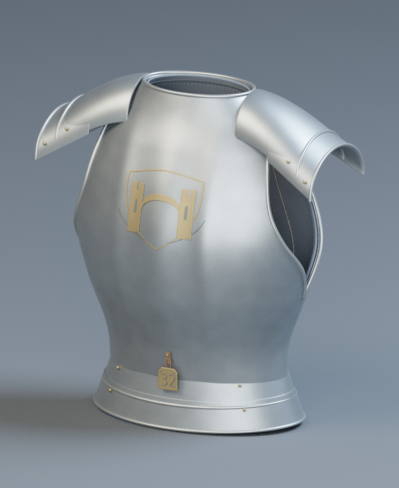

Use / purpose: Static nonfunctional fantasy model. No LOD, collision proxies or working rig; appearance in external game engines is untested.

Record type: model. Formats: Unknown; inspect ZIP.

Reported dimensions (metres; XYZ when derived from measured bounds, legacy axis order not reverified): [0.5481489896774292, 0.30111443996429443, 0.599419116973877]. Triangles: Unknown.

Origin: Unknown / not independently confirmed. Orientation: Unknown / not independently confirmed.

[Download ZIP](https://github.com/k3peta/tales-on-a-table/releases/download/v2026.10.19-armory/ARM_032_CC0.zip) · [License scope](../../LICENSE.md)

**CC0-1.0** — See original ZIP license and repository license scope. Models and embedded materials only; previews excluded.

Source details: [Catalogue 1](../../catalog/armory.en.md) · [Catalogue 2](../../catalog/armory.md) · [Catalogue 3](../../catalog/armory.zh-CN.md)

## ARM_033

**鱗重ね胸鎧**

鱗重ね胸鎧

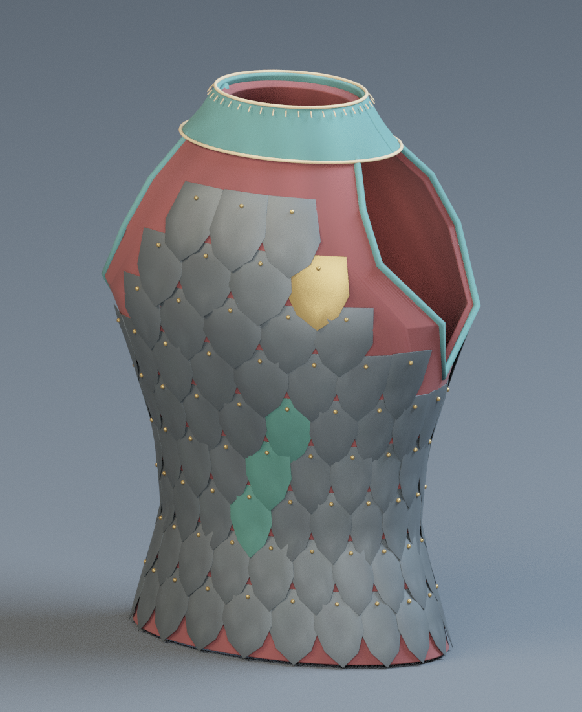

Use / purpose: Static nonfunctional fantasy model. No LOD, collision proxies or working rig; appearance in external game engines is untested.

Record type: model. Formats: Unknown; inspect ZIP.

Reported dimensions (metres; XYZ when derived from measured bounds, legacy axis order not reverified): [0.46342653036117554, 0.31238090991973877, 0.6779210567474365]. Triangles: Unknown.

Origin: Unknown / not independently confirmed. Orientation: Unknown / not independently confirmed.

[Download ZIP](https://github.com/k3peta/tales-on-a-table/releases/download/v2026.10.19-armory/ARM_033_CC0.zip) · [License scope](../../LICENSE.md)

**CC0-1.0** — See original ZIP license and repository license scope. Models and embedded materials only; previews excluded.

Source details: [Catalogue 1](../../catalog/armory.en.md) · [Catalogue 2](../../catalog/armory.md) · [Catalogue 3](../../catalog/armory.zh-CN.md)

**Quality39:** 64 zero-area triangles removed;91016tri over20k. [Details](../material_variants_arm024_arm033.md).

**Latest revision:** [ZIP](https://raw.githubusercontent.com/k3peta/tales-on-a-table/main/distributions/quality-arm024-033-v1/ARM_033__repair_CC0.zip) · [Matching revision preview](../../previews/quality-arm024-033-v1/ARM_033__repair_thumb.png). Original pictured ZIP retained above. Public ZIP/member/image identity verified.

## ARM_034

**縫い鎧の綿入れ胴着**

縫い鎧の綿入れ胴着

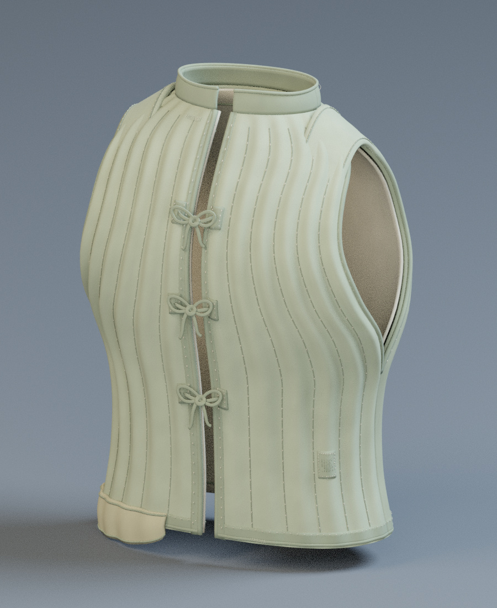

Use / purpose: Static nonfunctional fantasy model. No LOD, collision proxies or working rig; appearance in external game engines is untested.

Record type: model. Formats: Unknown; inspect ZIP.

Reported dimensions (metres; XYZ when derived from measured bounds, legacy axis order not reverified): [0.41482043266296387, 0.2946731448173523, 0.6142058372497559]. Triangles: Unknown.

Origin: Unknown / not independently confirmed. Orientation: Unknown / not independently confirmed.

[Download ZIP](https://github.com/k3peta/tales-on-a-table/releases/download/v2026.10.19-armory/ARM_034_CC0.zip) · [License scope](../../LICENSE.md)

**CC0-1.0** — See original ZIP license and repository license scope. Models and embedded materials only; previews excluded.

Source details: [Catalogue 1](../../catalog/armory.en.md) · [Catalogue 2](../../catalog/armory.md) · [Catalogue 3](../../catalog/armory.zh-CN.md)

**Quality40:** 150036tri over20k; blue linen variant, dense seams remain. [Details](../material_variants_arm034_arm045.md).

## ARM_035

**花弁重ねの儀礼肩鎧**

花弁重ねの儀礼肩鎧

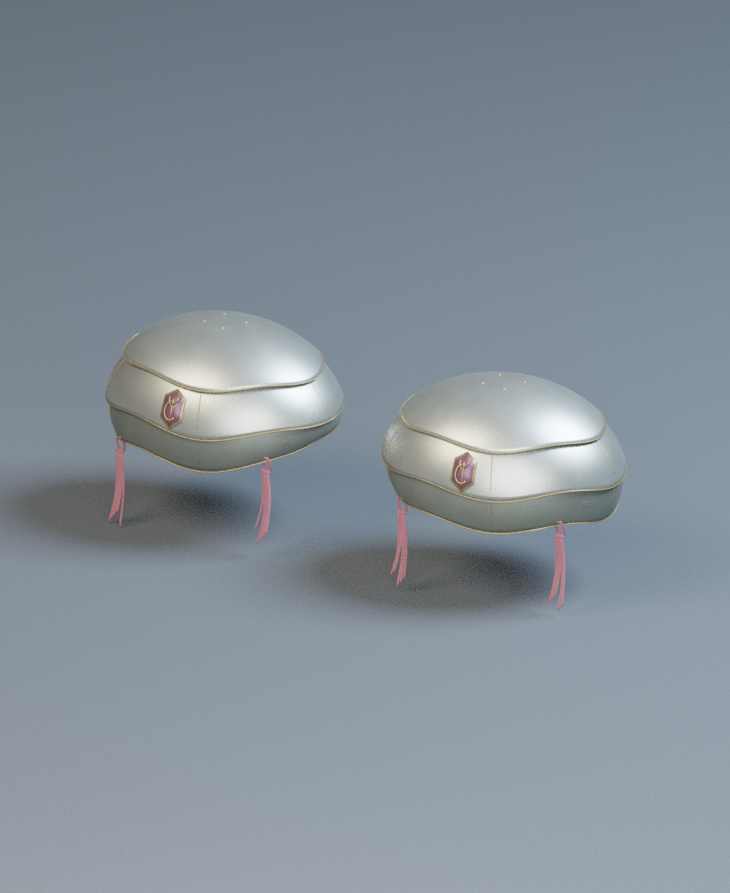

Use / purpose: Static nonfunctional fantasy model. No LOD, collision proxies or working rig; appearance in external game engines is untested.

Record type: model. Formats: Unknown; inspect ZIP.

Reported dimensions (metres; XYZ when derived from measured bounds, legacy axis order not reverified): [0.8530068397521973, 0.32193392515182495, 0.3115929961204529]. Triangles: Unknown.

Origin: Unknown / not independently confirmed. Orientation: Unknown / not independently confirmed.

[Download ZIP](https://github.com/k3peta/tales-on-a-table/releases/download/v2026.10.19-armory/ARM_035_CC0.zip) · [License scope](../../LICENSE.md)

**CC0-1.0** — See original ZIP license and repository license scope. Models and embedded materials only; previews excluded.

Source details: [Catalogue 1](../../catalog/armory.en.md) · [Catalogue 2](../../catalog/armory.md) · [Catalogue 3](../../catalog/armory.zh-CN.md)

**Quality40:** 116640tri over20k; paired shoulder armor counted once, copper-colored coating only. [Details](../material_variants_arm034_arm045.md).

## ARM_037

**前稜の衛兵脛当て**

前稜の衛兵脛当て

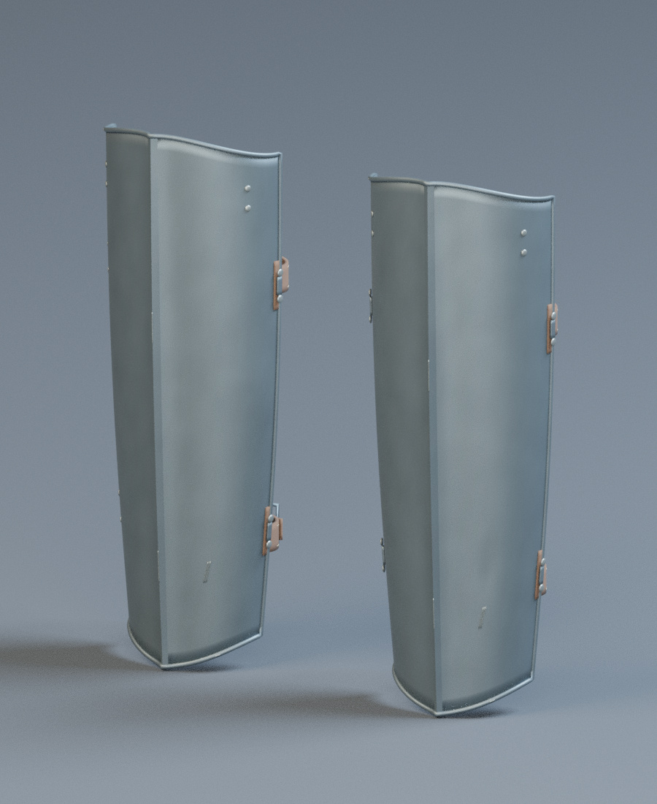

Use / purpose: Static nonfunctional fantasy model. No LOD, collision proxies or working rig; appearance in external game engines is untested.

Record type: model. Formats: Unknown; inspect ZIP.

Reported dimensions (metres; XYZ when derived from measured bounds, legacy axis order not reverified): [0.49711793661117554, 0.1860332190990448, 0.5400056838989258]. Triangles: Unknown.

Origin: Unknown / not independently confirmed. Orientation: Unknown / not independently confirmed.

[Download ZIP](https://github.com/k3peta/tales-on-a-table/releases/download/v2026.10.19-armory/ARM_037_CC0.zip) · [License scope](../../LICENSE.md)

**CC0-1.0** — See original ZIP license and repository license scope. Models and embedded materials only; previews excluded.

Source details: [Catalogue 1](../../catalog/armory.en.md) · [Catalogue 2](../../catalog/armory.md) · [Catalogue 3](../../catalog/armory.zh-CN.md)

**Quality40:** 61872tri; existing pair, fitting/motion untested. [Details](../material_variants_arm034_arm045.md).

## ARM_039F001

**旅剣適合の継ぎ鞘**

旅剣適合の継ぎ鞘

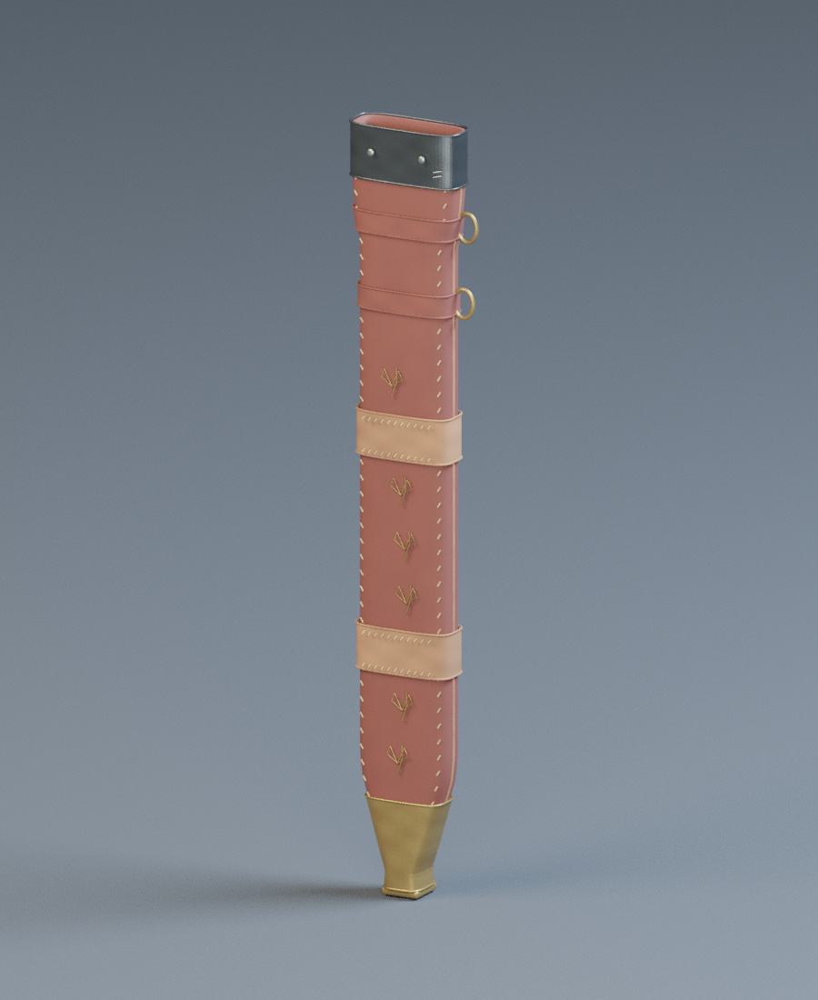

Use / purpose: Static nonfunctional fantasy model. No LOD, collision proxies or working rig; appearance in external game engines is untested.

Record type: structural_variant. Formats: Unknown; inspect ZIP.

Reported dimensions (metres; XYZ when derived from measured bounds, legacy axis order not reverified): []. Triangles: Unknown.

Origin: Unknown / not independently confirmed. Orientation: Unknown / not independently confirmed.

[Download ZIP](https://github.com/k3peta/tales-on-a-table/releases/download/v2026.10.19-armory/ARM_039F001_CC0.zip) · [License scope](../../LICENSE.md)

**CC0-1.0** — See original ZIP license and repository license scope. Models and embedded materials only; previews excluded.

Source details: [Catalogue 1](../../catalog/armory.en.md) · [Catalogue 2](../../catalog/armory.md) · [Catalogue 3](../../catalog/armory.zh-CN.md)

**Quality40:** 70136tri; existing fitted structural derivative, not an independent new shape. [Details](../material_variants_arm034_arm045.md).

## ARM_039

**補修継ぎ鞘**

補修継ぎ鞘

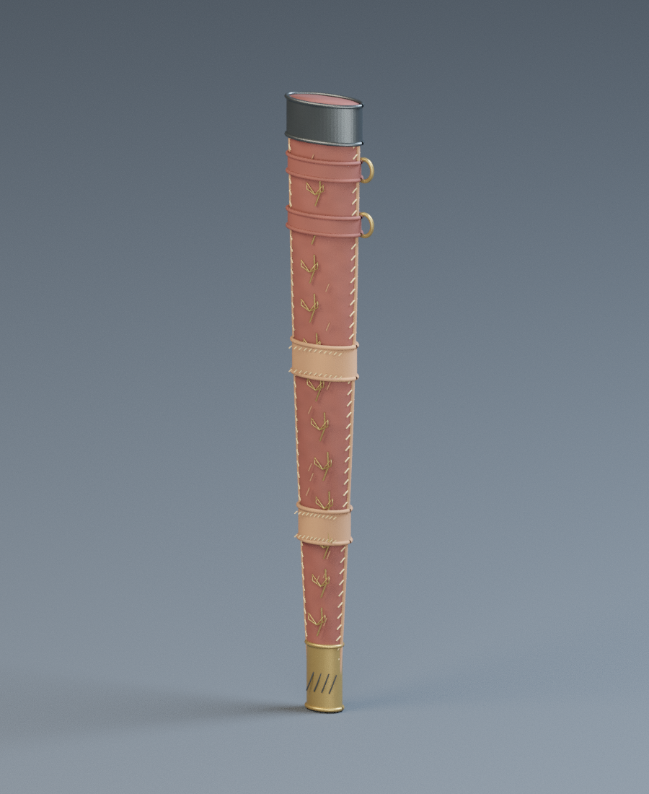

Use / purpose: Static nonfunctional fantasy model. No LOD, collision proxies or working rig; appearance in external game engines is untested.

Record type: model. Formats: Unknown; inspect ZIP.

Reported dimensions (metres; XYZ when derived from measured bounds, legacy axis order not reverified): [0.1379999965429306, 0.058000002056360245, 0.8895000219345093]. Triangles: Unknown.

Origin: Unknown / not independently confirmed. Orientation: Unknown / not independently confirmed.

[Download ZIP](https://github.com/k3peta/tales-on-a-table/releases/download/v2026.10.19-armory/ARM_039_CC0.zip) · [License scope](../../LICENSE.md)

**CC0-1.0** — See original ZIP license and repository license scope. Models and embedded materials only; previews excluded.

Source details: [Catalogue 1](../../catalog/armory.en.md) · [Catalogue 2](../../catalog/armory.md) · [Catalogue 3](../../catalog/armory.zh-CN.md)

**Quality40:** 45388tri;16 positive tiny triangles retained. [Details](../material_variants_arm034_arm045.md).

## ARM_040

**水葉の儀礼鞘**

水葉の儀礼鞘

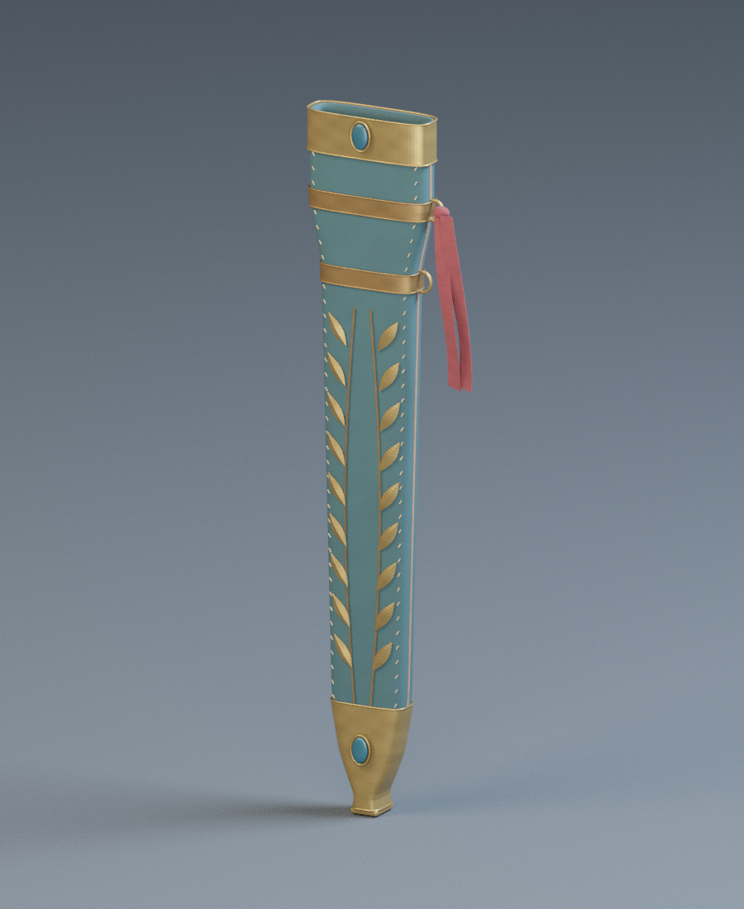

Use / purpose: Static nonfunctional fantasy model. No LOD, collision proxies or working rig; appearance in external game engines is untested.

Record type: model. Formats: Unknown; inspect ZIP.

Reported dimensions (metres; XYZ when derived from measured bounds, legacy axis order not reverified): [0.23801904916763306, 0.06579999625682831, 0.9562000036239624]. Triangles: Unknown.

Origin: Unknown / not independently confirmed. Orientation: Unknown / not independently confirmed.

[Download ZIP](https://github.com/k3peta/tales-on-a-table/releases/download/v2026.10.19-armory/ARM_040_CC0.zip) · [License scope](../../LICENSE.md)

**CC0-1.0** — See original ZIP license and repository license scope. Models and embedded materials only; previews excluded.

Source details: [Catalogue 1](../../catalog/armory.en.md) · [Catalogue 2](../../catalog/armory.md) · [Catalogue 3](../../catalog/armory.zh-CN.md)

**Quality40:** 144 zero faces removed;58864tri over20k. [Details](../material_variants_arm034_arm045.md).

**Latest revision:** [ZIP](https://raw.githubusercontent.com/k3peta/tales-on-a-table/main/distributions/quality-arm034-045-v1/ARM_040__repair_CC0.zip) · [Matching revision preview](../../previews/quality-arm034-045-v1/ARM_040__repair_thumb.png). Original pictured ZIP retained above. Public ZIP/member/image identity verified.

## ARM_041

**兵士の幅広剣帯**

兵士の幅広剣帯

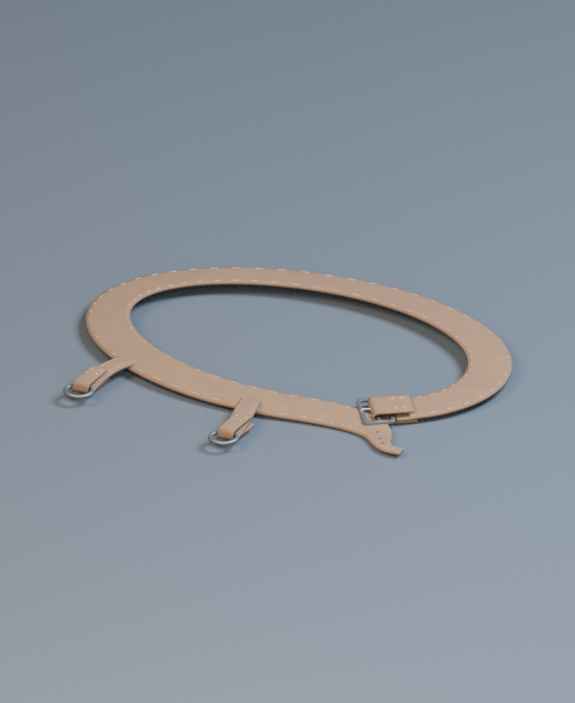

Use / purpose: Static nonfunctional fantasy model. No LOD, collision proxies or working rig; appearance in external game engines is untested.

Record type: model. Formats: Unknown; inspect ZIP.

Reported dimensions (metres; XYZ when derived from measured bounds, legacy axis order not reverified): [0.7419905662536621, 0.6577998399734497, 0.030562518164515495]. Triangles: Unknown.

Origin: Unknown / not independently confirmed. Orientation: Unknown / not independently confirmed.

[Download ZIP](https://github.com/k3peta/tales-on-a-table/releases/download/v2026.10.19-armory/ARM_041_CC0.zip) · [License scope](../../LICENSE.md)

**CC0-1.0** — See original ZIP license and repository license scope. Models and embedded materials only; previews excluded.

Source details: [Catalogue 1](../../catalog/armory.en.md) · [Catalogue 2](../../catalog/armory.md) · [Catalogue 3](../../catalog/armory.zh-CN.md)

**Quality40:** 24532tri; static belt, fit/load untested. [Details](../material_variants_arm034_arm045.md).

## ARM_042

**冒険者の交差吊り帯**

冒険者の交差吊り帯

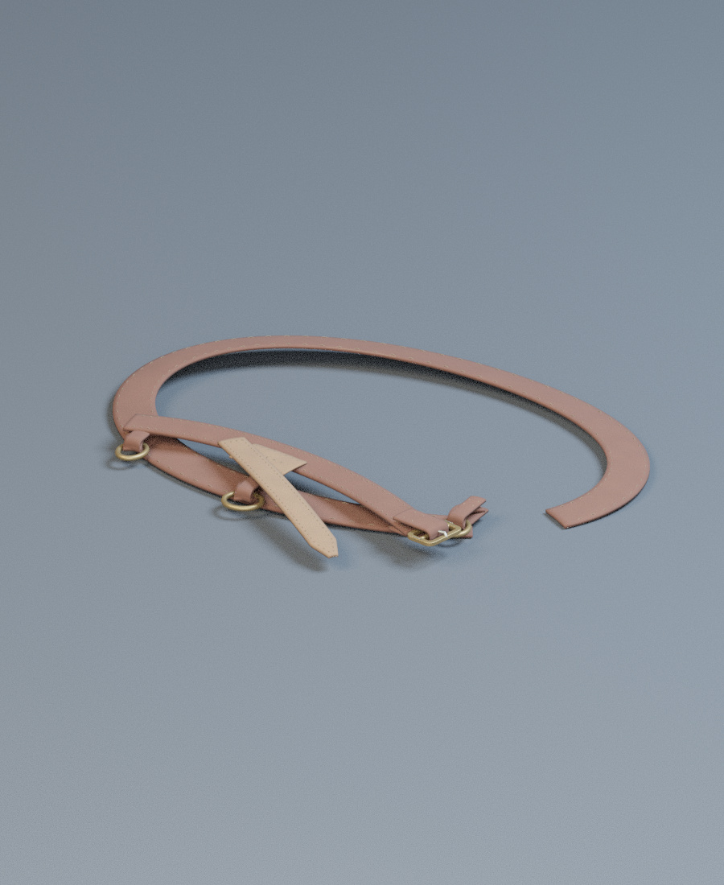

Use / purpose: Static nonfunctional fantasy model. No LOD, collision proxies or working rig; appearance in external game engines is untested.

Record type: model. Formats: Unknown; inspect ZIP.

Reported dimensions (metres; XYZ when derived from measured bounds, legacy axis order not reverified): [0.7669626474380493, 0.6496614217758179, 0.0482005700469017]. Triangles: Unknown.

Origin: Unknown / not independently confirmed. Orientation: Unknown / not independently confirmed.

[Download ZIP](https://github.com/k3peta/tales-on-a-table/releases/download/v2026.10.19-armory/ARM_042_CC0.zip) · [License scope](../../LICENSE.md)

**CC0-1.0** — See original ZIP license and repository license scope. Models and embedded materials only; previews excluded.

Source details: [Catalogue 1](../../catalog/armory.en.md) · [Catalogue 2](../../catalog/armory.md) · [Catalogue 3](../../catalog/armory.zh-CN.md)

**Quality40:** 56692tri; overlapping laid-out straps, wearing interference unverified. [Details](../material_variants_arm034_arm045.md).

## ARM_043

**背負い矢筒**

背負い矢筒

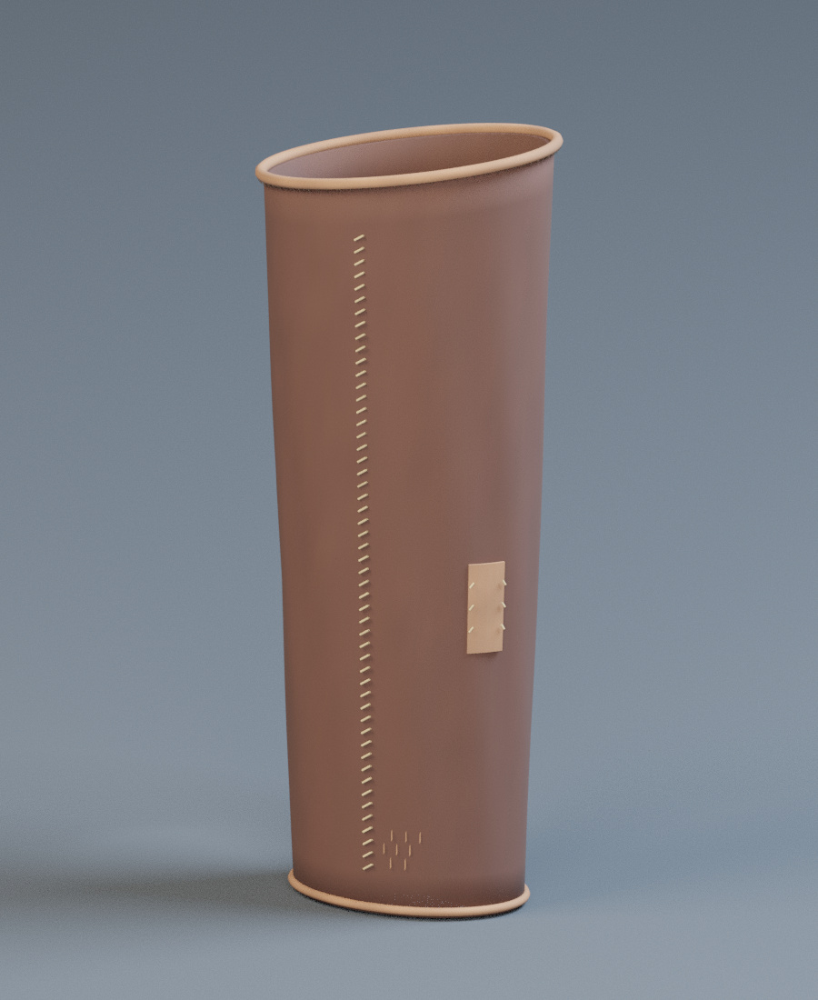

Use / purpose: Static nonfunctional fantasy model. No LOD, collision proxies or working rig; appearance in external game engines is untested.

Record type: model. Formats: Unknown; inspect ZIP.

Reported dimensions (metres; XYZ when derived from measured bounds, legacy axis order not reverified): [0.2622649669647217, 0.31750112771987915, 0.6184999942779541]. Triangles: Unknown.

Origin: Unknown / not independently confirmed. Orientation: Unknown / not independently confirmed.

[Download ZIP](https://github.com/k3peta/tales-on-a-table/releases/download/v2026.10.19-armory/ARM_043_CC0.zip) · [License scope](../../LICENSE.md)

**CC0-1.0** — See original ZIP license and repository license scope. Models and embedded materials only; previews excluded.

Source details: [Catalogue 1](../../catalog/armory.en.md) · [Catalogue 2](../../catalog/armory.md) · [Catalogue 3](../../catalog/armory.zh-CN.md)

**Quality40:** 25624tri; existing quiver. [Details](../material_variants_arm034_arm045.md).

## ARM_045

**飾り矢の束**

飾り矢の束

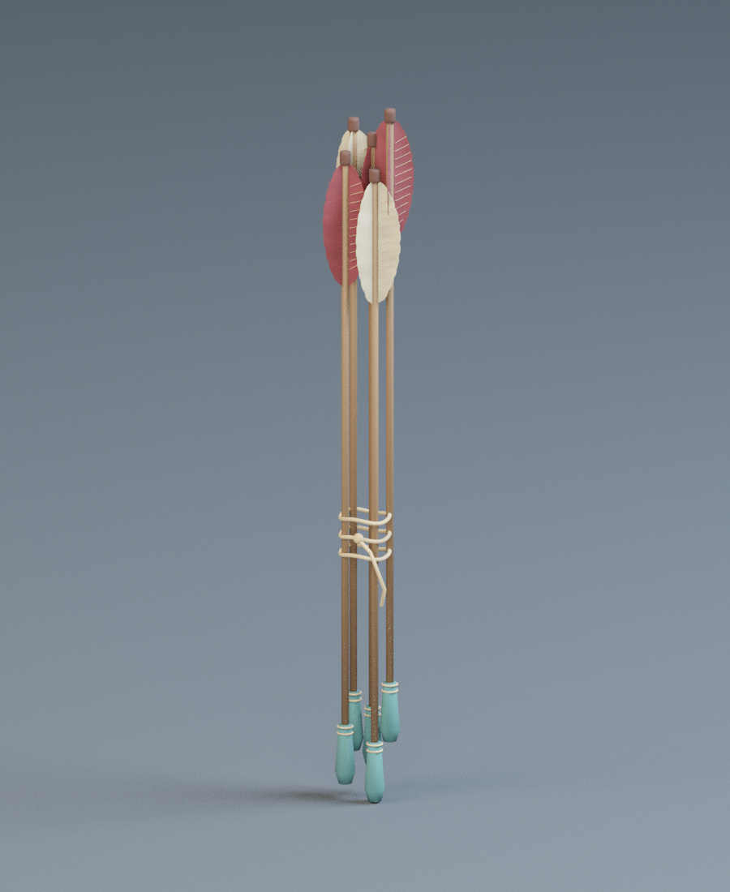

Use / purpose: Static nonfunctional fantasy model. No LOD, collision proxies or working rig; appearance in external game engines is untested.

Record type: model. Formats: Unknown; inspect ZIP.

Reported dimensions (metres; XYZ when derived from measured bounds, legacy axis order not reverified): [0.0938919335603714, 0.07923585176467896, 0.7610000371932983]. Triangles: Unknown.

Origin: Unknown / not independently confirmed. Orientation: Unknown / not independently confirmed.

[Download ZIP](https://github.com/k3peta/tales-on-a-table/releases/download/v2026.10.19-armory/ARM_045_CC0.zip) · [License scope](../../LICENSE.md)

**CC0-1.0** — See original ZIP license and repository license scope. Models and embedded materials only; previews excluded.

Source details: [Catalogue 1](../../catalog/armory.en.md) · [Catalogue 2](../../catalog/armory.md) · [Catalogue 3](../../catalog/armory.zh-CN.md)

**Quality40:** 120 zero faces removed;20068tri,68 over budget; bundle counted once. [Details](../material_variants_arm034_arm045.md).

**Latest revision:** [ZIP](https://raw.githubusercontent.com/k3peta/tales-on-a-table/main/distributions/quality-arm034-045-v1/ARM_045__repair_CC0.zip) · [Matching revision preview](../../previews/quality-arm034-045-v1/ARM_045__repair_thumb.png). Original pictured ZIP retained above. Public ZIP/member/image identity verified.

## ARM_050

**修理された壁剣掛け**

修理された壁剣掛け

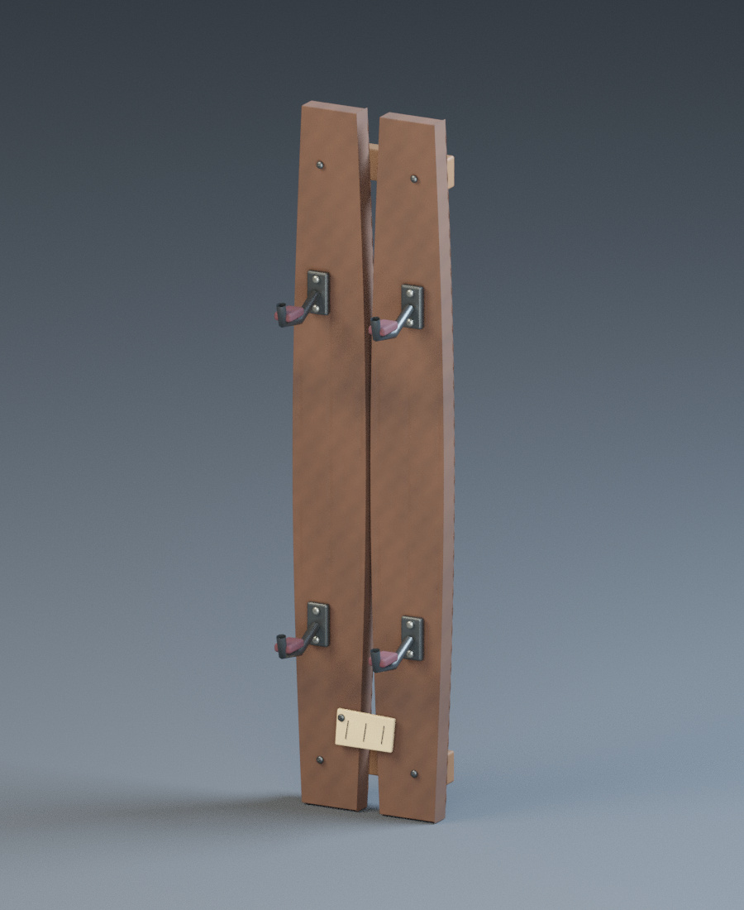

Use / purpose: Static nonfunctional fantasy model. No LOD, collision proxies or working rig; appearance in external game engines is untested.

Record type: model. Formats: Unknown; inspect ZIP.

Reported dimensions (metres; XYZ when derived from measured bounds, legacy axis order not reverified): [0.34198129177093506, 0.25975608825683594, 1.4339959621429443]. Triangles: Unknown.

Origin: Unknown / not independently confirmed. Orientation: Unknown / not independently confirmed.

[Download ZIP](https://github.com/k3peta/tales-on-a-table/releases/download/v2026.10.19-armory/ARM_050_CC0.zip) · [License scope](../../LICENSE.md)

**CC0-1.0** — See original ZIP license and repository license scope. Models and embedded materials only; previews excluded.

Source details: [Catalogue 1](../../catalog/armory.en.md) · [Catalogue 2](../../catalog/armory.md) · [Catalogue 3](../../catalog/armory.zh-CN.md)

**Quality41:** 24416tri within50k furnishing warning; mounting/load untested. [Details](../material_variants_arm050_arm066.md).

## ARM_051

**革敷きの傾斜盾架**

革敷きの傾斜盾架

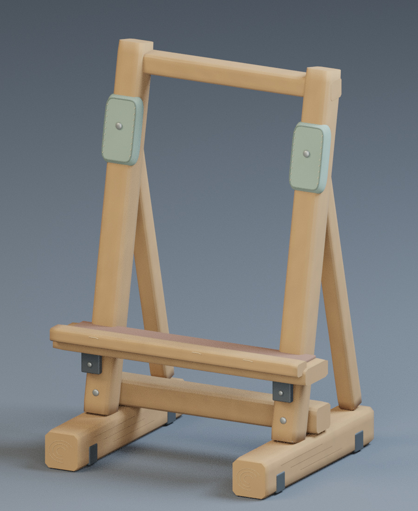

Use / purpose: Static nonfunctional fantasy model. No LOD, collision proxies or working rig; appearance in external game engines is untested.

Record type: model. Formats: Unknown; inspect ZIP.

Reported dimensions (metres; XYZ when derived from measured bounds, legacy axis order not reverified): [0.6880000233650208, 0.5559499859809875, 0.9809433817863464]. Triangles: Unknown.

Origin: Unknown / not independently confirmed. Orientation: Unknown / not independently confirmed.

[Download ZIP](https://github.com/k3peta/tales-on-a-table/releases/download/v2026.10.19-armory/ARM_051_CC0.zip) · [License scope](../../LICENSE.md)

**CC0-1.0** — See original ZIP license and repository license scope. Models and embedded materials only; previews excluded.

Source details: [Catalogue 1](../../catalog/armory.en.md) · [Catalogue 2](../../catalog/armory.md) · [Catalogue 3](../../catalog/armory.zh-CN.md)

**Quality41:** 37388tri within50k; blue felt only. [Details](../material_variants_arm050_arm066.md).

## ARM_052

**修理預かり防具架**

修理預かり防具架

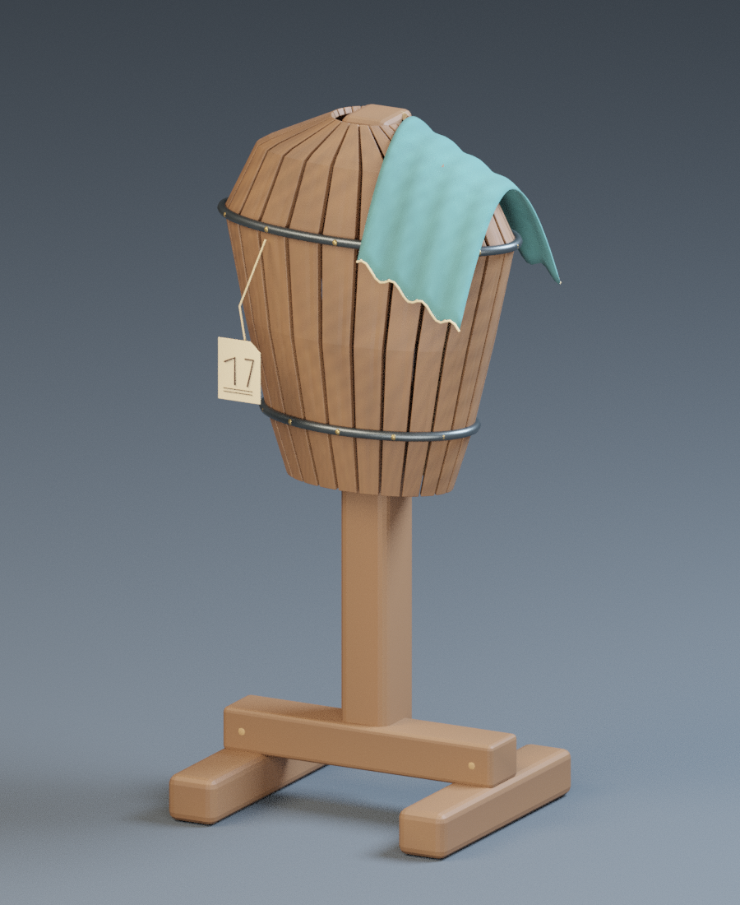

Use / purpose: Static nonfunctional fantasy model. No LOD, collision proxies or working rig; appearance in external game engines is untested.

Record type: model. Formats: Unknown; inspect ZIP.

Reported dimensions (metres; XYZ when derived from measured bounds, legacy axis order not reverified): [0.593999981880188, 0.49000000953674316, 1.2767671346664429]. Triangles: Unknown.

Origin: Unknown / not independently confirmed. Orientation: Unknown / not independently confirmed.

[Download ZIP](https://github.com/k3peta/tales-on-a-table/releases/download/v2026.10.19-armory/ARM_052_CC0.zip) · [License scope](../../LICENSE.md)

**CC0-1.0** — See original ZIP license and repository license scope. Models and embedded materials only; previews excluded.

Source details: [Catalogue 1](../../catalog/armory.en.md) · [Catalogue 2](../../catalog/armory.md) · [Catalogue 3](../../catalog/armory.zh-CN.md)

**Quality41:** 40 zero faces removed;83072tri over50k. [Details](../material_variants_arm050_arm066.md).

**Latest revision:** [ZIP](https://raw.githubusercontent.com/k3peta/tales-on-a-table/main/distributions/quality-arm050-066-v1/ARM_052__repair_CC0.zip) · [Matching revision preview](../../previews/quality-arm050-066-v1/ARM_052__repair_thumb.png). Original pictured ZIP retained above. Public ZIP/member/image identity verified.

## ARM_053

**フェルト頭の兜掛け**

フェルト頭の兜掛け

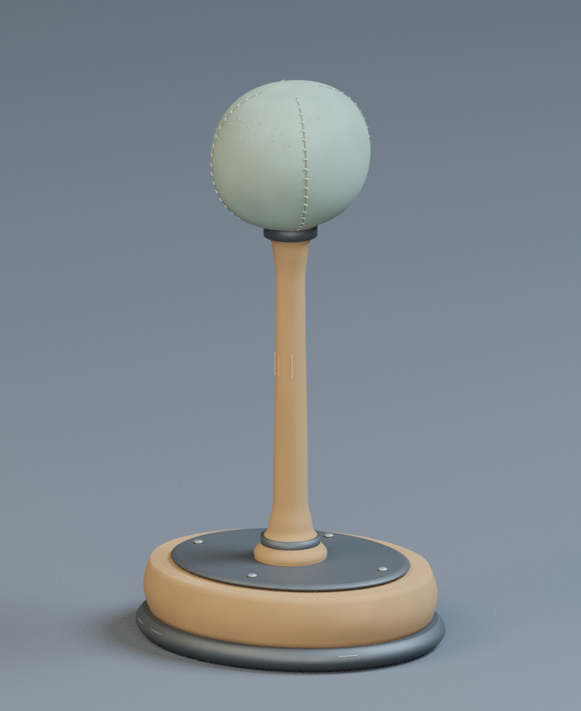

Use / purpose: Static nonfunctional fantasy model. No LOD, collision proxies or working rig; appearance in external game engines is untested.

Record type: model. Formats: Unknown; inspect ZIP.

Reported dimensions (metres; XYZ when derived from measured bounds, legacy axis order not reverified): [0.3319999873638153, 0.27799999713897705, 0.5870587825775146]. Triangles: Unknown.

Origin: Unknown / not independently confirmed. Orientation: Unknown / not independently confirmed.

[Download ZIP](https://github.com/k3peta/tales-on-a-table/releases/download/v2026.10.19-armory/ARM_053_CC0.zip) · [License scope](../../LICENSE.md)

**CC0-1.0** — See original ZIP license and repository license scope. Models and embedded materials only; previews excluded.

Source details: [Catalogue 1](../../catalog/armory.en.md) · [Catalogue 2](../../catalog/armory.md) · [Catalogue 3](../../catalog/armory.zh-CN.md)

**Quality41:** 21072tri within50k; red felt only, fit/load untested. [Details](../material_variants_arm050_arm066.md).

## ARM_054

**立ち作業の修理台**

立ち作業の修理台

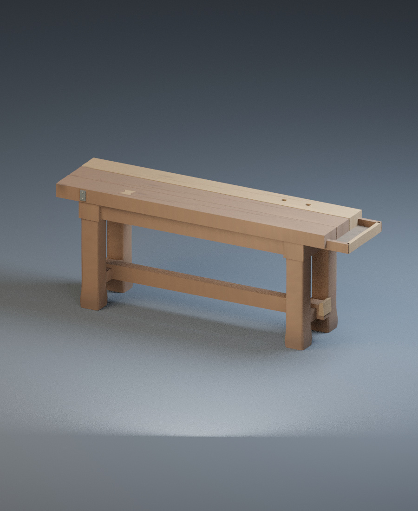

Use / purpose: Static nonfunctional fantasy model. No LOD, collision proxies or working rig; appearance in external game engines is untested.

Record type: model. Formats: Unknown; inspect ZIP.

Reported dimensions (metres; XYZ when derived from measured bounds, legacy axis order not reverified): [2.4721999168395996, 0.6119999885559082, 0.9690000414848328]. Triangles: Unknown.

Origin: Unknown / not independently confirmed. Orientation: Unknown / not independently confirmed.

[Download ZIP](https://github.com/k3peta/tales-on-a-table/releases/download/v2026.10.19-armory/ARM_054_CC0.zip) · [License scope](../../LICENSE.md)

**CC0-1.0** — See original ZIP license and repository license scope. Models and embedded materials only; previews excluded.

Source details: [Catalogue 1](../../catalog/armory.en.md) · [Catalogue 2](../../catalog/armory.md) · [Catalogue 3](../../catalog/armory.zh-CN.md)

**Quality41:** 118908tri over50k; structural load untested. [Details](../material_variants_arm050_arm066.md).

## ARM_055

**切株台付きの小鉄床**

切株台付きの小鉄床

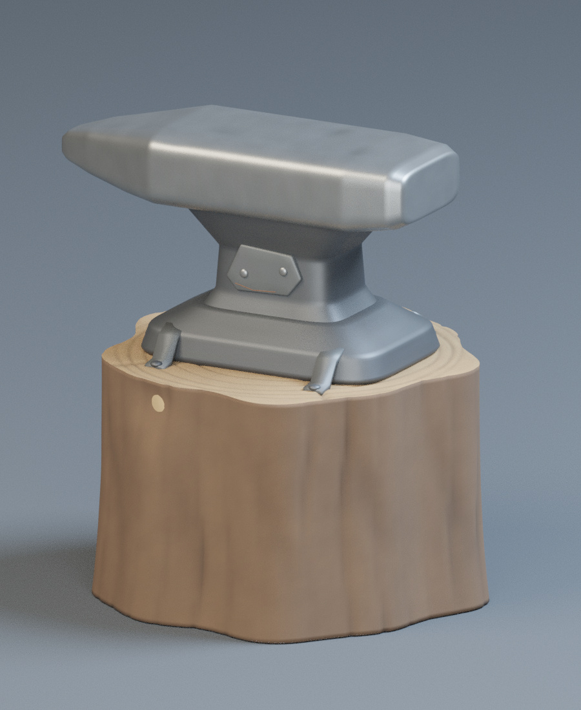

Use / purpose: Static nonfunctional fantasy model. No LOD, collision proxies or working rig; appearance in external game engines is untested.

Record type: model. Formats: Unknown; inspect ZIP.

Reported dimensions (metres; XYZ when derived from measured bounds, legacy axis order not reverified): [0.5874901413917542, 0.5101155638694763, 0.6060000061988831]. Triangles: Unknown.

Origin: Unknown / not independently confirmed. Orientation: Unknown / not independently confirmed.

[Download ZIP](https://github.com/k3peta/tales-on-a-table/releases/download/v2026.10.19-armory/ARM_055_CC0.zip) · [License scope](../../LICENSE.md)

**CC0-1.0** — See original ZIP license and repository license scope. Models and embedded materials only; previews excluded.

Source details: [Catalogue 1](../../catalog/armory.en.md) · [Catalogue 2](../../catalog/armory.md) · [Catalogue 3](../../catalog/armory.zh-CN.md)

**Quality41:** 108928tri over50k; budget unresolved. [Details](../material_variants_arm050_arm066.md).

## ARM_056

**工房の手槌**

工房の手槌

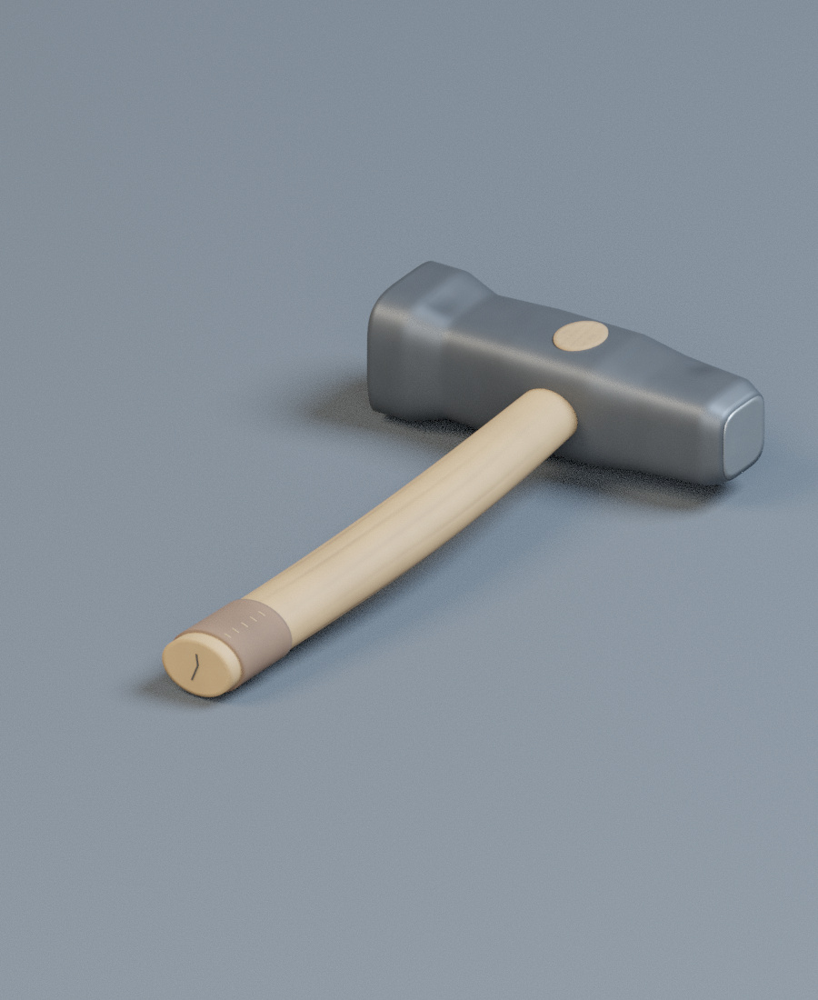

Use / purpose: Static nonfunctional fantasy model. No LOD, collision proxies or working rig; appearance in external game engines is untested.

Record type: model. Formats: Unknown; inspect ZIP.

Reported dimensions (metres; XYZ when derived from measured bounds, legacy axis order not reverified): [0.23199999332427979, 0.4059000015258789, 0.07599993050098419]. Triangles: Unknown.

Origin: Unknown / not independently confirmed. Orientation: Unknown / not independently confirmed.

[Download ZIP](https://github.com/k3peta/tales-on-a-table/releases/download/v2026.10.19-armory/ARM_056_CC0.zip) · [License scope](../../LICENSE.md)

**CC0-1.0** — See original ZIP license and repository license scope. Models and embedded materials only; previews excluded.

Source details: [Catalogue 1](../../catalog/armory.en.md) · [Catalogue 2](../../catalog/armory.md) · [Catalogue 3](../../catalog/armory.zh-CN.md)

**Quality41:** 45664tri over20k; static hand tool. [Details](../material_variants_arm050_arm066.md).

## ARM_058

**手入れ石と木受け**

手入れ石と木受け

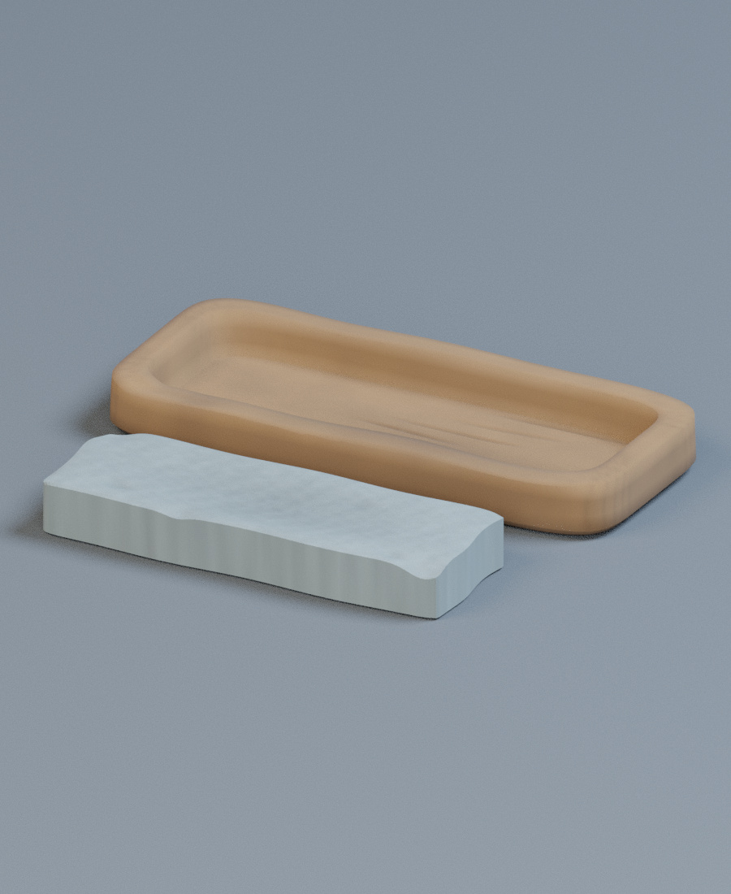

Use / purpose: Static nonfunctional fantasy model. No LOD, collision proxies or working rig; appearance in external game engines is untested.

Record type: model. Formats: Unknown; inspect ZIP.

Reported dimensions (metres; XYZ when derived from measured bounds, legacy axis order not reverified): [0.39800000190734863, 0.33442264795303345, 0.052899762988090515]. Triangles: Unknown.

Origin: Unknown / not independently confirmed. Orientation: Unknown / not independently confirmed.

[Download ZIP](https://github.com/k3peta/tales-on-a-table/releases/download/v2026.10.19-armory/ARM_058_CC0.zip) · [License scope](../../LICENSE.md)

**CC0-1.0** — See original ZIP license and repository license scope. Models and embedded materials only; previews excluded.

Source details: [Catalogue 1](../../catalog/armory.en.md) · [Catalogue 2](../../catalog/armory.md) · [Catalogue 3](../../catalog/armory.zh-CN.md)

**Quality41:** 45342tri over20k;6 positive tiny triangles retained; separate receiver intentional. [Details](../material_variants_arm050_arm066.md).

## ARM_065

**店頭の剣筒**

店頭の剣筒

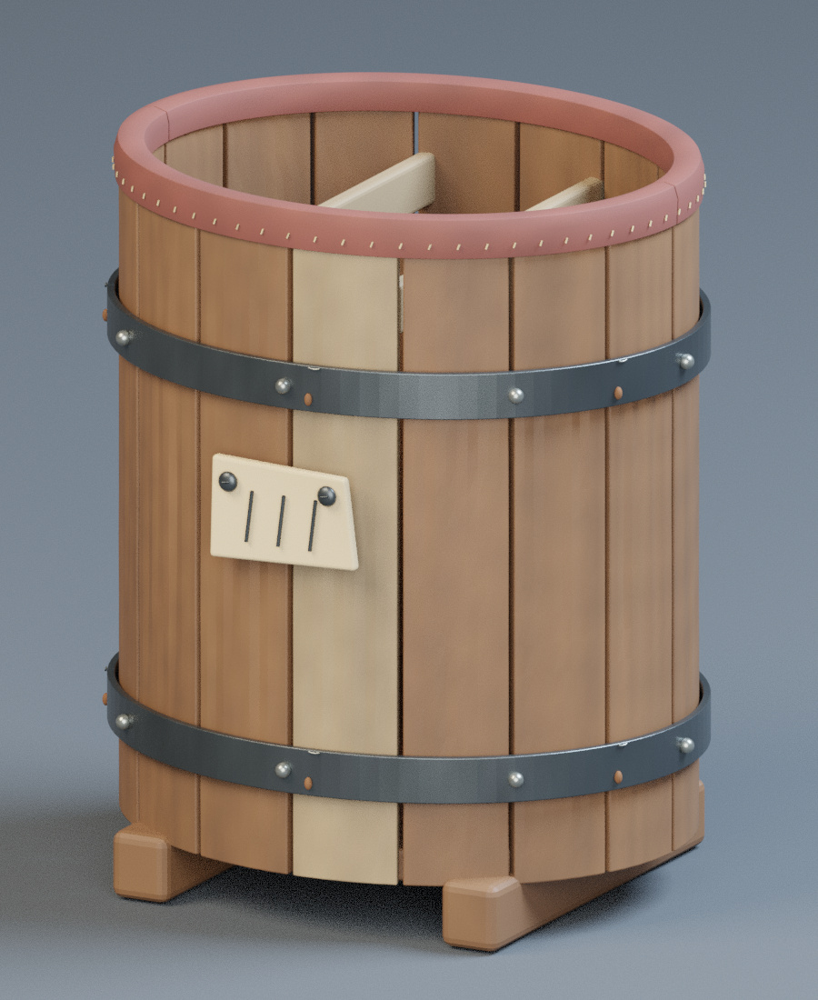

Use / purpose: Static nonfunctional fantasy model. No LOD, collision proxies or working rig; appearance in external game engines is untested.

Record type: model. Formats: Unknown; inspect ZIP.

Reported dimensions (metres; XYZ when derived from measured bounds, legacy axis order not reverified): [0.48399999737739563, 0.42170000076293945, 0.5680000185966492]. Triangles: Unknown.

Origin: Unknown / not independently confirmed. Orientation: Unknown / not independently confirmed.

[Download ZIP](https://github.com/k3peta/tales-on-a-table/releases/download/v2026.10.19-armory/ARM_065_CC0.zip) · [License scope](../../LICENSE.md)

**CC0-1.0** — See original ZIP license and repository license scope. Models and embedded materials only; previews excluded.

Source details: [Catalogue 1](../../catalog/armory.en.md) · [Catalogue 2](../../catalog/armory.md) · [Catalogue 3](../../catalog/armory.zh-CN.md)

**Quality41:** 60728tri over50k; regular wood grain remains. [Details](../material_variants_arm050_arm066.md).

## ARM_066

**日輪守の両手剣**

日輪守の両手剣

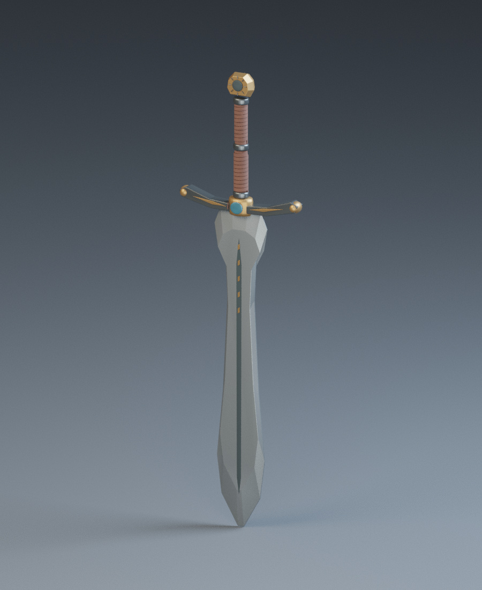

Use / purpose: Static nonfunctional fantasy model. No LOD, collision proxies or working rig; appearance in external game engines is untested.

Record type: model. Formats: Unknown; inspect ZIP.

Reported dimensions (metres; XYZ when derived from measured bounds, legacy axis order not reverified): [0.4779999852180481, 0.07400000095367432, 1.6579999923706055]. Triangles: Unknown.

Origin: Unknown / not independently confirmed. Orientation: Unknown / not independently confirmed.

[Download ZIP](https://github.com/k3peta/tales-on-a-table/releases/download/v2026.10.19-armory/ARM_066_CC0.zip) · [License scope](../../LICENSE.md)

**CC0-1.0** — See original ZIP license and repository license scope. Models and embedded materials only; previews excluded.

Source details: [Catalogue 1](../../catalog/armory.en.md) · [Catalogue 2](../../catalog/armory.md) · [Catalogue 3](../../catalog/armory.zh-CN.md)

**Quality41:** 82 zero faces removed;15386tri within20k;256 positive tiny retained. [Details](../material_variants_arm050_arm066.md).

**Latest revision:** [ZIP](https://raw.githubusercontent.com/k3peta/tales-on-a-table/main/distributions/quality-arm050-066-v1/ARM_066__repair_CC0.zip) · [Matching revision preview](../../previews/quality-arm050-066-v1/ARM_066__repair_thumb.png). Original pictured ZIP retained above. Public ZIP/member/image identity verified.

## ARM_067

**叉木のスリングショット小道具**

叉木のスリングショット小道具

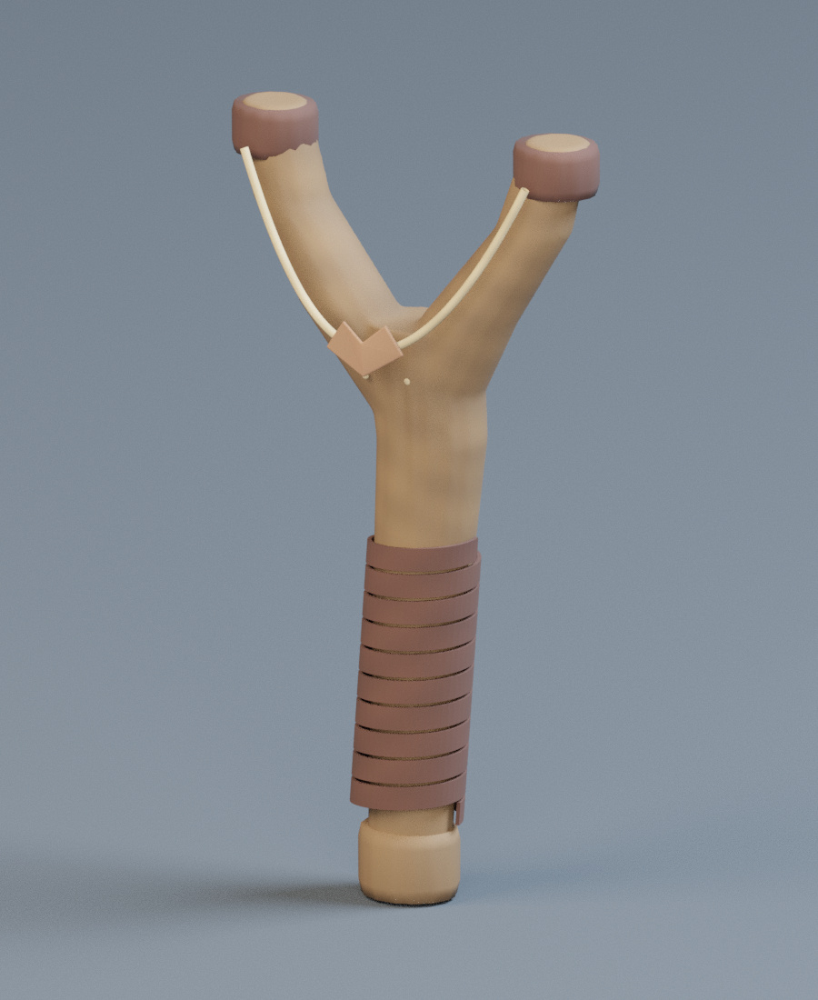

Use / purpose: Static nonfunctional fantasy model. No LOD, collision proxies or working rig; appearance in external game engines is untested.

Record type: model. Formats: Unknown; inspect ZIP.

Reported dimensions (metres; XYZ when derived from measured bounds, legacy axis order not reverified): [0.20454634726047516, 0.07704651355743408, 0.40150007605552673]. Triangles: Unknown.

Origin: Unknown / not independently confirmed. Orientation: Unknown / not independently confirmed.

[Download ZIP](https://github.com/k3peta/tales-on-a-table/releases/download/v2026.10.19-armory/ARM_067_CC0.zip) · [License scope](../../LICENSE.md)

**CC0-1.0** — See original ZIP license and repository license scope. Models and embedded materials only; previews excluded.

Source details: [Catalogue 1](../../catalog/armory.en.md) · [Catalogue 2](../../catalog/armory.md) · [Catalogue 3](../../catalog/armory.zh-CN.md)

**Quality42:** 40292tri over20k; static display only. [Details](../material_variants_arm067_arm076.md).

## ARM_068

**封印煙玉の外見小道具**

封印煙玉の外見小道具

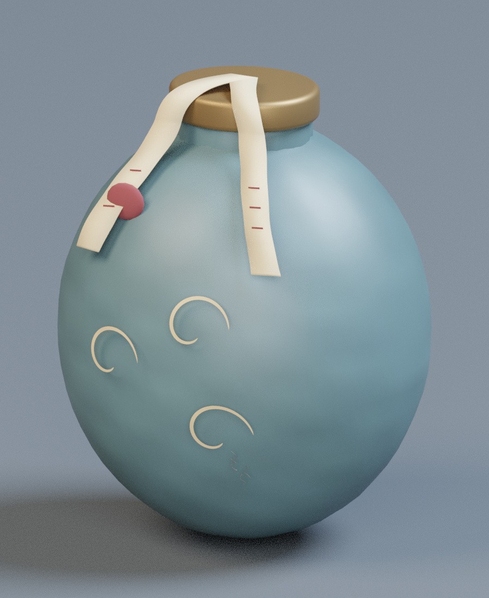

Use / purpose: Static nonfunctional fantasy model. No LOD, collision proxies or working rig; appearance in external game engines is untested.

Record type: model. Formats: Unknown; inspect ZIP.

Reported dimensions (metres; XYZ when derived from measured bounds, legacy axis order not reverified): [0.1766808182001114, 0.16974875330924988, 0.2225780189037323]. Triangles: Unknown.

Origin: Unknown / not independently confirmed. Orientation: Unknown / not independently confirmed.

[Download ZIP](https://github.com/k3peta/tales-on-a-table/releases/download/v2026.10.19-armory/ARM_068_CC0.zip) · [License scope](../../LICENSE.md)

**CC0-1.0** — See original ZIP license and repository license scope. Models and embedded materials only; previews excluded.

Source details: [Catalogue 1](../../catalog/armory.en.md) · [Catalogue 2](../../catalog/armory.md) · [Catalogue 3](../../catalog/armory.zh-CN.md)
**Quality42:** 6 zero faces removed;8550tri; terracotta variant uses cleaned baseline, not whole original unchanged. Static ceramic prop, no functional contents/mechanism. [Details](../material_variants_arm067_arm076.md).
**Latest revision:** [ZIP](https://raw.githubusercontent.com/k3peta/tales-on-a-table/main/distributions/quality-arm067-076-v1/ARM_068__repair_CC0.zip) · [Matching revision preview](../../previews/quality-arm067-076-v1/ARM_068__repair_thumb.png). Original pictured ZIP retained above. Public ZIP/member/image identity verified.
