# Base distribution records 409–432

[Browse index](README.md) · [Coverage and missing fields](COVERAGE.md)

Images are actual existing model renders for browsing, not covered by model CC0. A group record may show several reused models. Dimensions and triangle counts apply only to the original record when sourced; revisions can differ. Unknown means unverified, not zero. No blanket CC0 grant for scenes, images, code or articles.

## ARM_069

**量産剣用の在庫鞘**

量産剣用の在庫鞘

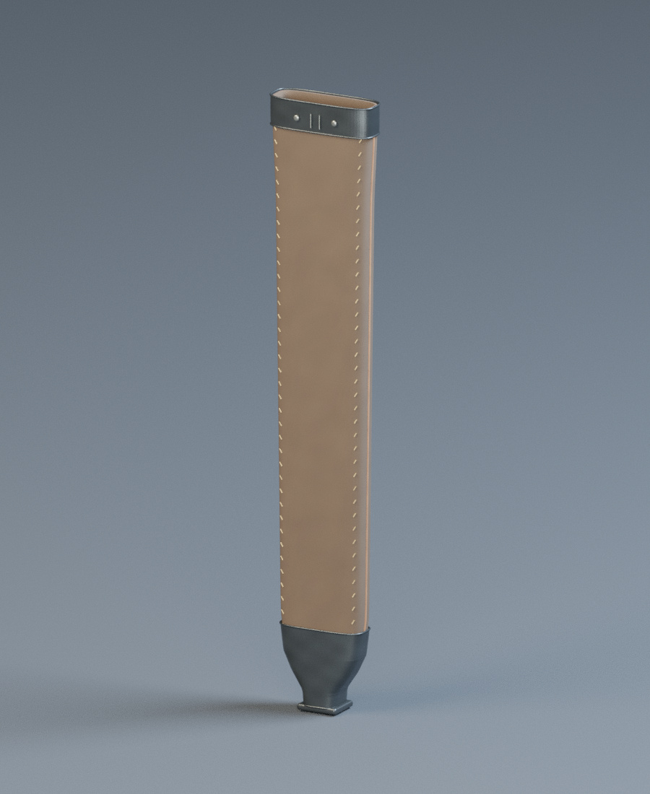

Use / purpose: Static nonfunctional fantasy model. No LOD, collision proxies or working rig; appearance in external game engines is untested.

Record type: model. Formats: Unknown; inspect ZIP.

Reported dimensions (metres; XYZ when derived from measured bounds, legacy axis order not reverified): [0.14272738993167877, 0.09025006741285324, 0.7749699354171753]. Triangles: Unknown.

Origin: Unknown / not independently confirmed. Orientation: Unknown / not independently confirmed.

[Download ZIP](https://github.com/k3peta/tales-on-a-table/releases/download/v2026.10.19-armory/ARM_069_CC0.zip) · [License scope](../../LICENSE.md)

**CC0-1.0** — See original ZIP license and repository license scope. Models and embedded materials only; previews excluded.

Source details: [Catalogue 1](../../catalog/armory.en.md) · [Catalogue 2](../../catalog/armory.md) · [Catalogue 3](../../catalog/armory.zh-CN.md)

**Quality42:** 38932tri over20k; fit not retested. [Details](../material_variants_arm067_arm076.md).

## ARM_070

**山道短剣の在庫鞘**

山道短剣の在庫鞘

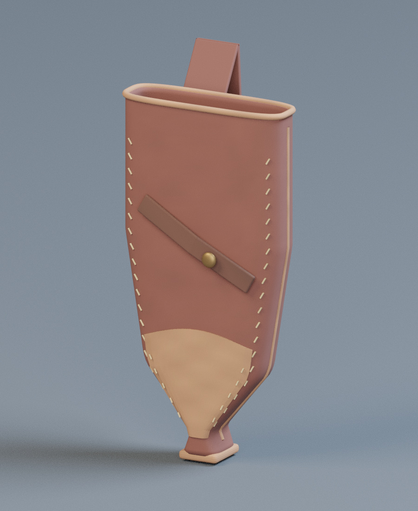

Use / purpose: Static nonfunctional fantasy model. No LOD, collision proxies or working rig; appearance in external game engines is untested.

Record type: model. Formats: Unknown; inspect ZIP.

Reported dimensions (metres; XYZ when derived from measured bounds, legacy axis order not reverified): [0.1587408035993576, 0.11172612756490707, 0.3499358296394348]. Triangles: Unknown.

Origin: Unknown / not independently confirmed. Orientation: Unknown / not independently confirmed.

[Download ZIP](https://github.com/k3peta/tales-on-a-table/releases/download/v2026.10.19-armory/ARM_070_CC0.zip) · [License scope](../../LICENSE.md)

**CC0-1.0** — See original ZIP license and repository license scope. Models and embedded materials only; previews excluded.

Source details: [Catalogue 1](../../catalog/armory.en.md) · [Catalogue 2](../../catalog/armory.md) · [Catalogue 3](../../catalog/armory.zh-CN.md)

**Quality42:** 25344tri over20k; rig/load untested. [Details](../material_variants_arm067_arm076.md).

## ARM_071

**日輪守の補強長鞘**

日輪守の補強長鞘

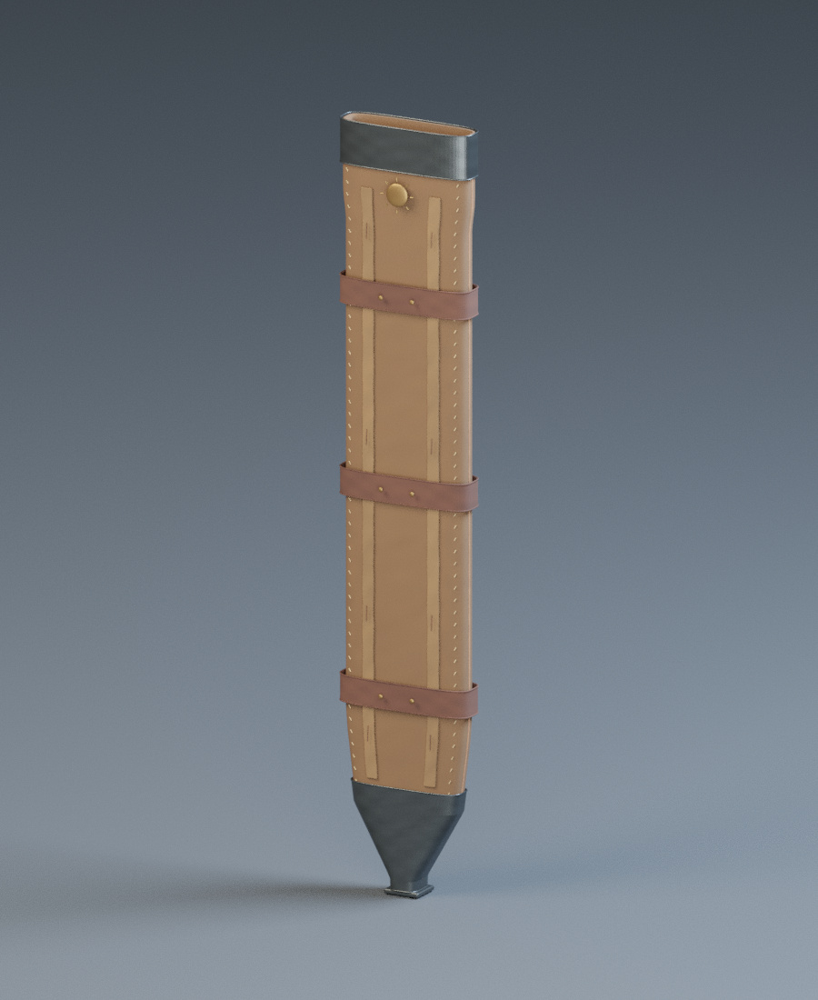

Use / purpose: Static nonfunctional fantasy model. No LOD, collision proxies or working rig; appearance in external game engines is untested.

Record type: model. Formats: Unknown; inspect ZIP.

Reported dimensions (metres; XYZ when derived from measured bounds, legacy axis order not reverified): [0.22855760157108307, 0.10721677541732788, 1.2191998958587646]. Triangles: Unknown.

Origin: Unknown / not independently confirmed. Orientation: Unknown / not independently confirmed.

[Download ZIP](https://github.com/k3peta/tales-on-a-table/releases/download/v2026.10.19-armory/ARM_071_CC0.zip) · [License scope](../../LICENSE.md)

**CC0-1.0** — See original ZIP license and repository license scope. Models and embedded materials only; previews excluded.

Source details: [Catalogue 1](../../catalog/armory.en.md) · [Catalogue 2](../../catalog/armory.md) · [Catalogue 3](../../catalog/armory.zh-CN.md)

**Quality42:** 70528tri over20k; existing fitted derivative. [Details](../material_variants_arm067_arm076.md).

## ARM_072

**空の布スリング**

空の布スリング

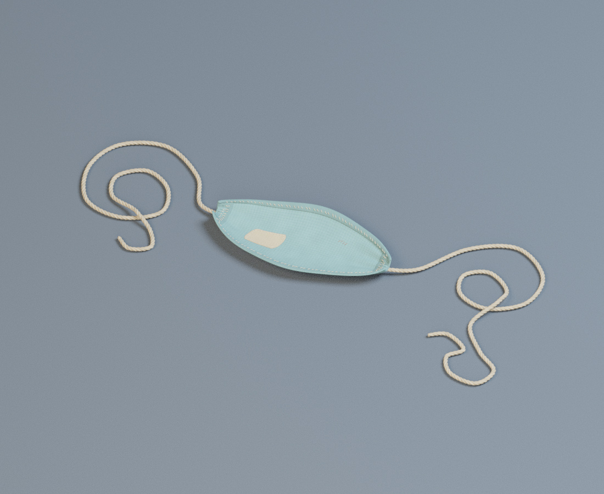

Use / purpose: Static nonfunctional fantasy model. No LOD, collision proxies or working rig; appearance in external game engines is untested.

Record type: model. Formats: Unknown; inspect ZIP.

Reported dimensions (metres; XYZ when derived from measured bounds, legacy axis order not reverified): [0.9305503368377686, 0.36089828610420227, 0.031346045434474945]. Triangles: Unknown.

Origin: Unknown / not independently confirmed. Orientation: Unknown / not independently confirmed.

[Download ZIP](https://github.com/k3peta/tales-on-a-table/releases/download/v2026.10.19-armory/ARM_072_CC0.zip) · [License scope](../../LICENSE.md)

**CC0-1.0** — See original ZIP license and repository license scope. Models and embedded materials only; previews excluded.

Source details: [Catalogue 1](../../catalog/armory.en.md) · [Catalogue 2](../../catalog/armory.md) · [Catalogue 3](../../catalog/armory.zh-CN.md)

**Quality42:** 272764tri over20k; strand geometry needs dedicated baking/redesign. [Details](../material_variants_arm067_arm076.md).

## ARM_073

**船旅の曲線継ぎ鞘**

船旅の曲線継ぎ鞘

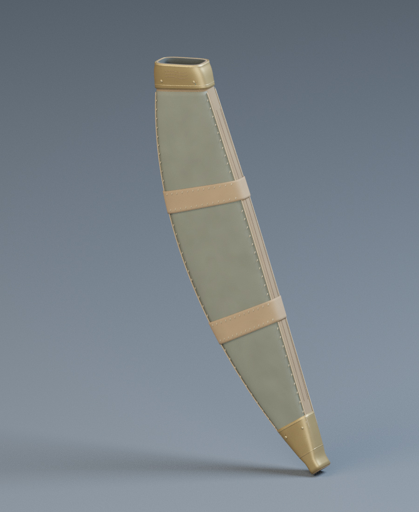

Use / purpose: Static nonfunctional fantasy model. No LOD, collision proxies or working rig; appearance in external game engines is untested.

Record type: model. Formats: Unknown; inspect ZIP.

Reported dimensions (metres; XYZ when derived from measured bounds, legacy axis order not reverified): [0.3771536350250244, 0.06554747372865677, 0.8040767312049866]. Triangles: Unknown.

Origin: Unknown / not independently confirmed. Orientation: Unknown / not independently confirmed.

[Download ZIP](https://github.com/k3peta/tales-on-a-table/releases/download/v2026.10.19-armory/ARM_073_CC0.zip) · [License scope](../../LICENSE.md)

**CC0-1.0** — See original ZIP license and repository license scope. Models and embedded materials only; previews excluded.

Source details: [Catalogue 1](../../catalog/armory.en.md) · [Catalogue 2](../../catalog/armory.md) · [Catalogue 3](../../catalog/armory.zh-CN.md)

**Quality42:** 70392tri over20k; fit untested. [Details](../material_variants_arm067_arm076.md).

## ARM_074

**雫宝飾の扁平短剣鞘**

雫宝飾の扁平短剣鞘

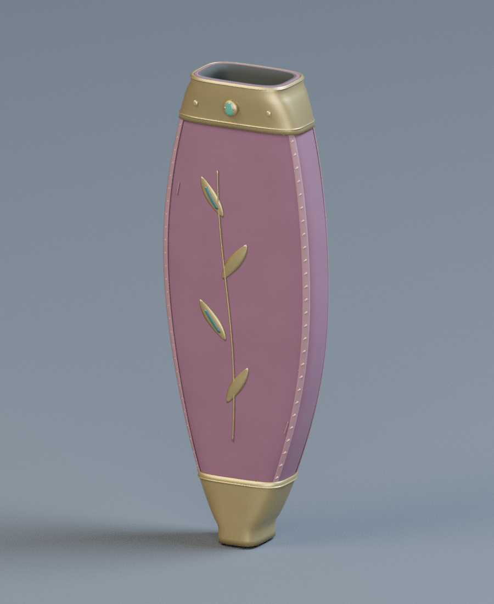

Use / purpose: Static nonfunctional fantasy model. No LOD, collision proxies or working rig; appearance in external game engines is untested.

Record type: model. Formats: Unknown; inspect ZIP.

Reported dimensions (metres; XYZ when derived from measured bounds, legacy axis order not reverified): [0.13977304100990295, 0.06729081273078918, 0.3886079788208008]. Triangles: Unknown.

Origin: Unknown / not independently confirmed. Orientation: Unknown / not independently confirmed.

[Download ZIP](https://github.com/k3peta/tales-on-a-table/releases/download/v2026.10.19-armory/ARM_074_CC0.zip) · [License scope](../../LICENSE.md)

**CC0-1.0** — See original ZIP license and repository license scope. Models and embedded materials only; previews excluded.

Source details: [Catalogue 1](../../catalog/armory.en.md) · [Catalogue 2](../../catalog/armory.md) · [Catalogue 3](../../catalog/armory.zh-CN.md)

**Quality42:** 50392tri over20k; existing palette retained. [Details](../material_variants_arm067_arm076.md).

## ARM_075

**細剣の縫い返し革鞘**

細剣の縫い返し革鞘

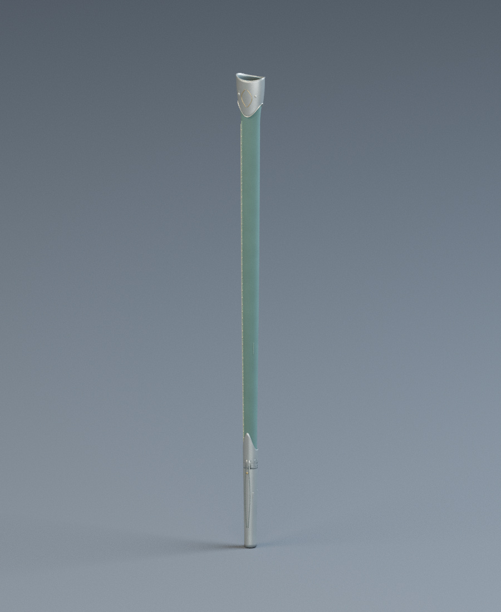

Use / purpose: Static nonfunctional fantasy model. No LOD, collision proxies or working rig; appearance in external game engines is untested.

Record type: model. Formats: Unknown; inspect ZIP.

Reported dimensions (metres; XYZ when derived from measured bounds, legacy axis order not reverified): [0.05583999678492546, 0.04104478657245636, 0.8623583316802979]. Triangles: Unknown.

Origin: Unknown / not independently confirmed. Orientation: Unknown / not independently confirmed.

[Download ZIP](https://github.com/k3peta/tales-on-a-table/releases/download/v2026.10.19-armory/ARM_075_CC0.zip) · [License scope](../../LICENSE.md)

**CC0-1.0** — See original ZIP license and repository license scope. Models and embedded materials only; previews excluded.

Source details: [Catalogue 1](../../catalog/armory.en.md) · [Catalogue 2](../../catalog/armory.md) · [Catalogue 3](../../catalog/armory.zh-CN.md)

**Quality42:** 63468tri over20k; fitting/load untested. [Details](../material_variants_arm067_arm076.md).

## ARM_076

**店先の検品台**

店先の検品台

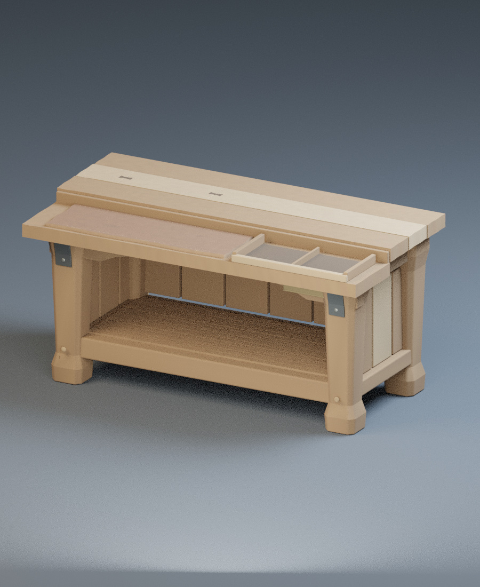

Use / purpose: Static nonfunctional fantasy model. No LOD, collision proxies or working rig; appearance in external game engines is untested.

Record type: model. Formats: Unknown; inspect ZIP.

Reported dimensions (metres; XYZ when derived from measured bounds, legacy axis order not reverified): [1.712599754333496, 0.8600000143051147, 0.846299946308136]. Triangles: Unknown.

Origin: Unknown / not independently confirmed. Orientation: Unknown / not independently confirmed.

[Download ZIP](https://github.com/k3peta/tales-on-a-table/releases/download/v2026.10.19-armory/ARM_076_CC0.zip) · [License scope](../../LICENSE.md)

**CC0-1.0** — See original ZIP license and repository license scope. Models and embedded materials only; previews excluded.

Source details: [Catalogue 1](../../catalog/armory.en.md) · [Catalogue 2](../../catalog/armory.md) · [Catalogue 3](../../catalog/armory.zh-CN.md)

**Quality42:** 150 zero faces removed;68518tri over50k. [Details](../material_variants_arm067_arm076.md).

**Latest revision:** [ZIP](https://raw.githubusercontent.com/k3peta/tales-on-a-table/main/distributions/quality-arm067-076-v1/ARM_076__repair_CC0.zip) · [Matching revision preview](../../previews/quality-arm067-076-v1/ARM_076__repair_thumb.png). Original pictured ZIP retained above. Public ZIP/member/image identity verified.

## ARM_077

**真鍮木製の古風レジ**

真鍮木製の古風レジ

Use / purpose: Static nonfunctional fantasy model. No LOD, collision proxies or working rig; appearance in external game engines is untested.

Record type: model. Formats: Unknown; inspect ZIP.

Reported dimensions (metres; XYZ when derived from measured bounds, legacy axis order not reverified): [0.5419999957084656, 0.47695183753967285, 0.531000018119812]. Triangles: Unknown.

Origin: Unknown / not independently confirmed. Orientation: Unknown / not independently confirmed.

[Download ZIP](https://github.com/k3peta/tales-on-a-table/releases/download/v2026.10.19-armory/ARM_077_CC0.zip) · [License scope](../../LICENSE.md)

**CC0-1.0** — See original ZIP license and repository license scope. Models and embedded materials only; previews excluded.

Source details: [Catalogue 1](../../catalog/armory.en.md) · [Catalogue 2](../../catalog/armory.md) · [Catalogue 3](../../catalog/armory.zh-CN.md)

**Quality43:** 8 zero faces removed;87k exceeds50k; colors retained. [Details](../material_variants_arm077_wh006.md).

**Latest revision:** [ZIP](https://raw.githubusercontent.com/k3peta/tales-on-a-table/main/distributions/quality-arm077-wh006-v1/ARM_077__repair_CC0.zip) · [Matching revision preview](../../previews/quality-arm077-wh006-v1/ARM_077__repair_thumb.png). Original pictured ZIP retained above. Public ZIP/member/image identity verified.

## ARM_078

**工房の研磨台**

工房の研磨台

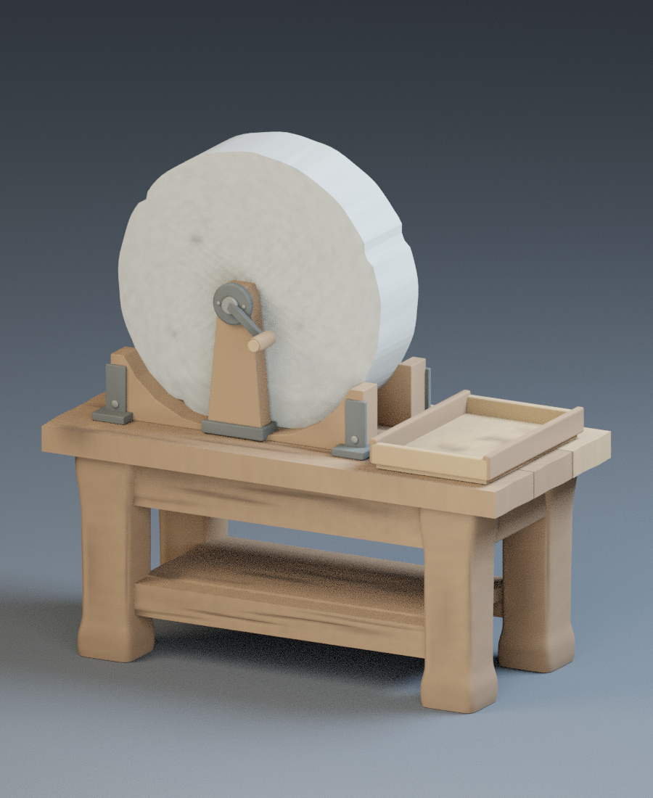

Use / purpose: Static nonfunctional fantasy model. No LOD, collision proxies or working rig; appearance in external game engines is untested.

Record type: model. Formats: Unknown; inspect ZIP.

Reported dimensions (metres; XYZ when derived from measured bounds, legacy axis order not reverified): [1.4029967784881592, 0.6740000247955322, 1.436500072479248]. Triangles: Unknown.

Origin: Unknown / not independently confirmed. Orientation: Unknown / not independently confirmed.

[Download ZIP](https://github.com/k3peta/tales-on-a-table/releases/download/v2026.10.19-armory/ARM_078_CC0.zip) · [License scope](../../LICENSE.md)

**CC0-1.0** — See original ZIP license and repository license scope. Models and embedded materials only; previews excluded.

Source details: [Catalogue 1](../../catalog/armory.en.md) · [Catalogue 2](../../catalog/armory.md) · [Catalogue 3](../../catalog/armory.zh-CN.md)

**Quality43:** 105k over50k, no zero faces; budget unresolved. [Details](../material_variants_arm077_wh006.md).

## ARM_079

**石造りの小修理炉**

石造りの小修理炉

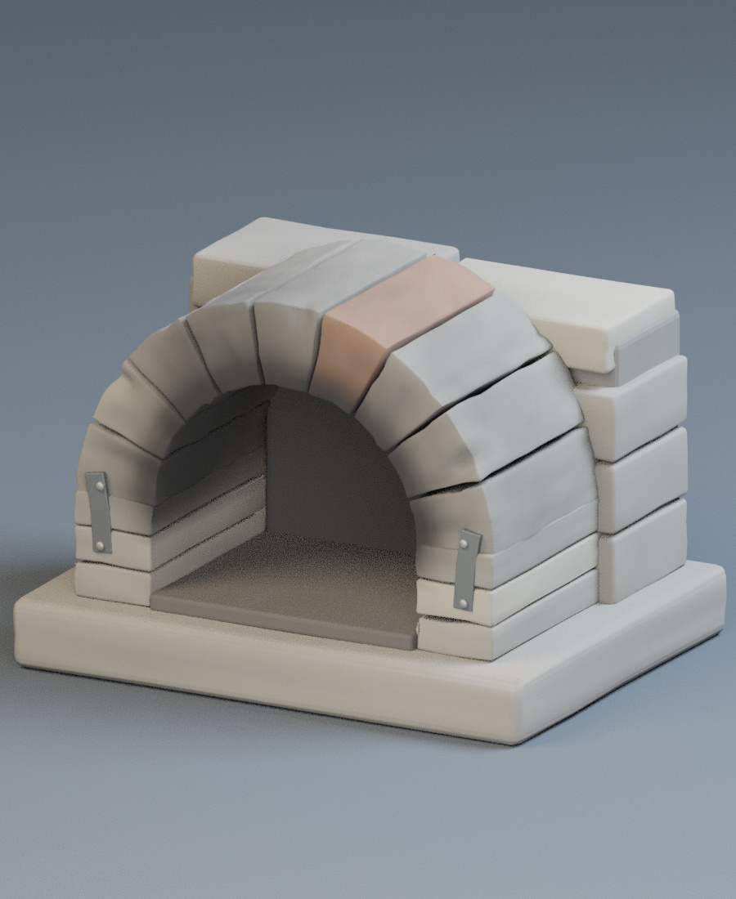

Use / purpose: Static nonfunctional fantasy model. No LOD, collision proxies or working rig; appearance in external game engines is untested.

Record type: model. Formats: Unknown; inspect ZIP.

Reported dimensions (metres; XYZ when derived from measured bounds, legacy axis order not reverified): [0.8425048589706421, 0.6533746719360352, 0.5993217825889587]. Triangles: Unknown.

Origin: Unknown / not independently confirmed. Orientation: Unknown / not independently confirmed.

[Download ZIP](https://github.com/k3peta/tales-on-a-table/releases/download/v2026.10.19-armory/ARM_079_CC0.zip) · [License scope](../../LICENSE.md)

**CC0-1.0** — See original ZIP license and repository license scope. Models and embedded materials only; previews excluded.

Source details: [Catalogue 1](../../catalog/armory.en.md) · [Catalogue 2](../../catalog/armory.md) · [Catalogue 3](../../catalog/armory.zh-CN.md)

**Quality43:** 256 zero faces removed; below50k; cold static forge only. [Details](../material_variants_arm077_wh006.md).

**Latest revision:** [ZIP](https://raw.githubusercontent.com/k3peta/tales-on-a-table/main/distributions/quality-arm077-wh006-v1/ARM_079__repair_CC0.zip) · [Matching revision preview](../../previews/quality-arm077-wh006-v1/ARM_079__repair_thumb.png). Original pictured ZIP retained above. Public ZIP/member/image identity verified.

## ARM_080

**革張り工房ふいご**

革張り工房ふいご

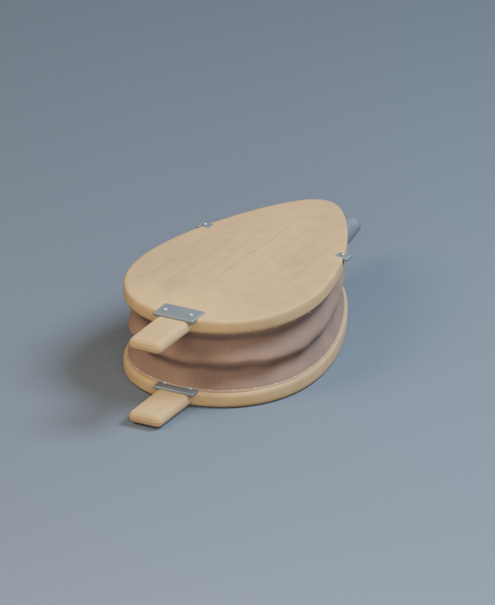

Use / purpose: Static nonfunctional fantasy model. No LOD, collision proxies or working rig; appearance in external game engines is untested.

Record type: model. Formats: Unknown; inspect ZIP.

Reported dimensions (metres; XYZ when derived from measured bounds, legacy axis order not reverified): [0.3973745107650757, 0.8769999742507935, 0.19679999351501465]. Triangles: Unknown.

Origin: Unknown / not independently confirmed. Orientation: Unknown / not independently confirmed.

[Download ZIP](https://github.com/k3peta/tales-on-a-table/releases/download/v2026.10.19-armory/ARM_080_CC0.zip) · [License scope](../../LICENSE.md)

**CC0-1.0** — See original ZIP license and repository license scope. Models and embedded materials only; previews excluded.

Source details: [Catalogue 1](../../catalog/armory.en.md) · [Catalogue 2](../../catalog/armory.md) · [Catalogue 3](../../catalog/armory.zh-CN.md)

**Quality43:** 90k over50k; bellows mechanism untested. [Details](../material_variants_arm077_wh006.md).

## WH_NEW_001

**値札付き全身鎧と鎧掛け**

値札付き全身鎧と鎧掛け

Use / purpose: Static nonfunctional fantasy model. No LOD, collision proxies or working rig; appearance in external game engines is untested.

Record type: model. Formats: Unknown; inspect ZIP.

Reported dimensions (metres; XYZ when derived from measured bounds, legacy axis order not reverified): [1.0950942039489746, 0.6600000262260437, 2.0013270378112793]. Triangles: Unknown.

Origin: Unknown / not independently confirmed. Orientation: Unknown / not independently confirmed.

[Download ZIP](https://github.com/k3peta/tales-on-a-table/releases/download/v2026.10.19-armory/WH_NEW_001_CC0.zip) · [License scope](../../LICENSE.md)

**CC0-1.0** — See original ZIP license and repository license scope. Models and embedded materials only; previews excluded.

Source details: [Catalogue 1](../../catalog/armory.en.md) · [Catalogue 2](../../catalog/armory.md) · [Catalogue 3](../../catalog/armory.zh-CN.md)

**Quality43:** 6700 zero faces removed, missing UV added;348k heavy composite armor/stand/tag. [Details](../material_variants_arm077_wh006.md).

**Latest revision:** [ZIP](https://raw.githubusercontent.com/k3peta/tales-on-a-table/main/distributions/quality-arm077-wh006-v1/WH_NEW_001__repair_CC0.zip) · [Matching revision preview](../../previews/quality-arm077-wh006-v1/WH_NEW_001__repair_thumb.png). Original pictured ZIP retained above. Public ZIP/member/image identity verified.

## WH_NEW_002

**装飾用の大型弩**

装飾用の大型弩

Use / purpose: Static nonfunctional fantasy model. No LOD, collision proxies or working rig; appearance in external game engines is untested.

Record type: model. Formats: Unknown; inspect ZIP.

Reported dimensions (metres; XYZ when derived from measured bounds, legacy axis order not reverified): [1.8794126510620117, 0.26999999582767487, 1.4199999570846558]. Triangles: Unknown.

Origin: Unknown / not independently confirmed. Orientation: Unknown / not independently confirmed.

[Download ZIP](https://github.com/k3peta/tales-on-a-table/releases/download/v2026.10.19-armory/WH_NEW_002_CC0.zip) · [License scope](../../LICENSE.md)

**CC0-1.0** — See original ZIP license and repository license scope. Models and embedded materials only; previews excluded.

Source details: [Catalogue 1](../../catalog/armory.en.md) · [Catalogue 2](../../catalog/armory.md) · [Catalogue 3](../../catalog/armory.zh-CN.md)

**Quality43:** 1658 zero faces removed, missing UV added;63k over50k; static decorative assembly. [Details](../material_variants_arm077_wh006.md).

**Latest revision:** [ZIP](https://raw.githubusercontent.com/k3peta/tales-on-a-table/main/distributions/quality-arm077-wh006-v1/WH_NEW_002__repair_CC0.zip) · [Matching revision preview](../../previews/quality-arm077-wh006-v1/WH_NEW_002__repair_thumb.png). Original pictured ZIP retained above. Public ZIP/member/image identity verified.

## WH_NEW_003

**月輪の長柄武器**

月輪の長柄武器

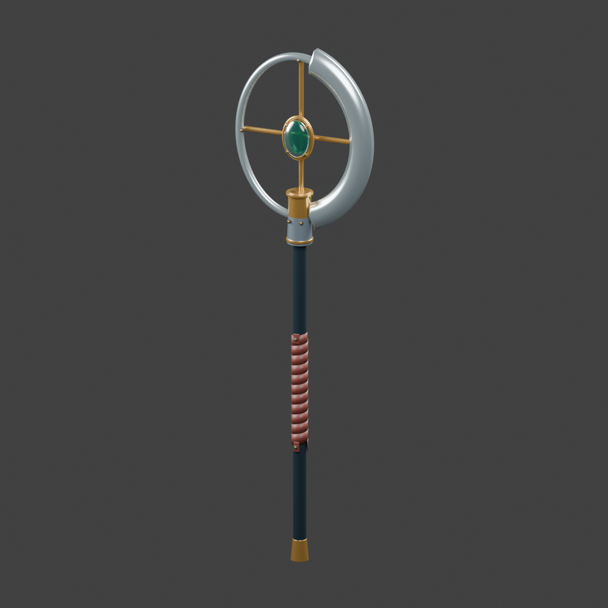

Use / purpose: Static nonfunctional fantasy model. No LOD, collision proxies or working rig; appearance in external game engines is untested.

Record type: model. Formats: Unknown; inspect ZIP.

Reported dimensions (metres; XYZ when derived from measured bounds, legacy axis order not reverified): [0.6011679172515869, 0.11364001035690308, 2.18224835395813]. Triangles: Unknown.

Origin: Unknown / not independently confirmed. Orientation: Unknown / not independently confirmed.

[Download ZIP](https://github.com/k3peta/tales-on-a-table/releases/download/v2026.10.19-armory/WH_NEW_003_CC0.zip) · [License scope](../../LICENSE.md)

**CC0-1.0** — See original ZIP license and repository license scope. Models and embedded materials only; previews excluded.

Source details: [Catalogue 1](../../catalog/armory.en.md) · [Catalogue 2](../../catalog/armory.md) · [Catalogue 3](../../catalog/armory.zh-CN.md)

**Quality43:** 1632 zero faces removed, missing UV added;40k over20k. [Details](../material_variants_arm077_wh006.md).

**Latest revision:** [ZIP](https://raw.githubusercontent.com/k3peta/tales-on-a-table/main/distributions/quality-arm077-wh006-v1/WH_NEW_003__repair_CC0.zip) · [Matching revision preview](../../previews/quality-arm077-wh006-v1/WH_NEW_003__repair_thumb.png). Original pictured ZIP retained above. Public ZIP/member/image identity verified.

## WH_NEW_004

**琥珀結晶の二股槍**

琥珀結晶の二股槍

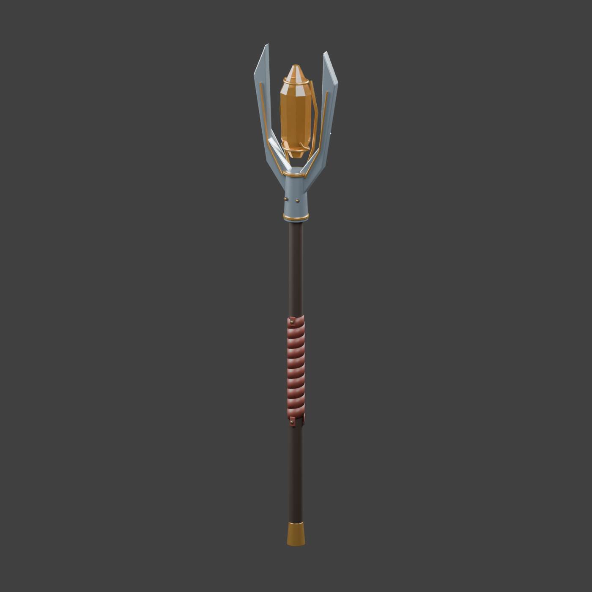

Use / purpose: Static nonfunctional fantasy model. No LOD, collision proxies or working rig; appearance in external game engines is untested.

Record type: model. Formats: Unknown; inspect ZIP.

Reported dimensions (metres; XYZ when derived from measured bounds, legacy axis order not reverified): [0.3784722089767456, 0.11128001660108566, 2.2271738052368164]. Triangles: Unknown.

Origin: Unknown / not independently confirmed. Orientation: Unknown / not independently confirmed.

[Download ZIP](https://github.com/k3peta/tales-on-a-table/releases/download/v2026.10.19-armory/WH_NEW_004_CC0.zip) · [License scope](../../LICENSE.md)

**CC0-1.0** — See original ZIP license and repository license scope. Models and embedded materials only; previews excluded.

Source details: [Catalogue 1](../../catalog/armory.en.md) · [Catalogue 2](../../catalog/armory.md) · [Catalogue 3](../../catalog/armory.zh-CN.md)

**Quality43:** 764 zero faces removed, missing UV added;22k over20k; cyan variant uses repaired baseline. [Details](../material_variants_arm077_wh006.md).

**Latest revision:** [ZIP](https://raw.githubusercontent.com/k3peta/tales-on-a-table/main/distributions/quality-arm077-wh006-v1/WH_NEW_004__repair_CC0.zip) · [Matching revision preview](../../previews/quality-arm077-wh006-v1/WH_NEW_004__repair_thumb.png). Original pictured ZIP retained above. Public ZIP/member/image identity verified.

## WH_NEW_005

**天球儀のメイス**

天球儀のメイス

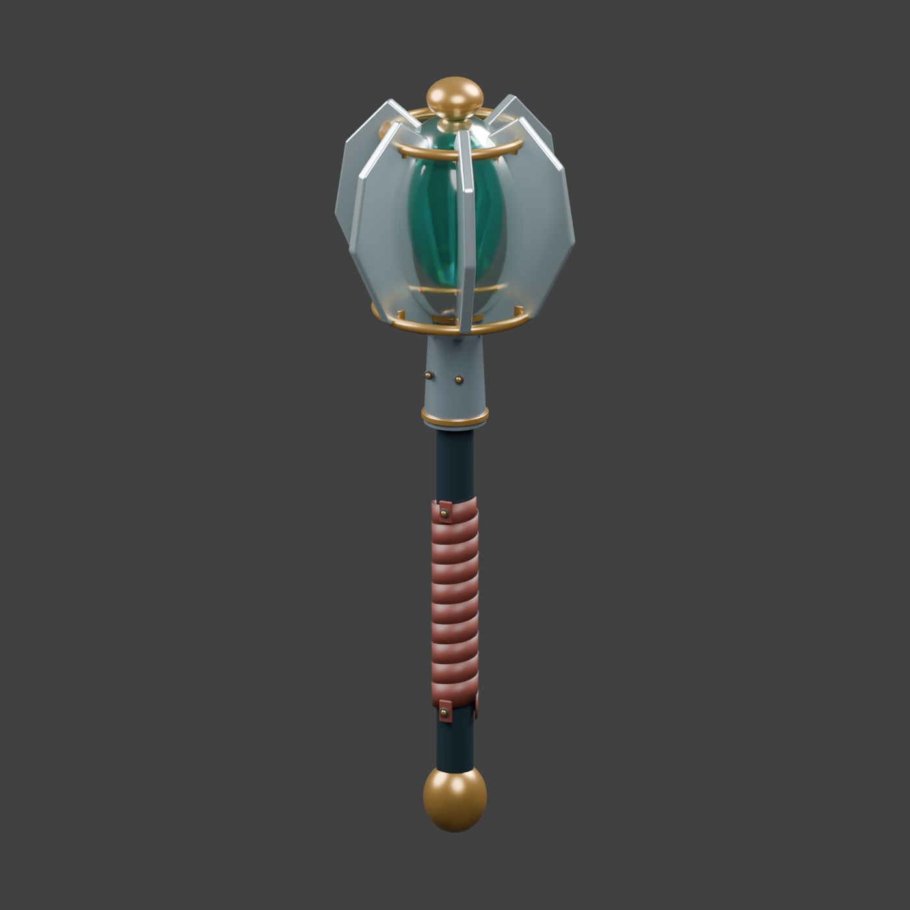

Use / purpose: Static nonfunctional fantasy model. No LOD, collision proxies or working rig; appearance in external game engines is untested.

Record type: model. Formats: Unknown; inspect ZIP.

Reported dimensions (metres; XYZ when derived from measured bounds, legacy axis order not reverified): [0.46844762563705444, 0.416687548160553, 1.4369999170303345]. Triangles: Unknown.

Origin: Unknown / not independently confirmed. Orientation: Unknown / not independently confirmed.

[Download ZIP](https://github.com/k3peta/tales-on-a-table/releases/download/v2026.10.19-armory/WH_NEW_005_CC0.zip) · [License scope](../../LICENSE.md)

**CC0-1.0** — See original ZIP license and repository license scope. Models and embedded materials only; previews excluded.

Source details: [Catalogue 1](../../catalog/armory.en.md) · [Catalogue 2](../../catalog/armory.md) · [Catalogue 3](../../catalog/armory.zh-CN.md)

**Quality43:** 1040 zero faces removed, missing UV added;36k over20k. [Details](../material_variants_arm077_wh006.md).

**Latest revision:** [ZIP](https://raw.githubusercontent.com/k3peta/tales-on-a-table/main/distributions/quality-arm077-wh006-v1/WH_NEW_005__repair_CC0.zip) · [Matching revision preview](../../previews/quality-arm077-wh006-v1/WH_NEW_005__repair_thumb.png). Original pictured ZIP retained above. Public ZIP/member/image identity verified.

## WH_NEW_006

**二段20本剣ラック**

二段20本剣ラック

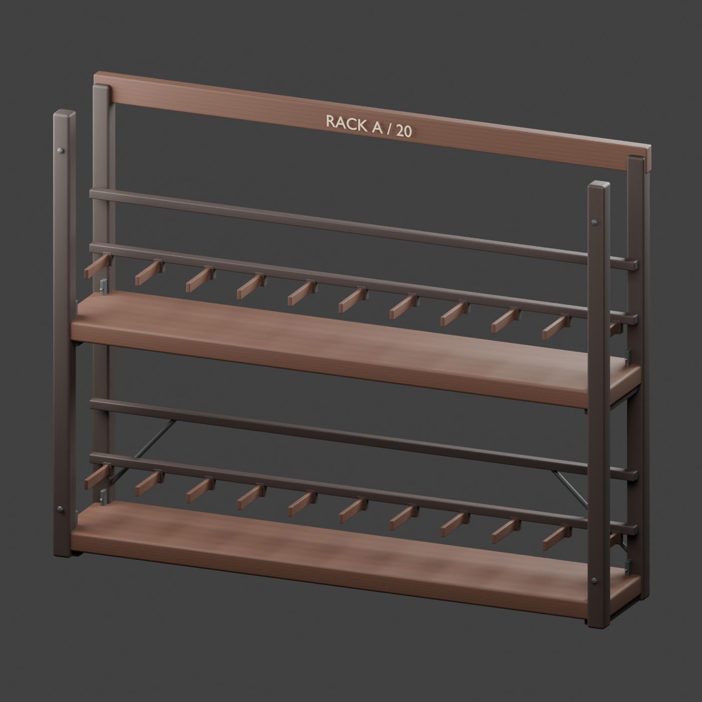

Use / purpose: Static nonfunctional fantasy model. No LOD, collision proxies or working rig; appearance in external game engines is untested.

Record type: model. Formats: Unknown; inspect ZIP.

Reported dimensions (metres; XYZ when derived from measured bounds, legacy axis order not reverified): [3.4800000190734863, 0.7129999995231628, 2.75]. Triangles: Unknown.

Origin: Unknown / not independently confirmed. Orientation: Unknown / not independently confirmed.

[Download ZIP](https://github.com/k3peta/tales-on-a-table/releases/download/v2026.10.19-armory/WH_NEW_006_CC0.zip) · [License scope](../../LICENSE.md)

**CC0-1.0** — See original ZIP license and repository license scope. Models and embedded materials only; previews excluded.

Source details: [Catalogue 1](../../catalog/armory.en.md) · [Catalogue 2](../../catalog/armory.md) · [Catalogue 3](../../catalog/armory.zh-CN.md)

**Quality43:** 5820 zero faces removed, missing UV added;90k over50k; empty20slot rack counted once. [Details](../material_variants_arm077_wh006.md).

**Latest revision:** [ZIP](https://raw.githubusercontent.com/k3peta/tales-on-a-table/main/distributions/quality-arm077-wh006-v1/WH_NEW_006__repair_CC0.zip) · [Matching revision preview](../../previews/quality-arm077-wh006-v1/WH_NEW_006__repair_thumb.png). Original pictured ZIP retained above. Public ZIP/member/image identity verified.

## WH_NEW_007

**低い二列20本剣ラック**

低い二列20本剣ラック

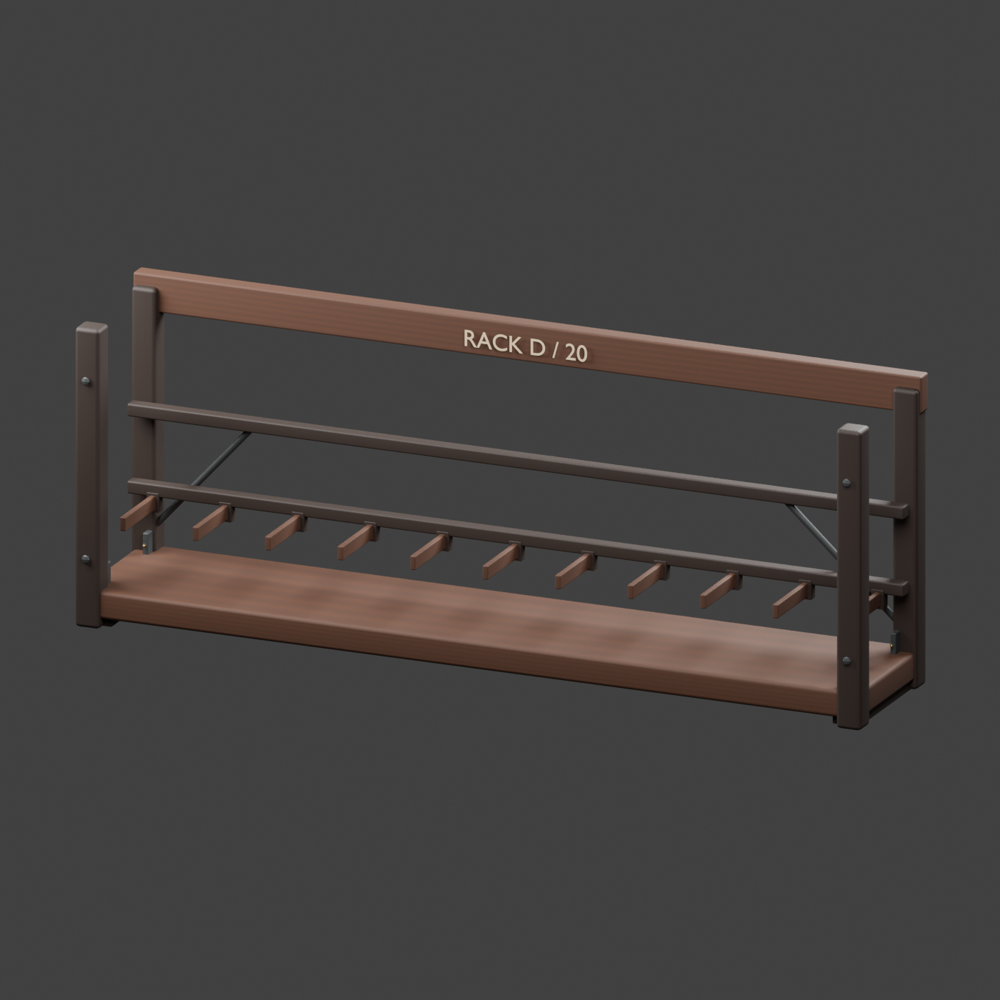

Use / purpose: Static nonfunctional fantasy model. No LOD, collision proxies or working rig; appearance in external game engines is untested.

Record type: model. Formats: Unknown; inspect ZIP.

Reported dimensions (metres; XYZ when derived from measured bounds, legacy axis order not reverified): [3.4800000190734863, 0.7129999995231628, 1.3300000429153442]. Triangles: Unknown.

Origin: Unknown / not independently confirmed. Orientation: Unknown / not independently confirmed.

[Download ZIP](https://github.com/k3peta/tales-on-a-table/releases/download/v2026.10.19-armory/WH_NEW_007_CC0.zip) · [License scope](../../LICENSE.md)

**CC0-1.0** — See original ZIP license and repository license scope. Models and embedded materials only; previews excluded.

Source details: [Catalogue 1](../../catalog/armory.en.md) · [Catalogue 2](../../catalog/armory.md) · [Catalogue 3](../../catalog/armory.zh-CN.md)

## WH_NEW_008

**倉庫の梱包箱**

倉庫の梱包箱

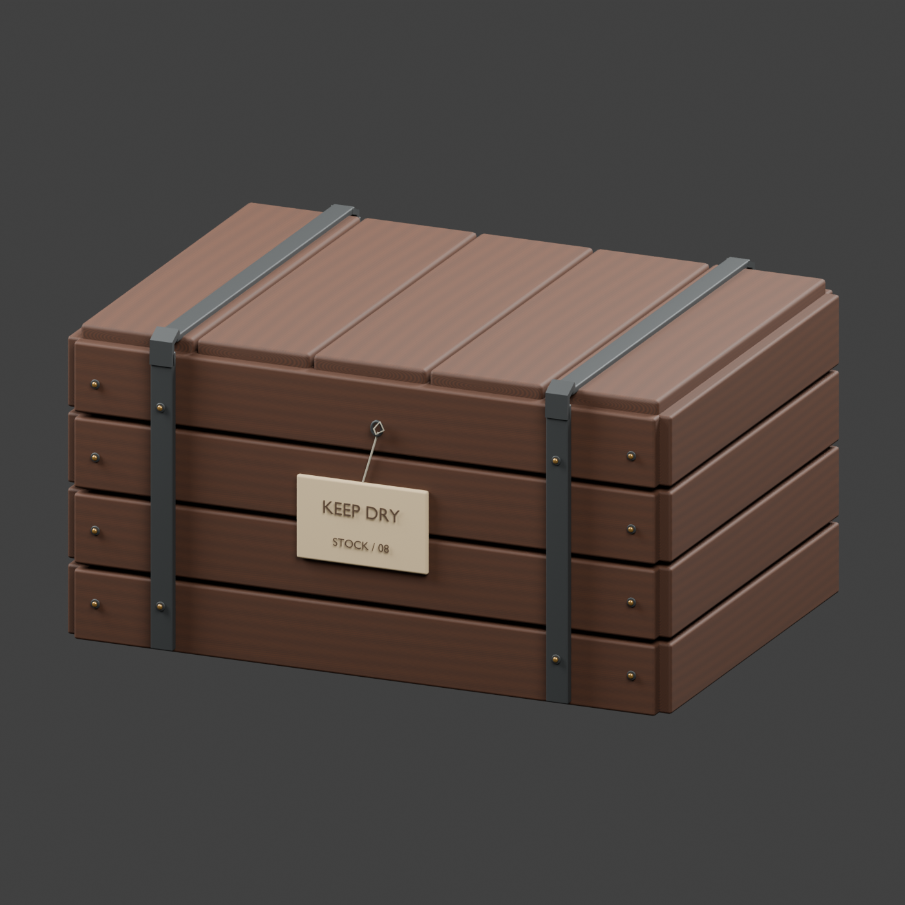

Use / purpose: Static nonfunctional fantasy model. No LOD, collision proxies or working rig; appearance in external game engines is untested.

Record type: model. Formats: Unknown; inspect ZIP.

Reported dimensions (metres; XYZ when derived from measured bounds, legacy axis order not reverified): [1.1950000524520874, 0.8810000121593475, 0.6179657578468323]. Triangles: Unknown.

Origin: Unknown / not independently confirmed. Orientation: Unknown / not independently confirmed.

[Download ZIP](https://github.com/k3peta/tales-on-a-table/releases/download/v2026.10.19-armory/WH_NEW_008_CC0.zip) · [License scope](../../LICENSE.md)

**CC0-1.0** — See original ZIP license and repository license scope. Models and embedded materials only; previews excluded.

Source details: [Catalogue 1](../../catalog/armory.en.md) · [Catalogue 2](../../catalog/armory.md) · [Catalogue 3](../../catalog/armory.zh-CN.md)

## BN_001

**Hay fork**

干し草フォーク

Use / purpose: Three curved iron tines with a wooden handle, for hay storage or stable scenes.

Record type: model. Formats: Unknown; inspect ZIP.

Reported dimensions (metres; XYZ when derived from measured bounds, legacy axis order not reverified): [0.2680000066757202, 0.09129735827445984, 1.5806126594543457]. Triangles: Unknown.

Origin: Unknown / not independently confirmed. Orientation: Unknown / not independently confirmed.

[Download ZIP](https://github.com/k3peta/tales-on-a-table/releases/download/v2026.10.19-farmhouse-barn/BN_001_CC0.zip) · [License scope](../../LICENSE.md)

**CC0-1.0** — See original ZIP license and repository license scope. Models and embedded materials only; previews excluded.

Source details: [Catalogue 1](../../catalog/farmhouse-barn.en.md) · [Catalogue 2](../../catalog/farmhouse-barn.md) · [Catalogue 3](../../catalog/farmhouse-barn.zh-CN.md)

## BN_002

**Wooden rake**

木製レーキ

Use / purpose: Wooden teeth on a crossbar, for gardens, fields or a barn wall.

Record type: model. Formats: Unknown; inspect ZIP.

Reported dimensions (metres; XYZ when derived from measured bounds, legacy axis order not reverified): [0.6499999761581421, 0.10446450114250183, 1.55393648147583]. Triangles: Unknown.

Origin: Unknown / not independently confirmed. Orientation: Unknown / not independently confirmed.

[Download ZIP](https://github.com/k3peta/tales-on-a-table/releases/download/v2026.10.19-farmhouse-barn/BN_002_CC0.zip) · [License scope](../../LICENSE.md)

**CC0-1.0** — See original ZIP license and repository license scope. Models and embedded materials only; previews excluded.

Source details: [Catalogue 1](../../catalog/farmhouse-barn.en.md) · [Catalogue 2](../../catalog/farmhouse-barn.md) · [Catalogue 3](../../catalog/farmhouse-barn.zh-CN.md)

## BN_003

**Grain spade**

穀物用の鋤

Use / purpose: Curved blade with a flattened socket tongue secured by two rivets.

Record type: model. Formats: Unknown; inspect ZIP.

Reported dimensions (metres; XYZ when derived from measured bounds, legacy axis order not reverified): [0.29962506890296936, 0.07644699513912201, 1.3819999694824219]. Triangles: Unknown.

Origin: Unknown / not independently confirmed. Orientation: Unknown / not independently confirmed.

[Download ZIP](https://github.com/k3peta/tales-on-a-table/releases/download/v2026.10.19-farmhouse-barn/BN_003_CC0.zip) · [License scope](../../LICENSE.md)

**CC0-1.0** — See original ZIP license and repository license scope. Models and embedded materials only; previews excluded.

Source details: [Catalogue 1](../../catalog/farmhouse-barn.en.md) · [Catalogue 2](../../catalog/farmhouse-barn.md) · [Catalogue 3](../../catalog/farmhouse-barn.zh-CN.md)

## BN_004

**Wooden wheelbarrow**

木製手押し車

Use / purpose: Planked tray, one wheel, drilled axle cheeks and fixing bolts for hauling scenes.

Record type: model. Formats: Unknown; inspect ZIP.

Reported dimensions (metres; XYZ when derived from measured bounds, legacy axis order not reverified): [0.7160000205039978, 1.9730799198150635, 0.8500000238418579]. Triangles: Unknown.

Origin: Unknown / not independently confirmed. Orientation: Unknown / not independently confirmed.

[Download ZIP](https://github.com/k3peta/tales-on-a-table/releases/download/v2026.10.19-farmhouse-barn/BN_004_CC0.zip) · [License scope](../../LICENSE.md)

**CC0-1.0** — See original ZIP license and repository license scope. Models and embedded materials only; previews excluded.

Source details: [Catalogue 1](../../catalog/farmhouse-barn.en.md) · [Catalogue 2](../../catalog/farmhouse-barn.md) · [Catalogue 3](../../catalog/farmhouse-barn.zh-CN.md)
