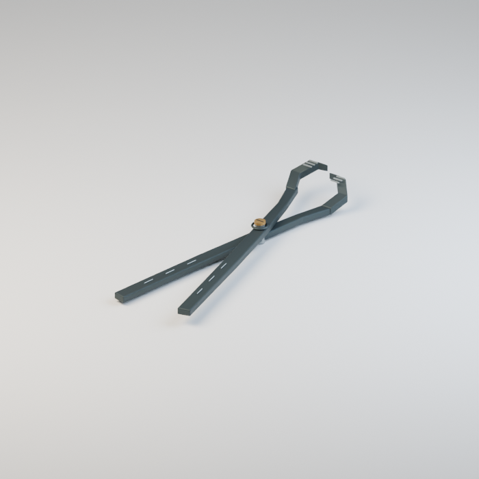
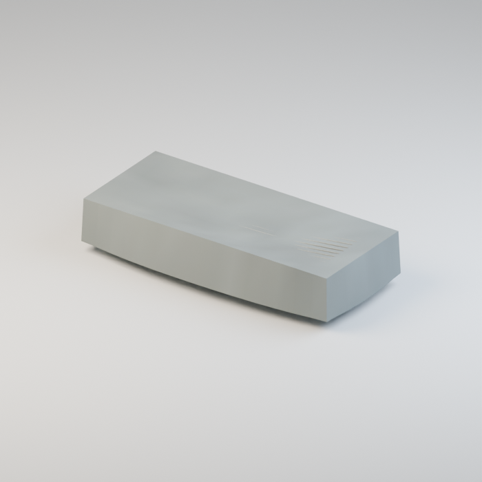
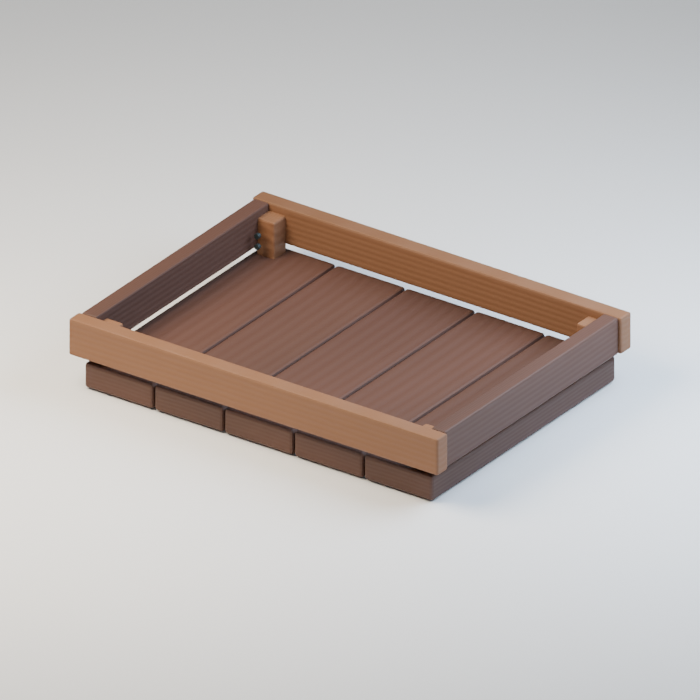

# Base distribution records 433–456

[Browse index](README.md) · [Coverage and missing fields](COVERAGE.md)

Images are actual existing model renders for browsing, not covered by model CC0. A group record may show several reused models. Dimensions and triangle counts apply only to the original record when sourced; revisions can differ. Unknown means unverified, not zero. No blanket CC0 grant for scenes, images, code or articles.

## BN_005

**Tied hay bale**

結束した干し草

Use / purpose: Uneven straw ends and two ties; use as a stack or as a wheelbarrow load.

Record type: model. Formats: Unknown; inspect ZIP.

Reported dimensions (metres; XYZ when derived from measured bounds, legacy axis order not reverified): [0.9098962545394897, 0.5345759987831116, 0.44763457775115967]. Triangles: Unknown.

Origin: Unknown / not independently confirmed. Orientation: Unknown / not independently confirmed.

[Download ZIP](https://github.com/k3peta/tales-on-a-table/releases/download/v2026.10.19-farmhouse-barn/BN_005_CC0.zip) · [License scope](../../LICENSE.md)

**CC0-1.0** — See original ZIP license and repository license scope. Models and embedded materials only; previews excluded.

Source details: [Catalogue 1](../../catalog/cheese_hay_buildings_v1.md) · [Catalogue 2](../../catalog/farmhouse-barn.en.md) · [Catalogue 3](../../catalog/farmhouse-barn.md)

**Quality44:** 85280tri over20k;11missing UV layers added, geometry unchanged;dense fibers remain. [Details](../material_variants_wh007_bn008.md).

## BN_006

**Three-compartment grain bin**

三区画の穀物箱

Use / purpose: Empty wooden bin with three compartments and tally plaques; add your own contents.

Record type: model. Formats: Unknown; inspect ZIP.

Reported dimensions (metres; XYZ when derived from measured bounds, legacy axis order not reverified): [1.3079999685287476, 0.6950000524520874, 0.7350000143051147]. Triangles: Unknown.

Origin: Unknown / not independently confirmed. Orientation: Unknown / not independently confirmed.

[Download ZIP](https://github.com/k3peta/tales-on-a-table/releases/download/v2026.10.19-farmhouse-barn/BN_006_CC0.zip) · [License scope](../../LICENSE.md)

**CC0-1.0** — See original ZIP license and repository license scope. Models and embedded materials only; previews excluded.

Source details: [Catalogue 1](../../catalog/farmhouse-barn.en.md) · [Catalogue 2](../../catalog/farmhouse-barn.md) · [Catalogue 3](../../catalog/farmhouse-barn.zh-CN.md)

**Quality44:** 4224tri,blue mapped wood texture variant retains geometry/UV/grain/non-basecolor channels. [Details](../material_variants_wh007_bn008.md).

## BN_007

**Farm tool stand**

農具掛け

Use / purpose: Freestanding rack with crossrails and paired pegs. Tools are separate assets.

Record type: model. Formats: Unknown; inspect ZIP.

Reported dimensions (metres; XYZ when derived from measured bounds, legacy axis order not reverified): [1.5299999713897705, 0.47999998927116394, 1.3050000667572021]. Triangles: Unknown.

Origin: Unknown / not independently confirmed. Orientation: Unknown / not independently confirmed.

[Download ZIP](https://github.com/k3peta/tales-on-a-table/releases/download/v2026.10.19-farmhouse-barn/BN_007_CC0.zip) · [License scope](../../LICENSE.md)

**CC0-1.0** — See original ZIP license and repository license scope. Models and embedded materials only; previews excluded.

Source details: [Catalogue 1](../../catalog/farmhouse-barn.en.md) · [Catalogue 2](../../catalog/farmhouse-barn.md) · [Catalogue 3](../../catalog/farmhouse-barn.zh-CN.md)

**Quality44:** 1224tri empty rack,no tools added. [Details](../material_variants_wh007_bn008.md).

## BN_008

**Grain sieve**

穀物の篩

Use / purpose: Round sieve with a thick wooden rim and mesh, for a grain bin or workbench.

Record type: model. Formats: Unknown; inspect ZIP.

Reported dimensions (metres; XYZ when derived from measured bounds, legacy axis order not reverified): [0.4440000057220459, 0.4440000057220459, 0.08933592587709427]. Triangles: Unknown.

Origin: Unknown / not independently confirmed. Orientation: Unknown / not independently confirmed.

[Download ZIP](https://github.com/k3peta/tales-on-a-table/releases/download/v2026.10.19-farmhouse-barn/BN_008_CC0.zip) · [License scope](../../LICENSE.md)

**CC0-1.0** — See original ZIP license and repository license scope. Models and embedded materials only; previews excluded.

Source details: [Catalogue 1](../../catalog/farmhouse-barn.en.md) · [Catalogue 2](../../catalog/farmhouse-barn.md) · [Catalogue 3](../../catalog/farmhouse-barn.zh-CN.md)

**Quality44:** 8832tri sieve,no separation simulation. [Details](../material_variants_wh007_bn008.md).

## BM_001

**Red leather old book**

赤革の古書

Use / purpose: Red leather old book, for the six-stall bridge market. First distribution of an earlier market design. Includes 3 model version(s); related variants share this record.

Record type: model. Formats: Unknown; inspect ZIP.

Reported dimensions (metres; XYZ when derived from measured bounds, legacy axis order not reverified): [0.3541799783706665, 0.453000009059906, 0.10159383714199066]. Triangles: Unknown.

Origin: Unknown / not independently confirmed. Orientation: Unknown / not independently confirmed.

[Download ZIP](https://github.com/k3peta/tales-on-a-table/releases/download/v2026.10.19-bridge-market/BM_001_CC0.zip) · [License scope](../../LICENSE.md)

**CC0-1.0** — See original ZIP license and repository license scope. Models and embedded materials only; previews excluded.

Source details: [Catalogue 1](../../catalog/bridge-market.en.md) · [Catalogue 2](../../catalog/bridge-market.md) · [Catalogue 3](../../catalog/bridge-market.zh-CN.md)

## BM_002

**Half-open scroll**

半開きの巻物

Use / purpose: Half-open scroll, for the six-stall bridge market. First distribution of an earlier market design. Includes 1 model version(s); related variants share this record.

Record type: model. Formats: Unknown; inspect ZIP.

Reported dimensions (metres; XYZ when derived from measured bounds, legacy axis order not reverified): [0.33469682931900024, 0.41200003027915955, 0.08569768816232681]. Triangles: Unknown.

Origin: Unknown / not independently confirmed. Orientation: Unknown / not independently confirmed.

[Download ZIP](https://github.com/k3peta/tales-on-a-table/releases/download/v2026.10.19-bridge-market/BM_002_CC0.zip) · [License scope](../../LICENSE.md)

**CC0-1.0** — See original ZIP license and repository license scope. Models and embedded materials only; previews excluded.

Source details: [Catalogue 1](../../catalog/bridge-market.en.md) · [Catalogue 2](../../catalog/bridge-market.md) · [Catalogue 3](../../catalog/bridge-market.zh-CN.md)

## BM_003

**Broken armillary sphere**

壊れた天球儀

Use / purpose: Broken armillary sphere, for the six-stall bridge market. First distribution of an earlier market design. Includes 1 model version(s); related variants share this record.

Record type: model. Formats: Unknown; inspect ZIP.

Reported dimensions (metres; XYZ when derived from measured bounds, legacy axis order not reverified): [0.3851621150970459, 0.3345124125480652, 0.5419999957084656]. Triangles: Unknown.

Origin: Unknown / not independently confirmed. Orientation: Unknown / not independently confirmed.

[Download ZIP](https://github.com/k3peta/tales-on-a-table/releases/download/v2026.10.19-bridge-market/BM_003_CC0.zip) · [License scope](../../LICENSE.md)

**CC0-1.0** — See original ZIP license and repository license scope. Models and embedded materials only; previews excluded.

Source details: [Catalogue 1](../../catalog/bridge-market.en.md) · [Catalogue 2](../../catalog/bridge-market.md) · [Catalogue 3](../../catalog/bridge-market.zh-CN.md)

## BM_004

**Old ink bottle**

古いインク瓶

Use / purpose: Old ink bottle, for the six-stall bridge market. First distribution of an earlier market design. Includes 3 model version(s); related variants share this record.

Record type: model. Formats: Unknown; inspect ZIP.

Reported dimensions (metres; XYZ when derived from measured bounds, legacy axis order not reverified): [0.18189717829227448, 0.1829494684934616, 0.2329999953508377]. Triangles: Unknown.

Origin: Unknown / not independently confirmed. Orientation: Unknown / not independently confirmed.

[Download ZIP](https://github.com/k3peta/tales-on-a-table/releases/download/v2026.10.19-bridge-market/BM_004_CC0.zip) · [License scope](../../LICENSE.md)

**CC0-1.0** — See original ZIP license and repository license scope. Models and embedded materials only; previews excluded.

Source details: [Catalogue 1](../../catalog/bridge-market.en.md) · [Catalogue 2](../../catalog/bridge-market.md) · [Catalogue 3](../../catalog/bridge-market.zh-CN.md)

## BM_005

**Hand bell**

呼び鈴

Use / purpose: Hand bell, for the six-stall bridge market. First distribution of an earlier market design. Includes 1 model version(s); related variants share this record.

Record type: model. Formats: Unknown; inspect ZIP.

Reported dimensions (metres; XYZ when derived from measured bounds, legacy axis order not reverified): [0.24014976620674133, 0.24000000953674316, 0.28200000524520874]. Triangles: Unknown.

Origin: Unknown / not independently confirmed. Orientation: Unknown / not independently confirmed.

[Download ZIP](https://github.com/k3peta/tales-on-a-table/releases/download/v2026.10.19-bridge-market/BM_005_CC0.zip) · [License scope](../../LICENSE.md)

**CC0-1.0** — See original ZIP license and repository license scope. Models and embedded materials only; previews excluded.

Source details: [Catalogue 1](../../catalog/bridge-market.en.md) · [Catalogue 2](../../catalog/bridge-market.md) · [Catalogue 3](../../catalog/bridge-market.zh-CN.md)

## BM_006

**Travel teacup**

旅の湯呑み

Use / purpose: Travel teacup, for the six-stall bridge market. First distribution of an earlier market design. Includes 2 model version(s); related variants share this record.

Record type: model. Formats: Unknown; inspect ZIP.

Reported dimensions (metres; XYZ when derived from measured bounds, legacy axis order not reverified): [0.28700315952301025, 0.21390707790851593, 0.14899495244026184]. Triangles: Unknown.

Origin: Unknown / not independently confirmed. Orientation: Unknown / not independently confirmed.

[Download ZIP](https://github.com/k3peta/tales-on-a-table/releases/download/v2026.10.19-bridge-market/BM_006_CC0.zip) · [License scope](../../LICENSE.md)

**CC0-1.0** — See original ZIP license and repository license scope. Models and embedded materials only; previews excluded.

Source details: [Catalogue 1](../../catalog/bridge-market.en.md) · [Catalogue 2](../../catalog/bridge-market.md) · [Catalogue 3](../../catalog/bridge-market.zh-CN.md)

## BM_007

**Bookmark pouch**

栞を入れた袋

Use / purpose: Bookmark pouch, for the six-stall bridge market. First distribution of an earlier market design. Includes 2 model version(s); related variants share this record.

Record type: model. Formats: Unknown; inspect ZIP.

Reported dimensions (metres; XYZ when derived from measured bounds, legacy axis order not reverified): [0.18094606697559357, 0.1815355122089386, 0.19232450425624847]. Triangles: Unknown.

Origin: Unknown / not independently confirmed. Orientation: Unknown / not independently confirmed.

[Download ZIP](https://github.com/k3peta/tales-on-a-table/releases/download/v2026.10.19-bridge-market/BM_007_CC0.zip) · [License scope](../../LICENSE.md)

**CC0-1.0** — See original ZIP license and repository license scope. Models and embedded materials only; previews excluded.

Source details: [Catalogue 1](../../catalog/bridge-market.en.md) · [Catalogue 2](../../catalog/bridge-market.md) · [Catalogue 3](../../catalog/bridge-market.zh-CN.md)

## BM_008

**Short candle**

短い蝋燭

Use / purpose: Short candle, for the six-stall bridge market. First distribution of an earlier market design. Includes 1 model version(s); related variants share this record.

Record type: model. Formats: Unknown; inspect ZIP.

Reported dimensions (metres; XYZ when derived from measured bounds, legacy axis order not reverified): [0.12330655008554459, 0.12205233424901962, 0.16406331956386566]. Triangles: Unknown.

Origin: Unknown / not independently confirmed. Orientation: Unknown / not independently confirmed.

[Download ZIP](https://github.com/k3peta/tales-on-a-table/releases/download/v2026.10.19-bridge-market/BM_008_CC0.zip) · [License scope](../../LICENSE.md)

**CC0-1.0** — See original ZIP license and repository license scope. Models and embedded materials only; previews excluded.

Source details: [Catalogue 1](../../catalog/bridge-market.en.md) · [Catalogue 2](../../catalog/bridge-market.md) · [Catalogue 3](../../catalog/bridge-market.zh-CN.md)

## BM_009

**Annotated loose pages**

書き込みのある紙束

Use / purpose: Annotated loose pages, for the six-stall bridge market. First distribution of an earlier market design. Includes 1 model version(s); related variants share this record.

Record type: model. Formats: Unknown; inspect ZIP.

Reported dimensions (metres; XYZ when derived from measured bounds, legacy axis order not reverified): [0.2662683129310608, 0.33549660444259644, 0.030867407098412514]. Triangles: Unknown.

Origin: Unknown / not independently confirmed. Orientation: Unknown / not independently confirmed.

[Download ZIP](https://github.com/k3peta/tales-on-a-table/releases/download/v2026.10.19-bridge-market/BM_009_CC0.zip) · [License scope](../../LICENSE.md)

**CC0-1.0** — See original ZIP license and repository license scope. Models and embedded materials only; previews excluded.

Source details: [Catalogue 1](../../catalog/bridge-market.en.md) · [Catalogue 2](../../catalog/bridge-market.md) · [Catalogue 3](../../catalog/bridge-market.zh-CN.md)

## BM_010

**Copper-patched pot**

銅で継いだ鍋

Use / purpose: Copper-patched pot, for the six-stall bridge market. First distribution of an earlier market design. Includes 1 model version(s); related variants share this record. Geometry and connections revised in this release.

Record type: model. Formats: Unknown; inspect ZIP.

Reported dimensions (metres; XYZ when derived from measured bounds, legacy axis order not reverified): [0.6909310817718506, 0.38045603036880493, 0.2076999992132187]. Triangles: Unknown.

Origin: Unknown / not independently confirmed. Orientation: Unknown / not independently confirmed.

[Download ZIP](https://github.com/k3peta/tales-on-a-table/releases/download/v2026.10.19-bridge-market/BM_010_CC0.zip) · [License scope](../../LICENSE.md)

**CC0-1.0** — See original ZIP license and repository license scope. Models and embedded materials only; previews excluded.

Source details: [Catalogue 1](../../catalog/bridge-market.en.md) · [Catalogue 2](../../catalog/bridge-market.md) · [Catalogue 3](../../catalog/bridge-market.zh-CN.md)

## BM_011

**Worn hammer**

使い込まれた鎚

Use / purpose: Worn hammer, for the six-stall bridge market. First distribution of an earlier market design. Includes 1 model version(s); related variants share this record.

Record type: model. Formats: Unknown; inspect ZIP.

Reported dimensions (metres; XYZ when derived from measured bounds, legacy axis order not reverified): [0.24914126098155975, 0.4270000159740448, 0.08799999952316284]. Triangles: Unknown.

Origin: Unknown / not independently confirmed. Orientation: Unknown / not independently confirmed.

[Download ZIP](https://github.com/k3peta/tales-on-a-table/releases/download/v2026.10.19-bridge-market/BM_011_CC0.zip) · [License scope](../../LICENSE.md)

**CC0-1.0** — See original ZIP license and repository license scope. Models and embedded materials only; previews excluded.

Source details: [Catalogue 1](../../catalog/bridge-market.en.md) · [Catalogue 2](../../catalog/bridge-market.md) · [Catalogue 3](../../catalog/bridge-market.zh-CN.md)

## BM_012

**Old scissors**

古い鋏

Use / purpose: Old scissors, for the six-stall bridge market. First distribution of an earlier market design. Includes 1 model version(s); related variants share this record. Geometry and connections revised in this release.

Record type: model. Formats: Unknown; inspect ZIP.

Reported dimensions (metres; XYZ when derived from measured bounds, legacy axis order not reverified): [0.14800000190734863, 0.38187792897224426, 0.021799998357892036]. Triangles: Unknown.

Origin: Unknown / not independently confirmed. Orientation: Unknown / not independently confirmed.

[Download ZIP](https://github.com/k3peta/tales-on-a-table/releases/download/v2026.10.19-bridge-market/BM_012_CC0.zip) · [License scope](../../LICENSE.md)

**CC0-1.0** — See original ZIP license and repository license scope. Models and embedded materials only; previews excluded.

Source details: [Catalogue 1](../../catalog/bridge-market.en.md) · [Catalogue 2](../../catalog/bridge-market.md) · [Catalogue 3](../../catalog/bridge-market.zh-CN.md)

## BM_013

**Rusty padlock**

錆びた錠前

Use / purpose: Rusty padlock, for the six-stall bridge market. First distribution of an earlier market design. Includes 1 model version(s); related variants share this record.

Record type: model. Formats: Unknown; inspect ZIP.

Reported dimensions (metres; XYZ when derived from measured bounds, legacy axis order not reverified): [0.1509999930858612, 0.09049999713897705, 0.21450001001358032]. Triangles: Unknown.

Origin: Unknown / not independently confirmed. Orientation: Unknown / not independently confirmed.

[Download ZIP](https://github.com/k3peta/tales-on-a-table/releases/download/v2026.10.19-bridge-market/BM_013_CC0.zip) · [License scope](../../LICENSE.md)

**CC0-1.0** — See original ZIP license and repository license scope. Models and embedded materials only; previews excluded.

Source details: [Catalogue 1](../../catalog/bridge-market.en.md) · [Catalogue 2](../../catalog/bridge-market.md) · [Catalogue 3](../../catalog/bridge-market.zh-CN.md)

## BM_014

**Worn horseshoe**

擦り減った蹄鉄

Use / purpose: Worn horseshoe, for the six-stall bridge market. First distribution of an earlier market design. Includes 1 model version(s); related variants share this record.

Record type: model. Formats: Unknown; inspect ZIP.

Reported dimensions (metres; XYZ when derived from measured bounds, legacy axis order not reverified): [0.26986178755760193, 0.2775267958641052, 0.026499997824430466]. Triangles: Unknown.

Origin: Unknown / not independently confirmed. Orientation: Unknown / not independently confirmed.

[Download ZIP](https://github.com/k3peta/tales-on-a-table/releases/download/v2026.10.19-bridge-market/BM_014_CC0.zip) · [License scope](../../LICENSE.md)

**CC0-1.0** — See original ZIP license and repository license scope. Models and embedded materials only; previews excluded.

Source details: [Catalogue 1](../../catalog/bridge-market.en.md) · [Catalogue 2](../../catalog/bridge-market.md) · [Catalogue 3](../../catalog/bridge-market.zh-CN.md)

## BM_015

**Bundle of bent nails**

曲がった釘の束

Use / purpose: Bundle of bent nails, for the six-stall bridge market. First distribution of an earlier market design. Includes 1 model version(s); related variants share this record.

Record type: model. Formats: Unknown; inspect ZIP.

Reported dimensions (metres; XYZ when derived from measured bounds, legacy axis order not reverified): [0.2698201537132263, 0.2822512984275818, 0.018889928236603737]. Triangles: Unknown.

Origin: Unknown / not independently confirmed. Orientation: Unknown / not independently confirmed.

[Download ZIP](https://github.com/k3peta/tales-on-a-table/releases/download/v2026.10.19-bridge-market/BM_015_CC0.zip) · [License scope](../../LICENSE.md)

**CC0-1.0** — See original ZIP license and repository license scope. Models and embedded materials only; previews excluded.

Source details: [Catalogue 1](../../catalog/bridge-market.en.md) · [Catalogue 2](../../catalog/bridge-market.md) · [Catalogue 3](../../catalog/bridge-market.zh-CN.md)

## BM_016

**Small fire tongs**

小さな火箸

Use / purpose: Small fire tongs, for the six-stall bridge market. First distribution of an earlier market design. Includes 1 model version(s); related variants share this record.

Record type: model. Formats: Unknown; inspect ZIP.

Reported dimensions (metres; XYZ when derived from measured bounds, legacy axis order not reverified): [0.1434340626001358, 0.4796525835990906, 0.056000005453825]. Triangles: Unknown.

Origin: Unknown / not independently confirmed. Orientation: Unknown / not independently confirmed.

[Download ZIP](https://github.com/k3peta/tales-on-a-table/releases/download/v2026.10.19-bridge-market/BM_016_CC0.zip) · [License scope](../../LICENSE.md)

**CC0-1.0** — See original ZIP license and repository license scope. Models and embedded materials only; previews excluded.

Source details: [Catalogue 1](../../catalog/bridge-market.en.md) · [Catalogue 2](../../catalog/bridge-market.md) · [Catalogue 3](../../catalog/bridge-market.zh-CN.md)

## BM_017

**Hollowed whetstone**

くぼんだ砥石

Use / purpose: Hollowed whetstone, for the six-stall bridge market. First distribution of an earlier market design. Includes 1 model version(s); related variants share this record.

Record type: model. Formats: Unknown; inspect ZIP.

Reported dimensions (metres; XYZ when derived from measured bounds, legacy axis order not reverified): [0.3239254653453827, 0.16052530705928802, 0.06199999898672104]. Triangles: Unknown.

Origin: Unknown / not independently confirmed. Orientation: Unknown / not independently confirmed.

[Download ZIP](https://github.com/k3peta/tales-on-a-table/releases/download/v2026.10.19-bridge-market/BM_017_CC0.zip) · [License scope](../../LICENSE.md)

**CC0-1.0** — See original ZIP license and repository license scope. Models and embedded materials only; previews excluded.

Source details: [Catalogue 1](../../catalog/bridge-market.en.md) · [Catalogue 2](../../catalog/bridge-market.md) · [Catalogue 3](../../catalog/bridge-market.zh-CN.md)

## BM_018

**Removed door hinge**

外した扉の蝶番

Use / purpose: Removed door hinge, for the six-stall bridge market. First distribution of an earlier market design. Includes 1 model version(s); related variants share this record.

Record type: model. Formats: Unknown; inspect ZIP.

Reported dimensions (metres; XYZ when derived from measured bounds, legacy axis order not reverified): [0.24199999868869781, 0.22700001299381256, 0.04600000008940697]. Triangles: Unknown.

Origin: Unknown / not independently confirmed. Orientation: Unknown / not independently confirmed.

[Download ZIP](https://github.com/k3peta/tales-on-a-table/releases/download/v2026.10.19-bridge-market/BM_018_CC0.zip) · [License scope](../../LICENSE.md)

**CC0-1.0** — See original ZIP license and repository license scope. Models and embedded materials only; previews excluded.

Source details: [Catalogue 1](../../catalog/bridge-market.en.md) · [Catalogue 2](../../catalog/bridge-market.md) · [Catalogue 3](../../catalog/bridge-market.zh-CN.md)

## BM_019

**Three-pronged repair tool**

修理用の三又工具

Use / purpose: Three-pronged repair tool, for the six-stall bridge market. First distribution of an earlier market design. Includes 1 model version(s); related variants share this record.

Record type: model. Formats: Unknown; inspect ZIP.

Reported dimensions (metres; XYZ when derived from measured bounds, legacy axis order not reverified): [0.1340000033378601, 0.44199997186660767, 0.03999999910593033]. Triangles: Unknown.

Origin: Unknown / not independently confirmed. Orientation: Unknown / not independently confirmed.

[Download ZIP](https://github.com/k3peta/tales-on-a-table/releases/download/v2026.10.19-bridge-market/BM_019_CC0.zip) · [License scope](../../LICENSE.md)

**CC0-1.0** — See original ZIP license and repository license scope. Models and embedded materials only; previews excluded.

Source details: [Catalogue 1](../../catalog/bridge-market.en.md) · [Catalogue 2](../../catalog/bridge-market.md) · [Catalogue 3](../../catalog/bridge-market.zh-CN.md)

## BM_020

**Shallow parts tray**

浅い部品箱

Use / purpose: Shallow parts tray, for the six-stall bridge market. First distribution of an earlier market design. Includes 1 model version(s); related variants share this record.

Record type: model. Formats: Unknown; inspect ZIP.

Reported dimensions (metres; XYZ when derived from measured bounds, legacy axis order not reverified): [0.45399999618530273, 0.33799999952316284, 0.07899999618530273]. Triangles: Unknown.

Origin: Unknown / not independently confirmed. Orientation: Unknown / not independently confirmed.

[Download ZIP](https://github.com/k3peta/tales-on-a-table/releases/download/v2026.10.19-bridge-market/BM_020_CC0.zip) · [License scope](../../LICENSE.md)

**CC0-1.0** — See original ZIP license and repository license scope. Models and embedded materials only; previews excluded.

Source details: [Catalogue 1](../../catalog/bridge-market.en.md) · [Catalogue 2](../../catalog/bridge-market.md) · [Catalogue 3](../../catalog/bridge-market.zh-CN.md)
