# Base distribution records 457–480

[Browse index](README.md) · [Coverage and missing fields](COVERAGE.md)

Images are actual existing model renders for browsing, not covered by model CC0. A group record may show several reused models. Dimensions and triangle counts apply only to the original record when sourced; revisions can differ. Unknown means unverified, not zero. No blanket CC0 grant for scenes, images, code or articles.

## BM_021

**Large iron door key**

大きな鉄扉の鍵

Use / purpose: Large iron door key, for the six-stall bridge market. First distribution of an earlier market design. Includes 2 model version(s); related variants share this record.

Record type: model. Formats: Unknown; inspect ZIP.

Reported dimensions (metres; XYZ when derived from measured bounds, legacy axis order not reverified): [0.27399998903274536, 0.09800000488758087, 0.030000001192092896]. Triangles: Unknown.

Origin: Unknown / not independently confirmed. Orientation: Unknown / not independently confirmed.

[Download ZIP](https://github.com/k3peta/tales-on-a-table/releases/download/v2026.10.19-bridge-market/BM_021_CC0.zip) · [License scope](../../LICENSE.md)

**CC0-1.0** — See original ZIP license and repository license scope. Models and embedded materials only; previews excluded.

Source details: [Catalogue 1](../../catalog/bridge-market.en.md) · [Catalogue 2](../../catalog/bridge-market.md) · [Catalogue 3](../../catalog/bridge-market.zh-CN.md)

**Quality47:** 1676tri plus dealer key member inspected;one record,no duplicated color member. [Details](../material_variants_bm021_bm030.md).

## BM_022

**Short chain**

短い鎖

Use / purpose: Short chain, for the six-stall bridge market. First distribution of an earlier market design. Includes 1 model version(s); related variants share this record.

Record type: model. Formats: Unknown; inspect ZIP.

Reported dimensions (metres; XYZ when derived from measured bounds, legacy axis order not reverified): [0.3867316246032715, 0.07881283015012741, 0.04159999638795853]. Triangles: Unknown.

Origin: Unknown / not independently confirmed. Orientation: Unknown / not independently confirmed.

[Download ZIP](https://github.com/k3peta/tales-on-a-table/releases/download/v2026.10.19-bridge-market/BM_022_CC0.zip) · [License scope](../../LICENSE.md)

**CC0-1.0** — See original ZIP license and repository license scope. Models and embedded materials only; previews excluded.

Source details: [Catalogue 1](../../catalog/bridge-market.en.md) · [Catalogue 2](../../catalog/bridge-market.md) · [Catalogue 3](../../catalog/bridge-market.zh-CN.md)

**Quality47:** 5760tri static chain,load/physics untested. [Details](../material_variants_bm021_bm030.md).

## BM_023

**Replacement iron ring**

交換用の輪金

Use / purpose: Replacement iron ring, for the six-stall bridge market. First distribution of an earlier market design. Includes 1 model version(s); related variants share this record.

Record type: model. Formats: Unknown; inspect ZIP.

Reported dimensions (metres; XYZ when derived from measured bounds, legacy axis order not reverified): [0.2759999930858612, 0.2759999930858612, 0.031176915392279625]. Triangles: Unknown.

Origin: Unknown / not independently confirmed. Orientation: Unknown / not independently confirmed.

[Download ZIP](https://github.com/k3peta/tales-on-a-table/releases/download/v2026.10.19-bridge-market/BM_023_CC0.zip) · [License scope](../../LICENSE.md)

**CC0-1.0** — See original ZIP license and repository license scope. Models and embedded materials only; previews excluded.

Source details: [Catalogue 1](../../catalog/bridge-market.en.md) · [Catalogue 2](../../catalog/bridge-market.md) · [Catalogue 3](../../catalog/bridge-market.zh-CN.md)

**Quality47:** 480tri faceted ring style retained. [Details](../material_variants_bm021_bm030.md).

## BM_024

**Suspicious sealed chest**

怪しい封印箱

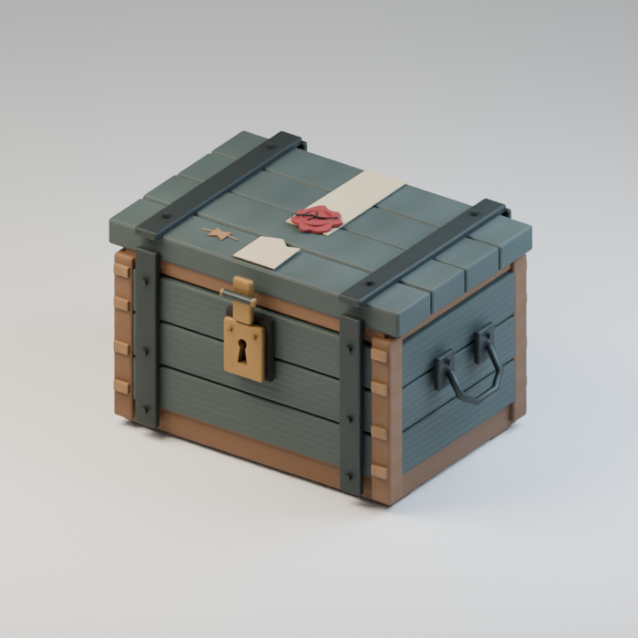

Use / purpose: Suspicious sealed chest, for the six-stall bridge market. First distribution of an earlier market design. Includes 1 model version(s); related variants share this record.

Record type: model. Formats: Unknown; inspect ZIP.

Reported dimensions (metres; XYZ when derived from measured bounds, legacy axis order not reverified): [0.438510000705719, 0.30699998140335083, 0.25599998235702515]. Triangles: Unknown.

Origin: Unknown / not independently confirmed. Orientation: Unknown / not independently confirmed.

[Download ZIP](https://github.com/k3peta/tales-on-a-table/releases/download/v2026.10.19-bridge-market/BM_024_CC0.zip) · [License scope](../../LICENSE.md)

**CC0-1.0** — See original ZIP license and repository license scope. Models and embedded materials only; previews excluded.

Source details: [Catalogue 1](../../catalog/bridge-market.en.md) · [Catalogue 2](../../catalog/bridge-market.md) · [Catalogue 3](../../catalog/bridge-market.zh-CN.md)

**Quality47:** 12792tri sealed box,original paint retained. [Details](../material_variants_bm021_bm030.md).

## BM_025

**Single leather boot**

片方だけの革靴

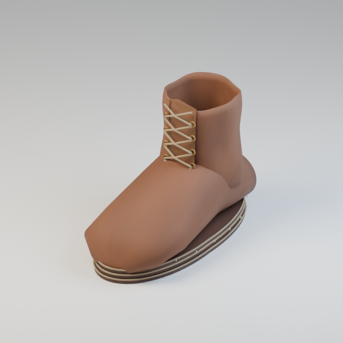

Use / purpose: Single leather boot, for the six-stall bridge market. First distribution of an earlier market design. Includes 1 model version(s); related variants share this record.

Record type: model. Formats: Unknown; inspect ZIP.

Reported dimensions (metres; XYZ when derived from measured bounds, legacy axis order not reverified): [0.1966981738805771, 0.4074000120162964, 0.28200000524520874]. Triangles: Unknown.

Origin: Unknown / not independently confirmed. Orientation: Unknown / not independently confirmed.

[Download ZIP](https://github.com/k3peta/tales-on-a-table/releases/download/v2026.10.19-bridge-market/BM_025_CC0.zip) · [License scope](../../LICENSE.md)

**CC0-1.0** — See original ZIP license and repository license scope. Models and embedded materials only; previews excluded.

Source details: [Catalogue 1](../../catalog/bridge-market.en.md) · [Catalogue 2](../../catalog/bridge-market.md) · [Catalogue 3](../../catalog/bridge-market.zh-CN.md)

**Quality47:** 8807tri single shoe,no pair/rig implied. [Details](../material_variants_bm021_bm030.md).

## BM_026

**Nameless mask**

名前のない仮面

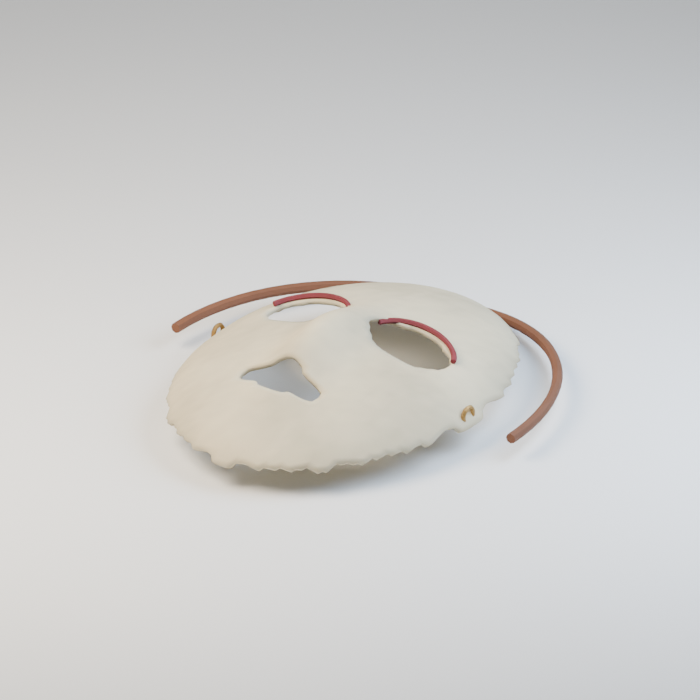

Use / purpose: Nameless mask, for the six-stall bridge market. First distribution of an earlier market design. Includes 1 model version(s); related variants share this record.

Record type: model. Formats: Unknown; inspect ZIP.

Reported dimensions (metres; XYZ when derived from measured bounds, legacy axis order not reverified): [0.3079952001571655, 0.3303477168083191, 0.0817594975233078]. Triangles: Unknown.

Origin: Unknown / not independently confirmed. Orientation: Unknown / not independently confirmed.

[Download ZIP](https://github.com/k3peta/tales-on-a-table/releases/download/v2026.10.19-bridge-market/BM_026_CC0.zip) · [License scope](../../LICENSE.md)

**CC0-1.0** — See original ZIP license and repository license scope. Models and embedded materials only; previews excluded.

Source details: [Catalogue 1](../../catalog/bridge-market.en.md) · [Catalogue 2](../../catalog/bridge-market.md) · [Catalogue 3](../../catalog/bridge-market.zh-CN.md)

**Quality47:** 9156tri;teal mask face only,geometry/UV/vertex colors retained. [Details](../material_variants_bm021_bm030.md).

## BM_027

**Foreign old coins**

異国の古銭

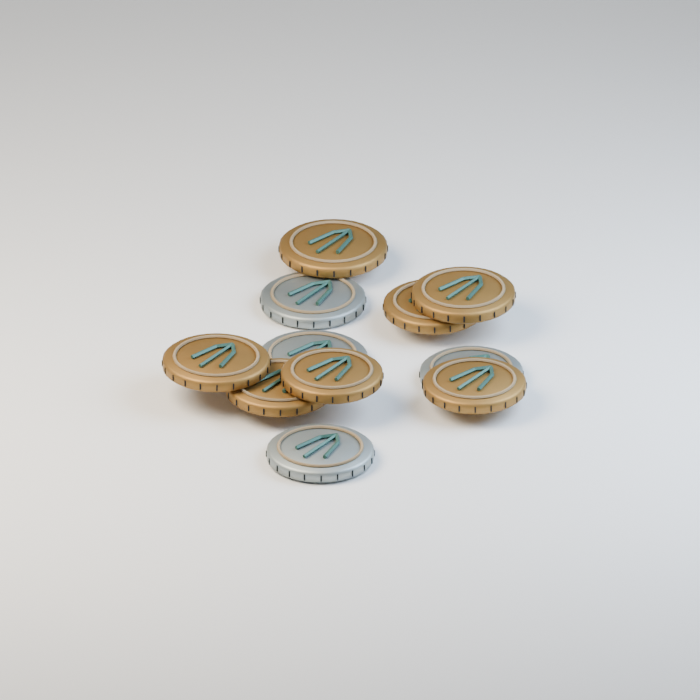

Use / purpose: Foreign old coins, for the six-stall bridge market. First distribution of an earlier market design. Includes 1 model version(s); related variants share this record.

Record type: model. Formats: Unknown; inspect ZIP.

Reported dimensions (metres; XYZ when derived from measured bounds, legacy axis order not reverified): [0.18055951595306396, 0.20790165662765503, 0.021951057016849518]. Triangles: Unknown.

Origin: Unknown / not independently confirmed. Orientation: Unknown / not independently confirmed.

[Download ZIP](https://github.com/k3peta/tales-on-a-table/releases/download/v2026.10.19-bridge-market/BM_027_CC0.zip) · [License scope](../../LICENSE.md)

**CC0-1.0** — See original ZIP license and repository license scope. Models and embedded materials only; previews excluded.

Source details: [Catalogue 1](../../catalog/bridge-market.en.md) · [Catalogue 2](../../catalog/bridge-market.md) · [Catalogue 3](../../catalog/bridge-market.zh-CN.md)

**Quality47:** 10406tri coin arrangement counted once. [Details](../material_variants_bm021_bm030.md).

## BM_028

**Unbalanced scales**

狂った天秤

Use / purpose: Unbalanced scales, for the six-stall bridge market. First distribution of an earlier market design. Includes 1 model version(s); related variants share this record.

Record type: model. Formats: Unknown; inspect ZIP.

Reported dimensions (metres; XYZ when derived from measured bounds, legacy axis order not reverified): [0.6240731477737427, 0.1940000057220459, 0.5099999904632568]. Triangles: Unknown.

Origin: Unknown / not independently confirmed. Orientation: Unknown / not independently confirmed.

[Download ZIP](https://github.com/k3peta/tales-on-a-table/releases/download/v2026.10.19-bridge-market/BM_028_CC0.zip) · [License scope](../../LICENSE.md)

**CC0-1.0** — See original ZIP license and repository license scope. Models and embedded materials only; previews excluded.

Source details: [Catalogue 1](../../catalog/bridge-market.en.md) · [Catalogue 2](../../catalog/bridge-market.md) · [Catalogue 3](../../catalog/bridge-market.zh-CN.md)

**Quality47:** 17853tri unbalanced theme,no weighing function. [Details](../material_variants_bm021_bm030.md).

## BM_029

**Back-alley lantern**

裏路地の提灯

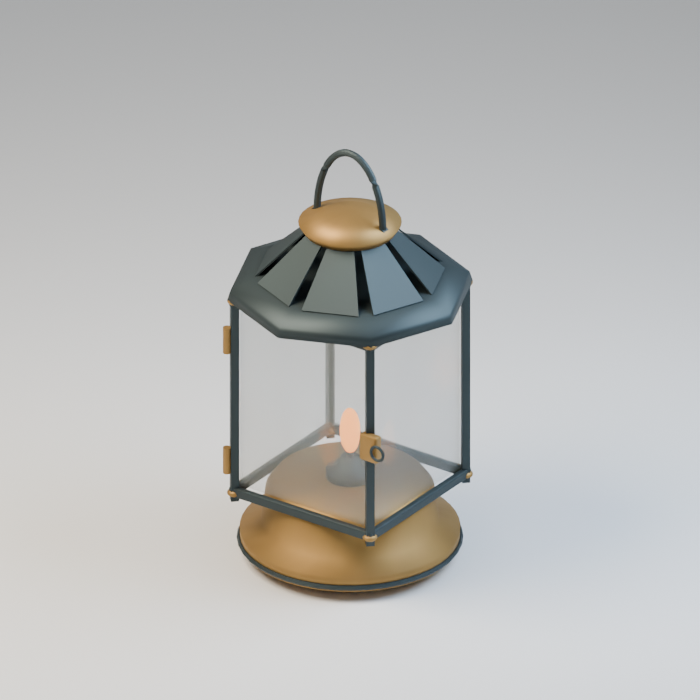

Use / purpose: Back-alley lantern, for the six-stall bridge market. First distribution of an earlier market design. Includes 1 model version(s); related variants share this record.

Record type: model. Formats: Unknown; inspect ZIP.

Reported dimensions (metres; XYZ when derived from measured bounds, legacy axis order not reverified): [0.2980000078678131, 0.2980000078678131, 0.5392797589302063]. Triangles: Unknown.

Origin: Unknown / not independently confirmed. Orientation: Unknown / not independently confirmed.

[Download ZIP](https://github.com/k3peta/tales-on-a-table/releases/download/v2026.10.19-bridge-market/BM_029_CC0.zip) · [License scope](../../LICENSE.md)

**CC0-1.0** — See original ZIP license and repository license scope. Models and embedded materials only; previews excluded.

Source details: [Catalogue 1](../../catalog/bridge-market.en.md) · [Catalogue 2](../../catalog/bridge-market.md) · [Catalogue 3](../../catalog/bridge-market.zh-CN.md)

**Quality47:** Original lantern7820tri retained;blueglass candidate rejected for exported GLB COLOR_0 mismatch,not published or public-base defect. [Details](../material_variants_bm021_bm030.md).

## BM_030

**Stranger's signet ring**

他人の紋章指輪

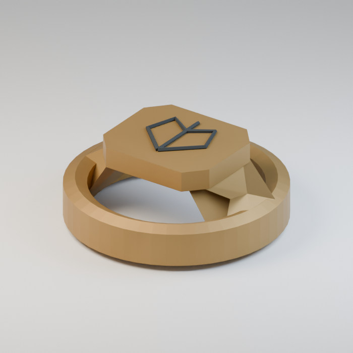

Use / purpose: Stranger's signet ring, for the six-stall bridge market. First distribution of an earlier market design. Includes 1 model version(s); related variants share this record.

Record type: model. Formats: Unknown; inspect ZIP.

Reported dimensions (metres; XYZ when derived from measured bounds, legacy axis order not reverified): [0.08399999886751175, 0.08399999886751175, 0.034300003200769424]. Triangles: Unknown.

Origin: Unknown / not independently confirmed. Orientation: Unknown / not independently confirmed.

[Download ZIP](https://github.com/k3peta/tales-on-a-table/releases/download/v2026.10.19-bridge-market/BM_030_CC0.zip) · [License scope](../../LICENSE.md)

**CC0-1.0** — See original ZIP license and repository license scope. Models and embedded materials only; previews excluded.

Source details: [Catalogue 1](../../catalog/bridge-market.en.md) · [Catalogue 2](../../catalog/bridge-market.md) · [Catalogue 3](../../catalog/bridge-market.zh-CN.md)

**Quality47:** 708tri signet ring,wearable fit untested. [Details](../material_variants_bm021_bm030.md).

## BM_031

**Clouded hand mirror**

曇った手鏡

Use / purpose: Clouded hand mirror, for the six-stall bridge market. First distribution of an earlier market design. Includes 1 model version(s); related variants share this record.

Record type: model. Formats: Unknown; inspect ZIP.

Reported dimensions (metres; XYZ when derived from measured bounds, legacy axis order not reverified): [0.20999999344348907, 0.4449999928474426, 0.029999999329447746]. Triangles: Unknown.

Origin: Unknown / not independently confirmed. Orientation: Unknown / not independently confirmed.

[Download ZIP](https://github.com/k3peta/tales-on-a-table/releases/download/v2026.10.19-bridge-market/BM_031_CC0.zip) · [License scope](../../LICENSE.md)

**CC0-1.0** — See original ZIP license and repository license scope. Models and embedded materials only; previews excluded.

Source details: [Catalogue 1](../../catalog/bridge-market.en.md) · [Catalogue 2](../../catalog/bridge-market.md) · [Catalogue 3](../../catalog/bridge-market.zh-CN.md)

**Quality48:** 1502tri;clouded mirror,physical optics unverified. [Details](../material_variants_bm031_bm040.md).

## BM_032

**Unsheathed dagger**

鞘のない短剣

Use / purpose: Unsheathed dagger, for the six-stall bridge market. First distribution of an earlier market design. Includes 3 model version(s); related variants share this record.

Record type: model. Formats: Unknown; inspect ZIP.

Reported dimensions (metres; XYZ when derived from measured bounds, legacy axis order not reverified): [0.18599998950958252, 0.6240000128746033, 0.052000001072883606]. Triangles: Unknown.

Origin: Unknown / not independently confirmed. Orientation: Unknown / not independently confirmed.

[Download ZIP](https://github.com/k3peta/tales-on-a-table/releases/download/v2026.10.19-bridge-market/BM_032_CC0.zip) · [License scope](../../LICENSE.md)

**CC0-1.0** — See original ZIP license and repository license scope. Models and embedded materials only; previews excluded.

Source details: [Catalogue 1](../../catalog/bridge-market.en.md) · [Catalogue 2](../../catalog/bridge-market.md) · [Catalogue 3](../../catalog/bridge-market.zh-CN.md)

**Quality48:** 4446tri dagger plus broken-hilt/gem-knife members;one record. [Details](../material_variants_bm031_bm040.md).

## BM_033

**Gear with missing tooth**

歯の欠けた歯車

Use / purpose: Gear with missing tooth, for the six-stall bridge market. First distribution of an earlier market design. Includes 1 model version(s); related variants share this record.

Record type: model. Formats: Unknown; inspect ZIP.

Reported dimensions (metres; XYZ when derived from measured bounds, legacy axis order not reverified): [0.2298865020275116, 0.2298865020275116, 0.02499999850988388]. Triangles: Unknown.

Origin: Unknown / not independently confirmed. Orientation: Unknown / not independently confirmed.

[Download ZIP](https://github.com/k3peta/tales-on-a-table/releases/download/v2026.10.19-bridge-market/BM_033_CC0.zip) · [License scope](../../LICENSE.md)

**CC0-1.0** — See original ZIP license and repository license scope. Models and embedded materials only; previews excluded.

Source details: [Catalogue 1](../../catalog/bridge-market.en.md) · [Catalogue 2](../../catalog/bridge-market.md) · [Catalogue 3](../../catalog/bridge-market.zh-CN.md)

**Quality48:** 5568tri;missing tooth intentional,no functional fit. [Details](../material_variants_bm031_bm040.md).

## BM_034

**Flattened cushion**

ぺしゃんこの座布団

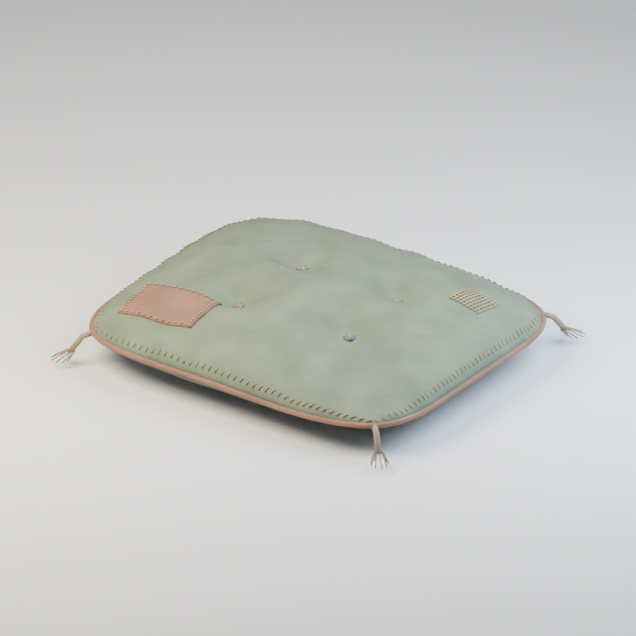

Use / purpose: Flattened cushion, for the six-stall bridge market. First distribution of an earlier market design. Includes 1 model version(s); related variants share this record.

Record type: model. Formats: Unknown; inspect ZIP.

Reported dimensions (metres; XYZ when derived from measured bounds, legacy axis order not reverified): [0.6735215187072754, 0.5897736549377441, 0.1302335411310196]. Triangles: Unknown.

Origin: Unknown / not independently confirmed. Orientation: Unknown / not independently confirmed.

[Download ZIP](https://github.com/k3peta/tales-on-a-table/releases/download/v2026.10.19-bridge-market/BM_034_CC0.zip) · [License scope](../../LICENSE.md)

**CC0-1.0** — See original ZIP license and repository license scope. Models and embedded materials only; previews excluded.

Source details: [Catalogue 1](../../catalog/bridge-market.en.md) · [Catalogue 2](../../catalog/bridge-market.md) · [Catalogue 3](../../catalog/bridge-market.zh-CN.md)

**Quality48:** 39742tri exceeds20k budget;rust-red fabric variant retains geometry/UV/colors. [Details](../material_variants_bm031_bm040.md).

## BM_035

**Small supply crate**

小さな仕入れ箱

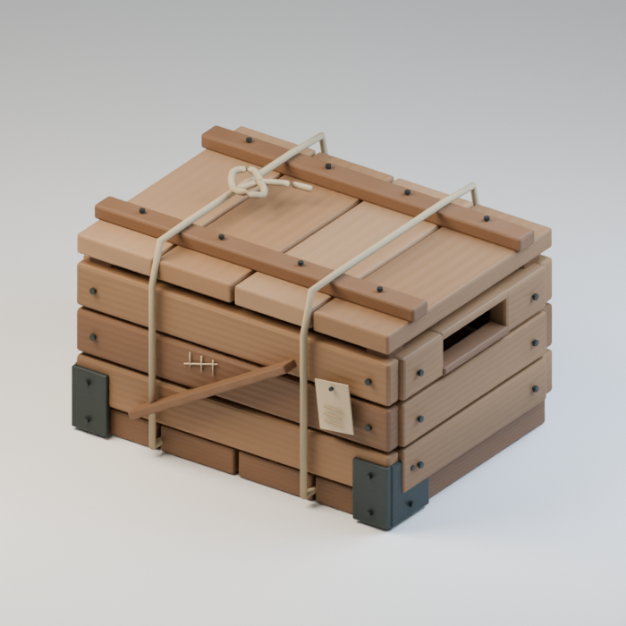

Use / purpose: Small supply crate, for the six-stall bridge market. First distribution of an earlier market design. Includes 1 model version(s); related variants share this record.

Record type: model. Formats: Unknown; inspect ZIP.

Reported dimensions (metres; XYZ when derived from measured bounds, legacy axis order not reverified): [0.4580000042915344, 0.36219608783721924, 0.28818279504776]. Triangles: Unknown.

Origin: Unknown / not independently confirmed. Orientation: Unknown / not independently confirmed.

[Download ZIP](https://github.com/k3peta/tales-on-a-table/releases/download/v2026.10.19-bridge-market/BM_035_CC0.zip) · [License scope](../../LICENSE.md)

**CC0-1.0** — See original ZIP license and repository license scope. Models and embedded materials only; previews excluded.

Source details: [Catalogue 1](../../catalog/bridge-market.en.md) · [Catalogue 2](../../catalog/bridge-market.md) · [Catalogue 3](../../catalog/bridge-market.zh-CN.md)

**Quality48:** 8588tri;static ties and contents,no physics. [Details](../material_variants_bm031_bm040.md).

## BM_036

**Open hardware crate**

金具入りの開いた木箱

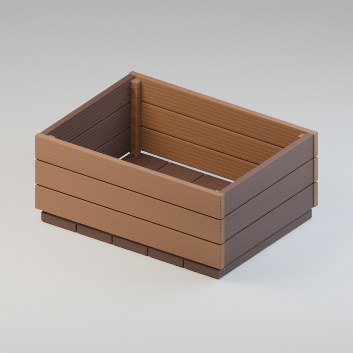

Use / purpose: Open hardware crate, for the six-stall bridge market. First distribution of an earlier market design. Includes 1 model version(s); related variants share this record.

Record type: model. Formats: Unknown; inspect ZIP.

Reported dimensions (metres; XYZ when derived from measured bounds, legacy axis order not reverified): [0.6039999723434448, 0.4480000138282776, 0.2590000033378601]. Triangles: Unknown.

Origin: Unknown / not independently confirmed. Orientation: Unknown / not independently confirmed.

[Download ZIP](https://github.com/k3peta/tales-on-a-table/releases/download/v2026.10.19-bridge-market/BM_036_CC0.zip) · [License scope](../../LICENSE.md)

**CC0-1.0** — See original ZIP license and repository license scope. Models and embedded materials only; previews excluded.

Source details: [Catalogue 1](../../catalog/bridge-market.en.md) · [Catalogue 2](../../catalog/bridge-market.md) · [Catalogue 3](../../catalog/bridge-market.zh-CN.md)

**Quality48:** 4864tri;contents assembly not additional records. [Details](../material_variants_bm031_bm040.md).

## BM_037

**Tied cloth bundle**

紐で括った布包み

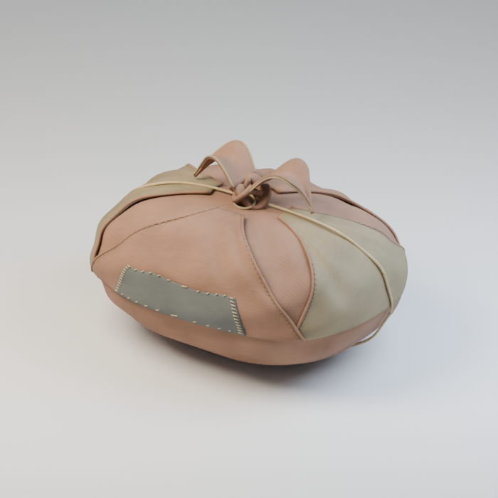

Use / purpose: Tied cloth bundle, for the six-stall bridge market. First distribution of an earlier market design. Includes 1 model version(s); related variants share this record.

Record type: model. Formats: Unknown; inspect ZIP.

Reported dimensions (metres; XYZ when derived from measured bounds, legacy axis order not reverified): [0.5193277597427368, 0.3995567560195923, 0.31550848484039307]. Triangles: Unknown.

Origin: Unknown / not independently confirmed. Orientation: Unknown / not independently confirmed.

[Download ZIP](https://github.com/k3peta/tales-on-a-table/releases/download/v2026.10.19-bridge-market/BM_037_CC0.zip) · [License scope](../../LICENSE.md)

**CC0-1.0** — See original ZIP license and repository license scope. Models and embedded materials only; previews excluded.

Source details: [Catalogue 1](../../catalog/bridge-market.en.md) · [Catalogue 2](../../catalog/bridge-market.md) · [Catalogue 3](../../catalog/bridge-market.zh-CN.md)

**Quality48:** 52220tri exceeds20k budget;blue fabric variant is not lightweight redesign. [Details](../material_variants_bm031_bm040.md).

## BM_038

**Rolled drawing tube**

巻き図面の筒

Use / purpose: Rolled drawing tube, for the six-stall bridge market. First distribution of an earlier market design. Includes 1 model version(s); related variants share this record.

Record type: model. Formats: Unknown; inspect ZIP.

Reported dimensions (metres; XYZ when derived from measured bounds, legacy axis order not reverified): [0.42089998722076416, 0.13794869184494019, 0.08799999952316284]. Triangles: Unknown.

Origin: Unknown / not independently confirmed. Orientation: Unknown / not independently confirmed.

[Download ZIP](https://github.com/k3peta/tales-on-a-table/releases/download/v2026.10.19-bridge-market/BM_038_CC0.zip) · [License scope](../../LICENSE.md)

**CC0-1.0** — See original ZIP license and repository license scope. Models and embedded materials only; previews excluded.

Source details: [Catalogue 1](../../catalog/bridge-market.en.md) · [Catalogue 2](../../catalog/bridge-market.md) · [Catalogue 3](../../catalog/bridge-market.zh-CN.md)

**Quality48:** 29196tri exceeds20k budget;no open/close rig. [Details](../material_variants_bm031_bm040.md).

## BM_039

**Repair iron offcut**

修理用の鉄端材

Use / purpose: Repair iron offcut, for the six-stall bridge market. First distribution of an earlier market design. Includes 1 model version(s); related variants share this record.

Record type: model. Formats: Unknown; inspect ZIP.

Reported dimensions (metres; XYZ when derived from measured bounds, legacy axis order not reverified): [0.3523627519607544, 0.32044312357902527, 0.0560000017285347]. Triangles: Unknown.

Origin: Unknown / not independently confirmed. Orientation: Unknown / not independently confirmed.

[Download ZIP](https://github.com/k3peta/tales-on-a-table/releases/download/v2026.10.19-bridge-market/BM_039_CC0.zip) · [License scope](../../LICENSE.md)

**CC0-1.0** — See original ZIP license and repository license scope. Models and embedded materials only; previews excluded.

Source details: [Catalogue 1](../../catalog/bridge-market.en.md) · [Catalogue 2](../../catalog/bridge-market.md) · [Catalogue 3](../../catalog/bridge-market.zh-CN.md)

**Quality48:** 864tri;iron-offcut arrangement one record. [Details](../material_variants_bm031_bm040.md).

## BM_040

**Intact dining fork**

全歯の揃ったフォーク

Use / purpose: Intact dining fork, for the six-stall bridge market. First distribution of an earlier market design. Includes 2 model version(s); related variants share this record.

Record type: model. Formats: Unknown; inspect ZIP.

Reported dimensions (metres; XYZ when derived from measured bounds, legacy axis order not reverified): [0.1318223923444748, 0.5220000147819519, 0.018000001087784767]. Triangles: Unknown.

Origin: Unknown / not independently confirmed. Orientation: Unknown / not independently confirmed.

[Download ZIP](https://github.com/k3peta/tales-on-a-table/releases/download/v2026.10.19-bridge-market/BM_040_CC0.zip) · [License scope](../../LICENSE.md)

**CC0-1.0** — See original ZIP license and repository license scope. Models and embedded materials only; previews excluded.

Source details: [Catalogue 1](../../catalog/bridge-market.en.md) · [Catalogue 2](../../catalog/bridge-market.md) · [Catalogue 3](../../catalog/bridge-market.zh-CN.md)

**Quality48:** 436tri plus broken-fork member;intentional derivative,not intact-model defect. [Details](../material_variants_bm031_bm040.md).

## BM_041

**Rusty corkscrew**

錆びたワインオープナー

Use / purpose: Rusty corkscrew, for the six-stall bridge market. First distribution of an earlier market design. Includes 1 model version(s); related variants share this record.

Record type: model. Formats: Unknown; inspect ZIP.

Reported dimensions (metres; XYZ when derived from measured bounds, legacy axis order not reverified): [0.30000001192092896, 0.45390868186950684, 0.08600001037120819]. Triangles: Unknown.

Origin: Unknown / not independently confirmed. Orientation: Unknown / not independently confirmed.

[Download ZIP](https://github.com/k3peta/tales-on-a-table/releases/download/v2026.10.19-bridge-market/BM_041_CC0.zip) · [License scope](../../LICENSE.md)

**CC0-1.0** — See original ZIP license and repository license scope. Models and embedded materials only; previews excluded.

Source details: [Catalogue 1](../../catalog/bridge-market.en.md) · [Catalogue 2](../../catalog/bridge-market.md) · [Catalogue 3](../../catalog/bridge-market.zh-CN.md)

**Quality49:** 8.263mm shank/helix gap bridged by48tri static connector;3472tri total,overlap not watertight union or strength guarantee. [Details](../material_variants_bm041_bm050.md).

## BM_042

**Dirty robe**

汚れたローブ

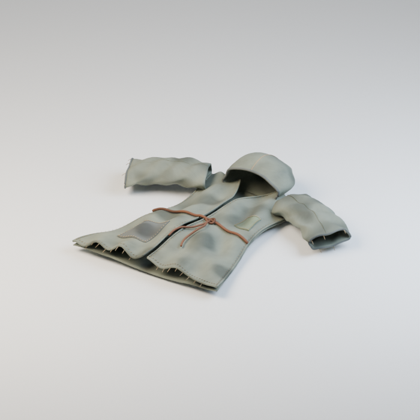

Use / purpose: Dirty robe, for the six-stall bridge market. First distribution of an earlier market design. Includes 1 model version(s); related variants share this record.

Record type: model. Formats: Unknown; inspect ZIP.

Reported dimensions (metres; XYZ when derived from measured bounds, legacy axis order not reverified): [1.0560535192489624, 0.9507893323898315, 0.17694871127605438]. Triangles: Unknown.

Origin: Unknown / not independently confirmed. Orientation: Unknown / not independently confirmed.

[Download ZIP](https://github.com/k3peta/tales-on-a-table/releases/download/v2026.10.19-bridge-market/BM_042_CC0.zip) · [License scope](../../LICENSE.md)

**CC0-1.0** — See original ZIP license and repository license scope. Models and embedded materials only; previews excluded.

Source details: [Catalogue 1](../../catalog/bridge-market.en.md) · [Catalogue 2](../../catalog/bridge-market.md) · [Catalogue 3](../../catalog/bridge-market.zh-CN.md)

**Quality49:** 60240tri over20k;rust-red robe tint,no wearable rig. [Details](../material_variants_bm041_bm050.md).

## BM_043

**Dirty bag**

汚れたバッグ

Use / purpose: Dirty bag, for the six-stall bridge market. First distribution of an earlier market design. Includes 1 model version(s); related variants share this record.

Record type: model. Formats: Unknown; inspect ZIP.

Reported dimensions (metres; XYZ when derived from measured bounds, legacy axis order not reverified): [0.4472000002861023, 0.30733007192611694, 0.5524688363075256]. Triangles: Unknown.

Origin: Unknown / not independently confirmed. Orientation: Unknown / not independently confirmed.

[Download ZIP](https://github.com/k3peta/tales-on-a-table/releases/download/v2026.10.19-bridge-market/BM_043_CC0.zip) · [License scope](../../LICENSE.md)

**CC0-1.0** — See original ZIP license and repository license scope. Models and embedded materials only; previews excluded.

Source details: [Catalogue 1](../../catalog/bridge-market.en.md) · [Catalogue 2](../../catalog/bridge-market.md) · [Catalogue 3](../../catalog/bridge-market.zh-CN.md)

**Quality49:** 60566tri over20k;blue bag tint,no budget redesign. [Details](../material_variants_bm041_bm050.md).

## BM_044

**Chipped magnifying glass**

欠けた拡大鏡

Use / purpose: Chipped magnifying glass, for the six-stall bridge market. First distribution of an earlier market design. Includes 1 model version(s); related variants share this record.

Record type: model. Formats: Unknown; inspect ZIP.

Reported dimensions (metres; XYZ when derived from measured bounds, legacy axis order not reverified): [0.264740914106369, 0.49898484349250793, 0.04780000075697899]. Triangles: Unknown.

Origin: Unknown / not independently confirmed. Orientation: Unknown / not independently confirmed.

[Download ZIP](https://github.com/k3peta/tales-on-a-table/releases/download/v2026.10.19-bridge-market/BM_044_CC0.zip) · [License scope](../../LICENSE.md)

**CC0-1.0** — See original ZIP license and repository license scope. Models and embedded materials only; previews excluded.

Source details: [Catalogue 1](../../catalog/bridge-market.en.md) · [Catalogue 2](../../catalog/bridge-market.md) · [Catalogue 3](../../catalog/bridge-market.zh-CN.md)
**Quality49:** 3152tri;chipped lens intentional,no optical accuracy guarantee. [Details](../material_variants_bm041_bm050.md).
