# Base distribution records 481–504

[Browse index](README.md) · [Coverage and missing fields](COVERAGE.md)

Images are actual existing model renders for browsing, not covered by model CC0. A group record may show several reused models. Dimensions and triangle counts apply only to the original record when sourced; revisions can differ. Unknown means unverified, not zero. No blanket CC0 grant for scenes, images, code or articles.

## BM_045

**Loaded handcart**

荷物を運んできた荷車

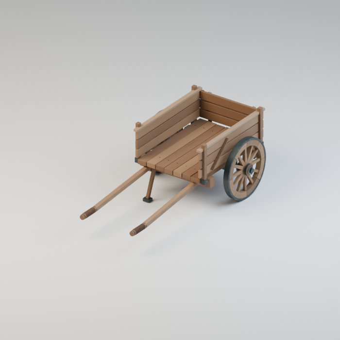

Use / purpose: Loaded handcart, for the six-stall bridge market. First distribution of an earlier market design. Includes 1 model version(s); related variants share this record.

Record type: model. Formats: Unknown; inspect ZIP.

Reported dimensions (metres; XYZ when derived from measured bounds, legacy axis order not reverified): [1.4539999961853027, 2.6399998664855957, 0.9685000777244568]. Triangles: Unknown.

Origin: Unknown / not independently confirmed. Orientation: Unknown / not independently confirmed.

[Download ZIP](https://github.com/k3peta/tales-on-a-table/releases/download/v2026.10.19-bridge-market/BM_045_CC0.zip) · [License scope](../../LICENSE.md)

**CC0-1.0** — See original ZIP license and repository license scope. Models and embedded materials only; previews excluded.

Source details: [Catalogue 1](../../catalog/bridge-market.en.md) · [Catalogue 2](../../catalog/bridge-market.md) · [Catalogue 3](../../catalog/bridge-market.zh-CN.md)

**Quality49:** 42600tri below50k assembly warning;static cart,no load/rolling test. [Details](../material_variants_bm041_bm050.md).

## BM_046

**Wooden pack frame**

木の背負いこ

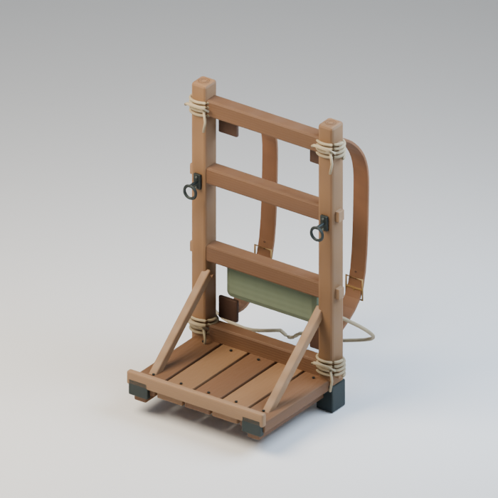

Use / purpose: Wooden pack frame, for the six-stall bridge market. First distribution of an earlier market design. Includes 1 model version(s); related variants share this record.

Record type: model. Formats: Unknown; inspect ZIP.

Reported dimensions (metres; XYZ when derived from measured bounds, legacy axis order not reverified): [0.6212618350982666, 0.643486738204956, 0.9730629324913025]. Triangles: Unknown.

Origin: Unknown / not independently confirmed. Orientation: Unknown / not independently confirmed.

[Download ZIP](https://github.com/k3peta/tales-on-a-table/releases/download/v2026.10.19-bridge-market/BM_046_CC0.zip) · [License scope](../../LICENSE.md)

**CC0-1.0** — See original ZIP license and repository license scope. Models and embedded materials only; previews excluded.

Source details: [Catalogue 1](../../catalog/bridge-market.en.md) · [Catalogue 2](../../catalog/bridge-market.md) · [Catalogue 3](../../catalog/bridge-market.zh-CN.md)

**Quality49:** 21624tri over20k;backpack frame wearable fit untested. [Details](../material_variants_bm041_bm050.md).

## BM_047

**Backpack travelling library**

背負う形の携帯書庫

Use / purpose: Backpack travelling library, for the six-stall bridge market. First distribution of an earlier market design. Includes 1 model version(s); related variants share this record.

Record type: model. Formats: Unknown; inspect ZIP.

Reported dimensions (metres; XYZ when derived from measured bounds, legacy axis order not reverified): [0.6940000057220459, 0.6420179009437561, 1.0440000295639038]. Triangles: Unknown.

Origin: Unknown / not independently confirmed. Orientation: Unknown / not independently confirmed.

[Download ZIP](https://github.com/k3peta/tales-on-a-table/releases/download/v2026.10.19-bridge-market/BM_047_CC0.zip) · [License scope](../../LICENSE.md)

**CC0-1.0** — See original ZIP license and repository license scope. Models and embedded materials only; previews excluded.

Source details: [Catalogue 1](../../catalog/bridge-market.en.md) · [Catalogue 2](../../catalog/bridge-market.md) · [Catalogue 3](../../catalog/bridge-market.zh-CN.md)

**Quality49:** 60626tri over20k;books are components of one portable-library record. [Details](../material_variants_bm041_bm050.md).

## BM_048

**Resting market donkey**

市の傍らに佇むロバ

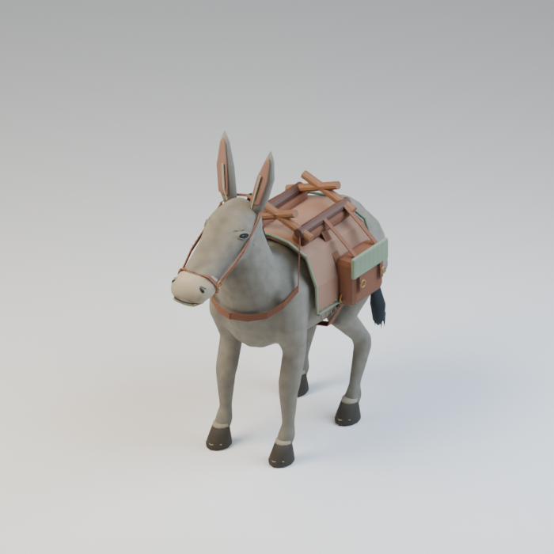

Use / purpose: Resting market donkey, for the six-stall bridge market. First distribution of an earlier market design. Includes 1 model version(s); related variants share this record.

Record type: model. Formats: Unknown; inspect ZIP.

Reported dimensions (metres; XYZ when derived from measured bounds, legacy axis order not reverified): [0.916928231716156, 1.8539801836013794, 2.0270001888275146]. Triangles: Unknown.

Origin: Unknown / not independently confirmed. Orientation: Unknown / not independently confirmed.

[Download ZIP](https://github.com/k3peta/tales-on-a-table/releases/download/v2026.10.19-bridge-market/BM_048_CC0.zip) · [License scope](../../LICENSE.md)

**CC0-1.0** — See original ZIP license and repository license scope. Models and embedded materials only; previews excluded.

Source details: [Catalogue 1](../../catalog/bridge-market.en.md) · [Catalogue 2](../../catalog/bridge-market.md) · [Catalogue 3](../../catalog/bridge-market.zh-CN.md)

**Quality49:** 66103tri exceeds provisional50k static-display warning;no dedicated animal threshold,no rig/anatomy guarantee. [Details](../material_variants_bm041_bm050.md).

## BM_049

**Donkey water bucket**

ロバの水桶

Use / purpose: Donkey water bucket, for the six-stall bridge market. First distribution of an earlier market design. Includes 1 model version(s); related variants share this record.

Record type: model. Formats: Unknown; inspect ZIP.

Reported dimensions (metres; XYZ when derived from measured bounds, legacy axis order not reverified): [0.328000009059906, 0.31200000643730164, 0.32399454712867737]. Triangles: Unknown.

Origin: Unknown / not independently confirmed. Orientation: Unknown / not independently confirmed.

[Download ZIP](https://github.com/k3peta/tales-on-a-table/releases/download/v2026.10.19-bridge-market/BM_049_CC0.zip) · [License scope](../../LICENSE.md)

**CC0-1.0** — See original ZIP license and repository license scope. Models and embedded materials only; previews excluded.

Source details: [Catalogue 1](../../catalog/bridge-market.en.md) · [Catalogue 2](../../catalog/bridge-market.md) · [Catalogue 3](../../catalog/bridge-market.zh-CN.md)

**Quality49:** 2512tri bucket,static water,no fluid simulation. [Details](../material_variants_bm041_bm050.md).

## BM_050

**Filled feed bag**

飼葉の入った袋

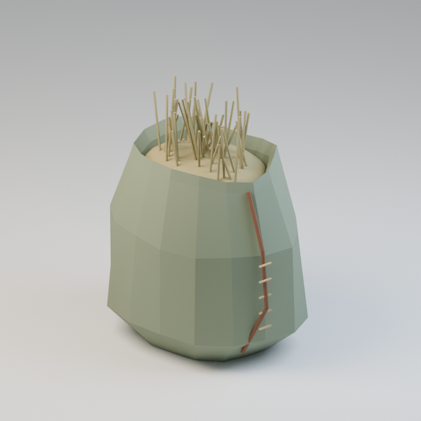

Use / purpose: Filled feed bag, for the six-stall bridge market. First distribution of an earlier market design. Includes 1 model version(s); related variants share this record.

Record type: model. Formats: Unknown; inspect ZIP.

Reported dimensions (metres; XYZ when derived from measured bounds, legacy axis order not reverified): [0.30000001192092896, 0.23999999463558197, 0.38494259119033813]. Triangles: Unknown.

Origin: Unknown / not independently confirmed. Orientation: Unknown / not independently confirmed.

[Download ZIP](https://github.com/k3peta/tales-on-a-table/releases/download/v2026.10.19-bridge-market/BM_050_CC0.zip) · [License scope](../../LICENSE.md)

**CC0-1.0** — See original ZIP license and repository license scope. Models and embedded materials only; previews excluded.

Source details: [Catalogue 1](../../catalog/bridge-market.en.md) · [Catalogue 2](../../catalog/bridge-market.md) · [Catalogue 3](../../catalog/bridge-market.zh-CN.md)

**Quality49:** 1738tri fodder bag,faceted low-poly style retained. [Details](../material_variants_bm041_bm050.md).

## BM_051

**Cart wheel chock**

荷車の車止め

Use / purpose: Cart wheel chock, for the six-stall bridge market. First distribution of an earlier market design. Includes 1 model version(s); related variants share this record.

Record type: model. Formats: Unknown; inspect ZIP.

Reported dimensions (metres; XYZ when derived from measured bounds, legacy axis order not reverified): [0.2564641237258911, 0.12999999523162842, 0.10499999672174454]. Triangles: Unknown.

Origin: Unknown / not independently confirmed. Orientation: Unknown / not independently confirmed.

[Download ZIP](https://github.com/k3peta/tales-on-a-table/releases/download/v2026.10.19-bridge-market/BM_051_CC0.zip) · [License scope](../../LICENSE.md)

**CC0-1.0** — See original ZIP license and repository license scope. Models and embedded materials only; previews excluded.

Source details: [Catalogue 1](../../catalog/bridge-market.en.md) · [Catalogue 2](../../catalog/bridge-market.md) · [Catalogue 3](../../catalog/bridge-market.zh-CN.md)

**Quality50:** 312tri wheel chock;contact/load untested. [Details](../material_variants_bm051_bm060.md).

## BM_052

**Uncoiled cargo rope**

解いた荷縄

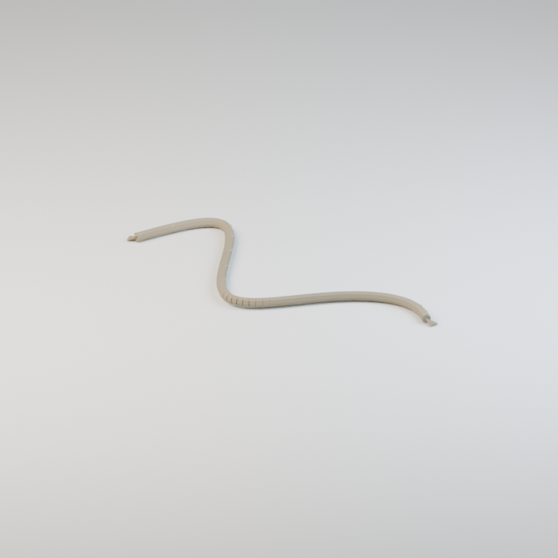

Use / purpose: Uncoiled cargo rope, for the six-stall bridge market. First distribution of an earlier market design. Includes 1 model version(s); related variants share this record.

Record type: model. Formats: Unknown; inspect ZIP.

Reported dimensions (metres; XYZ when derived from measured bounds, legacy axis order not reverified): [0.5331175327301025, 0.20195724070072174, 0.01599999889731407]. Triangles: Unknown.

Origin: Unknown / not independently confirmed. Orientation: Unknown / not independently confirmed.

[Download ZIP](https://github.com/k3peta/tales-on-a-table/releases/download/v2026.10.19-bridge-market/BM_052_CC0.zip) · [License scope](../../LICENSE.md)

**CC0-1.0** — See original ZIP license and repository license scope. Models and embedded materials only; previews excluded.

Source details: [Catalogue 1](../../catalog/bridge-market.en.md) · [Catalogue 2](../../catalog/bridge-market.md) · [Catalogue 3](../../catalog/bridge-market.zh-CN.md)

**Quality50:** 2288tri intentional loose rope,no cable physics. [Details](../material_variants_bm051_bm060.md).

## BM_053

**Rolled rain cover**

巻いた雨よけ布

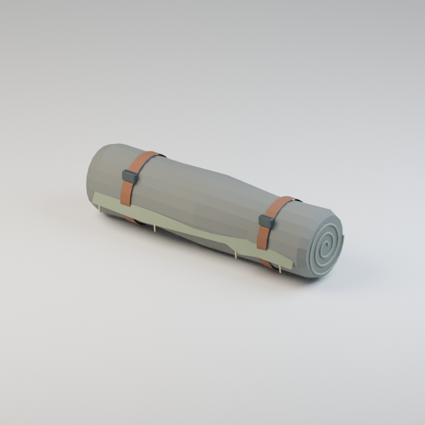

Use / purpose: Rolled rain cover, for the six-stall bridge market. First distribution of an earlier market design. Includes 1 model version(s); related variants share this record.

Record type: model. Formats: Unknown; inspect ZIP.

Reported dimensions (metres; XYZ when derived from measured bounds, legacy axis order not reverified): [0.6074000000953674, 0.1812172383069992, 0.16790500283241272]. Triangles: Unknown.

Origin: Unknown / not independently confirmed. Orientation: Unknown / not independently confirmed.

[Download ZIP](https://github.com/k3peta/tales-on-a-table/releases/download/v2026.10.19-bridge-market/BM_053_CC0.zip) · [License scope](../../LICENSE.md)

**CC0-1.0** — See original ZIP license and repository license scope. Models and embedded materials only; previews excluded.

Source details: [Catalogue 1](../../catalog/bridge-market.en.md) · [Catalogue 2](../../catalog/bridge-market.md) · [Catalogue 3](../../catalog/bridge-market.zh-CN.md)

**Quality50:** 5082tri rolled raincloth,straps/layers retained. [Details](../material_variants_bm051_bm060.md).

## BM_054

**Unfinished cup of tea**

飲みかけの茶

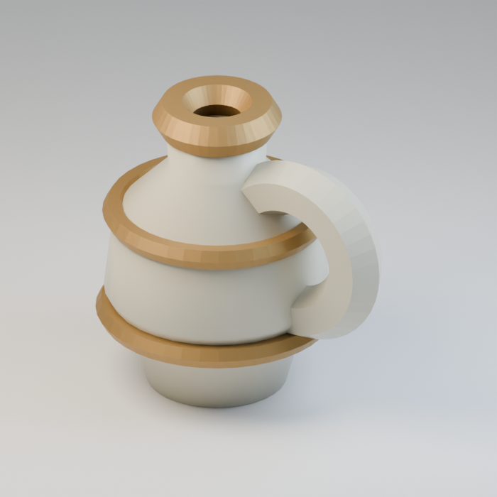

Use / purpose: Unfinished cup of tea, for the six-stall bridge market. First distribution of an earlier market design. Includes 1 model version(s); related variants share this record.

Record type: model. Formats: Unknown; inspect ZIP.

Reported dimensions (metres; XYZ when derived from measured bounds, legacy axis order not reverified): [0.24095000326633453, 0.18290001153945923, 0.23299038410186768]. Triangles: Unknown.

Origin: Unknown / not independently confirmed. Orientation: Unknown / not independently confirmed.

[Download ZIP](https://github.com/k3peta/tales-on-a-table/releases/download/v2026.10.19-bridge-market/BM_054_CC0.zip) · [License scope](../../LICENSE.md)

**CC0-1.0** — See original ZIP license and repository license scope. Models and embedded materials only; previews excluded.

Source details: [Catalogue 1](../../catalog/bridge-market.en.md) · [Catalogue 2](../../catalog/bridge-market.md) · [Catalogue 3](../../catalog/bridge-market.zh-CN.md)

**Quality50:** 2744tri tea vessel;narrow mouth limits content readability,detached liquid not established,generator intent unavailable;diagnosis open. [Details](../material_variants_bm051_bm060.md).

## BM_055

**Bitten bread**

食べかけのパン

Use / purpose: Bitten bread, for the six-stall bridge market. First distribution of an earlier market design. Includes 1 model version(s); related variants share this record.

Record type: model. Formats: Unknown; inspect ZIP.

Reported dimensions (metres; XYZ when derived from measured bounds, legacy axis order not reverified): [0.2770000100135803, 0.1383296400308609, 0.09300000220537186]. Triangles: Unknown.

Origin: Unknown / not independently confirmed. Orientation: Unknown / not independently confirmed.

[Download ZIP](https://github.com/k3peta/tales-on-a-table/releases/download/v2026.10.19-bridge-market/BM_055_CC0.zip) · [License scope](../../LICENSE.md)

**CC0-1.0** — See original ZIP license and repository license scope. Models and embedded materials only; previews excluded.

Source details: [Catalogue 1](../../catalog/bridge-market.en.md) · [Catalogue 2](../../catalog/bridge-market.md) · [Catalogue 3](../../catalog/bridge-market.zh-CN.md)

**Quality50:** 1796tri bitten bread,crumbs intentional not separate models. [Details](../material_variants_bm051_bm060.md).

## BM_056

**Bundle of old letters**

束ねた古い手紙

Use / purpose: Bundle of old letters, for the six-stall bridge market. First distribution of an earlier market design. Includes 1 model version(s); related variants share this record.

Record type: model. Formats: Unknown; inspect ZIP.

Reported dimensions (metres; XYZ when derived from measured bounds, legacy axis order not reverified): [0.2696878910064697, 0.19211837649345398, 0.05057545378804207]. Triangles: Unknown.

Origin: Unknown / not independently confirmed. Orientation: Unknown / not independently confirmed.

[Download ZIP](https://github.com/k3peta/tales-on-a-table/releases/download/v2026.10.19-bridge-market/BM_056_CC0.zip) · [License scope](../../LICENSE.md)

**CC0-1.0** — See original ZIP license and repository license scope. Models and embedded materials only; previews excluded.

Source details: [Catalogue 1](../../catalog/bridge-market.en.md) · [Catalogue 2](../../catalog/bridge-market.md) · [Catalogue 3](../../catalog/bridge-market.zh-CN.md)

**Quality50:** 1806tri tied letters,string/seal retained. [Details](../material_variants_bm051_bm060.md).

## BM_057

**Rolled old map**

巻き上げた古地図

Use / purpose: Rolled old map, for the six-stall bridge market. First distribution of an earlier market design. Includes 2 model version(s); related variants share this record.

Record type: model. Formats: Unknown; inspect ZIP.

Reported dimensions (metres; XYZ when derived from measured bounds, legacy axis order not reverified): [0.275982141494751, 0.30169999599456787, 0.09228968620300293]. Triangles: Unknown.

Origin: Unknown / not independently confirmed. Orientation: Unknown / not independently confirmed.

[Download ZIP](https://github.com/k3peta/tales-on-a-table/releases/download/v2026.10.19-bridge-market/BM_057_CC0.zip) · [License scope](../../LICENSE.md)

**CC0-1.0** — See original ZIP license and repository license scope. Models and embedded materials only; previews excluded.

Source details: [Catalogue 1](../../catalog/bridge-market.en.md) · [Catalogue 2](../../catalog/bridge-market.md) · [Catalogue 3](../../catalog/bridge-market.zh-CN.md)

**Quality50:** 15886tri map plus15309tri rolled-painting member;one distribution record. [Details](../material_variants_bm051_bm060.md).

## BM_058

**Planked trestle counter**

組み木の陳列台

Use / purpose: Planked trestle counter, for the six-stall bridge market. A new design for this revision. Includes 1 model version(s); related variants share this record.

Record type: model. Formats: Unknown; inspect ZIP.

Reported dimensions (metres; XYZ when derived from measured bounds, legacy axis order not reverified): [2.7920000553131104, 1.100000023841858, 0.8482643365859985]. Triangles: Unknown.

Origin: Unknown / not independently confirmed. Orientation: Unknown / not independently confirmed.

[Download ZIP](https://github.com/k3peta/tales-on-a-table/releases/download/v2026.10.19-bridge-market/BM_058_CC0.zip) · [License scope](../../LICENSE.md)

**CC0-1.0** — See original ZIP license and repository license scope. Models and embedded materials only; previews excluded.

Source details: [Catalogue 1](../../catalog/bridge-market.en.md) · [Catalogue 2](../../catalog/bridge-market.md) · [Catalogue 3](../../catalog/bridge-market.zh-CN.md)

**Quality50:** 1952tri display table below50k;structural strength untested. [Details](../material_variants_bm051_bm060.md).

## BM_059

**Striped canvas awning**

縞布の市庇

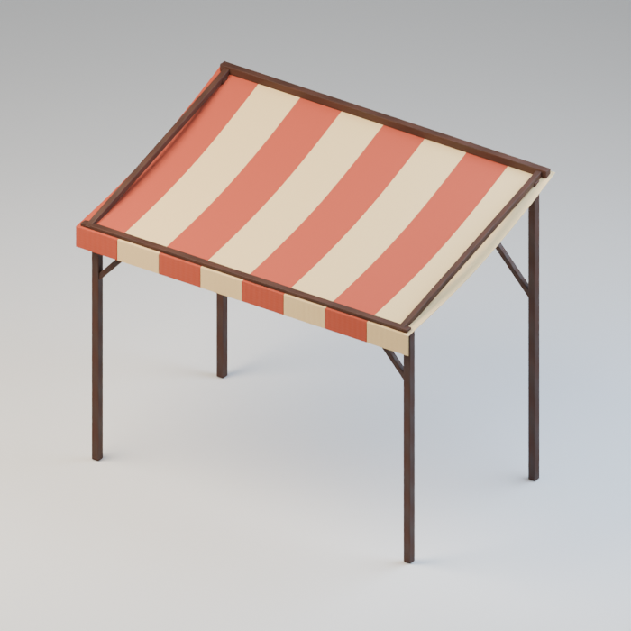

Use / purpose: Striped canvas awning, for the six-stall bridge market. A new design for this revision. Includes 1 model version(s); related variants share this record.

Record type: model. Formats: Unknown; inspect ZIP.

Reported dimensions (metres; XYZ when derived from measured bounds, legacy axis order not reverified): [3.200000047683716, 2.0059356689453125, 2.723904848098755]. Triangles: Unknown.

Origin: Unknown / not independently confirmed. Orientation: Unknown / not independently confirmed.

[Download ZIP](https://github.com/k3peta/tales-on-a-table/releases/download/v2026.10.19-bridge-market/BM_059_CC0.zip) · [License scope](../../LICENSE.md)

**CC0-1.0** — See original ZIP license and repository license scope. Models and embedded materials only; previews excluded.

Source details: [Catalogue 1](../../catalog/bridge-market.en.md) · [Catalogue 2](../../catalog/bridge-market.md) · [Catalogue 3](../../catalog/bridge-market.zh-CN.md)

**Quality50:** 3304tri awning;blue/green stripe variants retain geometry/UV/attribute presence and other material channels. [Details](../material_variants_bm051_bm060.md).

## BM_060

**Woven basket**

編み籠

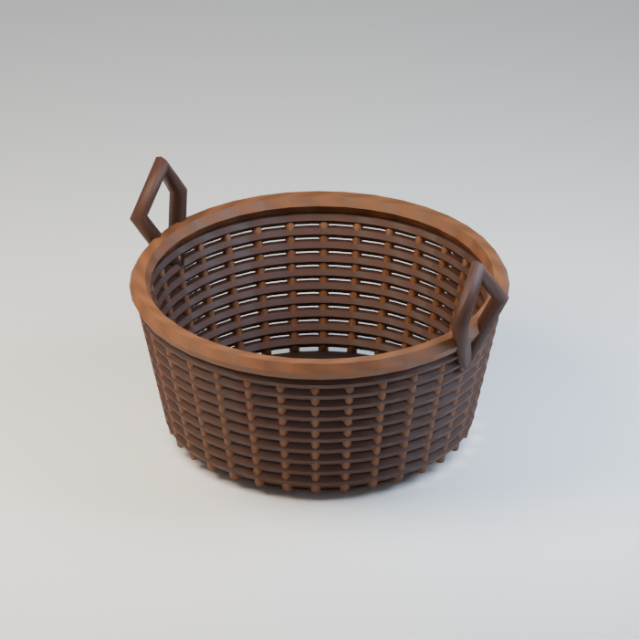

Use / purpose: Woven basket, for the six-stall bridge market. A new design for this revision. Includes 1 model version(s); related variants share this record.

Record type: model. Formats: Unknown; inspect ZIP.

Reported dimensions (metres; XYZ when derived from measured bounds, legacy axis order not reverified): [0.7147955298423767, 0.6600000262260437, 0.4359999895095825]. Triangles: Unknown.

Origin: Unknown / not independently confirmed. Orientation: Unknown / not independently confirmed.

[Download ZIP](https://github.com/k3peta/tales-on-a-table/releases/download/v2026.10.19-bridge-market/BM_060_CC0.zip) · [License scope](../../LICENSE.md)

**CC0-1.0** — See original ZIP license and repository license scope. Models and embedded materials only; previews excluded.

Source details: [Catalogue 1](../../catalog/bridge-market.en.md) · [Catalogue 2](../../catalog/bridge-market.md) · [Catalogue 3](../../catalog/bridge-market.zh-CN.md)

**Quality50:** 12020tri basket below20k;woven sides/rim retained. [Details](../material_variants_bm051_bm060.md).

## BM_061

**Leafy cabbage**

葉付きキャベツ

Use / purpose: Leafy cabbage, for the six-stall bridge market. A new design for this revision. Includes 1 model version(s); related variants share this record.

Record type: model. Formats: Unknown; inspect ZIP.

Reported dimensions (metres; XYZ when derived from measured bounds, legacy axis order not reverified): [0.33245348930358887, 0.33314022421836853, 0.29975005984306335]. Triangles: Unknown.

Origin: Unknown / not independently confirmed. Orientation: Unknown / not independently confirmed.

[Download ZIP](https://github.com/k3peta/tales-on-a-table/releases/download/v2026.10.19-bridge-market/BM_061_CC0.zip) · [License scope](../../LICENSE.md)

**CC0-1.0** — See original ZIP license and repository license scope. Models and embedded materials only; previews excluded.

Source details: [Catalogue 1](../../catalog/bridge-market.en.md) · [Catalogue 2](../../catalog/bridge-market.md) · [Catalogue 3](../../catalog/bridge-market.zh-CN.md)

**Quality51:** 35000tri over20k;cabbage purple variant is not geometry repair;vein redesign unimplemented,normal-reference defect not established. [Details](../material_variants_bm061_bm070.md).

## BM_062

**Carrot with greens**

葉付き人参

Use / purpose: Carrot with greens, for the six-stall bridge market. A new design for this revision. Includes 1 model version(s); related variants share this record.

Record type: model. Formats: Unknown; inspect ZIP.

Reported dimensions (metres; XYZ when derived from measured bounds, legacy axis order not reverified): [0.16523441672325134, 0.13192984461784363, 0.3879999816417694]. Triangles: Unknown.

Origin: Unknown / not independently confirmed. Orientation: Unknown / not independently confirmed.

[Download ZIP](https://github.com/k3peta/tales-on-a-table/releases/download/v2026.10.19-bridge-market/BM_062_CC0.zip) · [License scope](../../LICENSE.md)

**CC0-1.0** — See original ZIP license and repository license scope. Models and embedded materials only; previews excluded.

Source details: [Catalogue 1](../../catalog/bridge-market.en.md) · [Catalogue 2](../../catalog/bridge-market.md) · [Catalogue 3](../../catalog/bridge-market.zh-CN.md)

**Quality51:** 7156tri stylized carrot;original morphology retained. [Details](../material_variants_bm061_bm070.md).

## BM_063

**Onion**

玉葱

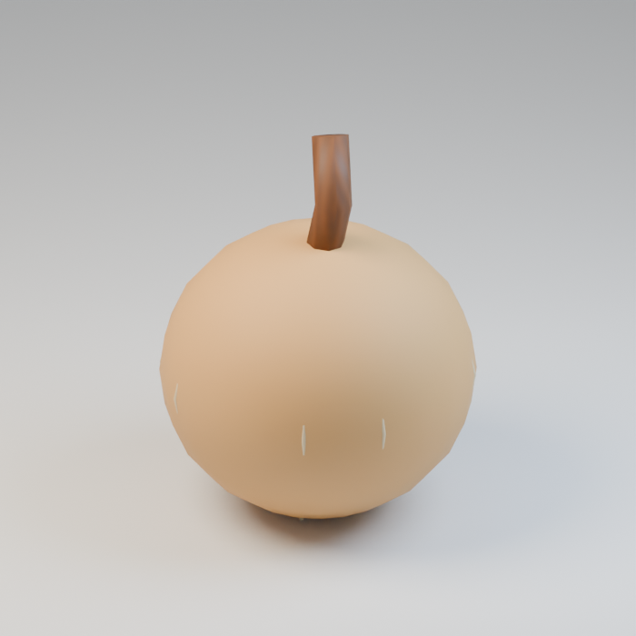

Use / purpose: Onion, for the six-stall bridge market. A new design for this revision. Includes 1 model version(s); related variants share this record.

Record type: model. Formats: Unknown; inspect ZIP.

Reported dimensions (metres; XYZ when derived from measured bounds, legacy axis order not reverified): [0.15000005066394806, 0.15000002086162567, 0.19366510212421417]. Triangles: Unknown.

Origin: Unknown / not independently confirmed. Orientation: Unknown / not independently confirmed.

[Download ZIP](https://github.com/k3peta/tales-on-a-table/releases/download/v2026.10.19-bridge-market/BM_063_CC0.zip) · [License scope](../../LICENSE.md)

**CC0-1.0** — See original ZIP license and repository license scope. Models and embedded materials only; previews excluded.

Source details: [Catalogue 1](../../catalog/bridge-market.en.md) · [Catalogue 2](../../catalog/bridge-market.md) · [Catalogue 3](../../catalog/bridge-market.zh-CN.md)

**Quality51:** 3100tri onion;red body/ribs,roots and neck unchanged;not over20k. [Details](../material_variants_bm061_bm070.md).

## BM_064

**Jewellery display stand**

装身具の陳列掛け

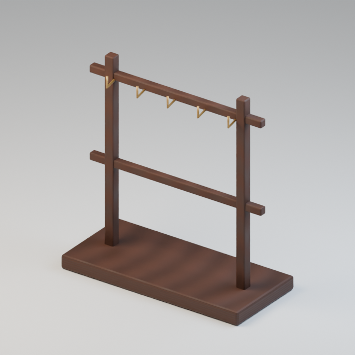

Use / purpose: Jewellery display stand, for the six-stall bridge market. A new design for this revision. Includes 1 model version(s); related variants share this record.

Record type: model. Formats: Unknown; inspect ZIP.

Reported dimensions (metres; XYZ when derived from measured bounds, legacy axis order not reverified): [0.699999988079071, 0.3199999928474426, 0.7400000095367432]. Triangles: Unknown.

Origin: Unknown / not independently confirmed. Orientation: Unknown / not independently confirmed.

[Download ZIP](https://github.com/k3peta/tales-on-a-table/releases/download/v2026.10.19-bridge-market/BM_064_CC0.zip) · [License scope](../../LICENSE.md)

**CC0-1.0** — See original ZIP license and repository license scope. Models and embedded materials only; previews excluded.

Source details: [Catalogue 1](../../catalog/bridge-market.en.md) · [Catalogue 2](../../catalog/bridge-market.md) · [Catalogue 3](../../catalog/bridge-market.zh-CN.md)

**Quality51:** 760tri empty display stand intentional;load untested. [Details](../material_variants_bm061_bm070.md).

## BM_065

**Gemstone necklace**

宝石の首飾り

Use / purpose: Gemstone necklace, for the six-stall bridge market. A new design for this revision. Includes 1 model version(s); related variants share this record.

Record type: model. Formats: Unknown; inspect ZIP.

Reported dimensions (metres; XYZ when derived from measured bounds, legacy axis order not reverified): [0.20600000023841858, 0.01600000262260437, 0.300493448972702]. Triangles: Unknown.

Origin: Unknown / not independently confirmed. Orientation: Unknown / not independently confirmed.

[Download ZIP](https://github.com/k3peta/tales-on-a-table/releases/download/v2026.10.19-bridge-market/BM_065_CC0.zip) · [License scope](../../LICENSE.md)

**CC0-1.0** — See original ZIP license and repository license scope. Models and embedded materials only; previews excluded.

Source details: [Catalogue 1](../../catalog/bridge-market.en.md) · [Catalogue 2](../../catalog/bridge-market.md) · [Catalogue 3](../../catalog/bridge-market.zh-CN.md)

**Quality51:** 5916tri necklace;minor gem recolor not produced. [Details](../material_variants_bm061_bm070.md).

## BM_066

**Decorative comb**

飾り櫛

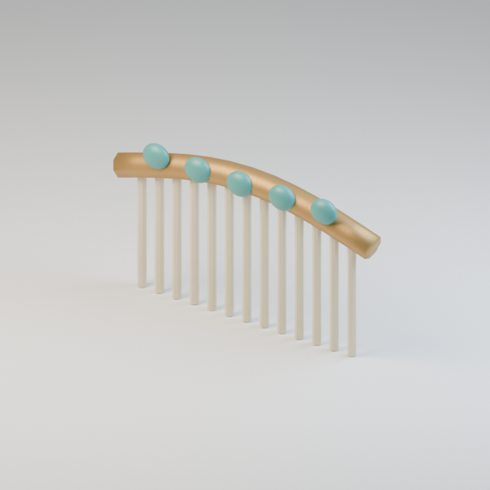

Use / purpose: Decorative comb, for the six-stall bridge market. A new design for this revision. Includes 1 model version(s); related variants share this record.

Record type: model. Formats: Unknown; inspect ZIP.

Reported dimensions (metres; XYZ when derived from measured bounds, legacy axis order not reverified): [0.18474571406841278, 0.020000003278255463, 0.10099999606609344]. Triangles: Unknown.

Origin: Unknown / not independently confirmed. Orientation: Unknown / not independently confirmed.

[Download ZIP](https://github.com/k3peta/tales-on-a-table/releases/download/v2026.10.19-bridge-market/BM_066_CC0.zip) · [License scope](../../LICENSE.md)

**CC0-1.0** — See original ZIP license and repository license scope. Models and embedded materials only; previews excluded.

Source details: [Catalogue 1](../../catalog/bridge-market.en.md) · [Catalogue 2](../../catalog/bridge-market.md) · [Catalogue 3](../../catalog/bridge-market.zh-CN.md)

**Quality51:** 2768tri comb;hair/fit simulation untested. [Details](../material_variants_bm061_bm070.md).

## BM_067

**Flower hairpin**

花の髪留め

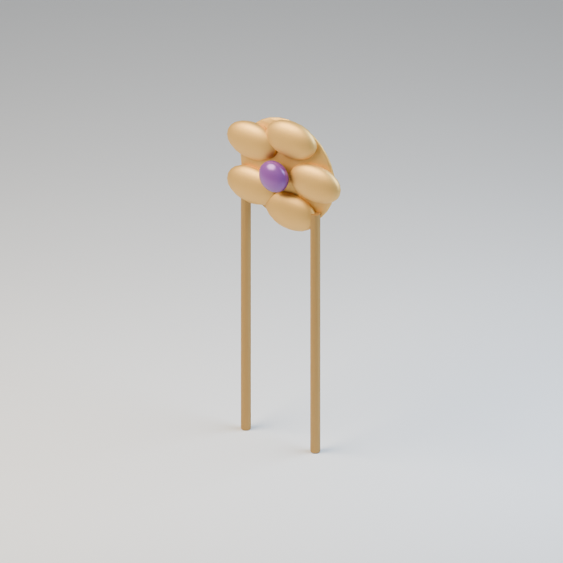

Use / purpose: Flower hairpin, for the six-stall bridge market. A new design for this revision. Includes 1 model version(s); related variants share this record.

Record type: model. Formats: Unknown; inspect ZIP.

Reported dimensions (metres; XYZ when derived from measured bounds, legacy axis order not reverified): [0.0812254399061203, 0.021000001579523087, 0.21377640962600708]. Triangles: Unknown.

Origin: Unknown / not independently confirmed. Orientation: Unknown / not independently confirmed.

[Download ZIP](https://github.com/k3peta/tales-on-a-table/releases/download/v2026.10.19-bridge-market/BM_067_CC0.zip) · [License scope](../../LICENSE.md)

**CC0-1.0** — See original ZIP license and repository license scope. Models and embedded materials only; previews excluded.

Source details: [Catalogue 1](../../catalog/bridge-market.en.md) · [Catalogue 2](../../catalog/bridge-market.md) · [Catalogue 3](../../catalog/bridge-market.zh-CN.md)

**Quality51:** 3928tri flower hairpin;minor center recolor not produced. [Details](../material_variants_bm061_bm070.md).

## BM_068

**Charcoal skewer grill**

炭火の串焼き台

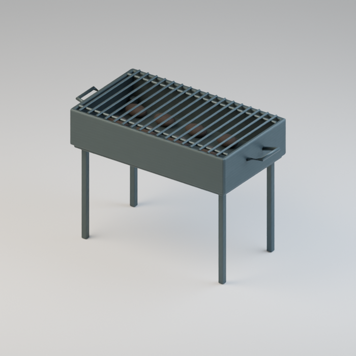

Use / purpose: Charcoal skewer grill, for the six-stall bridge market. A new design for this revision. Includes 1 model version(s); related variants share this record.

Record type: model. Formats: Unknown; inspect ZIP.

Reported dimensions (metres; XYZ when derived from measured bounds, legacy axis order not reverified): [1.315998911857605, 0.625, 0.8570001125335693]. Triangles: Unknown.

Origin: Unknown / not independently confirmed. Orientation: Unknown / not independently confirmed.

[Download ZIP](https://github.com/k3peta/tales-on-a-table/releases/download/v2026.10.19-bridge-market/BM_068_CC0.zip) · [License scope](../../LICENSE.md)

**CC0-1.0** — See original ZIP license and repository license scope. Models and embedded materials only; previews excluded.

Source details: [Catalogue 1](../../catalog/bridge-market.en.md) · [Catalogue 2](../../catalog/bridge-market.md) · [Catalogue 3](../../catalog/bridge-market.zh-CN.md)
**Quality51:** 14856tri grill below50k;no thermal/safety guarantee. [Details](../material_variants_bm061_bm070.md).
