# Base distribution records 505–528

[Browse index](README.md) · [Coverage and missing fields](COVERAGE.md)

Images are actual existing model renders for browsing, not covered by model CC0. A group record may show several reused models. Dimensions and triangle counts apply only to the original record when sourced; revisions can differ. Unknown means unverified, not zero. No blanket CC0 grant for scenes, images, code or articles.

## BM_069

**Meat and vegetable skewer**

肉と野菜の串焼き

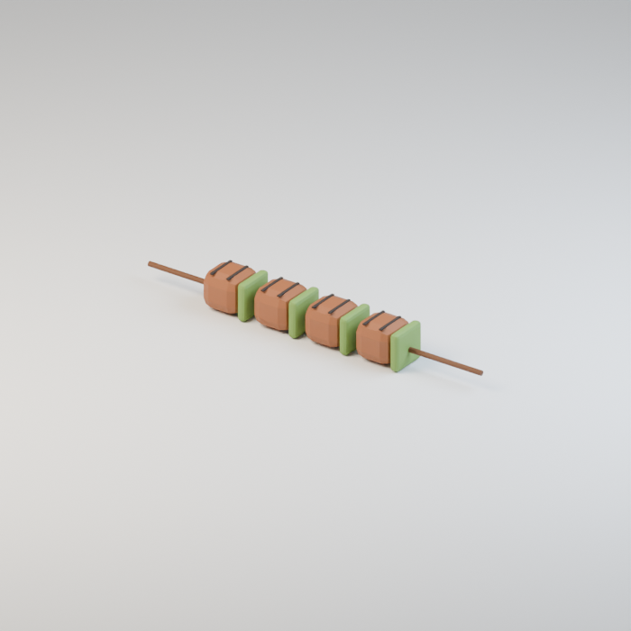

Use / purpose: Meat and vegetable skewer, for the six-stall bridge market. A new design for this revision. Includes 1 model version(s); related variants share this record.

Record type: model. Formats: Unknown; inspect ZIP.

Reported dimensions (metres; XYZ when derived from measured bounds, legacy axis order not reverified): [0.49000000953674316, 0.054999999701976776, 0.05199999734759331]. Triangles: Unknown.

Origin: Unknown / not independently confirmed. Orientation: Unknown / not independently confirmed.

[Download ZIP](https://github.com/k3peta/tales-on-a-table/releases/download/v2026.10.19-bridge-market/BM_069_CC0.zip) · [License scope](../../LICENSE.md)

**CC0-1.0** — See original ZIP license and repository license scope. Models and embedded materials only; previews excluded.

Source details: [Catalogue 1](../../catalog/bridge-market.en.md) · [Catalogue 2](../../catalog/bridge-market.md) · [Catalogue 3](../../catalog/bridge-market.zh-CN.md)

## BM_070

**Brass kettle**

真鍮の湯沸かし

Use / purpose: Brass kettle, for the six-stall bridge market. A new design for this revision. Includes 1 model version(s); related variants share this record.

Record type: model. Formats: Unknown; inspect ZIP.

Reported dimensions (metres; XYZ when derived from measured bounds, legacy axis order not reverified): [0.42466574907302856, 0.38094016909599304, 0.43199998140335083]. Triangles: Unknown.

Origin: Unknown / not independently confirmed. Orientation: Unknown / not independently confirmed.

[Download ZIP](https://github.com/k3peta/tales-on-a-table/releases/download/v2026.10.19-bridge-market/BM_070_CC0.zip) · [License scope](../../LICENSE.md)

**CC0-1.0** — See original ZIP license and repository license scope. Models and embedded materials only; previews excluded.

Source details: [Catalogue 1](../../catalog/bridge-market.en.md) · [Catalogue 2](../../catalog/bridge-market.md) · [Catalogue 3](../../catalog/bridge-market.zh-CN.md)

## BM_071

**Parapet sparrow**

欄干の雀

Use / purpose: Parapet sparrow, for the six-stall bridge market. A new design for this revision. Includes 1 model version(s); related variants share this record.

Record type: model. Formats: Unknown; inspect ZIP.

Reported dimensions (metres; XYZ when derived from measured bounds, legacy axis order not reverified): [0.07800000160932541, 0.191918283700943, 0.1454349160194397]. Triangles: Unknown.

Origin: Unknown / not independently confirmed. Orientation: Unknown / not independently confirmed.

[Download ZIP](https://github.com/k3peta/tales-on-a-table/releases/download/v2026.10.19-bridge-market/BM_071_CC0.zip) · [License scope](../../LICENSE.md)

**CC0-1.0** — See original ZIP license and repository license scope. Models and embedded materials only; previews excluded.

Source details: [Catalogue 1](../../catalog/bridge-market.en.md) · [Catalogue 2](../../catalog/bridge-market.md) · [Catalogue 3](../../catalog/bridge-market.zh-CN.md)

## BM_072

**Wooden serving platter**

木の給仕皿

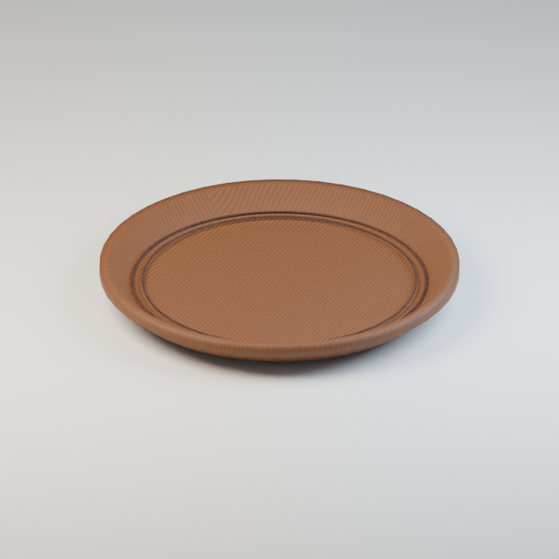

Use / purpose: Wooden serving platter, for the six-stall bridge market. A new design for this revision. Includes 1 model version(s); related variants share this record.

Record type: model. Formats: Unknown; inspect ZIP.

Reported dimensions (metres; XYZ when derived from measured bounds, legacy axis order not reverified): [0.5400000214576721, 0.5400000214576721, 0.054999999701976776]. Triangles: Unknown.

Origin: Unknown / not independently confirmed. Orientation: Unknown / not independently confirmed.

[Download ZIP](https://github.com/k3peta/tales-on-a-table/releases/download/v2026.10.19-bridge-market/BM_072_CC0.zip) · [License scope](../../LICENSE.md)

**CC0-1.0** — See original ZIP license and repository license scope. Models and embedded materials only; previews excluded.

Source details: [Catalogue 1](../../catalog/bridge-market.en.md) · [Catalogue 2](../../catalog/bridge-market.md) · [Catalogue 3](../../catalog/bridge-market.zh-CN.md)

## BM_073

**Tomato with stalk**

蔕付きトマト

Use / purpose: Tomato with stalk, for the six-stall bridge market. A new design for this revision. Includes 1 model version(s); related variants share this record.

Record type: model. Formats: Unknown; inspect ZIP.

Reported dimensions (metres; XYZ when derived from measured bounds, legacy axis order not reverified): [0.13200002908706665, 0.12000001221895218, 0.13100968301296234]. Triangles: Unknown.

Origin: Unknown / not independently confirmed. Orientation: Unknown / not independently confirmed.

[Download ZIP](https://github.com/k3peta/tales-on-a-table/releases/download/v2026.10.19-bridge-market/BM_073_CC0.zip) · [License scope](../../LICENSE.md)

**CC0-1.0** — See original ZIP license and repository license scope. Models and embedded materials only; previews excluded.

Source details: [Catalogue 1](../../catalog/bridge-market.en.md) · [Catalogue 2](../../catalog/bridge-market.md) · [Catalogue 3](../../catalog/bridge-market.zh-CN.md)

## BM_074

**Ribbed pumpkin**

肋のある南瓜

Use / purpose: Ribbed pumpkin, for the six-stall bridge market. A new design for this revision. Includes 1 model version(s); related variants share this record.

Record type: model. Formats: Unknown; inspect ZIP.

Reported dimensions (metres; XYZ when derived from measured bounds, legacy axis order not reverified): [0.2900000214576721, 0.28216904401779175, 0.25734981894493103]. Triangles: Unknown.

Origin: Unknown / not independently confirmed. Orientation: Unknown / not independently confirmed.

[Download ZIP](https://github.com/k3peta/tales-on-a-table/releases/download/v2026.10.19-bridge-market/BM_074_CC0.zip) · [License scope](../../LICENSE.md)

**CC0-1.0** — See original ZIP license and repository license scope. Models and embedded materials only; previews excluded.

Source details: [Catalogue 1](../../catalog/bridge-market.en.md) · [Catalogue 2](../../catalog/bridge-market.md) · [Catalogue 3](../../catalog/bridge-market.zh-CN.md)

## BM_075

**Gilled mushroom**

襞付き茸

Use / purpose: Gilled mushroom, for the six-stall bridge market. A new design for this revision. Includes 1 model version(s); related variants share this record.

Record type: model. Formats: Unknown; inspect ZIP.

Reported dimensions (metres; XYZ when derived from measured bounds, legacy axis order not reverified): [0.15000000596046448, 0.15000000596046448, 0.13500000536441803]. Triangles: Unknown.

Origin: Unknown / not independently confirmed. Orientation: Unknown / not independently confirmed.

[Download ZIP](https://github.com/k3peta/tales-on-a-table/releases/download/v2026.10.19-bridge-market/BM_075_CC0.zip) · [License scope](../../LICENSE.md)

**CC0-1.0** — See original ZIP license and repository license scope. Models and embedded materials only; previews excluded.

Source details: [Catalogue 1](../../catalog/bridge-market.en.md) · [Catalogue 2](../../catalog/bridge-market.md) · [Catalogue 3](../../catalog/bridge-market.zh-CN.md)

## BM_076

**Forged iron frying pan**

鍛鉄のフライパン

Use / purpose: Forged iron frying pan, for the six-stall bridge market. A new design for this revision. Includes 1 model version(s); related variants share this record.

Record type: model. Formats: Unknown; inspect ZIP.

Reported dimensions (metres; XYZ when derived from measured bounds, legacy axis order not reverified): [0.7480000257492065, 0.41999998688697815, 0.08596513420343399]. Triangles: Unknown.

Origin: Unknown / not independently confirmed. Orientation: Unknown / not independently confirmed.

[Download ZIP](https://github.com/k3peta/tales-on-a-table/releases/download/v2026.10.19-bridge-market/BM_076_CC0.zip) · [License scope](../../LICENSE.md)

**CC0-1.0** — See original ZIP license and repository license scope. Models and embedded materials only; previews excluded.

Source details: [Catalogue 1](../../catalog/bridge-market.en.md) · [Catalogue 2](../../catalog/bridge-market.md) · [Catalogue 3](../../catalog/bridge-market.zh-CN.md)

## BM_077

**Forged iron ladle**

鍛鉄のお玉

Use / purpose: Forged iron ladle, for the six-stall bridge market. A new design for this revision. Includes 1 model version(s); related variants share this record.

Record type: model. Formats: Unknown; inspect ZIP.

Reported dimensions (metres; XYZ when derived from measured bounds, legacy axis order not reverified): [0.3871554136276245, 0.11999999731779099, 0.3577611446380615]. Triangles: Unknown.

Origin: Unknown / not independently confirmed. Orientation: Unknown / not independently confirmed.

[Download ZIP](https://github.com/k3peta/tales-on-a-table/releases/download/v2026.10.19-bridge-market/BM_077_CC0.zip) · [License scope](../../LICENSE.md)

**CC0-1.0** — See original ZIP license and repository license scope. Models and embedded materials only; previews excluded.

Source details: [Catalogue 1](../../catalog/bridge-market.en.md) · [Catalogue 2](../../catalog/bridge-market.md) · [Catalogue 3](../../catalog/bridge-market.zh-CN.md)

## BM_078

**Housewares hanging rack**

日用品の吊り下げ棚

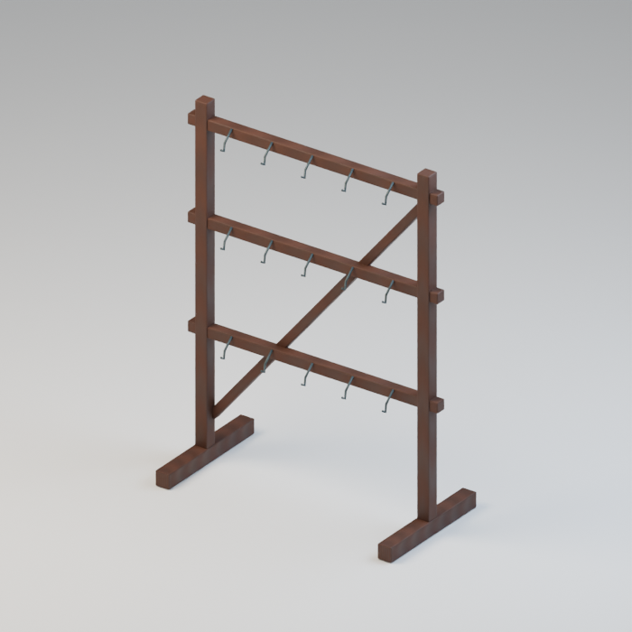

Use / purpose: Housewares hanging rack, for the six-stall bridge market. A new design for this revision. Includes 1 model version(s); related variants share this record.

Record type: model. Formats: Unknown; inspect ZIP.

Reported dimensions (metres; XYZ when derived from measured bounds, legacy axis order not reverified): [1.2400000095367432, 0.6000000238418579, 1.6500000953674316]. Triangles: Unknown.

Origin: Unknown / not independently confirmed. Orientation: Unknown / not independently confirmed.

[Download ZIP](https://github.com/k3peta/tales-on-a-table/releases/download/v2026.10.19-bridge-market/BM_078_CC0.zip) · [License scope](../../LICENSE.md)

**CC0-1.0** — See original ZIP license and repository license scope. Models and embedded materials only; previews excluded.

Source details: [Catalogue 1](../../catalog/bridge-market.en.md) · [Catalogue 2](../../catalog/bridge-market.md) · [Catalogue 3](../../catalog/bridge-market.zh-CN.md)

## BM_079

**Divided merchandise tray**

仕切り付き品物箱

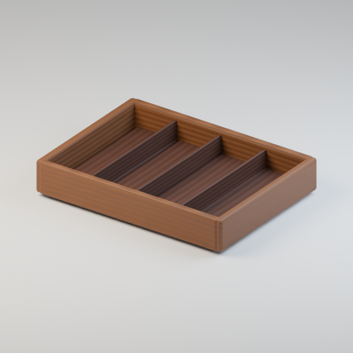

Use / purpose: Divided merchandise tray, for the six-stall bridge market. A new design for this revision. Includes 1 model version(s); related variants share this record.

Record type: model. Formats: Unknown; inspect ZIP.

Reported dimensions (metres; XYZ when derived from measured bounds, legacy axis order not reverified): [0.625, 0.4650000035762787, 0.10999999940395355]. Triangles: Unknown.

Origin: Unknown / not independently confirmed. Orientation: Unknown / not independently confirmed.

[Download ZIP](https://github.com/k3peta/tales-on-a-table/releases/download/v2026.10.19-bridge-market/BM_079_CC0.zip) · [License scope](../../LICENSE.md)

**CC0-1.0** — See original ZIP license and repository license scope. Models and embedded materials only; previews excluded.

Source details: [Catalogue 1](../../catalog/bridge-market.en.md) · [Catalogue 2](../../catalog/bridge-market.md) · [Catalogue 3](../../catalog/bridge-market.zh-CN.md)

## BM_080

**Gem-set bracelet**

石付き腕輪

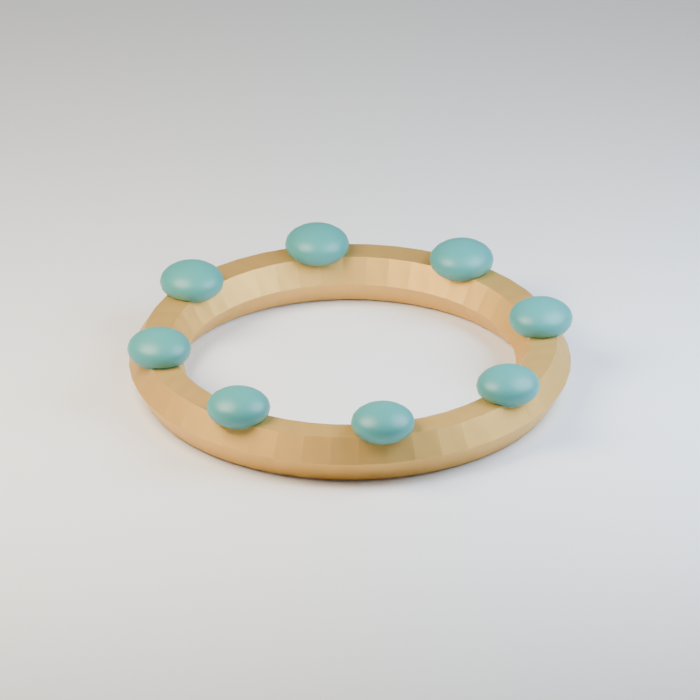

Use / purpose: Gem-set bracelet, for the six-stall bridge market. A new design for this revision. Includes 1 model version(s); related variants share this record.

Record type: model. Formats: Unknown; inspect ZIP.

Reported dimensions (metres; XYZ when derived from measured bounds, legacy axis order not reverified): [0.09800000488758087, 0.09800000488758087, 0.016196152195334435]. Triangles: Unknown.

Origin: Unknown / not independently confirmed. Orientation: Unknown / not independently confirmed.

[Download ZIP](https://github.com/k3peta/tales-on-a-table/releases/download/v2026.10.19-bridge-market/BM_080_CC0.zip) · [License scope](../../LICENSE.md)

**CC0-1.0** — See original ZIP license and repository license scope. Models and embedded materials only; previews excluded.

Source details: [Catalogue 1](../../catalog/bridge-market.en.md) · [Catalogue 2](../../catalog/bridge-market.md) · [Catalogue 3](../../catalog/bridge-market.zh-CN.md)

## BM_081

**Teardrop earrings**

雫形の耳飾り

Use / purpose: Teardrop earrings, for the six-stall bridge market. A new design for this revision. Includes 1 model version(s); related variants share this record.

Record type: model. Formats: Unknown; inspect ZIP.

Reported dimensions (metres; XYZ when derived from measured bounds, legacy axis order not reverified): [0.08799999952316284, 0.010000001639127731, 0.07149741053581238]. Triangles: Unknown.

Origin: Unknown / not independently confirmed. Orientation: Unknown / not independently confirmed.

[Download ZIP](https://github.com/k3peta/tales-on-a-table/releases/download/v2026.10.19-bridge-market/BM_081_CC0.zip) · [License scope](../../LICENSE.md)

**CC0-1.0** — See original ZIP license and repository license scope. Models and embedded materials only; previews excluded.

Source details: [Catalogue 1](../../catalog/bridge-market.en.md) · [Catalogue 2](../../catalog/bridge-market.md) · [Catalogue 3](../../catalog/bridge-market.zh-CN.md)

## BM_082

**Hanging shop sign**

吊り看板

Use / purpose: Hanging shop sign, for the six-stall bridge market. A new design for this revision. Includes 1 model version(s); related variants share this record.

Record type: model. Formats: Unknown; inspect ZIP.

Reported dimensions (metres; XYZ when derived from measured bounds, legacy axis order not reverified): [0.75, 0.08699999749660492, 0.4099999964237213]. Triangles: Unknown.

Origin: Unknown / not independently confirmed. Orientation: Unknown / not independently confirmed.

[Download ZIP](https://github.com/k3peta/tales-on-a-table/releases/download/v2026.10.19-bridge-market/BM_082_CC0.zip) · [License scope](../../LICENSE.md)

**CC0-1.0** — See original ZIP license and repository license scope. Models and embedded materials only; previews excluded.

Source details: [Catalogue 1](../../catalog/bridge-market.en.md) · [Catalogue 2](../../catalog/bridge-market.md) · [Catalogue 3](../../catalog/bridge-market.zh-CN.md)

## BM_083

**Stall valance cloth**

屋台の前掛け布

Use / purpose: Stall valance cloth, for the six-stall bridge market. A new design for this revision. Includes 1 model version(s); related variants share this record.

Record type: model. Formats: Unknown; inspect ZIP.

Reported dimensions (metres; XYZ when derived from measured bounds, legacy axis order not reverified): [3.0002379417419434, 0.02197340875864029, 0.7300682067871094]. Triangles: Unknown.

Origin: Unknown / not independently confirmed. Orientation: Unknown / not independently confirmed.

[Download ZIP](https://github.com/k3peta/tales-on-a-table/releases/download/v2026.10.19-bridge-market/BM_083_CC0.zip) · [License scope](../../LICENSE.md)

**CC0-1.0** — See original ZIP license and repository license scope. Models and embedded materials only; previews excluded.

Source details: [Catalogue 1](../../catalog/bridge-market.en.md) · [Catalogue 2](../../catalog/bridge-market.md) · [Catalogue 3](../../catalog/bridge-market.zh-CN.md)

## FP001

**Fixed cell grille**

固定鉄格子

[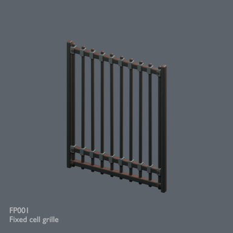](../../previews/prison-fp001-024/renders/FP001.png)

[Full-size image](../../previews/prison-fp001-024/renders/FP001.png)

Use / purpose: Fixed cell grille — static prop for a fictional prison scene. Visual set dressing; no functional simulation, collision or LOD supplied.

Record type: model. Formats: BLEND/GLB.

Measured dimensions (Blender-convention X × Y × Z, metres): [2.245, 0.1265, 2.8]. Scene-instance triangles: 5100.

Origin: Encoded GLB root transform recorded; intended placement pivot unknown for this prop. Orientation: BLEND documented Z-up; GLB native Y-up. Intended prop-facing direction not specified.

[Download ZIP](https://github.com/k3peta/tales-on-a-table/releases/download/v2026.10.20-prison/FP001_Fixed_cell_grille.zip) · [License scope](../../LICENSE.md)

**CC0-1.0** — See original ZIP license and repository license scope. Models and embedded materials only; previews excluded.

Source details: [Catalogue 1](../../catalog/prison.en.md) · [Catalogue 2](../../catalog/prison.md) · [Catalogue 3](../../catalog/prison.zh-CN.md)

[Measurement evidence and limitations](PILOT-24-METHOD.md). Source ZIP SHA-256: `731f28c3627c6e28e46706ccd97517c741146bf24dff1eb0147fa5cc82706a3e`.

## FP002

**Barred cell gate**

格子扉

[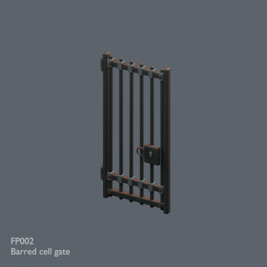](../../previews/prison-fp001-024/renders/FP002.png)

[Full-size image](../../previews/prison-fp001-024/renders/FP002.png)

Use / purpose: Barred cell gate — static prop for a fictional prison scene. Visual set dressing; no functional simulation, collision or LOD supplied.

Record type: model. Formats: BLEND/GLB.

Measured dimensions (Blender-convention X × Y × Z, metres): [1.3475, 0.223, 2.77]. Scene-instance triangles: 5968.

Origin: Encoded GLB root transform recorded; intended placement pivot unknown for this prop. Orientation: BLEND documented Z-up; GLB native Y-up. Intended prop-facing direction not specified.

[Download ZIP](https://github.com/k3peta/tales-on-a-table/releases/download/v2026.10.20-prison/FP002_Barred_cell_gate.zip) · [License scope](../../LICENSE.md)

**CC0-1.0** — See original ZIP license and repository license scope. Models and embedded materials only; previews excluded.

Source details: [Catalogue 1](../../catalog/prison.en.md) · [Catalogue 2](../../catalog/prison.md) · [Catalogue 3](../../catalog/prison.zh-CN.md)

[Measurement evidence and limitations](PILOT-24-METHOD.md). Source ZIP SHA-256: `3b02d5239f3d8bda0e7bbfd5423effca6725005ffe9ce7d290ff388cb669135b`.

## FP003

**Jailer trestle desk**

看守の机

[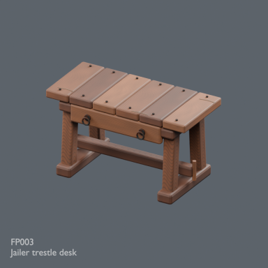](../../previews/prison-fp001-024/renders/FP003.png)

[Full-size image](../../previews/prison-fp001-024/renders/FP003.png)

Use / purpose: Jailer trestle desk — static prop for a fictional prison scene. Visual set dressing; no functional simulation, collision or LOD supplied.

Record type: model. Formats: BLEND/GLB.

Measured dimensions (Blender-convention X × Y × Z, metres): [1.804235, 0.909, 1.03]. Scene-instance triangles: 6268.

Origin: Encoded GLB root transform recorded; intended placement pivot unknown for this prop. Orientation: BLEND documented Z-up; GLB native Y-up. Intended prop-facing direction not specified.

[Download ZIP](https://github.com/k3peta/tales-on-a-table/releases/download/v2026.10.20-prison/FP003_Jailer_trestle_desk.zip) · [License scope](../../LICENSE.md)

**CC0-1.0** — See original ZIP license and repository license scope. Models and embedded materials only; previews excluded.

Source details: [Catalogue 1](../../catalog/prison.en.md) · [Catalogue 2](../../catalog/prison.md) · [Catalogue 3](../../catalog/prison.zh-CN.md)

[Measurement evidence and limitations](PILOT-24-METHOD.md). Source ZIP SHA-256: `708e2e4ec92fed79b31386271b041af2b839f6631def176581c3b123045e914a`.

## FP004

**Jailer high back chair**

看守の背もたれ椅子

[Full-size image](../../previews/prison-fp001-024/renders/FP004.png)

Use / purpose: Jailer high back chair — static prop for a fictional prison scene. Visual set dressing; no functional simulation, collision or LOD supplied.

Record type: model. Formats: BLEND/GLB.

Measured dimensions (Blender-convention X × Y × Z, metres): [0.598, 0.58, 1.445]. Scene-instance triangles: 4372.

Origin: Encoded GLB root transform recorded; intended placement pivot unknown for this prop. Orientation: BLEND documented Z-up; GLB native Y-up. Intended prop-facing direction not specified.

[Download ZIP](https://github.com/k3peta/tales-on-a-table/releases/download/v2026.10.20-prison/FP004_Jailer_high_back_chair.zip) · [License scope](../../LICENSE.md)

**CC0-1.0** — See original ZIP license and repository license scope. Models and embedded materials only; previews excluded.

Source details: [Catalogue 1](../../catalog/prison.en.md) · [Catalogue 2](../../catalog/prison.md) · [Catalogue 3](../../catalog/prison.zh-CN.md)

[Measurement evidence and limitations](PILOT-24-METHOD.md). Source ZIP SHA-256: `b38547c10c68f187c3b30cdb2d397b0109be97d0e59639374345ccf98344ddb5`.

## FP005

**Wardens keyring**

鍵束

[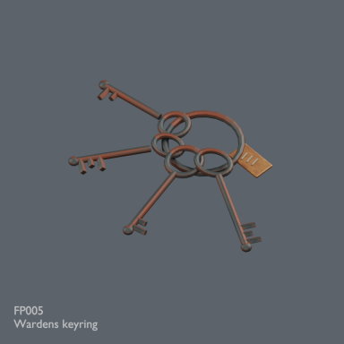](../../previews/prison-fp001-024/renders/FP005.png)

[Full-size image](../../previews/prison-fp001-024/renders/FP005.png)

Use / purpose: Wardens keyring — static prop for a fictional prison scene. Visual set dressing; no functional simulation, collision or LOD supplied.

Record type: model. Formats: BLEND/GLB.

Measured dimensions (Blender-convention X × Y × Z, metres): [0.990602, 0.735313, 0.072]. Scene-instance triangles: 5432.

Origin: Encoded GLB root transform recorded; intended placement pivot unknown for this prop. Orientation: BLEND documented Z-up; GLB native Y-up. Intended prop-facing direction not specified.

[Download ZIP](https://github.com/k3peta/tales-on-a-table/releases/download/v2026.10.20-prison/FP005_Wardens_keyring.zip) · [License scope](../../LICENSE.md)

**CC0-1.0** — See original ZIP license and repository license scope. Models and embedded materials only; previews excluded.

Source details: [Catalogue 1](../../catalog/prison.en.md) · [Catalogue 2](../../catalog/prison.md) · [Catalogue 3](../../catalog/prison.zh-CN.md)

[Measurement evidence and limitations](PILOT-24-METHOD.md). Source ZIP SHA-256: `f81d1d788487a5a632c2a6dcfd59a97684a3aeb0fdd6c02befac359dfa374bed`.

## FP006

**Straw sleeping pallet**

寝藁の寝台

[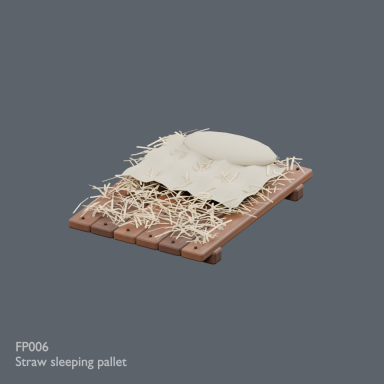](../../previews/prison-fp001-024/renders/FP006.png)

[Full-size image](../../previews/prison-fp001-024/renders/FP006.png)

Use / purpose: Straw sleeping pallet — static prop for a fictional prison scene. Visual set dressing; no functional simulation, collision or LOD supplied.

Record type: model. Formats: BLEND/GLB.

Measured dimensions (Blender-convention X × Y × Z, metres): [1.554459, 2.006783, 0.41]. Scene-instance triangles: 7884.

Origin: Encoded GLB root transform recorded; intended placement pivot unknown for this prop. Orientation: BLEND documented Z-up; GLB native Y-up. Intended prop-facing direction not specified.

[Download ZIP](https://github.com/k3peta/tales-on-a-table/releases/download/v2026.10.20-prison/FP006_Straw_sleeping_pallet.zip) · [License scope](../../LICENSE.md)

**CC0-1.0** — See original ZIP license and repository license scope. Models and embedded materials only; previews excluded.

Source details: [Catalogue 1](../../catalog/prison.en.md) · [Catalogue 2](../../catalog/prison.md) · [Catalogue 3](../../catalog/prison.zh-CN.md)

[Measurement evidence and limitations](PILOT-24-METHOD.md). Source ZIP SHA-256: `0cf16e0ea4b32d243d550460ca9fb44b1a541291eec1b39e488256e47e7ea250`.

## FP007

**Stave water bucket**

板組みの水桶

[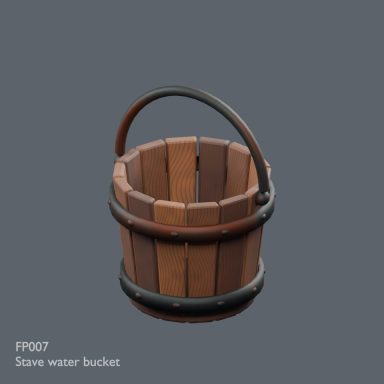](../../previews/prison-fp001-024/renders/FP007.png)

[Full-size image](../../previews/prison-fp001-024/renders/FP007.png)

Use / purpose: Stave water bucket — static prop for a fictional prison scene. Visual set dressing; no functional simulation, collision or LOD supplied.

Record type: model. Formats: BLEND/GLB.

Measured dimensions (Blender-convention X × Y × Z, metres): [0.586, 0.546, 0.767277]. Scene-instance triangles: 7524.

Origin: Encoded GLB root transform recorded; intended placement pivot unknown for this prop. Orientation: BLEND documented Z-up; GLB native Y-up. Intended prop-facing direction not specified.

[Download ZIP](https://github.com/k3peta/tales-on-a-table/releases/download/v2026.10.20-prison/FP007_Stave_water_bucket.zip) · [License scope](../../LICENSE.md)

**CC0-1.0** — See original ZIP license and repository license scope. Models and embedded materials only; previews excluded.

Source details: [Catalogue 1](../../catalog/prison.en.md) · [Catalogue 2](../../catalog/prison.md) · [Catalogue 3](../../catalog/prison.zh-CN.md)

[Measurement evidence and limitations](PILOT-24-METHOD.md). Source ZIP SHA-256: `656e453067b93a7aa03ebb602e4d518e20f078061ea481ada572ef11ab352347`.

## FP008

**Wall torch**

壁松明

[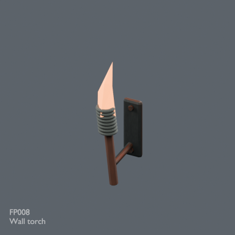](../../previews/prison-fp001-024/renders/FP008.png)

[Full-size image](../../previews/prison-fp001-024/renders/FP008.png)

Use / purpose: Wall torch — static prop for a fictional prison scene. Visual set dressing; no functional simulation, collision or LOD supplied.

Record type: model. Formats: BLEND/GLB.

Measured dimensions (Blender-convention X × Y × Z, metres): [0.16, 0.5163, 1.085315]. Scene-instance triangles: 4408.

Origin: Encoded GLB root transform recorded; intended placement pivot unknown for this prop. Orientation: BLEND documented Z-up; GLB native Y-up. Intended prop-facing direction not specified.

[Download ZIP](https://github.com/k3peta/tales-on-a-table/releases/download/v2026.10.20-prison/FP008_Wall_torch.zip) · [License scope](../../LICENSE.md)

**CC0-1.0** — See original ZIP license and repository license scope. Models and embedded materials only; previews excluded.

Source details: [Catalogue 1](../../catalog/prison.en.md) · [Catalogue 2](../../catalog/prison.md) · [Catalogue 3](../../catalog/prison.zh-CN.md)

[Measurement evidence and limitations](PILOT-24-METHOD.md). Source ZIP SHA-256: `19b61113b280058e0c054826704249905d863c32a989ac357a1461e4906733a0`.

## FP009

**Coiled iron chain**

巻いた鉄鎖

[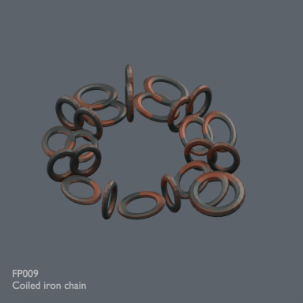](../../previews/prison-fp001-024/renders/FP009.png)

[Full-size image](../../previews/prison-fp001-024/renders/FP009.png)

Use / purpose: Coiled iron chain — static prop for a fictional prison scene. Visual set dressing; no functional simulation, collision or LOD supplied.

Record type: model. Formats: BLEND/GLB.

Measured dimensions (Blender-convention X × Y × Z, metres): [0.766404, 0.650087, 0.1682]. Scene-instance triangles: 9600.

Origin: Encoded GLB root transform recorded; intended placement pivot unknown for this prop. Orientation: BLEND documented Z-up; GLB native Y-up. Intended prop-facing direction not specified.

[Download ZIP](https://github.com/k3peta/tales-on-a-table/releases/download/v2026.10.20-prison/FP009_Coiled_iron_chain.zip) · [License scope](../../LICENSE.md)

**CC0-1.0** — See original ZIP license and repository license scope. Models and embedded materials only; previews excluded.

Source details: [Catalogue 1](../../catalog/prison.en.md) · [Catalogue 2](../../catalog/prison.md) · [Catalogue 3](../../catalog/prison.zh-CN.md)
[Measurement evidence and limitations](PILOT-24-METHOD.md). Source ZIP SHA-256: `66fa312031d20697e2ba7fd5f2a48946609eda89dc1428c7d5ac172a39b8c2d7`.
