# Base distribution records 529–552

[Browse index](README.md) · [Coverage and missing fields](COVERAGE.md)

Images are actual existing model renders for browsing, not covered by model CC0. A group record may show several reused models. Dimensions and triangle counts apply only to the original record when sourced; revisions can differ. Unknown means unverified, not zero. No blanket CC0 grant for scenes, images, code or articles.

## FP010

**Chipped food bowl**

欠けた食器

[Full-size image](../../previews/prison-fp001-024/renders/FP010.png)

Use / purpose: Chipped food bowl — static prop for a fictional prison scene. Visual set dressing; no functional simulation, collision or LOD supplied.

Record type: model. Formats: BLEND/GLB.

Measured dimensions (Blender-convention X × Y × Z, metres): [0.51, 0.51, 0.18]. Scene-instance triangles: 512.

Origin: Encoded GLB root transform recorded; intended placement pivot unknown for this prop. Orientation: BLEND documented Z-up; GLB native Y-up. Intended prop-facing direction not specified.

[Download ZIP](https://github.com/k3peta/tales-on-a-table/releases/download/v2026.10.20-prison/FP010_Chipped_food_bowl.zip) · [License scope](../../LICENSE.md)

**CC0-1.0** — See original ZIP license and repository license scope. Models and embedded materials only; previews excluded.

Source details: [Catalogue 1](../../catalog/prison.en.md) · [Catalogue 2](../../catalog/prison.md) · [Catalogue 3](../../catalog/prison.zh-CN.md)

[Measurement evidence and limitations](PILOT-24-METHOD.md). Source ZIP SHA-256: `fafb3d5b2c0d8c6557bb24c0a9a60626c3a52aa677bedba619877b0a5157ee05`.

**Quality54:** 64 exact-zero faces removed512→448tri;positive surfaces/chipped rim retained. [Details](../material_variants_fp008_fp017.md).

**Latest revision:** [ZIP](https://raw.githubusercontent.com/k3peta/tales-on-a-table/main/distributions/quality-fp008-017-v1/FP010__repair_CC0.zip) · [Matching revision preview](../../previews/quality-fp008-017-v1/FP010__repair_thumb.png). Original pictured ZIP retained above. Public ZIP/member/image identity verified.

## FP011

**Water jug**

水差し

[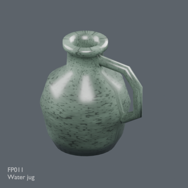](../../previews/prison-fp001-024/renders/FP011.png)

[Full-size image](../../previews/prison-fp001-024/renders/FP011.png)

Use / purpose: Water jug — static prop for a fictional prison scene. Visual set dressing; no functional simulation, collision or LOD supplied.

Record type: model. Formats: BLEND/GLB.

Measured dimensions (Blender-convention X × Y × Z, metres): [0.585539, 0.48, 0.6]. Scene-instance triangles: 1024.

Origin: Encoded GLB root transform recorded; intended placement pivot unknown for this prop. Orientation: BLEND documented Z-up; GLB native Y-up. Intended prop-facing direction not specified.

[Download ZIP](https://github.com/k3peta/tales-on-a-table/releases/download/v2026.10.20-prison/FP011_Water_jug.zip) · [License scope](../../LICENSE.md)

**CC0-1.0** — See original ZIP license and repository license scope. Models and embedded materials only; previews excluded.

Source details: [Catalogue 1](../../catalog/prison.en.md) · [Catalogue 2](../../catalog/prison.md) · [Catalogue 3](../../catalog/prison.zh-CN.md)

[Measurement evidence and limitations](PILOT-24-METHOD.md). Source ZIP SHA-256: `0fb11cfe90e9fab8be041b62c59119a0d82235e945952f80c8f481f5a0050257`.

**Quality54:** 64 exact-zero faces removed1024→960tri;blue glaze uses repaired baseline,wear/noncolor channels retained. [Details](../material_variants_fp008_fp017.md).

**Latest revision:** [ZIP](https://raw.githubusercontent.com/k3peta/tales-on-a-table/main/distributions/quality-fp008-017-v1/FP011__repair_CC0.zip) · [Matching revision preview](../../previews/quality-fp008-017-v1/FP011__repair_thumb.png). Original pictured ZIP retained above. Public ZIP/member/image identity verified.

## FP012

**Pewter drinking cup**

錫の杯

[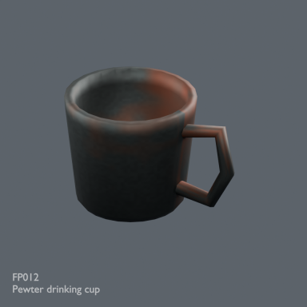](../../previews/prison-fp001-024/renders/FP012.png)

[Full-size image](../../previews/prison-fp001-024/renders/FP012.png)

Use / purpose: Pewter drinking cup — static prop for a fictional prison scene. Visual set dressing; no functional simulation, collision or LOD supplied.

Record type: model. Formats: BLEND/GLB.

Measured dimensions (Blender-convention X × Y × Z, metres): [0.340834, 0.244, 0.216]. Scene-instance triangles: 448.

Origin: Encoded GLB root transform recorded; intended placement pivot unknown for this prop. Orientation: BLEND documented Z-up; GLB native Y-up. Intended prop-facing direction not specified.

[Download ZIP](https://github.com/k3peta/tales-on-a-table/releases/download/v2026.10.20-prison/FP012_Pewter_drinking_cup.zip) · [License scope](../../LICENSE.md)

**CC0-1.0** — See original ZIP license and repository license scope. Models and embedded materials only; previews excluded.

Source details: [Catalogue 1](../../catalog/prison.en.md) · [Catalogue 2](../../catalog/prison.md) · [Catalogue 3](../../catalog/prison.zh-CN.md)

[Measurement evidence and limitations](PILOT-24-METHOD.md). Source ZIP SHA-256: `2459558df737804d3ed429746edff2018b8401558fcc218473935e304837c4f5`.

**Quality54:** 48 exact-zero faces removed448→400tri;metal wear retained,no food-use guarantee. [Details](../material_variants_fp008_fp017.md).

**Latest revision:** [ZIP](https://raw.githubusercontent.com/k3peta/tales-on-a-table/main/distributions/quality-fp008-017-v1/FP012__repair_CC0.zip) · [Matching revision preview](../../previews/quality-fp008-017-v1/FP012__repair_thumb.png). Original pictured ZIP retained above. Public ZIP/member/image identity verified.

## FP013

**Prisoners ledger**

囚人台帳

[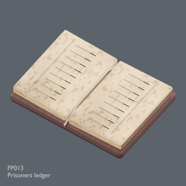](../../previews/prison-fp001-024/renders/FP013.png)

[Full-size image](../../previews/prison-fp001-024/renders/FP013.png)

Use / purpose: Prisoners ledger — static prop for a fictional prison scene. Visual set dressing; no functional simulation, collision or LOD supplied.

Record type: model. Formats: BLEND/GLB.

Measured dimensions (Blender-convention X × Y × Z, metres): [0.55, 0.403222, 0.0855]. Scene-instance triangles: 4636.

Origin: Encoded GLB root transform recorded; intended placement pivot unknown for this prop. Orientation: BLEND documented Z-up; GLB native Y-up. Intended prop-facing direction not specified.

[Download ZIP](https://github.com/k3peta/tales-on-a-table/releases/download/v2026.10.20-prison/FP013_Prisoners_ledger.zip) · [License scope](../../LICENSE.md)

**CC0-1.0** — See original ZIP license and repository license scope. Models and embedded materials only; previews excluded.

Source details: [Catalogue 1](../../catalog/prison.en.md) · [Catalogue 2](../../catalog/prison.md) · [Catalogue 3](../../catalog/prison.zh-CN.md)

[Measurement evidence and limitations](PILOT-24-METHOD.md). Source ZIP SHA-256: `656f6635b943f3f48d0454e7d2da5aa8045b5ea1cb67f85a029cf374c7ed87b0`.

**Quality54:** Open ledger,paper style retained;minor recolor not generated. [Details](../material_variants_fp008_fp017.md).

## FP014

**Inkpot and quill**

インク壺と羽根ペン

[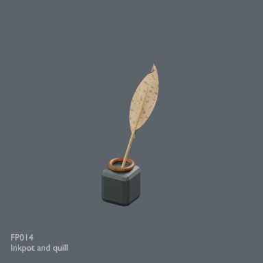](../../previews/prison-fp001-024/renders/FP014.png)

[Full-size image](../../previews/prison-fp001-024/renders/FP014.png)

Use / purpose: Inkpot and quill — static prop for a fictional prison scene. Visual set dressing; no functional simulation, collision or LOD supplied.

Record type: model. Formats: BLEND/GLB.

Measured dimensions (Blender-convention X × Y × Z, metres): [0.184332, 0.105, 0.527]. Scene-instance triangles: 824.

Origin: Encoded GLB root transform recorded; intended placement pivot unknown for this prop. Orientation: BLEND documented Z-up; GLB native Y-up. Intended prop-facing direction not specified.

[Download ZIP](https://github.com/k3peta/tales-on-a-table/releases/download/v2026.10.20-prison/FP014_Inkpot_and_quill.zip) · [License scope](../../LICENSE.md)

**CC0-1.0** — See original ZIP license and repository license scope. Models and embedded materials only; previews excluded.

Source details: [Catalogue 1](../../catalog/prison.en.md) · [Catalogue 2](../../catalog/prison.md) · [Catalogue 3](../../catalog/prison.zh-CN.md)

[Measurement evidence and limitations](PILOT-24-METHOD.md). Source ZIP SHA-256: `5d129d8c7dc8833580806614bbbf783fdc1fa42631cf7aff99854b1580264051`.

**Quality54:** Inkpot/quill static arrangement,no writing function. [Details](../material_variants_fp008_fp017.md).

## FP015

**Candle and drip tray**

蝋燭と受け皿

[Full-size image](../../previews/prison-fp001-024/renders/FP015.png)

Use / purpose: Candle and drip tray — static prop for a fictional prison scene. Visual set dressing; no functional simulation, collision or LOD supplied.

Record type: model. Formats: BLEND/GLB.

Measured dimensions (Blender-convention X × Y × Z, metres): [0.391, 0.32, 0.369]. Scene-instance triangles: 2352.

Origin: Encoded GLB root transform recorded; intended placement pivot unknown for this prop. Orientation: BLEND documented Z-up; GLB native Y-up. Intended prop-facing direction not specified.

[Download ZIP](https://github.com/k3peta/tales-on-a-table/releases/download/v2026.10.20-prison/FP015_Candle_and_drip_tray.zip) · [License scope](../../LICENSE.md)

**CC0-1.0** — See original ZIP license and repository license scope. Models and embedded materials only; previews excluded.

Source details: [Catalogue 1](../../catalog/prison.en.md) · [Catalogue 2](../../catalog/prison.md) · [Catalogue 3](../../catalog/prison.zh-CN.md)

[Measurement evidence and limitations](PILOT-24-METHOD.md). Source ZIP SHA-256: `b0a4294582db1f01972dff7da3901c47f85879fc1b5b1e5964e5c1bf458b75a9`.

**Quality54:** 64 exact-zero tray faces removed;positive surfaces/candle/existing emission retained. [Details](../material_variants_fp008_fp017.md).

**Latest revision:** [ZIP](https://raw.githubusercontent.com/k3peta/tales-on-a-table/main/distributions/quality-fp008-017-v1/FP015__repair_CC0.zip) · [Matching revision preview](../../previews/quality-fp008-017-v1/FP015__repair_thumb.png). Original pictured ZIP retained above. Public ZIP/member/image identity verified.

## FP016

**Ration bread**

配給パン

[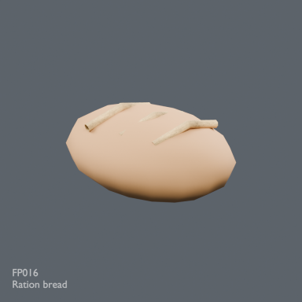](../../previews/prison-fp001-024/renders/FP016.png)

[Full-size image](../../previews/prison-fp001-024/renders/FP016.png)

Use / purpose: Ration bread — static prop for a fictional prison scene. Visual set dressing; no functional simulation, collision or LOD supplied.

Record type: model. Formats: BLEND/GLB.

Measured dimensions (Blender-convention X × Y × Z, metres): [0.38, 0.26, 0.187998]. Scene-instance triangles: 320.

Origin: Encoded GLB root transform recorded; intended placement pivot unknown for this prop. Orientation: BLEND documented Z-up; GLB native Y-up. Intended prop-facing direction not specified.

[Download ZIP](https://github.com/k3peta/tales-on-a-table/releases/download/v2026.10.20-prison/FP016_Ration_bread.zip) · [License scope](../../LICENSE.md)

**CC0-1.0** — See original ZIP license and repository license scope. Models and embedded materials only; previews excluded.

Source details: [Catalogue 1](../../catalog/prison.en.md) · [Catalogue 2](../../catalog/prison.md) · [Catalogue 3](../../catalog/prison.zh-CN.md)

[Measurement evidence and limitations](PILOT-24-METHOD.md). Source ZIP SHA-256: `c417c00872830e3f288ceddfc0838a37b846aacfa9e1ac4c4b13e1e50c470ca9`.

**Quality54:** Stylized ration loaf/scoring retained. [Details](../material_variants_fp008_fp017.md).

## FP017

**Birch broom**

白樺の箒

[Full-size image](../../previews/prison-fp001-024/renders/FP017.png)

Use / purpose: Birch broom — static prop for a fictional prison scene. Visual set dressing; no functional simulation, collision or LOD supplied.

Record type: model. Formats: BLEND/GLB.

Measured dimensions (Blender-convention X × Y × Z, metres): [0.177194, 0.164466, 1.256238]. Scene-instance triangles: 8424.

Origin: Encoded GLB root transform recorded; intended placement pivot unknown for this prop. Orientation: BLEND documented Z-up; GLB native Y-up. Intended prop-facing direction not specified.

[Download ZIP](https://github.com/k3peta/tales-on-a-table/releases/download/v2026.10.20-prison/FP017_Birch_broom.zip) · [License scope](../../LICENSE.md)

**CC0-1.0** — See original ZIP license and repository license scope. Models and embedded materials only; previews excluded.

Source details: [Catalogue 1](../../catalog/prison.en.md) · [Catalogue 2](../../catalog/prison.md) · [Catalogue 3](../../catalog/prison.zh-CN.md)

[Measurement evidence and limitations](PILOT-24-METHOD.md). Source ZIP SHA-256: `74ff7378f1fa6ef13d4519500a07ff5c8c556b6cf5e1cda53965825e5c817459`.

[Broom bristles detail](../../previews/prison-fp001-024/details/FP017_detail.png). Intentional crop.

**Quality54:** Birch broom static;no bristle physics. [Details](../material_variants_fp008_fp017.md).

## FP018

**Three leg stool**

三脚腰掛け

[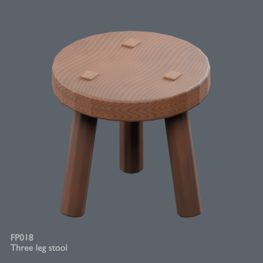](../../previews/prison-fp001-024/renders/FP018.png)

[Full-size image](../../previews/prison-fp001-024/renders/FP018.png)

Use / purpose: Three leg stool — static prop for a fictional prison scene. Visual set dressing; no functional simulation, collision or LOD supplied.

Record type: model. Formats: BLEND/GLB.

Measured dimensions (Blender-convention X × Y × Z, metres): [0.562782, 0.56, 0.536174]. Scene-instance triangles: 1436.

Origin: Encoded GLB root transform recorded; intended placement pivot unknown for this prop. Orientation: BLEND documented Z-up; GLB native Y-up. Intended prop-facing direction not specified.

[Download ZIP](https://github.com/k3peta/tales-on-a-table/releases/download/v2026.10.20-prison/FP018_Three_leg_stool.zip) · [License scope](../../LICENSE.md)

**CC0-1.0** — See original ZIP license and repository license scope. Models and embedded materials only; previews excluded.

Source details: [Catalogue 1](../../catalog/prison.en.md) · [Catalogue 2](../../catalog/prison.md) · [Catalogue 3](../../catalog/prison.zh-CN.md)

[Measurement evidence and limitations](PILOT-24-METHOD.md). Source ZIP SHA-256: `4cc40dfb9cf0e329a47c9e675f09fa5c768762ed87265896d66e65377858a976`.

**Quality55:** 1436tri stool;positive lower bound preserved,intended pivot unknown;floor placement needs height adjustment. [Details](../material_variants_fp018_pm002.md).

## FP019

**Iron bound lockbox**

鉄帯の小箱

[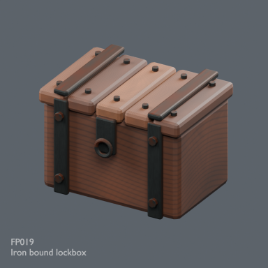](../../previews/prison-fp001-024/renders/FP019.png)

[Full-size image](../../previews/prison-fp001-024/renders/FP019.png)

Use / purpose: Iron bound lockbox — static prop for a fictional prison scene. Visual set dressing; no functional simulation, collision or LOD supplied.

Record type: model. Formats: BLEND/GLB.

Measured dimensions (Blender-convention X × Y × Z, metres): [0.658, 0.504, 0.4775]. Scene-instance triangles: 4652.

Origin: Encoded GLB root transform recorded; intended placement pivot unknown for this prop. Orientation: BLEND documented Z-up; GLB native Y-up. Intended prop-facing direction not specified.

[Download ZIP](https://github.com/k3peta/tales-on-a-table/releases/download/v2026.10.20-prison/FP019_Iron_bound_lockbox.zip) · [License scope](../../LICENSE.md)

**CC0-1.0** — See original ZIP license and repository license scope. Models and embedded materials only; previews excluded.

Source details: [Catalogue 1](../../catalog/prison.en.md) · [Catalogue 2](../../catalog/prison.md) · [Catalogue 3](../../catalog/prison.zh-CN.md)

[Measurement evidence and limitations](PILOT-24-METHOD.md). Source ZIP SHA-256: `9108a795183804b226c0ce56f05693435f9461507defad2fa9b44c0907ab4030`.

**Quality55:** 4652tri static lockbox;grain material-review issue,no mechanism. [Details](../material_variants_fp018_pm002.md).

## FP020

**Jailer wall shelf**

看守の壁棚

[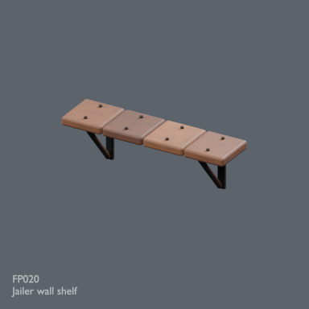](../../previews/prison-fp001-024/renders/FP020.png)

[Full-size image](../../previews/prison-fp001-024/renders/FP020.png)

Use / purpose: Jailer wall shelf — static prop for a fictional prison scene. Visual set dressing; no functional simulation, collision or LOD supplied.

Record type: model. Formats: BLEND/GLB.

Measured dimensions (Blender-convention X × Y × Z, metres): [1.448, 0.3875, 0.4825]. Scene-instance triangles: 3840.

Origin: Encoded GLB root transform recorded; intended placement pivot unknown for this prop. Orientation: BLEND documented Z-up; GLB native Y-up. Intended prop-facing direction not specified.

[Download ZIP](https://github.com/k3peta/tales-on-a-table/releases/download/v2026.10.20-prison/FP020_Jailer_wall_shelf.zip) · [License scope](../../LICENSE.md)

**CC0-1.0** — See original ZIP license and repository license scope. Models and embedded materials only; previews excluded.

Source details: [Catalogue 1](../../catalog/prison.en.md) · [Catalogue 2](../../catalog/prison.md) · [Catalogue 3](../../catalog/prison.zh-CN.md)

[Measurement evidence and limitations](PILOT-24-METHOD.md). Source ZIP SHA-256: `858295286a22fcf748ded74208949afbca15d528a4d7fe059894ee3304615d29`.

**Quality55:** 3840tri shelf requires wall placement;load untested. [Details](../material_variants_fp018_pm002.md).

## FP021

**Leather dispatch satchel**

革の書類鞄

[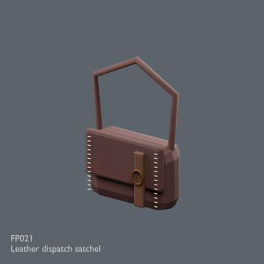](../../previews/prison-fp001-024/renders/FP021.png)

[Full-size image](../../previews/prison-fp001-024/renders/FP021.png)

Use / purpose: Leather dispatch satchel — static prop for a fictional prison scene. Visual set dressing; no functional simulation, collision or LOD supplied.

Record type: model. Formats: BLEND/GLB.

Measured dimensions (Blender-convention X × Y × Z, metres): [0.491897, 0.247, 0.787992]. Scene-instance triangles: 3580.

Origin: Encoded GLB root transform recorded; intended placement pivot unknown for this prop. Orientation: BLEND documented Z-up; GLB native Y-up. Intended prop-facing direction not specified.

[Download ZIP](https://github.com/k3peta/tales-on-a-table/releases/download/v2026.10.20-prison/FP021_Leather_dispatch_satchel.zip) · [License scope](../../LICENSE.md)

**CC0-1.0** — See original ZIP license and repository license scope. Models and embedded materials only; previews excluded.

Source details: [Catalogue 1](../../catalog/prison.en.md) · [Catalogue 2](../../catalog/prison.md) · [Catalogue 3](../../catalog/prison.zh-CN.md)

[Measurement evidence and limitations](PILOT-24-METHOD.md). Source ZIP SHA-256: `2be9c747a7c3d351506367905c4c1e0967af8bc2794960550972d487f04a2e7a`.

**Quality55:** 24 exact-zero faces removed3580→3556tri;periodic leather texture remains. [Details](../material_variants_fp018_pm002.md).

**Latest revision:** [ZIP](https://raw.githubusercontent.com/k3peta/tales-on-a-table/main/distributions/quality-fp018-pm002-v1/FP021__repair_CC0.zip) · [Matching revision preview](../../previews/quality-fp018-pm002-v1/FP021__repair_thumb.png). Original pictured ZIP retained above. Public ZIP/member/image identity verified.

## FP022

**Old iron padlock**

古い鉄錠

[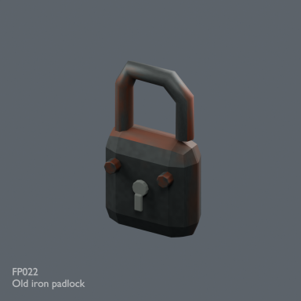](../../previews/prison-fp001-024/renders/FP022.png)

[Full-size image](../../previews/prison-fp001-024/renders/FP022.png)

Use / purpose: Old iron padlock — static prop for a fictional prison scene. Visual set dressing; no functional simulation, collision or LOD supplied.

Record type: model. Formats: BLEND/GLB.

Measured dimensions (Blender-convention X × Y × Z, metres): [0.17, 0.0935, 0.299782]. Scene-instance triangles: 876.

Origin: Encoded GLB root transform recorded; intended placement pivot unknown for this prop. Orientation: BLEND documented Z-up; GLB native Y-up. Intended prop-facing direction not specified.

[Download ZIP](https://github.com/k3peta/tales-on-a-table/releases/download/v2026.10.20-prison/FP022_Old_iron_padlock.zip) · [License scope](../../LICENSE.md)

**CC0-1.0** — See original ZIP license and repository license scope. Models and embedded materials only; previews excluded.

Source details: [Catalogue 1](../../catalog/prison.en.md) · [Catalogue 2](../../catalog/prison.md) · [Catalogue 3](../../catalog/prison.zh-CN.md)

[Measurement evidence and limitations](PILOT-24-METHOD.md). Source ZIP SHA-256: `9ed40f8b846e265fce310f9c0385369f2a01a53a23cc47d3a0e47d4a350158a2`.

**Quality55:** 876tri padlock;no functional mechanism. [Details](../material_variants_fp018_pm002.md).

## FP023

**Forged hand manacles**

手枷

[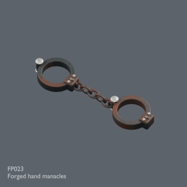](../../previews/prison-fp001-024/renders/FP023.png)

[Full-size image](../../previews/prison-fp001-024/renders/FP023.png)

Use / purpose: Forged hand manacles — static prop for a fictional prison scene. Visual set dressing; no functional simulation, collision or LOD supplied.

Record type: model. Formats: BLEND/GLB.

Measured dimensions (Blender-convention X × Y × Z, metres): [0.4536, 0.13493, 0.0552]. Scene-instance triangles: 12120.

Origin: Encoded GLB root transform recorded; intended placement pivot unknown for this prop. Orientation: BLEND documented Z-up; GLB native Y-up. Intended prop-facing direction not specified.

[Download ZIP](https://github.com/k3peta/tales-on-a-table/releases/download/v2026.10.20-prison/FP023_Forged_hand_manacles.zip) · [License scope](../../LICENSE.md)

**CC0-1.0** — See original ZIP license and repository license scope. Models and embedded materials only; previews excluded.

Source details: [Catalogue 1](../../catalog/prison.en.md) · [Catalogue 2](../../catalog/prison.md) · [Catalogue 3](../../catalog/prison.zh-CN.md)

[Measurement evidence and limitations](PILOT-24-METHOD.md). Source ZIP SHA-256: `24849a97198f841b73095ac6f3dfcacb29a5db524a8073c01d024e4b723aa411`.

**Quality55:** 12120tri decorative manacles;mechanism/fit/collision untested. [Details](../material_variants_fp018_pm002.md).

## FP024

**Heavy ankle shackles**

足枷

[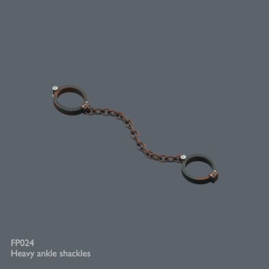](../../previews/prison-fp001-024/renders/FP024.png)

[Full-size image](../../previews/prison-fp001-024/renders/FP024.png)

Use / purpose: Heavy ankle shackles — static prop for a fictional prison scene. Visual set dressing; no functional simulation, collision or LOD supplied.

Record type: model. Formats: BLEND/GLB.

Measured dimensions (Blender-convention X × Y × Z, metres): [1.0764, 0.179242, 0.07215]. Scene-instance triangles: 16728.

Origin: Encoded GLB root transform recorded; intended placement pivot unknown for this prop. Orientation: BLEND documented Z-up; GLB native Y-up. Intended prop-facing direction not specified.

[Download ZIP](https://github.com/k3peta/tales-on-a-table/releases/download/v2026.10.20-prison/FP024_Heavy_ankle_shackles.zip) · [License scope](../../LICENSE.md)

**CC0-1.0** — See original ZIP license and repository license scope. Models and embedded materials only; previews excluded.

Source details: [Catalogue 1](../../catalog/prison.en.md) · [Catalogue 2](../../catalog/prison.md) · [Catalogue 3](../../catalog/prison.zh-CN.md)

[Measurement evidence and limitations](PILOT-24-METHOD.md). Source ZIP SHA-256: `68d7bd65280a1ebfa53788388b7cf20bfac15565f4d2fbe146f1591ab9de2081`.

**Quality55:** 16728tri decorative shackles;links not separate records. [Details](../material_variants_fp018_pm002.md).

## FP025

**Folded prison uniform**

畳んだ囚人服

[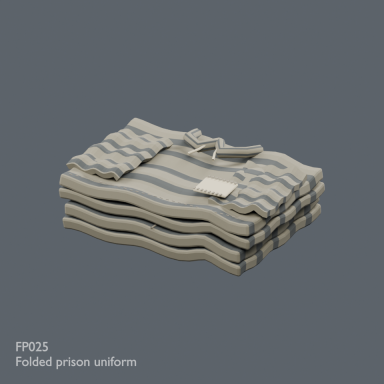](../../previews/prison-mill24/renders/FP025.png)

[Full-size image](../../previews/prison-mill24/renders/FP025.png)

Use / purpose: Unknown; see source catalogue. English use description needs review.

Record type: model. Formats: Unknown; inspect ZIP.

Reported dimensions (metres; XYZ when derived from measured bounds, legacy axis order not reverified): Unknown. Triangles: Unknown.

Origin: Unknown / not independently confirmed. Orientation: Unknown / not independently confirmed.

[Download ZIP](https://github.com/k3peta/tales-on-a-table/releases/download/v2026.10.20-prison/FP025_Folded_prison_uniform.zip) · [License scope](../../LICENSE.md)

**CC0-1.0** — See original ZIP license and repository license scope. Models and embedded materials only; previews excluded.

Source details: [Catalogue 1](../../catalog/prison.en.md) · [Catalogue 2](../../catalog/prison.md) · [Catalogue 3](../../catalog/prison.zh-CN.md)

**Quality55:** 24 exact-zero faces removed17982→17958tri;positive tiny surfaces retained;blue linen uses repaired baseline. [Details](../material_variants_fp018_pm002.md).

**Latest revision:** [ZIP](https://raw.githubusercontent.com/k3peta/tales-on-a-table/main/distributions/quality-fp018-pm002-v1/FP025__repair_CC0.zip) · [Matching revision preview](../../previews/quality-fp018-pm002-v1/FP025__repair_thumb.png). Original pictured ZIP retained above. Public ZIP/member/image identity verified.

## PM001

**Floor 2x2**

床2×2m

[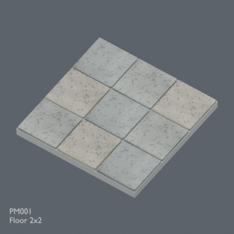](../../previews/prison-mill24/renders/PM001.png)

[Full-size image](../../previews/prison-mill24/renders/PM001.png)

Use / purpose: Unknown; see source catalogue. English use description needs review.

Record type: model. Formats: Unknown; inspect ZIP.

Reported dimensions (metres; XYZ when derived from measured bounds, legacy axis order not reverified): Unknown. Triangles: Unknown.

Origin: Unknown / not independently confirmed. Orientation: Unknown / not independently confirmed.

[Download ZIP](https://github.com/k3peta/tales-on-a-table/releases/download/v2026.10.20-prison/PM001_Floor_2x2.zip) · [License scope](../../LICENSE.md)

**CC0-1.0** — See original ZIP license and repository license scope. Models and embedded materials only; previews excluded.

Source details: [Catalogue 1](../../catalog/prison.en.md) · [Catalogue 2](../../catalog/prison.md) · [Catalogue 3](../../catalog/prison.zh-CN.md)

**Quality55:** 984tri floor2x2m,top0,bottom-0.16m,SW origin;3x3 validation scene not distributed. [Details](../material_variants_fp018_pm002.md).

## PM002

**Solid Wall 2m**

石壁2m

[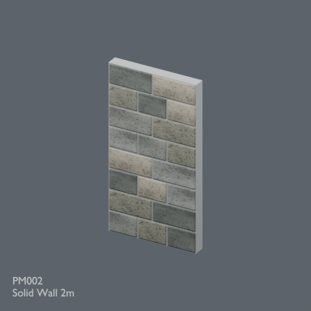](../../previews/prison-mill24/renders/PM002.png)

[Full-size image](../../previews/prison-mill24/renders/PM002.png)

Use / purpose: Unknown; see source catalogue. English use description needs review.

Record type: model. Formats: Unknown; inspect ZIP.

Reported dimensions (metres; XYZ when derived from measured bounds, legacy axis order not reverified): Unknown. Triangles: Unknown.

Origin: Unknown / not independently confirmed. Orientation: Unknown / not independently confirmed.

[Download ZIP](https://github.com/k3peta/tales-on-a-table/releases/download/v2026.10.20-prison/PM002_Solid_Wall_2m.zip) · [License scope](../../LICENSE.md)

**CC0-1.0** — See original ZIP license and repository license scope. Models and embedded materials only; previews excluded.

Source details: [Catalogue 1](../../catalog/prison.en.md) · [Catalogue 2](../../catalog/prison.md) · [Catalogue 3](../../catalog/prison.zh-CN.md)

**Quality55:** 2172tri wall1.72m wide;0.28m pillars required at2m pitch per source README,intentional gap. [Details](../material_variants_fp018_pm002.md).

## PM003

**Barred Wall 2m**

格子壁2m

[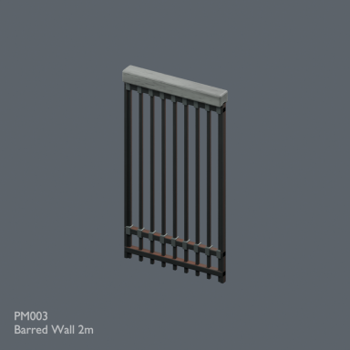](../../previews/prison-mill24/renders/PM003.png)

[Full-size image](../../previews/prison-mill24/renders/PM003.png)

Use / purpose: Unknown; see source catalogue. English use description needs review.

Record type: model. Formats: Unknown; inspect ZIP.

Reported dimensions (metres; XYZ when derived from measured bounds, legacy axis order not reverified): Unknown. Triangles: Unknown.

Origin: Unknown / not independently confirmed. Orientation: Unknown / not independently confirmed.

[Download ZIP](https://github.com/k3peta/tales-on-a-table/releases/download/v2026.10.20-prison/PM003_Barred_Wall_2m.zip) · [License scope](../../LICENSE.md)

**CC0-1.0** — See original ZIP license and repository license scope. Models and embedded materials only; previews excluded.

Source details: [Catalogue 1](../../catalog/prison.en.md) · [Catalogue 2](../../catalog/prison.md) · [Catalogue 3](../../catalog/prison.zh-CN.md)

**Quality56:** 3564tri barred wall uses connector pillars at2m pitch;security/collision untested. [Details](../material_variants_pm003_wm001.md).

## PM004

**Cell Door 2m**

牢房扉2m

[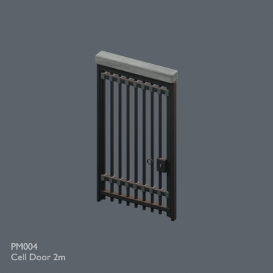](../../previews/prison-mill24/renders/PM004.png)

[Full-size image](../../previews/prison-mill24/renders/PM004.png)

Use / purpose: Unknown; see source catalogue. English use description needs review.

Record type: model. Formats: Unknown; inspect ZIP.

Reported dimensions (metres; XYZ when derived from measured bounds, legacy axis order not reverified): Unknown. Triangles: Unknown.

Origin: Unknown / not independently confirmed. Orientation: Unknown / not independently confirmed.

[Download ZIP](https://github.com/k3peta/tales-on-a-table/releases/download/v2026.10.20-prison/PM004_Cell_Door_2m.zip) · [License scope](../../LICENSE.md)

**CC0-1.0** — See original ZIP license and repository license scope. Models and embedded materials only; previews excluded.

Source details: [Catalogue 1](../../catalog/prison.en.md) · [Catalogue 2](../../catalog/prison.md) · [Catalogue 3](../../catalog/prison.zh-CN.md)

**Quality56:** 5332tri cell door;hinge setup retained,opening sweep not retested. [Details](../material_variants_pm003_wm001.md).

## PM005

**Arched Window Wall 2m**

アーチ窓壁2m

[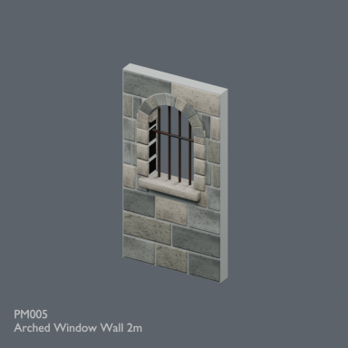](../../previews/prison-mill24/renders/PM005.png)

[Full-size image](../../previews/prison-mill24/renders/PM005.png)

Use / purpose: Unknown; see source catalogue. English use description needs review.

Record type: model. Formats: Unknown; inspect ZIP.

Reported dimensions (metres; XYZ when derived from measured bounds, legacy axis order not reverified): Unknown. Triangles: Unknown.

Origin: Unknown / not independently confirmed. Orientation: Unknown / not independently confirmed.

[Download ZIP](https://github.com/k3peta/tales-on-a-table/releases/download/v2026.10.20-prison/PM005_Arched_Window_Wall_2m.zip) · [License scope](../../LICENSE.md)

**CC0-1.0** — See original ZIP license and repository license scope. Models and embedded materials only; previews excluded.

Source details: [Catalogue 1](../../catalog/prison.en.md) · [Catalogue 2](../../catalog/prison.md) · [Catalogue 3](../../catalog/prison.zh-CN.md)

**Quality56:** 6388tri unchanged geometry;Mortar_Core missingUV0 added,existingUV retained;not original-UV-invariant. [Details](../material_variants_pm003_wm001.md).

## PM006

**Universal Stone Node**

共通石柱

[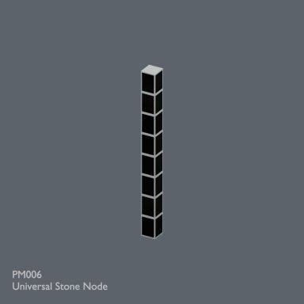](../../previews/prison-mill24/renders/PM006.png)

[Full-size image](../../previews/prison-mill24/renders/PM006.png)

Use / purpose: Unknown; see source catalogue. English use description needs review.

Record type: model. Formats: Unknown; inspect ZIP.

Reported dimensions (metres; XYZ when derived from measured bounds, legacy axis order not reverified): Unknown. Triangles: Unknown.

Origin: Unknown / not independently confirmed. Orientation: Unknown / not independently confirmed.

[Download ZIP](https://github.com/k3peta/tales-on-a-table/releases/download/v2026.10.20-prison/PM006_Universal_Stone_Node.zip) · [License scope](../../LICENSE.md)

**CC0-1.0** — See original ZIP license and repository license scope. Models and embedded materials only; previews excluded.

Source details: [Catalogue 1](../../catalog/prison.en.md) · [Catalogue 2](../../catalog/prison.md) · [Catalogue 3](../../catalog/prison.zh-CN.md)

**Version history:** Original version: Black side faces are an unresolved original-model issue. Revised version recess_mortar_core_v1 repairs this scoped defect; functional safety and compatibility remain unverified.

[Revised ZIP](https://raw.githubusercontent.com/k3peta/tales-on-a-table/main/distributions/quality-pmnode-wm009-repair-v1/PM006__repair_CC0.zip) · [Repair evidence and scope](../../catalog/pmnode_wm009_repairs.md). Original download and image above retained.

**Version scope:** The image above depicts the primary recorded ZIP. [Latest revision ZIP](https://raw.githubusercontent.com/k3peta/tales-on-a-table/main/distributions/quality-pmnode-wm009-repair-v1/PM006__repair_CC0.zip). [Revision-specific preview](../../previews/quality-pmnode-wm009-repair-v1/PM006__repair_thumb.png). [Version audit](VERSION-AUDIT.md).

**Quality56:** 876tri existing public mortar-recess repair retained SHA-matched;no new revision. [Details](../material_variants_pm003_wm001.md).

## PM007

**Drained Corridor Floor 2x2**

排水溝付き廊下床

[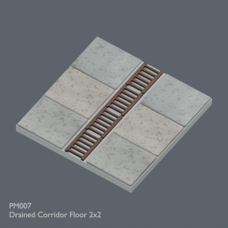](../../previews/prison-mill24/renders/PM007.png)

[Full-size image](../../previews/prison-mill24/renders/PM007.png)

Use / purpose: Unknown; see source catalogue. English use description needs review.

Record type: model. Formats: Unknown; inspect ZIP.

Reported dimensions (metres; XYZ when derived from measured bounds, legacy axis order not reverified): Unknown. Triangles: Unknown.

Origin: Unknown / not independently confirmed. Orientation: Unknown / not independently confirmed.

[Download ZIP](https://github.com/k3peta/tales-on-a-table/releases/download/v2026.10.20-prison/PM007_Drained_Corridor_Floor_2x2.zip) · [License scope](../../LICENSE.md)

**CC0-1.0** — See original ZIP license and repository license scope. Models and embedded materials only; previews excluded.

Source details: [Catalogue 1](../../catalog/prison.en.md) · [Catalogue 2](../../catalog/prison.md) · [Catalogue 3](../../catalog/prison.zh-CN.md)

**Quality56:** 4548tri drained floor2m,top0,bottom-0.16;no fluid simulation. [Details](../material_variants_pm003_wm001.md).

## PM008

**Corridor Junction Hatch 2x2**

点検蓋付き交差部床

[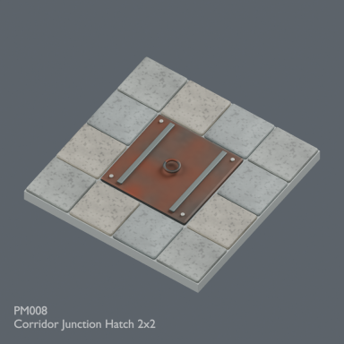](../../previews/prison-mill24/renders/PM008.png)

[Full-size image](../../previews/prison-mill24/renders/PM008.png)

Use / purpose: Unknown; see source catalogue. English use description needs review.

Record type: model. Formats: Unknown; inspect ZIP.

Reported dimensions (metres; XYZ when derived from measured bounds, legacy axis order not reverified): Unknown. Triangles: Unknown.

Origin: Unknown / not independently confirmed. Orientation: Unknown / not independently confirmed.

[Download ZIP](https://github.com/k3peta/tales-on-a-table/releases/download/v2026.10.20-prison/PM008_Corridor_Junction_Hatch_2x2.zip) · [License scope](../../LICENSE.md)

**CC0-1.0** — See original ZIP license and repository license scope. Models and embedded materials only; previews excluded.

Source details: [Catalogue 1](../../catalog/prison.en.md) · [Catalogue 2](../../catalog/prison.md) · [Catalogue 3](../../catalog/prison.zh-CN.md)
**Quality56:** 2896tri hatch floor;raised hardware maxZ0.051m intentional,no opening test. [Details](../material_variants_pm003_wm001.md).
