# Base distribution records 577–600

[Browse index](README.md) · [Coverage and missing fields](COVERAGE.md)

Images are actual existing model renders for browsing, not covered by model CC0. A group record may show several reused models. Dimensions and triangle counts apply only to the original record when sourced; revisions can differ. Unknown means unverified, not zero. No blanket CC0 grant for scenes, images, code or articles.

## WT005

**Path straight NS**

Path straight NS

[Full-size image](../../previews/mill-terrain-apiary24/renders/WT005.png)

Use / purpose: Unknown; see source catalogue. English use description needs review.

Record type: model. Formats: Unknown; inspect ZIP.

Reported dimensions (metres; XYZ when derived from measured bounds, legacy axis order not reverified): Unknown. Triangles: Unknown.

Origin: Unknown / not independently confirmed. Orientation: Unknown / not independently confirmed.

[Download ZIP](https://github.com/k3peta/tales-on-a-table/releases/download/v2026.10.21-watermill/WT005_CC0.zip) · [License scope](../../LICENSE.md)

**CC0-1.0** — See original ZIP license and repository license scope. Models and embedded materials only; previews excluded.

Source details: [Catalogue 1](../../catalog/watermill.en.md) · [Catalogue 2](../../catalog/watermill.md) · [Catalogue 3](../../catalog/watermill.zh-CN.md)

**Quality57–76 revisions (original pictured ZIP retained above):**

[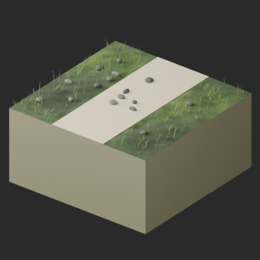](../../previews/quality-wt005-ap006-v1/WT005__repair_full.png)

[WT005__repair ZIP](https://raw.githubusercontent.com/k3peta/tales-on-a-table/main/distributions/quality-wt005-ap006-v1/WT005__repair_CC0.zip) · [Details](../quality-wt005-ap006-v1.md).

## WT006

**Path bend NE**

Path bend NE

[Full-size image](../../previews/mill-terrain-apiary24/renders/WT006.png)

Use / purpose: Unknown; see source catalogue. English use description needs review.

Record type: model. Formats: Unknown; inspect ZIP.

Reported dimensions (metres; XYZ when derived from measured bounds, legacy axis order not reverified): Unknown. Triangles: Unknown.

Origin: Unknown / not independently confirmed. Orientation: Unknown / not independently confirmed.

[Download ZIP](https://github.com/k3peta/tales-on-a-table/releases/download/v2026.10.21-watermill/WT006_CC0.zip) · [License scope](../../LICENSE.md)

**CC0-1.0** — See original ZIP license and repository license scope. Models and embedded materials only; previews excluded.

Source details: [Catalogue 1](../../catalog/watermill.en.md) · [Catalogue 2](../../catalog/watermill.md) · [Catalogue 3](../../catalog/watermill.zh-CN.md)

**Quality57–76 revisions (original pictured ZIP retained above):**

[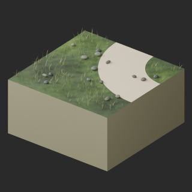](../../previews/quality-wt005-ap006-v1/WT006__repair_full.png)

[WT006__repair ZIP](https://raw.githubusercontent.com/k3peta/tales-on-a-table/main/distributions/quality-wt005-ap006-v1/WT006__repair_CC0.zip) · [Details](../quality-wt005-ap006-v1.md).

## WT007

**Stream straight NS**

Stream straight NS

[Full-size image](../../previews/mill-terrain-apiary24/renders/WT007.png)

Use / purpose: Unknown; see source catalogue. English use description needs review.

Record type: model. Formats: Unknown; inspect ZIP.

Reported dimensions (metres; XYZ when derived from measured bounds, legacy axis order not reverified): Unknown. Triangles: Unknown.

Origin: Unknown / not independently confirmed. Orientation: Unknown / not independently confirmed.

[Download ZIP](https://github.com/k3peta/tales-on-a-table/releases/download/v2026.10.21-watermill/WT007_CC0.zip) · [License scope](../../LICENSE.md)

**CC0-1.0** — See original ZIP license and repository license scope. Models and embedded materials only; previews excluded.

Source details: [Catalogue 1](../../catalog/watermill.en.md) · [Catalogue 2](../../catalog/watermill.md) · [Catalogue 3](../../catalog/watermill.zh-CN.md)

**Version history:** Original black end patches retained. Historical v1 validation withdrawn: the numerical pass report belonged to an older candidate; the distributed v1 failed the null-material-slot test. Historical v1 is not a validated replacement; see the current v2 result. Download/CRC/SHA verification does not resolve model QA.

[Historical v1 ZIP — validation withdrawn](https://raw.githubusercontent.com/k3peta/tales-on-a-table/main/distributions/quality-wt007-008-repair-v1/WT007__repair_CC0.zip) · [Repair evidence and scope](../../catalog/wt007_008_repairs.md). Original download and image above retained.

**Correction:** Prior v1 pass claim withdrawn: stale older-candidate results were applied to a package failing strict null-material-slot checks. Replacement v2 public-download reimport now passed scoped checks; v1 claim remains withdrawn. [Replacement v2](../../catalog/wt007_008_replacement_v2.md).

**Current v2 status:** v1 validation claim withdrawn: stale older-candidate report was misapplied and strict null-material-slot test failed. v2 exact public-download ZIPs independently reimported successfully in Blender5.2.2; scoped geometry/UV/material/image checks passed, not a general function or safety guarantee.

[Validated v2 ZIP](https://raw.githubusercontent.com/k3peta/tales-on-a-table/main/distributions/quality-wt007-008-repair-v2/WT007__repair_CC0.zip) · [Validation evidence](https://raw.githubusercontent.com/k3peta/tales-on-a-table/main/distributions/quality-wt007-008-repair-v2/validation.json) · [Version history](../../catalog/wt007_008_replacement_v2.md)

**Version scope:** The image above depicts the primary recorded ZIP. [Latest revision ZIP](https://raw.githubusercontent.com/k3peta/tales-on-a-table/main/distributions/quality-wt007-008-repair-v2/WT007__repair_CC0.zip). [Revision-specific preview](../../previews/quality-wt007-008-repair-v2/WT007__repair_thumb.png). [Version audit](VERSION-AUDIT.md).

**Quality57–76 revisions (original pictured ZIP retained above):**

[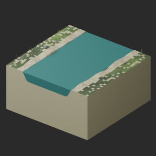](../../previews/quality-wt005-ap006-v1/WT007__repair_full.png)

[WT007__repair ZIP](https://raw.githubusercontent.com/k3peta/tales-on-a-table/main/distributions/quality-wt005-ap006-v1/WT007__repair_CC0.zip) · [Details](../quality-wt005-ap006-v1.md).

## WT008

**Stream bend NE**

Stream bend NE

[Full-size image](../../previews/mill-terrain-apiary24/renders/WT008.png)

Use / purpose: Unknown; see source catalogue. English use description needs review.

Record type: model. Formats: Unknown; inspect ZIP.

Reported dimensions (metres; XYZ when derived from measured bounds, legacy axis order not reverified): Unknown. Triangles: Unknown.

Origin: Unknown / not independently confirmed. Orientation: Unknown / not independently confirmed.

[Download ZIP](https://github.com/k3peta/tales-on-a-table/releases/download/v2026.10.21-watermill/WT008_CC0.zip) · [License scope](../../LICENSE.md)

**CC0-1.0** — See original ZIP license and repository license scope. Models and embedded materials only; previews excluded.

Source details: [Catalogue 1](../../catalog/watermill.en.md) · [Catalogue 2](../../catalog/watermill.md) · [Catalogue 3](../../catalog/watermill.zh-CN.md)

**Version history:** Original black end patches retained. Historical v1 validation withdrawn: the numerical pass report belonged to an older candidate; the distributed v1 failed the null-material-slot test. Historical v1 is not a validated replacement; see the current v2 result. Download/CRC/SHA verification does not resolve model QA.

[Historical v1 ZIP — validation withdrawn](https://raw.githubusercontent.com/k3peta/tales-on-a-table/main/distributions/quality-wt007-008-repair-v1/WT008__repair_CC0.zip) · [Repair evidence and scope](../../catalog/wt007_008_repairs.md). Original download and image above retained.

**Correction:** Prior v1 pass claim withdrawn: stale older-candidate results were applied to a package failing strict null-material-slot checks. Replacement v2 public-download reimport now passed scoped checks; v1 claim remains withdrawn. [Replacement v2](../../catalog/wt007_008_replacement_v2.md).

**Current v2 status:** v1 validation claim withdrawn: stale older-candidate report was misapplied and strict null-material-slot test failed. v2 exact public-download ZIPs independently reimported successfully in Blender5.2.2; scoped geometry/UV/material/image checks passed, not a general function or safety guarantee.

[Validated v2 ZIP](https://raw.githubusercontent.com/k3peta/tales-on-a-table/main/distributions/quality-wt007-008-repair-v2/WT008__repair_CC0.zip) · [Validation evidence](https://raw.githubusercontent.com/k3peta/tales-on-a-table/main/distributions/quality-wt007-008-repair-v2/validation.json) · [Version history](../../catalog/wt007_008_replacement_v2.md)

**Version scope:** The image above depicts the primary recorded ZIP. [Latest revision ZIP](https://raw.githubusercontent.com/k3peta/tales-on-a-table/main/distributions/quality-wt007-008-repair-v2/WT008__repair_CC0.zip). [Revision-specific preview](../../previews/quality-wt007-008-repair-v2/WT008__repair_thumb.png). [Version audit](VERSION-AUDIT.md).

**Quality57–76 revisions (original pictured ZIP retained above):**

[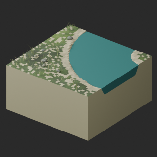](../../previews/quality-wt005-ap006-v1/WT008__repair_full.png)

[WT008__repair ZIP](https://raw.githubusercontent.com/k3peta/tales-on-a-table/main/distributions/quality-wt005-ap006-v1/WT008__repair_CC0.zip) · [Details](../quality-wt005-ap006-v1.md).

## AP001

**Weather lift beehive**

Weather lift beehive

[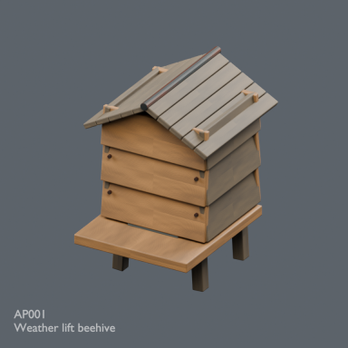](../../previews/mill-terrain-apiary24/renders/AP001.png)

[Full-size image](../../previews/mill-terrain-apiary24/renders/AP001.png)

Use / purpose: Unknown; see source catalogue. English use description needs review.

Record type: model. Formats: Unknown; inspect ZIP.

Reported dimensions (metres; XYZ when derived from measured bounds, legacy axis order not reverified): Unknown. Triangles: Unknown.

Origin: Unknown / not independently confirmed. Orientation: Unknown / not independently confirmed.

[Download ZIP](https://github.com/k3peta/tales-on-a-table/releases/download/v2026.10.21-apiary/AP001_CC0.zip) · [License scope](../../LICENSE.md)

**CC0-1.0** — See original ZIP license and repository license scope. Models and embedded materials only; previews excluded.

Source details: [Catalogue 1](../../catalog/apiary.en.md) · [Catalogue 2](../../catalog/apiary.md) · [Catalogue 3](../../catalog/apiary.zh-CN.md)

**Quality57–76 revisions (original pictured ZIP retained above):**

[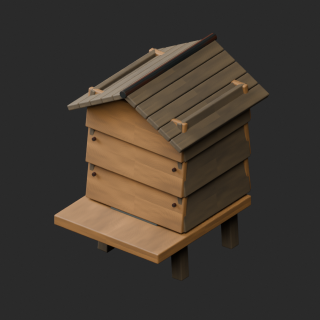](../../previews/quality-wt005-ap006-v1/AP001__repair_full.png)

[AP001__repair ZIP](https://raw.githubusercontent.com/k3peta/tales-on-a-table/main/distributions/quality-wt005-ap006-v1/AP001__repair_CC0.zip) · [Details](../quality-wt005-ap006-v1.md).

## AP002

**Open hive body**

Open hive body

[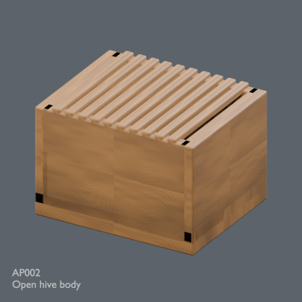](../../previews/mill-terrain-apiary24/renders/AP002.png)

[Full-size image](../../previews/mill-terrain-apiary24/renders/AP002.png)

Use / purpose: Unknown; see source catalogue. English use description needs review.

Record type: model. Formats: Unknown; inspect ZIP.

Reported dimensions (metres; XYZ when derived from measured bounds, legacy axis order not reverified): Unknown. Triangles: Unknown.

Origin: Unknown / not independently confirmed. Orientation: Unknown / not independently confirmed.

[Download ZIP](https://github.com/k3peta/tales-on-a-table/releases/download/v2026.10.21-apiary/AP002_CC0.zip) · [License scope](../../LICENSE.md)

**CC0-1.0** — See original ZIP license and repository license scope. Models and embedded materials only; previews excluded.

Source details: [Catalogue 1](../../catalog/apiary.en.md) · [Catalogue 2](../../catalog/apiary.md) · [Catalogue 3](../../catalog/apiary.zh-CN.md)

## AP003

**Honeycomb frame**

Honeycomb frame

[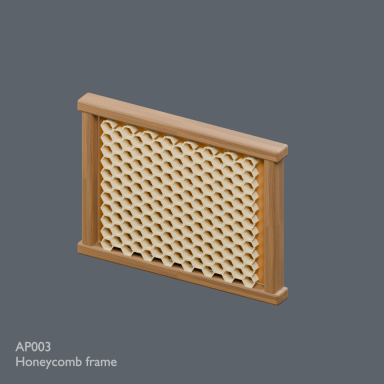](../../previews/mill-terrain-apiary24/renders/AP003.png)

[Full-size image](../../previews/mill-terrain-apiary24/renders/AP003.png)

Use / purpose: Unknown; see source catalogue. English use description needs review.

Record type: model. Formats: Unknown; inspect ZIP.

Reported dimensions (metres; XYZ when derived from measured bounds, legacy axis order not reverified): Unknown. Triangles: Unknown.

Origin: Unknown / not independently confirmed. Orientation: Unknown / not independently confirmed.

[Download ZIP](https://github.com/k3peta/tales-on-a-table/releases/download/v2026.10.21-apiary/AP003_CC0.zip) · [License scope](../../LICENSE.md)

**CC0-1.0** — See original ZIP license and repository license scope. Models and embedded materials only; previews excluded.

Source details: [Catalogue 1](../../catalog/apiary.en.md) · [Catalogue 2](../../catalog/apiary.md) · [Catalogue 3](../../catalog/apiary.zh-CN.md)

**Quality57–76 revisions (original pictured ZIP retained above):**

[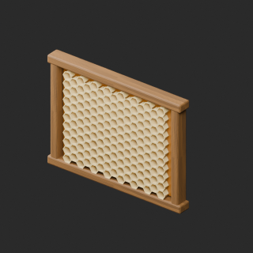](../../previews/quality-wt005-ap006-v1/AP003__repair_full.png)

[AP003__repair ZIP](https://raw.githubusercontent.com/k3peta/tales-on-a-table/main/distributions/quality-wt005-ap006-v1/AP003__repair_CC0.zip) · [Details](../quality-wt005-ap006-v1.md).

## AP004

**Coiled straw skep**

Coiled straw skep

[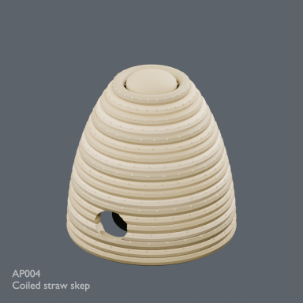](../../previews/mill-terrain-apiary24/renders/AP004.png)

[Full-size image](../../previews/mill-terrain-apiary24/renders/AP004.png)

Use / purpose: Unknown; see source catalogue. English use description needs review.

Record type: model. Formats: Unknown; inspect ZIP.

Reported dimensions (metres; XYZ when derived from measured bounds, legacy axis order not reverified): Unknown. Triangles: Unknown.

Origin: Unknown / not independently confirmed. Orientation: Unknown / not independently confirmed.

[Download ZIP](https://github.com/k3peta/tales-on-a-table/releases/download/v2026.10.21-apiary/AP004_CC0.zip) · [License scope](../../LICENSE.md)

**CC0-1.0** — See original ZIP license and repository license scope. Models and embedded materials only; previews excluded.

Source details: [Catalogue 1](../../catalog/apiary.en.md) · [Catalogue 2](../../catalog/apiary.md) · [Catalogue 3](../../catalog/apiary.zh-CN.md)

## AP005

**Copper bee smoker**

Copper bee smoker

[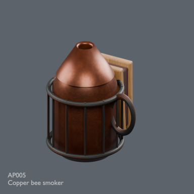](../../previews/mill-terrain-apiary24/renders/AP005.png)

[Full-size image](../../previews/mill-terrain-apiary24/renders/AP005.png)

Use / purpose: Unknown; see source catalogue. English use description needs review.

Record type: model. Formats: Unknown; inspect ZIP.

Reported dimensions (metres; XYZ when derived from measured bounds, legacy axis order not reverified): Unknown. Triangles: Unknown.

Origin: Unknown / not independently confirmed. Orientation: Unknown / not independently confirmed.

[Download ZIP](https://github.com/k3peta/tales-on-a-table/releases/download/v2026.10.21-apiary/AP005_CC0.zip) · [License scope](../../LICENSE.md)

**CC0-1.0** — See original ZIP license and repository license scope. Models and embedded materials only; previews excluded.

Source details: [Catalogue 1](../../catalog/apiary.en.md) · [Catalogue 2](../../catalog/apiary.md) · [Catalogue 3](../../catalog/apiary.zh-CN.md)

**Quality57–76 revisions (original pictured ZIP retained above):**

[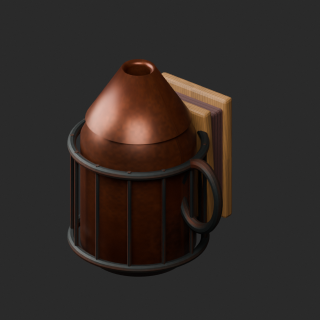](../../previews/quality-wt005-ap006-v1/AP005__repair_full.png)

[AP005__repair ZIP](https://raw.githubusercontent.com/k3peta/tales-on-a-table/main/distributions/quality-wt005-ap006-v1/AP005__repair_CC0.zip) · [Details](../quality-wt005-ap006-v1.md).

## AP006

**Honey workbench**

Honey workbench

[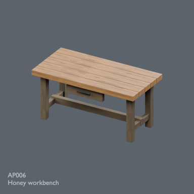](../../previews/mill-terrain-apiary24/renders/AP006.png)

[Full-size image](../../previews/mill-terrain-apiary24/renders/AP006.png)

Use / purpose: Unknown; see source catalogue. English use description needs review.

Record type: model. Formats: Unknown; inspect ZIP.

Reported dimensions (metres; XYZ when derived from measured bounds, legacy axis order not reverified): Unknown. Triangles: Unknown.

Origin: Unknown / not independently confirmed. Orientation: Unknown / not independently confirmed.

[Download ZIP](https://github.com/k3peta/tales-on-a-table/releases/download/v2026.10.21-apiary/AP006_CC0.zip) · [License scope](../../LICENSE.md)

**CC0-1.0** — See original ZIP license and repository license scope. Models and embedded materials only; previews excluded.

Source details: [Catalogue 1](../../catalog/apiary.en.md) · [Catalogue 2](../../catalog/apiary.md) · [Catalogue 3](../../catalog/apiary.zh-CN.md)

## AP007

**Manual honey press**

Manual honey press

[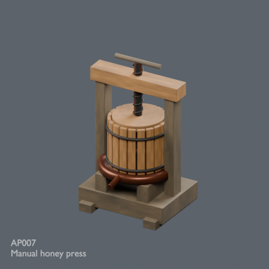](../../previews/mill-terrain-apiary24/renders/AP007.png)

[Full-size image](../../previews/mill-terrain-apiary24/renders/AP007.png)

Use / purpose: Unknown; see source catalogue. English use description needs review.

Record type: model. Formats: Unknown; inspect ZIP.

Reported dimensions (metres; XYZ when derived from measured bounds, legacy axis order not reverified): Unknown. Triangles: Unknown.

Origin: Unknown / not independently confirmed. Orientation: Unknown / not independently confirmed.

[Download ZIP](https://github.com/k3peta/tales-on-a-table/releases/download/v2026.10.21-apiary/AP007_CC0.zip) · [License scope](../../LICENSE.md)

**CC0-1.0** — See original ZIP license and repository license scope. Models and embedded materials only; previews excluded.

Source details: [Catalogue 1](../../catalog/apiary.en.md) · [Catalogue 2](../../catalog/apiary.md) · [Catalogue 3](../../catalog/apiary.zh-CN.md)

**Quality57–76 revisions (original pictured ZIP retained above):**

[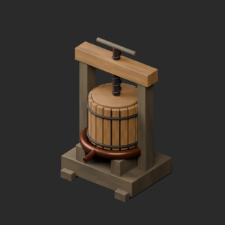](../../previews/quality-ap007-016-v1/AP007__repair_full.png)

[AP007__repair ZIP](https://raw.githubusercontent.com/k3peta/tales-on-a-table/main/distributions/quality-ap007-016-v1/AP007__repair_CC0.zip) · [Details](../quality-ap007-016-v1.md).

## AP008

**Staved honey pail**

Staved honey pail

[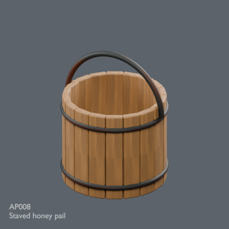](../../previews/mill-terrain-apiary24/renders/AP008.png)

[Full-size image](../../previews/mill-terrain-apiary24/renders/AP008.png)

Use / purpose: Unknown; see source catalogue. English use description needs review.

Record type: model. Formats: Unknown; inspect ZIP.

Reported dimensions (metres; XYZ when derived from measured bounds, legacy axis order not reverified): Unknown. Triangles: Unknown.

Origin: Unknown / not independently confirmed. Orientation: Unknown / not independently confirmed.

[Download ZIP](https://github.com/k3peta/tales-on-a-table/releases/download/v2026.10.21-apiary/AP008_CC0.zip) · [License scope](../../LICENSE.md)

**CC0-1.0** — See original ZIP license and repository license scope. Models and embedded materials only; previews excluded.

Source details: [Catalogue 1](../../catalog/apiary.en.md) · [Catalogue 2](../../catalog/apiary.md) · [Catalogue 3](../../catalog/apiary.zh-CN.md)

## AP009

**Honey storage jar**

Honey storage jar

[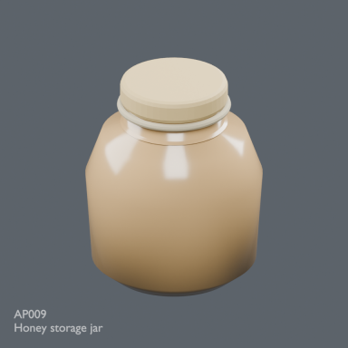](../../previews/mill-terrain-apiary24/renders/AP009.png)

[Full-size image](../../previews/mill-terrain-apiary24/renders/AP009.png)

Use / purpose: Unknown; see source catalogue. English use description needs review.

Record type: model. Formats: Unknown; inspect ZIP.

Reported dimensions (metres; XYZ when derived from measured bounds, legacy axis order not reverified): Unknown. Triangles: Unknown.

Origin: Unknown / not independently confirmed. Orientation: Unknown / not independently confirmed.

[Download ZIP](https://github.com/k3peta/tales-on-a-table/releases/download/v2026.10.21-apiary/AP009_CC0.zip) · [License scope](../../LICENSE.md)

**CC0-1.0** — See original ZIP license and repository license scope. Models and embedded materials only; previews excluded.

Source details: [Catalogue 1](../../catalog/apiary.en.md) · [Catalogue 2](../../catalog/apiary.md) · [Catalogue 3](../../catalog/apiary.zh-CN.md)

**Quality57–76 revisions (original pictured ZIP retained above):**

[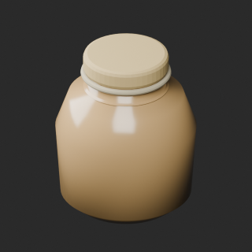](../../previews/quality-ap007-016-v1/AP009__repair_full.png)

[AP009__repair ZIP](https://raw.githubusercontent.com/k3peta/tales-on-a-table/main/distributions/quality-ap007-016-v1/AP009__repair_CC0.zip) · [Details](../quality-ap007-016-v1.md).

## AP010

**Honey dipper bowl**

Honey dipper bowl

[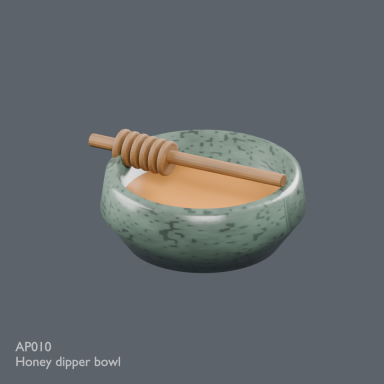](../../previews/mill-terrain-apiary24/renders/AP010.png)

[Full-size image](../../previews/mill-terrain-apiary24/renders/AP010.png)

Use / purpose: Unknown; see source catalogue. English use description needs review.

Record type: model. Formats: Unknown; inspect ZIP.

Reported dimensions (metres; XYZ when derived from measured bounds, legacy axis order not reverified): Unknown. Triangles: Unknown.

Origin: Unknown / not independently confirmed. Orientation: Unknown / not independently confirmed.

[Download ZIP](https://github.com/k3peta/tales-on-a-table/releases/download/v2026.10.21-apiary/AP010_CC0.zip) · [License scope](../../LICENSE.md)

**CC0-1.0** — See original ZIP license and repository license scope. Models and embedded materials only; previews excluded.

Source details: [Catalogue 1](../../catalog/apiary.en.md) · [Catalogue 2](../../catalog/apiary.md) · [Catalogue 3](../../catalog/apiary.zh-CN.md)

**Quality57–76 revisions (original pictured ZIP retained above):**

[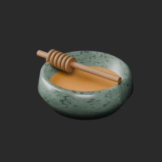](../../previews/quality-ap007-016-v1/AP010__repair_full.png)

[AP010__repair ZIP](https://raw.githubusercontent.com/k3peta/tales-on-a-table/main/distributions/quality-ap007-016-v1/AP010__repair_CC0.zip) · [Details](../quality-ap007-016-v1.md).

## AP011

**Beeswax blocks**

Beeswax blocks

[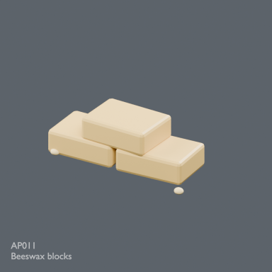](../../previews/mill-terrain-apiary24/renders/AP011.png)

[Full-size image](../../previews/mill-terrain-apiary24/renders/AP011.png)

Use / purpose: Unknown; see source catalogue. English use description needs review.

Record type: model. Formats: Unknown; inspect ZIP.

Reported dimensions (metres; XYZ when derived from measured bounds, legacy axis order not reverified): Unknown. Triangles: Unknown.

Origin: Unknown / not independently confirmed. Orientation: Unknown / not independently confirmed.

[Download ZIP](https://github.com/k3peta/tales-on-a-table/releases/download/v2026.10.21-apiary/AP011_CC0.zip) · [License scope](../../LICENSE.md)

**CC0-1.0** — See original ZIP license and repository license scope. Models and embedded materials only; previews excluded.

Source details: [Catalogue 1](../../catalog/apiary.en.md) · [Catalogue 2](../../catalog/apiary.md) · [Catalogue 3](../../catalog/apiary.zh-CN.md)

## AP012

**Candle drying rack**

Candle drying rack

[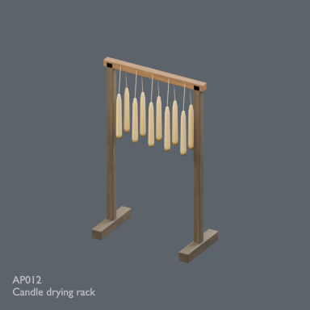](../../previews/apiary-alchemy24/renders/AP012.png)

[Full-size image](../../previews/apiary-alchemy24/renders/AP012.png)

Use / purpose: Unknown; see source catalogue. English use description needs review.

Record type: model. Formats: Unknown; inspect ZIP.

Reported dimensions (metres; XYZ when derived from measured bounds, legacy axis order not reverified): Unknown. Triangles: Unknown.

Origin: Unknown / not independently confirmed. Orientation: Unknown / not independently confirmed.

[Download ZIP](https://github.com/k3peta/tales-on-a-table/releases/download/v2026.10.21-apiary/AP012_CC0.zip) · [License scope](../../LICENSE.md)

**CC0-1.0** — See original ZIP license and repository license scope. Models and embedded materials only; previews excluded.

Source details: [Catalogue 1](../../catalog/apiary.en.md) · [Catalogue 2](../../catalog/apiary.md) · [Catalogue 3](../../catalog/apiary.zh-CN.md)

**Quality57–76 revisions (original pictured ZIP retained above):**

[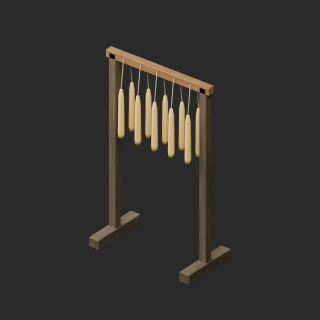](../../previews/quality-ap007-016-v1/AP012__repair_full.png)

[AP012__repair ZIP](https://raw.githubusercontent.com/k3peta/tales-on-a-table/main/distributions/quality-ap007-016-v1/AP012__repair_CC0.zip) · [Details](../quality-ap007-016-v1.md).

## AP013

**Six tube candle mould**

Six tube candle mould

[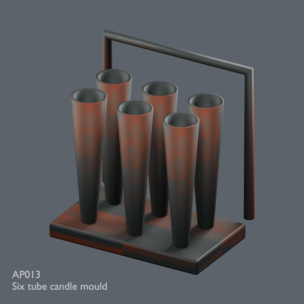](../../previews/apiary-alchemy24/renders/AP013.png)

[Full-size image](../../previews/apiary-alchemy24/renders/AP013.png)

Use / purpose: Unknown; see source catalogue. English use description needs review.

Record type: model. Formats: Unknown; inspect ZIP.

Reported dimensions (metres; XYZ when derived from measured bounds, legacy axis order not reverified): Unknown. Triangles: Unknown.

Origin: Unknown / not independently confirmed. Orientation: Unknown / not independently confirmed.

[Download ZIP](https://github.com/k3peta/tales-on-a-table/releases/download/v2026.10.21-apiary/AP013_CC0.zip) · [License scope](../../LICENSE.md)

**CC0-1.0** — See original ZIP license and repository license scope. Models and embedded materials only; previews excluded.

Source details: [Catalogue 1](../../catalog/apiary.en.md) · [Catalogue 2](../../catalog/apiary.md) · [Catalogue 3](../../catalog/apiary.zh-CN.md)

## AP014

**Wax melting cauldron**

Wax melting cauldron

[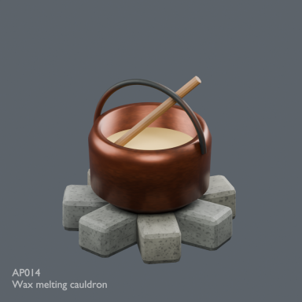](../../previews/apiary-alchemy24/renders/AP014.png)

[Full-size image](../../previews/apiary-alchemy24/renders/AP014.png)

Use / purpose: Unknown; see source catalogue. English use description needs review.

Record type: model. Formats: Unknown; inspect ZIP.

Reported dimensions (metres; XYZ when derived from measured bounds, legacy axis order not reverified): Unknown. Triangles: Unknown.

Origin: Unknown / not independently confirmed. Orientation: Unknown / not independently confirmed.

[Download ZIP](https://github.com/k3peta/tales-on-a-table/releases/download/v2026.10.21-apiary/AP014_CC0.zip) · [License scope](../../LICENSE.md)

**CC0-1.0** — See original ZIP license and repository license scope. Models and embedded materials only; previews excluded.

Source details: [Catalogue 1](../../catalog/apiary.en.md) · [Catalogue 2](../../catalog/apiary.md) · [Catalogue 3](../../catalog/apiary.zh-CN.md)

**Quality57–76 revisions (original pictured ZIP retained above):**

[AP014__repair ZIP](https://raw.githubusercontent.com/k3peta/tales-on-a-table/main/distributions/quality-ap007-016-v1/AP014__repair_CC0.zip) · [Details](../quality-ap007-016-v1.md).

## AP015

**Hive tool and brush**

Hive tool and brush

[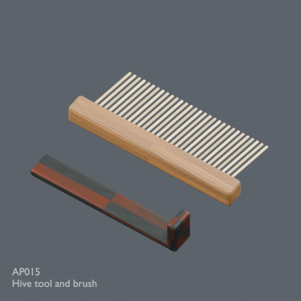](../../previews/apiary-alchemy24/renders/AP015.png)

[Full-size image](../../previews/apiary-alchemy24/renders/AP015.png)

Use / purpose: Unknown; see source catalogue. English use description needs review.

Record type: model. Formats: Unknown; inspect ZIP.

Reported dimensions (metres; XYZ when derived from measured bounds, legacy axis order not reverified): Unknown. Triangles: Unknown.

Origin: Unknown / not independently confirmed. Orientation: Unknown / not independently confirmed.

[Download ZIP](https://github.com/k3peta/tales-on-a-table/releases/download/v2026.10.21-apiary/AP015_CC0.zip) · [License scope](../../LICENSE.md)

**CC0-1.0** — See original ZIP license and repository license scope. Models and embedded materials only; previews excluded.

Source details: [Catalogue 1](../../catalog/apiary.en.md) · [Catalogue 2](../../catalog/apiary.md) · [Catalogue 3](../../catalog/apiary.zh-CN.md)

## AP016

**Apiary handcart**

Apiary handcart

[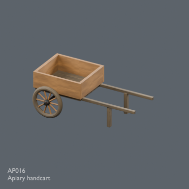](../../previews/apiary-alchemy24/renders/AP016.png)

[Full-size image](../../previews/apiary-alchemy24/renders/AP016.png)

Use / purpose: Unknown; see source catalogue. English use description needs review.

Record type: model. Formats: Unknown; inspect ZIP.

Reported dimensions (metres; XYZ when derived from measured bounds, legacy axis order not reverified): Unknown. Triangles: Unknown.

Origin: Unknown / not independently confirmed. Orientation: Unknown / not independently confirmed.

[Download ZIP](https://github.com/k3peta/tales-on-a-table/releases/download/v2026.10.21-apiary/AP016_CC0.zip) · [License scope](../../LICENSE.md)

**CC0-1.0** — See original ZIP license and repository license scope. Models and embedded materials only; previews excluded.

Source details: [Catalogue 1](../../catalog/apiary.en.md) · [Catalogue 2](../../catalog/apiary.md) · [Catalogue 3](../../catalog/apiary.zh-CN.md)

## AP017

**Frame transport crate**

Frame transport crate

[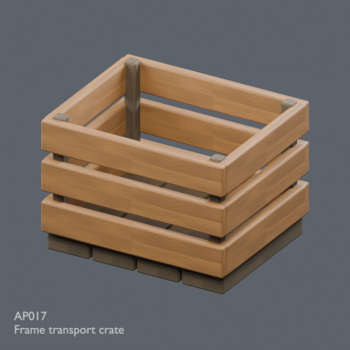](../../previews/apiary-alchemy24/renders/AP017.png)

[Full-size image](../../previews/apiary-alchemy24/renders/AP017.png)

Use / purpose: Unknown; see source catalogue. English use description needs review.

Record type: model. Formats: Unknown; inspect ZIP.

Reported dimensions (metres; XYZ when derived from measured bounds, legacy axis order not reverified): Unknown. Triangles: Unknown.

Origin: Unknown / not independently confirmed. Orientation: Unknown / not independently confirmed.

[Download ZIP](https://github.com/k3peta/tales-on-a-table/releases/download/v2026.10.21-apiary/AP017_CC0.zip) · [License scope](../../LICENSE.md)

**CC0-1.0** — See original ZIP license and repository license scope. Models and embedded materials only; previews excluded.

Source details: [Catalogue 1](../../catalog/apiary.en.md) · [Catalogue 2](../../catalog/apiary.md) · [Catalogue 3](../../catalog/apiary.zh-CN.md)

## AP018

**Uncapping board**

Uncapping board

[Full-size image](../../previews/apiary-alchemy24/renders/AP018.png)

Use / purpose: Unknown; see source catalogue. English use description needs review.

Record type: model. Formats: Unknown; inspect ZIP.

Reported dimensions (metres; XYZ when derived from measured bounds, legacy axis order not reverified): Unknown. Triangles: Unknown.

Origin: Unknown / not independently confirmed. Orientation: Unknown / not independently confirmed.

[Download ZIP](https://github.com/k3peta/tales-on-a-table/releases/download/v2026.10.21-apiary/AP018_CC0.zip) · [License scope](../../LICENSE.md)

**CC0-1.0** — See original ZIP license and repository license scope. Models and embedded materials only; previews excluded.

Source details: [Catalogue 1](../../catalog/apiary.en.md) · [Catalogue 2](../../catalog/apiary.md) · [Catalogue 3](../../catalog/apiary.zh-CN.md)

**Quality57–76 revisions (original pictured ZIP retained above):**

[AP018__repair ZIP](https://raw.githubusercontent.com/k3peta/tales-on-a-table/main/distributions/quality-ap017-al006-v1/AP018__repair_CC0.zip) · [Details](../quality-ap017-al006-v1.md).

## AP019

**Bee water tray**

Bee water tray

[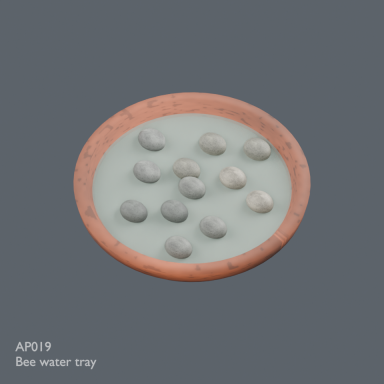](../../previews/apiary-alchemy24/renders/AP019.png)

[Full-size image](../../previews/apiary-alchemy24/renders/AP019.png)

Use / purpose: Unknown; see source catalogue. English use description needs review.

Record type: model. Formats: Unknown; inspect ZIP.

Reported dimensions (metres; XYZ when derived from measured bounds, legacy axis order not reverified): Unknown. Triangles: Unknown.

Origin: Unknown / not independently confirmed. Orientation: Unknown / not independently confirmed.

[Download ZIP](https://github.com/k3peta/tales-on-a-table/releases/download/v2026.10.21-apiary/AP019_CC0.zip) · [License scope](../../LICENSE.md)

**CC0-1.0** — See original ZIP license and repository license scope. Models and embedded materials only; previews excluded.

Source details: [Catalogue 1](../../catalog/apiary.en.md) · [Catalogue 2](../../catalog/apiary.md) · [Catalogue 3](../../catalog/apiary.zh-CN.md)

**Quality57–76 revisions (original pictured ZIP retained above):**

[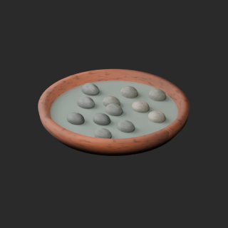](../../previews/quality-ap017-al006-v1/AP019__repair_full.png)

[AP019__repair ZIP](https://raw.githubusercontent.com/k3peta/tales-on-a-table/main/distributions/quality-ap017-al006-v1/AP019__repair_CC0.zip) · [Details](../quality-ap017-al006-v1.md).

## AP020

**Low hive stand**

Low hive stand

[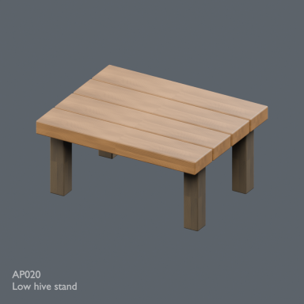](../../previews/apiary-alchemy24/renders/AP020.png)

[Full-size image](../../previews/apiary-alchemy24/renders/AP020.png)

Use / purpose: Unknown; see source catalogue. English use description needs review.

Record type: model. Formats: Unknown; inspect ZIP.

Reported dimensions (metres; XYZ when derived from measured bounds, legacy axis order not reverified): Unknown. Triangles: Unknown.

Origin: Unknown / not independently confirmed. Orientation: Unknown / not independently confirmed.

[Download ZIP](https://github.com/k3peta/tales-on-a-table/releases/download/v2026.10.21-apiary/AP020_CC0.zip) · [License scope](../../LICENSE.md)

**CC0-1.0** — See original ZIP license and repository license scope. Models and embedded materials only; previews excluded.

Source details: [Catalogue 1](../../catalog/apiary.en.md) · [Catalogue 2](../../catalog/apiary.md) · [Catalogue 3](../../catalog/apiary.zh-CN.md)
