# Base distribution records 601–624

[Browse index](README.md) · [Coverage and missing fields](COVERAGE.md)

Images are actual existing model renders for browsing, not covered by model CC0. A group record may show several reused models. Dimensions and triangle counts apply only to the original record when sourced; revisions can differ. Unknown means unverified, not zero. No blanket CC0 grant for scenes, images, code or articles.

## AL001

**Stone laboratory bench**

Stone laboratory bench

[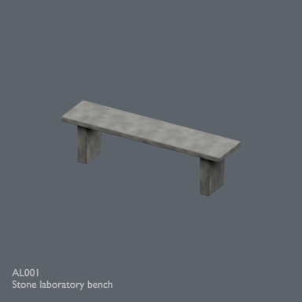](../../previews/apiary-alchemy24/renders/AL001.png)

[Full-size image](../../previews/apiary-alchemy24/renders/AL001.png)

Use / purpose: Unknown; see source catalogue. English use description needs review.

Record type: model. Formats: Unknown; inspect ZIP.

Reported dimensions (metres; XYZ when derived from measured bounds, legacy axis order not reverified): Unknown. Triangles: Unknown.

Origin: Unknown / not independently confirmed. Orientation: Unknown / not independently confirmed.

[Download ZIP](https://github.com/k3peta/tales-on-a-table/releases/download/v2026.10.21-alchemist/AL001_CC0.zip) · [License scope](../../LICENSE.md)

**CC0-1.0** — See original ZIP license and repository license scope. Models and embedded materials only; previews excluded.

Source details: [Catalogue 1](../../catalog/alchemist.md)

## AL002

**Refractory furnace**

Refractory furnace

[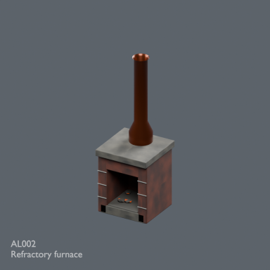](../../previews/apiary-alchemy24/renders/AL002.png)

[Full-size image](../../previews/apiary-alchemy24/renders/AL002.png)

Use / purpose: Unknown; see source catalogue. English use description needs review.

Record type: model. Formats: Unknown; inspect ZIP.

Reported dimensions (metres; XYZ when derived from measured bounds, legacy axis order not reverified): Unknown. Triangles: Unknown.

Origin: Unknown / not independently confirmed. Orientation: Unknown / not independently confirmed.

[Download ZIP](https://github.com/k3peta/tales-on-a-table/releases/download/v2026.10.21-alchemist/AL002_CC0.zip) · [License scope](../../LICENSE.md)

**CC0-1.0** — See original ZIP license and repository license scope. Models and embedded materials only; previews excluded.

Source details: [Catalogue 1](../../catalog/alchemist.md)

## AL003

**Copper alembic**

Copper alembic

[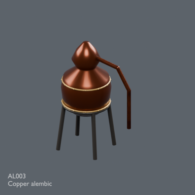](../../previews/apiary-alchemy24/renders/AL003.png)

[Full-size image](../../previews/apiary-alchemy24/renders/AL003.png)

Use / purpose: Unknown; see source catalogue. English use description needs review.

Record type: model. Formats: Unknown; inspect ZIP.

Reported dimensions (metres; XYZ when derived from measured bounds, legacy axis order not reverified): Unknown. Triangles: Unknown.

Origin: Unknown / not independently confirmed. Orientation: Unknown / not independently confirmed.

[Download ZIP](https://github.com/k3peta/tales-on-a-table/releases/download/v2026.10.21-alchemist/AL003_CC0.zip) · [License scope](../../LICENSE.md)

**CC0-1.0** — See original ZIP license and repository license scope. Models and embedded materials only; previews excluded.

Source details: [Catalogue 1](../../catalog/alchemist.md)

## AL004

**Cooling vat**

Cooling vat

[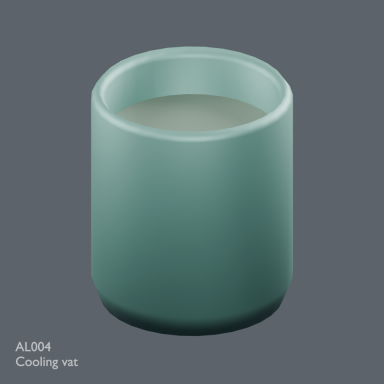](../../previews/apiary-alchemy24/renders/AL004.png)

[Full-size image](../../previews/apiary-alchemy24/renders/AL004.png)

Use / purpose: Unknown; see source catalogue. English use description needs review.

Record type: model. Formats: Unknown; inspect ZIP.

Reported dimensions (metres; XYZ when derived from measured bounds, legacy axis order not reverified): Unknown. Triangles: Unknown.

Origin: Unknown / not independently confirmed. Orientation: Unknown / not independently confirmed.

[Download ZIP](https://github.com/k3peta/tales-on-a-table/releases/download/v2026.10.21-alchemist/AL004_CC0.zip) · [License scope](../../LICENSE.md)

**CC0-1.0** — See original ZIP license and repository license scope. Models and embedded materials only; previews excluded.

Source details: [Catalogue 1](../../catalog/alchemist.md) · [Catalogue 2](../../catalog/husbandry_cellar_v1.md)

## AL005

**Reading desk**

Reading desk

[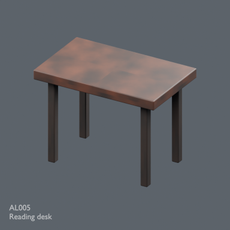](../../previews/apiary-alchemy24/renders/AL005.png)

[Full-size image](../../previews/apiary-alchemy24/renders/AL005.png)

Use / purpose: Unknown; see source catalogue. English use description needs review.

Record type: model. Formats: Unknown; inspect ZIP.

Reported dimensions (metres; XYZ when derived from measured bounds, legacy axis order not reverified): Unknown. Triangles: Unknown.

Origin: Unknown / not independently confirmed. Orientation: Unknown / not independently confirmed.

[Download ZIP](https://github.com/k3peta/tales-on-a-table/releases/download/v2026.10.21-alchemist/AL005_CC0.zip) · [License scope](../../LICENSE.md)

**CC0-1.0** — See original ZIP license and repository license scope. Models and embedded materials only; previews excluded.

Source details: [Catalogue 1](../../catalog/alchemist.md)

## AL006

**Open folio**

Open folio

[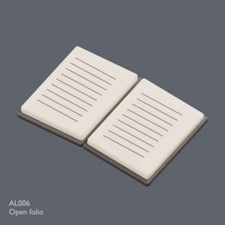](../../previews/apiary-alchemy24/renders/AL006.png)

[Full-size image](../../previews/apiary-alchemy24/renders/AL006.png)

Use / purpose: Unknown; see source catalogue. English use description needs review.

Record type: model. Formats: Unknown; inspect ZIP.

Reported dimensions (metres; XYZ when derived from measured bounds, legacy axis order not reverified): Unknown. Triangles: Unknown.

Origin: Unknown / not independently confirmed. Orientation: Unknown / not independently confirmed.

[Download ZIP](https://github.com/k3peta/tales-on-a-table/releases/download/v2026.10.21-alchemist/AL006_CC0.zip) · [License scope](../../LICENSE.md)

**CC0-1.0** — See original ZIP license and repository license scope. Models and embedded materials only; previews excluded.

Source details: [Catalogue 1](../../catalog/alchemist.md)

## AL007

**Assayers balance**

Assayers balance

[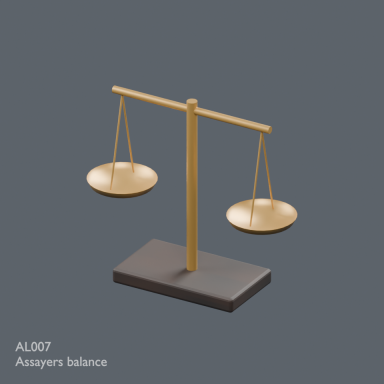](../../previews/apiary-alchemy24/renders/AL007.png)

[Full-size image](../../previews/apiary-alchemy24/renders/AL007.png)

Use / purpose: Unknown; see source catalogue. English use description needs review.

Record type: model. Formats: Unknown; inspect ZIP.

Reported dimensions (metres; XYZ when derived from measured bounds, legacy axis order not reverified): Unknown. Triangles: Unknown.

Origin: Unknown / not independently confirmed. Orientation: Unknown / not independently confirmed.

[Download ZIP](https://github.com/k3peta/tales-on-a-table/releases/download/v2026.10.21-alchemist/AL007_CC0.zip) · [License scope](../../LICENSE.md)

**CC0-1.0** — See original ZIP license and repository license scope. Models and embedded materials only; previews excluded.

Source details: [Catalogue 1](../../catalog/alchemist.md)

## AL008

**Green reagent bottle**

Green reagent bottle

[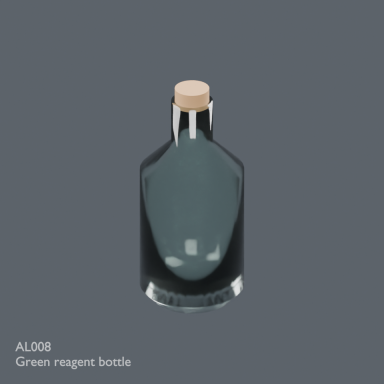](../../previews/apiary-alchemy24/renders/AL008.png)

[Full-size image](../../previews/apiary-alchemy24/renders/AL008.png)

Use / purpose: Unknown; see source catalogue. English use description needs review.

Record type: model. Formats: Unknown; inspect ZIP.

Reported dimensions (metres; XYZ when derived from measured bounds, legacy axis order not reverified): Unknown. Triangles: Unknown.

Origin: Unknown / not independently confirmed. Orientation: Unknown / not independently confirmed.

[Download ZIP](https://github.com/k3peta/tales-on-a-table/releases/download/v2026.10.21-alchemist/AL008_CC0.zip) · [License scope](../../LICENSE.md)

**CC0-1.0** — See original ZIP license and repository license scope. Models and embedded materials only; previews excluded.

Source details: [Catalogue 1](../../catalog/alchemist.md)

## AL009

**Small reagent bottle**

Small reagent bottle

[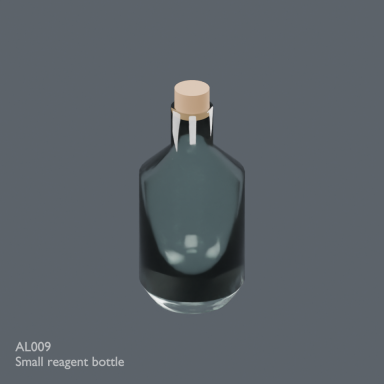](../../previews/apiary-alchemy24/renders/AL009.png)

[Full-size image](../../previews/apiary-alchemy24/renders/AL009.png)

Use / purpose: Unknown; see source catalogue. English use description needs review.

Record type: model. Formats: Unknown; inspect ZIP.

Reported dimensions (metres; XYZ when derived from measured bounds, legacy axis order not reverified): Unknown. Triangles: Unknown.

Origin: Unknown / not independently confirmed. Orientation: Unknown / not independently confirmed.

[Download ZIP](https://github.com/k3peta/tales-on-a-table/releases/download/v2026.10.21-alchemist/AL009_CC0.zip) · [License scope](../../LICENSE.md)

**CC0-1.0** — See original ZIP license and repository license scope. Models and embedded materials only; previews excluded.

Source details: [Catalogue 1](../../catalog/alchemist.md)

## AL010

**Glass retort**

Glass retort

[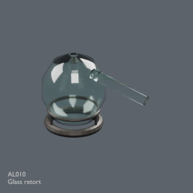](../../previews/apiary-alchemy24/renders/AL010.png)

[Full-size image](../../previews/apiary-alchemy24/renders/AL010.png)

Use / purpose: Unknown; see source catalogue. English use description needs review.

Record type: model. Formats: Unknown; inspect ZIP.

Reported dimensions (metres; XYZ when derived from measured bounds, legacy axis order not reverified): Unknown. Triangles: Unknown.

Origin: Unknown / not independently confirmed. Orientation: Unknown / not independently confirmed.

[Download ZIP](https://github.com/k3peta/tales-on-a-table/releases/download/v2026.10.21-alchemist/AL010_CC0.zip) · [License scope](../../LICENSE.md)

**CC0-1.0** — See original ZIP license and repository license scope. Models and embedded materials only; previews excluded.

Source details: [Catalogue 1](../../catalog/alchemist.md)

## AL011

**Mortar pestle**

Mortar pestle

[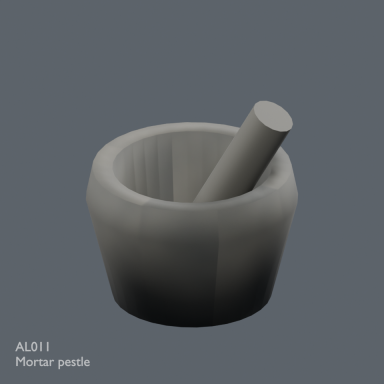](../../previews/apiary-alchemy24/renders/AL011.png)

[Full-size image](../../previews/apiary-alchemy24/renders/AL011.png)

Use / purpose: Unknown; see source catalogue. English use description needs review.

Record type: model. Formats: Unknown; inspect ZIP.

Reported dimensions (metres; XYZ when derived from measured bounds, legacy axis order not reverified): Unknown. Triangles: Unknown.

Origin: Unknown / not independently confirmed. Orientation: Unknown / not independently confirmed.

[Download ZIP](https://github.com/k3peta/tales-on-a-table/releases/download/v2026.10.21-alchemist/AL011_CC0.zip) · [License scope](../../LICENSE.md)

**CC0-1.0** — See original ZIP license and repository license scope. Models and embedded materials only; previews excluded.

Source details: [Catalogue 1](../../catalog/alchemist.md)

## AL012

**Mineral sample tray**

Mineral sample tray

[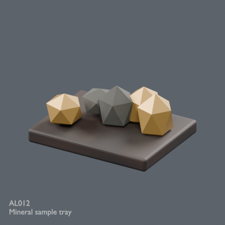](../../previews/apiary-alchemy24/renders/AL012.png)

[Full-size image](../../previews/apiary-alchemy24/renders/AL012.png)

Use / purpose: Unknown; see source catalogue. English use description needs review.

Record type: model. Formats: Unknown; inspect ZIP.

Reported dimensions (metres; XYZ when derived from measured bounds, legacy axis order not reverified): Unknown. Triangles: Unknown.

Origin: Unknown / not independently confirmed. Orientation: Unknown / not independently confirmed.

[Download ZIP](https://github.com/k3peta/tales-on-a-table/releases/download/v2026.10.21-alchemist/AL012_CC0.zip) · [License scope](../../LICENSE.md)

**CC0-1.0** — See original ZIP license and repository license scope. Models and embedded materials only; previews excluded.

Source details: [Catalogue 1](../../catalog/alchemist.md)

## AL013

**Copper funnel**

Copper funnel

[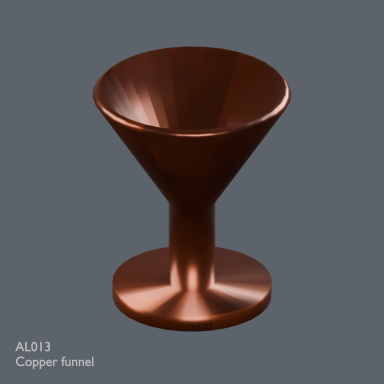](../../previews/apiary-alchemy24/renders/AL013.png)

[Full-size image](../../previews/apiary-alchemy24/renders/AL013.png)

Use / purpose: Unknown; see source catalogue. English use description needs review.

Record type: model. Formats: Unknown; inspect ZIP.

Reported dimensions (metres; XYZ when derived from measured bounds, legacy axis order not reverified): Unknown. Triangles: Unknown.

Origin: Unknown / not independently confirmed. Orientation: Unknown / not independently confirmed.

[Download ZIP](https://github.com/k3peta/tales-on-a-table/releases/download/v2026.10.21-alchemist/AL013_CC0.zip) · [License scope](../../LICENSE.md)

**CC0-1.0** — See original ZIP license and repository license scope. Models and embedded materials only; previews excluded.

Source details: [Catalogue 1](../../catalog/alchemist.md)

## AL014

**Bellows**

Bellows

[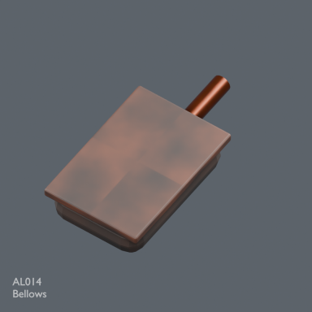](../../previews/apiary-alchemy24/renders/AL014.png)

[Full-size image](../../previews/apiary-alchemy24/renders/AL014.png)

Use / purpose: Unknown; see source catalogue. English use description needs review.

Record type: model. Formats: Unknown; inspect ZIP.

Reported dimensions (metres; XYZ when derived from measured bounds, legacy axis order not reverified): Unknown. Triangles: Unknown.

Origin: Unknown / not independently confirmed. Orientation: Unknown / not independently confirmed.

[Download ZIP](https://github.com/k3peta/tales-on-a-table/releases/download/v2026.10.21-alchemist/AL014_CC0.zip) · [License scope](../../LICENSE.md)

**CC0-1.0** — See original ZIP license and repository license scope. Models and embedded materials only; previews excluded.

Source details: [Catalogue 1](../../catalog/alchemist.md)

## AL015

**Long tongs**

Long tongs

[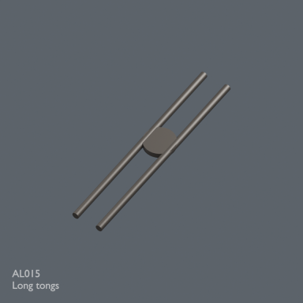](../../previews/apiary-alchemy24/renders/AL015.png)

[Full-size image](../../previews/apiary-alchemy24/renders/AL015.png)

Use / purpose: Unknown; see source catalogue. English use description needs review.

Record type: model. Formats: Unknown; inspect ZIP.

Reported dimensions (metres; XYZ when derived from measured bounds, legacy axis order not reverified): Unknown. Triangles: Unknown.

Origin: Unknown / not independently confirmed. Orientation: Unknown / not independently confirmed.

[Download ZIP](https://github.com/k3peta/tales-on-a-table/releases/download/v2026.10.21-alchemist/AL015_CC0.zip) · [License scope](../../LICENSE.md)

**CC0-1.0** — See original ZIP license and repository license scope. Models and embedded materials only; previews excluded.

Source details: [Catalogue 1](../../catalog/alchemist.md)

## AL016

**Storage chest**

Storage chest

[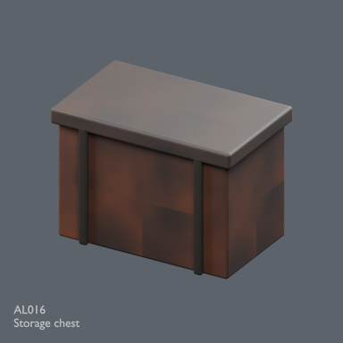](../../previews/alchemy-forest14/renders/AL016.png)

[Full-size image](../../previews/alchemy-forest14/renders/AL016.png)

Use / purpose: Unknown; see source catalogue. English use description needs review.

Record type: model. Formats: Unknown; inspect ZIP.

Reported dimensions (metres; XYZ when derived from measured bounds, legacy axis order not reverified): Unknown. Triangles: Unknown.

Origin: Unknown / not independently confirmed. Orientation: Unknown / not independently confirmed.

[Download ZIP](https://github.com/k3peta/tales-on-a-table/releases/download/v2026.10.21-alchemist/AL016_CC0.zip) · [License scope](../../LICENSE.md)

**CC0-1.0** — See original ZIP license and repository license scope. Models and embedded materials only; previews excluded.

Source details: [Catalogue 1](../../catalog/alchemist.md)

## AL017

**Bound volumes**

Bound volumes

[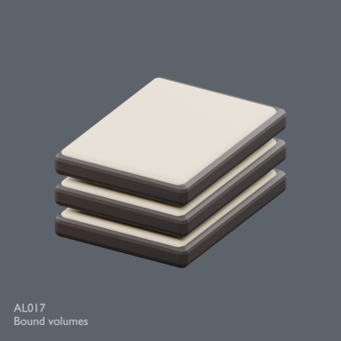](../../previews/alchemy-forest14/renders/AL017.png)

[Full-size image](../../previews/alchemy-forest14/renders/AL017.png)

Use / purpose: Unknown; see source catalogue. English use description needs review.

Record type: model. Formats: Unknown; inspect ZIP.

Reported dimensions (metres; XYZ when derived from measured bounds, legacy axis order not reverified): Unknown. Triangles: Unknown.

Origin: Unknown / not independently confirmed. Orientation: Unknown / not independently confirmed.

[Download ZIP](https://github.com/k3peta/tales-on-a-table/releases/download/v2026.10.21-alchemist/AL017_CC0.zip) · [License scope](../../LICENSE.md)

**CC0-1.0** — See original ZIP license and repository license scope. Models and embedded materials only; previews excluded.

Source details: [Catalogue 1](../../catalog/alchemist.md)

## AL018

**Ink and quill**

Ink and quill

[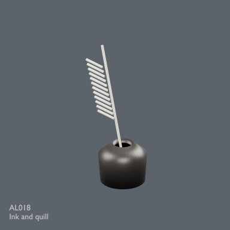](../../previews/alchemy-forest14/renders/AL018.png)

[Full-size image](../../previews/alchemy-forest14/renders/AL018.png)

Use / purpose: Unknown; see source catalogue. English use description needs review.

Record type: model. Formats: Unknown; inspect ZIP.

Reported dimensions (metres; XYZ when derived from measured bounds, legacy axis order not reverified): Unknown. Triangles: Unknown.

Origin: Unknown / not independently confirmed. Orientation: Unknown / not independently confirmed.

[Download ZIP](https://github.com/k3peta/tales-on-a-table/releases/download/v2026.10.21-alchemist/AL018_CC0.zip) · [License scope](../../LICENSE.md)

**CC0-1.0** — See original ZIP license and repository license scope. Models and embedded materials only; previews excluded.

Source details: [Catalogue 1](../../catalog/alchemist.md)

## AL019

**Stool**

Stool

[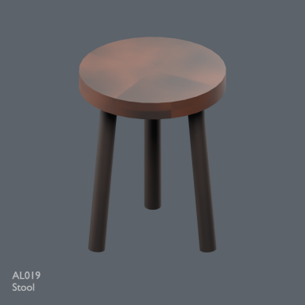](../../previews/alchemy-forest14/renders/AL019.png)

[Full-size image](../../previews/alchemy-forest14/renders/AL019.png)

Use / purpose: Unknown; see source catalogue. English use description needs review.

Record type: model. Formats: Unknown; inspect ZIP.

Reported dimensions (metres; XYZ when derived from measured bounds, legacy axis order not reverified): Unknown. Triangles: Unknown.

Origin: Unknown / not independently confirmed. Orientation: Unknown / not independently confirmed.

[Download ZIP](https://github.com/k3peta/tales-on-a-table/releases/download/v2026.10.21-alchemist/AL019_CC0.zip) · [License scope](../../LICENSE.md)

**CC0-1.0** — See original ZIP license and repository license scope. Models and embedded materials only; previews excluded.

Source details: [Catalogue 1](../../catalog/alchemist.md)

## AL020

**Crucibles**

Crucibles

[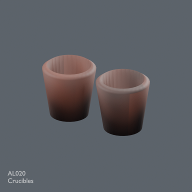](../../previews/alchemy-forest14/renders/AL020.png)

[Full-size image](../../previews/alchemy-forest14/renders/AL020.png)

Use / purpose: Unknown; see source catalogue. English use description needs review.

Record type: model. Formats: Unknown; inspect ZIP.

Reported dimensions (metres; XYZ when derived from measured bounds, legacy axis order not reverified): Unknown. Triangles: Unknown.

Origin: Unknown / not independently confirmed. Orientation: Unknown / not independently confirmed.

[Download ZIP](https://github.com/k3peta/tales-on-a-table/releases/download/v2026.10.21-alchemist/AL020_CC0.zip) · [License scope](../../LICENSE.md)

**CC0-1.0** — See original ZIP license and repository license scope. Models and embedded materials only; previews excluded.

Source details: [Catalogue 1](../../catalog/alchemist.md)

## AL021

**Copper ladle**

Copper ladle

[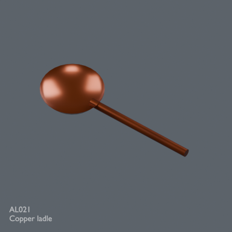](../../previews/alchemy-forest14/renders/AL021.png)

[Full-size image](../../previews/alchemy-forest14/renders/AL021.png)

Use / purpose: Unknown; see source catalogue. English use description needs review.

Record type: model. Formats: Unknown; inspect ZIP.

Reported dimensions (metres; XYZ when derived from measured bounds, legacy axis order not reverified): Unknown. Triangles: Unknown.

Origin: Unknown / not independently confirmed. Orientation: Unknown / not independently confirmed.

[Download ZIP](https://github.com/k3peta/tales-on-a-table/releases/download/v2026.10.21-alchemist/AL021_CC0.zip) · [License scope](../../LICENSE.md)

**CC0-1.0** — See original ZIP license and repository license scope. Models and embedded materials only; previews excluded.

Source details: [Catalogue 1](../../catalog/alchemist.md)

## AL022

**Wall instrument chart**

Wall instrument chart

[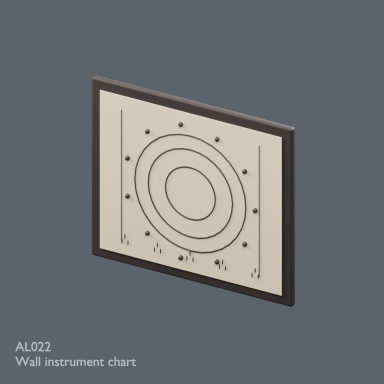](../../previews/alchemy-forest14/renders/AL022.png)

[Full-size image](../../previews/alchemy-forest14/renders/AL022.png)

Use / purpose: Unknown; see source catalogue. English use description needs review.

Record type: model. Formats: Unknown; inspect ZIP.

Reported dimensions (metres; XYZ when derived from measured bounds, legacy axis order not reverified): Unknown. Triangles: Unknown.

Origin: Unknown / not independently confirmed. Orientation: Unknown / not independently confirmed.

[Download ZIP](https://github.com/k3peta/tales-on-a-table/releases/download/v2026.10.21-alchemist/AL022_CC0.zip) · [License scope](../../LICENSE.md)

**CC0-1.0** — See original ZIP license and repository license scope. Models and embedded materials only; previews excluded.

Source details: [Catalogue 1](../../catalog/alchemist.md)

## AL023

**Bucket**

Bucket

[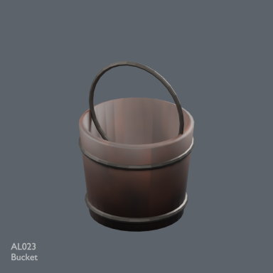](../../previews/alchemy-forest14/renders/AL023.png)

[Full-size image](../../previews/alchemy-forest14/renders/AL023.png)

Use / purpose: Unknown; see source catalogue. English use description needs review.

Record type: model. Formats: Unknown; inspect ZIP.

Reported dimensions (metres; XYZ when derived from measured bounds, legacy axis order not reverified): Unknown. Triangles: Unknown.

Origin: Unknown / not independently confirmed. Orientation: Unknown / not independently confirmed.

[Download ZIP](https://github.com/k3peta/tales-on-a-table/releases/download/v2026.10.21-alchemist/AL023_CC0.zip) · [License scope](../../LICENSE.md)

**CC0-1.0** — See original ZIP license and repository license scope. Models and embedded materials only; previews excluded.

Source details: [Catalogue 1](../../catalog/alchemist.md)

## AL024

**Hourglass**

Hourglass

[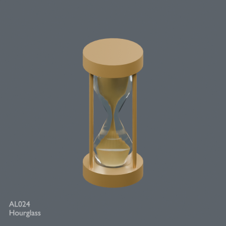](../../previews/alchemy-forest14/renders/AL024.png)

[Full-size image](../../previews/alchemy-forest14/renders/AL024.png)

Use / purpose: Unknown; see source catalogue. English use description needs review.

Record type: model. Formats: Unknown; inspect ZIP.

Reported dimensions (metres; XYZ when derived from measured bounds, legacy axis order not reverified): Unknown. Triangles: Unknown.

Origin: Unknown / not independently confirmed. Orientation: Unknown / not independently confirmed.

[Download ZIP](https://github.com/k3peta/tales-on-a-table/releases/download/v2026.10.21-alchemist/AL024_CC0.zip) · [License scope](../../LICENSE.md)

**CC0-1.0** — See original ZIP license and repository license scope. Models and embedded materials only; previews excluded.

Source details: [Catalogue 1](../../catalog/alchemist.md)
