# Base distribution records 625–648

[Browse index](README.md) · [Coverage and missing fields](COVERAGE.md)

Images are actual existing model renders for browsing, not covered by model CC0. A group record may show several reused models. Dimensions and triangle counts apply only to the original record when sourced; revisions can differ. Unknown means unverified, not zero. No blanket CC0 grant for scenes, images, code or articles.

## AL025

**Bench wizard volumes**

Bench wizard volumes

[Full-size image](../../previews/alchemy-forest14/renders/AL025.png)

Use / purpose: Unknown; see source catalogue. English use description needs review.

Record type: group. Formats: Unknown; inspect ZIP.

Reported dimensions (metres; XYZ when derived from measured bounds, legacy axis order not reverified): Unknown. Triangles: Unknown.

Origin: Unknown / not independently confirmed. Orientation: Unknown / not independently confirmed.

[Download ZIP](https://github.com/k3peta/tales-on-a-table/releases/download/v2026.10.21-alchemist/AL025_CC0.zip) · [License scope](../../LICENSE.md)

**CC0-1.0** — See original ZIP license and repository license scope. Models and embedded materials only; previews excluded.

Source details: [Catalogue 1](../../catalog/alchemist.md)

## AL026

**Desk side book pile**

Desk side book pile

[Full-size image](../../previews/alchemy-forest14/renders/AL026.png)

Use / purpose: Unknown; see source catalogue. English use description needs review.

Record type: group. Formats: Unknown; inspect ZIP.

Reported dimensions (metres; XYZ when derived from measured bounds, legacy axis order not reverified): Unknown. Triangles: Unknown.

Origin: Unknown / not independently confirmed. Orientation: Unknown / not independently confirmed.

[Download ZIP](https://github.com/k3peta/tales-on-a-table/releases/download/v2026.10.21-alchemist/AL026_CC0.zip) · [License scope](../../LICENSE.md)

**CC0-1.0** — See original ZIP license and repository license scope. Models and embedded materials only; previews excluded.

Source details: [Catalogue 1](../../catalog/alchemist.md)

## AL027

**Chest reference stack**

Chest reference stack

[Full-size image](../../previews/alchemy-forest14/renders/AL027.png)

Use / purpose: Unknown; see source catalogue. English use description needs review.

Record type: group. Formats: Unknown; inspect ZIP.

Reported dimensions (metres; XYZ when derived from measured bounds, legacy axis order not reverified): Unknown. Triangles: Unknown.

Origin: Unknown / not independently confirmed. Orientation: Unknown / not independently confirmed.

[Download ZIP](https://github.com/k3peta/tales-on-a-table/releases/download/v2026.10.21-alchemist/AL027_CC0.zip) · [License scope](../../LICENSE.md)

**CC0-1.0** — See original ZIP license and repository license scope. Models and embedded materials only; previews excluded.

Source details: [Catalogue 1](../../catalog/alchemist.md)

## FW001

**Herbalists workbench**

Herbalists workbench

[Full repair image](../../previews/quality-fw-normal-repair-v1/renders/FW001.png) · [Repaired ZIP](https://raw.githubusercontent.com/k3peta/tales-on-a-table/main/distributions/quality-fw-normal-repair-v1/FW001__repair_CC0.zip) · [Comparison](../../previews/quality-fw-normal-repair-v1/comparisons/FW001.png)

Image depicts corrected revision FW001__repair; original download below retained as history.

Use / purpose: Unknown; see source catalogue. English use description needs review.

Record type: model. Formats: Unknown; inspect ZIP.

Reported dimensions (metres; XYZ when derived from measured bounds, legacy axis order not reverified): Unknown. Triangles: Unknown.

Origin: Unknown / not independently confirmed. Orientation: Unknown / not independently confirmed.

[Download ZIP](https://raw.githubusercontent.com/k3peta/tales-on-a-table/main/distributions/quality-fw-normal-repair-v1/FW001__repair_CC0.zip) · [License scope](../../LICENSE.md)

**CC0-1.0** — See original ZIP license and repository license scope. Models and embedded materials only; previews excluded.

Source details: [Catalogue 1](../../catalog/forest_witch.md)

**Version history:** Original image was held for invalid normal mapping. Corrected revision now pictured; original remains historical. [Repair evidence](../fw_normal_repairs.md).

**Pictured corrected revision:** [ZIP](https://raw.githubusercontent.com/k3peta/tales-on-a-table/main/distributions/quality-fw-normal-repair-v1/FW001__repair_CC0.zip). [Legacy original ZIP](https://github.com/k3peta/tales-on-a-table/releases/download/v2026.10.21-forest-witch/FW001_CC0.zip) is retained and is not the pictured model.

**Version scope:** The image above depicts the corrected revision. [Latest revision ZIP](https://raw.githubusercontent.com/k3peta/tales-on-a-table/main/distributions/quality-fw-normal-repair-v1/FW001__repair_CC0.zip). [Revision-specific preview](../../previews/quality-fw-normal-repair-v1/renders/FW001.png). [Version audit](VERSION-AUDIT.md).

## FW002

**Stone mortar and pestle**

Stone mortar and pestle

[Full repair image](../../previews/quality-fw-normal-repair-v1/renders/FW002.png) · [Repaired ZIP](https://raw.githubusercontent.com/k3peta/tales-on-a-table/main/distributions/quality-fw-normal-repair-v1/FW002__repair_CC0.zip) · [Comparison](../../previews/quality-fw-normal-repair-v1/comparisons/FW002.png)

Image depicts corrected revision FW002__repair; original download below retained as history.

Use / purpose: Unknown; see source catalogue. English use description needs review.

Record type: model. Formats: Unknown; inspect ZIP.

Reported dimensions (metres; XYZ when derived from measured bounds, legacy axis order not reverified): Unknown. Triangles: Unknown.

Origin: Unknown / not independently confirmed. Orientation: Unknown / not independently confirmed.

[Download ZIP](https://raw.githubusercontent.com/k3peta/tales-on-a-table/main/distributions/quality-fw-normal-repair-v1/FW002__repair_CC0.zip) · [License scope](../../LICENSE.md)

**CC0-1.0** — See original ZIP license and repository license scope. Models and embedded materials only; previews excluded.

Source details: [Catalogue 1](../../catalog/forest_witch.md)

**Version history:** Original image was held for invalid normal mapping. Corrected revision now pictured; original remains historical. [Repair evidence](../fw_normal_repairs.md).

**Pictured corrected revision:** [ZIP](https://raw.githubusercontent.com/k3peta/tales-on-a-table/main/distributions/quality-fw-normal-repair-v1/FW002__repair_CC0.zip). [Legacy original ZIP](https://github.com/k3peta/tales-on-a-table/releases/download/v2026.10.21-forest-witch/FW002_CC0.zip) is retained and is not the pictured model.

**Version scope:** The image above depicts the corrected revision. [Latest revision ZIP](https://raw.githubusercontent.com/k3peta/tales-on-a-table/main/distributions/quality-fw-normal-repair-v1/FW002__repair_CC0.zip). [Revision-specific preview](../../previews/quality-fw-normal-repair-v1/renders/FW002.png). [Version audit](VERSION-AUDIT.md).

**Quality57–76 revisions (original pictured ZIP retained above):**

[FW002__repair ZIP](https://raw.githubusercontent.com/k3peta/tales-on-a-table/main/distributions/quality-al027-fw009-v1/FW002__repair_CC0.zip) · [Details](../quality-al027-fw009-v1.md).

## FW003

**Corked apothecary bottles**

Corked apothecary bottles

[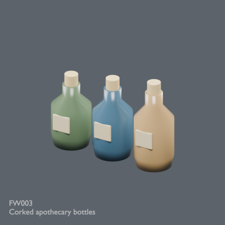](../../previews/alchemy-forest14/renders/FW003.png)

[Full-size image](../../previews/alchemy-forest14/renders/FW003.png)

Use / purpose: Unknown; see source catalogue. English use description needs review.

Record type: model. Formats: Unknown; inspect ZIP.

Reported dimensions (metres; XYZ when derived from measured bounds, legacy axis order not reverified): Unknown. Triangles: Unknown.

Origin: Unknown / not independently confirmed. Orientation: Unknown / not independently confirmed.

[Download ZIP](https://github.com/k3peta/tales-on-a-table/releases/download/v2026.10.21-forest-witch/FW003_CC0.zip) · [License scope](../../LICENSE.md)

**CC0-1.0** — See original ZIP license and repository license scope. Models and embedded materials only; previews excluded.

Source details: [Catalogue 1](../../catalog/forest_witch.md)

**Quality57–76 revisions (original pictured ZIP retained above):**

[FW003__repair ZIP](https://raw.githubusercontent.com/k3peta/tales-on-a-table/main/distributions/quality-al027-fw009-v1/FW003__repair_CC0.zip) · [Details](../quality-al027-fw009-v1.md).

## FW004

**Open herbal and bookstand**

Open herbal and bookstand

[Full repair image](../../previews/quality-fw-normal-repair-v1/renders/FW004.png) · [Repaired ZIP](https://raw.githubusercontent.com/k3peta/tales-on-a-table/main/distributions/quality-fw-normal-repair-v1/FW004__repair_CC0.zip) · [Comparison](../../previews/quality-fw-normal-repair-v1/comparisons/FW004.png)

Image depicts corrected revision FW004__repair; original download below retained as history.

Use / purpose: Unknown; see source catalogue. English use description needs review.

Record type: model. Formats: Unknown; inspect ZIP.

Reported dimensions (metres; XYZ when derived from measured bounds, legacy axis order not reverified): Unknown. Triangles: Unknown.

Origin: Unknown / not independently confirmed. Orientation: Unknown / not independently confirmed.

[Download ZIP](https://raw.githubusercontent.com/k3peta/tales-on-a-table/main/distributions/quality-fw-normal-repair-v1/FW004__repair_CC0.zip) · [License scope](../../LICENSE.md)

**CC0-1.0** — See original ZIP license and repository license scope. Models and embedded materials only; previews excluded.

Source details: [Catalogue 1](../../catalog/forest_witch.md)

**Version history:** Original image was held for invalid normal mapping. Corrected revision now pictured; original remains historical. [Repair evidence](../fw_normal_repairs.md).

**Pictured corrected revision:** [ZIP](https://raw.githubusercontent.com/k3peta/tales-on-a-table/main/distributions/quality-fw-normal-repair-v1/FW004__repair_CC0.zip). [Legacy original ZIP](https://github.com/k3peta/tales-on-a-table/releases/download/v2026.10.21-forest-witch/FW004_CC0.zip) is retained and is not the pictured model.

**Version scope:** The image above depicts the corrected revision. [Latest revision ZIP](https://raw.githubusercontent.com/k3peta/tales-on-a-table/main/distributions/quality-fw-normal-repair-v1/FW004__repair_CC0.zip). [Revision-specific preview](../../previews/quality-fw-normal-repair-v1/renders/FW004.png). [Version audit](VERSION-AUDIT.md).

## FW005

**Hanging herb drying rail**

Hanging herb drying rail

[Full repair image](../../previews/quality-fw-normal-repair-v1/renders/FW005.png) · [Repaired ZIP](https://raw.githubusercontent.com/k3peta/tales-on-a-table/main/distributions/quality-fw-normal-repair-v1/FW005__repair_CC0.zip) · [Comparison](../../previews/quality-fw-normal-repair-v1/comparisons/FW005.png)

Image depicts corrected revision FW005__repair; original download below retained as history.

Use / purpose: Unknown; see source catalogue. English use description needs review.

Record type: model. Formats: Unknown; inspect ZIP.

Reported dimensions (metres; XYZ when derived from measured bounds, legacy axis order not reverified): Unknown. Triangles: Unknown.

Origin: Unknown / not independently confirmed. Orientation: Unknown / not independently confirmed.

[Download ZIP](https://raw.githubusercontent.com/k3peta/tales-on-a-table/main/distributions/quality-fw-normal-repair-v1/FW005__repair_CC0.zip) · [License scope](../../LICENSE.md)

**CC0-1.0** — See original ZIP license and repository license scope. Models and embedded materials only; previews excluded.

Source details: [Catalogue 1](../../catalog/forest_witch.md)

**Version history:** Original image was held for invalid normal mapping. Corrected revision now pictured; original remains historical. [Repair evidence](../fw_normal_repairs.md).

**Pictured corrected revision:** [ZIP](https://raw.githubusercontent.com/k3peta/tales-on-a-table/main/distributions/quality-fw-normal-repair-v1/FW005__repair_CC0.zip). [Legacy original ZIP](https://github.com/k3peta/tales-on-a-table/releases/download/v2026.10.21-forest-witch/FW005_CC0.zip) is retained and is not the pictured model.

**Version scope:** The image above depicts the corrected revision. [Latest revision ZIP](https://raw.githubusercontent.com/k3peta/tales-on-a-table/main/distributions/quality-fw-normal-repair-v1/FW005__repair_CC0.zip). [Revision-specific preview](../../previews/quality-fw-normal-repair-v1/renders/FW005.png). [Version audit](VERSION-AUDIT.md).

## FW006

**Wicker gathering basket**

Wicker gathering basket

[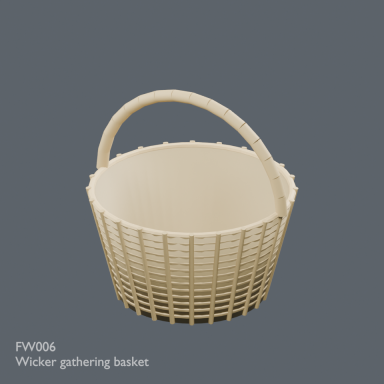](../../previews/alchemy-forest14/renders/FW006.png)

[Full-size image](../../previews/alchemy-forest14/renders/FW006.png)

Use / purpose: Unknown; see source catalogue. English use description needs review.

Record type: model. Formats: Unknown; inspect ZIP.

Reported dimensions (metres; XYZ when derived from measured bounds, legacy axis order not reverified): Unknown. Triangles: Unknown.

Origin: Unknown / not independently confirmed. Orientation: Unknown / not independently confirmed.

[Download ZIP](https://github.com/k3peta/tales-on-a-table/releases/download/v2026.10.21-forest-witch/FW006_CC0.zip) · [License scope](../../LICENSE.md)

**CC0-1.0** — See original ZIP license and repository license scope. Models and embedded materials only; previews excluded.

Source details: [Catalogue 1](../../catalog/forest_witch.md) · [Catalogue 2](../../catalog/husbandry_cellar_v2.md)

**Quality57–76 revisions (original pictured ZIP retained above):**

[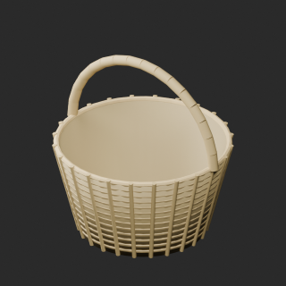](../../previews/quality-al027-fw009-v1/FW006__repair_full.png)

[FW006__repair ZIP](https://raw.githubusercontent.com/k3peta/tales-on-a-table/main/distributions/quality-al027-fw009-v1/FW006__repair_CC0.zip) · [Details](../quality-al027-fw009-v1.md).

## FW007

**Birch twig broom**

Birch twig broom

[Full repair image](../../previews/quality-fw-normal-repair-v1/renders/FW007.png) · [Repaired ZIP](https://raw.githubusercontent.com/k3peta/tales-on-a-table/main/distributions/quality-fw-normal-repair-v1/FW007__repair_CC0.zip) · [Comparison](../../previews/quality-fw-normal-repair-v1/comparisons/FW007.png)

Image depicts corrected revision FW007__repair; original download below retained as history.

Use / purpose: Unknown; see source catalogue. English use description needs review.

Record type: model. Formats: Unknown; inspect ZIP.

Reported dimensions (metres; XYZ when derived from measured bounds, legacy axis order not reverified): Unknown. Triangles: Unknown.

Origin: Unknown / not independently confirmed. Orientation: Unknown / not independently confirmed.

[Download ZIP](https://raw.githubusercontent.com/k3peta/tales-on-a-table/main/distributions/quality-fw-normal-repair-v1/FW007__repair_CC0.zip) · [License scope](../../LICENSE.md)

**CC0-1.0** — See original ZIP license and repository license scope. Models and embedded materials only; previews excluded.

Source details: [Catalogue 1](../../catalog/forest_witch.md)

**Version history:** Original image was held for invalid normal mapping. Corrected revision now pictured; original remains historical. [Repair evidence](../fw_normal_repairs.md).

**Pictured corrected revision:** [ZIP](https://raw.githubusercontent.com/k3peta/tales-on-a-table/main/distributions/quality-fw-normal-repair-v1/FW007__repair_CC0.zip). [Legacy original ZIP](https://github.com/k3peta/tales-on-a-table/releases/download/v2026.10.21-forest-witch/FW007_CC0.zip) is retained and is not the pictured model.

**Version scope:** The image above depicts the corrected revision. [Latest revision ZIP](https://raw.githubusercontent.com/k3peta/tales-on-a-table/main/distributions/quality-fw-normal-repair-v1/FW007__repair_CC0.zip). [Revision-specific preview](../../previews/quality-fw-normal-repair-v1/renders/FW007.png). [Version audit](VERSION-AUDIT.md).

## FW008

**Iron cauldron and tripod**

Iron cauldron and tripod

[Full repair image](../../previews/quality-fw-normal-repair-v1/renders/FW008.png) · [Repaired ZIP](https://raw.githubusercontent.com/k3peta/tales-on-a-table/main/distributions/quality-fw-normal-repair-v1/FW008__repair_CC0.zip) · [Comparison](../../previews/quality-fw-normal-repair-v1/comparisons/FW008.png)

Image depicts corrected revision FW008__repair; original download below retained as history.

Use / purpose: Unknown; see source catalogue. English use description needs review.

Record type: model. Formats: Unknown; inspect ZIP.

Reported dimensions (metres; XYZ when derived from measured bounds, legacy axis order not reverified): Unknown. Triangles: Unknown.

Origin: Unknown / not independently confirmed. Orientation: Unknown / not independently confirmed.

[Download ZIP](https://raw.githubusercontent.com/k3peta/tales-on-a-table/main/distributions/quality-fw-normal-repair-v1/FW008__repair_CC0.zip) · [License scope](../../LICENSE.md)

**CC0-1.0** — See original ZIP license and repository license scope. Models and embedded materials only; previews excluded.

Source details: [Catalogue 1](../../catalog/forest_witch.md)

**Version history:** Original image was held for invalid normal mapping. Corrected revision now pictured; original remains historical. [Repair evidence](../fw_normal_repairs.md).

**Pictured corrected revision:** [ZIP](https://raw.githubusercontent.com/k3peta/tales-on-a-table/main/distributions/quality-fw-normal-repair-v1/FW008__repair_CC0.zip). [Legacy original ZIP](https://github.com/k3peta/tales-on-a-table/releases/download/v2026.10.21-forest-witch/FW008_CC0.zip) is retained and is not the pictured model.

**Version scope:** The image above depicts the corrected revision. [Latest revision ZIP](https://raw.githubusercontent.com/k3peta/tales-on-a-table/main/distributions/quality-fw-normal-repair-v1/FW008__repair_CC0.zip). [Revision-specific preview](../../previews/quality-fw-normal-repair-v1/renders/FW008.png). [Version audit](VERSION-AUDIT.md).

**Quality57–76 revisions (original pictured ZIP retained above):**

[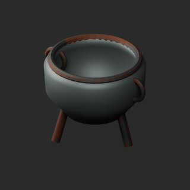](../../previews/quality-al027-fw009-v1/FW008__repair_full.png)

[FW008__repair ZIP](https://raw.githubusercontent.com/k3peta/tales-on-a-table/main/distributions/quality-al027-fw009-v1/FW008__repair_CC0.zip) · [Details](../quality-al027-fw009-v1.md).

## FW009

**Split firewood stack**

Split firewood stack

[Full repair image](../../previews/quality-fw-normal-repair-v1/renders/FW009.png) · [Repaired ZIP](https://raw.githubusercontent.com/k3peta/tales-on-a-table/main/distributions/quality-fw-normal-repair-v1/FW009__repair_CC0.zip) · [Comparison](../../previews/quality-fw-normal-repair-v1/comparisons/FW009.png)

Image depicts corrected revision FW009__repair; original download below retained as history.

Use / purpose: Unknown; see source catalogue. English use description needs review.

Record type: model. Formats: Unknown; inspect ZIP.

Reported dimensions (metres; XYZ when derived from measured bounds, legacy axis order not reverified): Unknown. Triangles: Unknown.

Origin: Unknown / not independently confirmed. Orientation: Unknown / not independently confirmed.

[Download ZIP](https://raw.githubusercontent.com/k3peta/tales-on-a-table/main/distributions/quality-fw-normal-repair-v1/FW009__repair_CC0.zip) · [License scope](../../LICENSE.md)

**CC0-1.0** — See original ZIP license and repository license scope. Models and embedded materials only; previews excluded.

Source details: [Catalogue 1](../../catalog/forest_witch.md)

**Version history:** Original image was held for invalid normal mapping. Corrected revision now pictured; original remains historical. [Repair evidence](../fw_normal_repairs.md).

**Pictured corrected revision:** [ZIP](https://raw.githubusercontent.com/k3peta/tales-on-a-table/main/distributions/quality-fw-normal-repair-v1/FW009__repair_CC0.zip). [Legacy original ZIP](https://github.com/k3peta/tales-on-a-table/releases/download/v2026.10.21-forest-witch/FW009_CC0.zip) is retained and is not the pictured model.

**Version scope:** The image above depicts the corrected revision. [Latest revision ZIP](https://raw.githubusercontent.com/k3peta/tales-on-a-table/main/distributions/quality-fw-normal-repair-v1/FW009__repair_CC0.zip). [Revision-specific preview](../../previews/quality-fw-normal-repair-v1/renders/FW009.png). [Version audit](VERSION-AUDIT.md).

## FW010

**Copper kettle**

Copper kettle

[Full repair image](../../previews/quality-fw-normal-repair-v1/renders/FW010.png) · [Repaired ZIP](https://raw.githubusercontent.com/k3peta/tales-on-a-table/main/distributions/quality-fw-normal-repair-v1/FW010__repair_CC0.zip) · [Comparison](../../previews/quality-fw-normal-repair-v1/comparisons/FW010.png)

Image depicts corrected revision FW010__repair; original download below retained as history.

Use / purpose: Unknown; see source catalogue. English use description needs review.

Record type: model. Formats: Unknown; inspect ZIP.

Reported dimensions (metres; XYZ when derived from measured bounds, legacy axis order not reverified): Unknown. Triangles: Unknown.

Origin: Unknown / not independently confirmed. Orientation: Unknown / not independently confirmed.

[Download ZIP](https://raw.githubusercontent.com/k3peta/tales-on-a-table/main/distributions/quality-fw-normal-repair-v1/FW010__repair_CC0.zip) · [License scope](../../LICENSE.md)

**CC0-1.0** — See original ZIP license and repository license scope. Models and embedded materials only; previews excluded.

Source details: [Catalogue 1](../../catalog/forest_witch.md)

**Version history:** Original image was held for invalid normal mapping. Corrected revision now pictured; original remains historical. [Repair evidence](../fw_normal_repairs.md).

**Pictured corrected revision:** [ZIP](https://raw.githubusercontent.com/k3peta/tales-on-a-table/main/distributions/quality-fw-normal-repair-v1/FW010__repair_CC0.zip). [Legacy original ZIP](https://github.com/k3peta/tales-on-a-table/releases/download/v2026.10.21-forest-witch/FW010_CC0.zip) is retained and is not the pictured model.

**Version scope:** The image above depicts the corrected revision. [Latest revision ZIP](https://raw.githubusercontent.com/k3peta/tales-on-a-table/main/distributions/quality-fw-normal-repair-v1/FW010__repair_CC0.zip). [Revision-specific preview](../../previews/quality-fw-normal-repair-v1/renders/FW010.png). [Version audit](VERSION-AUDIT.md).

**Quality57–76 revisions (original pictured ZIP retained above):**

[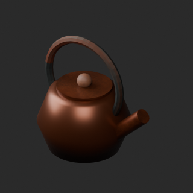](../../previews/quality-fw010-019-v1/FW010__repair_full.png)

[FW010__repair ZIP](https://raw.githubusercontent.com/k3peta/tales-on-a-table/main/distributions/quality-fw010-019-v1/FW010__repair_CC0.zip) · [Details](../quality-fw010-019-v1.md).

## FW011

**Lantern on stone plinth**

Lantern on stone plinth

[Full repair image](../../previews/quality-fw-normal-repair-v1/renders/FW011.png) · [Repaired ZIP](https://raw.githubusercontent.com/k3peta/tales-on-a-table/main/distributions/quality-fw-normal-repair-v1/FW011__repair_CC0.zip) · [Comparison](../../previews/quality-fw-normal-repair-v1/comparisons/FW011.png)

Image depicts corrected revision FW011__repair; original download below retained as history.

Use / purpose: Unknown; see source catalogue. English use description needs review.

Record type: model. Formats: Unknown; inspect ZIP.

Reported dimensions (metres; XYZ when derived from measured bounds, legacy axis order not reverified): Unknown. Triangles: Unknown.

Origin: Unknown / not independently confirmed. Orientation: Unknown / not independently confirmed.

[Download ZIP](https://raw.githubusercontent.com/k3peta/tales-on-a-table/main/distributions/quality-fw-normal-repair-v1/FW011__repair_CC0.zip) · [License scope](../../LICENSE.md)

**CC0-1.0** — See original ZIP license and repository license scope. Models and embedded materials only; previews excluded.

Source details: [Catalogue 1](../../catalog/forest_witch.md)

**Version history:** Original image was held for invalid normal mapping. Corrected revision now pictured; original remains historical. [Repair evidence](../fw_normal_repairs.md).

**Pictured corrected revision:** [ZIP](https://raw.githubusercontent.com/k3peta/tales-on-a-table/main/distributions/quality-fw-normal-repair-v1/FW011__repair_CC0.zip). [Legacy original ZIP](https://github.com/k3peta/tales-on-a-table/releases/download/v2026.10.21-forest-witch/FW011_CC0.zip) is retained and is not the pictured model.

**Version scope:** The image above depicts the corrected revision. [Latest revision ZIP](https://raw.githubusercontent.com/k3peta/tales-on-a-table/main/distributions/quality-fw-normal-repair-v1/FW011__repair_CC0.zip). [Revision-specific preview](../../previews/quality-fw-normal-repair-v1/renders/FW011.png). [Version audit](VERSION-AUDIT.md).

## FW012

**Rainwater barrel**

Rainwater barrel

[Full repair image](../../previews/quality-fw-normal-repair-v1/renders/FW012.png) · [Repaired ZIP](https://raw.githubusercontent.com/k3peta/tales-on-a-table/main/distributions/quality-fw-normal-repair-v1/FW012__repair_CC0.zip) · [Comparison](../../previews/quality-fw-normal-repair-v1/comparisons/FW012.png)

Image depicts corrected revision FW012__repair; original download below retained as history.

Use / purpose: Unknown; see source catalogue. English use description needs review.

Record type: model. Formats: Unknown; inspect ZIP.

Reported dimensions (metres; XYZ when derived from measured bounds, legacy axis order not reverified): Unknown. Triangles: Unknown.

Origin: Unknown / not independently confirmed. Orientation: Unknown / not independently confirmed.

[Download ZIP](https://raw.githubusercontent.com/k3peta/tales-on-a-table/main/distributions/quality-fw-normal-repair-v1/FW012__repair_CC0.zip) · [License scope](../../LICENSE.md)

**CC0-1.0** — See original ZIP license and repository license scope. Models and embedded materials only; previews excluded.

Source details: [Catalogue 1](../../catalog/forest_witch.md)

**Version history:** Original image was held for invalid normal mapping. Corrected revision now pictured; original remains historical. [Repair evidence](../fw_normal_repairs.md).

**Pictured corrected revision:** [ZIP](https://raw.githubusercontent.com/k3peta/tales-on-a-table/main/distributions/quality-fw-normal-repair-v1/FW012__repair_CC0.zip). [Legacy original ZIP](https://github.com/k3peta/tales-on-a-table/releases/download/v2026.10.21-forest-witch/FW012_CC0.zip) is retained and is not the pictured model.

**Version scope:** The image above depicts the corrected revision. [Latest revision ZIP](https://raw.githubusercontent.com/k3peta/tales-on-a-table/main/distributions/quality-fw-normal-repair-v1/FW012__repair_CC0.zip). [Revision-specific preview](../../previews/quality-fw-normal-repair-v1/renders/FW012.png). [Version audit](VERSION-AUDIT.md).

**Quality57–76 revisions (original pictured ZIP retained above):**

[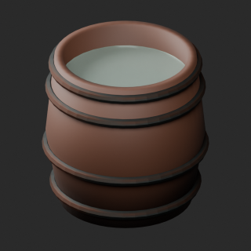](../../previews/quality-fw010-019-v1/FW012__repair_full.png)

[FW012__repair ZIP](https://raw.githubusercontent.com/k3peta/tales-on-a-table/main/distributions/quality-fw010-019-v1/FW012__repair_CC0.zip) · [Details](../quality-fw010-019-v1.md).

## FW013

**Three earthen herb pots**

Three earthen herb pots

[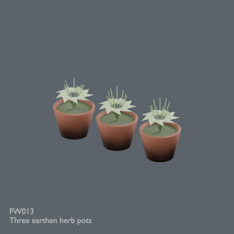](../../previews/quality-fw013-021-normal-repair-v1/renders/FW013.png)

[Full repair image](../../previews/quality-fw013-021-normal-repair-v1/renders/FW013.png) · [Repaired ZIP](https://raw.githubusercontent.com/k3peta/tales-on-a-table/main/distributions/quality-fw013-021-normal-repair-v1/FW013__repair_CC0.zip) · [Comparison](../../previews/quality-fw013-021-normal-repair-v1/comparisons/FW013.png)

Image depicts corrected revision FW013__repair; original download below retained as history.

Use / purpose: Unknown; see source catalogue. English use description needs review.

Record type: model. Formats: Unknown; inspect ZIP.

Reported dimensions (metres; XYZ when derived from measured bounds, legacy axis order not reverified): Unknown. Triangles: Unknown.

Origin: Unknown / not independently confirmed. Orientation: Unknown / not independently confirmed.

[Download ZIP](https://raw.githubusercontent.com/k3peta/tales-on-a-table/main/distributions/quality-fw013-021-normal-repair-v1/FW013__repair_CC0.zip) · [License scope](../../LICENSE.md)

**CC0-1.0** — See original ZIP license and repository license scope. Models and embedded materials only; previews excluded.

Source details: [Catalogue 1](../../catalog/forest_witch.md)

**Version history:** Original image was held for invalid normal mapping. Corrected revision now pictured; original remains historical. [Repair evidence](../fw013_021_normal_repairs.md).

**Pictured corrected revision:** [ZIP](https://raw.githubusercontent.com/k3peta/tales-on-a-table/main/distributions/quality-fw013-021-normal-repair-v1/FW013__repair_CC0.zip). [Legacy original ZIP](https://github.com/k3peta/tales-on-a-table/releases/download/v2026.10.21-forest-witch/FW013_CC0.zip) is retained and is not the pictured model.

**Version scope:** The image above depicts the corrected revision. [Latest revision ZIP](https://raw.githubusercontent.com/k3peta/tales-on-a-table/main/distributions/quality-fw013-021-normal-repair-v1/FW013__repair_CC0.zip). [Revision-specific preview](../../previews/quality-fw013-021-normal-repair-v1/renders/FW013.png). [Version audit](VERSION-AUDIT.md).

**Quality57–76 revisions (original pictured ZIP retained above):**

[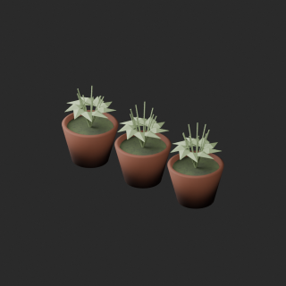](../../previews/quality-fw010-019-v1/FW013__repair_full.png)

[FW013__repair ZIP](https://raw.githubusercontent.com/k3peta/tales-on-a-table/main/distributions/quality-fw010-019-v1/FW013__repair_CC0.zip) · [Details](../quality-fw010-019-v1.md).

## FW014

**Low three legged stool**

Low three legged stool

[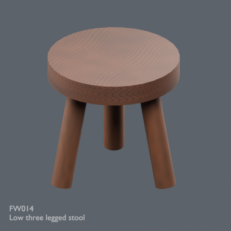](../../previews/quality-fw013-021-normal-repair-v1/renders/FW014.png)

[Full repair image](../../previews/quality-fw013-021-normal-repair-v1/renders/FW014.png) · [Repaired ZIP](https://raw.githubusercontent.com/k3peta/tales-on-a-table/main/distributions/quality-fw013-021-normal-repair-v1/FW014__repair_CC0.zip) · [Comparison](../../previews/quality-fw013-021-normal-repair-v1/comparisons/FW014.png)

Image depicts corrected revision FW014__repair; original download below retained as history.

Use / purpose: Unknown; see source catalogue. English use description needs review.

Record type: model. Formats: Unknown; inspect ZIP.

Reported dimensions (metres; XYZ when derived from measured bounds, legacy axis order not reverified): Unknown. Triangles: Unknown.

Origin: Unknown / not independently confirmed. Orientation: Unknown / not independently confirmed.

[Download ZIP](https://raw.githubusercontent.com/k3peta/tales-on-a-table/main/distributions/quality-fw013-021-normal-repair-v1/FW014__repair_CC0.zip) · [License scope](../../LICENSE.md)

**CC0-1.0** — See original ZIP license and repository license scope. Models and embedded materials only; previews excluded.

Source details: [Catalogue 1](../../catalog/forest_witch.md)

**Version history:** Original image was held for invalid normal mapping. Corrected revision now pictured; original remains historical. [Repair evidence](../fw013_021_normal_repairs.md).

**Pictured corrected revision:** [ZIP](https://raw.githubusercontent.com/k3peta/tales-on-a-table/main/distributions/quality-fw013-021-normal-repair-v1/FW014__repair_CC0.zip). [Legacy original ZIP](https://github.com/k3peta/tales-on-a-table/releases/download/v2026.10.21-forest-witch/FW014_CC0.zip) is retained and is not the pictured model.

**Version scope:** The image above depicts the corrected revision. [Latest revision ZIP](https://raw.githubusercontent.com/k3peta/tales-on-a-table/main/distributions/quality-fw013-021-normal-repair-v1/FW014__repair_CC0.zip). [Revision-specific preview](../../previews/quality-fw013-021-normal-repair-v1/renders/FW014.png). [Version audit](VERSION-AUDIT.md).

## FW015

**Canvas gathering satchel**

Canvas gathering satchel

[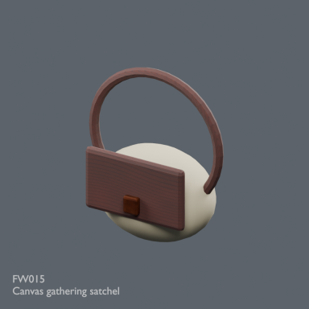](../../previews/quality-fw013-021-normal-repair-v1/renders/FW015.png)

[Full repair image](../../previews/quality-fw013-021-normal-repair-v1/renders/FW015.png) · [Repaired ZIP](https://raw.githubusercontent.com/k3peta/tales-on-a-table/main/distributions/quality-fw013-021-normal-repair-v1/FW015__repair_CC0.zip) · [Comparison](../../previews/quality-fw013-021-normal-repair-v1/comparisons/FW015.png)

Image depicts corrected revision FW015__repair; original download below retained as history.

Use / purpose: Unknown; see source catalogue. English use description needs review.

Record type: model. Formats: Unknown; inspect ZIP.

Reported dimensions (metres; XYZ when derived from measured bounds, legacy axis order not reverified): Unknown. Triangles: Unknown.

Origin: Unknown / not independently confirmed. Orientation: Unknown / not independently confirmed.

[Download ZIP](https://raw.githubusercontent.com/k3peta/tales-on-a-table/main/distributions/quality-fw013-021-normal-repair-v1/FW015__repair_CC0.zip) · [License scope](../../LICENSE.md)

**CC0-1.0** — See original ZIP license and repository license scope. Models and embedded materials only; previews excluded.

Source details: [Catalogue 1](../../catalog/forest_witch.md)

**Version history:** Original image was held for invalid normal mapping. Corrected revision now pictured; original remains historical. [Repair evidence](../fw013_021_normal_repairs.md).

**Pictured corrected revision:** [ZIP](https://raw.githubusercontent.com/k3peta/tales-on-a-table/main/distributions/quality-fw013-021-normal-repair-v1/FW015__repair_CC0.zip). [Legacy original ZIP](https://github.com/k3peta/tales-on-a-table/releases/download/v2026.10.21-forest-witch/FW015_CC0.zip) is retained and is not the pictured model.

**Version scope:** The image above depicts the corrected revision. [Latest revision ZIP](https://raw.githubusercontent.com/k3peta/tales-on-a-table/main/distributions/quality-fw013-021-normal-repair-v1/FW015__repair_CC0.zip). [Revision-specific preview](../../previews/quality-fw013-021-normal-repair-v1/renders/FW015.png). [Version audit](VERSION-AUDIT.md).

**Quality57–76 revisions (original pictured ZIP retained above):**

[FW015__repair ZIP](https://raw.githubusercontent.com/k3peta/tales-on-a-table/main/distributions/quality-fw010-019-v1/FW015__repair_CC0.zip) · [Details](../quality-fw010-019-v1.md).

## FW016

**Mushroom sorting tray**

Mushroom sorting tray

[Full repair image](../../previews/quality-fw013-021-normal-repair-v1/renders/FW016.png) · [Repaired ZIP](https://raw.githubusercontent.com/k3peta/tales-on-a-table/main/distributions/quality-fw013-021-normal-repair-v1/FW016__repair_CC0.zip) · [Comparison](../../previews/quality-fw013-021-normal-repair-v1/comparisons/FW016.png)

Image depicts corrected revision FW016__repair; original download below retained as history.

Use / purpose: Unknown; see source catalogue. English use description needs review.

Record type: model. Formats: Unknown; inspect ZIP.

Reported dimensions (metres; XYZ when derived from measured bounds, legacy axis order not reverified): Unknown. Triangles: Unknown.

Origin: Unknown / not independently confirmed. Orientation: Unknown / not independently confirmed.

[Download ZIP](https://raw.githubusercontent.com/k3peta/tales-on-a-table/main/distributions/quality-fw013-021-normal-repair-v1/FW016__repair_CC0.zip) · [License scope](../../LICENSE.md)

**CC0-1.0** — See original ZIP license and repository license scope. Models and embedded materials only; previews excluded.

Source details: [Catalogue 1](../../catalog/forest_witch.md)

**Version history:** Original image was held for invalid normal mapping. Corrected revision now pictured; original remains historical. [Repair evidence](../fw013_021_normal_repairs.md).

**Pictured corrected revision:** [ZIP](https://raw.githubusercontent.com/k3peta/tales-on-a-table/main/distributions/quality-fw013-021-normal-repair-v1/FW016__repair_CC0.zip). [Legacy original ZIP](https://github.com/k3peta/tales-on-a-table/releases/download/v2026.10.21-forest-witch/FW016_CC0.zip) is retained and is not the pictured model.

**Version scope:** The image above depicts the corrected revision. [Latest revision ZIP](https://raw.githubusercontent.com/k3peta/tales-on-a-table/main/distributions/quality-fw013-021-normal-repair-v1/FW016__repair_CC0.zip). [Revision-specific preview](../../previews/quality-fw013-021-normal-repair-v1/renders/FW016.png). [Version audit](VERSION-AUDIT.md).

**Quality57–76 revisions (original pictured ZIP retained above):**

[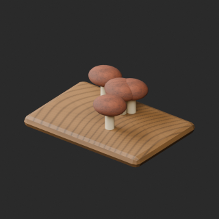](../../previews/quality-fw010-019-v1/FW016__repair_full.png)

[FW016__repair ZIP](https://raw.githubusercontent.com/k3peta/tales-on-a-table/main/distributions/quality-fw010-019-v1/FW016__repair_CC0.zip) · [Details](../quality-fw010-019-v1.md).

## FW017

**Herb bundle storage crate**

Herb bundle storage crate

[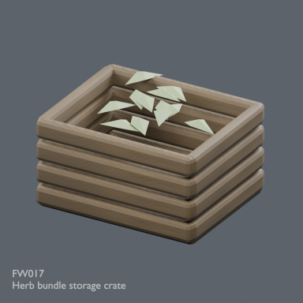](../../previews/quality-fw013-021-normal-repair-v1/renders/FW017.png)

[Full repair image](../../previews/quality-fw013-021-normal-repair-v1/renders/FW017.png) · [Repaired ZIP](https://raw.githubusercontent.com/k3peta/tales-on-a-table/main/distributions/quality-fw013-021-normal-repair-v1/FW017__repair_CC0.zip) · [Comparison](../../previews/quality-fw013-021-normal-repair-v1/comparisons/FW017.png)

Image depicts corrected revision FW017__repair; original download below retained as history.

Use / purpose: Unknown; see source catalogue. English use description needs review.

Record type: model. Formats: Unknown; inspect ZIP.

Reported dimensions (metres; XYZ when derived from measured bounds, legacy axis order not reverified): Unknown. Triangles: Unknown.

Origin: Unknown / not independently confirmed. Orientation: Unknown / not independently confirmed.

[Download ZIP](https://raw.githubusercontent.com/k3peta/tales-on-a-table/main/distributions/quality-fw013-021-normal-repair-v1/FW017__repair_CC0.zip) · [License scope](../../LICENSE.md)

**CC0-1.0** — See original ZIP license and repository license scope. Models and embedded materials only; previews excluded.

Source details: [Catalogue 1](../../catalog/forest_witch.md)

**Version history:** Original image was held for invalid normal mapping. Corrected revision now pictured; original remains historical. [Repair evidence](../fw013_021_normal_repairs.md).

**Pictured corrected revision:** [ZIP](https://raw.githubusercontent.com/k3peta/tales-on-a-table/main/distributions/quality-fw013-021-normal-repair-v1/FW017__repair_CC0.zip). [Legacy original ZIP](https://github.com/k3peta/tales-on-a-table/releases/download/v2026.10.21-forest-witch/FW017_CC0.zip) is retained and is not the pictured model.

**Version scope:** The image above depicts the corrected revision. [Latest revision ZIP](https://raw.githubusercontent.com/k3peta/tales-on-a-table/main/distributions/quality-fw013-021-normal-repair-v1/FW017__repair_CC0.zip). [Revision-specific preview](../../previews/quality-fw013-021-normal-repair-v1/renders/FW017.png). [Version audit](VERSION-AUDIT.md).

## FW018

**Folded linen and wash basin**

Folded linen and wash basin

[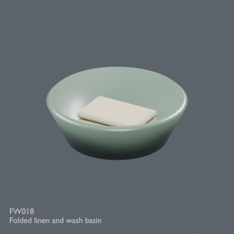](../../previews/quality-fw013-021-normal-repair-v1/renders/FW018.png)

[Full repair image](../../previews/quality-fw013-021-normal-repair-v1/renders/FW018.png) · [Repaired ZIP](https://raw.githubusercontent.com/k3peta/tales-on-a-table/main/distributions/quality-fw013-021-normal-repair-v1/FW018__repair_CC0.zip) · [Comparison](../../previews/quality-fw013-021-normal-repair-v1/comparisons/FW018.png)

Image depicts corrected revision FW018__repair; original download below retained as history.

Use / purpose: Unknown; see source catalogue. English use description needs review.

Record type: model. Formats: Unknown; inspect ZIP.

Reported dimensions (metres; XYZ when derived from measured bounds, legacy axis order not reverified): Unknown. Triangles: Unknown.

Origin: Unknown / not independently confirmed. Orientation: Unknown / not independently confirmed.

[Download ZIP](https://raw.githubusercontent.com/k3peta/tales-on-a-table/main/distributions/quality-fw013-021-normal-repair-v1/FW018__repair_CC0.zip) · [License scope](../../LICENSE.md)

**CC0-1.0** — See original ZIP license and repository license scope. Models and embedded materials only; previews excluded.

Source details: [Catalogue 1](../../catalog/fantasy_infirmary_v1.md) · [Catalogue 2](../../catalog/forest_witch.md)

**Version history:** Original image was held for invalid normal mapping. Corrected revision now pictured; original remains historical. [Repair evidence](../fw013_021_normal_repairs.md).

**Pictured corrected revision:** [ZIP](https://raw.githubusercontent.com/k3peta/tales-on-a-table/main/distributions/quality-fw013-021-normal-repair-v1/FW018__repair_CC0.zip). [Legacy original ZIP](https://github.com/k3peta/tales-on-a-table/releases/download/v2026.10.21-forest-witch/FW018_CC0.zip) is retained and is not the pictured model.

**Version scope:** The image above depicts the corrected revision. [Latest revision ZIP](https://raw.githubusercontent.com/k3peta/tales-on-a-table/main/distributions/quality-fw013-021-normal-repair-v1/FW018__repair_CC0.zip). [Revision-specific preview](../../previews/quality-fw013-021-normal-repair-v1/renders/FW018.png). [Version audit](VERSION-AUDIT.md).

**Quality57–76 revisions (original pictured ZIP retained above):**

[FW018__repair ZIP](https://raw.githubusercontent.com/k3peta/tales-on-a-table/main/distributions/quality-fw010-019-v1/FW018__repair_CC0.zip) · [Details](../quality-fw010-019-v1.md).

## FW019

**Balanced apothecary scales**

Balanced apothecary scales

[Full repair image](../../previews/quality-fw013-021-normal-repair-v1/renders/FW019.png) · [Repaired ZIP](https://raw.githubusercontent.com/k3peta/tales-on-a-table/main/distributions/quality-fw013-021-normal-repair-v1/FW019__repair_CC0.zip) · [Comparison](../../previews/quality-fw013-021-normal-repair-v1/comparisons/FW019.png)

Image depicts corrected revision FW019__repair; original download below retained as history.

Use / purpose: Unknown; see source catalogue. English use description needs review.

Record type: model. Formats: Unknown; inspect ZIP.

Reported dimensions (metres; XYZ when derived from measured bounds, legacy axis order not reverified): Unknown. Triangles: Unknown.

Origin: Unknown / not independently confirmed. Orientation: Unknown / not independently confirmed.

[Download ZIP](https://raw.githubusercontent.com/k3peta/tales-on-a-table/main/distributions/quality-fw013-021-normal-repair-v1/FW019__repair_CC0.zip) · [License scope](../../LICENSE.md)

**CC0-1.0** — See original ZIP license and repository license scope. Models and embedded materials only; previews excluded.

Source details: [Catalogue 1](../../catalog/forest_witch.md)

**Version history:** Original image was held for invalid normal mapping. Corrected revision now pictured; original remains historical. [Repair evidence](../fw013_021_normal_repairs.md).

**Pictured corrected revision:** [ZIP](https://raw.githubusercontent.com/k3peta/tales-on-a-table/main/distributions/quality-fw013-021-normal-repair-v1/FW019__repair_CC0.zip). [Legacy original ZIP](https://github.com/k3peta/tales-on-a-table/releases/download/v2026.10.21-forest-witch/FW019_CC0.zip) is retained and is not the pictured model.

**Version scope:** The image above depicts the corrected revision. [Latest revision ZIP](https://raw.githubusercontent.com/k3peta/tales-on-a-table/main/distributions/quality-fw013-021-normal-repair-v1/FW019__repair_CC0.zip). [Revision-specific preview](../../previews/quality-fw013-021-normal-repair-v1/renders/FW019.png). [Version audit](VERSION-AUDIT.md).

**Quality57–76 revisions (original pictured ZIP retained above):**

[FW019__repair ZIP](https://raw.githubusercontent.com/k3peta/tales-on-a-table/main/distributions/quality-fw010-019-v1/FW019__repair_CC0.zip) · [Details](../quality-fw010-019-v1.md).

## FW020

**Weathered waymarker**

Weathered waymarker

[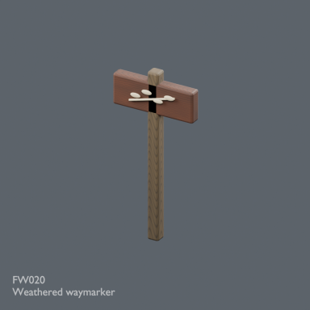](../../previews/quality-fw013-021-normal-repair-v1/renders/FW020.png)

[Full repair image](../../previews/quality-fw013-021-normal-repair-v1/renders/FW020.png) · [Repaired ZIP](https://raw.githubusercontent.com/k3peta/tales-on-a-table/main/distributions/quality-fw013-021-normal-repair-v1/FW020__repair_CC0.zip) · [Comparison](../../previews/quality-fw013-021-normal-repair-v1/comparisons/FW020.png)

Image depicts corrected revision FW020__repair; original download below retained as history.

Use / purpose: Unknown; see source catalogue. English use description needs review.

Record type: model. Formats: Unknown; inspect ZIP.

Reported dimensions (metres; XYZ when derived from measured bounds, legacy axis order not reverified): Unknown. Triangles: Unknown.

Origin: Unknown / not independently confirmed. Orientation: Unknown / not independently confirmed.

[Download ZIP](https://raw.githubusercontent.com/k3peta/tales-on-a-table/main/distributions/quality-fw013-021-normal-repair-v1/FW020__repair_CC0.zip) · [License scope](../../LICENSE.md)

**CC0-1.0** — See original ZIP license and repository license scope. Models and embedded materials only; previews excluded.

Source details: [Catalogue 1](../../catalog/forest_witch.md)

**Version history:** Original image was held for invalid normal mapping. Corrected revision now pictured; original remains historical. [Repair evidence](../fw013_021_normal_repairs.md).

**Pictured corrected revision:** [ZIP](https://raw.githubusercontent.com/k3peta/tales-on-a-table/main/distributions/quality-fw013-021-normal-repair-v1/FW020__repair_CC0.zip). [Legacy original ZIP](https://github.com/k3peta/tales-on-a-table/releases/download/v2026.10.21-forest-witch/FW020_CC0.zip) is retained and is not the pictured model.

**Version scope:** The image above depicts the corrected revision. [Latest revision ZIP](https://raw.githubusercontent.com/k3peta/tales-on-a-table/main/distributions/quality-fw013-021-normal-repair-v1/FW020__repair_CC0.zip). [Revision-specific preview](../../previews/quality-fw013-021-normal-repair-v1/renders/FW020.png). [Version audit](VERSION-AUDIT.md).

## FW021

**Wall apothecary shelf**

Wall apothecary shelf

[Full repair image](../../previews/quality-fw013-021-normal-repair-v1/renders/FW021.png) · [Repaired ZIP](https://raw.githubusercontent.com/k3peta/tales-on-a-table/main/distributions/quality-fw013-021-normal-repair-v1/FW021__repair_CC0.zip) · [Comparison](../../previews/quality-fw013-021-normal-repair-v1/comparisons/FW021.png)

Image depicts corrected revision FW021__repair; original download below retained as history.

Use / purpose: Unknown; see source catalogue. English use description needs review.

Record type: model. Formats: Unknown; inspect ZIP.

Reported dimensions (metres; XYZ when derived from measured bounds, legacy axis order not reverified): Unknown. Triangles: Unknown.

Origin: Unknown / not independently confirmed. Orientation: Unknown / not independently confirmed.

[Download ZIP](https://raw.githubusercontent.com/k3peta/tales-on-a-table/main/distributions/quality-fw013-021-normal-repair-v1/FW021__repair_CC0.zip) · [License scope](../../LICENSE.md)

**CC0-1.0** — See original ZIP license and repository license scope. Models and embedded materials only; previews excluded.

Source details: [Catalogue 1](../../catalog/forest_witch.md)
**Version history:** Original image was held for invalid normal mapping. Corrected revision now pictured; original remains historical. [Repair evidence](../fw013_021_normal_repairs.md).
**Pictured corrected revision:** [ZIP](https://raw.githubusercontent.com/k3peta/tales-on-a-table/main/distributions/quality-fw013-021-normal-repair-v1/FW021__repair_CC0.zip). [Legacy original ZIP](https://github.com/k3peta/tales-on-a-table/releases/download/v2026.10.21-forest-witch/FW021_CC0.zip) is retained and is not the pictured model.

**Version scope:** The image above depicts the corrected revision. [Latest revision ZIP](https://raw.githubusercontent.com/k3peta/tales-on-a-table/main/distributions/quality-fw013-021-normal-repair-v1/FW021__repair_CC0.zip). [Revision-specific preview](../../previews/quality-fw013-021-normal-repair-v1/renders/FW021.png). [Version audit](VERSION-AUDIT.md).
**Quality57–76 revisions (original pictured ZIP retained above):**

[FW021__repair ZIP](https://raw.githubusercontent.com/k3peta/tales-on-a-table/main/distributions/quality-fw020-in007-v1/FW021__repair_CC0.zip) · [Details](../quality-fw020-in007-v1.md).
