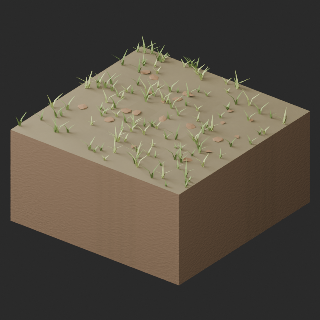
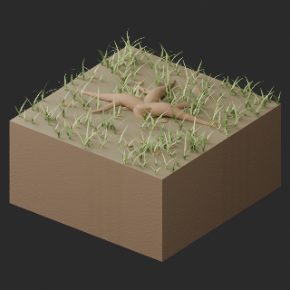
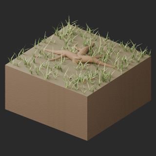

# Base distribution records 697–720

[Browse index](README.md) · [Coverage and missing fields](COVERAGE.md)

Images are actual existing model renders for browsing, not covered by model CC0. A group record may show several reused models. Dimensions and triangle counts apply only to the original record when sourced; revisions can differ. Unknown means unverified, not zero. No blanket CC0 grant for scenes, images, code or articles.

## PA012

**Open sketchbook**

Open sketchbook

[Full-size image](../../previews/atelier-terrain24/renders/PA012.png)

Use / purpose: Unknown; see source catalogue. English use description needs review.

Record type: model. Formats: Unknown; inspect ZIP.

Reported dimensions (metres; XYZ when derived from measured bounds, legacy axis order not reverified): Unknown. Triangles: Unknown.

Origin: Unknown / not independently confirmed. Orientation: Unknown / not independently confirmed.

[Download ZIP](https://github.com/k3peta/tales-on-a-table/releases/download/v2026.10.21-painter-atelier/PA012_CC0.zip) · [License scope](../../LICENSE.md)

**CC0-1.0** — See original ZIP license and repository license scope. Models and embedded materials only; previews excluded.

Source details: [Catalogue 1](../../catalog/painter_atelier.md)

**Quality57–76 revisions (original pictured ZIP retained above):**

[PA012__repair ZIP](https://raw.githubusercontent.com/k3peta/tales-on-a-table/main/distributions/quality-pa012-021-v1/PA012__repair_CC0.zip) · [Details](../quality-pa012-021-v1.md).

## PA013

**Charcoal sticks**

Charcoal sticks

[Full-size image](../../previews/atelier-terrain24/renders/PA013.png)

Use / purpose: Unknown; see source catalogue. English use description needs review.

Record type: model. Formats: Unknown; inspect ZIP.

Reported dimensions (metres; XYZ when derived from measured bounds, legacy axis order not reverified): Unknown. Triangles: Unknown.

Origin: Unknown / not independently confirmed. Orientation: Unknown / not independently confirmed.

[Download ZIP](https://github.com/k3peta/tales-on-a-table/releases/download/v2026.10.21-painter-atelier/PA013_CC0.zip) · [License scope](../../LICENSE.md)

**CC0-1.0** — See original ZIP license and repository license scope. Models and embedded materials only; previews excluded.

Source details: [Catalogue 1](../../catalog/painter_atelier.md)

**Quality57–76 revisions (original pictured ZIP retained above):**

[PA013__repair ZIP](https://raw.githubusercontent.com/k3peta/tales-on-a-table/main/distributions/quality-pa012-021-v1/PA013__repair_CC0.zip) · [Details](../quality-pa012-021-v1.md).

## PA014

**Canvas rolls**

Canvas rolls

[Full-size image](../../previews/atelier-terrain24/renders/PA014.png)

Use / purpose: Unknown; see source catalogue. English use description needs review.

Record type: model. Formats: Unknown; inspect ZIP.

Reported dimensions (metres; XYZ when derived from measured bounds, legacy axis order not reverified): Unknown. Triangles: Unknown.

Origin: Unknown / not independently confirmed. Orientation: Unknown / not independently confirmed.

[Download ZIP](https://github.com/k3peta/tales-on-a-table/releases/download/v2026.10.21-painter-atelier/PA014_CC0.zip) · [License scope](../../LICENSE.md)

**CC0-1.0** — See original ZIP license and repository license scope. Models and embedded materials only; previews excluded.

Source details: [Catalogue 1](../../catalog/painter_atelier.md)

**Quality57–76 revisions (original pictured ZIP retained above):**

[PA014__repair ZIP](https://raw.githubusercontent.com/k3peta/tales-on-a-table/main/distributions/quality-pa012-021-v1/PA014__repair_CC0.zip) · [Details](../quality-pa012-021-v1.md).

## PA015

**Blank stretched canvas**

Blank stretched canvas

[Full-size image](../../previews/atelier-terrain24/renders/PA015.png)

Use / purpose: Unknown; see source catalogue. English use description needs review.

Record type: model. Formats: Unknown; inspect ZIP.

Reported dimensions (metres; XYZ when derived from measured bounds, legacy axis order not reverified): Unknown. Triangles: Unknown.

Origin: Unknown / not independently confirmed. Orientation: Unknown / not independently confirmed.

[Download ZIP](https://github.com/k3peta/tales-on-a-table/releases/download/v2026.10.21-painter-atelier/PA015_CC0.zip) · [License scope](../../LICENSE.md)

**CC0-1.0** — See original ZIP license and repository license scope. Models and embedded materials only; previews excluded.

Source details: [Catalogue 1](../../catalog/painter_atelier.md)

**Quality57–76 revisions (original pictured ZIP retained above):**

[PA015__repair ZIP](https://raw.githubusercontent.com/k3peta/tales-on-a-table/main/distributions/quality-pa012-021-v1/PA015__repair_CC0.zip) · [Details](../quality-pa012-021-v1.md).

## PA016

**Empty carved picture frame**

Empty carved picture frame

[Full-size image](../../previews/atelier-terrain24/renders/PA016.png)

Use / purpose: Unknown; see source catalogue. English use description needs review.

Record type: model. Formats: Unknown; inspect ZIP.

Reported dimensions (metres; XYZ when derived from measured bounds, legacy axis order not reverified): Unknown. Triangles: Unknown.

Origin: Unknown / not independently confirmed. Orientation: Unknown / not independently confirmed.

[Download ZIP](https://github.com/k3peta/tales-on-a-table/releases/download/v2026.10.21-painter-atelier/PA016_CC0.zip) · [License scope](../../LICENSE.md)

**CC0-1.0** — See original ZIP license and repository license scope. Models and embedded materials only; previews excluded.

Source details: [Catalogue 1](../../catalog/painter_atelier.md)

**Quality57–76 revisions (original pictured ZIP retained above):**

[PA016__repair ZIP](https://raw.githubusercontent.com/k3peta/tales-on-a-table/main/distributions/quality-pa012-021-v1/PA016__repair_CC0.zip) · [Details](../quality-pa012-021-v1.md).

## PA017

**Plaster stilllife stand**

Plaster stilllife stand

[Full-size image](../../previews/atelier-terrain24/renders/PA017.png)

Use / purpose: Unknown; see source catalogue. English use description needs review.

Record type: model. Formats: Unknown; inspect ZIP.

Reported dimensions (metres; XYZ when derived from measured bounds, legacy axis order not reverified): Unknown. Triangles: Unknown.

Origin: Unknown / not independently confirmed. Orientation: Unknown / not independently confirmed.

[Download ZIP](https://github.com/k3peta/tales-on-a-table/releases/download/v2026.10.21-painter-atelier/PA017_CC0.zip) · [License scope](../../LICENSE.md)

**CC0-1.0** — See original ZIP license and repository license scope. Models and embedded materials only; previews excluded.

Source details: [Catalogue 1](../../catalog/painter_atelier.md)

**Quality57–76 revisions (original pictured ZIP retained above):**

[PA017__repair ZIP](https://raw.githubusercontent.com/k3peta/tales-on-a-table/main/distributions/quality-pa012-021-v1/PA017__repair_CC0.zip) · [Details](../quality-pa012-021-v1.md).

## PA018

**Plaster classical vessel**

Plaster classical vessel

[Full-size image](../../previews/atelier-terrain24/renders/PA018.png)

Use / purpose: Unknown; see source catalogue. English use description needs review.

Record type: model. Formats: Unknown; inspect ZIP.

Reported dimensions (metres; XYZ when derived from measured bounds, legacy axis order not reverified): Unknown. Triangles: Unknown.

Origin: Unknown / not independently confirmed. Orientation: Unknown / not independently confirmed.

[Download ZIP](https://github.com/k3peta/tales-on-a-table/releases/download/v2026.10.21-painter-atelier/PA018_CC0.zip) · [License scope](../../LICENSE.md)

**CC0-1.0** — See original ZIP license and repository license scope. Models and embedded materials only; previews excluded.

Source details: [Catalogue 1](../../catalog/painter_atelier.md)

**Quality57–76 revisions (original pictured ZIP retained above):**

[PA018__repair ZIP](https://raw.githubusercontent.com/k3peta/tales-on-a-table/main/distributions/quality-pa012-021-v1/PA018__repair_CC0.zip) · [Details](../quality-pa012-021-v1.md).

## PA019

**Plaster geometric studies**

Plaster geometric studies

[Full-size image](../../previews/atelier-terrain24/renders/PA019.png)

Use / purpose: Unknown; see source catalogue. English use description needs review.

Record type: model. Formats: Unknown; inspect ZIP.

Reported dimensions (metres; XYZ when derived from measured bounds, legacy axis order not reverified): Unknown. Triangles: Unknown.

Origin: Unknown / not independently confirmed. Orientation: Unknown / not independently confirmed.

[Download ZIP](https://github.com/k3peta/tales-on-a-table/releases/download/v2026.10.21-painter-atelier/PA019_CC0.zip) · [License scope](../../LICENSE.md)

**CC0-1.0** — See original ZIP license and repository license scope. Models and embedded materials only; previews excluded.

Source details: [Catalogue 1](../../catalog/painter_atelier.md)

**Quality57–76 revisions (original pictured ZIP retained above):**

[PA019__repair ZIP](https://raw.githubusercontent.com/k3peta/tales-on-a-table/main/distributions/quality-pa012-021-v1/PA019__repair_CC0.zip) · [Details](../quality-pa012-021-v1.md).

## PA020

**Wooden supply chest**

Wooden supply chest

[Full-size image](../../previews/atelier-terrain24/renders/PA020.png)

Use / purpose: Unknown; see source catalogue. English use description needs review.

Record type: model. Formats: Unknown; inspect ZIP.

Reported dimensions (metres; XYZ when derived from measured bounds, legacy axis order not reverified): Unknown. Triangles: Unknown.

Origin: Unknown / not independently confirmed. Orientation: Unknown / not independently confirmed.

[Download ZIP](https://github.com/k3peta/tales-on-a-table/releases/download/v2026.10.21-painter-atelier/PA020_CC0.zip) · [License scope](../../LICENSE.md)

**CC0-1.0** — See original ZIP license and repository license scope. Models and embedded materials only; previews excluded.

Source details: [Catalogue 1](../../catalog/painter_atelier.md)

**Quality57–76 revisions (original pictured ZIP retained above):**

[PA020__repair ZIP](https://raw.githubusercontent.com/k3peta/tales-on-a-table/main/distributions/quality-pa012-021-v1/PA020__repair_CC0.zip) · [Details](../quality-pa012-021-v1.md).

## PA021

**Folded dropcloth**

Folded dropcloth

[Full-size image](../../previews/atelier-terrain24/renders/PA021.png)

Use / purpose: Unknown; see source catalogue. English use description needs review.

Record type: model. Formats: Unknown; inspect ZIP.

Reported dimensions (metres; XYZ when derived from measured bounds, legacy axis order not reverified): Unknown. Triangles: Unknown.

Origin: Unknown / not independently confirmed. Orientation: Unknown / not independently confirmed.

[Download ZIP](https://github.com/k3peta/tales-on-a-table/releases/download/v2026.10.21-painter-atelier/PA021_CC0.zip) · [License scope](../../LICENSE.md)

**CC0-1.0** — See original ZIP license and repository license scope. Models and embedded materials only; previews excluded.

Source details: [Catalogue 1](../../catalog/painter_atelier.md)

**Quality57–76 revisions (original pictured ZIP retained above):**

[PA021__repair ZIP](https://raw.githubusercontent.com/k3peta/tales-on-a-table/main/distributions/quality-pa012-021-v1/PA021__repair_CC0.zip) · [Details](../quality-pa012-021-v1.md).

## PA022

**Small ceramic pitcher**

Small ceramic pitcher

[Full-size image](../../previews/atelier-terrain24/renders/PA022.png)

Use / purpose: Unknown; see source catalogue. English use description needs review.

Record type: model. Formats: Unknown; inspect ZIP.

Reported dimensions (metres; XYZ when derived from measured bounds, legacy axis order not reverified): Unknown. Triangles: Unknown.

Origin: Unknown / not independently confirmed. Orientation: Unknown / not independently confirmed.

[Download ZIP](https://github.com/k3peta/tales-on-a-table/releases/download/v2026.10.21-painter-atelier/PA022_CC0.zip) · [License scope](../../LICENSE.md)

**CC0-1.0** — See original ZIP license and repository license scope. Models and embedded materials only; previews excluded.

Source details: [Catalogue 1](../../catalog/painter_atelier.md)

**Image scope:** Dark lower shading undiagnosed; no repair claimed.

**Quality57–76 revisions (original pictured ZIP retained above):**

[PA022__repair ZIP](https://raw.githubusercontent.com/k3peta/tales-on-a-table/main/distributions/quality-pa022-tr007-v1/PA022__repair_CC0.zip) · [Details](../quality-pa022-tr007-v1.md).

## PA023

**Wall shelf with drawing papers**

Wall shelf with drawing papers

[Full-size image](../../previews/atelier-terrain24/renders/PA023.png)

Use / purpose: Unknown; see source catalogue. English use description needs review.

Record type: model. Formats: Unknown; inspect ZIP.

Reported dimensions (metres; XYZ when derived from measured bounds, legacy axis order not reverified): Unknown. Triangles: Unknown.

Origin: Unknown / not independently confirmed. Orientation: Unknown / not independently confirmed.

[Download ZIP](https://github.com/k3peta/tales-on-a-table/releases/download/v2026.10.21-painter-atelier/PA023_CC0.zip) · [License scope](../../LICENSE.md)

**CC0-1.0** — See original ZIP license and repository license scope. Models and embedded materials only; previews excluded.

Source details: [Catalogue 1](../../catalog/painter_atelier.md)

**Quality57–76 revisions (original pictured ZIP retained above):**

[PA023__repair ZIP](https://raw.githubusercontent.com/k3peta/tales-on-a-table/main/distributions/quality-pa022-tr007-v1/PA023__repair_CC0.zip) · [Details](../quality-pa022-tr007-v1.md).

## PA024

**Pinboard and reference sketches**

Pinboard and reference sketches

[Full-size image](../../previews/atelier-terrain24/renders/PA024.png)

Use / purpose: Unknown; see source catalogue. English use description needs review.

Record type: model. Formats: Unknown; inspect ZIP.

Reported dimensions (metres; XYZ when derived from measured bounds, legacy axis order not reverified): Unknown. Triangles: Unknown.

Origin: Unknown / not independently confirmed. Orientation: Unknown / not independently confirmed.

[Download ZIP](https://github.com/k3peta/tales-on-a-table/releases/download/v2026.10.21-painter-atelier/PA024_CC0.zip) · [License scope](../../LICENSE.md)

**CC0-1.0** — See original ZIP license and repository license scope. Models and embedded materials only; previews excluded.

Source details: [Catalogue 1](../../catalog/painter_atelier.md)

**Quality57–76 revisions (original pictured ZIP retained above):**

[PA024__repair ZIP](https://raw.githubusercontent.com/k3peta/tales-on-a-table/main/distributions/quality-pa022-tr007-v1/PA024__repair_CC0.zip) · [Details](../quality-pa022-tr007-v1.md).

## TR001

**grass short meadow**

grass short meadow

[Full-size image](../../previews/atelier-terrain24/renders/TR001.png)

Use / purpose: Unknown; see source catalogue. English use description needs review.

Record type: model. Formats: Unknown; inspect ZIP.

Reported dimensions (metres; XYZ when derived from measured bounds, legacy axis order not reverified): Unknown. Triangles: Unknown.

Origin: Unknown / not independently confirmed. Orientation: Unknown / not independently confirmed.

[Download ZIP](https://github.com/k3peta/tales-on-a-table/releases/download/v2026.10.21-terrain-v2/TR001_CC0.zip) · [License scope](../../LICENSE.md)

**CC0-1.0** — See original ZIP license and repository license scope. Models and embedded materials only; previews excluded.

Source details: [Catalogue 1](../../catalog/terrain_v2.md)

**Image scope:** Image shows HQ only, not LITE.

**Quality57–76 revisions (original pictured ZIP retained above):**

[TR001_HQ__repair ZIP](https://raw.githubusercontent.com/k3peta/tales-on-a-table/main/distributions/quality-pa022-tr007-v1/TR001_HQ__repair_CC0.zip) · [Details](../quality-pa022-tr007-v1.md).

[TR001_LITE__repair ZIP](https://raw.githubusercontent.com/k3peta/tales-on-a-table/main/distributions/quality-pa022-tr007-v1/TR001_LITE__repair_CC0.zip) · [Details](../quality-pa022-tr007-v1.md).

## TR002

**grass long meadow**

grass long meadow

[Full-size image](../../previews/atelier-terrain24/renders/TR002.png)

Use / purpose: Unknown; see source catalogue. English use description needs review.

Record type: model. Formats: Unknown; inspect ZIP.

Reported dimensions (metres; XYZ when derived from measured bounds, legacy axis order not reverified): Unknown. Triangles: Unknown.

Origin: Unknown / not independently confirmed. Orientation: Unknown / not independently confirmed.

[Download ZIP](https://github.com/k3peta/tales-on-a-table/releases/download/v2026.10.21-terrain-v2/TR002_CC0.zip) · [License scope](../../LICENSE.md)

**CC0-1.0** — See original ZIP license and repository license scope. Models and embedded materials only; previews excluded.

Source details: [Catalogue 1](../../catalog/terrain_v2.md)

**Image scope:** Image shows HQ only, not LITE.

**Quality57–76 revisions (original pictured ZIP retained above):**

[TR002_HQ__repair ZIP](https://raw.githubusercontent.com/k3peta/tales-on-a-table/main/distributions/quality-pa022-tr007-v1/TR002_HQ__repair_CC0.zip) · [Details](../quality-pa022-tr007-v1.md).

[TR002_LITE__repair ZIP](https://raw.githubusercontent.com/k3peta/tales-on-a-table/main/distributions/quality-pa022-tr007-v1/TR002_LITE__repair_CC0.zip) · [Details](../quality-pa022-tr007-v1.md).

## TR003

**grass wildflowers**

grass wildflowers

[Full-size image](../../previews/terrain-tr003-026/renders/TR003.png)

Use / purpose: Unknown; see source catalogue. English use description needs review.

Record type: model. Formats: Unknown; inspect ZIP.

Reported dimensions (metres; XYZ when derived from measured bounds, legacy axis order not reverified): Unknown. Triangles: Unknown.

Origin: Unknown / not independently confirmed. Orientation: Unknown / not independently confirmed.

[Download ZIP](https://github.com/k3peta/tales-on-a-table/releases/download/v2026.10.21-terrain-v2/TR003_CC0.zip) · [License scope](../../LICENSE.md)

**CC0-1.0** — See original ZIP license and repository license scope. Models and embedded materials only; previews excluded.

Source details: [Catalogue 1](../../catalog/terrain_v2.md)

**Image scope:** HQ shown; LITE not shown. Repeated vegetation, pale stones and weak rut detail are faithful to the current model, not a complete quality approval.

**Quality57–76 revisions (original pictured ZIP retained above):**

[TR003_HQ__repair ZIP](https://raw.githubusercontent.com/k3peta/tales-on-a-table/main/distributions/quality-pa022-tr007-v1/TR003_HQ__repair_CC0.zip) · [Details](../quality-pa022-tr007-v1.md).

[TR003_LITE__repair ZIP](https://raw.githubusercontent.com/k3peta/tales-on-a-table/main/distributions/quality-pa022-tr007-v1/TR003_LITE__repair_CC0.zip) · [Details](../quality-pa022-tr007-v1.md).

## TR004

**grass dry tussocks**

grass dry tussocks

[Full-size image](../../previews/terrain-tr003-026/renders/TR004.png)

Use / purpose: Unknown; see source catalogue. English use description needs review.

Record type: model. Formats: Unknown; inspect ZIP.

Reported dimensions (metres; XYZ when derived from measured bounds, legacy axis order not reverified): Unknown. Triangles: Unknown.

Origin: Unknown / not independently confirmed. Orientation: Unknown / not independently confirmed.

[Download ZIP](https://github.com/k3peta/tales-on-a-table/releases/download/v2026.10.21-terrain-v2/TR004_CC0.zip) · [License scope](../../LICENSE.md)

**CC0-1.0** — See original ZIP license and repository license scope. Models and embedded materials only; previews excluded.

Source details: [Catalogue 1](../../catalog/terrain_v2.md)

**Image scope:** HQ shown; LITE not shown. Repeated vegetation, pale stones and weak rut detail are faithful to the current model, not a complete quality approval.

**Quality57–76 revisions (original pictured ZIP retained above):**

[TR004_HQ__repair ZIP](https://raw.githubusercontent.com/k3peta/tales-on-a-table/main/distributions/quality-pa022-tr007-v1/TR004_HQ__repair_CC0.zip) · [Details](../quality-pa022-tr007-v1.md).

[TR004_LITE__repair ZIP](https://raw.githubusercontent.com/k3peta/tales-on-a-table/main/distributions/quality-pa022-tr007-v1/TR004_LITE__repair_CC0.zip) · [Details](../quality-pa022-tr007-v1.md).

## TR005

**grass moss patches**

grass moss patches

[Full-size image](../../previews/terrain-tr003-026/renders/TR005.png)

Use / purpose: Unknown; see source catalogue. English use description needs review.

Record type: model. Formats: Unknown; inspect ZIP.

Reported dimensions (metres; XYZ when derived from measured bounds, legacy axis order not reverified): Unknown. Triangles: Unknown.

Origin: Unknown / not independently confirmed. Orientation: Unknown / not independently confirmed.

[Download ZIP](https://github.com/k3peta/tales-on-a-table/releases/download/v2026.10.21-terrain-v2/TR005_CC0.zip) · [License scope](../../LICENSE.md)

**CC0-1.0** — See original ZIP license and repository license scope. Models and embedded materials only; previews excluded.

Source details: [Catalogue 1](../../catalog/terrain_v2.md)

**Image scope:** HQ shown; LITE not shown. Repeated vegetation, pale stones and weak rut detail are faithful to the current model, not a complete quality approval.

**Quality57–76 revisions (original pictured ZIP retained above):**

[TR005_HQ__repair ZIP](https://raw.githubusercontent.com/k3peta/tales-on-a-table/main/distributions/quality-pa022-tr007-v1/TR005_HQ__repair_CC0.zip) · [Details](../quality-pa022-tr007-v1.md).

[TR005_LITE__repair ZIP](https://raw.githubusercontent.com/k3peta/tales-on-a-table/main/distributions/quality-pa022-tr007-v1/TR005_LITE__repair_CC0.zip) · [Details](../quality-pa022-tr007-v1.md).

## TR006

**grass forest transition**

grass forest transition

[Full-size image](../../previews/terrain-tr003-026/renders/TR006.png)

Use / purpose: Unknown; see source catalogue. English use description needs review.

Record type: model. Formats: Unknown; inspect ZIP.

Reported dimensions (metres; XYZ when derived from measured bounds, legacy axis order not reverified): Unknown. Triangles: Unknown.

Origin: Unknown / not independently confirmed. Orientation: Unknown / not independently confirmed.

[Download ZIP](https://github.com/k3peta/tales-on-a-table/releases/download/v2026.10.21-terrain-v2/TR006_CC0.zip) · [License scope](../../LICENSE.md)

**CC0-1.0** — See original ZIP license and repository license scope. Models and embedded materials only; previews excluded.

Source details: [Catalogue 1](../../catalog/terrain_v2.md)

**Image scope:** HQ shown; LITE not shown. Repeated vegetation, pale stones and weak rut detail are faithful to the current model, not a complete quality approval.

**Quality57–76 revisions (original pictured ZIP retained above):**

[TR006_HQ__repair ZIP](https://raw.githubusercontent.com/k3peta/tales-on-a-table/main/distributions/quality-pa022-tr007-v1/TR006_HQ__repair_CC0.zip) · [Details](../quality-pa022-tr007-v1.md).

[TR006_LITE__repair ZIP](https://raw.githubusercontent.com/k3peta/tales-on-a-table/main/distributions/quality-pa022-tr007-v1/TR006_LITE__repair_CC0.zip) · [Details](../quality-pa022-tr007-v1.md).

## TR007

**grass rock transition**

grass rock transition

[Full-size image](../../previews/terrain-tr003-026/renders/TR007.png)

Use / purpose: Unknown; see source catalogue. English use description needs review.

Record type: model. Formats: Unknown; inspect ZIP.

Reported dimensions (metres; XYZ when derived from measured bounds, legacy axis order not reverified): Unknown. Triangles: Unknown.

Origin: Unknown / not independently confirmed. Orientation: Unknown / not independently confirmed.

[Download ZIP](https://github.com/k3peta/tales-on-a-table/releases/download/v2026.10.21-terrain-v2/TR007_CC0.zip) · [License scope](../../LICENSE.md)

**CC0-1.0** — See original ZIP license and repository license scope. Models and embedded materials only; previews excluded.

Source details: [Catalogue 1](../../catalog/terrain_v2.md)

**Image scope:** HQ shown; LITE not shown. Repeated vegetation, pale stones and weak rut detail are faithful to the current model, not a complete quality approval.

**Quality57–76 revisions (original pictured ZIP retained above):**

[TR007_HQ__repair ZIP](https://raw.githubusercontent.com/k3peta/tales-on-a-table/main/distributions/quality-pa022-tr007-v1/TR007_HQ__repair_CC0.zip) · [Details](../quality-pa022-tr007-v1.md).

[TR007_LITE__repair ZIP](https://raw.githubusercontent.com/k3peta/tales-on-a-table/main/distributions/quality-pa022-tr007-v1/TR007_LITE__repair_CC0.zip) · [Details](../quality-pa022-tr007-v1.md).

## TR008

**grass sand transition**

grass sand transition

[Full-size image](../../previews/terrain-tr003-026/renders/TR008.png)

Use / purpose: Unknown; see source catalogue. English use description needs review.

Record type: model. Formats: Unknown; inspect ZIP.

Reported dimensions (metres; XYZ when derived from measured bounds, legacy axis order not reverified): Unknown. Triangles: Unknown.

Origin: Unknown / not independently confirmed. Orientation: Unknown / not independently confirmed.

[Download ZIP](https://github.com/k3peta/tales-on-a-table/releases/download/v2026.10.21-terrain-v2/TR008_CC0.zip) · [License scope](../../LICENSE.md)

**CC0-1.0** — See original ZIP license and repository license scope. Models and embedded materials only; previews excluded.

Source details: [Catalogue 1](../../catalog/terrain_v2.md)

**Image scope:** HQ shown; LITE not shown. Repeated vegetation, pale stones and weak rut detail are faithful to the current model, not a complete quality approval.

**Quality57–76 revisions (original pictured ZIP retained above):**

[TR008_HQ__repair ZIP](https://raw.githubusercontent.com/k3peta/tales-on-a-table/main/distributions/quality-tr008-017-v1/TR008_HQ__repair_CC0.zip) · [Details](../quality-tr008-017-v1.md).

[TR008_LITE__repair ZIP](https://raw.githubusercontent.com/k3peta/tales-on-a-table/main/distributions/quality-tr008-017-v1/TR008_LITE__repair_CC0.zip) · [Details](../quality-tr008-017-v1.md).

## TR009

**forest leaf litter**

forest leaf litter

[Full-size image](../../previews/terrain-tr003-026/renders/TR009.png)

Use / purpose: Unknown; see source catalogue. English use description needs review.

Record type: model. Formats: Unknown; inspect ZIP.

Reported dimensions (metres; XYZ when derived from measured bounds, legacy axis order not reverified): Unknown. Triangles: Unknown.

Origin: Unknown / not independently confirmed. Orientation: Unknown / not independently confirmed.

[Download ZIP](https://github.com/k3peta/tales-on-a-table/releases/download/v2026.10.21-terrain-v2/TR009_CC0.zip) · [License scope](../../LICENSE.md)

**CC0-1.0** — See original ZIP license and repository license scope. Models and embedded materials only; previews excluded.

Source details: [Catalogue 1](../../catalog/terrain_v2.md)

**Image scope:** HQ shown; LITE not shown. Repeated vegetation, pale stones and weak rut detail are faithful to the current model, not a complete quality approval.

**Quality57–76 revisions (original pictured ZIP retained above):**

[TR009_HQ__repair ZIP](https://raw.githubusercontent.com/k3peta/tales-on-a-table/main/distributions/quality-tr-held-repair-v2/TR009_HQ__repair_CC0.zip) · [Details](../quality-tr-held-repair-v2.md).

[TR009_LITE__repair ZIP](https://raw.githubusercontent.com/k3peta/tales-on-a-table/main/distributions/quality-tr-held-repair-v2/TR009_LITE__repair_CC0.zip) · [Details](../quality-tr-held-repair-v2.md).

## TR010

**forest mossy roots**

forest mossy roots

[Full-size image](../../previews/terrain-tr003-026/renders/TR010.png)

Use / purpose: Unknown; see source catalogue. English use description needs review.

Record type: model. Formats: Unknown; inspect ZIP.

Reported dimensions (metres; XYZ when derived from measured bounds, legacy axis order not reverified): Unknown. Triangles: Unknown.

Origin: Unknown / not independently confirmed. Orientation: Unknown / not independently confirmed.

[Download ZIP](https://github.com/k3peta/tales-on-a-table/releases/download/v2026.10.21-terrain-v2/TR010_CC0.zip) · [License scope](../../LICENSE.md)

**CC0-1.0** — See original ZIP license and repository license scope. Models and embedded materials only; previews excluded.

Source details: [Catalogue 1](../../catalog/terrain_v2.md)

**Image scope:** HQ shown; LITE not shown. Repeated vegetation, pale stones and weak rut detail are faithful to the current model, not a complete quality approval.

**Quality57–76 revisions (original pictured ZIP retained above):**

[TR010_HQ__repair ZIP](https://raw.githubusercontent.com/k3peta/tales-on-a-table/main/distributions/quality-tr-held-repair-v2/TR010_HQ__repair_CC0.zip) · [Details](../quality-tr-held-repair-v2.md).

[TR010_LITE__repair ZIP](https://raw.githubusercontent.com/k3peta/tales-on-a-table/main/distributions/quality-tr-held-repair-v2/TR010_LITE__repair_CC0.zip) · [Details](../quality-tr-held-repair-v2.md).

## TR011

**forest fern floor**

forest fern floor

[Full-size image](../../previews/terrain-tr003-026/renders/TR011.png)

Use / purpose: Unknown; see source catalogue. English use description needs review.

Record type: model. Formats: Unknown; inspect ZIP.

Reported dimensions (metres; XYZ when derived from measured bounds, legacy axis order not reverified): Unknown. Triangles: Unknown.

Origin: Unknown / not independently confirmed. Orientation: Unknown / not independently confirmed.

[Download ZIP](https://github.com/k3peta/tales-on-a-table/releases/download/v2026.10.21-terrain-v2/TR011_CC0.zip) · [License scope](../../LICENSE.md)

**CC0-1.0** — See original ZIP license and repository license scope. Models and embedded materials only; previews excluded.

Source details: [Catalogue 1](../../catalog/terrain_v2.md)
**Image scope:** HQ shown; LITE not shown. Repeated vegetation, pale stones and weak rut detail are faithful to the current model, not a complete quality approval.
**Quality57–76 revisions (original pictured ZIP retained above):**

[TR011_HQ__repair ZIP](https://raw.githubusercontent.com/k3peta/tales-on-a-table/main/distributions/quality-tr008-017-v1/TR011_HQ__repair_CC0.zip) · [Details](../quality-tr008-017-v1.md).

[TR011_LITE__repair ZIP](https://raw.githubusercontent.com/k3peta/tales-on-a-table/main/distributions/quality-tr008-017-v1/TR011_LITE__repair_CC0.zip) · [Details](../quality-tr008-017-v1.md).
