# Base distribution records 721–744

[Browse index](README.md) · [Coverage and missing fields](COVERAGE.md)

Images are actual existing model renders for browsing, not covered by model CC0. A group record may show several reused models. Dimensions and triangle counts apply only to the original record when sourced; revisions can differ. Unknown means unverified, not zero. No blanket CC0 grant for scenes, images, code or articles.

## TR012

**forest fallen branch**

forest fallen branch

[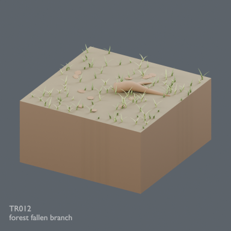](../../previews/terrain-tr003-026/renders/TR012.png)

[Full-size image](../../previews/terrain-tr003-026/renders/TR012.png)

Use / purpose: Unknown; see source catalogue. English use description needs review.

Record type: model. Formats: Unknown; inspect ZIP.

Reported dimensions (metres; XYZ when derived from measured bounds, legacy axis order not reverified): Unknown. Triangles: Unknown.

Origin: Unknown / not independently confirmed. Orientation: Unknown / not independently confirmed.

[Download ZIP](https://github.com/k3peta/tales-on-a-table/releases/download/v2026.10.21-terrain-v2/TR012_CC0.zip) · [License scope](../../LICENSE.md)

**CC0-1.0** — See original ZIP license and repository license scope. Models and embedded materials only; previews excluded.

Source details: [Catalogue 1](../../catalog/terrain_v2.md)

**Image scope:** HQ shown; LITE not shown. Repeated vegetation, pale stones and weak rut detail are faithful to the current model, not a complete quality approval.

## TR013

**forest stump clearing**

forest stump clearing

[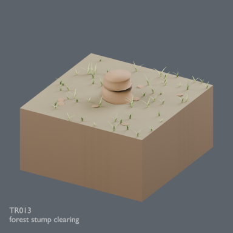](../../previews/terrain-tr003-026/renders/TR013.png)

[Full-size image](../../previews/terrain-tr003-026/renders/TR013.png)

Use / purpose: Unknown; see source catalogue. English use description needs review.

Record type: model. Formats: Unknown; inspect ZIP.

Reported dimensions (metres; XYZ when derived from measured bounds, legacy axis order not reverified): Unknown. Triangles: Unknown.

Origin: Unknown / not independently confirmed. Orientation: Unknown / not independently confirmed.

[Download ZIP](https://github.com/k3peta/tales-on-a-table/releases/download/v2026.10.21-terrain-v2/TR013_CC0.zip) · [License scope](../../LICENSE.md)

**CC0-1.0** — See original ZIP license and repository license scope. Models and embedded materials only; previews excluded.

Source details: [Catalogue 1](../../catalog/terrain_v2.md)

**Image scope:** HQ shown; LITE not shown. Repeated vegetation, pale stones and weak rut detail are faithful to the current model, not a complete quality approval.

## TR014

**forest stone moss**

forest stone moss

[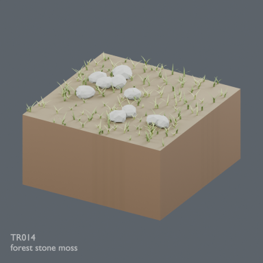](../../previews/terrain-tr003-026/renders/TR014.png)

[Full-size image](../../previews/terrain-tr003-026/renders/TR014.png)

Use / purpose: Unknown; see source catalogue. English use description needs review.

Record type: model. Formats: Unknown; inspect ZIP.

Reported dimensions (metres; XYZ when derived from measured bounds, legacy axis order not reverified): Unknown. Triangles: Unknown.

Origin: Unknown / not independently confirmed. Orientation: Unknown / not independently confirmed.

[Download ZIP](https://github.com/k3peta/tales-on-a-table/releases/download/v2026.10.21-terrain-v2/TR014_CC0.zip) · [License scope](../../LICENSE.md)

**CC0-1.0** — See original ZIP license and repository license scope. Models and embedded materials only; previews excluded.

Source details: [Catalogue 1](../../catalog/terrain_v2.md)

**Image scope:** HQ shown; LITE not shown. Repeated vegetation, pale stones and weak rut detail are faithful to the current model, not a complete quality approval.

## TR015

**forest sparse grass**

forest sparse grass

[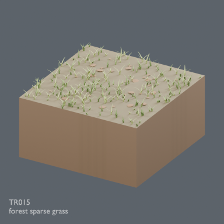](../../previews/terrain-tr003-026/renders/TR015.png)

[Full-size image](../../previews/terrain-tr003-026/renders/TR015.png)

Use / purpose: Unknown; see source catalogue. English use description needs review.

Record type: model. Formats: Unknown; inspect ZIP.

Reported dimensions (metres; XYZ when derived from measured bounds, legacy axis order not reverified): Unknown. Triangles: Unknown.

Origin: Unknown / not independently confirmed. Orientation: Unknown / not independently confirmed.

[Download ZIP](https://github.com/k3peta/tales-on-a-table/releases/download/v2026.10.21-terrain-v2/TR015_CC0.zip) · [License scope](../../LICENSE.md)

**CC0-1.0** — See original ZIP license and repository license scope. Models and embedded materials only; previews excluded.

Source details: [Catalogue 1](../../catalog/terrain_v2.md)

**Image scope:** HQ shown; LITE not shown. Repeated vegetation, pale stones and weak rut detail are faithful to the current model, not a complete quality approval.

## TR016

**forest exposed roots**

forest exposed roots

[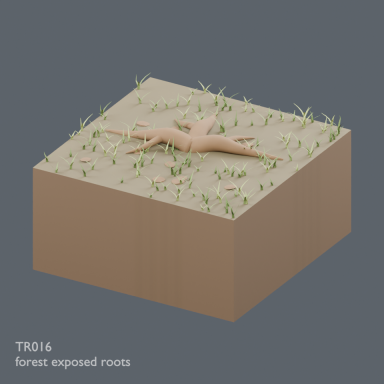](../../previews/terrain-tr003-026/renders/TR016.png)

[Full-size image](../../previews/terrain-tr003-026/renders/TR016.png)

Use / purpose: Unknown; see source catalogue. English use description needs review.

Record type: model. Formats: Unknown; inspect ZIP.

Reported dimensions (metres; XYZ when derived from measured bounds, legacy axis order not reverified): Unknown. Triangles: Unknown.

Origin: Unknown / not independently confirmed. Orientation: Unknown / not independently confirmed.

[Download ZIP](https://github.com/k3peta/tales-on-a-table/releases/download/v2026.10.21-terrain-v2/TR016_CC0.zip) · [License scope](../../LICENSE.md)

**CC0-1.0** — See original ZIP license and repository license scope. Models and embedded materials only; previews excluded.

Source details: [Catalogue 1](../../catalog/terrain_v2.md)

**Image scope:** HQ shown; LITE not shown. Repeated vegetation, pale stones and weak rut detail are faithful to the current model, not a complete quality approval.

## TR017

**path straight NS**

path straight NS

[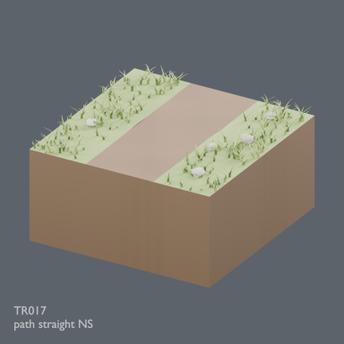](../../previews/terrain-tr003-026/renders/TR017.png)

[Full-size image](../../previews/terrain-tr003-026/renders/TR017.png)

Use / purpose: Unknown; see source catalogue. English use description needs review.

Record type: model. Formats: Unknown; inspect ZIP.

Reported dimensions (metres; XYZ when derived from measured bounds, legacy axis order not reverified): Unknown. Triangles: Unknown.

Origin: Unknown / not independently confirmed. Orientation: Unknown / not independently confirmed.

[Download ZIP](https://github.com/k3peta/tales-on-a-table/releases/download/v2026.10.21-terrain-v2/TR017_CC0.zip) · [License scope](../../LICENSE.md)

**CC0-1.0** — See original ZIP license and repository license scope. Models and embedded materials only; previews excluded.

Source details: [Catalogue 1](../../catalog/terrain_v2.md)

**Image scope:** HQ shown; LITE not shown. Repeated vegetation, pale stones and weak rut detail are faithful to the current model, not a complete quality approval.

## TR018

**path bend NE**

path bend NE

[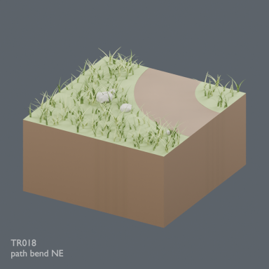](../../previews/terrain-tr003-026/renders/TR018.png)

[Full-size image](../../previews/terrain-tr003-026/renders/TR018.png)

Use / purpose: Unknown; see source catalogue. English use description needs review.

Record type: model. Formats: Unknown; inspect ZIP.

Reported dimensions (metres; XYZ when derived from measured bounds, legacy axis order not reverified): Unknown. Triangles: Unknown.

Origin: Unknown / not independently confirmed. Orientation: Unknown / not independently confirmed.

[Download ZIP](https://github.com/k3peta/tales-on-a-table/releases/download/v2026.10.21-terrain-v2/TR018_CC0.zip) · [License scope](../../LICENSE.md)

**CC0-1.0** — See original ZIP license and repository license scope. Models and embedded materials only; previews excluded.

Source details: [Catalogue 1](../../catalog/terrain_v2.md)

**Image scope:** HQ shown; LITE not shown. Repeated vegetation, pale stones and weak rut detail are faithful to the current model, not a complete quality approval.

## TR019

**path junction NES**

path junction NES

[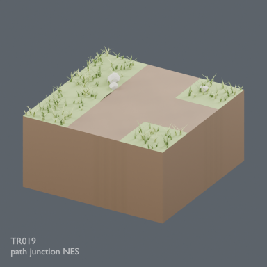](../../previews/terrain-tr003-026/renders/TR019.png)

[Full-size image](../../previews/terrain-tr003-026/renders/TR019.png)

Use / purpose: Unknown; see source catalogue. English use description needs review.

Record type: model. Formats: Unknown; inspect ZIP.

Reported dimensions (metres; XYZ when derived from measured bounds, legacy axis order not reverified): Unknown. Triangles: Unknown.

Origin: Unknown / not independently confirmed. Orientation: Unknown / not independently confirmed.

[Download ZIP](https://github.com/k3peta/tales-on-a-table/releases/download/v2026.10.21-terrain-v2/TR019_CC0.zip) · [License scope](../../LICENSE.md)

**CC0-1.0** — See original ZIP license and repository license scope. Models and embedded materials only; previews excluded.

Source details: [Catalogue 1](../../catalog/terrain_v2.md)

**Image scope:** HQ shown; LITE not shown. Repeated vegetation, pale stones and weak rut detail are faithful to the current model, not a complete quality approval.

## TR020

**path cross NESW**

path cross NESW

[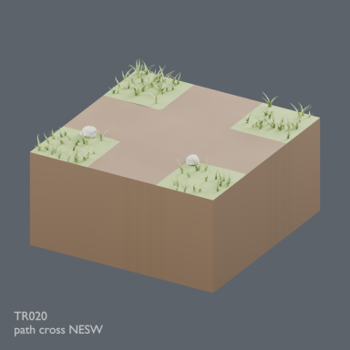](../../previews/terrain-tr003-026/renders/TR020.png)

[Full-size image](../../previews/terrain-tr003-026/renders/TR020.png)

Use / purpose: Unknown; see source catalogue. English use description needs review.

Record type: model. Formats: Unknown; inspect ZIP.

Reported dimensions (metres; XYZ when derived from measured bounds, legacy axis order not reverified): Unknown. Triangles: Unknown.

Origin: Unknown / not independently confirmed. Orientation: Unknown / not independently confirmed.

[Download ZIP](https://github.com/k3peta/tales-on-a-table/releases/download/v2026.10.21-terrain-v2/TR020_CC0.zip) · [License scope](../../LICENSE.md)

**CC0-1.0** — See original ZIP license and repository license scope. Models and embedded materials only; previews excluded.

Source details: [Catalogue 1](../../catalog/terrain_v2.md)

**Image scope:** HQ shown; LITE not shown. Repeated vegetation, pale stones and weak rut detail are faithful to the current model, not a complete quality approval.

## TR021

**path end N**

path end N

[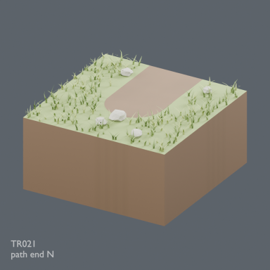](../../previews/terrain-tr003-026/renders/TR021.png)

[Full-size image](../../previews/terrain-tr003-026/renders/TR021.png)

Use / purpose: Unknown; see source catalogue. English use description needs review.

Record type: model. Formats: Unknown; inspect ZIP.

Reported dimensions (metres; XYZ when derived from measured bounds, legacy axis order not reverified): Unknown. Triangles: Unknown.

Origin: Unknown / not independently confirmed. Orientation: Unknown / not independently confirmed.

[Download ZIP](https://github.com/k3peta/tales-on-a-table/releases/download/v2026.10.21-terrain-v2/TR021_CC0.zip) · [License scope](../../LICENSE.md)

**CC0-1.0** — See original ZIP license and repository license scope. Models and embedded materials only; previews excluded.

Source details: [Catalogue 1](../../catalog/terrain_v2.md)

**Image scope:** HQ shown; LITE not shown. Repeated vegetation, pale stones and weak rut detail are faithful to the current model, not a complete quality approval.

## TR022

**path straight NS rutted**

path straight NS rutted

[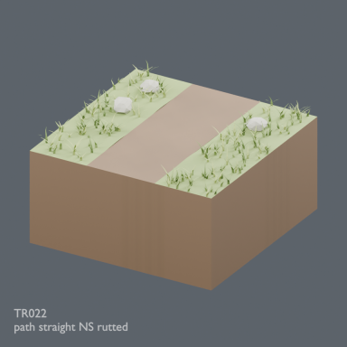](../../previews/terrain-tr003-026/renders/TR022.png)

[Full-size image](../../previews/terrain-tr003-026/renders/TR022.png)

Use / purpose: Unknown; see source catalogue. English use description needs review.

Record type: model. Formats: Unknown; inspect ZIP.

Reported dimensions (metres; XYZ when derived from measured bounds, legacy axis order not reverified): Unknown. Triangles: Unknown.

Origin: Unknown / not independently confirmed. Orientation: Unknown / not independently confirmed.

[Download ZIP](https://github.com/k3peta/tales-on-a-table/releases/download/v2026.10.21-terrain-v2/TR022_CC0.zip) · [License scope](../../LICENSE.md)

**CC0-1.0** — See original ZIP license and repository license scope. Models and embedded materials only; previews excluded.

Source details: [Catalogue 1](../../catalog/terrain_v2.md)

**Image scope:** HQ shown; LITE not shown. Repeated vegetation, pale stones and weak rut detail are faithful to the current model, not a complete quality approval.

## TR023

**path bend NE stony**

path bend NE stony

[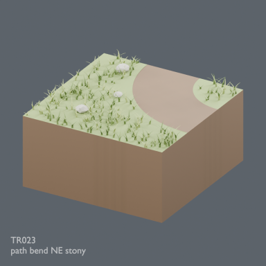](../../previews/terrain-tr003-026/renders/TR023.png)

[Full-size image](../../previews/terrain-tr003-026/renders/TR023.png)

Use / purpose: Unknown; see source catalogue. English use description needs review.

Record type: model. Formats: Unknown; inspect ZIP.

Reported dimensions (metres; XYZ when derived from measured bounds, legacy axis order not reverified): Unknown. Triangles: Unknown.

Origin: Unknown / not independently confirmed. Orientation: Unknown / not independently confirmed.

[Download ZIP](https://github.com/k3peta/tales-on-a-table/releases/download/v2026.10.21-terrain-v2/TR023_CC0.zip) · [License scope](../../LICENSE.md)

**CC0-1.0** — See original ZIP license and repository license scope. Models and embedded materials only; previews excluded.

Source details: [Catalogue 1](../../catalog/terrain_v2.md)

**Image scope:** HQ shown; LITE not shown. Repeated vegetation, pale stones and weak rut detail are faithful to the current model, not a complete quality approval.

## TR024

**path junction NES clearing**

path junction NES clearing

[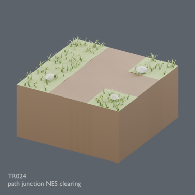](../../previews/terrain-tr003-026/renders/TR024.png)

[Full-size image](../../previews/terrain-tr003-026/renders/TR024.png)

Use / purpose: Unknown; see source catalogue. English use description needs review.

Record type: model. Formats: Unknown; inspect ZIP.

Reported dimensions (metres; XYZ when derived from measured bounds, legacy axis order not reverified): Unknown. Triangles: Unknown.

Origin: Unknown / not independently confirmed. Orientation: Unknown / not independently confirmed.

[Download ZIP](https://github.com/k3peta/tales-on-a-table/releases/download/v2026.10.21-terrain-v2/TR024_CC0.zip) · [License scope](../../LICENSE.md)

**CC0-1.0** — See original ZIP license and repository license scope. Models and embedded materials only; previews excluded.

Source details: [Catalogue 1](../../catalog/terrain_v2.md)

**Image scope:** HQ shown; LITE not shown. Repeated vegetation, pale stones and weak rut detail are faithful to the current model, not a complete quality approval.

## TR025

**rock flat scree**

rock flat scree

[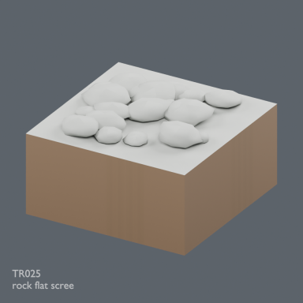](../../previews/terrain-tr003-026/renders/TR025.png)

[Full-size image](../../previews/terrain-tr003-026/renders/TR025.png)

Use / purpose: Unknown; see source catalogue. English use description needs review.

Record type: model. Formats: Unknown; inspect ZIP.

Reported dimensions (metres; XYZ when derived from measured bounds, legacy axis order not reverified): Unknown. Triangles: Unknown.

Origin: Unknown / not independently confirmed. Orientation: Unknown / not independently confirmed.

[Download ZIP](https://github.com/k3peta/tales-on-a-table/releases/download/v2026.10.21-terrain-v2/TR025_CC0.zip) · [License scope](../../LICENSE.md)

**CC0-1.0** — See original ZIP license and repository license scope. Models and embedded materials only; previews excluded.

Source details: [Catalogue 1](../../catalog/terrain_v2.md)

**Image scope:** HQ shown; LITE not shown. Repeated vegetation, pale stones and weak rut detail are faithful to the current model, not a complete quality approval.

## TR026

**rock low outcrop**

rock low outcrop

[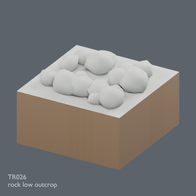](../../previews/terrain-tr003-026/renders/TR026.png)

[Full-size image](../../previews/terrain-tr003-026/renders/TR026.png)

Use / purpose: Unknown; see source catalogue. English use description needs review.

Record type: model. Formats: Unknown; inspect ZIP.

Reported dimensions (metres; XYZ when derived from measured bounds, legacy axis order not reverified): Unknown. Triangles: Unknown.

Origin: Unknown / not independently confirmed. Orientation: Unknown / not independently confirmed.

[Download ZIP](https://github.com/k3peta/tales-on-a-table/releases/download/v2026.10.21-terrain-v2/TR026_CC0.zip) · [License scope](../../LICENSE.md)

**CC0-1.0** — See original ZIP license and repository license scope. Models and embedded materials only; previews excluded.

Source details: [Catalogue 1](../../catalog/terrain_v2.md)

**Image scope:** HQ shown; LITE not shown. Repeated vegetation, pale stones and weak rut detail are faithful to the current model, not a complete quality approval.

## TR027

**rock tall outcrop**

rock tall outcrop

[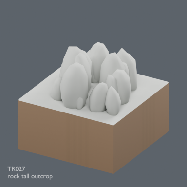](../../previews/terrain-tr027-050/renders/TR027.png)

[Full-size image](../../previews/terrain-tr027-050/renders/TR027.png)

Use / purpose: Unknown; see source catalogue. English use description needs review.

Record type: model. Formats: Unknown; inspect ZIP.

Reported dimensions (metres; XYZ when derived from measured bounds, legacy axis order not reverified): Unknown. Triangles: Unknown.

Origin: Unknown / not independently confirmed. Orientation: Unknown / not independently confirmed.

[Download ZIP](https://github.com/k3peta/tales-on-a-table/releases/download/v2026.10.21-terrain-v2/TR027_CC0.zip) · [License scope](../../LICENSE.md)

**CC0-1.0** — See original ZIP license and repository license scope. Models and embedded materials only; previews excluded.

Source details: [Catalogue 1](../../catalog/terrain_v2.md)

## TR028

**rock layered ridge**

rock layered ridge

[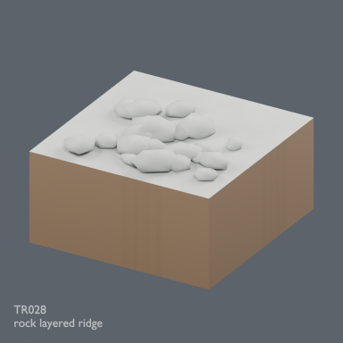](../../previews/terrain-tr027-050/renders/TR028.png)

[Full-size image](../../previews/terrain-tr027-050/renders/TR028.png)

Use / purpose: Unknown; see source catalogue. English use description needs review.

Record type: model. Formats: Unknown; inspect ZIP.

Reported dimensions (metres; XYZ when derived from measured bounds, legacy axis order not reverified): Unknown. Triangles: Unknown.

Origin: Unknown / not independently confirmed. Orientation: Unknown / not independently confirmed.

[Download ZIP](https://github.com/k3peta/tales-on-a-table/releases/download/v2026.10.21-terrain-v2/TR028_CC0.zip) · [License scope](../../LICENSE.md)

**CC0-1.0** — See original ZIP license and repository license scope. Models and embedded materials only; previews excluded.

Source details: [Catalogue 1](../../catalog/terrain_v2.md)

## TR029

**rock broken slabs**

rock broken slabs

[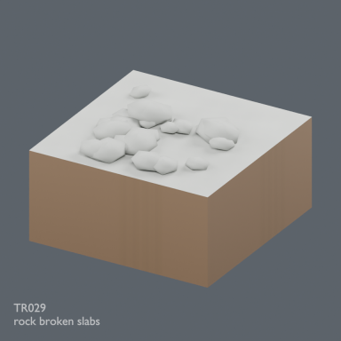](../../previews/terrain-tr027-050/renders/TR029.png)

[Full-size image](../../previews/terrain-tr027-050/renders/TR029.png)

Use / purpose: Unknown; see source catalogue. English use description needs review.

Record type: model. Formats: Unknown; inspect ZIP.

Reported dimensions (metres; XYZ when derived from measured bounds, legacy axis order not reverified): Unknown. Triangles: Unknown.

Origin: Unknown / not independently confirmed. Orientation: Unknown / not independently confirmed.

[Download ZIP](https://github.com/k3peta/tales-on-a-table/releases/download/v2026.10.21-terrain-v2/TR029_CC0.zip) · [License scope](../../LICENSE.md)

**CC0-1.0** — See original ZIP license and repository license scope. Models and embedded materials only; previews excluded.

Source details: [Catalogue 1](../../catalog/terrain_v2.md)

## TR030

**rock moss boulders**

rock moss boulders

[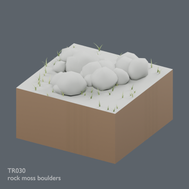](../../previews/terrain-tr027-050/renders/TR030.png)

[Full-size image](../../previews/terrain-tr027-050/renders/TR030.png)

Use / purpose: Unknown; see source catalogue. English use description needs review.

Record type: model. Formats: Unknown; inspect ZIP.

Reported dimensions (metres; XYZ when derived from measured bounds, legacy axis order not reverified): Unknown. Triangles: Unknown.

Origin: Unknown / not independently confirmed. Orientation: Unknown / not independently confirmed.

[Download ZIP](https://github.com/k3peta/tales-on-a-table/releases/download/v2026.10.21-terrain-v2/TR030_CC0.zip) · [License scope](../../LICENSE.md)

**CC0-1.0** — See original ZIP license and repository license scope. Models and embedded materials only; previews excluded.

Source details: [Catalogue 1](../../catalog/terrain_v2.md)

## TR031

**rock sand transition**

rock sand transition

[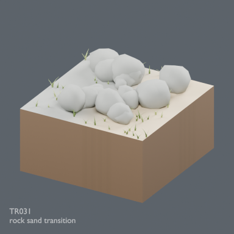](../../previews/terrain-tr027-050/renders/TR031.png)

[Full-size image](../../previews/terrain-tr027-050/renders/TR031.png)

Use / purpose: Unknown; see source catalogue. English use description needs review.

Record type: model. Formats: Unknown; inspect ZIP.

Reported dimensions (metres; XYZ when derived from measured bounds, legacy axis order not reverified): Unknown. Triangles: Unknown.

Origin: Unknown / not independently confirmed. Orientation: Unknown / not independently confirmed.

[Download ZIP](https://github.com/k3peta/tales-on-a-table/releases/download/v2026.10.21-terrain-v2/TR031_CC0.zip) · [License scope](../../LICENSE.md)

**CC0-1.0** — See original ZIP license and repository license scope. Models and embedded materials only; previews excluded.

Source details: [Catalogue 1](../../catalog/terrain_v2.md)

## TR032

**rock snow transition**

rock snow transition

[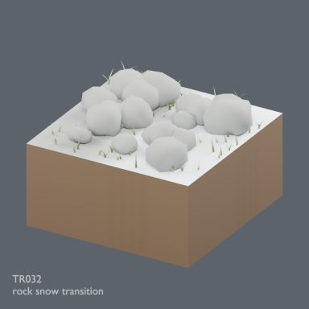](../../previews/terrain-tr027-050/renders/TR032.png)

[Full-size image](../../previews/terrain-tr027-050/renders/TR032.png)

Use / purpose: Unknown; see source catalogue. English use description needs review.

Record type: model. Formats: Unknown; inspect ZIP.

Reported dimensions (metres; XYZ when derived from measured bounds, legacy axis order not reverified): Unknown. Triangles: Unknown.

Origin: Unknown / not independently confirmed. Orientation: Unknown / not independently confirmed.

[Download ZIP](https://github.com/k3peta/tales-on-a-table/releases/download/v2026.10.21-terrain-v2/TR032_CC0.zip) · [License scope](../../LICENSE.md)

**CC0-1.0** — See original ZIP license and repository license scope. Models and embedded materials only; previews excluded.

Source details: [Catalogue 1](../../catalog/terrain_v2.md)

## TR033

**sand flat fine**

sand flat fine

[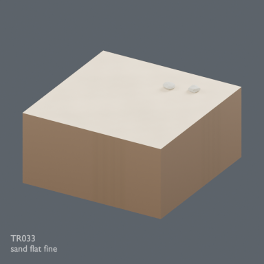](../../previews/terrain-tr027-050/renders/TR033.png)

[Full-size image](../../previews/terrain-tr027-050/renders/TR033.png)

Use / purpose: Unknown; see source catalogue. English use description needs review.

Record type: model. Formats: Unknown; inspect ZIP.

Reported dimensions (metres; XYZ when derived from measured bounds, legacy axis order not reverified): Unknown. Triangles: Unknown.

Origin: Unknown / not independently confirmed. Orientation: Unknown / not independently confirmed.

[Download ZIP](https://github.com/k3peta/tales-on-a-table/releases/download/v2026.10.21-terrain-v2/TR033_CC0.zip) · [License scope](../../LICENSE.md)

**CC0-1.0** — See original ZIP license and repository license scope. Models and embedded materials only; previews excluded.

Source details: [Catalogue 1](../../catalog/terrain_v2.md)

## TR034

**sand wind ripples**

sand wind ripples

[Full-size image](../../previews/terrain-tr027-050/renders/TR034.png)

Use / purpose: Unknown; see source catalogue. English use description needs review.

Record type: model. Formats: Unknown; inspect ZIP.

Reported dimensions (metres; XYZ when derived from measured bounds, legacy axis order not reverified): Unknown. Triangles: Unknown.

Origin: Unknown / not independently confirmed. Orientation: Unknown / not independently confirmed.

[Download ZIP](https://github.com/k3peta/tales-on-a-table/releases/download/v2026.10.21-terrain-v2/TR034_CC0.zip) · [License scope](../../LICENSE.md)

**CC0-1.0** — See original ZIP license and repository license scope. Models and embedded materials only; previews excluded.

Source details: [Catalogue 1](../../catalog/terrain_v2.md)

## TR035

**sand low dune**

sand low dune

[Full-size image](../../previews/terrain-tr027-050/renders/TR035.png)

Use / purpose: Unknown; see source catalogue. English use description needs review.

Record type: model. Formats: Unknown; inspect ZIP.

Reported dimensions (metres; XYZ when derived from measured bounds, legacy axis order not reverified): Unknown. Triangles: Unknown.

Origin: Unknown / not independently confirmed. Orientation: Unknown / not independently confirmed.

[Download ZIP](https://github.com/k3peta/tales-on-a-table/releases/download/v2026.10.21-terrain-v2/TR035_CC0.zip) · [License scope](../../LICENSE.md)

**CC0-1.0** — See original ZIP license and repository license scope. Models and embedded materials only; previews excluded.

Source details: [Catalogue 1](../../catalog/terrain_v2.md)
