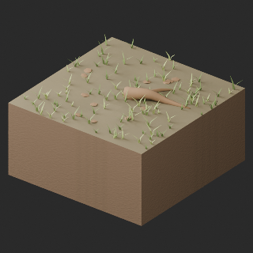
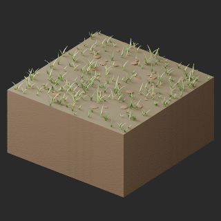
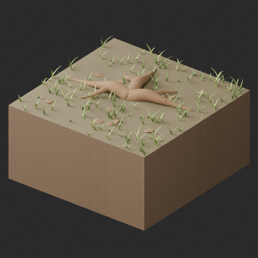
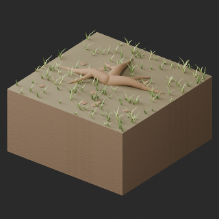

# Base distribution records 721–744

[Browse index](README.md) · [Coverage and missing fields](COVERAGE.md)

Images are actual existing model renders for browsing, not covered by model CC0. A group record may show several reused models. Dimensions and triangle counts apply only to the original record when sourced; revisions can differ. Unknown means unverified, not zero. No blanket CC0 grant for scenes, images, code or articles.

## TR012

**forest fallen branch**

forest fallen branch

[Full-size image](../../previews/terrain-tr003-026/renders/TR012.png)

Use / purpose: Unknown; see source catalogue. English use description needs review.

Record type: model. Formats: Unknown; inspect ZIP.

Reported dimensions (metres; XYZ when derived from measured bounds, legacy axis order not reverified): Unknown. Triangles: Unknown.

Origin: Unknown / not independently confirmed. Orientation: Unknown / not independently confirmed.

[Download ZIP](https://github.com/k3peta/tales-on-a-table/releases/download/v2026.10.21-terrain-v2/TR012_CC0.zip) · [License scope](../../LICENSE.md)

**CC0-1.0** — See original ZIP license and repository license scope. Models and embedded materials only; previews excluded.

Source details: [Catalogue 1](../../catalog/terrain_v2.md)

**Image scope:** HQ shown; LITE not shown. Repeated vegetation, pale stones and weak rut detail are faithful to the current model, not a complete quality approval.

**Quality57–76 revisions (original pictured ZIP retained above):**

[TR012_HQ__repair ZIP](https://raw.githubusercontent.com/k3peta/tales-on-a-table/main/distributions/quality-tr-held-repair-v2/TR012_HQ__repair_CC0.zip) · [Details](../quality-tr-held-repair-v2.md).

[TR012_LITE__repair ZIP](https://raw.githubusercontent.com/k3peta/tales-on-a-table/main/distributions/quality-tr-held-repair-v2/TR012_LITE__repair_CC0.zip) · [Details](../quality-tr-held-repair-v2.md).

## TR013

**forest stump clearing**

forest stump clearing

[Full-size image](../../previews/terrain-tr003-026/renders/TR013.png)

Use / purpose: Unknown; see source catalogue. English use description needs review.

Record type: model. Formats: Unknown; inspect ZIP.

Reported dimensions (metres; XYZ when derived from measured bounds, legacy axis order not reverified): Unknown. Triangles: Unknown.

Origin: Unknown / not independently confirmed. Orientation: Unknown / not independently confirmed.

[Download ZIP](https://github.com/k3peta/tales-on-a-table/releases/download/v2026.10.21-terrain-v2/TR013_CC0.zip) · [License scope](../../LICENSE.md)

**CC0-1.0** — See original ZIP license and repository license scope. Models and embedded materials only; previews excluded.

Source details: [Catalogue 1](../../catalog/terrain_v2.md)

**Image scope:** HQ shown; LITE not shown. Repeated vegetation, pale stones and weak rut detail are faithful to the current model, not a complete quality approval.

## TR014

**forest stone moss**

forest stone moss

[Full-size image](../../previews/terrain-tr003-026/renders/TR014.png)

Use / purpose: Unknown; see source catalogue. English use description needs review.

Record type: model. Formats: Unknown; inspect ZIP.

Reported dimensions (metres; XYZ when derived from measured bounds, legacy axis order not reverified): Unknown. Triangles: Unknown.

Origin: Unknown / not independently confirmed. Orientation: Unknown / not independently confirmed.

[Download ZIP](https://github.com/k3peta/tales-on-a-table/releases/download/v2026.10.21-terrain-v2/TR014_CC0.zip) · [License scope](../../LICENSE.md)

**CC0-1.0** — See original ZIP license and repository license scope. Models and embedded materials only; previews excluded.

Source details: [Catalogue 1](../../catalog/terrain_v2.md)

**Image scope:** HQ shown; LITE not shown. Repeated vegetation, pale stones and weak rut detail are faithful to the current model, not a complete quality approval.

**Quality57–76 revisions (original pictured ZIP retained above):**

[TR014_HQ__repair ZIP](https://raw.githubusercontent.com/k3peta/tales-on-a-table/main/distributions/quality-tr008-017-v1/TR014_HQ__repair_CC0.zip) · [Details](../quality-tr008-017-v1.md).

[TR014_LITE__repair ZIP](https://raw.githubusercontent.com/k3peta/tales-on-a-table/main/distributions/quality-tr008-017-v1/TR014_LITE__repair_CC0.zip) · [Details](../quality-tr008-017-v1.md).

## TR015

**forest sparse grass**

forest sparse grass

[Full-size image](../../previews/terrain-tr003-026/renders/TR015.png)

Use / purpose: Unknown; see source catalogue. English use description needs review.

Record type: model. Formats: Unknown; inspect ZIP.

Reported dimensions (metres; XYZ when derived from measured bounds, legacy axis order not reverified): Unknown. Triangles: Unknown.

Origin: Unknown / not independently confirmed. Orientation: Unknown / not independently confirmed.

[Download ZIP](https://github.com/k3peta/tales-on-a-table/releases/download/v2026.10.21-terrain-v2/TR015_CC0.zip) · [License scope](../../LICENSE.md)

**CC0-1.0** — See original ZIP license and repository license scope. Models and embedded materials only; previews excluded.

Source details: [Catalogue 1](../../catalog/terrain_v2.md)

**Image scope:** HQ shown; LITE not shown. Repeated vegetation, pale stones and weak rut detail are faithful to the current model, not a complete quality approval.

**Quality57–76 revisions (original pictured ZIP retained above):**

[TR015_HQ__repair ZIP](https://raw.githubusercontent.com/k3peta/tales-on-a-table/main/distributions/quality-tr-held-repair-v2/TR015_HQ__repair_CC0.zip) · [Details](../quality-tr-held-repair-v2.md).

[TR015_LITE__repair ZIP](https://raw.githubusercontent.com/k3peta/tales-on-a-table/main/distributions/quality-tr-held-repair-v2/TR015_LITE__repair_CC0.zip) · [Details](../quality-tr-held-repair-v2.md).

## TR016

**forest exposed roots**

forest exposed roots

[Full-size image](../../previews/terrain-tr003-026/renders/TR016.png)

Use / purpose: Unknown; see source catalogue. English use description needs review.

Record type: model. Formats: Unknown; inspect ZIP.

Reported dimensions (metres; XYZ when derived from measured bounds, legacy axis order not reverified): Unknown. Triangles: Unknown.

Origin: Unknown / not independently confirmed. Orientation: Unknown / not independently confirmed.

[Download ZIP](https://github.com/k3peta/tales-on-a-table/releases/download/v2026.10.21-terrain-v2/TR016_CC0.zip) · [License scope](../../LICENSE.md)

**CC0-1.0** — See original ZIP license and repository license scope. Models and embedded materials only; previews excluded.

Source details: [Catalogue 1](../../catalog/terrain_v2.md)

**Image scope:** HQ shown; LITE not shown. Repeated vegetation, pale stones and weak rut detail are faithful to the current model, not a complete quality approval.

**Quality57–76 revisions (original pictured ZIP retained above):**

[TR016_HQ__repair ZIP](https://raw.githubusercontent.com/k3peta/tales-on-a-table/main/distributions/quality-tr-held-repair-v2/TR016_HQ__repair_CC0.zip) · [Details](../quality-tr-held-repair-v2.md).

[TR016_LITE__repair ZIP](https://raw.githubusercontent.com/k3peta/tales-on-a-table/main/distributions/quality-tr-held-repair-v2/TR016_LITE__repair_CC0.zip) · [Details](../quality-tr-held-repair-v2.md).

## TR017

**path straight NS**

path straight NS

[Full-size image](../../previews/terrain-tr003-026/renders/TR017.png)

Use / purpose: Unknown; see source catalogue. English use description needs review.

Record type: model. Formats: Unknown; inspect ZIP.

Reported dimensions (metres; XYZ when derived from measured bounds, legacy axis order not reverified): Unknown. Triangles: Unknown.

Origin: Unknown / not independently confirmed. Orientation: Unknown / not independently confirmed.

[Download ZIP](https://github.com/k3peta/tales-on-a-table/releases/download/v2026.10.21-terrain-v2/TR017_CC0.zip) · [License scope](../../LICENSE.md)

**CC0-1.0** — See original ZIP license and repository license scope. Models and embedded materials only; previews excluded.

Source details: [Catalogue 1](../../catalog/terrain_v2.md)

**Image scope:** HQ shown; LITE not shown. Repeated vegetation, pale stones and weak rut detail are faithful to the current model, not a complete quality approval.

**Quality57–76 revisions (original pictured ZIP retained above):**

[TR017_HQ__repair ZIP](https://raw.githubusercontent.com/k3peta/tales-on-a-table/main/distributions/quality-tr008-017-v1/TR017_HQ__repair_CC0.zip) · [Details](../quality-tr008-017-v1.md).

[TR017_LITE__repair ZIP](https://raw.githubusercontent.com/k3peta/tales-on-a-table/main/distributions/quality-tr008-017-v1/TR017_LITE__repair_CC0.zip) · [Details](../quality-tr008-017-v1.md).

## TR018

**path bend NE**

path bend NE

[Full-size image](../../previews/terrain-tr003-026/renders/TR018.png)

Use / purpose: Unknown; see source catalogue. English use description needs review.

Record type: model. Formats: Unknown; inspect ZIP.

Reported dimensions (metres; XYZ when derived from measured bounds, legacy axis order not reverified): Unknown. Triangles: Unknown.

Origin: Unknown / not independently confirmed. Orientation: Unknown / not independently confirmed.

[Download ZIP](https://github.com/k3peta/tales-on-a-table/releases/download/v2026.10.21-terrain-v2/TR018_CC0.zip) · [License scope](../../LICENSE.md)

**CC0-1.0** — See original ZIP license and repository license scope. Models and embedded materials only; previews excluded.

Source details: [Catalogue 1](../../catalog/terrain_v2.md)

**Image scope:** HQ shown; LITE not shown. Repeated vegetation, pale stones and weak rut detail are faithful to the current model, not a complete quality approval.

**Quality57–76 revisions (original pictured ZIP retained above):**

[TR018_HQ__repair ZIP](https://raw.githubusercontent.com/k3peta/tales-on-a-table/main/distributions/quality-tr018-027-v1/TR018_HQ__repair_CC0.zip) · [Details](../quality-tr018-027-v1.md).

[TR018_LITE__repair ZIP](https://raw.githubusercontent.com/k3peta/tales-on-a-table/main/distributions/quality-tr018-027-v1/TR018_LITE__repair_CC0.zip) · [Details](../quality-tr018-027-v1.md).

## TR019

**path junction NES**

path junction NES

[Full-size image](../../previews/terrain-tr003-026/renders/TR019.png)

Use / purpose: Unknown; see source catalogue. English use description needs review.

Record type: model. Formats: Unknown; inspect ZIP.

Reported dimensions (metres; XYZ when derived from measured bounds, legacy axis order not reverified): Unknown. Triangles: Unknown.

Origin: Unknown / not independently confirmed. Orientation: Unknown / not independently confirmed.

[Download ZIP](https://github.com/k3peta/tales-on-a-table/releases/download/v2026.10.21-terrain-v2/TR019_CC0.zip) · [License scope](../../LICENSE.md)

**CC0-1.0** — See original ZIP license and repository license scope. Models and embedded materials only; previews excluded.

Source details: [Catalogue 1](../../catalog/terrain_v2.md)

**Image scope:** HQ shown; LITE not shown. Repeated vegetation, pale stones and weak rut detail are faithful to the current model, not a complete quality approval.

**Quality57–76 revisions (original pictured ZIP retained above):**

[TR019_HQ__repair ZIP](https://raw.githubusercontent.com/k3peta/tales-on-a-table/main/distributions/quality-tr018-027-v1/TR019_HQ__repair_CC0.zip) · [Details](../quality-tr018-027-v1.md).

[TR019_LITE__repair ZIP](https://raw.githubusercontent.com/k3peta/tales-on-a-table/main/distributions/quality-tr018-027-v1/TR019_LITE__repair_CC0.zip) · [Details](../quality-tr018-027-v1.md).

## TR020

**path cross NESW**

path cross NESW

[Full-size image](../../previews/terrain-tr003-026/renders/TR020.png)

Use / purpose: Unknown; see source catalogue. English use description needs review.

Record type: model. Formats: Unknown; inspect ZIP.

Reported dimensions (metres; XYZ when derived from measured bounds, legacy axis order not reverified): Unknown. Triangles: Unknown.

Origin: Unknown / not independently confirmed. Orientation: Unknown / not independently confirmed.

[Download ZIP](https://github.com/k3peta/tales-on-a-table/releases/download/v2026.10.21-terrain-v2/TR020_CC0.zip) · [License scope](../../LICENSE.md)

**CC0-1.0** — See original ZIP license and repository license scope. Models and embedded materials only; previews excluded.

Source details: [Catalogue 1](../../catalog/terrain_v2.md)

**Image scope:** HQ shown; LITE not shown. Repeated vegetation, pale stones and weak rut detail are faithful to the current model, not a complete quality approval.

**Quality57–76 revisions (original pictured ZIP retained above):**

[TR020_HQ__repair ZIP](https://raw.githubusercontent.com/k3peta/tales-on-a-table/main/distributions/quality-tr018-027-v1/TR020_HQ__repair_CC0.zip) · [Details](../quality-tr018-027-v1.md).

[TR020_LITE__repair ZIP](https://raw.githubusercontent.com/k3peta/tales-on-a-table/main/distributions/quality-tr018-027-v1/TR020_LITE__repair_CC0.zip) · [Details](../quality-tr018-027-v1.md).

## TR021

**path end N**

path end N

[Full-size image](../../previews/terrain-tr003-026/renders/TR021.png)

Use / purpose: Unknown; see source catalogue. English use description needs review.

Record type: model. Formats: Unknown; inspect ZIP.

Reported dimensions (metres; XYZ when derived from measured bounds, legacy axis order not reverified): Unknown. Triangles: Unknown.

Origin: Unknown / not independently confirmed. Orientation: Unknown / not independently confirmed.

[Download ZIP](https://github.com/k3peta/tales-on-a-table/releases/download/v2026.10.21-terrain-v2/TR021_CC0.zip) · [License scope](../../LICENSE.md)

**CC0-1.0** — See original ZIP license and repository license scope. Models and embedded materials only; previews excluded.

Source details: [Catalogue 1](../../catalog/terrain_v2.md)

**Image scope:** HQ shown; LITE not shown. Repeated vegetation, pale stones and weak rut detail are faithful to the current model, not a complete quality approval.

**Quality57–76 revisions (original pictured ZIP retained above):**

[TR021_HQ__repair ZIP](https://raw.githubusercontent.com/k3peta/tales-on-a-table/main/distributions/quality-tr018-027-v1/TR021_HQ__repair_CC0.zip) · [Details](../quality-tr018-027-v1.md).

[TR021_LITE__repair ZIP](https://raw.githubusercontent.com/k3peta/tales-on-a-table/main/distributions/quality-tr018-027-v1/TR021_LITE__repair_CC0.zip) · [Details](../quality-tr018-027-v1.md).

## TR022

**path straight NS rutted**

path straight NS rutted

[Full-size image](../../previews/terrain-tr003-026/renders/TR022.png)

Use / purpose: Unknown; see source catalogue. English use description needs review.

Record type: model. Formats: Unknown; inspect ZIP.

Reported dimensions (metres; XYZ when derived from measured bounds, legacy axis order not reverified): Unknown. Triangles: Unknown.

Origin: Unknown / not independently confirmed. Orientation: Unknown / not independently confirmed.

[Download ZIP](https://github.com/k3peta/tales-on-a-table/releases/download/v2026.10.21-terrain-v2/TR022_CC0.zip) · [License scope](../../LICENSE.md)

**CC0-1.0** — See original ZIP license and repository license scope. Models and embedded materials only; previews excluded.

Source details: [Catalogue 1](../../catalog/terrain_v2.md)

**Image scope:** HQ shown; LITE not shown. Repeated vegetation, pale stones and weak rut detail are faithful to the current model, not a complete quality approval.

**Quality57–76 revisions (original pictured ZIP retained above):**

[TR022_HQ__repair ZIP](https://raw.githubusercontent.com/k3peta/tales-on-a-table/main/distributions/quality-tr018-027-v1/TR022_HQ__repair_CC0.zip) · [Details](../quality-tr018-027-v1.md).

[TR022_LITE__repair ZIP](https://raw.githubusercontent.com/k3peta/tales-on-a-table/main/distributions/quality-tr018-027-v1/TR022_LITE__repair_CC0.zip) · [Details](../quality-tr018-027-v1.md).

## TR023

**path bend NE stony**

path bend NE stony

[Full-size image](../../previews/terrain-tr003-026/renders/TR023.png)

Use / purpose: Unknown; see source catalogue. English use description needs review.

Record type: model. Formats: Unknown; inspect ZIP.

Reported dimensions (metres; XYZ when derived from measured bounds, legacy axis order not reverified): Unknown. Triangles: Unknown.

Origin: Unknown / not independently confirmed. Orientation: Unknown / not independently confirmed.

[Download ZIP](https://github.com/k3peta/tales-on-a-table/releases/download/v2026.10.21-terrain-v2/TR023_CC0.zip) · [License scope](../../LICENSE.md)

**CC0-1.0** — See original ZIP license and repository license scope. Models and embedded materials only; previews excluded.

Source details: [Catalogue 1](../../catalog/terrain_v2.md)

**Image scope:** HQ shown; LITE not shown. Repeated vegetation, pale stones and weak rut detail are faithful to the current model, not a complete quality approval.

**Quality57–76 revisions (original pictured ZIP retained above):**

[TR023_HQ__repair ZIP](https://raw.githubusercontent.com/k3peta/tales-on-a-table/main/distributions/quality-tr018-027-v1/TR023_HQ__repair_CC0.zip) · [Details](../quality-tr018-027-v1.md).

[TR023_LITE__repair ZIP](https://raw.githubusercontent.com/k3peta/tales-on-a-table/main/distributions/quality-tr018-027-v1/TR023_LITE__repair_CC0.zip) · [Details](../quality-tr018-027-v1.md).

## TR024

**path junction NES clearing**

path junction NES clearing

[Full-size image](../../previews/terrain-tr003-026/renders/TR024.png)

Use / purpose: Unknown; see source catalogue. English use description needs review.

Record type: model. Formats: Unknown; inspect ZIP.

Reported dimensions (metres; XYZ when derived from measured bounds, legacy axis order not reverified): Unknown. Triangles: Unknown.

Origin: Unknown / not independently confirmed. Orientation: Unknown / not independently confirmed.

[Download ZIP](https://github.com/k3peta/tales-on-a-table/releases/download/v2026.10.21-terrain-v2/TR024_CC0.zip) · [License scope](../../LICENSE.md)

**CC0-1.0** — See original ZIP license and repository license scope. Models and embedded materials only; previews excluded.

Source details: [Catalogue 1](../../catalog/terrain_v2.md)

**Image scope:** HQ shown; LITE not shown. Repeated vegetation, pale stones and weak rut detail are faithful to the current model, not a complete quality approval.

**Quality57–76 revisions (original pictured ZIP retained above):**

[TR024_HQ__repair ZIP](https://raw.githubusercontent.com/k3peta/tales-on-a-table/main/distributions/quality-tr018-027-v1/TR024_HQ__repair_CC0.zip) · [Details](../quality-tr018-027-v1.md).

[TR024_LITE__repair ZIP](https://raw.githubusercontent.com/k3peta/tales-on-a-table/main/distributions/quality-tr018-027-v1/TR024_LITE__repair_CC0.zip) · [Details](../quality-tr018-027-v1.md).

## TR025

**rock flat scree**

rock flat scree

[Full-size image](../../previews/terrain-tr003-026/renders/TR025.png)

Use / purpose: Unknown; see source catalogue. English use description needs review.

Record type: model. Formats: Unknown; inspect ZIP.

Reported dimensions (metres; XYZ when derived from measured bounds, legacy axis order not reverified): Unknown. Triangles: Unknown.

Origin: Unknown / not independently confirmed. Orientation: Unknown / not independently confirmed.

[Download ZIP](https://github.com/k3peta/tales-on-a-table/releases/download/v2026.10.21-terrain-v2/TR025_CC0.zip) · [License scope](../../LICENSE.md)

**CC0-1.0** — See original ZIP license and repository license scope. Models and embedded materials only; previews excluded.

Source details: [Catalogue 1](../../catalog/terrain_v2.md)

**Image scope:** HQ shown; LITE not shown. Repeated vegetation, pale stones and weak rut detail are faithful to the current model, not a complete quality approval.

**Quality57–76 revisions (original pictured ZIP retained above):**

[TR025_HQ__repair ZIP](https://raw.githubusercontent.com/k3peta/tales-on-a-table/main/distributions/quality-tr018-027-v1/TR025_HQ__repair_CC0.zip) · [Details](../quality-tr018-027-v1.md).

[TR025_LITE__repair ZIP](https://raw.githubusercontent.com/k3peta/tales-on-a-table/main/distributions/quality-tr018-027-v1/TR025_LITE__repair_CC0.zip) · [Details](../quality-tr018-027-v1.md).

## TR026

**rock low outcrop**

rock low outcrop

[Full-size image](../../previews/terrain-tr003-026/renders/TR026.png)

Use / purpose: Unknown; see source catalogue. English use description needs review.

Record type: model. Formats: Unknown; inspect ZIP.

Reported dimensions (metres; XYZ when derived from measured bounds, legacy axis order not reverified): Unknown. Triangles: Unknown.

Origin: Unknown / not independently confirmed. Orientation: Unknown / not independently confirmed.

[Download ZIP](https://github.com/k3peta/tales-on-a-table/releases/download/v2026.10.21-terrain-v2/TR026_CC0.zip) · [License scope](../../LICENSE.md)

**CC0-1.0** — See original ZIP license and repository license scope. Models and embedded materials only; previews excluded.

Source details: [Catalogue 1](../../catalog/terrain_v2.md)

**Image scope:** HQ shown; LITE not shown. Repeated vegetation, pale stones and weak rut detail are faithful to the current model, not a complete quality approval.

**Quality57–76 revisions (original pictured ZIP retained above):**

[TR026_HQ__repair ZIP](https://raw.githubusercontent.com/k3peta/tales-on-a-table/main/distributions/quality-tr018-027-v1/TR026_HQ__repair_CC0.zip) · [Details](../quality-tr018-027-v1.md).

[TR026_LITE__repair ZIP](https://raw.githubusercontent.com/k3peta/tales-on-a-table/main/distributions/quality-tr018-027-v1/TR026_LITE__repair_CC0.zip) · [Details](../quality-tr018-027-v1.md).

## TR027

**rock tall outcrop**

rock tall outcrop

[Full-size image](../../previews/terrain-tr027-050/renders/TR027.png)

Use / purpose: Unknown; see source catalogue. English use description needs review.

Record type: model. Formats: Unknown; inspect ZIP.

Reported dimensions (metres; XYZ when derived from measured bounds, legacy axis order not reverified): Unknown. Triangles: Unknown.

Origin: Unknown / not independently confirmed. Orientation: Unknown / not independently confirmed.

[Download ZIP](https://github.com/k3peta/tales-on-a-table/releases/download/v2026.10.21-terrain-v2/TR027_CC0.zip) · [License scope](../../LICENSE.md)

**CC0-1.0** — See original ZIP license and repository license scope. Models and embedded materials only; previews excluded.

Source details: [Catalogue 1](../../catalog/terrain_v2.md)

**Quality57–76 revisions (original pictured ZIP retained above):**

[TR027_HQ__repair ZIP](https://raw.githubusercontent.com/k3peta/tales-on-a-table/main/distributions/quality-tr018-027-v1/TR027_HQ__repair_CC0.zip) · [Details](../quality-tr018-027-v1.md).

[TR027_LITE__repair ZIP](https://raw.githubusercontent.com/k3peta/tales-on-a-table/main/distributions/quality-tr018-027-v1/TR027_LITE__repair_CC0.zip) · [Details](../quality-tr018-027-v1.md).

## TR028

**rock layered ridge**

rock layered ridge

[Full-size image](../../previews/terrain-tr027-050/renders/TR028.png)

Use / purpose: Unknown; see source catalogue. English use description needs review.

Record type: model. Formats: Unknown; inspect ZIP.

Reported dimensions (metres; XYZ when derived from measured bounds, legacy axis order not reverified): Unknown. Triangles: Unknown.

Origin: Unknown / not independently confirmed. Orientation: Unknown / not independently confirmed.

[Download ZIP](https://github.com/k3peta/tales-on-a-table/releases/download/v2026.10.21-terrain-v2/TR028_CC0.zip) · [License scope](../../LICENSE.md)

**CC0-1.0** — See original ZIP license and repository license scope. Models and embedded materials only; previews excluded.

Source details: [Catalogue 1](../../catalog/terrain_v2.md)

**Quality57–76 revisions (original pictured ZIP retained above):**

[TR028_HQ__repair ZIP](https://raw.githubusercontent.com/k3peta/tales-on-a-table/main/distributions/quality-tr028-037-v1/TR028_HQ__repair_CC0.zip) · [Details](../quality-tr028-037-v1.md).

[TR028_LITE__repair ZIP](https://raw.githubusercontent.com/k3peta/tales-on-a-table/main/distributions/quality-tr028-037-v1/TR028_LITE__repair_CC0.zip) · [Details](../quality-tr028-037-v1.md).

## TR029

**rock broken slabs**

rock broken slabs

[Full-size image](../../previews/terrain-tr027-050/renders/TR029.png)

Use / purpose: Unknown; see source catalogue. English use description needs review.

Record type: model. Formats: Unknown; inspect ZIP.

Reported dimensions (metres; XYZ when derived from measured bounds, legacy axis order not reverified): Unknown. Triangles: Unknown.

Origin: Unknown / not independently confirmed. Orientation: Unknown / not independently confirmed.

[Download ZIP](https://github.com/k3peta/tales-on-a-table/releases/download/v2026.10.21-terrain-v2/TR029_CC0.zip) · [License scope](../../LICENSE.md)

**CC0-1.0** — See original ZIP license and repository license scope. Models and embedded materials only; previews excluded.

Source details: [Catalogue 1](../../catalog/terrain_v2.md)

**Quality57–76 revisions (original pictured ZIP retained above):**

[TR029_HQ__repair ZIP](https://raw.githubusercontent.com/k3peta/tales-on-a-table/main/distributions/quality-tr028-037-v1/TR029_HQ__repair_CC0.zip) · [Details](../quality-tr028-037-v1.md).

[TR029_LITE__repair ZIP](https://raw.githubusercontent.com/k3peta/tales-on-a-table/main/distributions/quality-tr028-037-v1/TR029_LITE__repair_CC0.zip) · [Details](../quality-tr028-037-v1.md).

## TR030

**rock moss boulders**

rock moss boulders

[Full-size image](../../previews/terrain-tr027-050/renders/TR030.png)

Use / purpose: Unknown; see source catalogue. English use description needs review.

Record type: model. Formats: Unknown; inspect ZIP.

Reported dimensions (metres; XYZ when derived from measured bounds, legacy axis order not reverified): Unknown. Triangles: Unknown.

Origin: Unknown / not independently confirmed. Orientation: Unknown / not independently confirmed.

[Download ZIP](https://github.com/k3peta/tales-on-a-table/releases/download/v2026.10.21-terrain-v2/TR030_CC0.zip) · [License scope](../../LICENSE.md)

**CC0-1.0** — See original ZIP license and repository license scope. Models and embedded materials only; previews excluded.

Source details: [Catalogue 1](../../catalog/terrain_v2.md)

**Quality57–76 revisions (original pictured ZIP retained above):**

[TR030_HQ__repair ZIP](https://raw.githubusercontent.com/k3peta/tales-on-a-table/main/distributions/quality-tr028-037-v1/TR030_HQ__repair_CC0.zip) · [Details](../quality-tr028-037-v1.md).

[TR030_LITE__repair ZIP](https://raw.githubusercontent.com/k3peta/tales-on-a-table/main/distributions/quality-tr028-037-v1/TR030_LITE__repair_CC0.zip) · [Details](../quality-tr028-037-v1.md).

## TR031

**rock sand transition**

rock sand transition

[Full-size image](../../previews/terrain-tr027-050/renders/TR031.png)

Use / purpose: Unknown; see source catalogue. English use description needs review.

Record type: model. Formats: Unknown; inspect ZIP.

Reported dimensions (metres; XYZ when derived from measured bounds, legacy axis order not reverified): Unknown. Triangles: Unknown.

Origin: Unknown / not independently confirmed. Orientation: Unknown / not independently confirmed.

[Download ZIP](https://github.com/k3peta/tales-on-a-table/releases/download/v2026.10.21-terrain-v2/TR031_CC0.zip) · [License scope](../../LICENSE.md)

**CC0-1.0** — See original ZIP license and repository license scope. Models and embedded materials only; previews excluded.

Source details: [Catalogue 1](../../catalog/terrain_v2.md)

**Quality57–76 revisions (original pictured ZIP retained above):**

[TR031_HQ__repair ZIP](https://raw.githubusercontent.com/k3peta/tales-on-a-table/main/distributions/quality-tr028-037-v1/TR031_HQ__repair_CC0.zip) · [Details](../quality-tr028-037-v1.md).

[TR031_LITE__repair ZIP](https://raw.githubusercontent.com/k3peta/tales-on-a-table/main/distributions/quality-tr028-037-v1/TR031_LITE__repair_CC0.zip) · [Details](../quality-tr028-037-v1.md).

## TR032

**rock snow transition**

rock snow transition

[Full-size image](../../previews/terrain-tr027-050/renders/TR032.png)

Use / purpose: Unknown; see source catalogue. English use description needs review.

Record type: model. Formats: Unknown; inspect ZIP.

Reported dimensions (metres; XYZ when derived from measured bounds, legacy axis order not reverified): Unknown. Triangles: Unknown.

Origin: Unknown / not independently confirmed. Orientation: Unknown / not independently confirmed.

[Download ZIP](https://github.com/k3peta/tales-on-a-table/releases/download/v2026.10.21-terrain-v2/TR032_CC0.zip) · [License scope](../../LICENSE.md)

**CC0-1.0** — See original ZIP license and repository license scope. Models and embedded materials only; previews excluded.

Source details: [Catalogue 1](../../catalog/terrain_v2.md)

**Quality57–76 revisions (original pictured ZIP retained above):**

[TR032_HQ__repair ZIP](https://raw.githubusercontent.com/k3peta/tales-on-a-table/main/distributions/quality-tr028-037-v1/TR032_HQ__repair_CC0.zip) · [Details](../quality-tr028-037-v1.md).

[TR032_LITE__repair ZIP](https://raw.githubusercontent.com/k3peta/tales-on-a-table/main/distributions/quality-tr028-037-v1/TR032_LITE__repair_CC0.zip) · [Details](../quality-tr028-037-v1.md).

## TR033

**sand flat fine**

sand flat fine

[Full-size image](../../previews/terrain-tr027-050/renders/TR033.png)

Use / purpose: Unknown; see source catalogue. English use description needs review.

Record type: model. Formats: Unknown; inspect ZIP.

Reported dimensions (metres; XYZ when derived from measured bounds, legacy axis order not reverified): Unknown. Triangles: Unknown.

Origin: Unknown / not independently confirmed. Orientation: Unknown / not independently confirmed.

[Download ZIP](https://github.com/k3peta/tales-on-a-table/releases/download/v2026.10.21-terrain-v2/TR033_CC0.zip) · [License scope](../../LICENSE.md)

**CC0-1.0** — See original ZIP license and repository license scope. Models and embedded materials only; previews excluded.

Source details: [Catalogue 1](../../catalog/terrain_v2.md)

**Quality57–76 revisions (original pictured ZIP retained above):**

[TR033_HQ__repair ZIP](https://raw.githubusercontent.com/k3peta/tales-on-a-table/main/distributions/quality-tr028-037-v1/TR033_HQ__repair_CC0.zip) · [Details](../quality-tr028-037-v1.md).

[TR033_LITE__repair ZIP](https://raw.githubusercontent.com/k3peta/tales-on-a-table/main/distributions/quality-tr028-037-v1/TR033_LITE__repair_CC0.zip) · [Details](../quality-tr028-037-v1.md).

## TR034

**sand wind ripples**

sand wind ripples

[Full-size image](../../previews/terrain-tr027-050/renders/TR034.png)

Use / purpose: Unknown; see source catalogue. English use description needs review.

Record type: model. Formats: Unknown; inspect ZIP.

Reported dimensions (metres; XYZ when derived from measured bounds, legacy axis order not reverified): Unknown. Triangles: Unknown.

Origin: Unknown / not independently confirmed. Orientation: Unknown / not independently confirmed.

[Download ZIP](https://github.com/k3peta/tales-on-a-table/releases/download/v2026.10.21-terrain-v2/TR034_CC0.zip) · [License scope](../../LICENSE.md)

**CC0-1.0** — See original ZIP license and repository license scope. Models and embedded materials only; previews excluded.

Source details: [Catalogue 1](../../catalog/terrain_v2.md)

**Quality57–76 revisions (original pictured ZIP retained above):**

[TR034_HQ__repair ZIP](https://raw.githubusercontent.com/k3peta/tales-on-a-table/main/distributions/quality-tr028-037-v1/TR034_HQ__repair_CC0.zip) · [Details](../quality-tr028-037-v1.md).

[TR034_LITE__repair ZIP](https://raw.githubusercontent.com/k3peta/tales-on-a-table/main/distributions/quality-tr028-037-v1/TR034_LITE__repair_CC0.zip) · [Details](../quality-tr028-037-v1.md).

## TR035

**sand low dune**

sand low dune

[Full-size image](../../previews/terrain-tr027-050/renders/TR035.png)

Use / purpose: Unknown; see source catalogue. English use description needs review.

Record type: model. Formats: Unknown; inspect ZIP.

Reported dimensions (metres; XYZ when derived from measured bounds, legacy axis order not reverified): Unknown. Triangles: Unknown.

Origin: Unknown / not independently confirmed. Orientation: Unknown / not independently confirmed.

[Download ZIP](https://github.com/k3peta/tales-on-a-table/releases/download/v2026.10.21-terrain-v2/TR035_CC0.zip) · [License scope](../../LICENSE.md)

**CC0-1.0** — See original ZIP license and repository license scope. Models and embedded materials only; previews excluded.

Source details: [Catalogue 1](../../catalog/terrain_v2.md)
**Quality57–76 revisions (original pictured ZIP retained above):**

[TR035_HQ__repair ZIP](https://raw.githubusercontent.com/k3peta/tales-on-a-table/main/distributions/quality-tr028-037-v1/TR035_HQ__repair_CC0.zip) · [Details](../quality-tr028-037-v1.md).

[TR035_LITE__repair ZIP](https://raw.githubusercontent.com/k3peta/tales-on-a-table/main/distributions/quality-tr028-037-v1/TR035_LITE__repair_CC0.zip) · [Details](../quality-tr028-037-v1.md).
