# Base distribution records 745–768

[Browse index](README.md) · [Coverage and missing fields](COVERAGE.md)

Images are actual existing model renders for browsing, not covered by model CC0. A group record may show several reused models. Dimensions and triangle counts apply only to the original record when sourced; revisions can differ. Unknown means unverified, not zero. No blanket CC0 grant for scenes, images, code or articles.

## TR036

**sand pebble patch**

sand pebble patch

[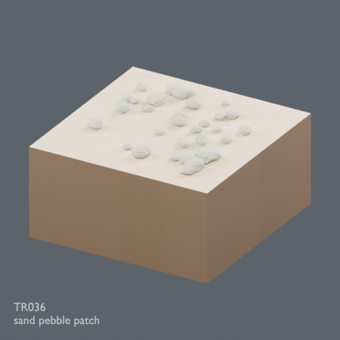](../../previews/terrain-tr027-050/renders/TR036.png)

[Full-size image](../../previews/terrain-tr027-050/renders/TR036.png)

Use / purpose: Unknown; see source catalogue. English use description needs review.

Record type: model. Formats: Unknown; inspect ZIP.

Reported dimensions (metres; XYZ when derived from measured bounds, legacy axis order not reverified): Unknown. Triangles: Unknown.

Origin: Unknown / not independently confirmed. Orientation: Unknown / not independently confirmed.

[Download ZIP](https://github.com/k3peta/tales-on-a-table/releases/download/v2026.10.21-terrain-v2/TR036_CC0.zip) · [License scope](../../LICENSE.md)

**CC0-1.0** — See original ZIP license and repository license scope. Models and embedded materials only; previews excluded.

Source details: [Catalogue 1](../../catalog/terrain_v2.md)

**Quality57–76 revisions (original pictured ZIP retained above):**

[TR036_HQ__repair ZIP](https://raw.githubusercontent.com/k3peta/tales-on-a-table/main/distributions/quality-tr028-037-v1/TR036_HQ__repair_CC0.zip) · [Details](../quality-tr028-037-v1.md).

[TR036_LITE__repair ZIP](https://raw.githubusercontent.com/k3peta/tales-on-a-table/main/distributions/quality-tr028-037-v1/TR036_LITE__repair_CC0.zip) · [Details](../quality-tr028-037-v1.md).

## TR037

**sand dry grass**

sand dry grass

[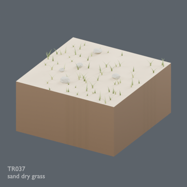](../../previews/terrain-tr027-050/renders/TR037.png)

[Full-size image](../../previews/terrain-tr027-050/renders/TR037.png)

Use / purpose: Unknown; see source catalogue. English use description needs review.

Record type: model. Formats: Unknown; inspect ZIP.

Reported dimensions (metres; XYZ when derived from measured bounds, legacy axis order not reverified): Unknown. Triangles: Unknown.

Origin: Unknown / not independently confirmed. Orientation: Unknown / not independently confirmed.

[Download ZIP](https://github.com/k3peta/tales-on-a-table/releases/download/v2026.10.21-terrain-v2/TR037_CC0.zip) · [License scope](../../LICENSE.md)

**CC0-1.0** — See original ZIP license and repository license scope. Models and embedded materials only; previews excluded.

Source details: [Catalogue 1](../../catalog/terrain_v2.md)

**Quality57–76 revisions (original pictured ZIP retained above):**

[TR037_HQ__repair ZIP](https://raw.githubusercontent.com/k3peta/tales-on-a-table/main/distributions/quality-tr028-037-v1/TR037_HQ__repair_CC0.zip) · [Details](../quality-tr028-037-v1.md).

[TR037_LITE__repair ZIP](https://raw.githubusercontent.com/k3peta/tales-on-a-table/main/distributions/quality-tr028-037-v1/TR037_LITE__repair_CC0.zip) · [Details](../quality-tr028-037-v1.md).

## TR038

**sand rock transition**

sand rock transition

[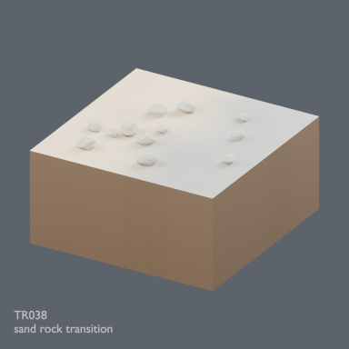](../../previews/terrain-tr027-050/renders/TR038.png)

[Full-size image](../../previews/terrain-tr027-050/renders/TR038.png)

Use / purpose: Unknown; see source catalogue. English use description needs review.

Record type: model. Formats: Unknown; inspect ZIP.

Reported dimensions (metres; XYZ when derived from measured bounds, legacy axis order not reverified): Unknown. Triangles: Unknown.

Origin: Unknown / not independently confirmed. Orientation: Unknown / not independently confirmed.

[Download ZIP](https://github.com/k3peta/tales-on-a-table/releases/download/v2026.10.21-terrain-v2/TR038_CC0.zip) · [License scope](../../LICENSE.md)

**CC0-1.0** — See original ZIP license and repository license scope. Models and embedded materials only; previews excluded.

Source details: [Catalogue 1](../../catalog/terrain_v2.md)

**Quality57–76 revisions (original pictured ZIP retained above):**

[TR038_HQ__repair ZIP](https://raw.githubusercontent.com/k3peta/tales-on-a-table/main/distributions/quality-tr038-047-v1/TR038_HQ__repair_CC0.zip) · [Details](../quality-tr038-047-v1.md).

[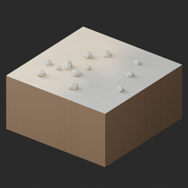](../../previews/quality-tr038-047-v1/TR038_LITE__repair_full.png)

[TR038_LITE__repair ZIP](https://raw.githubusercontent.com/k3peta/tales-on-a-table/main/distributions/quality-tr038-047-v1/TR038_LITE__repair_CC0.zip) · [Details](../quality-tr038-047-v1.md).

## TR039

**sand mud transition**

sand mud transition

[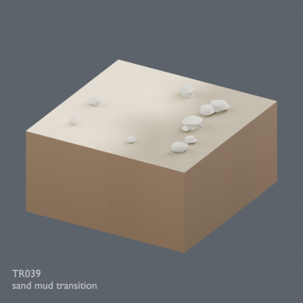](../../previews/terrain-tr027-050/renders/TR039.png)

[Full-size image](../../previews/terrain-tr027-050/renders/TR039.png)

Use / purpose: Unknown; see source catalogue. English use description needs review.

Record type: model. Formats: Unknown; inspect ZIP.

Reported dimensions (metres; XYZ when derived from measured bounds, legacy axis order not reverified): Unknown. Triangles: Unknown.

Origin: Unknown / not independently confirmed. Orientation: Unknown / not independently confirmed.

[Download ZIP](https://github.com/k3peta/tales-on-a-table/releases/download/v2026.10.21-terrain-v2/TR039_CC0.zip) · [License scope](../../LICENSE.md)

**CC0-1.0** — See original ZIP license and repository license scope. Models and embedded materials only; previews excluded.

Source details: [Catalogue 1](../../catalog/terrain_v2.md)

**Quality57–76 revisions (original pictured ZIP retained above):**

[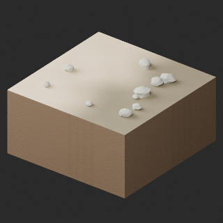](../../previews/quality-tr038-047-v1/TR039_HQ__repair_full.png)

[TR039_HQ__repair ZIP](https://raw.githubusercontent.com/k3peta/tales-on-a-table/main/distributions/quality-tr038-047-v1/TR039_HQ__repair_CC0.zip) · [Details](../quality-tr038-047-v1.md).

[TR039_LITE__repair ZIP](https://raw.githubusercontent.com/k3peta/tales-on-a-table/main/distributions/quality-tr038-047-v1/TR039_LITE__repair_CC0.zip) · [Details](../quality-tr038-047-v1.md).

## TR040

**sand shell gravel**

sand shell gravel

[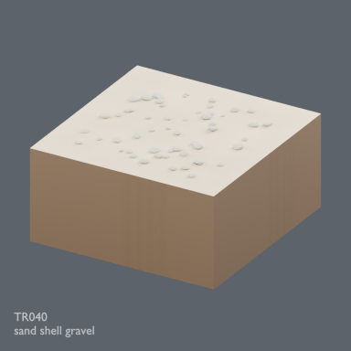](../../previews/terrain-tr027-050/renders/TR040.png)

[Full-size image](../../previews/terrain-tr027-050/renders/TR040.png)

Use / purpose: Unknown; see source catalogue. English use description needs review.

Record type: model. Formats: Unknown; inspect ZIP.

Reported dimensions (metres; XYZ when derived from measured bounds, legacy axis order not reverified): Unknown. Triangles: Unknown.

Origin: Unknown / not independently confirmed. Orientation: Unknown / not independently confirmed.

[Download ZIP](https://github.com/k3peta/tales-on-a-table/releases/download/v2026.10.21-terrain-v2/TR040_CC0.zip) · [License scope](../../LICENSE.md)

**CC0-1.0** — See original ZIP license and repository license scope. Models and embedded materials only; previews excluded.

Source details: [Catalogue 1](../../catalog/terrain_v2.md)

**Quality57–76 revisions (original pictured ZIP retained above):**

[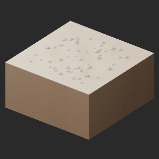](../../previews/quality-tr038-047-v1/TR040_HQ__repair_full.png)

[TR040_HQ__repair ZIP](https://raw.githubusercontent.com/k3peta/tales-on-a-table/main/distributions/quality-tr038-047-v1/TR040_HQ__repair_CC0.zip) · [Details](../quality-tr038-047-v1.md).

[TR040_LITE__repair ZIP](https://raw.githubusercontent.com/k3peta/tales-on-a-table/main/distributions/quality-tr038-047-v1/TR040_LITE__repair_CC0.zip) · [Details](../quality-tr038-047-v1.md).

## TR041

**water straight NS**

water straight NS

[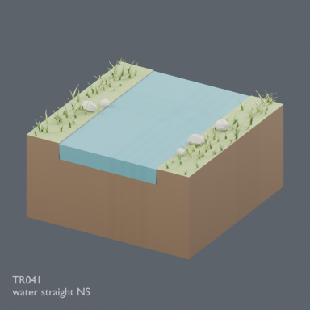](../../previews/terrain-tr027-050/renders/TR041.png)

[Full-size image](../../previews/terrain-tr027-050/renders/TR041.png)

Use / purpose: Unknown; see source catalogue. English use description needs review.

Record type: model. Formats: Unknown; inspect ZIP.

Reported dimensions (metres; XYZ when derived from measured bounds, legacy axis order not reverified): Unknown. Triangles: Unknown.

Origin: Unknown / not independently confirmed. Orientation: Unknown / not independently confirmed.

[Download ZIP](https://github.com/k3peta/tales-on-a-table/releases/download/v2026.10.21-terrain-v2/TR041_CC0.zip) · [License scope](../../LICENSE.md)

**CC0-1.0** — See original ZIP license and repository license scope. Models and embedded materials only; previews excluded.

Source details: [Catalogue 1](../../catalog/terrain_v2.md)

## TR042

**water bend NE**

water bend NE

[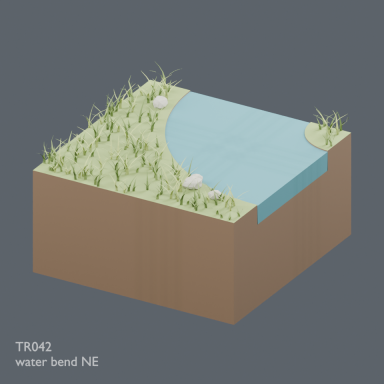](../../previews/terrain-tr027-050/renders/TR042.png)

[Full-size image](../../previews/terrain-tr027-050/renders/TR042.png)

Use / purpose: Unknown; see source catalogue. English use description needs review.

Record type: model. Formats: Unknown; inspect ZIP.

Reported dimensions (metres; XYZ when derived from measured bounds, legacy axis order not reverified): Unknown. Triangles: Unknown.

Origin: Unknown / not independently confirmed. Orientation: Unknown / not independently confirmed.

[Download ZIP](https://github.com/k3peta/tales-on-a-table/releases/download/v2026.10.21-terrain-v2/TR042_CC0.zip) · [License scope](../../LICENSE.md)

**CC0-1.0** — See original ZIP license and repository license scope. Models and embedded materials only; previews excluded.

Source details: [Catalogue 1](../../catalog/terrain_v2.md)

## TR043

**water junction NES**

water junction NES

[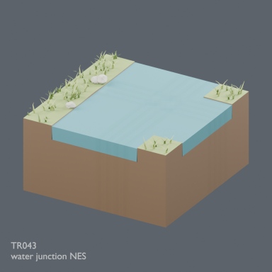](../../previews/terrain-tr027-050/renders/TR043.png)

[Full-size image](../../previews/terrain-tr027-050/renders/TR043.png)

Use / purpose: Unknown; see source catalogue. English use description needs review.

Record type: model. Formats: Unknown; inspect ZIP.

Reported dimensions (metres; XYZ when derived from measured bounds, legacy axis order not reverified): Unknown. Triangles: Unknown.

Origin: Unknown / not independently confirmed. Orientation: Unknown / not independently confirmed.

[Download ZIP](https://github.com/k3peta/tales-on-a-table/releases/download/v2026.10.21-terrain-v2/TR043_CC0.zip) · [License scope](../../LICENSE.md)

**CC0-1.0** — See original ZIP license and repository license scope. Models and embedded materials only; previews excluded.

Source details: [Catalogue 1](../../catalog/terrain_v2.md)

## TR044

**water cross NESW**

water cross NESW

[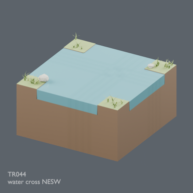](../../previews/terrain-tr027-050/renders/TR044.png)

[Full-size image](../../previews/terrain-tr027-050/renders/TR044.png)

Use / purpose: Unknown; see source catalogue. English use description needs review.

Record type: model. Formats: Unknown; inspect ZIP.

Reported dimensions (metres; XYZ when derived from measured bounds, legacy axis order not reverified): Unknown. Triangles: Unknown.

Origin: Unknown / not independently confirmed. Orientation: Unknown / not independently confirmed.

[Download ZIP](https://github.com/k3peta/tales-on-a-table/releases/download/v2026.10.21-terrain-v2/TR044_CC0.zip) · [License scope](../../LICENSE.md)

**CC0-1.0** — See original ZIP license and repository license scope. Models and embedded materials only; previews excluded.

Source details: [Catalogue 1](../../catalog/terrain_v2.md)

## TR045

**water end N pool**

water end N pool

[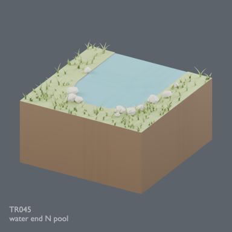](../../previews/terrain-tr027-050/renders/TR045.png)

[Full-size image](../../previews/terrain-tr027-050/renders/TR045.png)

Use / purpose: Unknown; see source catalogue. English use description needs review.

Record type: model. Formats: Unknown; inspect ZIP.

Reported dimensions (metres; XYZ when derived from measured bounds, legacy axis order not reverified): Unknown. Triangles: Unknown.

Origin: Unknown / not independently confirmed. Orientation: Unknown / not independently confirmed.

[Download ZIP](https://github.com/k3peta/tales-on-a-table/releases/download/v2026.10.21-terrain-v2/TR045_CC0.zip) · [License scope](../../LICENSE.md)

**CC0-1.0** — See original ZIP license and repository license scope. Models and embedded materials only; previews excluded.

Source details: [Catalogue 1](../../catalog/terrain_v2.md)

## TR046

**water straight NS reeds**

water straight NS reeds

[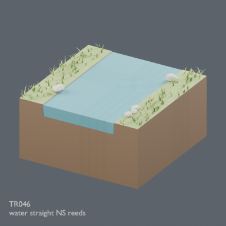](../../previews/terrain-tr027-050/renders/TR046.png)

[Full-size image](../../previews/terrain-tr027-050/renders/TR046.png)

Use / purpose: Unknown; see source catalogue. English use description needs review.

Record type: model. Formats: Unknown; inspect ZIP.

Reported dimensions (metres; XYZ when derived from measured bounds, legacy axis order not reverified): Unknown. Triangles: Unknown.

Origin: Unknown / not independently confirmed. Orientation: Unknown / not independently confirmed.

[Download ZIP](https://github.com/k3peta/tales-on-a-table/releases/download/v2026.10.21-terrain-v2/TR046_CC0.zip) · [License scope](../../LICENSE.md)

**CC0-1.0** — See original ZIP license and repository license scope. Models and embedded materials only; previews excluded.

Source details: [Catalogue 1](../../catalog/terrain_v2.md)

## TR047

**water bend NE stones**

water bend NE stones

[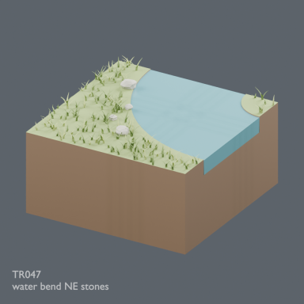](../../previews/terrain-tr027-050/renders/TR047.png)

[Full-size image](../../previews/terrain-tr027-050/renders/TR047.png)

Use / purpose: Unknown; see source catalogue. English use description needs review.

Record type: model. Formats: Unknown; inspect ZIP.

Reported dimensions (metres; XYZ when derived from measured bounds, legacy axis order not reverified): Unknown. Triangles: Unknown.

Origin: Unknown / not independently confirmed. Orientation: Unknown / not independently confirmed.

[Download ZIP](https://github.com/k3peta/tales-on-a-table/releases/download/v2026.10.21-terrain-v2/TR047_CC0.zip) · [License scope](../../LICENSE.md)

**CC0-1.0** — See original ZIP license and repository license scope. Models and embedded materials only; previews excluded.

Source details: [Catalogue 1](../../catalog/terrain_v2.md)

## TR048

**water junction NES marsh**

water junction NES marsh

[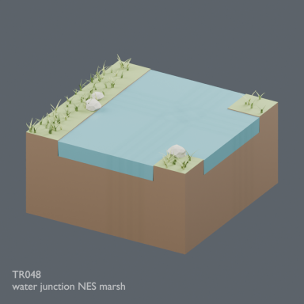](../../previews/terrain-tr027-050/renders/TR048.png)

[Full-size image](../../previews/terrain-tr027-050/renders/TR048.png)

Use / purpose: Unknown; see source catalogue. English use description needs review.

Record type: model. Formats: Unknown; inspect ZIP.

Reported dimensions (metres; XYZ when derived from measured bounds, legacy axis order not reverified): Unknown. Triangles: Unknown.

Origin: Unknown / not independently confirmed. Orientation: Unknown / not independently confirmed.

[Download ZIP](https://github.com/k3peta/tales-on-a-table/releases/download/v2026.10.21-terrain-v2/TR048_CC0.zip) · [License scope](../../LICENSE.md)

**CC0-1.0** — See original ZIP license and repository license scope. Models and embedded materials only; previews excluded.

Source details: [Catalogue 1](../../catalog/terrain_v2.md)

## TR049

**snow fresh flat**

snow fresh flat

[Full-size image](../../previews/terrain-tr027-050/renders/TR049.png)

Use / purpose: Unknown; see source catalogue. English use description needs review.

Record type: model. Formats: Unknown; inspect ZIP.

Reported dimensions (metres; XYZ when derived from measured bounds, legacy axis order not reverified): Unknown. Triangles: Unknown.

Origin: Unknown / not independently confirmed. Orientation: Unknown / not independently confirmed.

[Download ZIP](https://github.com/k3peta/tales-on-a-table/releases/download/v2026.10.21-terrain-v2/TR049_CC0.zip) · [License scope](../../LICENSE.md)

**CC0-1.0** — See original ZIP license and repository license scope. Models and embedded materials only; previews excluded.

Source details: [Catalogue 1](../../catalog/terrain_v2.md)

## TR050

**snow wind drift**

snow wind drift

[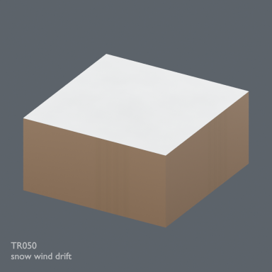](../../previews/terrain-tr027-050/renders/TR050.png)

[Full-size image](../../previews/terrain-tr027-050/renders/TR050.png)

Use / purpose: Unknown; see source catalogue. English use description needs review.

Record type: model. Formats: Unknown; inspect ZIP.

Reported dimensions (metres; XYZ when derived from measured bounds, legacy axis order not reverified): Unknown. Triangles: Unknown.

Origin: Unknown / not independently confirmed. Orientation: Unknown / not independently confirmed.

[Download ZIP](https://github.com/k3peta/tales-on-a-table/releases/download/v2026.10.21-terrain-v2/TR050_CC0.zip) · [License scope](../../LICENSE.md)

**CC0-1.0** — See original ZIP license and repository license scope. Models and embedded materials only; previews excluded.

Source details: [Catalogue 1](../../catalog/terrain_v2.md)

## TR051

**snow rock exposed**

snow rock exposed

[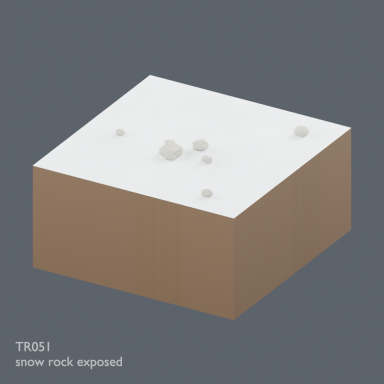](../../previews/terrain-tr051-ud24/renders/TR051.png)

[Full-size image](../../previews/terrain-tr051-ud24/renders/TR051.png)

Use / purpose: Unknown; see source catalogue. English use description needs review.

Record type: model. Formats: Unknown; inspect ZIP.

Reported dimensions (metres; XYZ when derived from measured bounds, legacy axis order not reverified): Unknown. Triangles: Unknown.

Origin: Unknown / not independently confirmed. Orientation: Unknown / not independently confirmed.

[Download ZIP](https://github.com/k3peta/tales-on-a-table/releases/download/v2026.10.21-terrain-v2/TR051_CC0.zip) · [License scope](../../LICENSE.md)

**CC0-1.0** — See original ZIP license and repository license scope. Models and embedded materials only; previews excluded.

Source details: [Catalogue 1](../../catalog/terrain_v2.md)

## TR052

**snow grass exposed**

snow grass exposed

[Full-size image](../../previews/terrain-tr051-ud24/renders/TR052.png)

Use / purpose: Unknown; see source catalogue. English use description needs review.

Record type: model. Formats: Unknown; inspect ZIP.

Reported dimensions (metres; XYZ when derived from measured bounds, legacy axis order not reverified): Unknown. Triangles: Unknown.

Origin: Unknown / not independently confirmed. Orientation: Unknown / not independently confirmed.

[Download ZIP](https://github.com/k3peta/tales-on-a-table/releases/download/v2026.10.21-terrain-v2/TR052_CC0.zip) · [License scope](../../LICENSE.md)

**CC0-1.0** — See original ZIP license and repository license scope. Models and embedded materials only; previews excluded.

Source details: [Catalogue 1](../../catalog/terrain_v2.md)

## TR053

**snow ice patch**

snow ice patch

[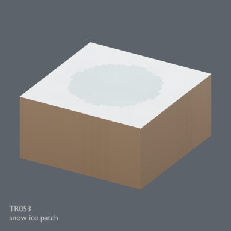](../../previews/terrain-tr051-ud24/renders/TR053.png)

[Full-size image](../../previews/terrain-tr051-ud24/renders/TR053.png)

Use / purpose: Unknown; see source catalogue. English use description needs review.

Record type: model. Formats: Unknown; inspect ZIP.

Reported dimensions (metres; XYZ when derived from measured bounds, legacy axis order not reverified): Unknown. Triangles: Unknown.

Origin: Unknown / not independently confirmed. Orientation: Unknown / not independently confirmed.

[Download ZIP](https://github.com/k3peta/tales-on-a-table/releases/download/v2026.10.21-terrain-v2/TR053_CC0.zip) · [License scope](../../LICENSE.md)

**CC0-1.0** — See original ZIP license and repository license scope. Models and embedded materials only; previews excluded.

Source details: [Catalogue 1](../../catalog/terrain_v2.md)

## TR054

**snow forest floor**

snow forest floor

[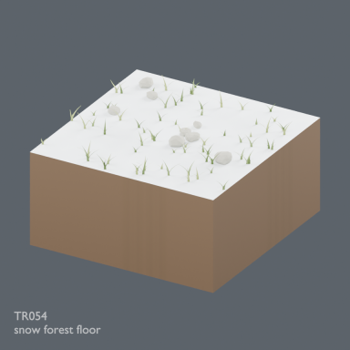](../../previews/terrain-tr051-ud24/renders/TR054.png)

[Full-size image](../../previews/terrain-tr051-ud24/renders/TR054.png)

Use / purpose: Unknown; see source catalogue. English use description needs review.

Record type: model. Formats: Unknown; inspect ZIP.

Reported dimensions (metres; XYZ when derived from measured bounds, legacy axis order not reverified): Unknown. Triangles: Unknown.

Origin: Unknown / not independently confirmed. Orientation: Unknown / not independently confirmed.

[Download ZIP](https://github.com/k3peta/tales-on-a-table/releases/download/v2026.10.21-terrain-v2/TR054_CC0.zip) · [License scope](../../LICENSE.md)

**CC0-1.0** — See original ZIP license and repository license scope. Models and embedded materials only; previews excluded.

Source details: [Catalogue 1](../../catalog/terrain_v2.md)

## TR055

**snow sand transition**

snow sand transition

[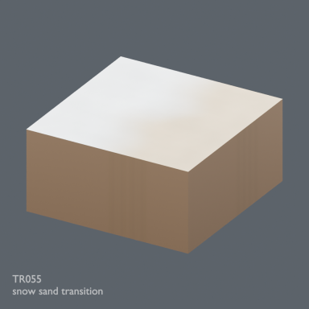](../../previews/terrain-tr051-ud24/renders/TR055.png)

[Full-size image](../../previews/terrain-tr051-ud24/renders/TR055.png)

Use / purpose: Unknown; see source catalogue. English use description needs review.

Record type: model. Formats: Unknown; inspect ZIP.

Reported dimensions (metres; XYZ when derived from measured bounds, legacy axis order not reverified): Unknown. Triangles: Unknown.

Origin: Unknown / not independently confirmed. Orientation: Unknown / not independently confirmed.

[Download ZIP](https://github.com/k3peta/tales-on-a-table/releases/download/v2026.10.21-terrain-v2/TR055_CC0.zip) · [License scope](../../LICENSE.md)

**CC0-1.0** — See original ZIP license and repository license scope. Models and embedded materials only; previews excluded.

Source details: [Catalogue 1](../../catalog/terrain_v2.md)

## TR056

**snow compacted tracks**

snow compacted tracks

[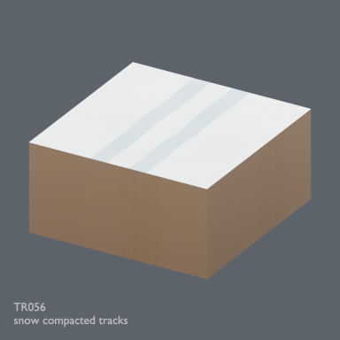](../../previews/terrain-tr051-ud24/renders/TR056.png)

[Full-size image](../../previews/terrain-tr051-ud24/renders/TR056.png)

Use / purpose: Unknown; see source catalogue. English use description needs review.

Record type: model. Formats: Unknown; inspect ZIP.

Reported dimensions (metres; XYZ when derived from measured bounds, legacy axis order not reverified): Unknown. Triangles: Unknown.

Origin: Unknown / not independently confirmed. Orientation: Unknown / not independently confirmed.

[Download ZIP](https://github.com/k3peta/tales-on-a-table/releases/download/v2026.10.21-terrain-v2/TR056_CC0.zip) · [License scope](../../LICENSE.md)

**CC0-1.0** — See original ZIP license and repository license scope. Models and embedded materials only; previews excluded.

Source details: [Catalogue 1](../../catalog/terrain_v2.md)

## TR057

**grass forest transition outer corner**

grass forest transition outer corner

[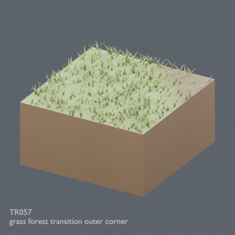](../../previews/terrain-tr051-ud24/renders/TR057.png)

[Full-size image](../../previews/terrain-tr051-ud24/renders/TR057.png)

Use / purpose: Unknown; see source catalogue. English use description needs review.

Record type: model. Formats: Unknown; inspect ZIP.

Reported dimensions (metres; XYZ when derived from measured bounds, legacy axis order not reverified): Unknown. Triangles: Unknown.

Origin: Unknown / not independently confirmed. Orientation: Unknown / not independently confirmed.

[Download ZIP](https://github.com/k3peta/tales-on-a-table/releases/download/v2026.10.21-terrain-v2/TR057_CC0.zip) · [License scope](../../LICENSE.md)

**CC0-1.0** — See original ZIP license and repository license scope. Models and embedded materials only; previews excluded.

Source details: [Catalogue 1](../../catalog/terrain_v2.md)

## TR058

**grass forest transition inner corner**

grass forest transition inner corner

[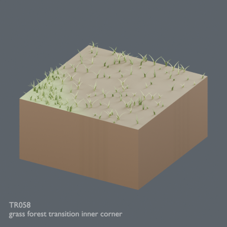](../../previews/terrain-tr051-ud24/renders/TR058.png)

[Full-size image](../../previews/terrain-tr051-ud24/renders/TR058.png)

Use / purpose: Unknown; see source catalogue. English use description needs review.

Record type: model. Formats: Unknown; inspect ZIP.

Reported dimensions (metres; XYZ when derived from measured bounds, legacy axis order not reverified): Unknown. Triangles: Unknown.

Origin: Unknown / not independently confirmed. Orientation: Unknown / not independently confirmed.

[Download ZIP](https://github.com/k3peta/tales-on-a-table/releases/download/v2026.10.21-terrain-v2/TR058_CC0.zip) · [License scope](../../LICENSE.md)

**CC0-1.0** — See original ZIP license and repository license scope. Models and embedded materials only; previews excluded.

Source details: [Catalogue 1](../../catalog/terrain_v2.md)

## TR059

**grass rock transition outer corner**

grass rock transition outer corner

[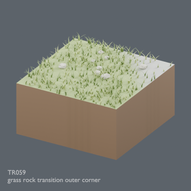](../../previews/terrain-tr051-ud24/renders/TR059.png)

[Full-size image](../../previews/terrain-tr051-ud24/renders/TR059.png)

Use / purpose: Unknown; see source catalogue. English use description needs review.

Record type: model. Formats: Unknown; inspect ZIP.

Reported dimensions (metres; XYZ when derived from measured bounds, legacy axis order not reverified): Unknown. Triangles: Unknown.

Origin: Unknown / not independently confirmed. Orientation: Unknown / not independently confirmed.

[Download ZIP](https://github.com/k3peta/tales-on-a-table/releases/download/v2026.10.21-terrain-v2/TR059_CC0.zip) · [License scope](../../LICENSE.md)

**CC0-1.0** — See original ZIP license and repository license scope. Models and embedded materials only; previews excluded.

Source details: [Catalogue 1](../../catalog/terrain_v2.md)
