# Base distribution records 769–792

[Browse index](README.md) · [Coverage and missing fields](COVERAGE.md)

Images are actual existing model renders for browsing, not covered by model CC0. A group record may show several reused models. Dimensions and triangle counts apply only to the original record when sourced; revisions can differ. Unknown means unverified, not zero. No blanket CC0 grant for scenes, images, code or articles.

## TR060

**grass rock transition inner corner**

grass rock transition inner corner

[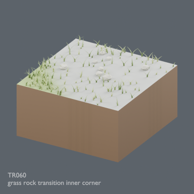](../../previews/terrain-tr051-ud24/renders/TR060.png)

[Full-size image](../../previews/terrain-tr051-ud24/renders/TR060.png)

Use / purpose: Unknown; see source catalogue. English use description needs review.

Record type: model. Formats: Unknown; inspect ZIP.

Reported dimensions (metres; XYZ when derived from measured bounds, legacy axis order not reverified): Unknown. Triangles: Unknown.

Origin: Unknown / not independently confirmed. Orientation: Unknown / not independently confirmed.

[Download ZIP](https://github.com/k3peta/tales-on-a-table/releases/download/v2026.10.21-terrain-v2/TR060_CC0.zip) · [License scope](../../LICENSE.md)

**CC0-1.0** — See original ZIP license and repository license scope. Models and embedded materials only; previews excluded.

Source details: [Catalogue 1](../../catalog/terrain_v2.md)

**Quality78 revisions (original pictured ZIP retained above):**

[TR060_HQ__repair ZIP](https://raw.githubusercontent.com/k3peta/tales-on-a-table/main/distributions/quality-tr058-067-v1/TR060_HQ__repair_CC0.zip) · [Details](../quality-tr058-067-v1.md).

[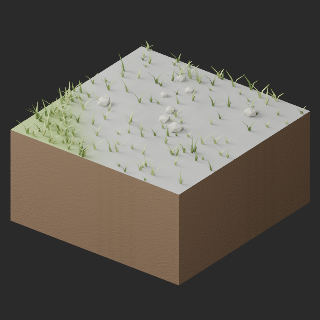](../../previews/quality-tr058-067-v1/TR060_LITE__repair_full.png)

[TR060_LITE__repair ZIP](https://raw.githubusercontent.com/k3peta/tales-on-a-table/main/distributions/quality-tr058-067-v1/TR060_LITE__repair_CC0.zip) · [Details](../quality-tr058-067-v1.md).

## TR061

**grass sand transition outer corner**

grass sand transition outer corner

[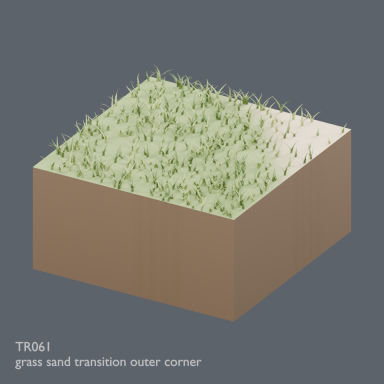](../../previews/terrain-tr051-ud24/renders/TR061.png)

[Full-size image](../../previews/terrain-tr051-ud24/renders/TR061.png)

Use / purpose: Unknown; see source catalogue. English use description needs review.

Record type: model. Formats: Unknown; inspect ZIP.

Reported dimensions (metres; XYZ when derived from measured bounds, legacy axis order not reverified): Unknown. Triangles: Unknown.

Origin: Unknown / not independently confirmed. Orientation: Unknown / not independently confirmed.

[Download ZIP](https://github.com/k3peta/tales-on-a-table/releases/download/v2026.10.21-terrain-v2/TR061_CC0.zip) · [License scope](../../LICENSE.md)

**CC0-1.0** — See original ZIP license and repository license scope. Models and embedded materials only; previews excluded.

Source details: [Catalogue 1](../../catalog/terrain_v2.md)

**Quality78 revisions (original pictured ZIP retained above):**

[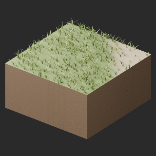](../../previews/quality-tr058-067-v1/TR061_HQ__repair_full.png)

[TR061_HQ__repair ZIP](https://raw.githubusercontent.com/k3peta/tales-on-a-table/main/distributions/quality-tr058-067-v1/TR061_HQ__repair_CC0.zip) · [Details](../quality-tr058-067-v1.md).

[TR061_LITE__repair ZIP](https://raw.githubusercontent.com/k3peta/tales-on-a-table/main/distributions/quality-tr058-067-v1/TR061_LITE__repair_CC0.zip) · [Details](../quality-tr058-067-v1.md).

## TR062

**grass sand transition inner corner**

grass sand transition inner corner

[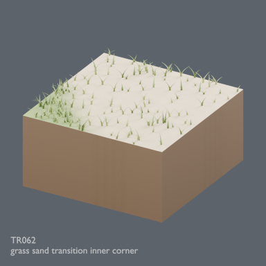](../../previews/terrain-tr051-ud24/renders/TR062.png)

[Full-size image](../../previews/terrain-tr051-ud24/renders/TR062.png)

Use / purpose: Unknown; see source catalogue. English use description needs review.

Record type: model. Formats: Unknown; inspect ZIP.

Reported dimensions (metres; XYZ when derived from measured bounds, legacy axis order not reverified): Unknown. Triangles: Unknown.

Origin: Unknown / not independently confirmed. Orientation: Unknown / not independently confirmed.

[Download ZIP](https://github.com/k3peta/tales-on-a-table/releases/download/v2026.10.21-terrain-v2/TR062_CC0.zip) · [License scope](../../LICENSE.md)

**CC0-1.0** — See original ZIP license and repository license scope. Models and embedded materials only; previews excluded.

Source details: [Catalogue 1](../../catalog/terrain_v2.md)

**Quality78 revisions (original pictured ZIP retained above):**

[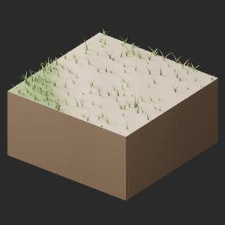](../../previews/quality-tr058-067-v1/TR062_HQ__repair_full.png)

[TR062_HQ__repair ZIP](https://raw.githubusercontent.com/k3peta/tales-on-a-table/main/distributions/quality-tr058-067-v1/TR062_HQ__repair_CC0.zip) · [Details](../quality-tr058-067-v1.md).

[TR062_LITE__repair ZIP](https://raw.githubusercontent.com/k3peta/tales-on-a-table/main/distributions/quality-tr058-067-v1/TR062_LITE__repair_CC0.zip) · [Details](../quality-tr058-067-v1.md).

## TR063

**rock sand transition outer corner**

rock sand transition outer corner

[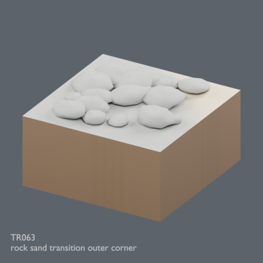](../../previews/terrain-tr051-ud24/renders/TR063.png)

[Full-size image](../../previews/terrain-tr051-ud24/renders/TR063.png)

Use / purpose: Unknown; see source catalogue. English use description needs review.

Record type: model. Formats: Unknown; inspect ZIP.

Reported dimensions (metres; XYZ when derived from measured bounds, legacy axis order not reverified): Unknown. Triangles: Unknown.

Origin: Unknown / not independently confirmed. Orientation: Unknown / not independently confirmed.

[Download ZIP](https://github.com/k3peta/tales-on-a-table/releases/download/v2026.10.21-terrain-v2/TR063_CC0.zip) · [License scope](../../LICENSE.md)

**CC0-1.0** — See original ZIP license and repository license scope. Models and embedded materials only; previews excluded.

Source details: [Catalogue 1](../../catalog/terrain_v2.md)

**Quality78 revisions (original pictured ZIP retained above):**

[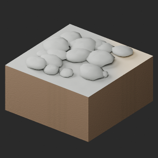](../../previews/quality-tr058-067-v1/TR063_HQ__repair_full.png)

[TR063_HQ__repair ZIP](https://raw.githubusercontent.com/k3peta/tales-on-a-table/main/distributions/quality-tr058-067-v1/TR063_HQ__repair_CC0.zip) · [Details](../quality-tr058-067-v1.md).

[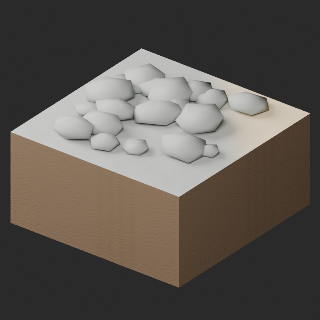](../../previews/quality-tr058-067-v1/TR063_LITE__repair_full.png)

[TR063_LITE__repair ZIP](https://raw.githubusercontent.com/k3peta/tales-on-a-table/main/distributions/quality-tr058-067-v1/TR063_LITE__repair_CC0.zip) · [Details](../quality-tr058-067-v1.md).

## TR064

**rock sand transition inner corner**

rock sand transition inner corner

[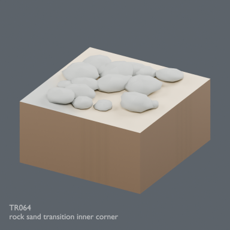](../../previews/terrain-tr051-ud24/renders/TR064.png)

[Full-size image](../../previews/terrain-tr051-ud24/renders/TR064.png)

Use / purpose: Unknown; see source catalogue. English use description needs review.

Record type: model. Formats: Unknown; inspect ZIP.

Reported dimensions (metres; XYZ when derived from measured bounds, legacy axis order not reverified): Unknown. Triangles: Unknown.

Origin: Unknown / not independently confirmed. Orientation: Unknown / not independently confirmed.

[Download ZIP](https://github.com/k3peta/tales-on-a-table/releases/download/v2026.10.21-terrain-v2/TR064_CC0.zip) · [License scope](../../LICENSE.md)

**CC0-1.0** — See original ZIP license and repository license scope. Models and embedded materials only; previews excluded.

Source details: [Catalogue 1](../../catalog/terrain_v2.md)

**Quality78 revisions (original pictured ZIP retained above):**

[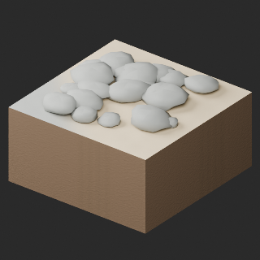](../../previews/quality-tr058-067-v1/TR064_HQ__repair_full.png)

[TR064_HQ__repair ZIP](https://raw.githubusercontent.com/k3peta/tales-on-a-table/main/distributions/quality-tr058-067-v1/TR064_HQ__repair_CC0.zip) · [Details](../quality-tr058-067-v1.md).

[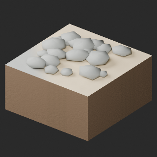](../../previews/quality-tr058-067-v1/TR064_LITE__repair_full.png)

[TR064_LITE__repair ZIP](https://raw.githubusercontent.com/k3peta/tales-on-a-table/main/distributions/quality-tr058-067-v1/TR064_LITE__repair_CC0.zip) · [Details](../quality-tr058-067-v1.md).

## TR065

**rock snow transition outer corner**

rock snow transition outer corner

[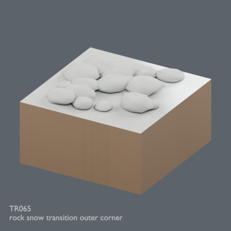](../../previews/terrain-tr051-ud24/renders/TR065.png)

[Full-size image](../../previews/terrain-tr051-ud24/renders/TR065.png)

Use / purpose: Unknown; see source catalogue. English use description needs review.

Record type: model. Formats: Unknown; inspect ZIP.

Reported dimensions (metres; XYZ when derived from measured bounds, legacy axis order not reverified): Unknown. Triangles: Unknown.

Origin: Unknown / not independently confirmed. Orientation: Unknown / not independently confirmed.

[Download ZIP](https://github.com/k3peta/tales-on-a-table/releases/download/v2026.10.21-terrain-v2/TR065_CC0.zip) · [License scope](../../LICENSE.md)

**CC0-1.0** — See original ZIP license and repository license scope. Models and embedded materials only; previews excluded.

Source details: [Catalogue 1](../../catalog/terrain_v2.md)

**Quality78 revisions (original pictured ZIP retained above):**

[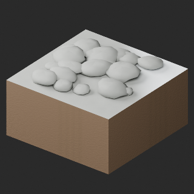](../../previews/quality-tr058-067-v1/TR065_HQ__repair_full.png)

[TR065_HQ__repair ZIP](https://raw.githubusercontent.com/k3peta/tales-on-a-table/main/distributions/quality-tr058-067-v1/TR065_HQ__repair_CC0.zip) · [Details](../quality-tr058-067-v1.md).

[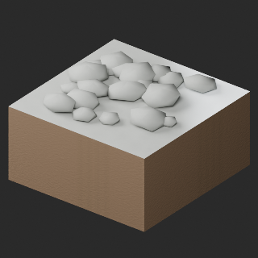](../../previews/quality-tr058-067-v1/TR065_LITE__repair_full.png)

[TR065_LITE__repair ZIP](https://raw.githubusercontent.com/k3peta/tales-on-a-table/main/distributions/quality-tr058-067-v1/TR065_LITE__repair_CC0.zip) · [Details](../quality-tr058-067-v1.md).

## TR066

**rock snow transition inner corner**

rock snow transition inner corner

[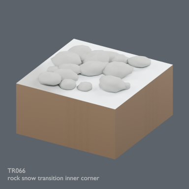](../../previews/terrain-tr051-ud24/renders/TR066.png)

[Full-size image](../../previews/terrain-tr051-ud24/renders/TR066.png)

Use / purpose: Unknown; see source catalogue. English use description needs review.

Record type: model. Formats: Unknown; inspect ZIP.

Reported dimensions (metres; XYZ when derived from measured bounds, legacy axis order not reverified): Unknown. Triangles: Unknown.

Origin: Unknown / not independently confirmed. Orientation: Unknown / not independently confirmed.

[Download ZIP](https://github.com/k3peta/tales-on-a-table/releases/download/v2026.10.21-terrain-v2/TR066_CC0.zip) · [License scope](../../LICENSE.md)

**CC0-1.0** — See original ZIP license and repository license scope. Models and embedded materials only; previews excluded.

Source details: [Catalogue 1](../../catalog/terrain_v2.md)

**Quality78 revisions (original pictured ZIP retained above):**

[TR066_HQ__repair ZIP](https://raw.githubusercontent.com/k3peta/tales-on-a-table/main/distributions/quality-tr058-067-v1/TR066_HQ__repair_CC0.zip) · [Details](../quality-tr058-067-v1.md).

[TR066_LITE__repair ZIP](https://raw.githubusercontent.com/k3peta/tales-on-a-table/main/distributions/quality-tr058-067-v1/TR066_LITE__repair_CC0.zip) · [Details](../quality-tr058-067-v1.md).

## TR067

**sand mud transition outer corner**

sand mud transition outer corner

[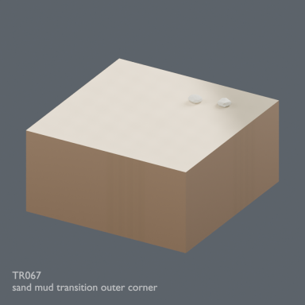](../../previews/terrain-tr051-ud24/renders/TR067.png)

[Full-size image](../../previews/terrain-tr051-ud24/renders/TR067.png)

Use / purpose: Unknown; see source catalogue. English use description needs review.

Record type: model. Formats: Unknown; inspect ZIP.

Reported dimensions (metres; XYZ when derived from measured bounds, legacy axis order not reverified): Unknown. Triangles: Unknown.

Origin: Unknown / not independently confirmed. Orientation: Unknown / not independently confirmed.

[Download ZIP](https://github.com/k3peta/tales-on-a-table/releases/download/v2026.10.21-terrain-v2/TR067_CC0.zip) · [License scope](../../LICENSE.md)

**CC0-1.0** — See original ZIP license and repository license scope. Models and embedded materials only; previews excluded.

Source details: [Catalogue 1](../../catalog/terrain_v2.md)

**Quality78 revisions (original pictured ZIP retained above):**

[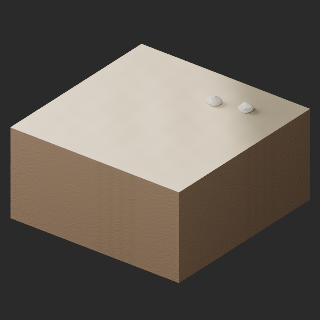](../../previews/quality-tr058-067-v1/TR067_HQ__repair_full.png)

[TR067_HQ__repair ZIP](https://raw.githubusercontent.com/k3peta/tales-on-a-table/main/distributions/quality-tr058-067-v1/TR067_HQ__repair_CC0.zip) · [Details](../quality-tr058-067-v1.md).

[TR067_LITE__repair ZIP](https://raw.githubusercontent.com/k3peta/tales-on-a-table/main/distributions/quality-tr058-067-v1/TR067_LITE__repair_CC0.zip) · [Details](../quality-tr058-067-v1.md).

## TR068

**sand mud transition inner corner**

sand mud transition inner corner

[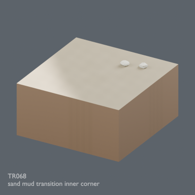](../../previews/terrain-tr051-ud24/renders/TR068.png)

[Full-size image](../../previews/terrain-tr051-ud24/renders/TR068.png)

Use / purpose: Unknown; see source catalogue. English use description needs review.

Record type: model. Formats: Unknown; inspect ZIP.

Reported dimensions (metres; XYZ when derived from measured bounds, legacy axis order not reverified): Unknown. Triangles: Unknown.

Origin: Unknown / not independently confirmed. Orientation: Unknown / not independently confirmed.

[Download ZIP](https://github.com/k3peta/tales-on-a-table/releases/download/v2026.10.21-terrain-v2/TR068_CC0.zip) · [License scope](../../LICENSE.md)

**CC0-1.0** — See original ZIP license and repository license scope. Models and embedded materials only; previews excluded.

Source details: [Catalogue 1](../../catalog/terrain_v2.md)

**Quality79 revisions (original pictured ZIP retained above):**

[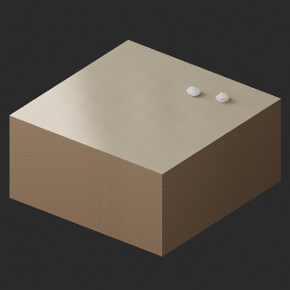](../../previews/quality-tr068-tg007-v1/TR068_HQ__repair_full.png)

[TR068_HQ__repair ZIP](https://raw.githubusercontent.com/k3peta/tales-on-a-table/main/distributions/quality-tr068-tg007-v1/TR068_HQ__repair_CC0.zip) · [Details](../quality-tr068-tg007-v1.md).

[TR068_LITE__repair ZIP](https://raw.githubusercontent.com/k3peta/tales-on-a-table/main/distributions/quality-tr068-tg007-v1/TR068_LITE__repair_CC0.zip) · [Details](../quality-tr068-tg007-v1.md).

## TR069

**snow sand transition outer corner**

snow sand transition outer corner

[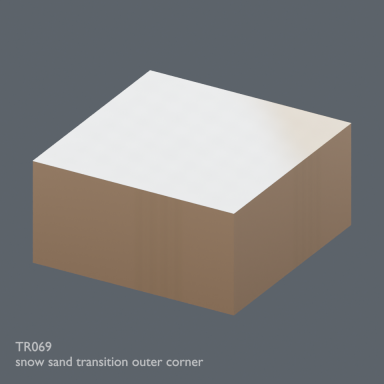](../../previews/terrain-tr051-ud24/renders/TR069.png)

[Full-size image](../../previews/terrain-tr051-ud24/renders/TR069.png)

Use / purpose: Unknown; see source catalogue. English use description needs review.

Record type: model. Formats: Unknown; inspect ZIP.

Reported dimensions (metres; XYZ when derived from measured bounds, legacy axis order not reverified): Unknown. Triangles: Unknown.

Origin: Unknown / not independently confirmed. Orientation: Unknown / not independently confirmed.

[Download ZIP](https://github.com/k3peta/tales-on-a-table/releases/download/v2026.10.21-terrain-v2/TR069_CC0.zip) · [License scope](../../LICENSE.md)

**CC0-1.0** — See original ZIP license and repository license scope. Models and embedded materials only; previews excluded.

Source details: [Catalogue 1](../../catalog/terrain_v2.md)

**Quality79 revisions (original pictured ZIP retained above):**

[TR069_HQ__repair ZIP](https://raw.githubusercontent.com/k3peta/tales-on-a-table/main/distributions/quality-tr068-tg007-v1/TR069_HQ__repair_CC0.zip) · [Details](../quality-tr068-tg007-v1.md).

[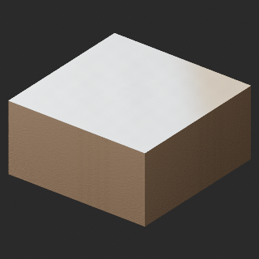](../../previews/quality-tr068-tg007-v1/TR069_LITE__repair_full.png)

[TR069_LITE__repair ZIP](https://raw.githubusercontent.com/k3peta/tales-on-a-table/main/distributions/quality-tr068-tg007-v1/TR069_LITE__repair_CC0.zip) · [Details](../quality-tr068-tg007-v1.md).

## TR070

**snow sand transition inner corner**

snow sand transition inner corner

[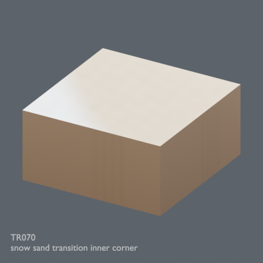](../../previews/terrain-tr051-ud24/renders/TR070.png)

[Full-size image](../../previews/terrain-tr051-ud24/renders/TR070.png)

Use / purpose: Unknown; see source catalogue. English use description needs review.

Record type: model. Formats: Unknown; inspect ZIP.

Reported dimensions (metres; XYZ when derived from measured bounds, legacy axis order not reverified): Unknown. Triangles: Unknown.

Origin: Unknown / not independently confirmed. Orientation: Unknown / not independently confirmed.

[Download ZIP](https://github.com/k3peta/tales-on-a-table/releases/download/v2026.10.21-terrain-v2/TR070_CC0.zip) · [License scope](../../LICENSE.md)

**CC0-1.0** — See original ZIP license and repository license scope. Models and embedded materials only; previews excluded.

Source details: [Catalogue 1](../../catalog/terrain_v2.md)

**Quality79 revisions (original pictured ZIP retained above):**

[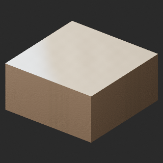](../../previews/quality-tr068-tg007-v1/TR070_HQ__repair_full.png)

[TR070_HQ__repair ZIP](https://raw.githubusercontent.com/k3peta/tales-on-a-table/main/distributions/quality-tr068-tg007-v1/TR070_HQ__repair_CC0.zip) · [Details](../quality-tr068-tg007-v1.md).

[TR070_LITE__repair ZIP](https://raw.githubusercontent.com/k3peta/tales-on-a-table/main/distributions/quality-tr068-tg007-v1/TR070_LITE__repair_CC0.zip) · [Details](../quality-tr068-tg007-v1.md).

## TG001

**ramp half**

ramp half

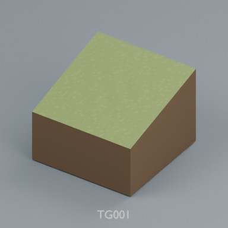

Use / purpose: 2m modular terrain distribution record. Includes BLEND and GLB; not a claim of independent design count.

Record type: terrain_distribution_record. Formats: BLEND/GLB.

Reported dimensions (metres; XYZ when derived from measured bounds, legacy axis order not reverified): Unknown. Triangles: Unknown.

Origin: Unknown / not independently confirmed. Orientation: Unknown / not independently confirmed.

[Download ZIP](https://raw.githubusercontent.com/k3peta/tales-on-a-table/main/distributions/terrain-connectivity-91/zips/TG001_CC0.zip) · [License scope](../../LICENSE.md)

**CC0-1.0** — model geometry and included display materials only. Models and embedded materials only; previews excluded.

Source details: [Catalogue 1](../../catalog/terrain_connectivity_v1.md)

**Quality79 revisions (original pictured ZIP retained above):**

[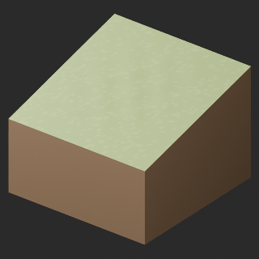](../../previews/quality-tr068-tg007-v1/TG001__repair_full.png)

[TG001__repair ZIP](https://raw.githubusercontent.com/k3peta/tales-on-a-table/main/distributions/quality-tr068-tg007-v1/TG001__repair_CC0.zip) · [Details](../quality-tr068-tg007-v1.md).

## TG002

**ramp full**

ramp full

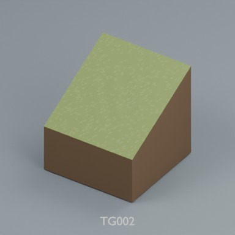

Use / purpose: 2m modular terrain distribution record. Includes BLEND and GLB; not a claim of independent design count.

Record type: terrain_distribution_record. Formats: BLEND/GLB.

Reported dimensions (metres; XYZ when derived from measured bounds, legacy axis order not reverified): Unknown. Triangles: Unknown.

Origin: Unknown / not independently confirmed. Orientation: Unknown / not independently confirmed.

[Download ZIP](https://raw.githubusercontent.com/k3peta/tales-on-a-table/main/distributions/terrain-connectivity-91/zips/TG002_CC0.zip) · [License scope](../../LICENSE.md)

**CC0-1.0** — model geometry and included display materials only. Models and embedded materials only; previews excluded.

Source details: [Catalogue 1](../../catalog/terrain_connectivity_v1.md)

**Quality79 revisions (original pictured ZIP retained above):**

[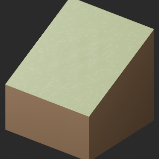](../../previews/quality-tr068-tg007-v1/TG002__repair_full.png)

[TG002__repair ZIP](https://raw.githubusercontent.com/k3peta/tales-on-a-table/main/distributions/quality-tr068-tg007-v1/TG002__repair_CC0.zip) · [Details](../quality-tr068-tg007-v1.md).

## TG003

**ramp inner**

ramp inner

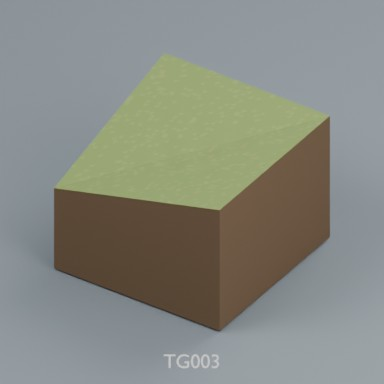

Use / purpose: 2m modular terrain distribution record. Includes BLEND and GLB; not a claim of independent design count.

Record type: terrain_distribution_record. Formats: BLEND/GLB.

Reported dimensions (metres; XYZ when derived from measured bounds, legacy axis order not reverified): Unknown. Triangles: Unknown.

Origin: Unknown / not independently confirmed. Orientation: Unknown / not independently confirmed.

[Download ZIP](https://raw.githubusercontent.com/k3peta/tales-on-a-table/main/distributions/terrain-connectivity-91/zips/TG003_CC0.zip) · [License scope](../../LICENSE.md)

**CC0-1.0** — model geometry and included display materials only. Models and embedded materials only; previews excluded.

Source details: [Catalogue 1](../../catalog/terrain_connectivity_v1.md)

**Quality79 revisions (original pictured ZIP retained above):**

[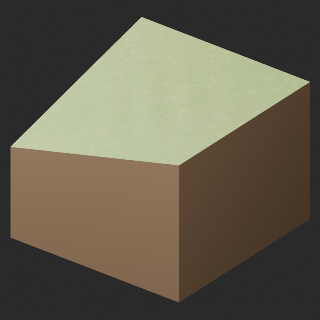](../../previews/quality-tr068-tg007-v1/TG003__repair_full.png)

[TG003__repair ZIP](https://raw.githubusercontent.com/k3peta/tales-on-a-table/main/distributions/quality-tr068-tg007-v1/TG003__repair_CC0.zip) · [Details](../quality-tr068-tg007-v1.md).

## TG004

**ramp outer**

ramp outer

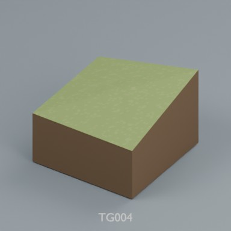

Use / purpose: 2m modular terrain distribution record. Includes BLEND and GLB; not a claim of independent design count.

Record type: terrain_distribution_record. Formats: BLEND/GLB.

Reported dimensions (metres; XYZ when derived from measured bounds, legacy axis order not reverified): Unknown. Triangles: Unknown.

Origin: Unknown / not independently confirmed. Orientation: Unknown / not independently confirmed.

[Download ZIP](https://raw.githubusercontent.com/k3peta/tales-on-a-table/main/distributions/terrain-connectivity-91/zips/TG004_CC0.zip) · [License scope](../../LICENSE.md)

**CC0-1.0** — model geometry and included display materials only. Models and embedded materials only; previews excluded.

Source details: [Catalogue 1](../../catalog/terrain_connectivity_v1.md)

**Quality79 revisions (original pictured ZIP retained above):**

[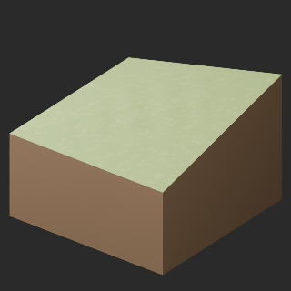](../../previews/quality-tr068-tg007-v1/TG004__repair_full.png)

[TG004__repair ZIP](https://raw.githubusercontent.com/k3peta/tales-on-a-table/main/distributions/quality-tr068-tg007-v1/TG004__repair_CC0.zip) · [Details](../quality-tr068-tg007-v1.md).

## TG005

**stairs half**

stairs half

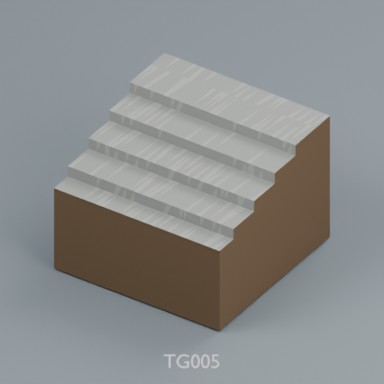

Use / purpose: 2m modular terrain distribution record. Includes BLEND and GLB; not a claim of independent design count.

Record type: terrain_distribution_record. Formats: BLEND/GLB.

Reported dimensions (metres; XYZ when derived from measured bounds, legacy axis order not reverified): Unknown. Triangles: Unknown.

Origin: Unknown / not independently confirmed. Orientation: Unknown / not independently confirmed.

[Download ZIP](https://raw.githubusercontent.com/k3peta/tales-on-a-table/main/distributions/terrain-connectivity-91/zips/TG005_CC0.zip) · [License scope](../../LICENSE.md)

**CC0-1.0** — model geometry and included display materials only. Models and embedded materials only; previews excluded.

Source details: [Catalogue 1](../../catalog/terrain_connectivity_v1.md)

**Quality79 revisions (original pictured ZIP retained above):**

[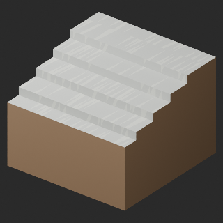](../../previews/quality-tr068-tg007-v1/TG005__repair_full.png)

[TG005__repair ZIP](https://raw.githubusercontent.com/k3peta/tales-on-a-table/main/distributions/quality-tr068-tg007-v1/TG005__repair_CC0.zip) · [Details](../quality-tr068-tg007-v1.md).

## TG006

**stairs full**

stairs full

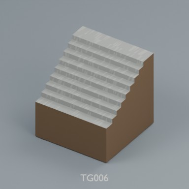

Use / purpose: 2m modular terrain distribution record. Includes BLEND and GLB; not a claim of independent design count.

Record type: terrain_distribution_record. Formats: BLEND/GLB.

Reported dimensions (metres; XYZ when derived from measured bounds, legacy axis order not reverified): Unknown. Triangles: Unknown.

Origin: Unknown / not independently confirmed. Orientation: Unknown / not independently confirmed.

[Download ZIP](https://raw.githubusercontent.com/k3peta/tales-on-a-table/main/distributions/terrain-connectivity-91/zips/TG006_CC0.zip) · [License scope](../../LICENSE.md)

**CC0-1.0** — model geometry and included display materials only. Models and embedded materials only; previews excluded.

Source details: [Catalogue 1](../../catalog/terrain_connectivity_v1.md)

**Quality79 revisions (original pictured ZIP retained above):**

[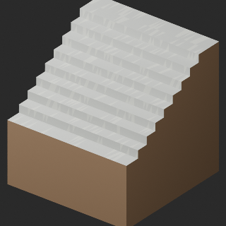](../../previews/quality-tr068-tg007-v1/TG006__repair_full.png)

[TG006__repair ZIP](https://raw.githubusercontent.com/k3peta/tales-on-a-table/main/distributions/quality-tr068-tg007-v1/TG006__repair_CC0.zip) · [Details](../quality-tr068-tg007-v1.md).

## TG007

**cliff straight**

cliff straight

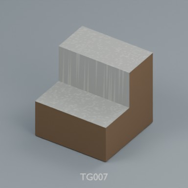

Use / purpose: 2m modular terrain distribution record. Includes BLEND and GLB; not a claim of independent design count.

Record type: terrain_distribution_record. Formats: BLEND/GLB.

Reported dimensions (metres; XYZ when derived from measured bounds, legacy axis order not reverified): Unknown. Triangles: Unknown.

Origin: Unknown / not independently confirmed. Orientation: Unknown / not independently confirmed.

[Download ZIP](https://raw.githubusercontent.com/k3peta/tales-on-a-table/main/distributions/terrain-connectivity-91/zips/TG007_CC0.zip) · [License scope](../../LICENSE.md)

**CC0-1.0** — model geometry and included display materials only. Models and embedded materials only; previews excluded.

Source details: [Catalogue 1](../../catalog/terrain_connectivity_v1.md)

**Quality79 revisions (original pictured ZIP retained above):**

[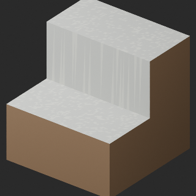](../../previews/quality-tr068-tg007-v1/TG007__repair_full.png)

[TG007__repair ZIP](https://raw.githubusercontent.com/k3peta/tales-on-a-table/main/distributions/quality-tr068-tg007-v1/TG007__repair_CC0.zip) · [Details](../quality-tr068-tg007-v1.md).

## TG008

**cliff outer**

cliff outer

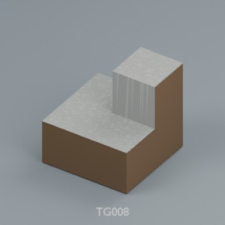

Use / purpose: 2m modular terrain distribution record. Includes BLEND and GLB; not a claim of independent design count.

Record type: terrain_distribution_record. Formats: BLEND/GLB.

Reported dimensions (metres; XYZ when derived from measured bounds, legacy axis order not reverified): Unknown. Triangles: Unknown.

Origin: Unknown / not independently confirmed. Orientation: Unknown / not independently confirmed.

[Download ZIP](https://raw.githubusercontent.com/k3peta/tales-on-a-table/main/distributions/terrain-connectivity-91/zips/TG008_CC0.zip) · [License scope](../../LICENSE.md)

**CC0-1.0** — model geometry and included display materials only. Models and embedded materials only; previews excluded.

Source details: [Catalogue 1](../../catalog/terrain_connectivity_v1.md)

## TG009

**cliff inner**

cliff inner

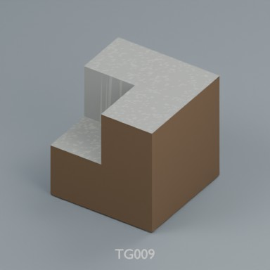

Use / purpose: 2m modular terrain distribution record. Includes BLEND and GLB; not a claim of independent design count.

Record type: terrain_distribution_record. Formats: BLEND/GLB.

Reported dimensions (metres; XYZ when derived from measured bounds, legacy axis order not reverified): Unknown. Triangles: Unknown.

Origin: Unknown / not independently confirmed. Orientation: Unknown / not independently confirmed.

[Download ZIP](https://raw.githubusercontent.com/k3peta/tales-on-a-table/main/distributions/terrain-connectivity-91/zips/TG009_CC0.zip) · [License scope](../../LICENSE.md)

**CC0-1.0** — model geometry and included display materials only. Models and embedded materials only; previews excluded.

Source details: [Catalogue 1](../../catalog/terrain_connectivity_v1.md)

## TG010

**cliff nose**

cliff nose

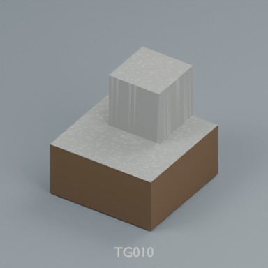

Use / purpose: 2m modular terrain distribution record. Includes BLEND and GLB; not a claim of independent design count.

Record type: terrain_distribution_record. Formats: BLEND/GLB.

Reported dimensions (metres; XYZ when derived from measured bounds, legacy axis order not reverified): Unknown. Triangles: Unknown.

Origin: Unknown / not independently confirmed. Orientation: Unknown / not independently confirmed.

[Download ZIP](https://raw.githubusercontent.com/k3peta/tales-on-a-table/main/distributions/terrain-connectivity-91/zips/TG010_CC0.zip) · [License scope](../../LICENSE.md)

**CC0-1.0** — model geometry and included display materials only. Models and embedded materials only; previews excluded.

Source details: [Catalogue 1](../../catalog/terrain_connectivity_v1.md)

## TG011

**overhang straight**

overhang straight

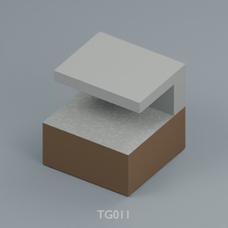

Use / purpose: 2m modular terrain distribution record. Includes BLEND and GLB; not a claim of independent design count.

Record type: terrain_distribution_record. Formats: BLEND/GLB.

Reported dimensions (metres; XYZ when derived from measured bounds, legacy axis order not reverified): Unknown. Triangles: Unknown.

Origin: Unknown / not independently confirmed. Orientation: Unknown / not independently confirmed.

[Download ZIP](https://raw.githubusercontent.com/k3peta/tales-on-a-table/main/distributions/terrain-connectivity-91/zips/TG011_CC0.zip) · [License scope](../../LICENSE.md)

**CC0-1.0** — model geometry and included display materials only. Models and embedded materials only; previews excluded.

Source details: [Catalogue 1](../../catalog/terrain_connectivity_v1.md)

## TG012

**overhang end**

overhang end

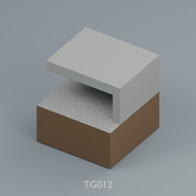

Use / purpose: 2m modular terrain distribution record. Includes BLEND and GLB; not a claim of independent design count.

Record type: terrain_distribution_record. Formats: BLEND/GLB.

Reported dimensions (metres; XYZ when derived from measured bounds, legacy axis order not reverified): Unknown. Triangles: Unknown.

Origin: Unknown / not independently confirmed. Orientation: Unknown / not independently confirmed.

[Download ZIP](https://raw.githubusercontent.com/k3peta/tales-on-a-table/main/distributions/terrain-connectivity-91/zips/TG012_CC0.zip) · [License scope](../../LICENSE.md)

**CC0-1.0** — model geometry and included display materials only. Models and embedded materials only; previews excluded.

Source details: [Catalogue 1](../../catalog/terrain_connectivity_v1.md)

## TG013

**overhang corner**

overhang corner

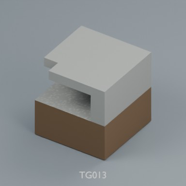

Use / purpose: 2m modular terrain distribution record. Includes BLEND and GLB; not a claim of independent design count.

Record type: terrain_distribution_record. Formats: BLEND/GLB.

Reported dimensions (metres; XYZ when derived from measured bounds, legacy axis order not reverified): Unknown. Triangles: Unknown.

Origin: Unknown / not independently confirmed. Orientation: Unknown / not independently confirmed.

[Download ZIP](https://raw.githubusercontent.com/k3peta/tales-on-a-table/main/distributions/terrain-connectivity-91/zips/TG013_CC0.zip) · [License scope](../../LICENSE.md)

**CC0-1.0** — model geometry and included display materials only. Models and embedded materials only; previews excluded.

Source details: [Catalogue 1](../../catalog/terrain_connectivity_v1.md)
