# Base distribution records 793–816

[Browse index](README.md) · [Coverage and missing fields](COVERAGE.md)

Images are actual existing model renders for browsing, not covered by model CC0. A group record may show several reused models. Dimensions and triangle counts apply only to the original record when sourced; revisions can differ. Unknown means unverified, not zero. No blanket CC0 grant for scenes, images, code or articles.

## TG014

**pit floor**

pit floor

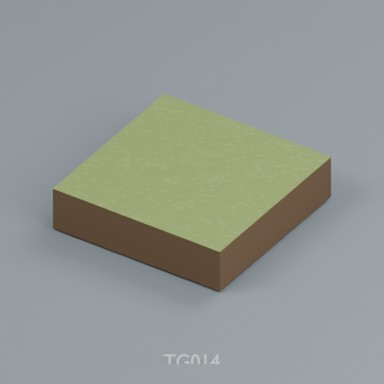

Use / purpose: 2m modular terrain distribution record. Includes BLEND and GLB; not a claim of independent design count.

Record type: terrain_distribution_record. Formats: BLEND/GLB.

Reported dimensions (metres; XYZ when derived from measured bounds, legacy axis order not reverified): Unknown. Triangles: Unknown.

Origin: Unknown / not independently confirmed. Orientation: Unknown / not independently confirmed.

[Download ZIP](https://raw.githubusercontent.com/k3peta/tales-on-a-table/main/distributions/terrain-connectivity-91/zips/TG014_CC0.zip) · [License scope](../../LICENSE.md)

**CC0-1.0** — model geometry and included display materials only. Models and embedded materials only; previews excluded.

Source details: [Catalogue 1](../../catalog/terrain_connectivity_v1.md)

## TG015

**pit rim**

pit rim

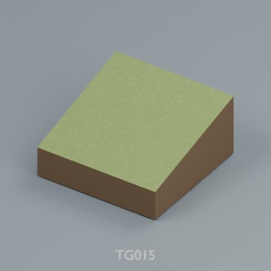

Use / purpose: 2m modular terrain distribution record. Includes BLEND and GLB; not a claim of independent design count.

Record type: terrain_distribution_record. Formats: BLEND/GLB.

Reported dimensions (metres; XYZ when derived from measured bounds, legacy axis order not reverified): Unknown. Triangles: Unknown.

Origin: Unknown / not independently confirmed. Orientation: Unknown / not independently confirmed.

[Download ZIP](https://raw.githubusercontent.com/k3peta/tales-on-a-table/main/distributions/terrain-connectivity-91/zips/TG015_CC0.zip) · [License scope](../../LICENSE.md)

**CC0-1.0** — model geometry and included display materials only. Models and embedded materials only; previews excluded.

Source details: [Catalogue 1](../../catalog/terrain_connectivity_v1.md)

**Quality80 revisions (original pictured ZIP retained above):**

[TG015__repair ZIP](https://raw.githubusercontent.com/k3peta/tales-on-a-table/main/distributions/quality-tg008-017-v1/TG015__repair_CC0.zip) · [Details](../quality-tg008-017-v1.md).

## TG016

**pit outer**

pit outer

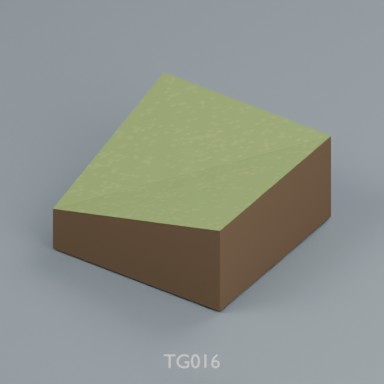

Use / purpose: 2m modular terrain distribution record. Includes BLEND and GLB; not a claim of independent design count.

Record type: terrain_distribution_record. Formats: BLEND/GLB.

Reported dimensions (metres; XYZ when derived from measured bounds, legacy axis order not reverified): Unknown. Triangles: Unknown.

Origin: Unknown / not independently confirmed. Orientation: Unknown / not independently confirmed.

[Download ZIP](https://raw.githubusercontent.com/k3peta/tales-on-a-table/main/distributions/terrain-connectivity-91/zips/TG016_CC0.zip) · [License scope](../../LICENSE.md)

**CC0-1.0** — model geometry and included display materials only. Models and embedded materials only; previews excluded.

Source details: [Catalogue 1](../../catalog/terrain_connectivity_v1.md)

**Quality80 revisions (original pictured ZIP retained above):**

[TG016__repair ZIP](https://raw.githubusercontent.com/k3peta/tales-on-a-table/main/distributions/quality-tg008-017-v1/TG016__repair_CC0.zip) · [Details](../quality-tg008-017-v1.md).

## TG017

**pit inner**

pit inner

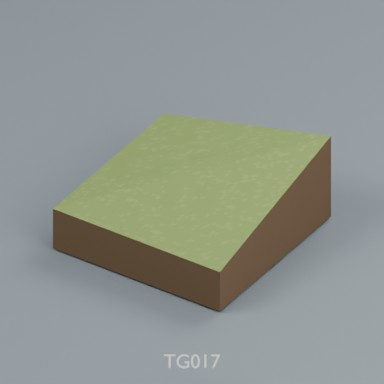

Use / purpose: 2m modular terrain distribution record. Includes BLEND and GLB; not a claim of independent design count.

Record type: terrain_distribution_record. Formats: BLEND/GLB.

Reported dimensions (metres; XYZ when derived from measured bounds, legacy axis order not reverified): Unknown. Triangles: Unknown.

Origin: Unknown / not independently confirmed. Orientation: Unknown / not independently confirmed.

[Download ZIP](https://raw.githubusercontent.com/k3peta/tales-on-a-table/main/distributions/terrain-connectivity-91/zips/TG017_CC0.zip) · [License scope](../../LICENSE.md)

**CC0-1.0** — model geometry and included display materials only. Models and embedded materials only; previews excluded.

Source details: [Catalogue 1](../../catalog/terrain_connectivity_v1.md)

**Quality80 revisions (original pictured ZIP retained above):**

[TG017__repair ZIP](https://raw.githubusercontent.com/k3peta/tales-on-a-table/main/distributions/quality-tg008-017-v1/TG017__repair_CC0.zip) · [Details](../quality-tg008-017-v1.md).

## TG018

**pit closed**

pit closed

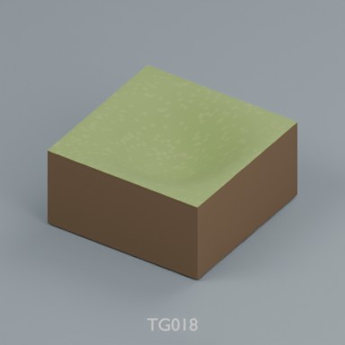

Use / purpose: 2m modular terrain distribution record. Includes BLEND and GLB; not a claim of independent design count.

Record type: terrain_distribution_record. Formats: BLEND/GLB.

Reported dimensions (metres; XYZ when derived from measured bounds, legacy axis order not reverified): Unknown. Triangles: Unknown.

Origin: Unknown / not independently confirmed. Orientation: Unknown / not independently confirmed.

[Download ZIP](https://raw.githubusercontent.com/k3peta/tales-on-a-table/main/distributions/terrain-connectivity-91/zips/TG018_CC0.zip) · [License scope](../../LICENSE.md)

**CC0-1.0** — model geometry and included display materials only. Models and embedded materials only; previews excluded.

Source details: [Catalogue 1](../../catalog/terrain_connectivity_v1.md)

## TG019

**water full**

water full

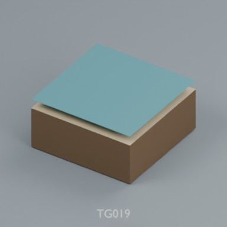

Use / purpose: 2m modular terrain distribution record. Includes BLEND and GLB; not a claim of independent design count.

Record type: terrain_distribution_record. Formats: BLEND/GLB.

Reported dimensions (metres; XYZ when derived from measured bounds, legacy axis order not reverified): Unknown. Triangles: Unknown.

Origin: Unknown / not independently confirmed. Orientation: Unknown / not independently confirmed.

[Download ZIP](https://raw.githubusercontent.com/k3peta/tales-on-a-table/main/distributions/terrain-connectivity-91/zips/TG019_CC0.zip) · [License scope](../../LICENSE.md)

**CC0-1.0** — model geometry and included display materials only. Models and embedded materials only; previews excluded.

Source details: [Catalogue 1](../../catalog/terrain_connectivity_v1.md)

## TG020

**shore**

shore

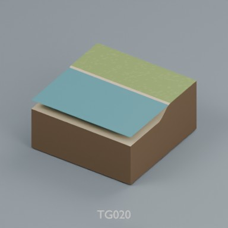

Use / purpose: 2m modular terrain distribution record. Includes BLEND and GLB; not a claim of independent design count.

Record type: terrain_distribution_record. Formats: BLEND/GLB.

Reported dimensions (metres; XYZ when derived from measured bounds, legacy axis order not reverified): Unknown. Triangles: Unknown.

Origin: Unknown / not independently confirmed. Orientation: Unknown / not independently confirmed.

[Download ZIP](https://raw.githubusercontent.com/k3peta/tales-on-a-table/main/distributions/terrain-connectivity-91/zips/TG020_CC0.zip) · [License scope](../../LICENSE.md)

**CC0-1.0** — model geometry and included display materials only. Models and embedded materials only; previews excluded.

Source details: [Catalogue 1](../../catalog/terrain_connectivity_v1.md)

## TG021

**shore outer**

shore outer

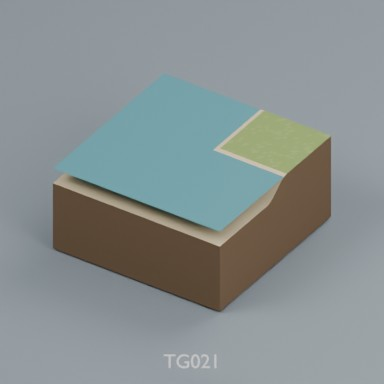

Use / purpose: 2m modular terrain distribution record. Includes BLEND and GLB; not a claim of independent design count.

Record type: terrain_distribution_record. Formats: BLEND/GLB.

Reported dimensions (metres; XYZ when derived from measured bounds, legacy axis order not reverified): Unknown. Triangles: Unknown.

Origin: Unknown / not independently confirmed. Orientation: Unknown / not independently confirmed.

[Download ZIP](https://raw.githubusercontent.com/k3peta/tales-on-a-table/main/distributions/terrain-connectivity-91/zips/TG021_CC0.zip) · [License scope](../../LICENSE.md)

**CC0-1.0** — model geometry and included display materials only. Models and embedded materials only; previews excluded.

Source details: [Catalogue 1](../../catalog/terrain_connectivity_v1.md)

## TG022

**shore inner**

shore inner

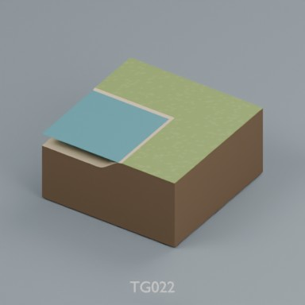

Use / purpose: 2m modular terrain distribution record. Includes BLEND and GLB; not a claim of independent design count.

Record type: terrain_distribution_record. Formats: BLEND/GLB.

Reported dimensions (metres; XYZ when derived from measured bounds, legacy axis order not reverified): Unknown. Triangles: Unknown.

Origin: Unknown / not independently confirmed. Orientation: Unknown / not independently confirmed.

[Download ZIP](https://raw.githubusercontent.com/k3peta/tales-on-a-table/main/distributions/terrain-connectivity-91/zips/TG022_CC0.zip) · [License scope](../../LICENSE.md)

**CC0-1.0** — model geometry and included display materials only. Models and embedded materials only; previews excluded.

Source details: [Catalogue 1](../../catalog/terrain_connectivity_v1.md)

## TG023

**estuary**

estuary

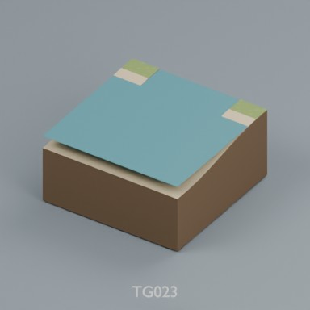

Use / purpose: 2m modular terrain distribution record. Includes BLEND and GLB; not a claim of independent design count.

Record type: terrain_distribution_record. Formats: BLEND/GLB.

Reported dimensions (metres; XYZ when derived from measured bounds, legacy axis order not reverified): Unknown. Triangles: Unknown.

Origin: Unknown / not independently confirmed. Orientation: Unknown / not independently confirmed.

[Download ZIP](https://raw.githubusercontent.com/k3peta/tales-on-a-table/main/distributions/terrain-connectivity-91/zips/TG023_CC0.zip) · [License scope](../../LICENSE.md)

**CC0-1.0** — model geometry and included display materials only. Models and embedded materials only; previews excluded.

Source details: [Catalogue 1](../../catalog/terrain_connectivity_v1.md)

## TG024

**beach**

beach

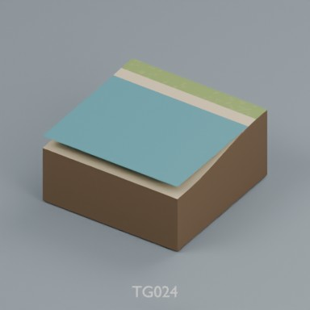

Use / purpose: 2m modular terrain distribution record. Includes BLEND and GLB; not a claim of independent design count.

Record type: terrain_distribution_record. Formats: BLEND/GLB.

Reported dimensions (metres; XYZ when derived from measured bounds, legacy axis order not reverified): Unknown. Triangles: Unknown.

Origin: Unknown / not independently confirmed. Orientation: Unknown / not independently confirmed.

[Download ZIP](https://raw.githubusercontent.com/k3peta/tales-on-a-table/main/distributions/terrain-connectivity-91/zips/TG024_CC0.zip) · [License scope](../../LICENSE.md)

**CC0-1.0** — model geometry and included display materials only. Models and embedded materials only; previews excluded.

Source details: [Catalogue 1](../../catalog/static_mudflat_v1.md) · [Catalogue 2](../../catalog/terrain_connectivity_v1.md)

## TG025

**beach outer**

beach outer

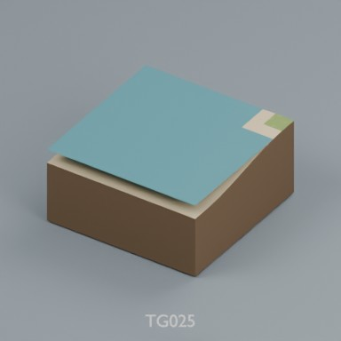

Use / purpose: 2m modular terrain distribution record. Includes BLEND and GLB; not a claim of independent design count.

Record type: terrain_distribution_record. Formats: BLEND/GLB.

Reported dimensions (metres; XYZ when derived from measured bounds, legacy axis order not reverified): Unknown. Triangles: Unknown.

Origin: Unknown / not independently confirmed. Orientation: Unknown / not independently confirmed.

[Download ZIP](https://raw.githubusercontent.com/k3peta/tales-on-a-table/main/distributions/terrain-connectivity-91/zips/TG025_CC0.zip) · [License scope](../../LICENSE.md)

**CC0-1.0** — model geometry and included display materials only. Models and embedded materials only; previews excluded.

Source details: [Catalogue 1](../../catalog/terrain_connectivity_v1.md)

## TG026

**beach inner**

beach inner

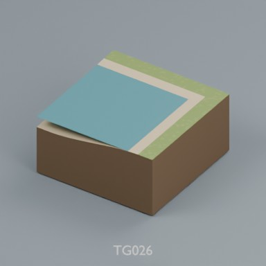

Use / purpose: 2m modular terrain distribution record. Includes BLEND and GLB; not a claim of independent design count.

Record type: terrain_distribution_record. Formats: BLEND/GLB.

Reported dimensions (metres; XYZ when derived from measured bounds, legacy axis order not reverified): Unknown. Triangles: Unknown.

Origin: Unknown / not independently confirmed. Orientation: Unknown / not independently confirmed.

[Download ZIP](https://raw.githubusercontent.com/k3peta/tales-on-a-table/main/distributions/terrain-connectivity-91/zips/TG026_CC0.zip) · [License scope](../../LICENSE.md)

**CC0-1.0** — model geometry and included display materials only. Models and embedded materials only; previews excluded.

Source details: [Catalogue 1](../../catalog/terrain_connectivity_v1.md)

## TG027

**tide pool**

tide pool

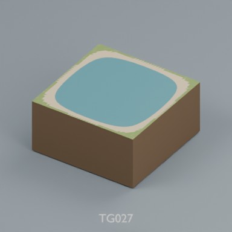

Use / purpose: 2m modular terrain distribution record. Includes BLEND and GLB; not a claim of independent design count.

Record type: terrain_distribution_record. Formats: BLEND/GLB.

Reported dimensions (metres; XYZ when derived from measured bounds, legacy axis order not reverified): Unknown. Triangles: Unknown.

Origin: Unknown / not independently confirmed. Orientation: Unknown / not independently confirmed.

[Download ZIP](https://raw.githubusercontent.com/k3peta/tales-on-a-table/main/distributions/terrain-connectivity-91/zips/TG027_CC0.zip) · [License scope](../../LICENSE.md)

**CC0-1.0** — model geometry and included display materials only. Models and embedded materials only; previews excluded.

Source details: [Catalogue 1](../../catalog/terrain_connectivity_v1.md)

## TG028

**arch**

arch

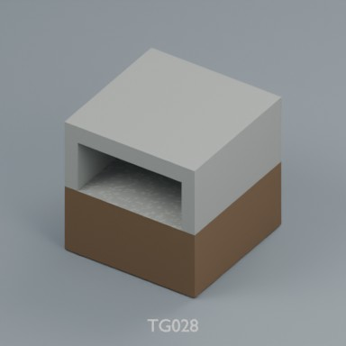

Use / purpose: 2m modular terrain distribution record. Includes BLEND and GLB; not a claim of independent design count.

Record type: terrain_distribution_record. Formats: BLEND/GLB.

Reported dimensions (metres; XYZ when derived from measured bounds, legacy axis order not reverified): Unknown. Triangles: Unknown.

Origin: Unknown / not independently confirmed. Orientation: Unknown / not independently confirmed.

[Download ZIP](https://raw.githubusercontent.com/k3peta/tales-on-a-table/main/distributions/terrain-connectivity-91/zips/TG028_CC0.zip) · [License scope](../../LICENSE.md)

**CC0-1.0** — model geometry and included display materials only. Models and embedded materials only; previews excluded.

Source details: [Catalogue 1](../../catalog/husbandry_cellar_v1.md) · [Catalogue 2](../../catalog/terrain_connectivity_v1.md)

## TG029

**plateau half**

plateau half

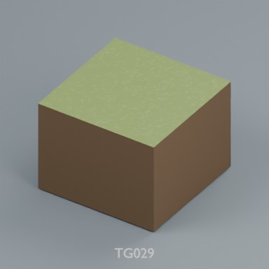

Use / purpose: 2m modular terrain distribution record. Includes BLEND and GLB; not a claim of independent design count.

Record type: terrain_distribution_record. Formats: BLEND/GLB.

Reported dimensions (metres; XYZ when derived from measured bounds, legacy axis order not reverified): Unknown. Triangles: Unknown.

Origin: Unknown / not independently confirmed. Orientation: Unknown / not independently confirmed.

[Download ZIP](https://raw.githubusercontent.com/k3peta/tales-on-a-table/main/distributions/terrain-connectivity-91/zips/TG029_CC0.zip) · [License scope](../../LICENSE.md)

**CC0-1.0** — model geometry and included display materials only. Models and embedded materials only; previews excluded.

Source details: [Catalogue 1](../../catalog/terrain_connectivity_v1.md)

## TG030

**plateau full**

plateau full

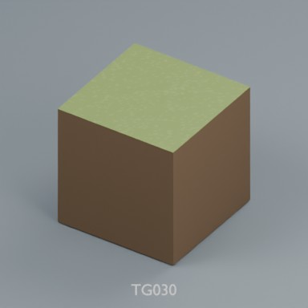

Use / purpose: 2m modular terrain distribution record. Includes BLEND and GLB; not a claim of independent design count.

Record type: terrain_distribution_record. Formats: BLEND/GLB.

Reported dimensions (metres; XYZ when derived from measured bounds, legacy axis order not reverified): Unknown. Triangles: Unknown.

Origin: Unknown / not independently confirmed. Orientation: Unknown / not independently confirmed.

[Download ZIP](https://raw.githubusercontent.com/k3peta/tales-on-a-table/main/distributions/terrain-connectivity-91/zips/TG030_CC0.zip) · [License scope](../../LICENSE.md)

**CC0-1.0** — model geometry and included display materials only. Models and embedded materials only; previews excluded.

Source details: [Catalogue 1](../../catalog/terrain_connectivity_v1.md)

## TG031

**cliff half to full**

cliff half to full

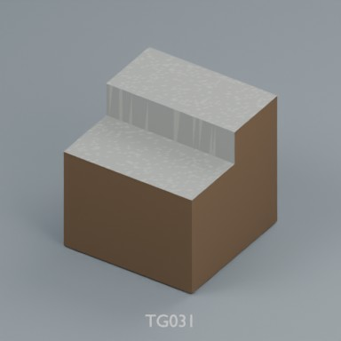

Use / purpose: 2m modular terrain distribution record. Includes BLEND and GLB; not a claim of independent design count.

Record type: terrain_distribution_record. Formats: BLEND/GLB.

Reported dimensions (metres; XYZ when derived from measured bounds, legacy axis order not reverified): Unknown. Triangles: Unknown.

Origin: Unknown / not independently confirmed. Orientation: Unknown / not independently confirmed.

[Download ZIP](https://raw.githubusercontent.com/k3peta/tales-on-a-table/main/distributions/terrain-connectivity-91/zips/TG031_CC0.zip) · [License scope](../../LICENSE.md)

**CC0-1.0** — model geometry and included display materials only. Models and embedded materials only; previews excluded.

Source details: [Catalogue 1](../../catalog/terrain_connectivity_v1.md)

## TG032

**ravine**

ravine

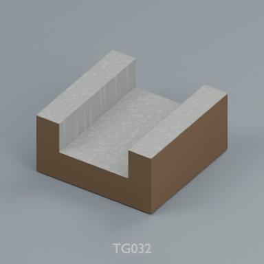

Use / purpose: 2m modular terrain distribution record. Includes BLEND and GLB; not a claim of independent design count.

Record type: terrain_distribution_record. Formats: BLEND/GLB.

Reported dimensions (metres; XYZ when derived from measured bounds, legacy axis order not reverified): Unknown. Triangles: Unknown.

Origin: Unknown / not independently confirmed. Orientation: Unknown / not independently confirmed.

[Download ZIP](https://raw.githubusercontent.com/k3peta/tales-on-a-table/main/distributions/terrain-connectivity-91/zips/TG032_CC0.zip) · [License scope](../../LICENSE.md)

**CC0-1.0** — model geometry and included display materials only. Models and embedded materials only; previews excluded.

Source details: [Catalogue 1](../../catalog/terrain_connectivity_v1.md)

## TG033

**ravine bend**

ravine bend

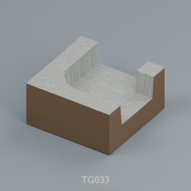

Use / purpose: 2m modular terrain distribution record. Includes BLEND and GLB; not a claim of independent design count.

Record type: terrain_distribution_record. Formats: BLEND/GLB.

Reported dimensions (metres; XYZ when derived from measured bounds, legacy axis order not reverified): Unknown. Triangles: Unknown.

Origin: Unknown / not independently confirmed. Orientation: Unknown / not independently confirmed.

[Download ZIP](https://raw.githubusercontent.com/k3peta/tales-on-a-table/main/distributions/terrain-connectivity-91/zips/TG033_CC0.zip) · [License scope](../../LICENSE.md)

**CC0-1.0** — model geometry and included display materials only. Models and embedded materials only; previews excluded.

Source details: [Catalogue 1](../../catalog/terrain_connectivity_v1.md)

## TG034

**ravine T**

ravine T

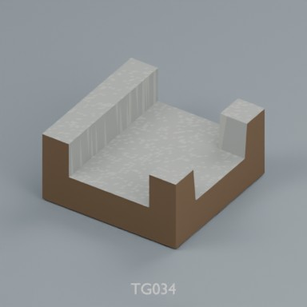

Use / purpose: 2m modular terrain distribution record. Includes BLEND and GLB; not a claim of independent design count.

Record type: terrain_distribution_record. Formats: BLEND/GLB.

Reported dimensions (metres; XYZ when derived from measured bounds, legacy axis order not reverified): Unknown. Triangles: Unknown.

Origin: Unknown / not independently confirmed. Orientation: Unknown / not independently confirmed.

[Download ZIP](https://raw.githubusercontent.com/k3peta/tales-on-a-table/main/distributions/terrain-connectivity-91/zips/TG034_CC0.zip) · [License scope](../../LICENSE.md)

**CC0-1.0** — model geometry and included display materials only. Models and embedded materials only; previews excluded.

Source details: [Catalogue 1](../../catalog/terrain_connectivity_v1.md)

## TV201

**ravine end**

ravine end

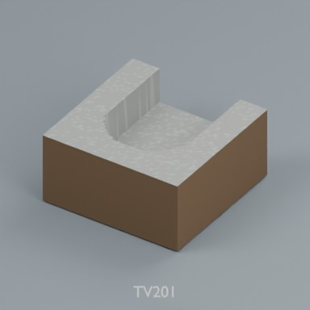

Use / purpose: 2m modular terrain distribution record. Includes BLEND and GLB; not a claim of independent design count.

Record type: terrain_distribution_record. Formats: BLEND/GLB.

Reported dimensions (metres; XYZ when derived from measured bounds, legacy axis order not reverified): Unknown. Triangles: Unknown.

Origin: Unknown / not independently confirmed. Orientation: Unknown / not independently confirmed.

[Download ZIP](https://raw.githubusercontent.com/k3peta/tales-on-a-table/main/distributions/terrain-connectivity-91/zips/TV201_CC0.zip) · [License scope](../../LICENSE.md)

**CC0-1.0** — model geometry and included display materials only. Models and embedded materials only; previews excluded.

Source details: [Catalogue 1](../../catalog/terrain_connectivity_v1.md)

## TV202

**ravine cross**

ravine cross

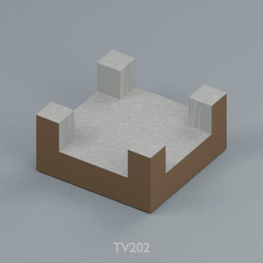

Use / purpose: 2m modular terrain distribution record. Includes BLEND and GLB; not a claim of independent design count.

Record type: terrain_distribution_record. Formats: BLEND/GLB.

Reported dimensions (metres; XYZ when derived from measured bounds, legacy axis order not reverified): Unknown. Triangles: Unknown.

Origin: Unknown / not independently confirmed. Orientation: Unknown / not independently confirmed.

[Download ZIP](https://raw.githubusercontent.com/k3peta/tales-on-a-table/main/distributions/terrain-connectivity-91/zips/TV202_CC0.zip) · [License scope](../../LICENSE.md)

**CC0-1.0** — model geometry and included display materials only. Models and embedded materials only; previews excluded.

Source details: [Catalogue 1](../../catalog/terrain_connectivity_v1.md)

## TV203

**ravine ramp entry**

ravine ramp entry

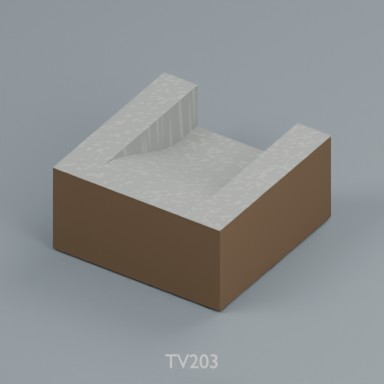

Use / purpose: 2m modular terrain distribution record. Includes BLEND and GLB; not a claim of independent design count.

Record type: terrain_distribution_record. Formats: BLEND/GLB.

Reported dimensions (metres; XYZ when derived from measured bounds, legacy axis order not reverified): Unknown. Triangles: Unknown.

Origin: Unknown / not independently confirmed. Orientation: Unknown / not independently confirmed.

[Download ZIP](https://raw.githubusercontent.com/k3peta/tales-on-a-table/main/distributions/terrain-connectivity-91/zips/TV203_CC0.zip) · [License scope](../../LICENSE.md)

**CC0-1.0** — model geometry and included display materials only. Models and embedded materials only; previews excluded.

Source details: [Catalogue 1](../../catalog/terrain_connectivity_v1.md)
