# Base distribution records 817–840

[Browse index](README.md) · [Coverage and missing fields](COVERAGE.md)

Images are actual existing model renders for browsing, not covered by model CC0. A group record may show several reused models. Dimensions and triangle counts apply only to the original record when sourced; revisions can differ. Unknown means unverified, not zero. No blanket CC0 grant for scenes, images, code or articles.

## TV204

**ravine stair entry**

ravine stair entry

Use / purpose: 2m modular terrain distribution record. Includes BLEND and GLB; not a claim of independent design count.

Record type: terrain_distribution_record. Formats: BLEND/GLB.

Reported dimensions (metres; XYZ when derived from measured bounds, legacy axis order not reverified): Unknown. Triangles: Unknown.

Origin: Unknown / not independently confirmed. Orientation: Unknown / not independently confirmed.

[Download ZIP](https://raw.githubusercontent.com/k3peta/tales-on-a-table/main/distributions/terrain-connectivity-91/zips/TV204_CC0.zip) · [License scope](../../LICENSE.md)

**CC0-1.0** — model geometry and included display materials only. Models and embedded materials only; previews excluded.

Source details: [Catalogue 1](../../catalog/terrain_connectivity_v1.md)

## TV205

**cliff double bench**

cliff double bench

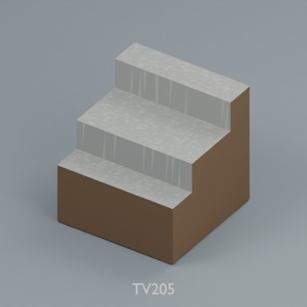

Use / purpose: 2m modular terrain distribution record. Includes BLEND and GLB; not a claim of independent design count.

Record type: terrain_distribution_record. Formats: BLEND/GLB.

Reported dimensions (metres; XYZ when derived from measured bounds, legacy axis order not reverified): Unknown. Triangles: Unknown.

Origin: Unknown / not independently confirmed. Orientation: Unknown / not independently confirmed.

[Download ZIP](https://raw.githubusercontent.com/k3peta/tales-on-a-table/main/distributions/terrain-connectivity-91/zips/TV205_CC0.zip) · [License scope](../../LICENSE.md)

**CC0-1.0** — model geometry and included display materials only. Models and embedded materials only; previews excluded.

Source details: [Catalogue 1](../../catalog/terrain_connectivity_v1.md)

## TV206

**cliff access slot**

cliff access slot

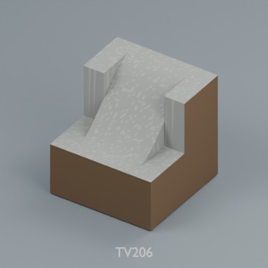

Use / purpose: 2m modular terrain distribution record. Includes BLEND and GLB; not a claim of independent design count.

Record type: terrain_distribution_record. Formats: BLEND/GLB.

Reported dimensions (metres; XYZ when derived from measured bounds, legacy axis order not reverified): Unknown. Triangles: Unknown.

Origin: Unknown / not independently confirmed. Orientation: Unknown / not independently confirmed.

[Download ZIP](https://raw.githubusercontent.com/k3peta/tales-on-a-table/main/distributions/terrain-connectivity-91/zips/TV206_CC0.zip) · [License scope](../../LICENSE.md)

**CC0-1.0** — model geometry and included display materials only. Models and embedded materials only; previews excluded.

Source details: [Catalogue 1](../../catalog/terrain_connectivity_v1.md)

## TV207

**overhang closed**

overhang closed

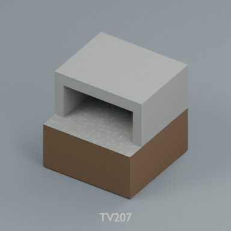

Use / purpose: 2m modular terrain distribution record. Includes BLEND and GLB; not a claim of independent design count.

Record type: terrain_distribution_record. Formats: BLEND/GLB.

Reported dimensions (metres; XYZ when derived from measured bounds, legacy axis order not reverified): Unknown. Triangles: Unknown.

Origin: Unknown / not independently confirmed. Orientation: Unknown / not independently confirmed.

[Download ZIP](https://raw.githubusercontent.com/k3peta/tales-on-a-table/main/distributions/terrain-connectivity-91/zips/TV207_CC0.zip) · [License scope](../../LICENSE.md)

**CC0-1.0** — model geometry and included display materials only. Models and embedded materials only; previews excluded.

Source details: [Catalogue 1](../../catalog/terrain_connectivity_v1.md)

## TV208

**water ravine sill**

water ravine sill

Use / purpose: 2m modular terrain distribution record. Includes BLEND and GLB; not a claim of independent design count.

Record type: terrain_distribution_record. Formats: BLEND/GLB.

Reported dimensions (metres; XYZ when derived from measured bounds, legacy axis order not reverified): Unknown. Triangles: Unknown.

Origin: Unknown / not independently confirmed. Orientation: Unknown / not independently confirmed.

[Download ZIP](https://raw.githubusercontent.com/k3peta/tales-on-a-table/main/distributions/terrain-connectivity-91/zips/TV208_CC0.zip) · [License scope](../../LICENSE.md)

**CC0-1.0** — model geometry and included display materials only. Models and embedded materials only; previews excluded.

Source details: [Catalogue 1](../../catalog/terrain_connectivity_v1.md)

## TV209

**river Y**

river Y

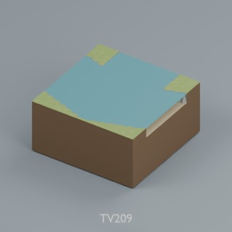

Use / purpose: 2m modular terrain distribution record. Includes BLEND and GLB; not a claim of independent design count.

Record type: terrain_distribution_record. Formats: BLEND/GLB.

Reported dimensions (metres; XYZ when derived from measured bounds, legacy axis order not reverified): Unknown. Triangles: Unknown.

Origin: Unknown / not independently confirmed. Orientation: Unknown / not independently confirmed.

[Download ZIP](https://raw.githubusercontent.com/k3peta/tales-on-a-table/main/distributions/terrain-connectivity-91/zips/TV209_CC0.zip) · [License scope](../../LICENSE.md)

**CC0-1.0** — model geometry and included display materials only. Models and embedded materials only; previews excluded.

Source details: [Catalogue 1](../../catalog/terrain_connectivity_v1.md)

## TV210

**ravine widen**

ravine widen

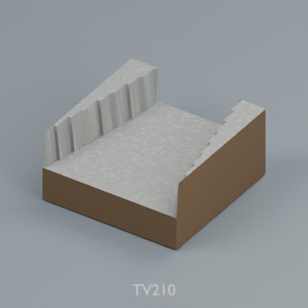

Use / purpose: 2m modular terrain distribution record. Includes BLEND and GLB; not a claim of independent design count.

Record type: terrain_distribution_record. Formats: BLEND/GLB.

Reported dimensions (metres; XYZ when derived from measured bounds, legacy axis order not reverified): Unknown. Triangles: Unknown.

Origin: Unknown / not independently confirmed. Orientation: Unknown / not independently confirmed.

[Download ZIP](https://raw.githubusercontent.com/k3peta/tales-on-a-table/main/distributions/terrain-connectivity-91/zips/TV210_CC0.zip) · [License scope](../../LICENSE.md)

**CC0-1.0** — model geometry and included display materials only. Models and embedded materials only; previews excluded.

Source details: [Catalogue 1](../../catalog/terrain_connectivity_v1.md)

## TX301

**ramp late half**

ramp late half

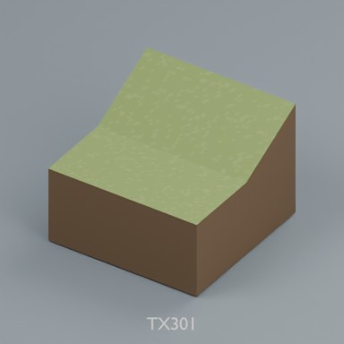

Use / purpose: 2m modular terrain distribution record. Includes BLEND and GLB; not a claim of independent design count.

Record type: terrain_distribution_record. Formats: BLEND/GLB.

Reported dimensions (metres; XYZ when derived from measured bounds, legacy axis order not reverified): Unknown. Triangles: Unknown.

Origin: Unknown / not independently confirmed. Orientation: Unknown / not independently confirmed.

[Download ZIP](https://raw.githubusercontent.com/k3peta/tales-on-a-table/main/distributions/terrain-connectivity-91/zips/TX301_CC0.zip) · [License scope](../../LICENSE.md)

**CC0-1.0** — model geometry and included display materials only. Models and embedded materials only; previews excluded.

Source details: [Catalogue 1](../../catalog/terrain_connectivity_v1.md)

## TX302

**ramp early half**

ramp early half

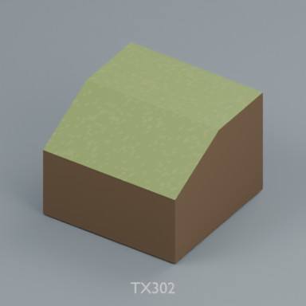

Use / purpose: 2m modular terrain distribution record. Includes BLEND and GLB; not a claim of independent design count.

Record type: terrain_distribution_record. Formats: BLEND/GLB.

Reported dimensions (metres; XYZ when derived from measured bounds, legacy axis order not reverified): Unknown. Triangles: Unknown.

Origin: Unknown / not independently confirmed. Orientation: Unknown / not independently confirmed.

[Download ZIP](https://raw.githubusercontent.com/k3peta/tales-on-a-table/main/distributions/terrain-connectivity-91/zips/TX302_CC0.zip) · [License scope](../../LICENSE.md)

**CC0-1.0** — model geometry and included display materials only. Models and embedded materials only; previews excluded.

Source details: [Catalogue 1](../../catalog/terrain_connectivity_v1.md)

## TX303

**ramp S full**

ramp S full

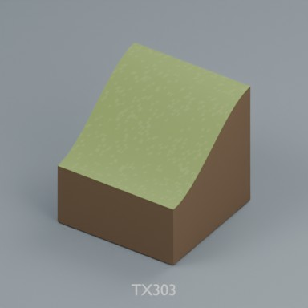

Use / purpose: 2m modular terrain distribution record. Includes BLEND and GLB; not a claim of independent design count.

Record type: terrain_distribution_record. Formats: BLEND/GLB.

Reported dimensions (metres; XYZ when derived from measured bounds, legacy axis order not reverified): Unknown. Triangles: Unknown.

Origin: Unknown / not independently confirmed. Orientation: Unknown / not independently confirmed.

[Download ZIP](https://raw.githubusercontent.com/k3peta/tales-on-a-table/main/distributions/terrain-connectivity-91/zips/TX303_CC0.zip) · [License scope](../../LICENSE.md)

**CC0-1.0** — model geometry and included display materials only. Models and embedded materials only; previews excluded.

Source details: [Catalogue 1](../../catalog/terrain_connectivity_v1.md)

## TX304

**ramp bilinear corner**

ramp bilinear corner

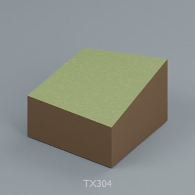

Use / purpose: 2m modular terrain distribution record. Includes BLEND and GLB; not a claim of independent design count.

Record type: terrain_distribution_record. Formats: BLEND/GLB.

Reported dimensions (metres; XYZ when derived from measured bounds, legacy axis order not reverified): Unknown. Triangles: Unknown.

Origin: Unknown / not independently confirmed. Orientation: Unknown / not independently confirmed.

[Download ZIP](https://raw.githubusercontent.com/k3peta/tales-on-a-table/main/distributions/terrain-connectivity-91/zips/TX304_CC0.zip) · [License scope](../../LICENSE.md)

**CC0-1.0** — model geometry and included display materials only. Models and embedded materials only; previews excluded.

Source details: [Catalogue 1](../../catalog/terrain_connectivity_v1.md)

## TX305

**ramp diagonal**

ramp diagonal

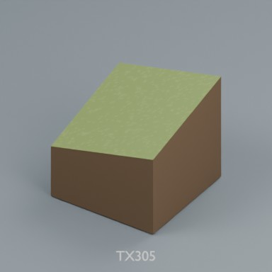

Use / purpose: 2m modular terrain distribution record. Includes BLEND and GLB; not a claim of independent design count.

Record type: terrain_distribution_record. Formats: BLEND/GLB.

Reported dimensions (metres; XYZ when derived from measured bounds, legacy axis order not reverified): Unknown. Triangles: Unknown.

Origin: Unknown / not independently confirmed. Orientation: Unknown / not independently confirmed.

[Download ZIP](https://raw.githubusercontent.com/k3peta/tales-on-a-table/main/distributions/terrain-connectivity-91/zips/TX305_CC0.zip) · [License scope](../../LICENSE.md)

**CC0-1.0** — model geometry and included display materials only. Models and embedded materials only; previews excluded.

Source details: [Catalogue 1](../../catalog/terrain_connectivity_v1.md)

## TX306

**cliff double corner**

cliff double corner

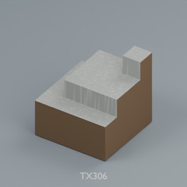

Use / purpose: 2m modular terrain distribution record. Includes BLEND and GLB; not a claim of independent design count.

Record type: terrain_distribution_record. Formats: BLEND/GLB.

Reported dimensions (metres; XYZ when derived from measured bounds, legacy axis order not reverified): Unknown. Triangles: Unknown.

Origin: Unknown / not independently confirmed. Orientation: Unknown / not independently confirmed.

[Download ZIP](https://raw.githubusercontent.com/k3peta/tales-on-a-table/main/distributions/terrain-connectivity-91/zips/TX306_CC0.zip) · [License scope](../../LICENSE.md)

**CC0-1.0** — model geometry and included display materials only. Models and embedded materials only; previews excluded.

Source details: [Catalogue 1](../../catalog/terrain_connectivity_v1.md)

## TX307

**river width transition**

river width transition

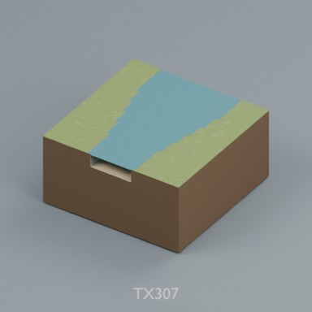

Use / purpose: 2m modular terrain distribution record. Includes BLEND and GLB; not a claim of independent design count.

Record type: terrain_distribution_record. Formats: BLEND/GLB.

Reported dimensions (metres; XYZ when derived from measured bounds, legacy axis order not reverified): Unknown. Triangles: Unknown.

Origin: Unknown / not independently confirmed. Orientation: Unknown / not independently confirmed.

[Download ZIP](https://raw.githubusercontent.com/k3peta/tales-on-a-table/main/distributions/terrain-connectivity-91/zips/TX307_CC0.zip) · [License scope](../../LICENSE.md)

**CC0-1.0** — model geometry and included display materials only. Models and embedded materials only; previews excluded.

Source details: [Catalogue 1](../../catalog/terrain_connectivity_v1.md)

## TX308

**river narrow bend**

river narrow bend

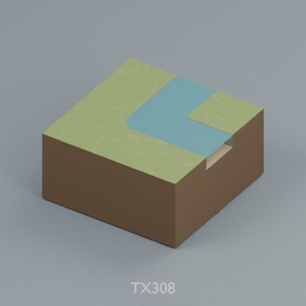

Use / purpose: 2m modular terrain distribution record. Includes BLEND and GLB; not a claim of independent design count.

Record type: terrain_distribution_record. Formats: BLEND/GLB.

Reported dimensions (metres; XYZ when derived from measured bounds, legacy axis order not reverified): Unknown. Triangles: Unknown.

Origin: Unknown / not independently confirmed. Orientation: Unknown / not independently confirmed.

[Download ZIP](https://raw.githubusercontent.com/k3peta/tales-on-a-table/main/distributions/terrain-connectivity-91/zips/TX308_CC0.zip) · [License scope](../../LICENSE.md)

**CC0-1.0** — model geometry and included display materials only. Models and embedded materials only; previews excluded.

Source details: [Catalogue 1](../../catalog/terrain_connectivity_v1.md)

## TX309

**overhang full corner**

overhang full corner

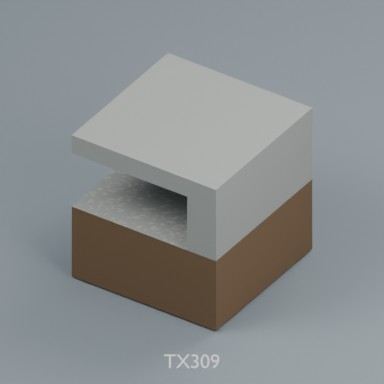

Use / purpose: 2m modular terrain distribution record. Includes BLEND and GLB; not a claim of independent design count.

Record type: terrain_distribution_record. Formats: BLEND/GLB.

Reported dimensions (metres; XYZ when derived from measured bounds, legacy axis order not reverified): Unknown. Triangles: Unknown.

Origin: Unknown / not independently confirmed. Orientation: Unknown / not independently confirmed.

[Download ZIP](https://raw.githubusercontent.com/k3peta/tales-on-a-table/main/distributions/terrain-connectivity-91/zips/TX309_CC0.zip) · [License scope](../../LICENSE.md)

**CC0-1.0** — model geometry and included display materials only. Models and embedded materials only; previews excluded.

Source details: [Catalogue 1](../../catalog/terrain_connectivity_v1.md)

## TX310

**river narrow end**

river narrow end

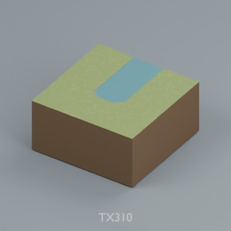

Use / purpose: 2m modular terrain distribution record. Includes BLEND and GLB; not a claim of independent design count.

Record type: terrain_distribution_record. Formats: BLEND/GLB.

Reported dimensions (metres; XYZ when derived from measured bounds, legacy axis order not reverified): Unknown. Triangles: Unknown.

Origin: Unknown / not independently confirmed. Orientation: Unknown / not independently confirmed.

[Download ZIP](https://raw.githubusercontent.com/k3peta/tales-on-a-table/main/distributions/terrain-connectivity-91/zips/TX310_CC0.zip) · [License scope](../../LICENSE.md)

**CC0-1.0** — model geometry and included display materials only. Models and embedded materials only; previews excluded.

Source details: [Catalogue 1](../../catalog/terrain_connectivity_v1.md)

## TW401

**waterfall channel**

waterfall channel

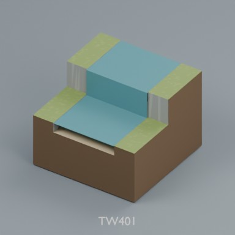

Use / purpose: 2m modular terrain distribution record. Includes BLEND and GLB; not a claim of independent design count.

Record type: terrain_distribution_record. Formats: BLEND/GLB.

Reported dimensions (metres; XYZ when derived from measured bounds, legacy axis order not reverified): Unknown. Triangles: Unknown.

Origin: Unknown / not independently confirmed. Orientation: Unknown / not independently confirmed.

[Download ZIP](https://raw.githubusercontent.com/k3peta/tales-on-a-table/main/distributions/terrain-connectivity-91/zips/TW401_CC0.zip) · [License scope](../../LICENSE.md)

**CC0-1.0** — model geometry and included display materials only. Models and embedded materials only; previews excluded.

Source details: [Catalogue 1](../../catalog/terrain_connectivity_v1.md)

## TW402

**cascade channel**

cascade channel

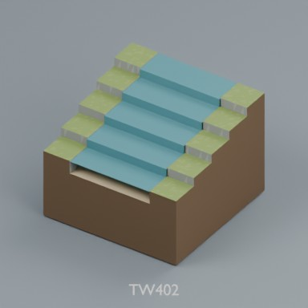

Use / purpose: 2m modular terrain distribution record. Includes BLEND and GLB; not a claim of independent design count.

Record type: terrain_distribution_record. Formats: BLEND/GLB.

Reported dimensions (metres; XYZ when derived from measured bounds, legacy axis order not reverified): Unknown. Triangles: Unknown.

Origin: Unknown / not independently confirmed. Orientation: Unknown / not independently confirmed.

[Download ZIP](https://raw.githubusercontent.com/k3peta/tales-on-a-table/main/distributions/terrain-connectivity-91/zips/TW402_CC0.zip) · [License scope](../../LICENSE.md)

**CC0-1.0** — model geometry and included display materials only. Models and embedded materials only; previews excluded.

Source details: [Catalogue 1](../../catalog/terrain_connectivity_v1.md)

## TW403

**upper straight**

upper straight

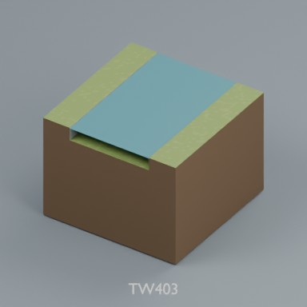

Use / purpose: 2m modular terrain distribution record. Includes BLEND and GLB; not a claim of independent design count.

Record type: terrain_distribution_record. Formats: BLEND/GLB.

Reported dimensions (metres; XYZ when derived from measured bounds, legacy axis order not reverified): Unknown. Triangles: Unknown.

Origin: Unknown / not independently confirmed. Orientation: Unknown / not independently confirmed.

[Download ZIP](https://raw.githubusercontent.com/k3peta/tales-on-a-table/main/distributions/terrain-connectivity-91/zips/TW403_CC0.zip) · [License scope](../../LICENSE.md)

**CC0-1.0** — model geometry and included display materials only. Models and embedded materials only; previews excluded.

Source details: [Catalogue 1](../../catalog/terrain_connectivity_v1.md)

## TW404

**upper bend**

upper bend

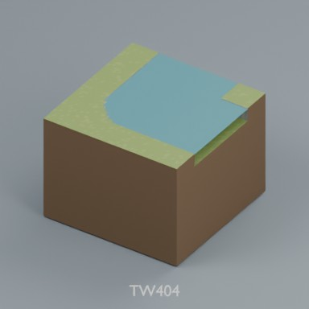

Use / purpose: 2m modular terrain distribution record. Includes BLEND and GLB; not a claim of independent design count.

Record type: terrain_distribution_record. Formats: BLEND/GLB.

Reported dimensions (metres; XYZ when derived from measured bounds, legacy axis order not reverified): Unknown. Triangles: Unknown.

Origin: Unknown / not independently confirmed. Orientation: Unknown / not independently confirmed.

[Download ZIP](https://raw.githubusercontent.com/k3peta/tales-on-a-table/main/distributions/terrain-connectivity-91/zips/TW404_CC0.zip) · [License scope](../../LICENSE.md)

**CC0-1.0** — model geometry and included display materials only. Models and embedded materials only; previews excluded.

Source details: [Catalogue 1](../../catalog/terrain_connectivity_v1.md)

## TW405

**upper T**

upper T

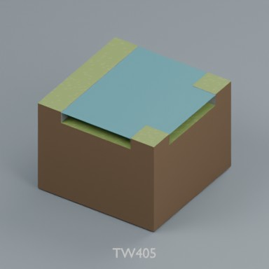

Use / purpose: 2m modular terrain distribution record. Includes BLEND and GLB; not a claim of independent design count.

Record type: terrain_distribution_record. Formats: BLEND/GLB.

Reported dimensions (metres; XYZ when derived from measured bounds, legacy axis order not reverified): Unknown. Triangles: Unknown.

Origin: Unknown / not independently confirmed. Orientation: Unknown / not independently confirmed.

[Download ZIP](https://raw.githubusercontent.com/k3peta/tales-on-a-table/main/distributions/terrain-connectivity-91/zips/TW405_CC0.zip) · [License scope](../../LICENSE.md)

**CC0-1.0** — model geometry and included display materials only. Models and embedded materials only; previews excluded.

Source details: [Catalogue 1](../../catalog/terrain_connectivity_v1.md)

## TW406

**upper end**

upper end

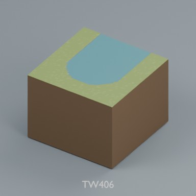

Use / purpose: 2m modular terrain distribution record. Includes BLEND and GLB; not a claim of independent design count.

Record type: terrain_distribution_record. Formats: BLEND/GLB.

Reported dimensions (metres; XYZ when derived from measured bounds, legacy axis order not reverified): Unknown. Triangles: Unknown.

Origin: Unknown / not independently confirmed. Orientation: Unknown / not independently confirmed.

[Download ZIP](https://raw.githubusercontent.com/k3peta/tales-on-a-table/main/distributions/terrain-connectivity-91/zips/TW406_CC0.zip) · [License scope](../../LICENSE.md)

**CC0-1.0** — model geometry and included display materials only. Models and embedded materials only; previews excluded.

Source details: [Catalogue 1](../../catalog/terrain_connectivity_v1.md)

## TW407

**upper cross**

upper cross

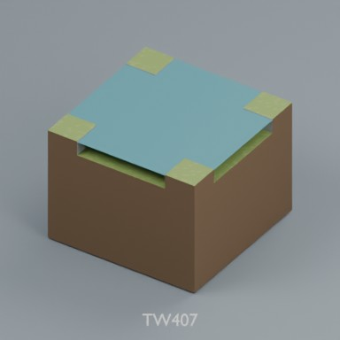

Use / purpose: 2m modular terrain distribution record. Includes BLEND and GLB; not a claim of independent design count.

Record type: terrain_distribution_record. Formats: BLEND/GLB.

Reported dimensions (metres; XYZ when derived from measured bounds, legacy axis order not reverified): Unknown. Triangles: Unknown.

Origin: Unknown / not independently confirmed. Orientation: Unknown / not independently confirmed.

[Download ZIP](https://raw.githubusercontent.com/k3peta/tales-on-a-table/main/distributions/terrain-connectivity-91/zips/TW407_CC0.zip) · [License scope](../../LICENSE.md)

**CC0-1.0** — model geometry and included display materials only. Models and embedded materials only; previews excluded.

Source details: [Catalogue 1](../../catalog/terrain_connectivity_v1.md)
