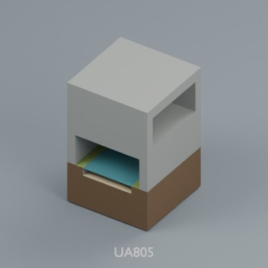
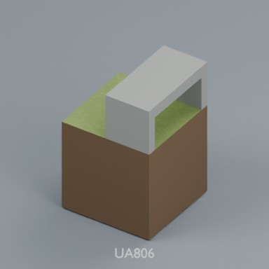
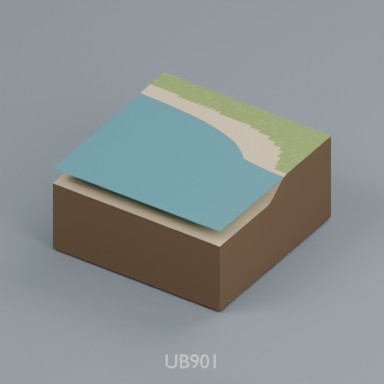
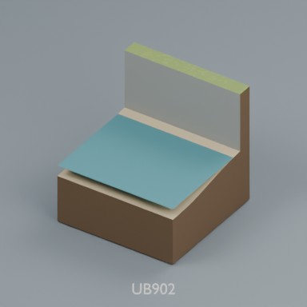
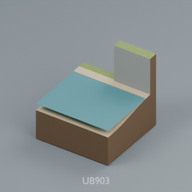
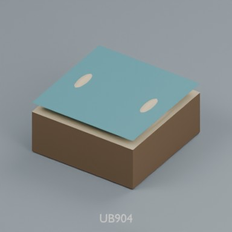
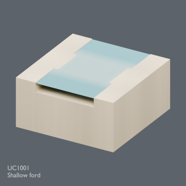
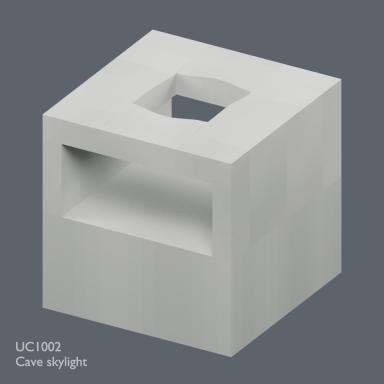
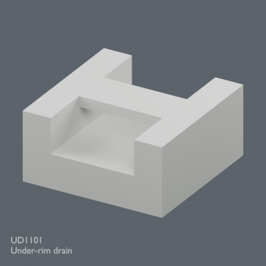

# Base distribution records 865–888

[Browse index](README.md) · [Coverage and missing fields](COVERAGE.md)

Images are actual existing model renders for browsing, not covered by model CC0. A group record may show several reused models. Dimensions and triangle counts apply only to the original record when sourced; revisions can differ. Unknown means unverified, not zero. No blanket CC0 grant for scenes, images, code or articles.

## UA805

**stacked crossing**

stacked crossing

Use / purpose: 2m modular terrain distribution record. Includes BLEND and GLB; not a claim of independent design count.

Record type: terrain_distribution_record. Formats: BLEND/GLB.

Reported dimensions (metres; XYZ when derived from measured bounds, legacy axis order not reverified): Unknown. Triangles: Unknown.

Origin: Unknown / not independently confirmed. Orientation: Unknown / not independently confirmed.

[Download ZIP](https://raw.githubusercontent.com/k3peta/tales-on-a-table/main/distributions/terrain-connectivity-91/zips/UA805_CC0.zip) · [License scope](../../LICENSE.md)

**CC0-1.0** — model geometry and included display materials only. Models and embedded materials only; previews excluded.

Source details: [Catalogue 1](../../catalog/terrain_connectivity_v1.md)

## UA806

**upper cave portal**

upper cave portal

Use / purpose: 2m modular terrain distribution record. Includes BLEND and GLB; not a claim of independent design count.

Record type: terrain_distribution_record. Formats: BLEND/GLB.

Reported dimensions (metres; XYZ when derived from measured bounds, legacy axis order not reverified): Unknown. Triangles: Unknown.

Origin: Unknown / not independently confirmed. Orientation: Unknown / not independently confirmed.

[Download ZIP](https://raw.githubusercontent.com/k3peta/tales-on-a-table/main/distributions/terrain-connectivity-91/zips/UA806_CC0.zip) · [License scope](../../LICENSE.md)

**CC0-1.0** — model geometry and included display materials only. Models and embedded materials only; previews excluded.

Source details: [Catalogue 1](../../catalog/terrain_connectivity_v1.md)

## UB901

**beach_shore_transition**

beach_shore_transition

Use / purpose: 2m modular terrain distribution record. Includes BLEND and GLB; not a claim of independent design count.

Record type: terrain_distribution_record. Formats: BLEND/GLB.

Reported dimensions (metres; XYZ when derived from measured bounds, legacy axis order not reverified): Unknown. Triangles: Unknown.

Origin: Unknown / not independently confirmed. Orientation: Unknown / not independently confirmed.

[Download ZIP](https://raw.githubusercontent.com/k3peta/tales-on-a-table/main/distributions/terrain-connectivity-91/zips/UB901_CC0.zip) · [License scope](../../LICENSE.md)

**CC0-1.0** — model geometry and included display materials only. Models and embedded materials only; previews excluded.

Source details: [Catalogue 1](../../catalog/terrain_connectivity_v1.md)

## UB902

**beach_cliff**

beach_cliff

Use / purpose: 2m modular terrain distribution record. Includes BLEND and GLB; not a claim of independent design count.

Record type: terrain_distribution_record. Formats: BLEND/GLB.

Reported dimensions (metres; XYZ when derived from measured bounds, legacy axis order not reverified): Unknown. Triangles: Unknown.

Origin: Unknown / not independently confirmed. Orientation: Unknown / not independently confirmed.

[Download ZIP](https://raw.githubusercontent.com/k3peta/tales-on-a-table/main/distributions/terrain-connectivity-91/zips/UB902_CC0.zip) · [License scope](../../LICENSE.md)

**CC0-1.0** — model geometry and included display materials only. Models and embedded materials only; previews excluded.

Source details: [Catalogue 1](../../catalog/terrain_connectivity_v1.md)

## UB903

**beach_cliff_end**

beach_cliff_end

Use / purpose: 2m modular terrain distribution record. Includes BLEND and GLB; not a claim of independent design count.

Record type: terrain_distribution_record. Formats: BLEND/GLB.

Reported dimensions (metres; XYZ when derived from measured bounds, legacy axis order not reverified): Unknown. Triangles: Unknown.

Origin: Unknown / not independently confirmed. Orientation: Unknown / not independently confirmed.

[Download ZIP](https://raw.githubusercontent.com/k3peta/tales-on-a-table/main/distributions/terrain-connectivity-91/zips/UB903_CC0.zip) · [License scope](../../LICENSE.md)

**CC0-1.0** — model geometry and included display materials only. Models and embedded materials only; previews excluded.

Source details: [Catalogue 1](../../catalog/terrain_connectivity_v1.md)

## UB904

**twin_sandbar**

twin_sandbar

Use / purpose: 2m modular terrain distribution record. Includes BLEND and GLB; not a claim of independent design count.

Record type: terrain_distribution_record. Formats: BLEND/GLB.

Reported dimensions (metres; XYZ when derived from measured bounds, legacy axis order not reverified): Unknown. Triangles: Unknown.

Origin: Unknown / not independently confirmed. Orientation: Unknown / not independently confirmed.

[Download ZIP](https://raw.githubusercontent.com/k3peta/tales-on-a-table/main/distributions/terrain-connectivity-91/zips/UB904_CC0.zip) · [License scope](../../LICENSE.md)

**CC0-1.0** — model geometry and included display materials only. Models and embedded materials only; previews excluded.

Source details: [Catalogue 1](../../catalog/terrain_connectivity_v1.md)

## UC1001

**Shallow ford**

浅瀬

[Full-size image](../../previews/terrain-tr051-ud24/renders/UC1001.png)

Use / purpose: 2m modular terrain distribution record. Includes BLEND and GLB; not a claim of independent design count.

Record type: terrain_distribution_record. Formats: BLEND/GLB.

Reported dimensions (metres; XYZ when derived from measured bounds, legacy axis order not reverified): Unknown. Triangles: Unknown.

Origin: Unknown / not independently confirmed. Orientation: Unknown / not independently confirmed.

[Download ZIP](https://raw.githubusercontent.com/k3peta/tales-on-a-table/main/distributions/terrain-connectivity-10/zips/UC1001_CC0.zip) · [License scope](../../LICENSE.md)

**CC0-1.0** — model geometry and included display materials only. Models and embedded materials only; previews excluded.

Source details: [Catalogue 1](../../catalog/terrain_connectivity_v1.md) · [Catalogue 2](../../catalog/terrain_connectivity_v10.md)

**Known issue:** Dark shadow below water leading edge retained faithfully; diagnosis unresolved, not certified defect-free. Preview faithfully shows the distributed model; image completion is not quality approval.

## UC1002

**Cave skylight**

縦穴付き洞

[Full-size image](../../previews/terrain-tr051-ud24/renders/UC1002.png)

Use / purpose: 2m modular terrain distribution record. Includes BLEND and GLB; not a claim of independent design count.

Record type: terrain_distribution_record. Formats: BLEND/GLB.

Reported dimensions (metres; XYZ when derived from measured bounds, legacy axis order not reverified): Unknown. Triangles: Unknown.

Origin: Unknown / not independently confirmed. Orientation: Unknown / not independently confirmed.

[Download ZIP](https://raw.githubusercontent.com/k3peta/tales-on-a-table/main/distributions/terrain-connectivity-10/zips/UC1002_CC0.zip) · [License scope](../../LICENSE.md)

**CC0-1.0** — model geometry and included display materials only. Models and embedded materials only; previews excluded.

Source details: [Catalogue 1](../../catalog/terrain_connectivity_v1.md) · [Catalogue 2](../../catalog/terrain_connectivity_v10.md)

## VF001

**Lakeside marble fountain**

湖畔の大理石噴水

[Full-size image](../../previews/terrain-tr051-ud24/renders/VF001.png)

Use / purpose: Standalone model with static water geometry. Includes BLEND and GLB, not an application.

Record type: model. Formats: BLEND/GLB.

Reported dimensions (metres; XYZ when derived from measured bounds, legacy axis order not reverified): Unknown. Triangles: Unknown.

Origin: Unknown / not independently confirmed. Orientation: Unknown / not independently confirmed.

[Download ZIP](https://raw.githubusercontent.com/k3peta/tales-on-a-table/main/distributions/vf001-v2/VF001-v2-public-clean-CC0.zip) · [License scope](../../LICENSE.md)

**CC0-1.0** — model geometry and included display materials only. Models and embedded materials only; previews excluded.

Source details: [Catalogue 1](../../catalog/vf001_fountain_v2.md)

## UD1101

**Under-rim drain**

縁下排水口

[Full-size image](../../previews/terrain-tr051-ud24/renders/UD1101.png)

Use / purpose: 2m modular terrain distribution record. Includes BLEND and GLB; not a claim of independent design count.

Record type: terrain_distribution_record. Formats: BLEND/GLB.

Reported dimensions (metres; XYZ when derived from measured bounds, legacy axis order not reverified): Unknown. Triangles: Unknown.

Origin: Unknown / not independently confirmed. Orientation: Unknown / not independently confirmed.

[Download ZIP](https://raw.githubusercontent.com/k3peta/tales-on-a-table/main/distributions/terrain-connectivity-11/zips/UD1101_CC0.zip) · [License scope](../../LICENSE.md)

**CC0-1.0** — model geometry and included display materials only. Models and embedded materials only; previews excluded.

Source details: [Catalogue 1](../../catalog/husbandry_cellar_v1.md) · [Catalogue 2](../../catalog/terrain_connectivity_v1.md) · [Catalogue 3](../../catalog/terrain_connectivity_v11.md)

## UD1102

**Covered waterfall**

洞内落差水路

**Image pending: no verified ID-specific preview mapping yet.**

Use / purpose: 2m modular terrain distribution record. Includes BLEND and GLB; not a claim of independent design count.

Record type: terrain_distribution_record. Formats: BLEND/GLB.

Reported dimensions (metres; XYZ when derived from measured bounds, legacy axis order not reverified): Unknown. Triangles: Unknown.

Origin: Unknown / not independently confirmed. Orientation: Unknown / not independently confirmed.

[Download ZIP](https://raw.githubusercontent.com/k3peta/tales-on-a-table/main/distributions/terrain-connectivity-11/zips/UD1102_CC0.zip) · [License scope](../../LICENSE.md)

**CC0-1.0** — model geometry and included display materials only. Models and embedded materials only; previews excluded.

Source details: [Catalogue 1](../../catalog/terrain_connectivity_v1.md) · [Catalogue 2](../../catalog/terrain_connectivity_v11.md)

## RS201

**Pasture slope bay**

Pasture slope bay

**Image pending: no verified ID-specific preview mapping yet.**

Use / purpose: Static fence model; see catalogue for placement limits.

Record type: structural_variant. Formats: BLEND/GLB.

Reported dimensions (metres; XYZ when derived from measured bounds, legacy axis order not reverified): Unknown. Triangles: Unknown.

Origin: Unknown / not independently confirmed. Orientation: Unknown / not independently confirmed.

[Download ZIP](https://raw.githubusercontent.com/k3peta/tales-on-a-table/main/distributions/rustic-slope-connections-v2/zips/RS201_CC0.zip) · [License scope](../../LICENSE.md)

**CC0-1.0** — model geometry and included display materials only. Models and embedded materials only; previews excluded.

Source details: [Catalogue 1](../../catalog/fortified_city_sites_v1.md) · [Catalogue 2](../../catalog/rustic_slope_connections_v2.md)

## RS202

**Garden slope bay**

Garden slope bay

**Image pending: no verified ID-specific preview mapping yet.**

Use / purpose: Static fence model; see catalogue for placement limits.

Record type: structural_variant. Formats: BLEND/GLB.

Reported dimensions (metres; XYZ when derived from measured bounds, legacy axis order not reverified): Unknown. Triangles: Unknown.

Origin: Unknown / not independently confirmed. Orientation: Unknown / not independently confirmed.

[Download ZIP](https://raw.githubusercontent.com/k3peta/tales-on-a-table/main/distributions/rustic-slope-connections-v2/zips/RS202_CC0.zip) · [License scope](../../LICENSE.md)

**CC0-1.0** — model geometry and included display materials only. Models and embedded materials only; previews excluded.

Source details: [Catalogue 1](../../catalog/recovered_rustic_fences_rf7.md) · [Catalogue 2](../../catalog/rustic_slope_connections_v2.md)

## RS203

**Fence crossing stile**

Fence crossing stile

**Image pending: no verified ID-specific preview mapping yet.**

Use / purpose: Static fence model; see catalogue for placement limits.

Record type: model. Formats: BLEND/GLB.

Reported dimensions (metres; XYZ when derived from measured bounds, legacy axis order not reverified): Unknown. Triangles: Unknown.

Origin: Unknown / not independently confirmed. Orientation: Unknown / not independently confirmed.

[Download ZIP](https://raw.githubusercontent.com/k3peta/tales-on-a-table/main/distributions/rustic-slope-connections-v2/zips/RS203_CC0.zip) · [License scope](../../LICENSE.md)

**CC0-1.0** — model geometry and included display materials only. Models and embedded materials only; previews excluded.

Source details: [Catalogue 1](../../catalog/rustic_slope_connections_v2.md)

## BD101_Bellflower

**Bellflower**

Bellflower

**Image pending: no verified ID-specific preview mapping yet.**

Use / purpose: Hollow five-lobed hanging bells on branching stems. Flower border.

Record type: model. Formats: BLEND/GLB.

Reported dimensions (metres; XYZ when derived from measured bounds, legacy axis order not reverified): Unknown. Triangles: Unknown.

Origin: Unknown / not independently confirmed. Orientation: Unknown / not independently confirmed.

[Download ZIP](https://raw.githubusercontent.com/k3peta/tales-on-a-table/main/distributions/botanical-diversity-v1/BD101_Bellflower_CC0.zip) · [License scope](../../LICENSE.md)

**CC0-1.0** — model geometry and embedded display materials only. Models and embedded materials only; previews excluded.

Source details: [Catalogue 1](../../catalog/botanical_diversity_v1.md)

## BD102_Iris

**Iris**

Iris

**Image pending: no verified ID-specific preview mapping yet.**

Use / purpose: Sword-shaped basal leaves and alternating upright/falling petals. Garden border.

Record type: model. Formats: BLEND/GLB.

Reported dimensions (metres; XYZ when derived from measured bounds, legacy axis order not reverified): Unknown. Triangles: Unknown.

Origin: Unknown / not independently confirmed. Orientation: Unknown / not independently confirmed.

[Download ZIP](https://raw.githubusercontent.com/k3peta/tales-on-a-table/main/distributions/botanical-diversity-v1/BD102_Iris_CC0.zip) · [License scope](../../LICENSE.md)

**CC0-1.0** — model geometry and embedded display materials only. Models and embedded materials only; previews excluded.

Source details: [Catalogue 1](../../catalog/botanical_diversity_v1.md)

## BD103_PeaVine

**PeaVine**

PeaVine

**Image pending: no verified ID-specific preview mapping yet.**

Use / purpose: Paired leaflets, spiral tendrils, hanging seed pods. Vegetable garden; add separate supports as desired.

Record type: model. Formats: BLEND/GLB.

Reported dimensions (metres; XYZ when derived from measured bounds, legacy axis order not reverified): Unknown. Triangles: Unknown.

Origin: Unknown / not independently confirmed. Orientation: Unknown / not independently confirmed.

[Download ZIP](https://raw.githubusercontent.com/k3peta/tales-on-a-table/main/distributions/botanical-diversity-v1/BD103_PeaVine_CC0.zip) · [License scope](../../LICENSE.md)

**CC0-1.0** — model geometry and embedded display materials only. Models and embedded materials only; previews excluded.

Source details: [Catalogue 1](../../catalog/botanical_diversity_v1.md)

## BD104_LobedIvy

**LobedIvy**

LobedIvy

**Image pending: no verified ID-specific preview mapping yet.**

Use / purpose: Five-lobed leaves on a vertical branching climber. Ruined wall dressing; front is -Y, wall plane +Y=0.025m. Not an automatic surface-conforming vine.

Record type: model. Formats: BLEND/GLB.

Reported dimensions (metres; XYZ when derived from measured bounds, legacy axis order not reverified): Unknown. Triangles: Unknown.

Origin: Unknown / not independently confirmed. Orientation: Unknown / not independently confirmed.

[Download ZIP](https://raw.githubusercontent.com/k3peta/tales-on-a-table/main/distributions/botanical-diversity-v1/BD104_LobedIvy_CC0.zip) · [License scope](../../LICENSE.md)

**CC0-1.0** — model geometry and embedded display materials only. Models and embedded materials only; previews excluded.

Source details: [Catalogue 1](../../catalog/botanical_diversity_v1.md)

## BD201_WaterLily

**WaterLily**

WaterLily

**Image pending: no verified ID-specific preview mapping yet.**

Use / purpose: Notched floating pads and layered flower. Origin Z=0 is WATER SURFACE, not pond bed. Place at the water elevation; no underwater roots included.

Record type: model. Formats: BLEND/GLB.

Reported dimensions (metres; XYZ when derived from measured bounds, legacy axis order not reverified): Unknown. Triangles: Unknown.

Origin: Unknown / not independently confirmed. Orientation: Unknown / not independently confirmed.

[Download ZIP](https://raw.githubusercontent.com/k3peta/tales-on-a-table/main/distributions/botanical-diversity-v2/BD201_WaterLily_CC0.zip) · [License scope](../../LICENSE.md)

**CC0-1.0** — model geometry and embedded display materials only. Models and embedded materials only; previews excluded.

Source details: [Catalogue 1](../../catalog/botanical_diversity_v2.md)

## BD202_Horsetail

**Horsetail**

Horsetail

**Image pending: no verified ID-specific preview mapping yet.**

Use / purpose: Jointed stems with seven-way whorled branches. Damp forest edge or waterside bank. Origin is soil level.

Record type: model. Formats: BLEND/GLB.

Reported dimensions (metres; XYZ when derived from measured bounds, legacy axis order not reverified): Unknown. Triangles: Unknown.

Origin: Unknown / not independently confirmed. Orientation: Unknown / not independently confirmed.

[Download ZIP](https://raw.githubusercontent.com/k3peta/tales-on-a-table/main/distributions/botanical-diversity-v2/BD202_Horsetail_CC0.zip) · [License scope](../../LICENSE.md)

**CC0-1.0** — model geometry and embedded display materials only. Models and embedded materials only; previews excluded.

Source details: [Catalogue 1](../../catalog/botanical_diversity_v2.md)

## BD203_FloweringAllium

**FloweringAllium**

FloweringAllium

**Image pending: no verified ID-specific preview mapping yet.**

Use / purpose: Spherical umbels of small six-petal florets above basal narrow leaves. Field border or vegetable plot in flower. Origin is soil level.

Record type: model. Formats: BLEND/GLB.

Reported dimensions (metres; XYZ when derived from measured bounds, legacy axis order not reverified): Unknown. Triangles: Unknown.

Origin: Unknown / not independently confirmed. Orientation: Unknown / not independently confirmed.

[Download ZIP](https://raw.githubusercontent.com/k3peta/tales-on-a-table/main/distributions/botanical-diversity-v2/BD203_FloweringAllium_CC0.zip) · [License scope](../../LICENSE.md)

**CC0-1.0** — model geometry and embedded display materials only. Models and embedded materials only; previews excluded.

Source details: [Catalogue 1](../../catalog/botanical_diversity_v2.md)

## BD301_StrawberryRunner

**StrawberryRunner**

StrawberryRunner

**Image pending: no verified ID-specific preview mapping yet.**

Use / purpose: Trifoliate serrated leaves, berries and two daughter crowns connected by runners. Ground cover for field edges.

Record type: model. Formats: BLEND/GLB.

Reported dimensions (metres; XYZ when derived from measured bounds, legacy axis order not reverified): Unknown. Triangles: Unknown.

Origin: Unknown / not independently confirmed. Orientation: Unknown / not independently confirmed.

[Download ZIP](https://raw.githubusercontent.com/k3peta/tales-on-a-table/main/distributions/botanical-diversity-v3/BD301_StrawberryRunner_CC0.zip) · [License scope](../../LICENSE.md)

**CC0-1.0** — model geometry and embedded display materials only. Models and embedded materials only; previews excluded.

Source details: [Catalogue 1](../../catalog/botanical_diversity_v3.md)

## BD302_TrailingCucumber

**TrailingCucumber**

TrailingCucumber

**Image pending: no verified ID-specific preview mapping yet.**

Use / purpose: Ground-trailing vine with broad angular leaves, tendrils, elongated fruit and small flowers. Vegetable bed.

Record type: model. Formats: BLEND/GLB.

Reported dimensions (metres; XYZ when derived from measured bounds, legacy axis order not reverified): Unknown. Triangles: Unknown.

Origin: Unknown / not independently confirmed. Orientation: Unknown / not independently confirmed.

[Download ZIP](https://raw.githubusercontent.com/k3peta/tales-on-a-table/main/distributions/botanical-diversity-v3/BD302_TrailingCucumber_CC0.zip) · [License scope](../../LICENSE.md)

**CC0-1.0** — model geometry and embedded display materials only. Models and embedded materials only; previews excluded.

Source details: [Catalogue 1](../../catalog/botanical_diversity_v3.md)

## BD303_DandelionSeedhead

**DandelionSeedhead**

DandelionSeedhead

**Image pending: no verified ID-specific preview mapping yet.**

Use / purpose: Deeply toothed basal rosette and spherical parachute seed heads. Field margins and neglected walls; static seeds.

Record type: model. Formats: BLEND/GLB.

Reported dimensions (metres; XYZ when derived from measured bounds, legacy axis order not reverified): Unknown. Triangles: Unknown.

Origin: Unknown / not independently confirmed. Orientation: Unknown / not independently confirmed.

[Download ZIP](https://raw.githubusercontent.com/k3peta/tales-on-a-table/main/distributions/botanical-diversity-v3/BD303_DandelionSeedhead_CC0.zip) · [License scope](../../LICENSE.md)

**CC0-1.0** — model geometry and embedded display materials only. Models and embedded materials only; previews excluded.

Source details: [Catalogue 1](../../catalog/botanical_diversity_v3.md)
