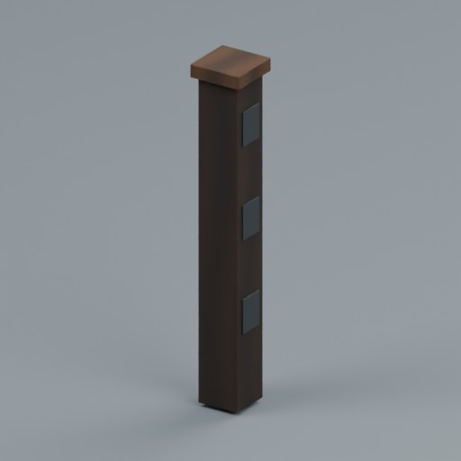
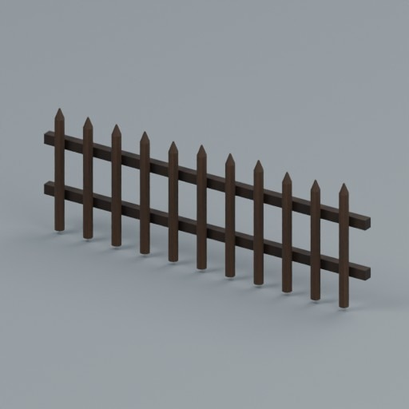
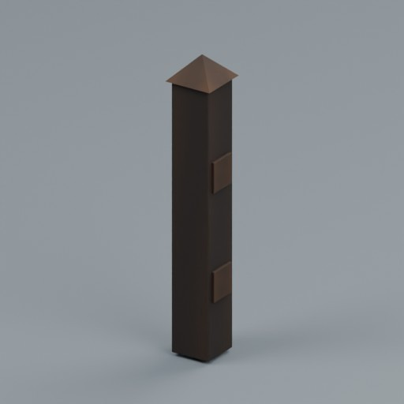
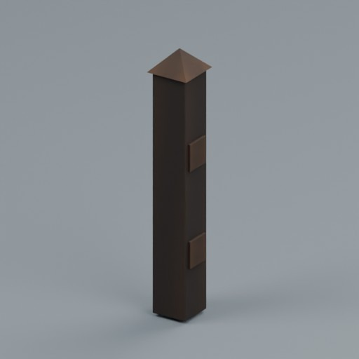
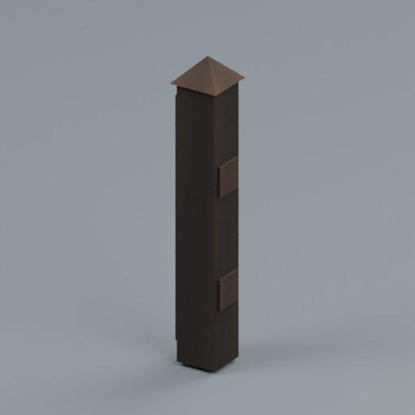
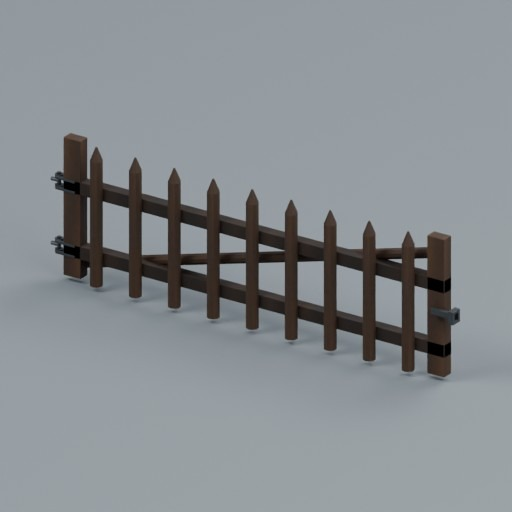

# Base distribution records 889–912

[Browse index](README.md) · [Coverage and missing fields](COVERAGE.md)

Images are actual existing model renders for browsing, not covered by model CC0. A group record may show several reused models. Dimensions and triangle counts apply only to the original record when sourced; revisions can differ. Unknown means unverified, not zero. No blanket CC0 grant for scenes, images, code or articles.

## PAV-RUN

**PAV-RUN**

PAV-RUN

**Image pending: no verified ID-specific preview mapping yet.**

Use / purpose: Running bond

Record type: model. Formats: BLEND/GLB.

Reported dimensions (metres; XYZ when derived from measured bounds, legacy axis order not reverified): Unknown. Triangles: Unknown.

Origin: Unknown / not independently confirmed. Orientation: Unknown / not independently confirmed.

[Download ZIP](https://raw.githubusercontent.com/k3peta/tales-on-a-table/main/distributions/stone-paving-v2/PAV-RUN-v2-models-CC0.zip) · [License scope](../../LICENSE.md)

**CC0-1.0** — model geometry and embedded display materials only. Models and embedded materials only; previews excluded.

Source details: [Catalogue 1](../../catalog/stone_paving_v2.md)

## PAV-BASKET

**PAV-BASKET**

PAV-BASKET

**Image pending: no verified ID-specific preview mapping yet.**

Use / purpose: Basket weave

Record type: model. Formats: BLEND/GLB.

Reported dimensions (metres; XYZ when derived from measured bounds, legacy axis order not reverified): Unknown. Triangles: Unknown.

Origin: Unknown / not independently confirmed. Orientation: Unknown / not independently confirmed.

[Download ZIP](https://raw.githubusercontent.com/k3peta/tales-on-a-table/main/distributions/stone-paving-v2/PAV-BASKET-v2-models-CC0.zip) · [License scope](../../LICENSE.md)

**CC0-1.0** — model geometry and embedded display materials only. Models and embedded materials only; previews excluded.

Source details: [Catalogue 1](../../catalog/stone_paving_v2.md)

## PAV-FAN

**PAV-FAN**

PAV-FAN

**Image pending: no verified ID-specific preview mapping yet.**

Use / purpose: Fan paving accent panel

Record type: model. Formats: BLEND/GLB.

Reported dimensions (metres; XYZ when derived from measured bounds, legacy axis order not reverified): Unknown. Triangles: Unknown.

Origin: Unknown / not independently confirmed. Orientation: Unknown / not independently confirmed.

[Download ZIP](https://raw.githubusercontent.com/k3peta/tales-on-a-table/main/distributions/stone-paving-v2/PAV-FAN-v2-models-CC0.zip) · [License scope](../../LICENSE.md)

**CC0-1.0** — model geometry and embedded display materials only. Models and embedded materials only; previews excluded.

Source details: [Catalogue 1](../../catalog/stone_paving_v2.md)

## RF01

**Pasture inline shared post**

Pasture inline shared post

Use / purpose: Recovered existing model: Pasture inline shared post

Record type: structural_variant. Formats: BLEND/GLB.

Reported dimensions (metres; XYZ when derived from measured bounds, legacy axis order not reverified): Unknown. Triangles: Unknown.

Origin: Unknown / not independently confirmed. Orientation: Unknown / not independently confirmed.

[Download ZIP](https://raw.githubusercontent.com/k3peta/tales-on-a-table/main/distributions/recovered-rustic-fences-rf7/RF01_CC0.zip) · [License scope](../../LICENSE.md)

**CC0-1.0** — model geometry and embedded display materials only. Models and embedded materials only; previews excluded.

Source details: [Catalogue 1](../../catalog/recovered_rustic_fences_rf7.md) · [Catalogue 2](../../catalog/rustic_slope_connections_v2.md)

## RF02

**Pasture gate fixed catch**

Pasture gate fixed catch

Use / purpose: Recovered existing model: Pasture gate fixed catch

Record type: model. Formats: BLEND/GLB.

Reported dimensions (metres; XYZ when derived from measured bounds, legacy axis order not reverified): Unknown. Triangles: Unknown.

Origin: Unknown / not independently confirmed. Orientation: Unknown / not independently confirmed.

[Download ZIP](https://raw.githubusercontent.com/k3peta/tales-on-a-table/main/distributions/recovered-rustic-fences-rf7/RF02_CC0.zip) · [License scope](../../LICENSE.md)

**CC0-1.0** — model geometry and embedded display materials only. Models and embedded materials only; previews excluded.

Source details: [Catalogue 1](../../catalog/recovered_rustic_fences_rf7.md)

## RF03

**Low kitchen-garden round-stake bay**

Low kitchen-garden round-stake bay

Use / purpose: Recovered existing model: Low kitchen-garden round-stake bay

Record type: model. Formats: BLEND/GLB.

Reported dimensions (metres; XYZ when derived from measured bounds, legacy axis order not reverified): Unknown. Triangles: Unknown.

Origin: Unknown / not independently confirmed. Orientation: Unknown / not independently confirmed.

[Download ZIP](https://raw.githubusercontent.com/k3peta/tales-on-a-table/main/distributions/recovered-rustic-fences-rf7/RF03_CC0.zip) · [License scope](../../LICENSE.md)

**CC0-1.0** — model geometry and embedded display materials only. Models and embedded materials only; previews excluded.

Source details: [Catalogue 1](../../catalog/recovered_rustic_fences_rf7.md)

## RF04

**Garden corner post**

Garden corner post

Use / purpose: Recovered existing model: Garden corner post

Record type: structural_variant. Formats: BLEND/GLB.

Reported dimensions (metres; XYZ when derived from measured bounds, legacy axis order not reverified): Unknown. Triangles: Unknown.

Origin: Unknown / not independently confirmed. Orientation: Unknown / not independently confirmed.

[Download ZIP](https://raw.githubusercontent.com/k3peta/tales-on-a-table/main/distributions/recovered-rustic-fences-rf7/RF04_CC0.zip) · [License scope](../../LICENSE.md)

**CC0-1.0** — model geometry and embedded display materials only. Models and embedded materials only; previews excluded.

Source details: [Catalogue 1](../../catalog/recovered_rustic_fences_rf7.md)

## RF05

**Garden inline shared post**

Garden inline shared post

Use / purpose: Recovered existing model: Garden inline shared post

Record type: structural_variant. Formats: BLEND/GLB.

Reported dimensions (metres; XYZ when derived from measured bounds, legacy axis order not reverified): Unknown. Triangles: Unknown.

Origin: Unknown / not independently confirmed. Orientation: Unknown / not independently confirmed.

[Download ZIP](https://raw.githubusercontent.com/k3peta/tales-on-a-table/main/distributions/recovered-rustic-fences-rf7/RF05_CC0.zip) · [License scope](../../LICENSE.md)

**CC0-1.0** — model geometry and embedded display materials only. Models and embedded materials only; previews excluded.

Source details: [Catalogue 1](../../catalog/recovered_rustic_fences_rf7.md) · [Catalogue 2](../../catalog/rustic_slope_connections_v2.md)

## RF06

**Garden terminal post**

Garden terminal post

Use / purpose: Recovered existing model: Garden terminal post

Record type: structural_variant. Formats: BLEND/GLB.

Reported dimensions (metres; XYZ when derived from measured bounds, legacy axis order not reverified): Unknown. Triangles: Unknown.

Origin: Unknown / not independently confirmed. Orientation: Unknown / not independently confirmed.

[Download ZIP](https://raw.githubusercontent.com/k3peta/tales-on-a-table/main/distributions/recovered-rustic-fences-rf7/RF06_CC0.zip) · [License scope](../../LICENSE.md)

**CC0-1.0** — model geometry and embedded display materials only. Models and embedded materials only; previews excluded.

Source details: [Catalogue 1](../../catalog/recovered_rustic_fences_rf7.md)

## RF07

**Low garden gate with fixed hinge and catch hardware**

Low garden gate with fixed hinge and catch hardware

Use / purpose: Recovered existing model: Low garden gate with fixed hinge and catch hardware

Record type: structural_variant. Formats: BLEND/GLB.

Reported dimensions (metres; XYZ when derived from measured bounds, legacy axis order not reverified): Unknown. Triangles: Unknown.

Origin: Unknown / not independently confirmed. Orientation: Unknown / not independently confirmed.

[Download ZIP](https://raw.githubusercontent.com/k3peta/tales-on-a-table/main/distributions/recovered-rustic-fences-rf7/RF07_CC0.zip) · [License scope](../../LICENSE.md)

**CC0-1.0** — model geometry and embedded display materials only. Models and embedded materials only; previews excluded.

Source details: [Catalogue 1](../../catalog/recovered_rustic_fences_rf7.md)

## ER101_StairTJunction

**StairTJunction**

StairTJunction

**Image pending: no verified ID-specific preview mapping yet.**

Use / purpose: 2x4m stair-top T junction. Low S interface (0,-2,0), first riser .125m; 8 treads .25m run/.125m rise. Top floor1m; W(-1,1,1), E(1,1,1), N(0,2,1). Stair tread width .9m. Landing underside .8m; not a human underpass.

Record type: model. Formats: BLEND/GLB.

Reported dimensions (metres; XYZ when derived from measured bounds, legacy axis order not reverified): Unknown. Triangles: Unknown.

Origin: Unknown / not independently confirmed. Orientation: Unknown / not independently confirmed.

[Download ZIP](https://raw.githubusercontent.com/k3peta/tales-on-a-table/main/distributions/elevated-ruin-connectors-v1/ER101_StairTJunction_CC0.zip) · [License scope](../../LICENSE.md)

**CC0-1.0** — model geometry and embedded display materials only. Models and embedded materials only; previews excluded.

Source details: [Catalogue 1](../../catalog/elevated_ruin_connectors_v1.md)

## ER102_RuinArchWalkway

**RuinArchWalkway**

RuinArchWalkway

**Image pending: no verified ID-specific preview mapping yet.**

Use / purpose: 2m EW upper walkway at Z3m over NS arch. Deck width1m, conservative guard clearance .955m. Lower opening width1.2m; spring1.6m, centre crown2.2m. E/W upper ports (+/-1,0,3). Upper and lower routes are separate. Broken stone crest remains below deck.

Record type: model. Formats: BLEND/GLB.

Reported dimensions (metres; XYZ when derived from measured bounds, legacy axis order not reverified): Unknown. Triangles: Unknown.

Origin: Unknown / not independently confirmed. Orientation: Unknown / not independently confirmed.

[Download ZIP](https://raw.githubusercontent.com/k3peta/tales-on-a-table/main/distributions/elevated-ruin-connectors-v1/ER102_RuinArchWalkway_CC0.zip) · [License scope](../../LICENSE.md)

**CC0-1.0** — model geometry and embedded display materials only. Models and embedded materials only; previews excluded.

Source details: [Catalogue 1](../../catalog/elevated_ruin_connectors_v1.md)

## RI101_RaisedFlume

**RaisedFlume**

RaisedFlume

**Image pending: no verified ID-specific preview mapping yet.**

Use / purpose: 2m NS supported flume. Open ends y+-1, wet width .6m, bed Z1, side top1.3. Ground feet Z0.

Record type: model. Formats: BLEND/GLB.

Reported dimensions (metres; XYZ when derived from measured bounds, legacy axis order not reverified): Unknown. Triangles: Unknown.

Origin: Unknown / not independently confirmed. Orientation: Unknown / not independently confirmed.

[Download ZIP](https://raw.githubusercontent.com/k3peta/tales-on-a-table/main/distributions/rural-interface-v1/RI101_RaisedFlume_CC0.zip) · [License scope](../../LICENSE.md)

**CC0-1.0** — model geometry and embedded display materials only. Models and embedded materials only; previews excluded.

Source details: [Catalogue 1](../../catalog/rural_interfaces_v1.md)

## RI102_SluiceDistributor

**SluiceDistributor**

SluiceDistributor

**Image pending: no verified ID-specific preview mapping yet.**

Use / purpose: 2x2m supported distributor. S(0,-1,1), N(0,1,1), E(1,0,1) bed ports, .6m wet width. Gate fixed raised, .39m gap beneath gate. No animated or hydraulic simulation.

Record type: model. Formats: BLEND/GLB.

Reported dimensions (metres; XYZ when derived from measured bounds, legacy axis order not reverified): Unknown. Triangles: Unknown.

Origin: Unknown / not independently confirmed. Orientation: Unknown / not independently confirmed.

[Download ZIP](https://raw.githubusercontent.com/k3peta/tales-on-a-table/main/distributions/rural-interface-v1/RI102_SluiceDistributor_CC0.zip) · [License scope](../../LICENSE.md)

**CC0-1.0** — model geometry and embedded display materials only. Models and embedded materials only; previews excluded.

Source details: [Catalogue 1](../../catalog/rural_interfaces_v1.md)

## RI103_DitchFence

**DitchFence**

DitchFence

**Image pending: no verified ID-specific preview mapping yet.**

Use / purpose: 2m fence bay across ditch. Bank origin Z0, post bottoms0; centre hanging slat bottom-.46m. Intended .5m deep ditch, .04m clearance. Fixed slats and hinge pins, no movement or collision test.

Record type: model. Formats: BLEND/GLB.

Reported dimensions (metres; XYZ when derived from measured bounds, legacy axis order not reverified): Unknown. Triangles: Unknown.

Origin: Unknown / not independently confirmed. Orientation: Unknown / not independently confirmed.

[Download ZIP](https://raw.githubusercontent.com/k3peta/tales-on-a-table/main/distributions/rural-interface-v1/RI103_DitchFence_CC0.zip) · [License scope](../../LICENSE.md)

**CC0-1.0** — model geometry and embedded display materials only. Models and embedded materials only; previews excluded.

Source details: [Catalogue 1](../../catalog/rural_interfaces_v1.md)

## RI104_EavesDownchute

**EavesDownchute**

EavesDownchute

**Image pending: no verified ID-specific preview mapping yet.**

Use / purpose: Attachment module: NS gutter y-1..1 at bedZ2; chute y1..2 drops to bedZ1. Wet width.6m, walls.3m. Attach to eaves/wall; not ground-supported. Outlet (0,2,1) fits raised flume. Roof and wall not included.

Record type: model. Formats: BLEND/GLB.

Reported dimensions (metres; XYZ when derived from measured bounds, legacy axis order not reverified): Unknown. Triangles: Unknown.

Origin: Unknown / not independently confirmed. Orientation: Unknown / not independently confirmed.

[Download ZIP](https://raw.githubusercontent.com/k3peta/tales-on-a-table/main/distributions/rural-interface-v1/RI104_EavesDownchute_CC0.zip) · [License scope](../../LICENSE.md)

**CC0-1.0** — model geometry and embedded display materials only. Models and embedded materials only; previews excluded.

Source details: [Catalogue 1](../../catalog/rural_interfaces_v1.md)

## RG101_OpenTreeGuard

**OpenTreeGuard**

OpenTreeGuard

**Image pending: no verified ID-specific preview mapping yet.**

Use / purpose: Open-top/open-bottom eight-sided tree guard. Origin at soilZ0, stakes to1.32m, central cylinder radius.5m unobstructed. Outer radius under.70m. Four fixed straps at two seams, no animation. Place trees independently; trees and soil not included.

Record type: model. Formats: BLEND/GLB.

Reported dimensions (metres; XYZ when derived from measured bounds, legacy axis order not reverified): Unknown. Triangles: Unknown.

Origin: Unknown / not independently confirmed. Orientation: Unknown / not independently confirmed.

[Download ZIP](https://raw.githubusercontent.com/k3peta/tales-on-a-table/main/distributions/tree-guard-v1/RG101_OpenTreeGuard_CC0.zip) · [License scope](../../LICENSE.md)

**CC0-1.0** — model geometry and embedded display materials only. Models and embedded materials only; previews excluded.

Source details: [Catalogue 1](../../catalog/tree_guard_v1.md)

## BG401_Maize

**Maize**

Maize

**Image pending: no verified ID-specific preview mapping yet.**

Use / purpose: Tall stalk with long blade leaves, lateral husked ears and terminal branched tassel.

Record type: model. Formats: BLEND/GLB.

Reported dimensions (metres; XYZ when derived from measured bounds, legacy axis order not reverified): Unknown. Triangles: Unknown.

Origin: Unknown / not independently confirmed. Orientation: Unknown / not independently confirmed.

[Download ZIP](https://raw.githubusercontent.com/k3peta/tales-on-a-table/main/distributions/botanical-field-growth-v1/BG401_Maize_CC0.zip) · [License scope](../../LICENSE.md)

**CC0-1.0** — model geometry and embedded display materials only. Models and embedded materials only; previews excluded.

Source details: [Catalogue 1](../../catalog/botanical_field_growth_v1.md)

## BG402_Eggplant

**Eggplant**

Eggplant

**Image pending: no verified ID-specific preview mapping yet.**

Use / purpose: Branching vegetable shrub with broad leaves and hanging elongated purple fruit under green calyx.

Record type: model. Formats: BLEND/GLB.

Reported dimensions (metres; XYZ when derived from measured bounds, legacy axis order not reverified): Unknown. Triangles: Unknown.

Origin: Unknown / not independently confirmed. Orientation: Unknown / not independently confirmed.

[Download ZIP](https://raw.githubusercontent.com/k3peta/tales-on-a-table/main/distributions/botanical-field-growth-v1/BG402_Eggplant_CC0.zip) · [License scope](../../LICENSE.md)

**CC0-1.0** — model geometry and embedded display materials only. Models and embedded materials only; previews excluded.

Source details: [Catalogue 1](../../catalog/botanical_field_growth_v1.md)

## BG403_Artichoke

**Artichoke**

Artichoke

**Image pending: no verified ID-specific preview mapping yet.**

Use / purpose: Deeply cut basal leaves and three stalked heads built from overlapping pointed bracts.

Record type: model. Formats: BLEND/GLB.

Reported dimensions (metres; XYZ when derived from measured bounds, legacy axis order not reverified): Unknown. Triangles: Unknown.

Origin: Unknown / not independently confirmed. Orientation: Unknown / not independently confirmed.

[Download ZIP](https://raw.githubusercontent.com/k3peta/tales-on-a-table/main/distributions/botanical-field-growth-v1/BG403_Artichoke_CC0.zip) · [License scope](../../LICENSE.md)

**CC0-1.0** — model geometry and embedded display materials only. Models and embedded materials only; previews excluded.

Source details: [Catalogue 1](../../catalog/botanical_field_growth_v1.md)

## BG404_AsparagusShoots

**AsparagusShoots**

AsparagusShoots

**Image pending: no verified ID-specific preview mapping yet.**

Use / purpose: Seven emerging tapering spears with small overlapping tip scales; spring shoot stage, not mature fern foliage.

Record type: model. Formats: BLEND/GLB.

Reported dimensions (metres; XYZ when derived from measured bounds, legacy axis order not reverified): Unknown. Triangles: Unknown.

Origin: Unknown / not independently confirmed. Orientation: Unknown / not independently confirmed.

[Download ZIP](https://raw.githubusercontent.com/k3peta/tales-on-a-table/main/distributions/botanical-field-growth-v1/BG404_AsparagusShoots_CC0.zip) · [License scope](../../LICENSE.md)

**CC0-1.0** — model geometry and embedded display materials only. Models and embedded materials only; previews excluded.

Source details: [Catalogue 1](../../catalog/botanical_field_growth_v1.md)

## NR101_FlowstoneApron

**FlowstoneApron**

FlowstoneApron

**Image pending: no verified ID-specific preview mapping yet.**

Use / purpose: 2m wide rock apron. Toe y-.8 at Z0, back y.5 topZ1.6. Matching E/W profile for 2m pitch. Longitudinal folds on curved solid surface. Cave dressing, not a walkable ramp.

Record type: model. Formats: BLEND/GLB.

Reported dimensions (metres; XYZ when derived from measured bounds, legacy axis order not reverified): Unknown. Triangles: Unknown.

Origin: Unknown / not independently confirmed. Orientation: Unknown / not independently confirmed.

[Download ZIP](https://raw.githubusercontent.com/k3peta/tales-on-a-table/main/distributions/natural-rock-forms-v1/NR101_FlowstoneApron_CC0.zip) · [License scope](../../LICENSE.md)

**CC0-1.0** — model geometry and embedded display materials only. Models and embedded materials only; previews excluded.

Source details: [Catalogue 1](../../catalog/natural_rock_forms_v1.md)

## NR102_ColumnarLedge

**ColumnarLedge**

ColumnarLedge

**Image pending: no verified ID-specific preview mapping yet.**

Use / purpose: 2x1m grounded columnar rock cluster. Polygonal vertical fracture faces with chipped/dished caps. Common baseZ0..0.1. Intended exposed rock dressing; top silhouette does not form a sealed terrain-tile port.

Record type: model. Formats: BLEND/GLB.

Reported dimensions (metres; XYZ when derived from measured bounds, legacy axis order not reverified): Unknown. Triangles: Unknown.

Origin: Unknown / not independently confirmed. Orientation: Unknown / not independently confirmed.

[Download ZIP](https://raw.githubusercontent.com/k3peta/tales-on-a-table/main/distributions/natural-rock-forms-v1/NR102_ColumnarLedge_CC0.zip) · [License scope](../../LICENSE.md)

**CC0-1.0** — model geometry and embedded display materials only. Models and embedded materials only; previews excluded.

Source details: [Catalogue 1](../../catalog/natural_rock_forms_v1.md)

## NP101_BraidedIsland

**BraidedIsland**

BraidedIsland

**Image pending: no verified ID-specific preview mapping yet.**

Use / purpose: Local-use candidate: single N/S river split around central dry island then rejoined inside2m.

Record type: model. Formats: BLEND/GLB.

Reported dimensions (metres; XYZ when derived from measured bounds, legacy axis order not reverified): Unknown. Triangles: Unknown.

Origin: Unknown / not independently confirmed. Orientation: Unknown / not independently confirmed.

[Download ZIP](https://raw.githubusercontent.com/k3peta/tales-on-a-table/main/distributions/terrain-use-plan-v1/NP101_BraidedIsland_CC0.zip) · [License scope](../../LICENSE.md)

**CC0-1.0** — model geometry and embedded display materials only. Models and embedded materials only; previews excluded.

Source details: [Catalogue 1](../../catalog/terrain_use_plan_v1.md)
