# Base distribution records 913–936

[Browse index](README.md) · [Coverage and missing fields](COVERAGE.md)

Images are actual existing model renders for browsing, not covered by model CC0. A group record may show several reused models. Dimensions and triangle counts apply only to the original record when sourced; revisions can differ. Unknown means unverified, not zero. No blanket CC0 grant for scenes, images, code or articles.

## NP102_SteppingCrossing

**SteppingCrossing**

SteppingCrossing

[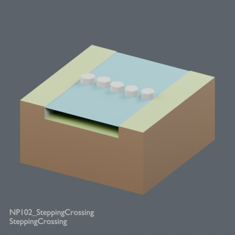](../../previews/bg-fcs24/renders/NP102_SteppingCrossing.png)

[Full-size image](../../previews/bg-fcs24/renders/NP102_SteppingCrossing.png)

Use / purpose: Local-use candidate: five grounded stepping stones crossing river, top.075m; water gaps remain. Not tested for walking.

Record type: model. Formats: BLEND/GLB.

Reported dimensions (metres; XYZ when derived from measured bounds, legacy axis order not reverified): Unknown. Triangles: Unknown.

Origin: Unknown / not independently confirmed. Orientation: Unknown / not independently confirmed.

[Download ZIP](https://raw.githubusercontent.com/k3peta/tales-on-a-table/main/distributions/terrain-use-plan-v1/NP102_SteppingCrossing_CC0.zip) · [License scope](../../LICENSE.md)

**CC0-1.0** — model geometry and embedded display materials only. Models and embedded materials only; previews excluded.

Source details: [Catalogue 1](../../catalog/terrain_use_plan_v1.md)

## NP103_DoubleMouth

**DoubleMouth**

DoubleMouth

[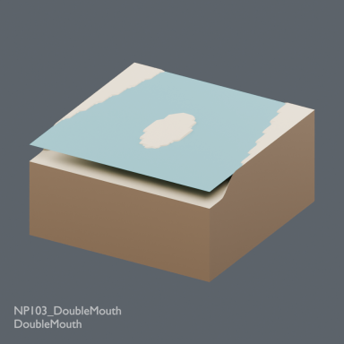](../../previews/bg-fcs24/renders/NP103_DoubleMouth.png)

[Full-size image](../../previews/bg-fcs24/renders/NP103_DoubleMouth.png)

Use / purpose: Structural variant: N river into S full sea, central sand island makes two outlets.

Record type: structural_variant. Formats: BLEND/GLB.

Reported dimensions (metres; XYZ when derived from measured bounds, legacy axis order not reverified): Unknown. Triangles: Unknown.

Origin: Unknown / not independently confirmed. Orientation: Unknown / not independently confirmed.

[Download ZIP](https://raw.githubusercontent.com/k3peta/tales-on-a-table/main/distributions/terrain-use-plan-v1/NP103_DoubleMouth_CC0.zip) · [License scope](../../LICENSE.md)

**CC0-1.0** — model geometry and embedded display materials only. Models and embedded materials only; previews excluded.

Source details: [Catalogue 1](../../catalog/terrain_use_plan_v1.md)

## NP104_WetOverhang

**WetOverhang**

WetOverhang

[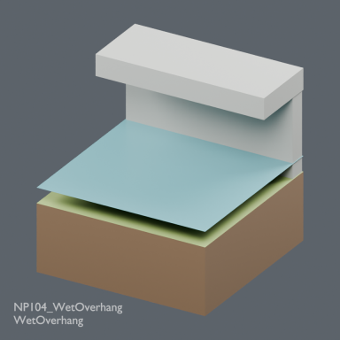](../../previews/bg-fcs24/renders/NP104_WetOverhang.png)

[Full-size image](../../previews/bg-fcs24/renders/NP104_WetOverhang.png)

Use / purpose: Structural variant: full sea bed-.19/water-.01 under roof underside.75/top1; N solid land1.

Record type: structural_variant. Formats: BLEND/GLB.

Reported dimensions (metres; XYZ when derived from measured bounds, legacy axis order not reverified): Unknown. Triangles: Unknown.

Origin: Unknown / not independently confirmed. Orientation: Unknown / not independently confirmed.

[Download ZIP](https://raw.githubusercontent.com/k3peta/tales-on-a-table/main/distributions/terrain-use-plan-v1/NP104_WetOverhang_CC0.zip) · [License scope](../../LICENSE.md)

**CC0-1.0** — model geometry and embedded display materials only. Models and embedded materials only; previews excluded.

Source details: [Catalogue 1](../../catalog/terrain_use_plan_v1.md)

## NP105_CliffRiver

**CliffRiver**

CliffRiver

[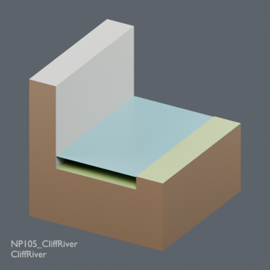](../../previews/bg-fcs24/renders/NP105_CliffRiver.png)

[Full-size image](../../previews/bg-fcs24/renders/NP105_CliffRiver.png)

Use / purpose: Structural variant: river bed-.19/water-.01, W bank1 and E bank0. N/S water ports standard; land heights differ on west.

Record type: structural_variant. Formats: BLEND/GLB.

Reported dimensions (metres; XYZ when derived from measured bounds, legacy axis order not reverified): Unknown. Triangles: Unknown.

Origin: Unknown / not independently confirmed. Orientation: Unknown / not independently confirmed.

[Download ZIP](https://raw.githubusercontent.com/k3peta/tales-on-a-table/main/distributions/terrain-use-plan-v1/NP105_CliffRiver_CC0.zip) · [License scope](../../LICENSE.md)

**CC0-1.0** — model geometry and embedded display materials only. Models and embedded materials only; previews excluded.

Source details: [Catalogue 1](../../catalog/terrain_use_plan_v1.md)

## NP106_RecessedFall

**RecessedFall**

RecessedFall

[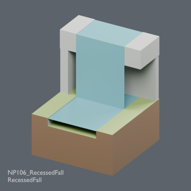](../../previews/bg-fcs24/renders/NP106_RecessedFall.png)

[Full-size image](../../previews/bg-fcs24/renders/NP106_RecessedFall.png)

Use / purpose: Local-use candidate: lower river-.19/- .01 and upper bed1.31/water1.49, banks1.5. Behind water curtain lower cavity has ceiling1.05, open side. Not a human passage guarantee.

Record type: model. Formats: BLEND/GLB.

Reported dimensions (metres; XYZ when derived from measured bounds, legacy axis order not reverified): Unknown. Triangles: Unknown.

Origin: Unknown / not independently confirmed. Orientation: Unknown / not independently confirmed.

[Download ZIP](https://raw.githubusercontent.com/k3peta/tales-on-a-table/main/distributions/terrain-use-plan-v1/NP106_RecessedFall_CC0.zip) · [License scope](../../LICENSE.md)

**CC0-1.0** — model geometry and embedded display materials only. Models and embedded materials only; previews excluded.

Source details: [Catalogue 1](../../catalog/terrain_use_plan_v1.md)

## CD101_CeilingPendants

**CeilingPendants**

CeilingPendants

[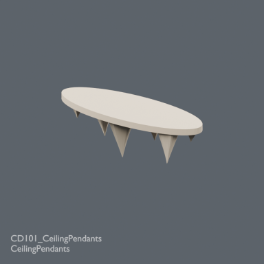](../../previews/bg-fcs24/renders/CD101_CeilingPendants.png)

[Full-size image](../../previews/bg-fcs24/renders/CD101_CeilingPendants.png)

Use / purpose: Ceiling mineral pendants. Anchor origin on ceiling plane; place at Z0.75 for a cave ceiling0.75. Upper0.04m embeds into roof. Lowest local Z-0.465.

Record type: model. Formats: BLEND/GLB.

Reported dimensions (metres; XYZ when derived from measured bounds, legacy axis order not reverified): Unknown. Triangles: Unknown.

Origin: Unknown / not independently confirmed. Orientation: Unknown / not independently confirmed.

[Download ZIP](https://raw.githubusercontent.com/k3peta/tales-on-a-table/main/distributions/cave-deposition-v1/CD101_CeilingPendants_CC0.zip) · [License scope](../../LICENSE.md)

**CC0-1.0** — model geometry and embedded display materials only. Models and embedded materials only; previews excluded.

Source details: [Catalogue 1](../../catalog/cave_deposition_v1.md)

## CD102_FoldedCurtain

**FoldedCurtain**

FoldedCurtain

[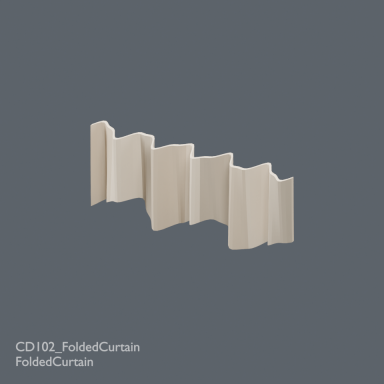](../../previews/bg-fcs24/renders/CD102_FoldedCurtain.png)

[Full-size image](../../previews/bg-fcs24/renders/CD102_FoldedCurtain.png)

Use / purpose: Folded cave curtain. Ceiling anchor origin; place at Y0.65 Z0.75 in a2m room with north inner wallY0.8. Upper0.04m embeds into roof.

Record type: model. Formats: BLEND/GLB.

Reported dimensions (metres; XYZ when derived from measured bounds, legacy axis order not reverified): Unknown. Triangles: Unknown.

Origin: Unknown / not independently confirmed. Orientation: Unknown / not independently confirmed.

[Download ZIP](https://raw.githubusercontent.com/k3peta/tales-on-a-table/main/distributions/cave-deposition-v1/CD102_FoldedCurtain_CC0.zip) · [License scope](../../LICENSE.md)

**CC0-1.0** — model geometry and embedded display materials only. Models and embedded materials only; previews excluded.

Source details: [Catalogue 1](../../catalog/cave_deposition_v1.md)

## CD103_RimstonePools

**RimstonePools**

RimstonePools

[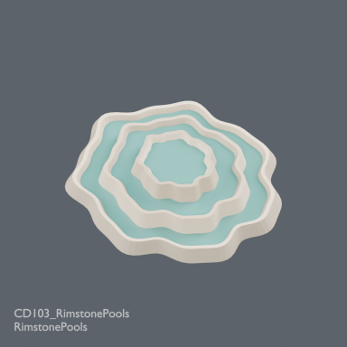](../../previews/bg-fcs24/renders/CD103_RimstonePools.png)

[Full-size image](../../previews/bg-fcs24/renders/CD103_RimstonePools.png)

Use / purpose: Closed rimstone pools. Floor anchor originZ0. Local static water levels0.27,0.17,0.07m. Not compatible with standard river waterZ-0.01 without deliberate separate basin placement.

Record type: model. Formats: BLEND/GLB.

Reported dimensions (metres; XYZ when derived from measured bounds, legacy axis order not reverified): Unknown. Triangles: Unknown.

Origin: Unknown / not independently confirmed. Orientation: Unknown / not independently confirmed.

[Download ZIP](https://raw.githubusercontent.com/k3peta/tales-on-a-table/main/distributions/cave-deposition-v1/CD103_RimstonePools_CC0.zip) · [License scope](../../LICENSE.md)

**CC0-1.0** — model geometry and embedded display materials only. Models and embedded materials only; previews excluded.

Source details: [Catalogue 1](../../catalog/cave_deposition_v1.md)

## MF101_DrainedMudflat

**DrainedMudflat**

DrainedMudflat

[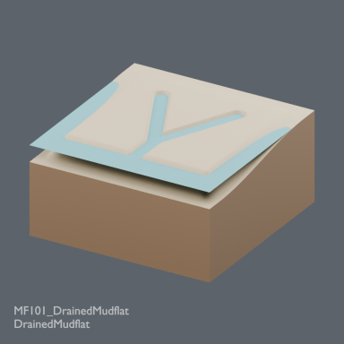](../../previews/bg-fcs24/renders/MF101_DrainedMudflat.png)

[Full-size image](../../previews/bg-fcs24/renders/MF101_DrainedMudflat.png)

Use / purpose: Broad dry mudflat with narrow branching drainage on standard beach edges; fixed water only

Record type: model. Formats: BLEND/GLB.

Reported dimensions (metres; XYZ when derived from measured bounds, legacy axis order not reverified): Unknown. Triangles: Unknown.

Origin: Unknown / not independently confirmed. Orientation: Unknown / not independently confirmed.

[Download ZIP](https://raw.githubusercontent.com/k3peta/tales-on-a-table/main/distributions/static-mudflat-v1/MF101_DrainedMudflat_CC0.zip) · [License scope](../../LICENSE.md)

**CC0-1.0** — model geometry and embedded display materials only. Models and embedded materials only; previews excluded.

Source details: [Catalogue 1](../../catalog/static_mudflat_v1.md)

## FCS101_TimberScaffold

**TimberScaffold**

TimberScaffold

[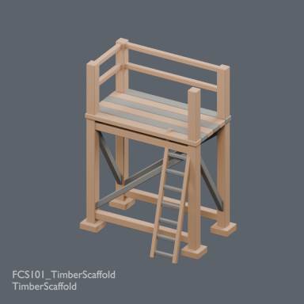](../../previews/bg-fcs24/renders/FCS101_TimberScaffold.png)

[Full-size image](../../previews/bg-fcs24/renders/FCS101_TimberScaffold.png)

Use / purpose: 2m bay deckZ2 with integral ladder and guard rails; published ladder alone not a scaffold

Record type: model. Formats: BLEND/GLB.

Reported dimensions (metres; XYZ when derived from measured bounds, legacy axis order not reverified): Unknown. Triangles: Unknown.

Origin: Unknown / not independently confirmed. Orientation: Unknown / not independently confirmed.

[Download ZIP](https://raw.githubusercontent.com/k3peta/tales-on-a-table/main/distributions/fortified-city-sites-v1/FCS101_TimberScaffold_CC0.zip) · [License scope](../../LICENSE.md)

**CC0-1.0** — model geometry and embedded display materials only. Models and embedded materials only; previews excluded.

Source details: [Catalogue 1](../../catalog/fortified_city_sites_v1.md)

## FCS102_TreadwheelHoist

**TreadwheelHoist**

TreadwheelHoist

[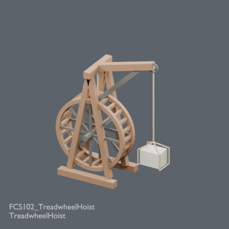](../../previews/bg-fcs24/renders/FCS102_TreadwheelHoist.png)

[Full-size image](../../previews/bg-fcs24/renders/FCS102_TreadwheelHoist.png)

Use / purpose: Grounded frame, treadwheel, boom and hanging stone sling; loose pulley not complete hoist

Record type: model. Formats: BLEND/GLB.

Reported dimensions (metres; XYZ when derived from measured bounds, legacy axis order not reverified): Unknown. Triangles: Unknown.

Origin: Unknown / not independently confirmed. Orientation: Unknown / not independently confirmed.

[Download ZIP](https://raw.githubusercontent.com/k3peta/tales-on-a-table/main/distributions/fortified-city-sites-v1/FCS102_TreadwheelHoist_CC0.zip) · [License scope](../../LICENSE.md)

**CC0-1.0** — model geometry and embedded display materials only. Models and embedded materials only; previews excluded.

Source details: [Catalogue 1](../../catalog/fortified_city_sites_v1.md)

## FCS103_UnfinishedMasonry

**UnfinishedMasonry**

UnfinishedMasonry

[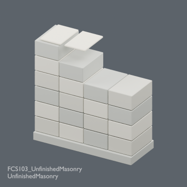](../../previews/bg-fcs24/renders/FCS103_UnfinishedMasonry.png)

[Full-size image](../../previews/bg-fcs24/renders/FCS103_UnfinishedMasonry.png)

Use / purpose: 2m masonry bay with stepped unlaid top and tooth end; old wall remains existing reference

Record type: model. Formats: BLEND/GLB.

Reported dimensions (metres; XYZ when derived from measured bounds, legacy axis order not reverified): Unknown. Triangles: Unknown.

Origin: Unknown / not independently confirmed. Orientation: Unknown / not independently confirmed.

[Download ZIP](https://raw.githubusercontent.com/k3peta/tales-on-a-table/main/distributions/fortified-city-sites-v1/FCS103_UnfinishedMasonry_CC0.zip) · [License scope](../../LICENSE.md)

**CC0-1.0** — model geometry and embedded display materials only. Models and embedded materials only; previews excluded.

Source details: [Catalogue 1](../../catalog/fortified_city_sites_v1.md)

**Known issue:** Partly unsupported-looking top plates: intent/contact diagnosis pending; image faithfully shows distributed source. Preview faithfully shows the distributed model; image completion is not quality approval.

## FCS104_MasonsDressingBank

**MasonsDressingBank**

MasonsDressingBank

[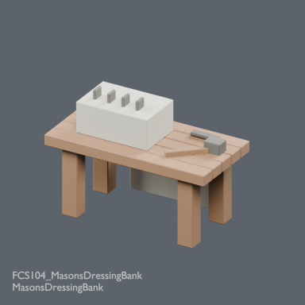](../../previews/bg-fcs24/renders/FCS104_MasonsDressingBank.png)

[Full-size image](../../previews/bg-fcs24/renders/FCS104_MasonsDressingBank.png)

Use / purpose: Stone dressing bank with ashlar block and wedges; generic workbench not newly counted independent

Record type: model. Formats: BLEND/GLB.

Reported dimensions (metres; XYZ when derived from measured bounds, legacy axis order not reverified): Unknown. Triangles: Unknown.

Origin: Unknown / not independently confirmed. Orientation: Unknown / not independently confirmed.

[Download ZIP](https://raw.githubusercontent.com/k3peta/tales-on-a-table/main/distributions/fortified-city-sites-v1/FCS104_MasonsDressingBank_CC0.zip) · [License scope](../../LICENSE.md)

**CC0-1.0** — model geometry and embedded display materials only. Models and embedded materials only; previews excluded.

Source details: [Catalogue 1](../../catalog/fortified_city_sites_v1.md)

## FCS105_RoadGatehouse

**RoadGatehouse**

RoadGatehouse

[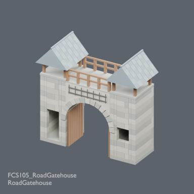](../../previews/bg-fcs24/renders/FCS105_RoadGatehouse.png)

[Full-size image](../../previews/bg-fcs24/renders/FCS105_RoadGatehouse.png)

Use / purpose: 6m frontage, clear central cart arch,4m upper deck, twin roofed tower rooms; old2m gate arch different scale/program

Record type: model. Formats: BLEND/GLB.

Reported dimensions (metres; XYZ when derived from measured bounds, legacy axis order not reverified): Unknown. Triangles: Unknown.

Origin: Unknown / not independently confirmed. Orientation: Unknown / not independently confirmed.

[Download ZIP](https://raw.githubusercontent.com/k3peta/tales-on-a-table/main/distributions/fortified-city-sites-v1/FCS105_RoadGatehouse_CC0.zip) · [License scope](../../LICENSE.md)

**CC0-1.0** — model geometry and embedded display materials only. Models and embedded materials only; previews excluded.

Source details: [Catalogue 1](../../catalog/fortified_city_sites_v1.md)

**Version scope:** The image above depicts the primary recorded ZIP. [Latest revision ZIP](https://raw.githubusercontent.com/k3peta/tales-on-a-table/main/distributions/fortified-city-access-v2/FCS105_RoadGatehouse_access_v2_CC0.zip). Exact latest-revision image/ZIP binding remains under review; do not substitute the earlier image. [Version audit](VERSION-AUDIT.md).

## FCS106_WatchKiosk

**WatchKiosk**

WatchKiosk

[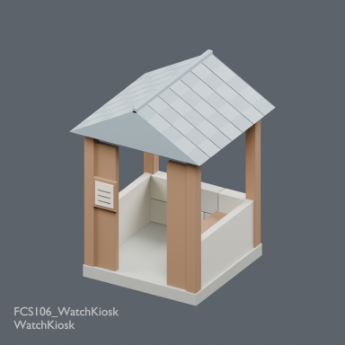](../../previews/bg-fcs24/renders/FCS106_WatchKiosk.png)

[Full-size image](../../previews/bg-fcs24/renders/FCS106_WatchKiosk.png)

Use / purpose: 2m guard booth with open door/window, bench and pitched roof; not barn/wine facility

Record type: model. Formats: BLEND/GLB.

Reported dimensions (metres; XYZ when derived from measured bounds, legacy axis order not reverified): Unknown. Triangles: Unknown.

Origin: Unknown / not independently confirmed. Orientation: Unknown / not independently confirmed.

[Download ZIP](https://raw.githubusercontent.com/k3peta/tales-on-a-table/main/distributions/fortified-city-sites-v1/FCS106_WatchKiosk_CC0.zip) · [License scope](../../LICENSE.md)

**CC0-1.0** — model geometry and embedded display materials only. Models and embedded materials only; previews excluded.

Source details: [Catalogue 1](../../catalog/fortified_city_sites_v1.md)

## FCSV01_ConstructionSite

**ConstructionSite**

ConstructionSite

[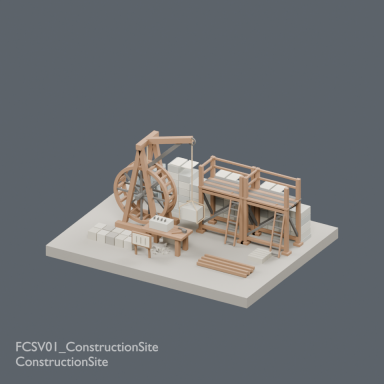](../../previews/bg-fcs24/renders/FCSV01_ConstructionSite.png)

[Full-size image](../../previews/bg-fcs24/renders/FCSV01_ConstructionSite.png)

Use / purpose: Repositionable assembly of current FCS parts and verified CC0 NR102/BD104/RS201 where used, plus original scene fixtures. Not an additional independent shape.

Record type: group. Formats: BLEND/GLB.

Reported dimensions (metres; XYZ when derived from measured bounds, legacy axis order not reverified): Unknown. Triangles: Unknown.

Origin: Unknown / not independently confirmed. Orientation: Unknown / not independently confirmed.

[Download ZIP](https://raw.githubusercontent.com/k3peta/tales-on-a-table/main/distributions/fortified-city-sites-v1/FCSV01_ConstructionSite_CC0.zip) · [License scope](../../LICENSE.md)

**CC0-1.0** — model geometry and embedded display materials only. Models and embedded materials only; previews excluded.

Source details: [Catalogue 1](../../catalog/city_scenes_quality_v3.md) · [Catalogue 2](../../catalog/fortified_city_sites_v1.md)

**Version scope:** The image above depicts the primary recorded ZIP. [Latest revision ZIP](https://raw.githubusercontent.com/k3peta/tales-on-a-table/main/distributions/city-scenes-quality-v3/FCSV01_ConstructionSite_v3_CC0.zip). Exact latest-revision image/ZIP binding remains under review; do not substitute the earlier image. [Version audit](VERSION-AUDIT.md).

## FCSV02_RoadEntrance

**RoadEntrance**

RoadEntrance

[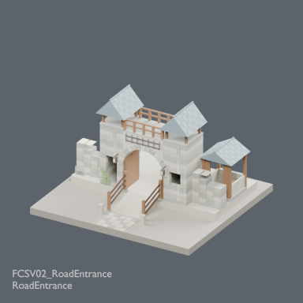](../../previews/bg-fcs24/renders/FCSV02_RoadEntrance.png)

[Full-size image](../../previews/bg-fcs24/renders/FCSV02_RoadEntrance.png)

Use / purpose: Repositionable assembly of current FCS parts and verified CC0 NR102/BD104/RS201 where used, plus original scene fixtures. Not an additional independent shape.

Record type: group. Formats: BLEND/GLB.

Reported dimensions (metres; XYZ when derived from measured bounds, legacy axis order not reverified): Unknown. Triangles: Unknown.

Origin: Unknown / not independently confirmed. Orientation: Unknown / not independently confirmed.

[Download ZIP](https://raw.githubusercontent.com/k3peta/tales-on-a-table/main/distributions/fortified-city-sites-v1/FCSV02_RoadEntrance_CC0.zip) · [License scope](../../LICENSE.md)

**CC0-1.0** — model geometry and embedded display materials only. Models and embedded materials only; previews excluded.

Source details: [Catalogue 1](../../catalog/fortified_city_sites_v1.md)

## HCV101

**HCV101**

HCV101

[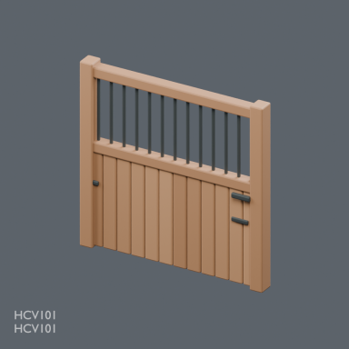](../../previews/hcv-chb24/renders/HCV101.png)

[Full-size image](../../previews/hcv-chb24/renders/HCV101.png)

Use / purpose: HCV101: Horse box front with upper grille

Record type: model. Formats: BLEND/GLB.

Reported dimensions (metres; XYZ when derived from measured bounds, legacy axis order not reverified): Unknown. Triangles: Unknown.

Origin: Unknown / not independently confirmed. Orientation: Unknown / not independently confirmed.

[Download ZIP](https://raw.githubusercontent.com/k3peta/tales-on-a-table/main/distributions/husbandry-cellar-v1/HCV101-CC0.zip) · [License scope](../../LICENSE.md)

**CC0-1.0** — model geometry and embedded display materials only. Models and embedded materials only; previews excluded.

Source details: [Catalogue 1](../../catalog/husbandry_cellar_v1.md)

## HCV102

**HCV102**

HCV102

[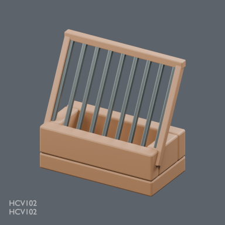](../../previews/hcv-chb24/renders/HCV102.png)

[Full-size image](../../previews/hcv-chb24/renders/HCV102.png)

Use / purpose: HCV102: Angled horse hay manger

Record type: model. Formats: BLEND/GLB.

Reported dimensions (metres; XYZ when derived from measured bounds, legacy axis order not reverified): Unknown. Triangles: Unknown.

Origin: Unknown / not independently confirmed. Orientation: Unknown / not independently confirmed.

[Download ZIP](https://raw.githubusercontent.com/k3peta/tales-on-a-table/main/distributions/husbandry-cellar-v1/HCV102-CC0.zip) · [License scope](../../LICENSE.md)

**CC0-1.0** — model geometry and embedded display materials only. Models and embedded materials only; previews excluded.

Source details: [Catalogue 1](../../catalog/cheese_hay_buildings_v1.md) · [Catalogue 2](../../catalog/husbandry_cellar_v1.md)

## HCV103

**HCV103**

HCV103

[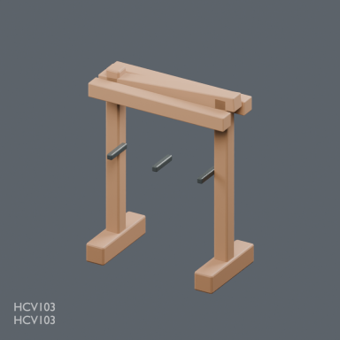](../../previews/hcv-chb24/renders/HCV103.png)

[Full-size image](../../previews/hcv-chb24/renders/HCV103.png)

Use / purpose: HCV103: Saddle and bridle stand

Record type: model. Formats: BLEND/GLB.

Reported dimensions (metres; XYZ when derived from measured bounds, legacy axis order not reverified): Unknown. Triangles: Unknown.

Origin: Unknown / not independently confirmed. Orientation: Unknown / not independently confirmed.

[Download ZIP](https://raw.githubusercontent.com/k3peta/tales-on-a-table/main/distributions/husbandry-cellar-v1/HCV103-CC0.zip) · [License scope](../../LICENSE.md)

**CC0-1.0** — model geometry and embedded display materials only. Models and embedded materials only; previews excluded.

Source details: [Catalogue 1](../../catalog/husbandry_cellar_v1.md)

**Known issue:** Peg contact diagnosis pending. GLB shown; Blender-only procedural bump not represented. Preview faithfully shows the distributed model; image completion is not quality approval.

## HCV201

**HCV201**

HCV201

[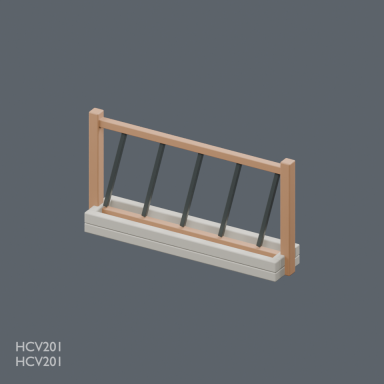](../../previews/hcv-chb24/renders/HCV201.png)

[Full-size image](../../previews/hcv-chb24/renders/HCV201.png)

Use / purpose: HCV201: Cattle communal feed barrier and bunk

Record type: model. Formats: BLEND/GLB.

Reported dimensions (metres; XYZ when derived from measured bounds, legacy axis order not reverified): Unknown. Triangles: Unknown.

Origin: Unknown / not independently confirmed. Orientation: Unknown / not independently confirmed.

[Download ZIP](https://raw.githubusercontent.com/k3peta/tales-on-a-table/main/distributions/husbandry-cellar-v1/HCV201-CC0.zip) · [License scope](../../LICENSE.md)

**CC0-1.0** — model geometry and embedded display materials only. Models and embedded materials only; previews excluded.

Source details: [Catalogue 1](../../catalog/husbandry_cellar_v1.md)

## HCV202

**HCV202**

HCV202

[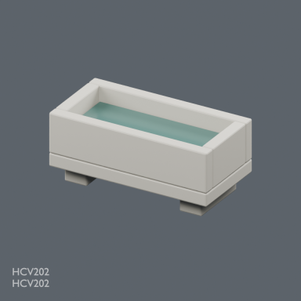](../../previews/hcv-chb24/renders/HCV202.png)

[Full-size image](../../previews/hcv-chb24/renders/HCV202.png)

Use / purpose: HCV202: Raised livestock stone water trough

Record type: model. Formats: BLEND/GLB.

Reported dimensions (metres; XYZ when derived from measured bounds, legacy axis order not reverified): Unknown. Triangles: Unknown.

Origin: Unknown / not independently confirmed. Orientation: Unknown / not independently confirmed.

[Download ZIP](https://raw.githubusercontent.com/k3peta/tales-on-a-table/main/distributions/husbandry-cellar-v1/HCV202-CC0.zip) · [License scope](../../LICENSE.md)

**CC0-1.0** — model geometry and embedded display materials only. Models and embedded materials only; previews excluded.

Source details: [Catalogue 1](../../catalog/husbandry_cellar_v1.md)

## HCV203

**HCV203**

HCV203

[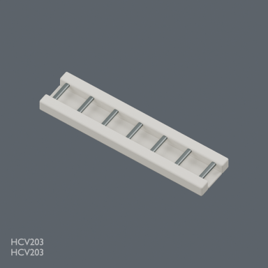](../../previews/hcv-chb24/renders/HCV203.png)

[Full-size image](../../previews/hcv-chb24/renders/HCV203.png)

Use / purpose: HCV203: Barn grated drainage channel

Record type: model. Formats: BLEND/GLB.

Reported dimensions (metres; XYZ when derived from measured bounds, legacy axis order not reverified): Unknown. Triangles: Unknown.

Origin: Unknown / not independently confirmed. Orientation: Unknown / not independently confirmed.

[Download ZIP](https://raw.githubusercontent.com/k3peta/tales-on-a-table/main/distributions/husbandry-cellar-v1/HCV203-CC0.zip) · [License scope](../../LICENSE.md)

**CC0-1.0** — model geometry and embedded display materials only. Models and embedded materials only; previews excluded.

Source details: [Catalogue 1](../../catalog/husbandry_cellar_v1.md)

## HCV301

**HCV301**

HCV301

[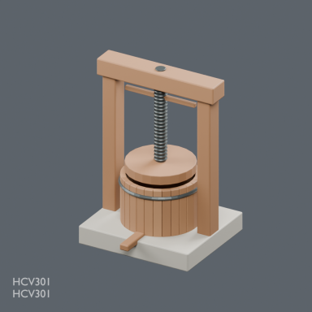](../../previews/hcv-chb24/renders/HCV301.png)

[Full-size image](../../previews/hcv-chb24/renders/HCV301.png)

Use / purpose: HCV301: Basket screw wine press

Record type: model. Formats: BLEND/GLB.

Reported dimensions (metres; XYZ when derived from measured bounds, legacy axis order not reverified): Unknown. Triangles: Unknown.

Origin: Unknown / not independently confirmed. Orientation: Unknown / not independently confirmed.

[Download ZIP](https://raw.githubusercontent.com/k3peta/tales-on-a-table/main/distributions/husbandry-cellar-v1/HCV301-CC0.zip) · [License scope](../../LICENSE.md)

**CC0-1.0** — model geometry and embedded display materials only. Models and embedded materials only; previews excluded.

Source details: [Catalogue 1](../../catalog/husbandry_cellar_v1.md)
