# Base distribution records 937–960

[Browse index](README.md) · [Coverage and missing fields](COVERAGE.md)

Images are actual existing model renders for browsing, not covered by model CC0. A group record may show several reused models. Dimensions and triangle counts apply only to the original record when sourced; revisions can differ. Unknown means unverified, not zero. No blanket CC0 grant for scenes, images, code or articles.

## HCV302

**HCV302**

HCV302

[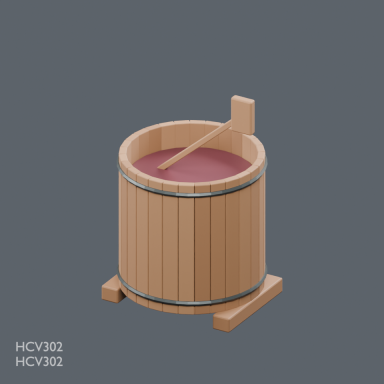](../../previews/hcv-chb24/renders/HCV302.png)

[Full-size image](../../previews/hcv-chb24/renders/HCV302.png)

Use / purpose: HCV302: Open fermentation vat with paddle

Record type: model. Formats: BLEND/GLB.

Reported dimensions (metres; XYZ when derived from measured bounds, legacy axis order not reverified): Unknown. Triangles: Unknown.

Origin: Unknown / not independently confirmed. Orientation: Unknown / not independently confirmed.

[Download ZIP](https://raw.githubusercontent.com/k3peta/tales-on-a-table/main/distributions/husbandry-cellar-v1/HCV302-CC0.zip) · [License scope](../../LICENSE.md)

**CC0-1.0** — model geometry and embedded display materials only. Models and embedded materials only; previews excluded.

Source details: [Catalogue 1](../../catalog/husbandry_cellar_v1.md)

## HCV303

**HCV303**

HCV303

[Full-size image](../../previews/hcv-chb24/renders/HCV303.png)

Use / purpose: HCV303: Raised-edge sorting and draining table

Record type: model. Formats: BLEND/GLB.

Reported dimensions (metres; XYZ when derived from measured bounds, legacy axis order not reverified): Unknown. Triangles: Unknown.

Origin: Unknown / not independently confirmed. Orientation: Unknown / not independently confirmed.

[Download ZIP](https://raw.githubusercontent.com/k3peta/tales-on-a-table/main/distributions/husbandry-cellar-v1/HCV303-CC0.zip) · [License scope](../../LICENSE.md)

**CC0-1.0** — model geometry and embedded display materials only. Models and embedded materials only; previews excluded.

Source details: [Catalogue 1](../../catalog/husbandry_cellar_v1.md) · [Catalogue 2](../../catalog/stable_care_v1.md) · [Catalogue 3](../../catalog/winery_utilities_v1.md)

**Known issue:** Brace contact diagnosis pending. GLB shown; Blender-only procedural bump not represented. Preview faithfully shows the distributed model; image completion is not quality approval.

## HCV401

**HCV401**

HCV401

[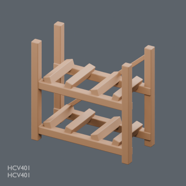](../../previews/hcv-chb24/renders/HCV401.png)

[Full-size image](../../previews/hcv-chb24/renders/HCV401.png)

Use / purpose: HCV401: Two-tier four-barrel cradle rack

Record type: model. Formats: BLEND/GLB.

Reported dimensions (metres; XYZ when derived from measured bounds, legacy axis order not reverified): Unknown. Triangles: Unknown.

Origin: Unknown / not independently confirmed. Orientation: Unknown / not independently confirmed.

[Download ZIP](https://raw.githubusercontent.com/k3peta/tales-on-a-table/main/distributions/husbandry-cellar-v1/HCV401-CC0.zip) · [License scope](../../LICENSE.md)

**CC0-1.0** — model geometry and embedded display materials only. Models and embedded materials only; previews excluded.

Source details: [Catalogue 1](../../catalog/husbandry_cellar_v1.md)

## HCV402

**HCV402**

HCV402

[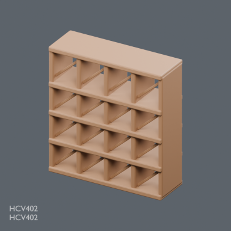](../../previews/hcv-chb24/renders/HCV402.png)

[Full-size image](../../previews/hcv-chb24/renders/HCV402.png)

Use / purpose: HCV402: Bottle storage cubby wall

Record type: model. Formats: BLEND/GLB.

Reported dimensions (metres; XYZ when derived from measured bounds, legacy axis order not reverified): Unknown. Triangles: Unknown.

Origin: Unknown / not independently confirmed. Orientation: Unknown / not independently confirmed.

[Download ZIP](https://raw.githubusercontent.com/k3peta/tales-on-a-table/main/distributions/husbandry-cellar-v1/HCV402-CC0.zip) · [License scope](../../LICENSE.md)

**CC0-1.0** — model geometry and embedded display materials only. Models and embedded materials only; previews excluded.

Source details: [Catalogue 1](../../catalog/craft_shops_v1.md) · [Catalogue 2](../../catalog/husbandry_cellar_v1.md)

## HCV403

**HCV403**

HCV403

[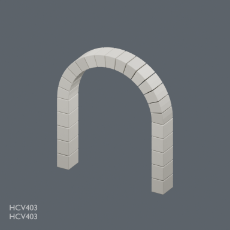](../../previews/hcv-chb24/renders/HCV403.png)

[Full-size image](../../previews/hcv-chb24/renders/HCV403.png)

Use / purpose: HCV403: Segmented cellar arch rib

Record type: model. Formats: BLEND/GLB.

Reported dimensions (metres; XYZ when derived from measured bounds, legacy axis order not reverified): Unknown. Triangles: Unknown.

Origin: Unknown / not independently confirmed. Orientation: Unknown / not independently confirmed.

[Download ZIP](https://raw.githubusercontent.com/k3peta/tales-on-a-table/main/distributions/husbandry-cellar-v1/HCV403-CC0.zip) · [License scope](../../LICENSE.md)

**CC0-1.0** — model geometry and embedded display materials only. Models and embedded materials only; previews excluded.

Source details: [Catalogue 1](../../catalog/husbandry_cellar_v1.md)

## FCS201_ScaffoldCorner

**ScaffoldCorner**

ScaffoldCorner

[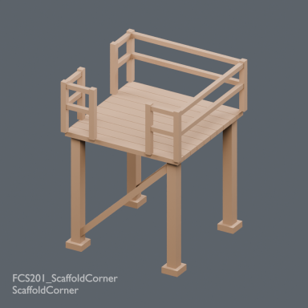](../../previews/hcv-chb24/renders/FCS201_ScaffoldCorner.png)

[Full-size image](../../previews/hcv-chb24/renders/FCS201_ScaffoldCorner.png)

Use / purpose: FCS201_ScaffoldCorner

Record type: model. Formats: BLEND/GLB.

Reported dimensions (metres; XYZ when derived from measured bounds, legacy axis order not reverified): Unknown. Triangles: Unknown.

Origin: Unknown / not independently confirmed. Orientation: Unknown / not independently confirmed.

[Download ZIP](https://raw.githubusercontent.com/k3peta/tales-on-a-table/main/distributions/fortified-city-access-v2/FCS201_ScaffoldCorner_CC0.zip) · [License scope](../../LICENSE.md)

**CC0-1.0** — model geometry and embedded display materials only. Models and embedded materials only; previews excluded.

Source details: [Catalogue 1](../../catalog/fortified_city_access_v2.md)

## FCS202_DeckEndGuard

**DeckEndGuard**

DeckEndGuard

[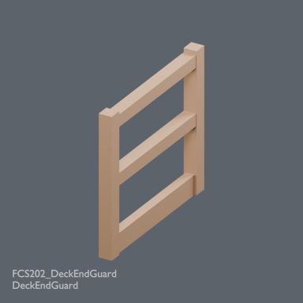](../../previews/hcv-chb24/renders/FCS202_DeckEndGuard.png)

[Full-size image](../../previews/hcv-chb24/renders/FCS202_DeckEndGuard.png)

Use / purpose: FCS202_DeckEndGuard

Record type: model. Formats: BLEND/GLB.

Reported dimensions (metres; XYZ when derived from measured bounds, legacy axis order not reverified): Unknown. Triangles: Unknown.

Origin: Unknown / not independently confirmed. Orientation: Unknown / not independently confirmed.

[Download ZIP](https://raw.githubusercontent.com/k3peta/tales-on-a-table/main/distributions/fortified-city-access-v2/FCS202_DeckEndGuard_CC0.zip) · [License scope](../../LICENSE.md)

**CC0-1.0** — model geometry and embedded display materials only. Models and embedded materials only; previews excluded.

Source details: [Catalogue 1](../../catalog/fortified_city_access_v2.md)

## FCSV03_GateAccessExample

**GateAccessExample**

GateAccessExample

[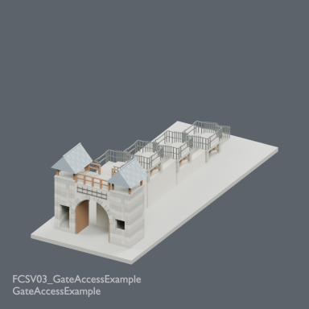](../../previews/hcv-chb24/renders/FCSV03_GateAccessExample.png)

[Full-size image](../../previews/hcv-chb24/renders/FCSV03_GateAccessExample.png)

Use / purpose: FCSV03_GateAccessExample

Record type: group. Formats: BLEND/GLB.

Reported dimensions (metres; XYZ when derived from measured bounds, legacy axis order not reverified): Unknown. Triangles: Unknown.

Origin: Unknown / not independently confirmed. Orientation: Unknown / not independently confirmed.

[Download ZIP](https://raw.githubusercontent.com/k3peta/tales-on-a-table/main/distributions/fortified-city-access-v2/FCSV03_GateAccessExample_CC0.zip) · [License scope](../../LICENSE.md)

**CC0-1.0** — model geometry and embedded display materials only. Models and embedded materials only; previews excluded.

Source details: [Catalogue 1](../../catalog/city_scenes_quality_v3.md) · [Catalogue 2](../../catalog/fortified_city_access_v2.md)

## FCSV04_ScaffoldCornerExample

**ScaffoldCornerExample**

ScaffoldCornerExample

[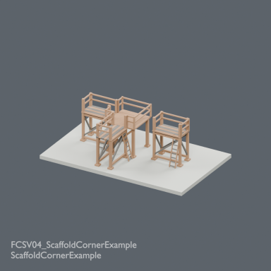](../../previews/hcv-chb24/renders/FCSV04_ScaffoldCornerExample.png)

[Full-size image](../../previews/hcv-chb24/renders/FCSV04_ScaffoldCornerExample.png)

Use / purpose: FCSV04_ScaffoldCornerExample

Record type: group. Formats: BLEND/GLB.

Reported dimensions (metres; XYZ when derived from measured bounds, legacy axis order not reverified): Unknown. Triangles: Unknown.

Origin: Unknown / not independently confirmed. Orientation: Unknown / not independently confirmed.

[Download ZIP](https://raw.githubusercontent.com/k3peta/tales-on-a-table/main/distributions/fortified-city-access-v2/FCSV04_ScaffoldCornerExample_CC0.zip) · [License scope](../../LICENSE.md)

**CC0-1.0** — model geometry and embedded display materials only. Models and embedded materials only; previews excluded.

Source details: [Catalogue 1](../../catalog/fortified_city_access_v2.md)

## FTR101_StepoffLadder4m

**StepoffLadder4m**

StepoffLadder4m

[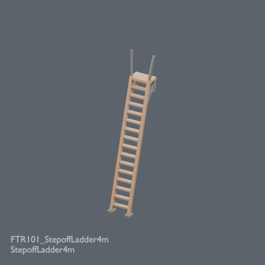](../../previews/hcv-chb24/renders/FTR101_StepoffLadder4m.png)

[Full-size image](../../previews/hcv-chb24/renders/FTR101_StepoffLadder4m.png)

Use / purpose: FTR101_StepoffLadder4m

Record type: model. Formats: BLEND/GLB.

Reported dimensions (metres; XYZ when derived from measured bounds, legacy axis order not reverified): Unknown. Triangles: Unknown.

Origin: Unknown / not independently confirmed. Orientation: Unknown / not independently confirmed.

[Download ZIP](https://raw.githubusercontent.com/k3peta/tales-on-a-table/main/distributions/field-travel-tools-v1/FTR101_StepoffLadder4m_CC0.zip) · [License scope](../../LICENSE.md)

**CC0-1.0** — model geometry and embedded display materials only. Models and embedded materials only; previews excluded.

Source details: [Catalogue 1](../../catalog/field_travel_tools_v1.md)

## FTR102_SegmentedRodCase

**SegmentedRodCase**

SegmentedRodCase

[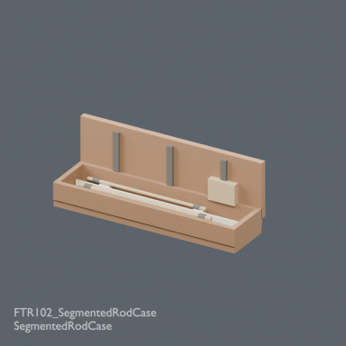](../../previews/hcv-chb24/renders/FTR102_SegmentedRodCase.png)

[Full-size image](../../previews/hcv-chb24/renders/FTR102_SegmentedRodCase.png)

Use / purpose: FTR102_SegmentedRodCase

Record type: model. Formats: BLEND/GLB.

Reported dimensions (metres; XYZ when derived from measured bounds, legacy axis order not reverified): Unknown. Triangles: Unknown.

Origin: Unknown / not independently confirmed. Orientation: Unknown / not independently confirmed.

[Download ZIP](https://raw.githubusercontent.com/k3peta/tales-on-a-table/main/distributions/field-travel-tools-v1/FTR102_SegmentedRodCase_CC0.zip) · [License scope](../../LICENSE.md)

**CC0-1.0** — model geometry and embedded display materials only. Models and embedded materials only; previews excluded.

Source details: [Catalogue 1](../../catalog/field_travel_tools_v1.md) · [Catalogue 2](../../catalog/personal_fishing_kit_v1.md)

## FTRV01_GateLadderFit

**GateLadderFit**

GateLadderFit

[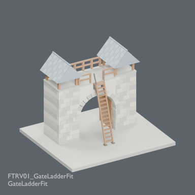](../../previews/hcv-chb24/renders/FTRV01_GateLadderFit.png)

[Full-size image](../../previews/hcv-chb24/renders/FTRV01_GateLadderFit.png)

Use / purpose: FTRV01_GateLadderFit

Record type: group. Formats: BLEND/GLB.

Reported dimensions (metres; XYZ when derived from measured bounds, legacy axis order not reverified): Unknown. Triangles: Unknown.

Origin: Unknown / not independently confirmed. Orientation: Unknown / not independently confirmed.

[Download ZIP](https://raw.githubusercontent.com/k3peta/tales-on-a-table/main/distributions/field-travel-tools-v1/FTRV01_GateLadderFit_CC0.zip) · [License scope](../../LICENSE.md)

**CC0-1.0** — model geometry and embedded display materials only. Models and embedded materials only; previews excluded.

Source details: [Catalogue 1](../../catalog/field_travel_tools_v1.md)

## FTRV02_TravelRodKit

**TravelRodKit**

TravelRodKit

[Full-size image](../../previews/hcv-chb24/renders/FTRV02_TravelRodKit.png)

Use / purpose: FTRV02_TravelRodKit

Record type: group. Formats: BLEND/GLB.

Reported dimensions (metres; XYZ when derived from measured bounds, legacy axis order not reverified): Unknown. Triangles: Unknown.

Origin: Unknown / not independently confirmed. Orientation: Unknown / not independently confirmed.

[Download ZIP](https://raw.githubusercontent.com/k3peta/tales-on-a-table/main/distributions/field-travel-tools-v1/FTRV02_TravelRodKit_CC0.zip) · [License scope](../../LICENSE.md)

**CC0-1.0** — model geometry and embedded display materials only. Models and embedded materials only; previews excluded.

Source details: [Catalogue 1](../../catalog/field_travel_tools_v1.md)

## PFKV01_PersonalFishingKit

**PersonalFishingKit**

PersonalFishingKit

[Full-size image](../../previews/hcv-chb24/renders/PFKV01_PersonalFishingKit.png)

Use / purpose: Repositionable personal fishing kit assembled from eight existing models; no new shapes

Record type: group. Formats: BLEND/GLB.

Reported dimensions (metres; XYZ when derived from measured bounds, legacy axis order not reverified): Unknown. Triangles: Unknown.

Origin: Unknown / not independently confirmed. Orientation: Unknown / not independently confirmed.

[Download ZIP](https://raw.githubusercontent.com/k3peta/tales-on-a-table/main/distributions/personal-fishing-kit-v1/PFKV01_PersonalFishingKit_CC0.zip) · [License scope](../../LICENSE.md)

**CC0-1.0** — model geometry and embedded display materials only. Models and embedded materials only; previews excluded.

Source details: [Catalogue 1](../../catalog/personal_fishing_kit_v1.md)

## CHB101_CheeseHouse

**CheeseHouse**

CheeseHouse

[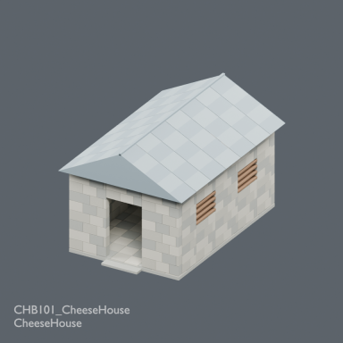](../../previews/hcv-chb24/renders/CHB101_CheeseHouse.png)

[Full-size image](../../previews/hcv-chb24/renders/CHB101_CheeseHouse.png)

Use / purpose: CHB101_CheeseHouse

Record type: model. Formats: BLEND/GLB.

Reported dimensions (metres; XYZ when derived from measured bounds, legacy axis order not reverified): Unknown. Triangles: Unknown.

Origin: Unknown / not independently confirmed. Orientation: Unknown / not independently confirmed.

[Download ZIP](https://raw.githubusercontent.com/k3peta/tales-on-a-table/main/distributions/cheese-hay-buildings-v1/CHB101_CheeseHouse_CC0.zip) · [License scope](../../LICENSE.md)

**CC0-1.0** — model geometry and embedded display materials only. Models and embedded materials only; previews excluded.

Source details: [Catalogue 1](../../catalog/cheese_hay_buildings_v1.md)

## CHB102_RipeningRack

**RipeningRack**

RipeningRack

[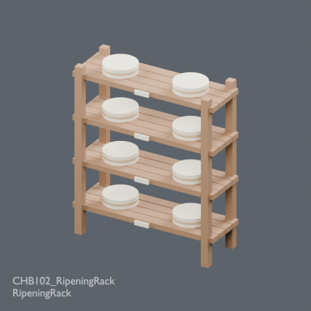](../../previews/hcv-chb24/renders/CHB102_RipeningRack.png)

[Full-size image](../../previews/hcv-chb24/renders/CHB102_RipeningRack.png)

Use / purpose: CHB102_RipeningRack

Record type: model. Formats: BLEND/GLB.

Reported dimensions (metres; XYZ when derived from measured bounds, legacy axis order not reverified): Unknown. Triangles: Unknown.

Origin: Unknown / not independently confirmed. Orientation: Unknown / not independently confirmed.

[Download ZIP](https://raw.githubusercontent.com/k3peta/tales-on-a-table/main/distributions/cheese-hay-buildings-v1/CHB102_RipeningRack_CC0.zip) · [License scope](../../LICENSE.md)

**CC0-1.0** — model geometry and embedded display materials only. Models and embedded materials only; previews excluded.

Source details: [Catalogue 1](../../catalog/cheese_hay_buildings_v1.md)

## CHB103_VentilatedHayBarn

**VentilatedHayBarn**

VentilatedHayBarn

[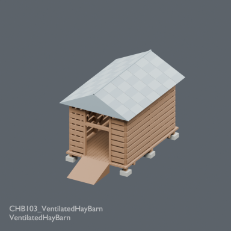](../../previews/hcv-chb24/renders/CHB103_VentilatedHayBarn.png)

[Full-size image](../../previews/hcv-chb24/renders/CHB103_VentilatedHayBarn.png)

Use / purpose: CHB103_VentilatedHayBarn

Record type: model. Formats: BLEND/GLB.

Reported dimensions (metres; XYZ when derived from measured bounds, legacy axis order not reverified): Unknown. Triangles: Unknown.

Origin: Unknown / not independently confirmed. Orientation: Unknown / not independently confirmed.

[Download ZIP](https://raw.githubusercontent.com/k3peta/tales-on-a-table/main/distributions/cheese-hay-buildings-v1/CHB103_VentilatedHayBarn_CC0.zip) · [License scope](../../LICENSE.md)

**CC0-1.0** — model geometry and embedded display materials only. Models and embedded materials only; previews excluded.

Source details: [Catalogue 1](../../catalog/cheese_hay_buildings_v1.md)

## CHBV01_CheeseRipeningHut

**CheeseRipeningHut**

CheeseRipeningHut

[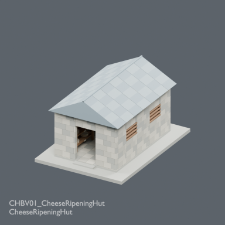](../../previews/chbv-mrt24/renders/CHBV01_CheeseRipeningHut.png)

[Full-size image](../../previews/chbv-mrt24/renders/CHBV01_CheeseRipeningHut.png)

Use / purpose: CHBV01_CheeseRipeningHut

Record type: group. Formats: BLEND/GLB.

Reported dimensions (metres; XYZ when derived from measured bounds, legacy axis order not reverified): Unknown. Triangles: Unknown.

Origin: Unknown / not independently confirmed. Orientation: Unknown / not independently confirmed.

[Download ZIP](https://raw.githubusercontent.com/k3peta/tales-on-a-table/main/distributions/cheese-hay-buildings-v1/CHBV01_CheeseRipeningHut_CC0.zip) · [License scope](../../LICENSE.md)

**CC0-1.0** — model geometry and embedded display materials only. Models and embedded materials only; previews excluded.

Source details: [Catalogue 1](../../catalog/cheese_hay_buildings_v1.md)

## CHBV02_DryHayStore

**DryHayStore**

DryHayStore

[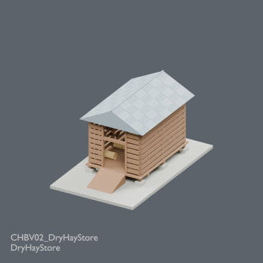](../../previews/chbv-mrt24/renders/CHBV02_DryHayStore.png)

[Full-size image](../../previews/chbv-mrt24/renders/CHBV02_DryHayStore.png)

Use / purpose: CHBV02_DryHayStore

Record type: group. Formats: BLEND/GLB.

Reported dimensions (metres; XYZ when derived from measured bounds, legacy axis order not reverified): Unknown. Triangles: Unknown.

Origin: Unknown / not independently confirmed. Orientation: Unknown / not independently confirmed.

[Download ZIP](https://raw.githubusercontent.com/k3peta/tales-on-a-table/main/distributions/cheese-hay-buildings-v1/CHBV02_DryHayStore_CC0.zip) · [License scope](../../LICENSE.md)

**CC0-1.0** — model geometry and embedded display materials only. Models and embedded materials only; previews excluded.

Source details: [Catalogue 1](../../catalog/cheese_hay_buildings_v1.md)

## HCV501

**HCV501**

HCV501

[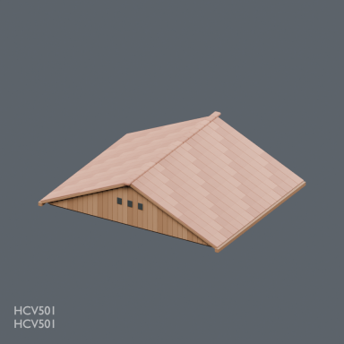](../../previews/chbv-mrt24/renders/HCV501.png)

[Full-size image](../../previews/chbv-mrt24/renders/HCV501.png)

Use / purpose: HCV501: Removable tiled gable roof with timber trusses

Record type: model. Formats: BLEND/GLB.

Reported dimensions (metres; XYZ when derived from measured bounds, legacy axis order not reverified): Unknown. Triangles: Unknown.

Origin: Unknown / not independently confirmed. Orientation: Unknown / not independently confirmed.

[Download ZIP](https://raw.githubusercontent.com/k3peta/tales-on-a-table/main/distributions/husbandry-cellar-v2/HCV501-CC0.zip) · [License scope](../../LICENSE.md)

**CC0-1.0** — model geometry and embedded display materials only. Models and embedded materials only; previews excluded.

Source details: [Catalogue 1](../../catalog/husbandry_cellar_v2.md)

## HCV502

**HCV502**

HCV502

[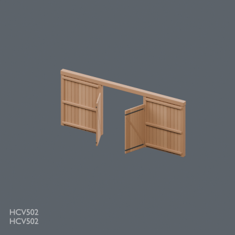](../../previews/chbv-mrt24/renders/HCV502.png)

[Full-size image](../../previews/chbv-mrt24/renders/HCV502.png)

Use / purpose: HCV502: Wide barn facade with fixed-open double doors

Record type: model. Formats: BLEND/GLB.

Reported dimensions (metres; XYZ when derived from measured bounds, legacy axis order not reverified): Unknown. Triangles: Unknown.

Origin: Unknown / not independently confirmed. Orientation: Unknown / not independently confirmed.

[Download ZIP](https://raw.githubusercontent.com/k3peta/tales-on-a-table/main/distributions/husbandry-cellar-v2/HCV502-CC0.zip) · [License scope](../../LICENSE.md)

**CC0-1.0** — model geometry and embedded display materials only. Models and embedded materials only; previews excluded.

Source details: [Catalogue 1](../../catalog/husbandry_cellar_v2.md)

## HCV503

**HCV503**

HCV503

[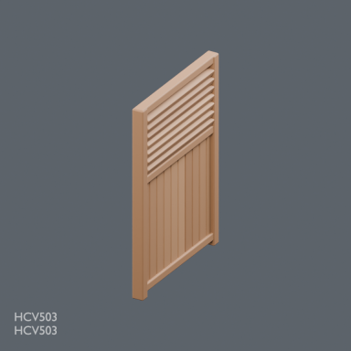](../../previews/chbv-mrt24/renders/HCV503.png)

[Full-size image](../../previews/chbv-mrt24/renders/HCV503.png)

Use / purpose: HCV503: Two-metre ventilated barn wall bay

Record type: model. Formats: BLEND/GLB.

Reported dimensions (metres; XYZ when derived from measured bounds, legacy axis order not reverified): Unknown. Triangles: Unknown.

Origin: Unknown / not independently confirmed. Orientation: Unknown / not independently confirmed.

[Download ZIP](https://raw.githubusercontent.com/k3peta/tales-on-a-table/main/distributions/husbandry-cellar-v2/HCV503-CC0.zip) · [License scope](../../LICENSE.md)

**CC0-1.0** — model geometry and embedded display materials only. Models and embedded materials only; previews excluded.

Source details: [Catalogue 1](../../catalog/cheese_hay_buildings_v1.md) · [Catalogue 2](../../catalog/husbandry_cellar_v2.md)

## HCV504

**HCV504**

HCV504

[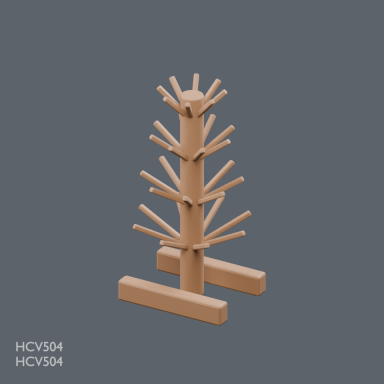](../../previews/chbv-mrt24/renders/HCV504.png)

[Full-size image](../../previews/chbv-mrt24/renders/HCV504.png)

Use / purpose: HCV504: Radial bottle draining tree

Record type: model. Formats: BLEND/GLB.

Reported dimensions (metres; XYZ when derived from measured bounds, legacy axis order not reverified): Unknown. Triangles: Unknown.

Origin: Unknown / not independently confirmed. Orientation: Unknown / not independently confirmed.

[Download ZIP](https://raw.githubusercontent.com/k3peta/tales-on-a-table/main/distributions/husbandry-cellar-v2/HCV504-CC0.zip) · [License scope](../../LICENSE.md)

**CC0-1.0** — model geometry and embedded display materials only. Models and embedded materials only; previews excluded.

Source details: [Catalogue 1](../../catalog/husbandry_cellar_v2.md)

## HCV505

**HCV505**

HCV505

[Full-size image](../../previews/chbv-mrt24/renders/HCV505.png)

Use / purpose: HCV505: Lever corking bench with bottle centering socket

Record type: model. Formats: BLEND/GLB.

Reported dimensions (metres; XYZ when derived from measured bounds, legacy axis order not reverified): Unknown. Triangles: Unknown.

Origin: Unknown / not independently confirmed. Orientation: Unknown / not independently confirmed.

[Download ZIP](https://raw.githubusercontent.com/k3peta/tales-on-a-table/main/distributions/husbandry-cellar-v2/HCV505-CC0.zip) · [License scope](../../LICENSE.md)

**CC0-1.0** — model geometry and embedded display materials only. Models and embedded materials only; previews excluded.

Source details: [Catalogue 1](../../catalog/husbandry_cellar_v2.md)
