# Base distribution records 961–984

[Browse index](README.md) · [Coverage and missing fields](COVERAGE.md)

Images are actual existing model renders for browsing, not covered by model CC0. A group record may show several reused models. Dimensions and triangle counts apply only to the original record when sourced; revisions can differ. Unknown means unverified, not zero. No blanket CC0 grant for scenes, images, code or articles.

## HCV506

**HCV506**

HCV506

[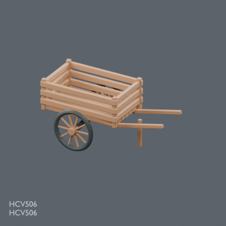](../../previews/chbv-mrt24/renders/HCV506.png)

[Full-size image](../../previews/chbv-mrt24/renders/HCV506.png)

Use / purpose: HCV506: Two-wheel slatted harvest handcart

Record type: model. Formats: BLEND/GLB.

Reported dimensions (metres; XYZ when derived from measured bounds, legacy axis order not reverified): Unknown. Triangles: Unknown.

Origin: Unknown / not independently confirmed. Orientation: Unknown / not independently confirmed.

[Download ZIP](https://raw.githubusercontent.com/k3peta/tales-on-a-table/main/distributions/husbandry-cellar-v2/HCV506-CC0.zip) · [License scope](../../LICENSE.md)

**CC0-1.0** — model geometry and embedded display materials only. Models and embedded materials only; previews excluded.

Source details: [Catalogue 1](../../catalog/husbandry_cellar_v2.md) · [Catalogue 2](../../catalog/livestock_tack_v1.md)

## HCV_SCENE_HORSE

**HCV_SCENE_HORSE**

HCV_SCENE_HORSE

[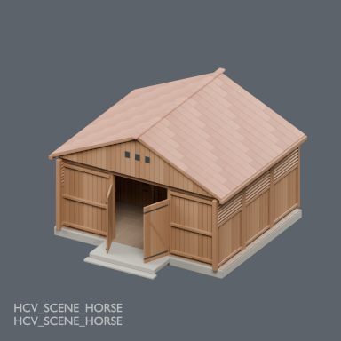](../../previews/chbv-mrt24/renders/HCV_SCENE_HORSE.png)

[Full-size image](../../previews/chbv-mrt24/renders/HCV_SCENE_HORSE.png)

Use / purpose: horse - rearrangeable static vignette, revision 2

Record type: group. Formats: BLEND/GLB.

Reported dimensions (metres; XYZ when derived from measured bounds, legacy axis order not reverified): Unknown. Triangles: Unknown.

Origin: Unknown / not independently confirmed. Orientation: Unknown / not independently confirmed.

[Download ZIP](https://raw.githubusercontent.com/k3peta/tales-on-a-table/main/distributions/husbandry-cellar-v2/horse-scene-v2.zip) · [License scope](../../LICENSE.md)

**LicenseRef-Scene-Viewing-Rearranging** — Underlying models/materials CC0; arrangement for viewing and rearranging only, no redistribution license granted. Arrangement restrictions apply; not a CC0 scene.

Source details: [Catalogue 1](../../catalog/husbandry_cellar_v2.md)

## HCV_SCENE_CATTLE

**HCV_SCENE_CATTLE**

HCV_SCENE_CATTLE

[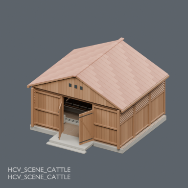](../../previews/chbv-mrt24/renders/HCV_SCENE_CATTLE.png)

[Full-size image](../../previews/chbv-mrt24/renders/HCV_SCENE_CATTLE.png)

Use / purpose: cattle - rearrangeable static vignette, revision 2

Record type: group. Formats: BLEND/GLB.

Reported dimensions (metres; XYZ when derived from measured bounds, legacy axis order not reverified): Unknown. Triangles: Unknown.

Origin: Unknown / not independently confirmed. Orientation: Unknown / not independently confirmed.

[Download ZIP](https://raw.githubusercontent.com/k3peta/tales-on-a-table/main/distributions/husbandry-cellar-v2/cattle-scene-v2.zip) · [License scope](../../LICENSE.md)

**LicenseRef-Scene-Viewing-Rearranging** — Underlying models/materials CC0; arrangement for viewing and rearranging only, no redistribution license granted. Arrangement restrictions apply; not a CC0 scene.

Source details: [Catalogue 1](../../catalog/husbandry_cellar_v2.md)

## HCV_SCENE_WINERY

**HCV_SCENE_WINERY**

HCV_SCENE_WINERY

[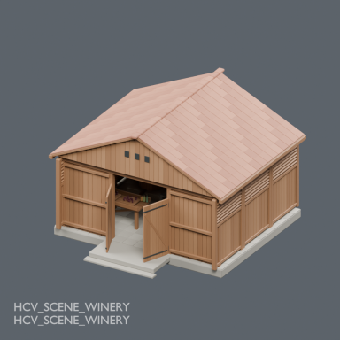](../../previews/chbv-mrt24/renders/HCV_SCENE_WINERY.png)

[Full-size image](../../previews/chbv-mrt24/renders/HCV_SCENE_WINERY.png)

Use / purpose: winery - rearrangeable static vignette, revision 2

Record type: group. Formats: BLEND/GLB.

Reported dimensions (metres; XYZ when derived from measured bounds, legacy axis order not reverified): Unknown. Triangles: Unknown.

Origin: Unknown / not independently confirmed. Orientation: Unknown / not independently confirmed.

[Download ZIP](https://raw.githubusercontent.com/k3peta/tales-on-a-table/main/distributions/husbandry-cellar-v2/winery-scene-v2.zip) · [License scope](../../LICENSE.md)

**LicenseRef-Scene-Viewing-Rearranging** — Underlying models/materials CC0; arrangement for viewing and rearranging only, no redistribution license granted. Arrangement restrictions apply; not a CC0 scene.

Source details: [Catalogue 1](../../catalog/husbandry_cellar_v2.md)

## HCV_SCENE_CELLAR

**HCV_SCENE_CELLAR**

HCV_SCENE_CELLAR

[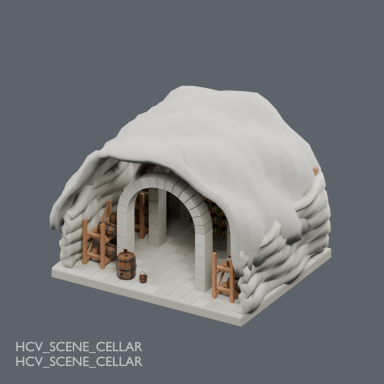](../../previews/chbv-mrt24/renders/HCV_SCENE_CELLAR.png)

[Full-size image](../../previews/chbv-mrt24/renders/HCV_SCENE_CELLAR.png)

Use / purpose: cellar - rearrangeable static vignette, revision 2

Record type: group. Formats: BLEND/GLB.

Reported dimensions (metres; XYZ when derived from measured bounds, legacy axis order not reverified): Unknown. Triangles: Unknown.

Origin: Unknown / not independently confirmed. Orientation: Unknown / not independently confirmed.

[Download ZIP](https://raw.githubusercontent.com/k3peta/tales-on-a-table/main/distributions/husbandry-cellar-v2/cellar-scene-v2.zip) · [License scope](../../LICENSE.md)

**LicenseRef-Scene-Viewing-Rearranging** — Underlying models/materials CC0; arrangement for viewing and rearranging only, no redistribution license granted. Arrangement restrictions apply; not a CC0 scene.

Source details: [Catalogue 1](../../catalog/husbandry_cellar_v2.md)

## HCV601

**HCV601**

HCV601

[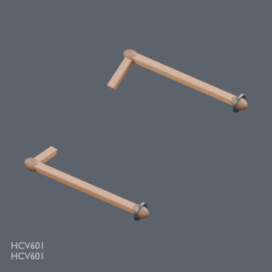](../../previews/chbv-mrt24/renders/HCV601.png)

[Full-size image](../../previews/chbv-mrt24/renders/HCV601.png)

Use / purpose: HCV601: Paired static donkey cart shaft adapters

Record type: model. Formats: BLEND/GLB.

Reported dimensions (metres; XYZ when derived from measured bounds, legacy axis order not reverified): Unknown. Triangles: Unknown.

Origin: Unknown / not independently confirmed. Orientation: Unknown / not independently confirmed.

[Download ZIP](https://raw.githubusercontent.com/k3peta/tales-on-a-table/main/distributions/livestock-tack-v1/HCV601-CC0.zip) · [License scope](../../LICENSE.md)

**CC0-1.0** — model geometry and embedded display materials only. Models and embedded materials only; previews excluded.

Source details: [Catalogue 1](../../catalog/livestock_tack_v1.md)

**Known issue:** Standalone mounting shafts shown separately; assembled fit and operation untested. Preview faithfully shows the distributed model; image completion is not quality approval.

## HCV602

**HCV602**

HCV602

[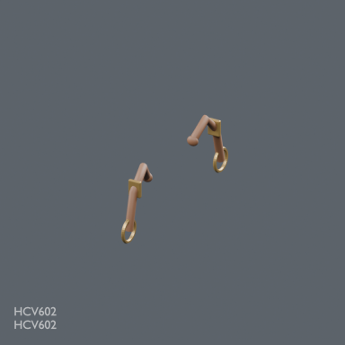](../../previews/chbv-mrt24/renders/HCV602.png)

[Full-size image](../../previews/chbv-mrt24/renders/HCV602.png)

Use / purpose: HCV602: Matched saddle attachment straps and shaft loops

Record type: model. Formats: BLEND/GLB.

Reported dimensions (metres; XYZ when derived from measured bounds, legacy axis order not reverified): Unknown. Triangles: Unknown.

Origin: Unknown / not independently confirmed. Orientation: Unknown / not independently confirmed.

[Download ZIP](https://raw.githubusercontent.com/k3peta/tales-on-a-table/main/distributions/livestock-tack-v1/HCV602-CC0.zip) · [License scope](../../LICENSE.md)

**CC0-1.0** — model geometry and embedded display materials only. Models and embedded materials only; previews excluded.

Source details: [Catalogue 1](../../catalog/livestock_tack_v1.md)

**Known issue:** Standalone mounting fittings shown separately; assembled fit and operation untested. Preview faithfully shows the distributed model; image completion is not quality approval.

## HCV603

**HCV603**

HCV603

[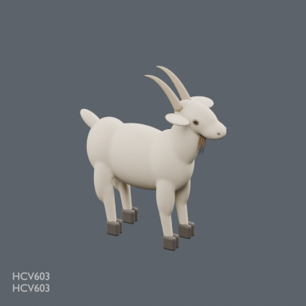](../../previews/chbv-mrt24/renders/HCV603.png)

[Full-size image](../../previews/chbv-mrt24/renders/HCV603.png)

Use / purpose: HCV603: Standing bearded goat with cloven hooves

Record type: model. Formats: BLEND/GLB.

Reported dimensions (metres; XYZ when derived from measured bounds, legacy axis order not reverified): Unknown. Triangles: Unknown.

Origin: Unknown / not independently confirmed. Orientation: Unknown / not independently confirmed.

[Download ZIP](https://raw.githubusercontent.com/k3peta/tales-on-a-table/main/distributions/livestock-tack-v1/HCV603-CC0.zip) · [License scope](../../LICENSE.md)

**CC0-1.0** — model geometry and embedded display materials only. Models and embedded materials only; previews excluded.

Source details: [Catalogue 1](../../catalog/goat_care_platform_v1.md) · [Catalogue 2](../../catalog/livestock_tack_v1.md)

## HCV604

**HCV604**

HCV604

[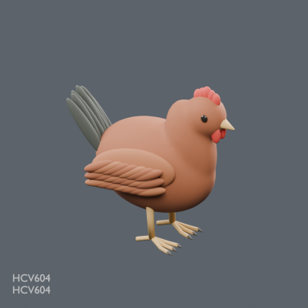](../../previews/chbv-mrt24/renders/HCV604.png)

[Full-size image](../../previews/chbv-mrt24/renders/HCV604.png)

Use / purpose: HCV604: Standing russet hen with layered feathers

Record type: model. Formats: BLEND/GLB.

Reported dimensions (metres; XYZ when derived from measured bounds, legacy axis order not reverified): Unknown. Triangles: Unknown.

Origin: Unknown / not independently confirmed. Orientation: Unknown / not independently confirmed.

[Download ZIP](https://raw.githubusercontent.com/k3peta/tales-on-a-table/main/distributions/livestock-tack-v1/HCV604-CC0.zip) · [License scope](../../LICENSE.md)

**CC0-1.0** — model geometry and embedded display materials only. Models and embedded materials only; previews excluded.

Source details: [Catalogue 1](../../catalog/livestock_tack_v1.md) · [Catalogue 2](../../catalog/poultry_support_v1.md)

## HCV605

**HCV605**

HCV605

[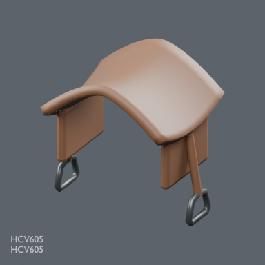](../../previews/chbv-mrt24/renders/HCV605.png)

[Full-size image](../../previews/chbv-mrt24/renders/HCV605.png)

Use / purpose: HCV605: Saddle with hanging stirrups

Record type: model. Formats: BLEND/GLB.

Reported dimensions (metres; XYZ when derived from measured bounds, legacy axis order not reverified): Unknown. Triangles: Unknown.

Origin: Unknown / not independently confirmed. Orientation: Unknown / not independently confirmed.

[Download ZIP](https://raw.githubusercontent.com/k3peta/tales-on-a-table/main/distributions/livestock-tack-v1/HCV605-CC0.zip) · [License scope](../../LICENSE.md)

**CC0-1.0** — model geometry and embedded display materials only. Models and embedded materials only; previews excluded.

Source details: [Catalogue 1](../../catalog/livestock_tack_v1.md)

## HCV701

**HCV701**

HCV701

[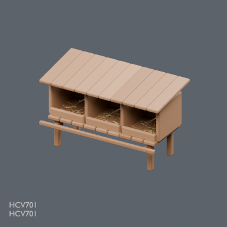](../../previews/chbv-mrt24/renders/HCV701.png)

[Full-size image](../../previews/chbv-mrt24/renders/HCV701.png)

Use / purpose: HCV701: Raised three-bay hen nesting box

Record type: model. Formats: BLEND/GLB.

Reported dimensions (metres; XYZ when derived from measured bounds, legacy axis order not reverified): Unknown. Triangles: Unknown.

Origin: Unknown / not independently confirmed. Orientation: Unknown / not independently confirmed.

[Download ZIP](https://raw.githubusercontent.com/k3peta/tales-on-a-table/main/distributions/poultry-support-v1/HCV701-CC0.zip) · [License scope](../../LICENSE.md)

**CC0-1.0** — model geometry and embedded display materials only. Models and embedded materials only; previews excluded.

Source details: [Catalogue 1](../../catalog/poultry_support_v1.md)

## HCV702

**HCV702**

HCV702

[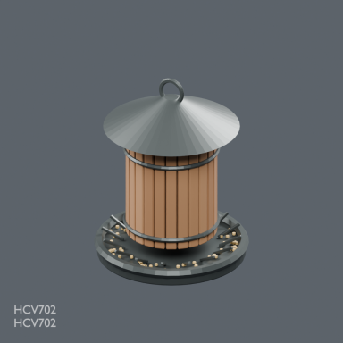](../../previews/chbv-mrt24/renders/HCV702.png)

[Full-size image](../../previews/chbv-mrt24/renders/HCV702.png)

Use / purpose: HCV702: Covered poultry gravity feeder with pecking tray

Record type: model. Formats: BLEND/GLB.

Reported dimensions (metres; XYZ when derived from measured bounds, legacy axis order not reverified): Unknown. Triangles: Unknown.

Origin: Unknown / not independently confirmed. Orientation: Unknown / not independently confirmed.

[Download ZIP](https://raw.githubusercontent.com/k3peta/tales-on-a-table/main/distributions/poultry-support-v1/HCV702-CC0.zip) · [License scope](../../LICENSE.md)

**CC0-1.0** — model geometry and embedded display materials only. Models and embedded materials only; previews excluded.

Source details: [Catalogue 1](../../catalog/poultry_support_v1.md)

## HCV801

**HCV801**

HCV801

[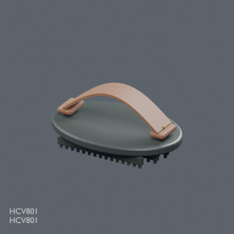](../../previews/chbv-mrt24/renders/HCV801.png)

[Full-size image](../../previews/chbv-mrt24/renders/HCV801.png)

Use / purpose: HCV801: Oval toothed curry comb with hand strap

Record type: model. Formats: BLEND/GLB.

Reported dimensions (metres; XYZ when derived from measured bounds, legacy axis order not reverified): Unknown. Triangles: Unknown.

Origin: Unknown / not independently confirmed. Orientation: Unknown / not independently confirmed.

[Download ZIP](https://raw.githubusercontent.com/k3peta/tales-on-a-table/main/distributions/stable-care-v1/HCV801-CC0.zip) · [License scope](../../LICENSE.md)

**CC0-1.0** — model geometry and embedded display materials only. Models and embedded materials only; previews excluded.

Source details: [Catalogue 1](../../catalog/stable_care_v1.md)

## HCV802

**HCV802**

HCV802

[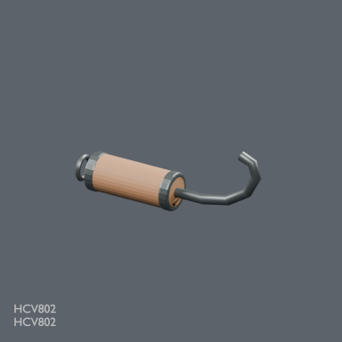](../../previews/chbv-mrt24/renders/HCV802.png)

[Full-size image](../../previews/chbv-mrt24/renders/HCV802.png)

Use / purpose: HCV802: Wood handled curved hoof pick

Record type: model. Formats: BLEND/GLB.

Reported dimensions (metres; XYZ when derived from measured bounds, legacy axis order not reverified): Unknown. Triangles: Unknown.

Origin: Unknown / not independently confirmed. Orientation: Unknown / not independently confirmed.

[Download ZIP](https://raw.githubusercontent.com/k3peta/tales-on-a-table/main/distributions/stable-care-v1/HCV802-CC0.zip) · [License scope](../../LICENSE.md)

**CC0-1.0** — model geometry and embedded display materials only. Models and embedded materials only; previews excluded.

Source details: [Catalogue 1](../../catalog/stable_care_v1.md)

## HCV803

**HCV803**

HCV803

[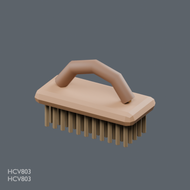](../../previews/chbv-mrt24/renders/HCV803.png)

[Full-size image](../../previews/chbv-mrt24/renders/HCV803.png)

Use / purpose: HCV803: Stiff body grooming brush

Record type: model. Formats: BLEND/GLB.

Reported dimensions (metres; XYZ when derived from measured bounds, legacy axis order not reverified): Unknown. Triangles: Unknown.

Origin: Unknown / not independently confirmed. Orientation: Unknown / not independently confirmed.

[Download ZIP](https://raw.githubusercontent.com/k3peta/tales-on-a-table/main/distributions/stable-care-v1/HCV803-CC0.zip) · [License scope](../../LICENSE.md)

**CC0-1.0** — model geometry and embedded display materials only. Models and embedded materials only; previews excluded.

Source details: [Catalogue 1](../../catalog/stable_care_v1.md)

## HCV804

**HCV804**

HCV804

[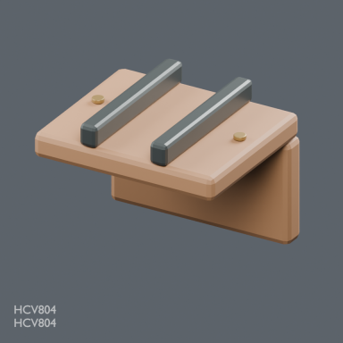](../../previews/chbv-mrt24/renders/HCV804.png)

[Full-size image](../../previews/chbv-mrt24/renders/HCV804.png)

Use / purpose: HCV804: Right angle cargo rope edge guard

Record type: model. Formats: BLEND/GLB.

Reported dimensions (metres; XYZ when derived from measured bounds, legacy axis order not reverified): Unknown. Triangles: Unknown.

Origin: Unknown / not independently confirmed. Orientation: Unknown / not independently confirmed.

[Download ZIP](https://raw.githubusercontent.com/k3peta/tales-on-a-table/main/distributions/stable-care-v1/HCV804-CC0.zip) · [License scope](../../LICENSE.md)

**CC0-1.0** — model geometry and embedded display materials only. Models and embedded materials only; previews excluded.

Source details: [Catalogue 1](../../catalog/stable_care_v1.md)

## MRT101_PlumbLevel

**PlumbLevel**

PlumbLevel

[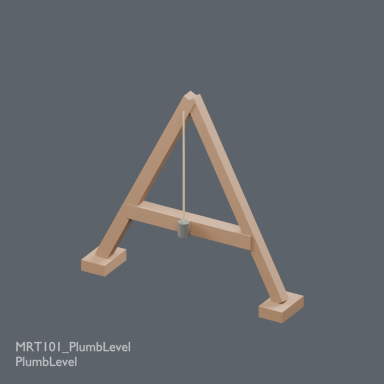](../../previews/chbv-mrt24/renders/MRT101_PlumbLevel.png)

[Full-size image](../../previews/chbv-mrt24/renders/MRT101_PlumbLevel.png)

Use / purpose: MRT101_PlumbLevel

Record type: model. Formats: BLEND/GLB.

Reported dimensions (metres; XYZ when derived from measured bounds, legacy axis order not reverified): Unknown. Triangles: Unknown.

Origin: Unknown / not independently confirmed. Orientation: Unknown / not independently confirmed.

[Download ZIP](https://raw.githubusercontent.com/k3peta/tales-on-a-table/main/distributions/masonry-road-tools-v1/MRT101_PlumbLevel_CC0.zip) · [License scope](../../LICENSE.md)

**CC0-1.0** — model geometry and embedded display materials only. Models and embedded materials only; previews excluded.

Source details: [Catalogue 1](../../catalog/masonry_road_tools_v1.md)

## MRT102_SurveyCross

**SurveyCross**

SurveyCross

**Image pending: no verified ID-specific preview mapping yet.**

Use / purpose: MRT102_SurveyCross

Record type: model. Formats: BLEND/GLB.

Reported dimensions (metres; XYZ when derived from measured bounds, legacy axis order not reverified): Unknown. Triangles: Unknown.

Origin: Unknown / not independently confirmed. Orientation: Unknown / not independently confirmed.

[Download ZIP](https://raw.githubusercontent.com/k3peta/tales-on-a-table/main/distributions/masonry-road-tools-v1/MRT102_SurveyCross_CC0.zip) · [License scope](../../LICENSE.md)

**CC0-1.0** — model geometry and embedded display materials only. Models and embedded materials only; previews excluded.

Source details: [Catalogue 1](../../catalog/masonry_road_tools_v1.md)

## MRT103_ArchCentering

**ArchCentering**

ArchCentering

**Image pending: no verified ID-specific preview mapping yet.**

Use / purpose: MRT103_ArchCentering

Record type: model. Formats: BLEND/GLB.

Reported dimensions (metres; XYZ when derived from measured bounds, legacy axis order not reverified): Unknown. Triangles: Unknown.

Origin: Unknown / not independently confirmed. Orientation: Unknown / not independently confirmed.

[Download ZIP](https://raw.githubusercontent.com/k3peta/tales-on-a-table/main/distributions/masonry-road-tools-v1/MRT103_ArchCentering_CC0.zip) · [License scope](../../LICENSE.md)

**CC0-1.0** — model geometry and embedded display materials only. Models and embedded materials only; previews excluded.

Source details: [Catalogue 1](../../catalog/masonry_road_tools_v1.md)

## MRT104_StoneLiftingSocket

**StoneLiftingSocket**

StoneLiftingSocket

**Image pending: no verified ID-specific preview mapping yet.**

Use / purpose: MRT104_StoneLiftingSocket

Record type: model. Formats: BLEND/GLB.

Reported dimensions (metres; XYZ when derived from measured bounds, legacy axis order not reverified): Unknown. Triangles: Unknown.

Origin: Unknown / not independently confirmed. Orientation: Unknown / not independently confirmed.

[Download ZIP](https://raw.githubusercontent.com/k3peta/tales-on-a-table/main/distributions/masonry-road-tools-v1/MRT104_StoneLiftingSocket_CC0.zip) · [License scope](../../LICENSE.md)

**CC0-1.0** — model geometry and embedded display materials only. Models and embedded materials only; previews excluded.

Source details: [Catalogue 1](../../catalog/masonry_road_tools_v1.md)

## MRT105_RollerStoneSled

**RollerStoneSled**

RollerStoneSled

**Image pending: no verified ID-specific preview mapping yet.**

Use / purpose: MRT105_RollerStoneSled

Record type: model. Formats: BLEND/GLB.

Reported dimensions (metres; XYZ when derived from measured bounds, legacy axis order not reverified): Unknown. Triangles: Unknown.

Origin: Unknown / not independently confirmed. Orientation: Unknown / not independently confirmed.

[Download ZIP](https://raw.githubusercontent.com/k3peta/tales-on-a-table/main/distributions/masonry-road-tools-v1/MRT105_RollerStoneSled_CC0.zip) · [License scope](../../LICENSE.md)

**CC0-1.0** — model geometry and embedded display materials only. Models and embedded materials only; previews excluded.

Source details: [Catalogue 1](../../catalog/masonry_road_tools_v1.md)

## MRT106_GateBarStorage

**GateBarStorage**

GateBarStorage

**Image pending: no verified ID-specific preview mapping yet.**

Use / purpose: MRT106_GateBarStorage

Record type: model. Formats: BLEND/GLB.

Reported dimensions (metres; XYZ when derived from measured bounds, legacy axis order not reverified): Unknown. Triangles: Unknown.

Origin: Unknown / not independently confirmed. Orientation: Unknown / not independently confirmed.

[Download ZIP](https://raw.githubusercontent.com/k3peta/tales-on-a-table/main/distributions/masonry-road-tools-v1/MRT106_GateBarStorage_CC0.zip) · [License scope](../../LICENSE.md)

**CC0-1.0** — model geometry and embedded display materials only. Models and embedded materials only; previews excluded.

Source details: [Catalogue 1](../../catalog/masonry_road_tools_v1.md)

## MRT107_FiresteelKit

**FiresteelKit**

FiresteelKit

**Image pending: no verified ID-specific preview mapping yet.**

Use / purpose: MRT107_FiresteelKit

Record type: model. Formats: BLEND/GLB.

Reported dimensions (metres; XYZ when derived from measured bounds, legacy axis order not reverified): Unknown. Triangles: Unknown.

Origin: Unknown / not independently confirmed. Orientation: Unknown / not independently confirmed.

[Download ZIP](https://raw.githubusercontent.com/k3peta/tales-on-a-table/main/distributions/masonry-road-tools-v1/MRT107_FiresteelKit_CC0.zip) · [License scope](../../LICENSE.md)

**CC0-1.0** — model geometry and embedded display materials only. Models and embedded materials only; previews excluded.

Source details: [Catalogue 1](../../catalog/masonry_road_tools_v1.md)

## MRH201_ShoulderHod

**ShoulderHod**

ShoulderHod

**Image pending: no verified ID-specific preview mapping yet.**

Use / purpose: MRH201_ShoulderHod

Record type: model. Formats: BLEND/GLB.

Reported dimensions (metres; XYZ when derived from measured bounds, legacy axis order not reverified): Unknown. Triangles: Unknown.

Origin: Unknown / not independently confirmed. Orientation: Unknown / not independently confirmed.

[Download ZIP](https://raw.githubusercontent.com/k3peta/tales-on-a-table/main/distributions/masonry-handling-v2/MRH201_ShoulderHod_CC0.zip) · [License scope](../../LICENSE.md)

**CC0-1.0** — model geometry and embedded display materials only. Models and embedded materials only; previews excluded.

Source details: [Catalogue 1](../../catalog/masonry_handling_v2.md)
