# Base distribution records 985–1008

[Browse index](README.md) · [Coverage and missing fields](COVERAGE.md)

Images are actual existing model renders for browsing, not covered by model CC0. A group record may show several reused models. Dimensions and triangle counts apply only to the original record when sourced; revisions can differ. Unknown means unverified, not zero. No blanket CC0 grant for scenes, images, code or articles.

## MRH202_MortarHawkTrowel

**MortarHawkTrowel**

MortarHawkTrowel

[Full-size image](../../previews/mrt102-csh24/renders/MRH202_MortarHawkTrowel.png)

Use / purpose: MRH202_MortarHawkTrowel

Record type: model. Formats: BLEND/GLB.

Reported dimensions (metres; XYZ when derived from measured bounds, legacy axis order not reverified): Unknown. Triangles: Unknown.

Origin: Unknown / not independently confirmed. Orientation: Unknown / not independently confirmed.

[Download ZIP](https://raw.githubusercontent.com/k3peta/tales-on-a-table/main/distributions/masonry-handling-v2/MRH202_MortarHawkTrowel_CC0.zip) · [License scope](../../LICENSE.md)

**CC0-1.0** — model geometry and embedded display materials only. Models and embedded materials only; previews excluded.

Source details: [Catalogue 1](../../catalog/masonry_handling_v2.md)

## HCV901

**HCV901**

HCV901

[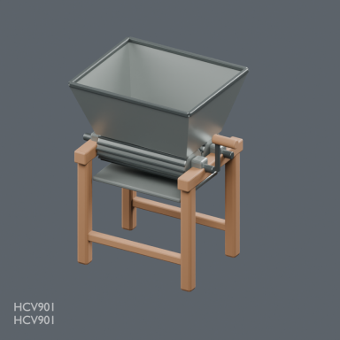](../../previews/mrt102-csh24/renders/HCV901.png)

[Full-size image](../../previews/mrt102-csh24/renders/HCV901.png)

Use / purpose: HCV901: Twin roller hand grape crusher

Record type: model. Formats: BLEND/GLB.

Reported dimensions (metres; XYZ when derived from measured bounds, legacy axis order not reverified): Unknown. Triangles: Unknown.

Origin: Unknown / not independently confirmed. Orientation: Unknown / not independently confirmed.

[Download ZIP](https://raw.githubusercontent.com/k3peta/tales-on-a-table/main/distributions/winery-utilities-v1/HCV901-CC0.zip) · [License scope](../../LICENSE.md)

**CC0-1.0** — model geometry and embedded display materials only. Models and embedded materials only; previews excluded.

Source details: [Catalogue 1](../../catalog/winery_utilities_v1.md)

## HCV902

**HCV902**

HCV902

[Full-size image](../../previews/mrt102-csh24/renders/HCV902.png)

Use / purpose: HCV902: Open ended hollow wine sampling thief

Record type: model. Formats: BLEND/GLB.

Reported dimensions (metres; XYZ when derived from measured bounds, legacy axis order not reverified): Unknown. Triangles: Unknown.

Origin: Unknown / not independently confirmed. Orientation: Unknown / not independently confirmed.

[Download ZIP](https://raw.githubusercontent.com/k3peta/tales-on-a-table/main/distributions/winery-utilities-v1/HCV902-CC0.zip) · [License scope](../../LICENSE.md)

**CC0-1.0** — model geometry and embedded display materials only. Models and embedded materials only; previews excluded.

Source details: [Catalogue 1](../../catalog/winery_utilities_v1.md)

## HCV903

**HCV903**

HCV903

[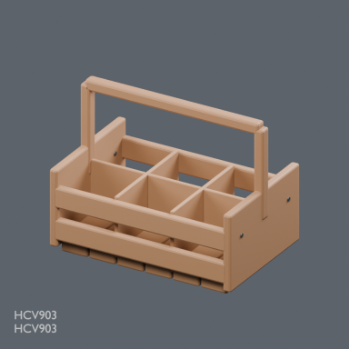](../../previews/mrt102-csh24/renders/HCV903.png)

[Full-size image](../../previews/mrt102-csh24/renders/HCV903.png)

Use / purpose: HCV903: Six cell protective bottle carrier

Record type: model. Formats: BLEND/GLB.

Reported dimensions (metres; XYZ when derived from measured bounds, legacy axis order not reverified): Unknown. Triangles: Unknown.

Origin: Unknown / not independently confirmed. Orientation: Unknown / not independently confirmed.

[Download ZIP](https://raw.githubusercontent.com/k3peta/tales-on-a-table/main/distributions/winery-utilities-v1/HCV903-CC0.zip) · [License scope](../../LICENSE.md)

**CC0-1.0** — model geometry and embedded display materials only. Models and embedded materials only; previews excluded.

Source details: [Catalogue 1](../../catalog/winery_utilities_v1.md)

## HCV1001

**HCV1001**

HCV1001

[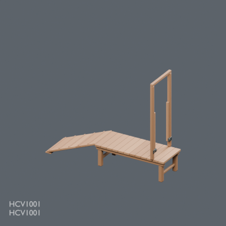](../../previews/mrt102-csh24/renders/HCV1001.png)

[Full-size image](../../previews/mrt102-csh24/renders/HCV1001.png)

Use / purpose: HCV1001: Raised goat care platform with cleated ramp and open guide frame

Record type: model. Formats: BLEND/GLB.

Reported dimensions (metres; XYZ when derived from measured bounds, legacy axis order not reverified): Unknown. Triangles: Unknown.

Origin: Unknown / not independently confirmed. Orientation: Unknown / not independently confirmed.

[Download ZIP](https://raw.githubusercontent.com/k3peta/tales-on-a-table/main/distributions/goat-care-platform-v1/HCV1001-CC0.zip) · [License scope](../../LICENSE.md)

**CC0-1.0** — model geometry and embedded display materials only. Models and embedded materials only; previews excluded.

Source details: [Catalogue 1](../../catalog/goat_care_platform_v1.md)

## CPT101_ChapelShell

**ChapelShell**

ChapelShell

[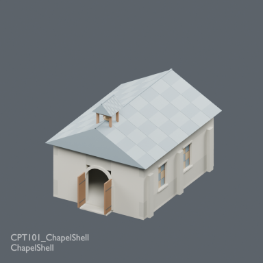](../../previews/mrt102-csh24/renders/CPT101_ChapelShell.png)

[Full-size image](../../previews/mrt102-csh24/renders/CPT101_ChapelShell.png)

Use / purpose: CPT101_ChapelShell

Record type: model. Formats: BLEND/GLB.

Reported dimensions (metres; XYZ when derived from measured bounds, legacy axis order not reverified): Unknown. Triangles: Unknown.

Origin: Unknown / not independently confirmed. Orientation: Unknown / not independently confirmed.

[Download ZIP](https://raw.githubusercontent.com/k3peta/tales-on-a-table/main/distributions/chapel-training-v1/CPT101_ChapelShell_CC0.zip) · [License scope](../../LICENSE.md)

**CC0-1.0** — model geometry and embedded display materials only. Models and embedded materials only; previews excluded.

Source details: [Catalogue 1](../../catalog/chapel_training_v1.md)

## CPT102_SunAltar

**SunAltar**

SunAltar

[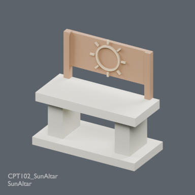](../../previews/mrt102-csh24/renders/CPT102_SunAltar.png)

[Full-size image](../../previews/mrt102-csh24/renders/CPT102_SunAltar.png)

Use / purpose: CPT102_SunAltar

Record type: model. Formats: BLEND/GLB.

Reported dimensions (metres; XYZ when derived from measured bounds, legacy axis order not reverified): Unknown. Triangles: Unknown.

Origin: Unknown / not independently confirmed. Orientation: Unknown / not independently confirmed.

[Download ZIP](https://raw.githubusercontent.com/k3peta/tales-on-a-table/main/distributions/chapel-training-v1/CPT102_SunAltar_CC0.zip) · [License scope](../../LICENSE.md)

**CC0-1.0** — model geometry and embedded display materials only. Models and embedded materials only; previews excluded.

Source details: [Catalogue 1](../../catalog/chapel_training_v1.md)

## CPT103_PrayerKneeler

**PrayerKneeler**

PrayerKneeler

[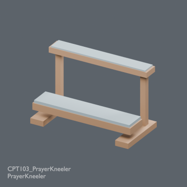](../../previews/mrt102-csh24/renders/CPT103_PrayerKneeler.png)

[Full-size image](../../previews/mrt102-csh24/renders/CPT103_PrayerKneeler.png)

Use / purpose: CPT103_PrayerKneeler

Record type: model. Formats: BLEND/GLB.

Reported dimensions (metres; XYZ when derived from measured bounds, legacy axis order not reverified): Unknown. Triangles: Unknown.

Origin: Unknown / not independently confirmed. Orientation: Unknown / not independently confirmed.

[Download ZIP](https://raw.githubusercontent.com/k3peta/tales-on-a-table/main/distributions/chapel-training-v1/CPT103_PrayerKneeler_CC0.zip) · [License scope](../../LICENSE.md)

**CC0-1.0** — model geometry and embedded display materials only. Models and embedded materials only; previews excluded.

Source details: [Catalogue 1](../../catalog/chapel_training_v1.md)

## CPT201_PaddedPell

**PaddedPell**

PaddedPell

[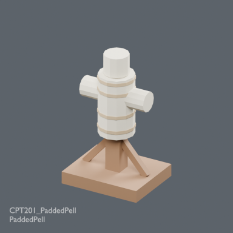](../../previews/mrt102-csh24/renders/CPT201_PaddedPell.png)

[Full-size image](../../previews/mrt102-csh24/renders/CPT201_PaddedPell.png)

Use / purpose: CPT201_PaddedPell

Record type: model. Formats: BLEND/GLB.

Reported dimensions (metres; XYZ when derived from measured bounds, legacy axis order not reverified): Unknown. Triangles: Unknown.

Origin: Unknown / not independently confirmed. Orientation: Unknown / not independently confirmed.

[Download ZIP](https://raw.githubusercontent.com/k3peta/tales-on-a-table/main/distributions/chapel-training-v1/CPT201_PaddedPell_CC0.zip) · [License scope](../../LICENSE.md)

**CC0-1.0** — model geometry and embedded display materials only. Models and embedded materials only; previews excluded.

Source details: [Catalogue 1](../../catalog/chapel_training_v1.md)

## CPTV01_Chapel

**Chapel**

Chapel

[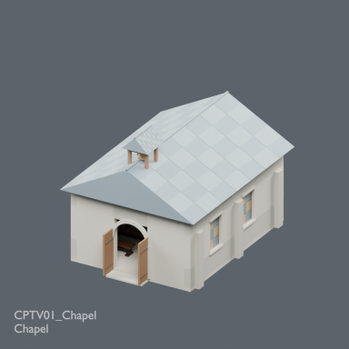](../../previews/mrt102-csh24/renders/CPTV01_Chapel.png)

[Full-size image](../../previews/mrt102-csh24/renders/CPTV01_Chapel.png)

Use / purpose: CPTV01_Chapel

Record type: group. Formats: BLEND/GLB.

Reported dimensions (metres; XYZ when derived from measured bounds, legacy axis order not reverified): Unknown. Triangles: Unknown.

Origin: Unknown / not independently confirmed. Orientation: Unknown / not independently confirmed.

[Download ZIP](https://raw.githubusercontent.com/k3peta/tales-on-a-table/main/distributions/chapel-training-v1/CPTV01_Chapel_CC0.zip) · [License scope](../../LICENSE.md)

**CC0-1.0** — model geometry and embedded display materials only. Models and embedded materials only; previews excluded.

Source details: [Catalogue 1](../../catalog/chapel_training_v1.md)

## CPTV02_TrainingCourt

**TrainingCourt**

TrainingCourt

[Full-size image](../../previews/mrt102-csh24/renders/CPTV02_TrainingCourt.png)

Use / purpose: CPTV02_TrainingCourt

Record type: group. Formats: BLEND/GLB.

Reported dimensions (metres; XYZ when derived from measured bounds, legacy axis order not reverified): Unknown. Triangles: Unknown.

Origin: Unknown / not independently confirmed. Orientation: Unknown / not independently confirmed.

[Download ZIP](https://raw.githubusercontent.com/k3peta/tales-on-a-table/main/distributions/chapel-training-v1/CPTV02_TrainingCourt_CC0.zip) · [License scope](../../LICENSE.md)

**CC0-1.0** — model geometry and embedded display materials only. Models and embedded materials only; previews excluded.

Source details: [Catalogue 1](../../catalog/chapel_training_v1.md)

## INF101_CanvasStretcher

**CanvasStretcher**

CanvasStretcher

[Full-size image](../../previews/mrt102-csh24/renders/INF101_CanvasStretcher.png)

Use / purpose: INF101_CanvasStretcher

Record type: model. Formats: BLEND/GLB.

Reported dimensions (metres; XYZ when derived from measured bounds, legacy axis order not reverified): Unknown. Triangles: Unknown.

Origin: Unknown / not independently confirmed. Orientation: Unknown / not independently confirmed.

[Download ZIP](https://raw.githubusercontent.com/k3peta/tales-on-a-table/main/distributions/fantasy-infirmary-v1/INF101_CanvasStretcher_CC0.zip) · [License scope](../../LICENSE.md)

**CC0-1.0** — model geometry and embedded display materials only. Models and embedded materials only; previews excluded.

Source details: [Catalogue 1](../../catalog/fantasy_infirmary_v1.md)

## INF102_BedsideCantileverTray

**BedsideCantileverTray**

BedsideCantileverTray

[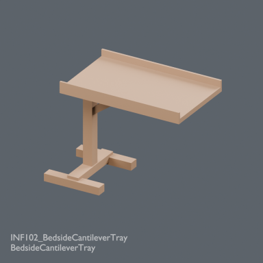](../../previews/mrt102-csh24/renders/INF102_BedsideCantileverTray.png)

[Full-size image](../../previews/mrt102-csh24/renders/INF102_BedsideCantileverTray.png)

Use / purpose: INF102_BedsideCantileverTray

Record type: model. Formats: BLEND/GLB.

Reported dimensions (metres; XYZ when derived from measured bounds, legacy axis order not reverified): Unknown. Triangles: Unknown.

Origin: Unknown / not independently confirmed. Orientation: Unknown / not independently confirmed.

[Download ZIP](https://raw.githubusercontent.com/k3peta/tales-on-a-table/main/distributions/fantasy-infirmary-v1/INF102_BedsideCantileverTray_CC0.zip) · [License scope](../../LICENSE.md)

**CC0-1.0** — model geometry and embedded display materials only. Models and embedded materials only; previews excluded.

Source details: [Catalogue 1](../../catalog/fantasy_infirmary_v1.md)

## INFV01_FantasyInfirmary

**FantasyInfirmary**

FantasyInfirmary

[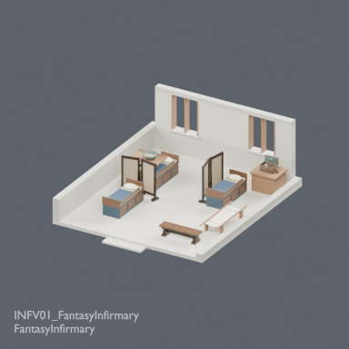](../../previews/mrt102-csh24/renders/INFV01_FantasyInfirmary.png)

[Full-size image](../../previews/mrt102-csh24/renders/INFV01_FantasyInfirmary.png)

Use / purpose: INFV01_FantasyInfirmary

Record type: group. Formats: BLEND/GLB.

Reported dimensions (metres; XYZ when derived from measured bounds, legacy axis order not reverified): Unknown. Triangles: Unknown.

Origin: Unknown / not independently confirmed. Orientation: Unknown / not independently confirmed.

[Download ZIP](https://raw.githubusercontent.com/k3peta/tales-on-a-table/main/distributions/fantasy-infirmary-v1/INFV01_FantasyInfirmary_CC0.zip) · [License scope](../../LICENSE.md)

**CC0-1.0** — model geometry and embedded display materials only. Models and embedded materials only; previews excluded.

Source details: [Catalogue 1](../../catalog/fantasy_infirmary_v1.md)

## CSH101

**CSH101**

CSH101

[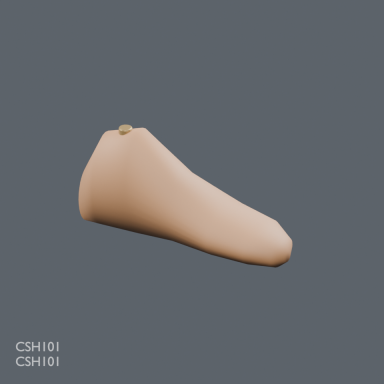](../../previews/mrt102-csh24/renders/CSH101.png)

[Full-size image](../../previews/mrt102-csh24/renders/CSH101.png)

Use / purpose: CSH101: Carved wooden shoe last

Record type: model. Formats: BLEND/GLB.

Reported dimensions (metres; XYZ when derived from measured bounds, legacy axis order not reverified): Unknown. Triangles: Unknown.

Origin: Unknown / not independently confirmed. Orientation: Unknown / not independently confirmed.

[Download ZIP](https://raw.githubusercontent.com/k3peta/tales-on-a-table/main/distributions/craft-shops-v1/CSH101-CC0.zip) · [License scope](../../LICENSE.md)

**CC0-1.0** — model geometry and embedded display materials only. Models and embedded materials only; previews excluded.

Source details: [Catalogue 1](../../catalog/craft_shops_v1.md)

## CSH102

**CSH102**

CSH102

[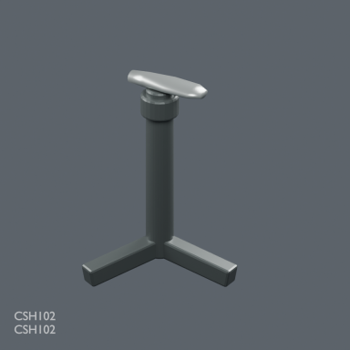](../../previews/mrt102-csh24/renders/CSH102.png)

[Full-size image](../../previews/mrt102-csh24/renders/CSH102.png)

Use / purpose: CSH102: Cobbler sole-working stake on tripod

Record type: model. Formats: BLEND/GLB.

Reported dimensions (metres; XYZ when derived from measured bounds, legacy axis order not reverified): Unknown. Triangles: Unknown.

Origin: Unknown / not independently confirmed. Orientation: Unknown / not independently confirmed.

[Download ZIP](https://raw.githubusercontent.com/k3peta/tales-on-a-table/main/distributions/craft-shops-v1/CSH102-CC0.zip) · [License scope](../../LICENSE.md)

**CC0-1.0** — model geometry and embedded display materials only. Models and embedded materials only; previews excluded.

Source details: [Catalogue 1](../../catalog/craft_shops_v1.md)

## CSH201

**CSH201**

CSH201

[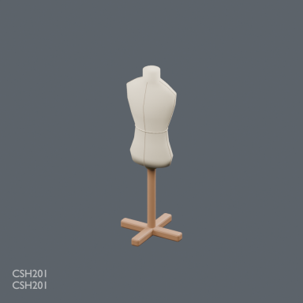](../../previews/mrt102-csh24/renders/CSH201.png)

[Full-size image](../../previews/mrt102-csh24/renders/CSH201.png)

Use / purpose: CSH201: Linen fitting form with waist measure

Record type: model. Formats: BLEND/GLB.

Reported dimensions (metres; XYZ when derived from measured bounds, legacy axis order not reverified): Unknown. Triangles: Unknown.

Origin: Unknown / not independently confirmed. Orientation: Unknown / not independently confirmed.

[Download ZIP](https://raw.githubusercontent.com/k3peta/tales-on-a-table/main/distributions/craft-shops-v1/CSH201-CC0.zip) · [License scope](../../LICENSE.md)

**CC0-1.0** — model geometry and embedded display materials only. Models and embedded materials only; previews excluded.

Source details: [Catalogue 1](../../catalog/craft_shops_v1.md)

## CSH202

**CSH202**

CSH202

**Image pending: no verified ID-specific preview mapping yet.**

Use / purpose: CSH202: Garment rail with three shoulder hangers

Record type: model. Formats: BLEND/GLB.

Reported dimensions (metres; XYZ when derived from measured bounds, legacy axis order not reverified): Unknown. Triangles: Unknown.

Origin: Unknown / not independently confirmed. Orientation: Unknown / not independently confirmed.

[Download ZIP](https://raw.githubusercontent.com/k3peta/tales-on-a-table/main/distributions/craft-shops-v1/CSH202-CC0.zip) · [License scope](../../LICENSE.md)

**CC0-1.0** — model geometry and embedded display materials only. Models and embedded materials only; previews excluded.

Source details: [Catalogue 1](../../catalog/craft_shops_v1.md)

## CSH301

**CSH301**

CSH301

**Image pending: no verified ID-specific preview mapping yet.**

Use / purpose: CSH301: Saddler stitching pony with open padded jaws

Record type: model. Formats: BLEND/GLB.

Reported dimensions (metres; XYZ when derived from measured bounds, legacy axis order not reverified): Unknown. Triangles: Unknown.

Origin: Unknown / not independently confirmed. Orientation: Unknown / not independently confirmed.

[Download ZIP](https://raw.githubusercontent.com/k3peta/tales-on-a-table/main/distributions/craft-shops-v1/CSH301-CC0.zip) · [License scope](../../LICENSE.md)

**CC0-1.0** — model geometry and embedded display materials only. Models and embedded materials only; previews excluded.

Source details: [Catalogue 1](../../catalog/craft_shops_v1.md)

## CSH302

**CSH302**

CSH302

**Image pending: no verified ID-specific preview mapping yet.**

Use / purpose: CSH302: Leatherworker half-moon head knife

Record type: model. Formats: BLEND/GLB.

Reported dimensions (metres; XYZ when derived from measured bounds, legacy axis order not reverified): Unknown. Triangles: Unknown.

Origin: Unknown / not independently confirmed. Orientation: Unknown / not independently confirmed.

[Download ZIP](https://raw.githubusercontent.com/k3peta/tales-on-a-table/main/distributions/craft-shops-v1/CSH302-CC0.zip) · [License scope](../../LICENSE.md)

**CC0-1.0** — model geometry and embedded display materials only. Models and embedded materials only; previews excluded.

Source details: [Catalogue 1](../../catalog/craft_shops_v1.md)

## CSH_SCENE_COBBLER

**CSH_SCENE_COBBLER**

CSH_SCENE_COBBLER

**Image pending: no verified ID-specific preview mapping yet.**

Use / purpose: cobbler - rearrangeable static vignette, revision 1

Record type: group. Formats: BLEND/GLB.

Reported dimensions (metres; XYZ when derived from measured bounds, legacy axis order not reverified): Unknown. Triangles: Unknown.

Origin: Unknown / not independently confirmed. Orientation: Unknown / not independently confirmed.

[Download ZIP](https://raw.githubusercontent.com/k3peta/tales-on-a-table/main/distributions/craft-shops-v1/cobbler-scene-v1.zip) · [License scope](../../LICENSE.md)

**LicenseRef-Scene-Viewing-Rearranging** — Underlying models/materials CC0; arrangement for viewing and rearranging only, no redistribution license granted. Arrangement restrictions apply; not a CC0 scene.

Source details: [Catalogue 1](../../catalog/craft_shops_v1.md)

## CSH_SCENE_TAILOR

**CSH_SCENE_TAILOR**

CSH_SCENE_TAILOR

**Image pending: no verified ID-specific preview mapping yet.**

Use / purpose: tailor - rearrangeable static vignette, revision 1

Record type: group. Formats: BLEND/GLB.

Reported dimensions (metres; XYZ when derived from measured bounds, legacy axis order not reverified): Unknown. Triangles: Unknown.

Origin: Unknown / not independently confirmed. Orientation: Unknown / not independently confirmed.

[Download ZIP](https://raw.githubusercontent.com/k3peta/tales-on-a-table/main/distributions/craft-shops-v1/tailor-scene-v1.zip) · [License scope](../../LICENSE.md)

**LicenseRef-Scene-Viewing-Rearranging** — Underlying models/materials CC0; arrangement for viewing and rearranging only, no redistribution license granted. Arrangement restrictions apply; not a CC0 scene.

Source details: [Catalogue 1](../../catalog/craft_shops_v1.md)

## CSH_SCENE_LEATHERWORKER

**CSH_SCENE_LEATHERWORKER**

CSH_SCENE_LEATHERWORKER

**Image pending: no verified ID-specific preview mapping yet.**

Use / purpose: leatherworker - rearrangeable static vignette, revision 1

Record type: group. Formats: BLEND/GLB.

Reported dimensions (metres; XYZ when derived from measured bounds, legacy axis order not reverified): Unknown. Triangles: Unknown.

Origin: Unknown / not independently confirmed. Orientation: Unknown / not independently confirmed.

[Download ZIP](https://raw.githubusercontent.com/k3peta/tales-on-a-table/main/distributions/craft-shops-v1/leatherworker-scene-v1.zip) · [License scope](../../LICENSE.md)

**LicenseRef-Scene-Viewing-Rearranging** — Underlying models/materials CC0; arrangement for viewing and rearranging only, no redistribution license granted. Arrangement restrictions apply; not a CC0 scene.

Source details: [Catalogue 1](../../catalog/craft_shops_v1.md)

## HERBALIST_SCENE_V1

**Herbalist shop**

薬師の店舗

**Image pending: no verified ID-specific preview mapping yet.**

Use / purpose: Static fictional shop; 14 reused types, no new model geometry. No medical efficacy or procedures.

Record type: group. Formats: BLEND/GLB.

Reported dimensions (metres; XYZ when derived from measured bounds, legacy axis order not reverified): Unknown. Triangles: Unknown.

Origin: Unknown / not independently confirmed. Orientation: Unknown / not independently confirmed.

[Download ZIP](https://raw.githubusercontent.com/k3peta/tales-on-a-table/main/distributions/herbalist-shop-v1/herbalist-scene-v1.zip) · [License scope](../../LICENSE.md)

**LicenseRef-Scene-Viewing-Rearranging** — Underlying models/materials CC0; arrangement for viewing and rearranging only; no additional redistribution license. Arrangement restrictions apply; not a CC0 scene.

Source details: [Catalogue 1](../../catalog/scene_polish_herbalist.md)
