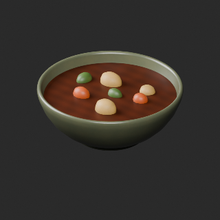
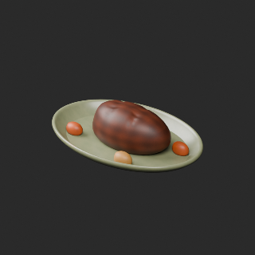
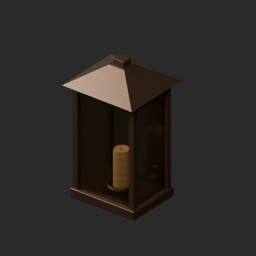

# Material variants 49–72

[Browse index](README.md) · [Coverage and missing fields](COVERAGE.md)

Images are actual existing model renders for browsing, not covered by model CC0. A group record may show several reused models. Dimensions and triangle counts apply only to the original record when sourced; revisions can differ. Unknown means unverified, not zero. No blanket CC0 grant for scenes, images, code or articles.

## FT_023__new

**Spoon, fork and table knife**

スプーン・フォーク・食卓ナイフ

Use / purpose: Spoon, fork and table knife from the tavern collection. Unit: one model record. Includes BLEND and GLB. The close-up is rendered from the distributed BLEND.

Record type: model. Formats: BLEND/GLB.

Dimensions (X × Y × Z, metres): Unknown. Triangles: Unknown.

Origin: Unknown / not independently confirmed. Orientation: Unknown / not independently confirmed.

[Base model FT_023](base-01.md#ft_023). Geometry baseline: original; UV: original_uv0_plus_wearuv_v1. Base measurements are not silently applied to changed geometry.

[Download ZIP](https://raw.githubusercontent.com/k3peta/tales-on-a-table/main/distributions/material-variants-ft021-030-v1/FT_023__new_CC0.zip) · [License scope](../../LICENSE.md)

**CC0-1.0** — model and embedded materials only. Models and embedded materials only; previews excluded.

Source details: [Catalogue 1](../../catalog/material_variants_ft021_030.md)

## FT_023__color

**Spoon, fork and table knife**

スプーン・フォーク・食卓ナイフ

Use / purpose: Spoon, fork and table knife from the tavern collection. Unit: one model record. Includes BLEND and GLB. The close-up is rendered from the distributed BLEND.

Record type: model. Formats: BLEND/GLB.

Dimensions (X × Y × Z, metres): Unknown. Triangles: Unknown.

Origin: Unknown / not independently confirmed. Orientation: Unknown / not independently confirmed.

[Base model FT_023](base-01.md#ft_023). Geometry baseline: original; UV: original_uv0_plus_wearuv_v1. Base measurements are not silently applied to changed geometry.

[Download ZIP](https://raw.githubusercontent.com/k3peta/tales-on-a-table/main/distributions/material-variants-ft021-030-v1/FT_023__color_CC0.zip) · [License scope](../../LICENSE.md)

**CC0-1.0** — model and embedded materials only. Models and embedded materials only; previews excluded.

Source details: [Catalogue 1](../../catalog/material_variants_ft021_030.md)

## FT_026__color

**Ceramic bowl of stew**

シチュー入り陶器鉢

Use / purpose: Ceramic bowl of stew from the tavern collection. Unit: one model record. Includes BLEND and GLB. The close-up is rendered from the distributed BLEND.

Record type: model. Formats: BLEND/GLB.

Dimensions (X × Y × Z, metres): Unknown. Triangles: Unknown.

Origin: Unknown / not independently confirmed. Orientation: Unknown / not independently confirmed.

[Base model FT_026](base-02.md#ft_026). Geometry baseline: original; UV: original_uv0_plus_wearuv_v1. Base measurements are not silently applied to changed geometry.

[Download ZIP](https://raw.githubusercontent.com/k3peta/tales-on-a-table/main/distributions/material-variants-ft021-030-v1/FT_026__color_CC0.zip) · [License scope](../../LICENSE.md)

**CC0-1.0** — model and embedded materials only. Models and embedded materials only; previews excluded.

Source details: [Catalogue 1](../../catalog/material_variants_ft021_030.md)

## FT_027__color

**Roast and vegetable platter**

ローストと野菜の盛皿

Use / purpose: Roast and vegetable platter from the tavern collection. Unit: one model record. Includes BLEND and GLB. The close-up is rendered from the distributed BLEND.

Record type: model. Formats: BLEND/GLB.

Dimensions (X × Y × Z, metres): Unknown. Triangles: Unknown.

Origin: Unknown / not independently confirmed. Orientation: Unknown / not independently confirmed.

[Base model FT_027](base-02.md#ft_027). Geometry baseline: original; UV: original_uv0_plus_wearuv_v1. Base measurements are not silently applied to changed geometry.

[Download ZIP](https://raw.githubusercontent.com/k3peta/tales-on-a-table/main/distributions/material-variants-ft021-030-v1/FT_027__color_CC0.zip) · [License scope](../../LICENSE.md)

**CC0-1.0** — model and embedded materials only. Models and embedded materials only; previews excluded.

Source details: [Catalogue 1](../../catalog/material_variants_ft021_030.md)

## FT_028__color

**Unlit candlestick**

未点火の燭台

Use / purpose: Unlit candlestick from the tavern collection. Unit: one model record. Includes BLEND and GLB. The close-up is rendered from the distributed BLEND.

Record type: model. Formats: BLEND/GLB.

Dimensions (X × Y × Z, metres): Unknown. Triangles: Unknown.

Origin: Unknown / not independently confirmed. Orientation: Unknown / not independently confirmed.

[Base model FT_028](base-02.md#ft_028). Geometry baseline: original; UV: original_uv0_plus_wearuv_v1. Base measurements are not silently applied to changed geometry.

[Download ZIP](https://raw.githubusercontent.com/k3peta/tales-on-a-table/main/distributions/material-variants-ft021-030-v1/FT_028__color_CC0.zip) · [License scope](../../LICENSE.md)

**CC0-1.0** — model and embedded materials only. Models and embedded materials only; previews excluded.

Source details: [Catalogue 1](../../catalog/material_variants_ft021_030.md)

## FT_030__color

**Wall-mounted glass lantern**

壁付けガラスランタン

Use / purpose: Wall-mounted glass lantern from the tavern collection. Unit: one model record. Includes BLEND and GLB. The close-up is rendered from the distributed BLEND.

Record type: model. Formats: BLEND/GLB.

Dimensions (X × Y × Z, metres): Unknown. Triangles: Unknown.

Origin: Unknown / not independently confirmed. Orientation: Unknown / not independently confirmed.

[Base model FT_030](base-02.md#ft_030). Geometry baseline: original; UV: original_uv0_plus_wearuv_v1. Base measurements are not silently applied to changed geometry.

[Download ZIP](https://raw.githubusercontent.com/k3peta/tales-on-a-table/main/distributions/material-variants-ft021-030-v1/FT_030__color_CC0.zip) · [License scope](../../LICENSE.md)

**CC0-1.0** — model and embedded materials only. Models and embedded materials only; previews excluded.

Source details: [Catalogue 1](../../catalog/material_variants_ft021_030.md)

## FT_031__used

**Decorative stone fireplace**

装飾用の石造暖炉

Use / purpose: Decorative stone fireplace from the tavern collection. Unit: one model record. Includes BLEND and GLB. The close-up is rendered from the distributed BLEND.

Record type: model. Formats: BLEND/GLB.

Dimensions (X × Y × Z, metres): Unknown. Triangles: Unknown.

Origin: Unknown / not independently confirmed. Orientation: Unknown / not independently confirmed.

[Base model FT_031](base-02.md#ft_031). Geometry baseline: original; UV: original_uv0_plus_wearuv. Base measurements are not silently applied to changed geometry.

Comparison: left: original base; right: accepted variant; same overview camera.

[Download ZIP](https://raw.githubusercontent.com/k3peta/tales-on-a-table/main/distributions/quality-ft031-040-v1/FT_031__used_CC0.zip) · [License scope](../../LICENSE.md)

**CC0-1.0** — model geometry and embedded materials only. Models and embedded materials only; previews excluded.

Source details: [Catalogue 1](../../catalog/material_variants_ft031_040.md)

## FT_031__color

**Decorative stone fireplace**

装飾用の石造暖炉

Use / purpose: Decorative stone fireplace from the tavern collection. Unit: one model record. Includes BLEND and GLB. The close-up is rendered from the distributed BLEND.

Record type: model. Formats: BLEND/GLB.

Dimensions (X × Y × Z, metres): Unknown. Triangles: Unknown.

Origin: Unknown / not independently confirmed. Orientation: Unknown / not independently confirmed.

[Base model FT_031](base-02.md#ft_031). Geometry baseline: original; UV: original_uv0_plus_wearuv. Base measurements are not silently applied to changed geometry.

Comparison: left: original base; right: accepted variant; same overview camera.

[Download ZIP](https://raw.githubusercontent.com/k3peta/tales-on-a-table/main/distributions/quality-ft031-040-v1/FT_031__color_CC0.zip) · [License scope](../../LICENSE.md)

**CC0-1.0** — model geometry and embedded materials only. Models and embedded materials only; previews excluded.

Source details: [Catalogue 1](../../catalog/material_variants_ft031_040.md)

## FT_034__new

**Wooden target**

木製の的

Use / purpose: Wooden target from the tavern collection. Unit: one model record. Includes BLEND and GLB. The close-up is rendered from the distributed BLEND.

Record type: model. Formats: BLEND/GLB.

Dimensions (X × Y × Z, metres): Unknown. Triangles: Unknown.

Origin: Unknown / not independently confirmed. Orientation: Unknown / not independently confirmed.

[Base model FT_034](base-02.md#ft_034). Geometry baseline: original; UV: original_uv0_plus_wearuv. Base measurements are not silently applied to changed geometry.

Comparison: left: original base; right: accepted variant; same overview camera.

[Download ZIP](https://raw.githubusercontent.com/k3peta/tales-on-a-table/main/distributions/quality-ft031-040-v1/FT_034__new_CC0.zip) · [License scope](../../LICENSE.md)

**CC0-1.0** — model geometry and embedded materials only. Models and embedded materials only; previews excluded.

Source details: [Catalogue 1](../../catalog/material_variants_ft031_040.md)

## FT_035__new

**Blank notice board**

無地の掲示板

Use / purpose: Blank notice board from the tavern collection. Unit: one model record. Includes BLEND and GLB. The close-up is rendered from the distributed BLEND.

Record type: model. Formats: BLEND/GLB.

Dimensions (X × Y × Z, metres): Unknown. Triangles: Unknown.

Origin: Unknown / not independently confirmed. Orientation: Unknown / not independently confirmed.

[Base model FT_035](base-02.md#ft_035). Geometry baseline: original; UV: original_uv0_plus_wearuv. Base measurements are not silently applied to changed geometry.

Comparison: left: original base; right: accepted variant; same overview camera.

[Download ZIP](https://raw.githubusercontent.com/k3peta/tales-on-a-table/main/distributions/quality-ft031-040-v1/FT_035__new_CC0.zip) · [License scope](../../LICENSE.md)

**CC0-1.0** — model geometry and embedded materials only. Models and embedded materials only; previews excluded.

Source details: [Catalogue 1](../../catalog/material_variants_ft031_040.md)

## FT_036__new

**Blank A-frame menu board**

無地のA型メニュー看板

Use / purpose: Blank A-frame menu board from the tavern collection. Unit: one model record. Includes BLEND and GLB. The close-up is rendered from the distributed BLEND.

Record type: model. Formats: BLEND/GLB.

Dimensions (X × Y × Z, metres): Unknown. Triangles: Unknown.

Origin: Unknown / not independently confirmed. Orientation: Unknown / not independently confirmed.

[Base model FT_036](base-02.md#ft_036). Geometry baseline: original; UV: original_uv0_plus_wearuv. Base measurements are not silently applied to changed geometry.

Comparison: left: original base; right: accepted variant; same overview camera.

[Download ZIP](https://raw.githubusercontent.com/k3peta/tales-on-a-table/main/distributions/quality-ft031-040-v1/FT_036__new_CC0.zip) · [License scope](../../LICENSE.md)

**CC0-1.0** — model geometry and embedded materials only. Models and embedded materials only; previews excluded.

Source details: [Catalogue 1](../../catalog/material_variants_ft031_040.md)

## FT_037__new

**Blank hanging sign**

無地の吊り看板

Use / purpose: Blank hanging sign from the tavern collection. Unit: one model record. Includes BLEND and GLB. The close-up is rendered from the distributed BLEND.

Record type: model. Formats: BLEND/GLB.

Dimensions (X × Y × Z, metres): Unknown. Triangles: Unknown.

Origin: Unknown / not independently confirmed. Orientation: Unknown / not independently confirmed.

[Base model FT_037](base-02.md#ft_037). Geometry baseline: original; UV: original_uv0_plus_wearuv. Base measurements are not silently applied to changed geometry.

Comparison: left: original base; right: accepted variant; same overview camera.

[Download ZIP](https://raw.githubusercontent.com/k3peta/tales-on-a-table/main/distributions/quality-ft031-040-v1/FT_037__new_CC0.zip) · [License scope](../../LICENSE.md)

**CC0-1.0** — model geometry and embedded materials only. Models and embedded materials only; previews excluded.

Source details: [Catalogue 1](../../catalog/material_variants_ft031_040.md)

## FT_037__color

**Blank hanging sign**

無地の吊り看板

Use / purpose: Blank hanging sign from the tavern collection. Unit: one model record. Includes BLEND and GLB. The close-up is rendered from the distributed BLEND.

Record type: model. Formats: BLEND/GLB.

Dimensions (X × Y × Z, metres): Unknown. Triangles: Unknown.

Origin: Unknown / not independently confirmed. Orientation: Unknown / not independently confirmed.

[Base model FT_037](base-02.md#ft_037). Geometry baseline: original; UV: original_uv0_plus_wearuv. Base measurements are not silently applied to changed geometry.

Comparison: left: original base; right: accepted variant; same overview camera.

[Download ZIP](https://raw.githubusercontent.com/k3peta/tales-on-a-table/main/distributions/quality-ft031-040-v1/FT_037__color_CC0.zip) · [License scope](../../LICENSE.md)

**CC0-1.0** — model geometry and embedded materials only. Models and embedded materials only; previews excluded.

Source details: [Catalogue 1](../../catalog/material_variants_ft031_040.md)

## FT_038__color

**Closed leather pouch**

閉じた革の巾着

Use / purpose: Closed leather pouch from the tavern collection. Unit: one model record. Includes BLEND and GLB. The close-up is rendered from the distributed BLEND.

Record type: model. Formats: BLEND/GLB.

Dimensions (X × Y × Z, metres): Unknown. Triangles: Unknown.

Origin: Unknown / not independently confirmed. Orientation: Unknown / not independently confirmed.

[Base model FT_038](base-02.md#ft_038). Geometry baseline: original; UV: original_uv0_plus_wearuv. Base measurements are not silently applied to changed geometry.

Comparison: left: original base; right: accepted variant; same overview camera.

[Download ZIP](https://raw.githubusercontent.com/k3peta/tales-on-a-table/main/distributions/quality-ft031-040-v1/FT_038__color_CC0.zip) · [License scope](../../LICENSE.md)

**CC0-1.0** — model geometry and embedded materials only. Models and embedded materials only; previews excluded.

Source details: [Catalogue 1](../../catalog/material_variants_ft031_040.md)

## FT_039__used

**Empty dice cup and two dice**

空のダイスカップと二つのサイコロ

Use / purpose: Empty dice cup and two dice from the tavern collection. Unit: one model record. Includes BLEND and GLB. The close-up is rendered from the distributed BLEND.

Record type: model. Formats: BLEND/GLB.

Dimensions (X × Y × Z, metres): Unknown. Triangles: Unknown.

Origin: Unknown / not independently confirmed. Orientation: Unknown / not independently confirmed.

[Base model FT_039](base-02.md#ft_039). Geometry baseline: original; UV: original_uv0_plus_wearuv. Base measurements are not silently applied to changed geometry.

Comparison: left: original base; right: accepted variant; same overview camera.

[Download ZIP](https://raw.githubusercontent.com/k3peta/tales-on-a-table/main/distributions/quality-ft031-040-v1/FT_039__used_CC0.zip) · [License scope](../../LICENSE.md)

**CC0-1.0** — model geometry and embedded materials only. Models and embedded materials only; previews excluded.

Source details: [Catalogue 1](../../catalog/material_variants_ft031_040.md)

## FT_039__color

**Empty dice cup and two dice**

空のダイスカップと二つのサイコロ

Use / purpose: Empty dice cup and two dice from the tavern collection. Unit: one model record. Includes BLEND and GLB. The close-up is rendered from the distributed BLEND.

Record type: model. Formats: BLEND/GLB.

Dimensions (X × Y × Z, metres): Unknown. Triangles: Unknown.

Origin: Unknown / not independently confirmed. Orientation: Unknown / not independently confirmed.

[Base model FT_039](base-02.md#ft_039). Geometry baseline: original; UV: original_uv0_plus_wearuv. Base measurements are not silently applied to changed geometry.

Comparison: left: original base; right: accepted variant; same overview camera.

[Download ZIP](https://raw.githubusercontent.com/k3peta/tales-on-a-table/main/distributions/quality-ft031-040-v1/FT_039__color_CC0.zip) · [License scope](../../LICENSE.md)

**CC0-1.0** — model geometry and embedded materials only. Models and embedded materials only; previews excluded.

Source details: [Catalogue 1](../../catalog/material_variants_ft031_040.md)

## FT_040__color

**Closed leather travel bag**

閉じた革の旅鞄

Use / purpose: Closed leather travel bag from the tavern collection. Unit: one model record. Includes BLEND and GLB. The close-up is rendered from the distributed BLEND.

Record type: model. Formats: BLEND/GLB.

Dimensions (X × Y × Z, metres): Unknown. Triangles: Unknown.

Origin: Unknown / not independently confirmed. Orientation: Unknown / not independently confirmed.

[Base model FT_040](base-02.md#ft_040). Geometry baseline: original; UV: missing_uv0_added_plus_wearuv. Base measurements are not silently applied to changed geometry.

Comparison: left: original base; right: accepted variant; same overview camera.

[Download ZIP](https://raw.githubusercontent.com/k3peta/tales-on-a-table/main/distributions/quality-ft031-040-v1/FT_040__color_CC0.zip) · [License scope](../../LICENSE.md)

**CC0-1.0** — model geometry and embedded materials only. Models and embedded materials only; previews excluded.

Source details: [Catalogue 1](../../catalog/material_variants_ft031_040.md)

## AT_025__liquid_red

**Bottled aether**

瓶詰めエーテル

Use / purpose: Bottled aether from the antique shop collection. Unit: one model record. Includes BLEND and GLB. The close-up is rendered from the distributed BLEND.

Record type: model. Formats: BLEND/GLB.

Dimensions (X × Y × Z, metres): Unknown. Triangles: Unknown.

Origin: Unknown / not independently confirmed. Orientation: Unknown / not independently confirmed.

[Base model AT_025](base-09.md#at_025). Geometry baseline: original; UV: original. Base measurements are not silently applied to changed geometry.

[Download ZIP](https://raw.githubusercontent.com/k3peta/tales-on-a-table/main/distributions/bottle-liquid-colors-v1/AT_025__liquid_red_CC0.zip) · [License scope](../../LICENSE.md)

**CC0-1.0** — model geometry and embedded materials only. Models and embedded materials only; previews excluded.

Source details: [Catalogue 1](../../catalog/bottle_liquid_colors_v1.md)

## AT_025__liquid_orange

**Bottled aether**

瓶詰めエーテル

Use / purpose: Bottled aether from the antique shop collection. Unit: one model record. Includes BLEND and GLB. The close-up is rendered from the distributed BLEND.

Record type: model. Formats: BLEND/GLB.

Dimensions (X × Y × Z, metres): Unknown. Triangles: Unknown.

Origin: Unknown / not independently confirmed. Orientation: Unknown / not independently confirmed.

[Base model AT_025](base-09.md#at_025). Geometry baseline: original; UV: original. Base measurements are not silently applied to changed geometry.

[Download ZIP](https://raw.githubusercontent.com/k3peta/tales-on-a-table/main/distributions/bottle-liquid-colors-v1/AT_025__liquid_orange_CC0.zip) · [License scope](../../LICENSE.md)

**CC0-1.0** — model geometry and embedded materials only. Models and embedded materials only; previews excluded.

Source details: [Catalogue 1](../../catalog/bottle_liquid_colors_v1.md)

## AT_025__liquid_amber

**Bottled aether**

瓶詰めエーテル

Use / purpose: Bottled aether from the antique shop collection. Unit: one model record. Includes BLEND and GLB. The close-up is rendered from the distributed BLEND.

Record type: model. Formats: BLEND/GLB.

Dimensions (X × Y × Z, metres): Unknown. Triangles: Unknown.

Origin: Unknown / not independently confirmed. Orientation: Unknown / not independently confirmed.

[Base model AT_025](base-09.md#at_025). Geometry baseline: original; UV: original. Base measurements are not silently applied to changed geometry.

[Download ZIP](https://raw.githubusercontent.com/k3peta/tales-on-a-table/main/distributions/bottle-liquid-colors-v1/AT_025__liquid_amber_CC0.zip) · [License scope](../../LICENSE.md)

**CC0-1.0** — model geometry and embedded materials only. Models and embedded materials only; previews excluded.

Source details: [Catalogue 1](../../catalog/bottle_liquid_colors_v1.md)

## FT_041__used

**Wooden door and frame**

木製の扉と枠

Use / purpose: Wooden door and frame from the tavern collection. Unit: one model record. Includes BLEND and GLB. The close-up is rendered from the distributed BLEND.

Record type: model. Formats: BLEND/GLB.

Dimensions (X × Y × Z, metres): Unknown. Triangles: Unknown.

Origin: Unknown / not independently confirmed. Orientation: Unknown / not independently confirmed.

[Base model FT_041](base-02.md#ft_041). Geometry baseline: original; UV: original_uv0_plus_wearuv. Base measurements are not silently applied to changed geometry.

Comparison: left: original base; right: accepted variant; same overview camera.

[Download ZIP](https://raw.githubusercontent.com/k3peta/tales-on-a-table/main/distributions/quality-ft041-050-v1/FT_041__used_CC0.zip) · [License scope](../../LICENSE.md)

**CC0-1.0** — model geometry and embedded materials only. Models and embedded materials only; previews excluded.

Source details: [Catalogue 1](../../catalog/material_variants_ft041_050.md)

## FT_044__color

**Plaster wall with two openings**

二つの実開口を持つ漆喰の壁

Use / purpose: Plaster wall with two openings from the tavern collection. Unit: one model record. Includes BLEND and GLB. The close-up is rendered from the distributed BLEND.

Record type: model. Formats: BLEND/GLB.

Dimensions (X × Y × Z, metres): Unknown. Triangles: Unknown.

Origin: Unknown / not independently confirmed. Orientation: Unknown / not independently confirmed.

[Base model FT_044](base-02.md#ft_044). Geometry baseline: original; UV: original_uv0_plus_wearuv. Base measurements are not silently applied to changed geometry.

Comparison: left: original base; right: accepted variant; same overview camera.

[Download ZIP](https://raw.githubusercontent.com/k3peta/tales-on-a-table/main/distributions/quality-ft041-050-v1/FT_044__color_CC0.zip) · [License scope](../../LICENSE.md)

**CC0-1.0** — model geometry and embedded materials only. Models and embedded materials only; previews excluded.

Source details: [Catalogue 1](../../catalog/material_variants_ft041_050.md)

## FT_046__color

**Stone floor module**

石敷きの床モジュール

Use / purpose: Stone floor module from the tavern collection. Unit: one model record. Includes BLEND and GLB. The close-up is rendered from the distributed BLEND.

Record type: model. Formats: BLEND/GLB.

Dimensions (X × Y × Z, metres): Unknown. Triangles: Unknown.

Origin: Unknown / not independently confirmed. Orientation: Unknown / not independently confirmed.

[Base model FT_046](base-02.md#ft_046). Geometry baseline: original; UV: original_uv0_plus_wearuv. Base measurements are not silently applied to changed geometry.

Comparison: left: original base; right: accepted variant; same overview camera.

[Download ZIP](https://raw.githubusercontent.com/k3peta/tales-on-a-table/main/distributions/quality-ft041-050-v1/FT_046__color_CC0.zip) · [License scope](../../LICENSE.md)

**CC0-1.0** — model geometry and embedded materials only. Models and embedded materials only; previews excluded.

Source details: [Catalogue 1](../../catalog/material_variants_ft041_050.md)

## FT_049__used

**Thin woven-pattern rug**

織り模様の薄いラグ

Use / purpose: Thin woven-pattern rug from the tavern collection. Unit: one model record. Includes BLEND and GLB. The close-up is rendered from the distributed BLEND.

Record type: model. Formats: BLEND/GLB.

Dimensions (X × Y × Z, metres): Unknown. Triangles: Unknown.

Origin: Unknown / not independently confirmed. Orientation: Unknown / not independently confirmed.

[Base model FT_049](base-03.md#ft_049). Geometry baseline: original; UV: original_uv0_plus_wearuv. Base measurements are not silently applied to changed geometry.

Comparison: left: original base; right: accepted variant; same overview camera.

[Download ZIP](https://raw.githubusercontent.com/k3peta/tales-on-a-table/main/distributions/quality-ft041-050-v1/FT_049__used_CC0.zip) · [License scope](../../LICENSE.md)

**CC0-1.0** — model geometry and embedded materials only. Models and embedded materials only; previews excluded.

Source details: [Catalogue 1](../../catalog/material_variants_ft041_050.md)
