# Material variants 73–96

[Browse index](README.md) · [Coverage and missing fields](COVERAGE.md)

Images are actual existing model renders for browsing, not covered by model CC0. A group record may show several reused models. Dimensions and triangle counts apply only to the original record when sourced; revisions can differ. Unknown means unverified, not zero. No blanket CC0 grant for scenes, images, code or articles.

## FT_049__color

**Thin woven-pattern rug**

織り模様の薄いラグ

Use / purpose: Thin woven-pattern rug from the tavern collection. Unit: one model record. Includes BLEND and GLB. The close-up is rendered from the distributed BLEND.

Record type: model. Formats: BLEND/GLB.

Dimensions (X × Y × Z, metres): Unknown. Triangles: Unknown.

Origin: Unknown / not independently confirmed. Orientation: Unknown / not independently confirmed.

[Base model FT_049](base-03.md#ft_049). Geometry baseline: original; UV: original_uv0_plus_wearuv. Base measurements are not silently applied to changed geometry.

Comparison: left: original base; right: accepted variant; same overview camera.

[Download ZIP](https://raw.githubusercontent.com/k3peta/tales-on-a-table/main/distributions/quality-ft041-050-v1/FT_049__color_CC0.zip) · [License scope](../../LICENSE.md)

**CC0-1.0** — model geometry and embedded materials only. Models and embedded materials only; previews excluded.

Source details: [Catalogue 1](../../catalog/material_variants_ft041_050.md)

## FT_050__color

**Two-panel wood and linen screen**

木枠とリネンの二連衝立

Use / purpose: Two-panel wood and linen screen from the tavern collection. Unit: one model record. Includes BLEND and GLB. The close-up is rendered from the distributed BLEND.

Record type: model. Formats: BLEND/GLB.

Dimensions (X × Y × Z, metres): Unknown. Triangles: Unknown.

Origin: Unknown / not independently confirmed. Orientation: Unknown / not independently confirmed.

[Base model FT_050](base-03.md#ft_050). Geometry baseline: original; UV: original_uv0_plus_wearuv. Base measurements are not silently applied to changed geometry.

Comparison: left: original base; right: accepted variant; same overview camera.

[Download ZIP](https://raw.githubusercontent.com/k3peta/tales-on-a-table/main/distributions/quality-ft041-050-v1/FT_050__color_CC0.zip) · [License scope](../../LICENSE.md)

**CC0-1.0** — model geometry and embedded materials only. Models and embedded materials only; previews excluded.

Source details: [Catalogue 1](../../catalog/material_variants_ft041_050.md)

## FT_051__color

**Mended ledger**

補修された帳簿

Use / purpose: Mended ledger from the tavern collection. Unit: one model record. Includes BLEND and GLB. The close-up is rendered from the distributed BLEND.

Record type: model. Formats: BLEND/GLB.

Dimensions (X × Y × Z, metres): Unknown. Triangles: Unknown.

Origin: Unknown / not independently confirmed. Orientation: Unknown / not independently confirmed.

[Base model FT_051](base-03.md#ft_051). Geometry baseline: original; UV: original_uv0_plus_wearuv. Base measurements are not silently applied to changed geometry.

Comparison: left: original base; right: accepted revision or variant; same overview camera.

[Download ZIP](https://raw.githubusercontent.com/k3peta/tales-on-a-table/main/distributions/quality-ft051-056-v1/FT_051__color_CC0.zip) · [License scope](../../LICENSE.md)

**CC0-1.0** — model geometry and embedded materials only. Models and embedded materials only; previews excluded.

Source details: [Catalogue 1](../../catalog/material_variants_ft051_056.md)

## FT_054__color

**Repair tool roll**

修繕道具の巻き物

Use / purpose: Repair tool roll from the tavern collection. Unit: one model record. Includes BLEND and GLB. The close-up is rendered from the distributed BLEND.

Record type: model. Formats: BLEND/GLB.

Dimensions (X × Y × Z, metres): Unknown. Triangles: Unknown.

Origin: Unknown / not independently confirmed. Orientation: Unknown / not independently confirmed.

[Base model FT_054](base-03.md#ft_054). Geometry baseline: original; UV: original_uv0_plus_wearuv. Base measurements are not silently applied to changed geometry.

Comparison: left: original base; right: accepted revision or variant; same overview camera.

[Download ZIP](https://raw.githubusercontent.com/k3peta/tales-on-a-table/main/distributions/quality-ft051-056-v1/FT_054__color_CC0.zip) · [License scope](../../LICENSE.md)

**CC0-1.0** — model geometry and embedded materials only. Models and embedded materials only; previews excluded.

Source details: [Catalogue 1](../../catalog/material_variants_ft051_056.md)

## FT_055__color

**Small loaner shield**

貸出用の小盾

Use / purpose: Small loaner shield from the tavern collection. Unit: one model record. Includes BLEND and GLB. The close-up is rendered from the distributed BLEND.

Record type: model. Formats: BLEND/GLB.

Dimensions (X × Y × Z, metres): Unknown. Triangles: Unknown.

Origin: Unknown / not independently confirmed. Orientation: Unknown / not independently confirmed.

[Base model FT_055](base-03.md#ft_055). Geometry baseline: micro_degenerate_cleanup_v1; UV: micro_degenerate_cleanup_v1_uv0_plus_wearuv. Base measurements are not silently applied to changed geometry.

Comparison: left: repaired FT055 base; right: same-geometry color variant.

[Download ZIP](https://raw.githubusercontent.com/k3peta/tales-on-a-table/main/distributions/quality-ft051-056-v1/FT_055__color_CC0.zip) · [License scope](../../LICENSE.md)

**CC0-1.0** — model geometry and embedded materials only. Models and embedded materials only; previews excluded.

Source details: [Catalogue 1](../../catalog/material_variants_ft051_056.md)

## FH_002__new

**Rusty small-boat anchor**

錆びた小舟用の錨

Use / purpose: Rusty small-boat anchor from the harbor collection. Unit: one model record. Includes BLEND and GLB. The close-up is rendered from the distributed BLEND.

Record type: model. Formats: BLEND/GLB.

Dimensions (X × Y × Z, metres): Unknown. Triangles: Unknown.

Origin: Unknown / not independently confirmed. Orientation: Unknown / not independently confirmed.

[Base model FH_002](base-03.md#fh_002). Geometry baseline: original; UV: missing_uv0_added_plus_wearuv. Base measurements are not silently applied to changed geometry.

Comparison: left: original base; right: accepted variant; same overview camera.

[Download ZIP](https://raw.githubusercontent.com/k3peta/tales-on-a-table/main/distributions/quality-fh001-010-v1/FH_002__new_CC0.zip) · [License scope](../../LICENSE.md)

**CC0-1.0** — model geometry and embedded materials only. Models and embedded materials only; previews excluded.

Source details: [Catalogue 1](../../catalog/material_variants_fh001_010.md)

## FH_004__new

**Wooden buoy with peeling paint**

塗装が剥げた木製ブイ

Use / purpose: Wooden buoy with peeling paint from the harbor collection. Unit: one model record. Includes BLEND and GLB. The close-up is rendered from the distributed BLEND.

Record type: model. Formats: BLEND/GLB.

Dimensions (X × Y × Z, metres): Unknown. Triangles: Unknown.

Origin: Unknown / not independently confirmed. Orientation: Unknown / not independently confirmed.

[Base model FH_004](base-03.md#fh_004). Geometry baseline: original; UV: original_uv0_plus_wearuv. Base measurements are not silently applied to changed geometry.

Comparison: left: original base; right: accepted variant; same overview camera.

[Download ZIP](https://raw.githubusercontent.com/k3peta/tales-on-a-table/main/distributions/quality-fh001-010-v1/FH_004__new_CC0.zip) · [License scope](../../LICENSE.md)

**CC0-1.0** — model geometry and embedded materials only. Models and embedded materials only; previews excluded.

Source details: [Catalogue 1](../../catalog/material_variants_fh001_010.md)

## FH_004__color

**Wooden buoy with peeling paint**

塗装が剥げた木製ブイ

Use / purpose: Wooden buoy with peeling paint from the harbor collection. Unit: one model record. Includes BLEND and GLB. The close-up is rendered from the distributed BLEND.

Record type: model. Formats: BLEND/GLB.

Dimensions (X × Y × Z, metres): Unknown. Triangles: Unknown.

Origin: Unknown / not independently confirmed. Orientation: Unknown / not independently confirmed.

[Base model FH_004](base-03.md#fh_004). Geometry baseline: original; UV: original_uv0_plus_wearuv. Base measurements are not silently applied to changed geometry.

Comparison: left: original base; right: accepted variant; same overview camera.

[Download ZIP](https://raw.githubusercontent.com/k3peta/tales-on-a-table/main/distributions/quality-fh001-010-v1/FH_004__color_CC0.zip) · [License scope](../../LICENSE.md)

**CC0-1.0** — model geometry and embedded materials only. Models and embedded materials only; previews excluded.

Source details: [Catalogue 1](../../catalog/material_variants_fh001_010.md)

## FH_009__color

**2 m paved quay section**

岸壁・敷石2m

Use / purpose: 2 m paved quay section from the harbor collection. Unit: one model record. Includes BLEND and GLB. The close-up is rendered from the distributed BLEND.

Record type: model. Formats: BLEND/GLB.

Dimensions (X × Y × Z, metres): Unknown. Triangles: Unknown.

Origin: Unknown / not independently confirmed. Orientation: Unknown / not independently confirmed.

[Base model FH_009](base-03.md#fh_009). Geometry baseline: original; UV: original_uv0_plus_wearuv. Base measurements are not silently applied to changed geometry.

Comparison: left: original base; right: accepted variant; same overview camera.

[Download ZIP](https://raw.githubusercontent.com/k3peta/tales-on-a-table/main/distributions/quality-fh001-010-v1/FH_009__color_CC0.zip) · [License scope](../../LICENSE.md)

**CC0-1.0** — model geometry and embedded materials only. Models and embedded materials only; previews excluded.

Source details: [Catalogue 1](../../catalog/material_variants_fh001_010.md)

## FH_011__color

**Low seaward parapet**

海側の低い胸壁

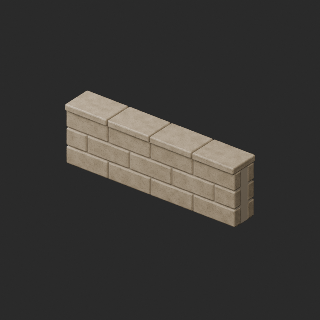

Use / purpose: Low seaward parapet from the harbor collection. Unit: one model record. Includes BLEND and GLB. The close-up is rendered from the distributed BLEND.

Record type: model. Formats: BLEND/GLB.

Dimensions (X × Y × Z, metres): Unknown. Triangles: Unknown.

Origin: Unknown / not independently confirmed. Orientation: Unknown / not independently confirmed.

[Base model FH_011](base-03.md#fh_011). Geometry baseline: original; UV: original_uv0_plus_wearuv. Base measurements are not silently applied to changed geometry.

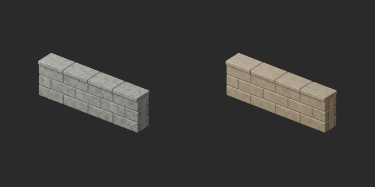

Comparison: left: original base; right: accepted variant; same overview camera.

[Download ZIP](https://raw.githubusercontent.com/k3peta/tales-on-a-table/main/distributions/quality-fh011-020-v1/FH_011__color_CC0.zip) · [License scope](../../LICENSE.md)

**CC0-1.0** — model geometry and embedded materials only. Models and embedded materials only; previews excluded.

Source details: [Catalogue 1](../../catalog/material_variants_fh011_020.md)

## FH_012__new

**Iron mooring bollard**

鉄の係船柱

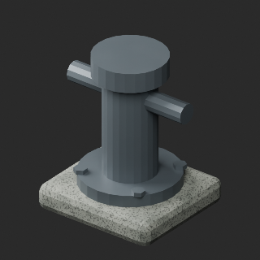

Use / purpose: Iron mooring bollard from the harbor collection. Unit: one model record. Includes BLEND and GLB. The close-up is rendered from the distributed BLEND.

Record type: model. Formats: BLEND/GLB.

Dimensions (X × Y × Z, metres): Unknown. Triangles: Unknown.

Origin: Unknown / not independently confirmed. Orientation: Unknown / not independently confirmed.

[Base model FH_012](base-03.md#fh_012). Geometry baseline: original; UV: original_uv0_plus_wearuv. Base measurements are not silently applied to changed geometry.

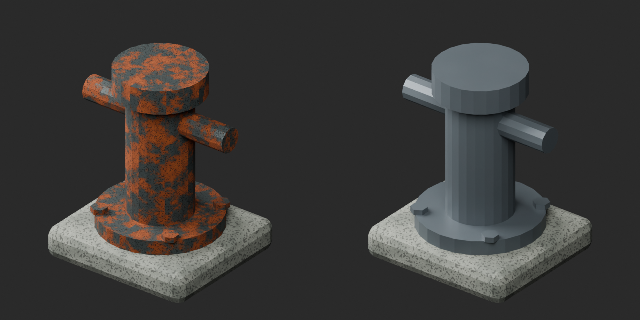

Comparison: left: original base; right: accepted variant; same overview camera.

[Download ZIP](https://raw.githubusercontent.com/k3peta/tales-on-a-table/main/distributions/quality-fh011-020-v1/FH_012__new_CC0.zip) · [License scope](../../LICENSE.md)

**CC0-1.0** — model geometry and embedded materials only. Models and embedded materials only; previews excluded.

Source details: [Catalogue 1](../../catalog/material_variants_fh011_020.md)

## FH_013__new

**Stone-mounted mooring ring**

石留めの係留環

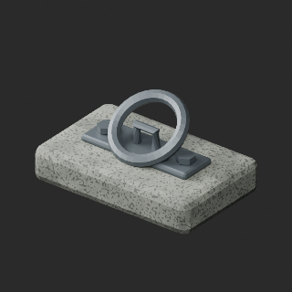

Use / purpose: Stone-mounted mooring ring from the harbor collection. Unit: one model record. Includes BLEND and GLB. The close-up is rendered from the distributed BLEND.

Record type: model. Formats: BLEND/GLB.

Dimensions (X × Y × Z, metres): Unknown. Triangles: Unknown.

Origin: Unknown / not independently confirmed. Orientation: Unknown / not independently confirmed.

[Base model FH_013](base-03.md#fh_013). Geometry baseline: original; UV: original_uv0_plus_wearuv. Base measurements are not silently applied to changed geometry.

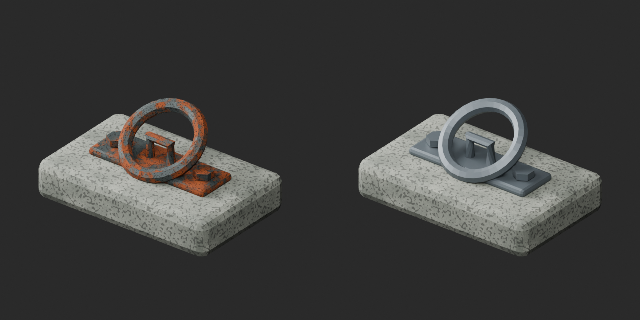

Comparison: left: original base; right: accepted variant; same overview camera.

[Download ZIP](https://raw.githubusercontent.com/k3peta/tales-on-a-table/main/distributions/quality-fh011-020-v1/FH_013__new_CC0.zip) · [License scope](../../LICENSE.md)

**CC0-1.0** — model geometry and embedded materials only. Models and embedded materials only; previews excluded.

Source details: [Catalogue 1](../../catalog/material_variants_fh011_020.md)

## FH_015__new

**Harbor lantern with wind shield**

防風ガラスの港灯

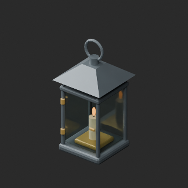

Use / purpose: Harbor lantern with wind shield from the harbor collection. Unit: one model record. Includes BLEND and GLB. The close-up is rendered from the distributed BLEND.

Record type: model. Formats: BLEND/GLB.

Dimensions (X × Y × Z, metres): Unknown. Triangles: Unknown.

Origin: Unknown / not independently confirmed. Orientation: Unknown / not independently confirmed.

[Base model FH_015](base-03.md#fh_015). Geometry baseline: original; UV: original_uv0_plus_wearuv. Base measurements are not silently applied to changed geometry.

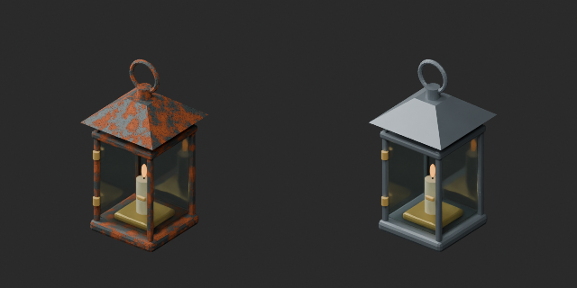

Comparison: left: original base; right: accepted variant; same overview camera.

[Download ZIP](https://raw.githubusercontent.com/k3peta/tales-on-a-table/main/distributions/quality-fh011-020-v1/FH_015__new_CC0.zip) · [License scope](../../LICENSE.md)

**CC0-1.0** — model geometry and embedded materials only. Models and embedded materials only; previews excluded.

Source details: [Catalogue 1](../../catalog/material_variants_fh011_020.md)

## FH_021__color

**Folded and tied small sail**

畳んで縛った小さな帆

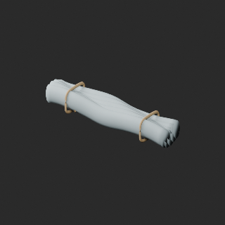

Use / purpose: Folded and tied small sail from the harbor collection. Unit: one model record. Includes BLEND and GLB. The close-up is rendered from the distributed BLEND.

Record type: model. Formats: BLEND/GLB.

Dimensions (X × Y × Z, metres): Unknown. Triangles: Unknown.

Origin: Unknown / not independently confirmed. Orientation: Unknown / not independently confirmed.

[Base model FH_021](base-04.md#fh_021). Geometry baseline: original; UV: original_uv0_plus_wearuv. Base measurements are not silently applied to changed geometry.

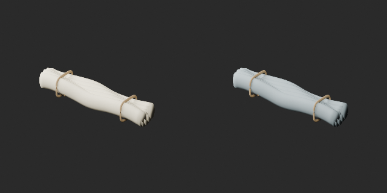

Comparison: left: original base; right: accepted variant; same overview camera.

[Download ZIP](https://raw.githubusercontent.com/k3peta/tales-on-a-table/main/distributions/quality-fh021-030-v1/FH_021__color_CC0.zip) · [License scope](../../LICENSE.md)

**CC0-1.0** — model geometry and embedded materials only. Models and embedded materials only; previews excluded.

Source details: [Catalogue 1](../../catalog/material_variants_fh021_030.md)

## FH_029__color

**Rope with small floats**

小さな浮子を並べた索

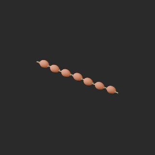

Use / purpose: Rope with small floats from the harbor collection. Unit: one model record. Includes BLEND and GLB. The close-up is rendered from the distributed BLEND.

Record type: model. Formats: BLEND/GLB.

Dimensions (X × Y × Z, metres): Unknown. Triangles: Unknown.

Origin: Unknown / not independently confirmed. Orientation: Unknown / not independently confirmed.

[Base model FH_029](base-04.md#fh_029). Geometry baseline: original; UV: original_uv0_plus_wearuv. Base measurements are not silently applied to changed geometry.

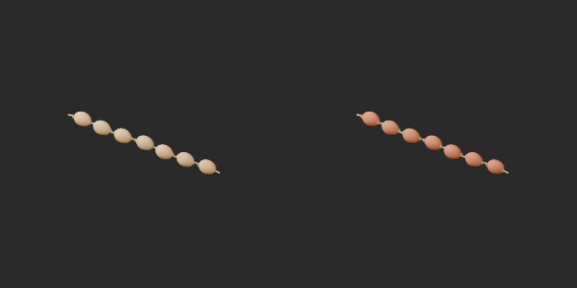

Comparison: left: original base; right: accepted variant; same overview camera.

[Download ZIP](https://raw.githubusercontent.com/k3peta/tales-on-a-table/main/distributions/quality-fh021-030-v1/FH_029__color_CC0.zip) · [License scope](../../LICENSE.md)

**CC0-1.0** — model geometry and embedded materials only. Models and embedded materials only; previews excluded.

Source details: [Catalogue 1](../../catalog/material_variants_fh021_030.md)

## FH_035__new

**Lunch box tied with cloth**

布紐で留めた弁当箱

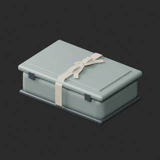

Use / purpose: Lunch box tied with cloth from the harbor collection. Unit: one model record. Includes BLEND and GLB. The close-up is rendered from the distributed BLEND.

Record type: model. Formats: BLEND/GLB.

Dimensions (X × Y × Z, metres): Unknown. Triangles: Unknown.

Origin: Unknown / not independently confirmed. Orientation: Unknown / not independently confirmed.

[Base model FH_035](base-04.md#fh_035). Geometry baseline: original; UV: original_uv0_plus_wearuv. Base measurements are not silently applied to changed geometry.

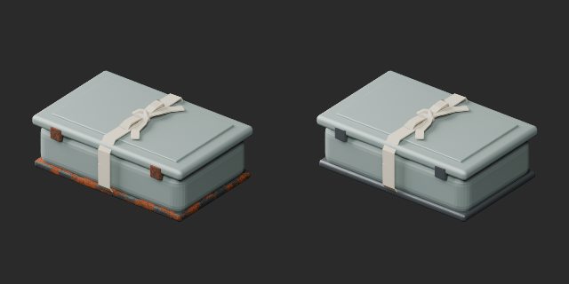

Comparison: left: original base; right: accepted variant; same overview camera.

[Download ZIP](https://raw.githubusercontent.com/k3peta/tales-on-a-table/main/distributions/quality-fh031-040-v1/FH_035__new_CC0.zip) · [License scope](../../LICENSE.md)

**CC0-1.0** — model geometry and embedded materials only. Models and embedded materials only; previews excluded.

Source details: [Catalogue 1](../../catalog/material_variants_fh031_040.md)

## FH_037__color

**Rain cloak hanging on a nail**

釘に掛かった雨よけ外套

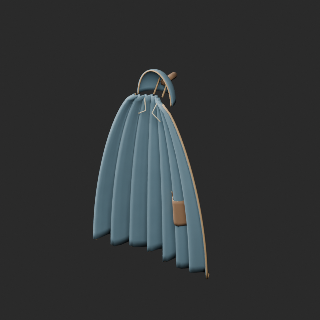

Use / purpose: Rain cloak hanging on a nail from the harbor collection. Unit: one model record. Includes BLEND and GLB. The close-up is rendered from the distributed BLEND.

Record type: model. Formats: BLEND/GLB.

Dimensions (X × Y × Z, metres): Unknown. Triangles: Unknown.

Origin: Unknown / not independently confirmed. Orientation: Unknown / not independently confirmed.

[Base model FH_037](base-04.md#fh_037). Geometry baseline: original; UV: original_uv0_plus_wearuv. Base measurements are not silently applied to changed geometry.

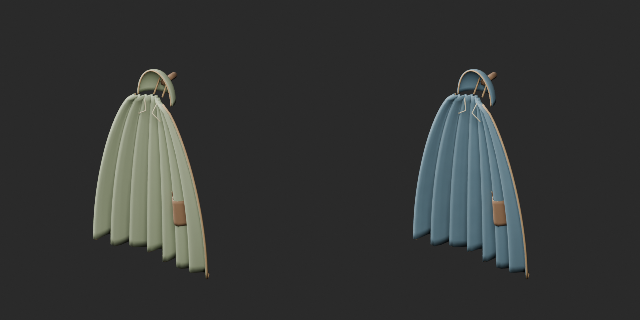

Comparison: left: original base; right: accepted variant; same overview camera.

[Download ZIP](https://raw.githubusercontent.com/k3peta/tales-on-a-table/main/distributions/quality-fh031-040-v1/FH_037__color_CC0.zip) · [License scope](../../LICENSE.md)

**CC0-1.0** — model geometry and embedded materials only. Models and embedded materials only; previews excluded.

Source details: [Catalogue 1](../../catalog/material_variants_fh031_040.md)

## FH_044__color

**Shell offering dish**

貝殻のお供え皿

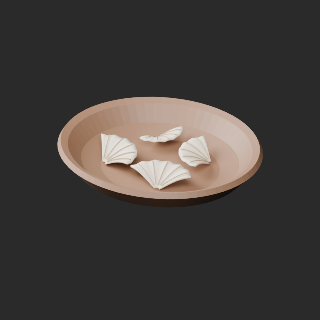

Use / purpose: Shell offering dish from the harbor collection. Unit: one model record. Includes BLEND and GLB. The close-up is rendered from the distributed BLEND.

Record type: model. Formats: BLEND/GLB.

Dimensions (X × Y × Z, metres): Unknown. Triangles: Unknown.

Origin: Unknown / not independently confirmed. Orientation: Unknown / not independently confirmed.

[Base model FH_044](base-05.md#fh_044). Geometry baseline: original; UV: original_uv0_plus_wearuv. Base measurements are not silently applied to changed geometry.

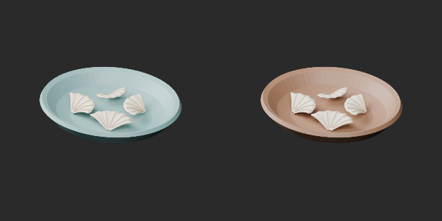

Comparison: left: original base; right: accepted variant; same overview camera.

[Download ZIP](https://raw.githubusercontent.com/k3peta/tales-on-a-table/main/distributions/quality-fh041-050-v1/FH_044__color_CC0.zip) · [License scope](../../LICENSE.md)

**CC0-1.0** — model geometry and embedded materials only. Models and embedded materials only; previews excluded.

Source details: [Catalogue 1](../../catalog/material_variants_fh041_050.md)

## OL_003__color

**Blue decorative vase**

青い飾り壺

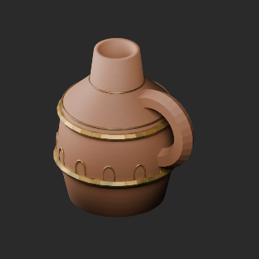

Use / purpose: Blue decorative vase from the lamp shop collection. Unit: one model record. Includes BLEND and GLB. The close-up is rendered from the distributed BLEND.

Record type: model. Formats: BLEND/GLB.

Dimensions (X × Y × Z, metres): Unknown. Triangles: Unknown.

Origin: Unknown / not independently confirmed. Orientation: Unknown / not independently confirmed.

[Base model OL_003](base-05.md#ol_003). Geometry baseline: original; UV: original_uv0_plus_wearuv. Base measurements are not silently applied to changed geometry.

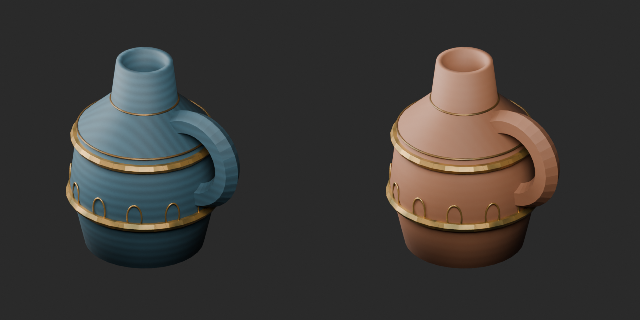

Comparison: left: original base; right: accepted variant; same overview camera.

[Download ZIP](https://raw.githubusercontent.com/k3peta/tales-on-a-table/main/distributions/quality-fh051-056-ol001-004-v1/OL_003__color_CC0.zip) · [License scope](../../LICENSE.md)

**CC0-1.0** — model geometry and embedded materials only. Models and embedded materials only; previews excluded.

Source details: [Catalogue 1](../../catalog/material_variants_fh051_056_ol001_004.md)

## OL_004__color

**Carved counter**

彫刻入りカウンター

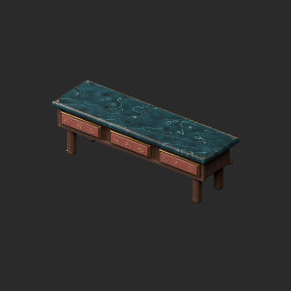

Use / purpose: Carved counter from the lamp shop collection. Unit: one model record. Includes BLEND and GLB. The close-up is rendered from the distributed BLEND.

Record type: model. Formats: BLEND/GLB.

Dimensions (X × Y × Z, metres): Unknown. Triangles: Unknown.

Origin: Unknown / not independently confirmed. Orientation: Unknown / not independently confirmed.

[Base model OL_004](base-05.md#ol_004). Geometry baseline: original; UV: original_uv0_plus_wearuv. Base measurements are not silently applied to changed geometry.

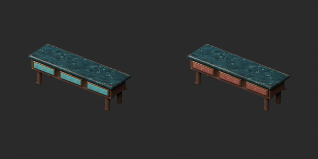

Comparison: left: original base; right: accepted variant; same overview camera.

[Download ZIP](https://raw.githubusercontent.com/k3peta/tales-on-a-table/main/distributions/quality-fh051-056-ol001-004-v1/OL_004__color_CC0.zip) · [License scope](../../LICENSE.md)

**CC0-1.0** — model geometry and embedded materials only. Models and embedded materials only; previews excluded.

Source details: [Catalogue 1](../../catalog/material_variants_fh051_056_ol001_004.md)

## OL_005__color

**Crimson medallion carpet**

深紅のメダリオン絨毯

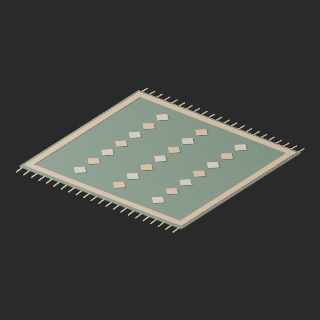

Use / purpose: Crimson medallion carpet from the lamp shop collection. Unit: one model record. Includes BLEND and GLB. The close-up is rendered from the distributed BLEND.

Record type: model. Formats: BLEND/GLB.

Dimensions (X × Y × Z, metres): Unknown. Triangles: Unknown.

Origin: Unknown / not independently confirmed. Orientation: Unknown / not independently confirmed.

[Base model OL_005](base-05.md#ol_005). Geometry baseline: border_trim_v1; UV: original_uv0_plus_wearuv. Base measurements are not silently applied to changed geometry.

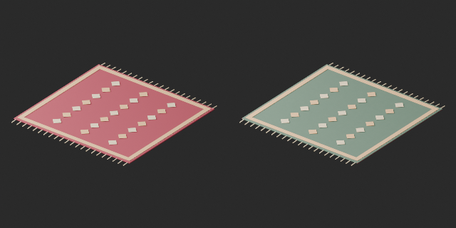

Comparison: left: border_trim_v1 repaired base; right: same-shape color variant.

[Download ZIP](https://raw.githubusercontent.com/k3peta/tales-on-a-table/main/distributions/quality-ol005-014-v1/OL_005__color_CC0.zip) · [License scope](../../LICENSE.md)

**CC0-1.0** — model geometry and embedded materials only. Models and embedded materials only; previews excluded.

Source details: [Catalogue 1](../../catalog/material_variants_ol005_014.md)

## OL_011__color

**Indigo runner rug**

藍色の細長い敷物

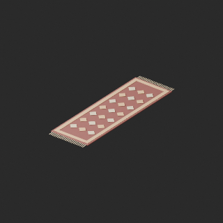

Use / purpose: Indigo runner rug from the lamp shop collection. Unit: one model record. Includes BLEND and GLB. The close-up is rendered from the distributed BLEND.

Record type: model. Formats: BLEND/GLB.

Dimensions (X × Y × Z, metres): Unknown. Triangles: Unknown.

Origin: Unknown / not independently confirmed. Orientation: Unknown / not independently confirmed.

[Base model OL_011](base-06.md#ol_011). Geometry baseline: border_trim_v1; UV: original_uv0_plus_wearuv. Base measurements are not silently applied to changed geometry.

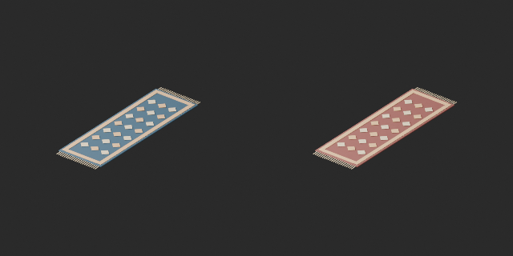

Comparison: left: border_trim_v1 repaired base; right: same-shape color variant.

[Download ZIP](https://raw.githubusercontent.com/k3peta/tales-on-a-table/main/distributions/quality-ol005-014-v1/OL_011__color_CC0.zip) · [License scope](../../LICENSE.md)

**CC0-1.0** — model geometry and embedded materials only. Models and embedded materials only; previews excluded.

Source details: [Catalogue 1](../../catalog/material_variants_ol005_014.md)

## OL_012__color

**Jewelry display tray**

宝飾品の展示トレイ

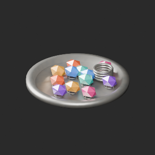

Use / purpose: Jewelry display tray from the lamp shop collection. Unit: one model record. Includes BLEND and GLB. The close-up is rendered from the distributed BLEND.

Record type: model. Formats: BLEND/GLB.

Dimensions (X × Y × Z, metres): Unknown. Triangles: Unknown.

Origin: Unknown / not independently confirmed. Orientation: Unknown / not independently confirmed.

[Base model OL_012](base-06.md#ol_012). Geometry baseline: original; UV: original_uv0_plus_wearuv. Base measurements are not silently applied to changed geometry.

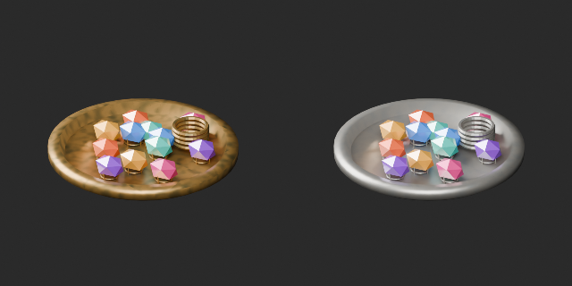

Comparison: left: original; right: accepted revision or variant; same camera.

[Download ZIP](https://raw.githubusercontent.com/k3peta/tales-on-a-table/main/distributions/quality-ol005-014-v1/OL_012__color_CC0.zip) · [License scope](../../LICENSE.md)

**CC0-1.0** — model geometry and embedded materials only. Models and embedded materials only; previews excluded.

Source details: [Catalogue 1](../../catalog/material_variants_ol005_014.md)

## OL_014__color

**Three rolled carpets**

巻いた絨毯3本

Use / purpose: Three rolled carpets from the lamp shop collection. Unit: one model record. Includes BLEND and GLB. The close-up is rendered from the distributed BLEND.

Record type: model. Formats: BLEND/GLB.

Dimensions (X × Y × Z, metres): Unknown. Triangles: Unknown.

Origin: Unknown / not independently confirmed. Orientation: Unknown / not independently confirmed.

[Base model OL_014](base-06.md#ol_014). Geometry baseline: original; UV: original_uv0_plus_wearuv. Base measurements are not silently applied to changed geometry.

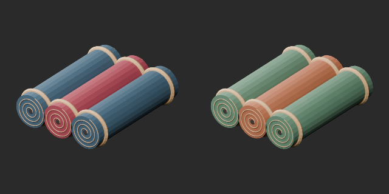

Comparison: left: original; right: accepted revision or variant; same camera.

[Download ZIP](https://raw.githubusercontent.com/k3peta/tales-on-a-table/main/distributions/quality-ol005-014-v1/OL_014__color_CC0.zip) · [License scope](../../LICENSE.md)

**CC0-1.0** — model geometry and embedded materials only. Models and embedded materials only; previews excluded.

Source details: [Catalogue 1](../../catalog/material_variants_ol005_014.md)
