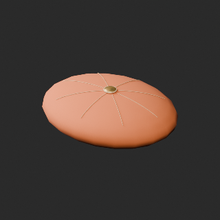
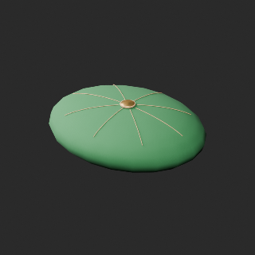
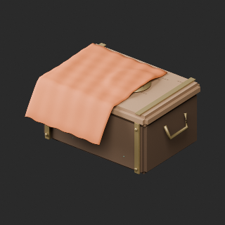
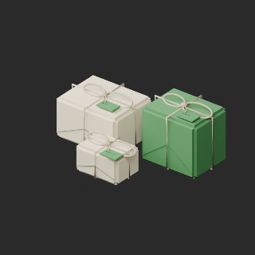
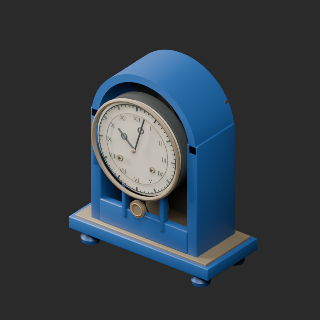
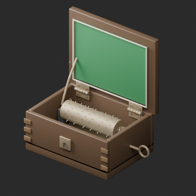
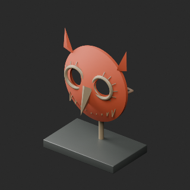
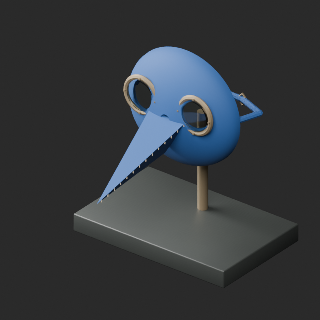
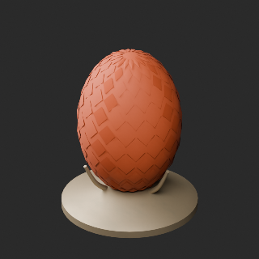
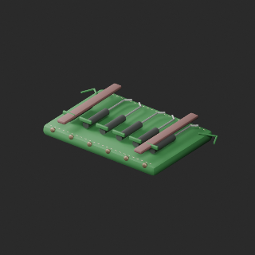

# Material variants 97–104

[Browse index](README.md) · [Coverage and missing fields](COVERAGE.md)

Images are actual existing model renders for browsing, not covered by model CC0. A group record may show several reused models. Dimensions and triangle counts apply only to the original record when sourced; revisions can differ. Unknown means unverified, not zero. No blanket CC0 grant for scenes, images, code or articles.

## OL_019__color

**Set of silk cushions**

絹のクッション一式

Use / purpose: Set of silk cushions from the lamp shop collection. Unit: one model record. Includes BLEND and GLB. The close-up is rendered from the distributed BLEND.

Record type: model. Formats: BLEND/GLB.

Dimensions (X × Y × Z, metres): Unknown. Triangles: Unknown.

Origin: Unknown / not independently confirmed. Orientation: Unknown / not independently confirmed.

[Base model OL_019](base-06.md#ol_019). Geometry baseline: compact_pair_v1; UV: original_uv0_plus_wearuv. Base measurements are not silently applied to changed geometry.

Comparison: left: compact_pair_v1 repaired layout; right: same-layout color variant.

[Download ZIP](https://raw.githubusercontent.com/k3peta/tales-on-a-table/main/distributions/quality-ol015-024-v1/OL_019__color_CC0.zip) · [License scope](../../LICENSE.md)

**CC0-1.0** — model geometry and embedded materials only. Models and embedded materials only; previews excluded.

Source details: [Catalogue 1](../../catalog/material_variants_ol015_024.md)

## OL_028__color

**Blue flattened-sphere lamp**

青い扁球形ランプ

Use / purpose: Blue flattened-sphere lamp from the lamp shop collection. Unit: one model record. Includes BLEND and GLB. The close-up is rendered from the distributed BLEND.

Record type: model. Formats: BLEND/GLB.

Dimensions (X × Y × Z, metres): Unknown. Triangles: Unknown.

Origin: Unknown / not independently confirmed. Orientation: Unknown / not independently confirmed.

[Base model OL_028](base-06.md#ol_028). Geometry baseline: original; UV: original_uv0_plus_wearuv. Base measurements are not silently applied to changed geometry.

Comparison: left: original base; right: accepted variant; same overview camera.

[Download ZIP](https://raw.githubusercontent.com/k3peta/tales-on-a-table/main/distributions/quality-ol025-034-v1/OL_028__color_CC0.zip) · [License scope](../../LICENSE.md)

**CC0-1.0** — model geometry and embedded materials only. Models and embedded materials only; previews excluded.

Source details: [Catalogue 1](../../catalog/material_variants_ol025_034.md)

## OL_029__color

**Decorative hookah**

装飾用の水煙草器

Use / purpose: Decorative hookah from the lamp shop collection. Unit: one model record. Includes BLEND and GLB. The close-up is rendered from the distributed BLEND.

Record type: model. Formats: BLEND/GLB.

Dimensions (X × Y × Z, metres): Unknown. Triangles: Unknown.

Origin: Unknown / not independently confirmed. Orientation: Unknown / not independently confirmed.

[Base model OL_029](base-06.md#ol_029). Geometry baseline: original; UV: original_uv0_plus_wearuv. Base measurements are not silently applied to changed geometry.

Comparison: left: original base; right: accepted variant; same overview camera.

[Download ZIP](https://raw.githubusercontent.com/k3peta/tales-on-a-table/main/distributions/quality-ol025-034-v1/OL_029__color_CC0.zip) · [License scope](../../LICENSE.md)

**CC0-1.0** — model geometry and embedded materials only. Models and embedded materials only; previews excluded.

Source details: [Catalogue 1](../../catalog/material_variants_ol025_034.md)

## OL_035__color

**Indigo wall carpet**

壁掛けの藍色絨毯

Use / purpose: Indigo wall carpet from the lamp shop collection. Unit: one model record. Includes BLEND and GLB. The close-up is rendered from the distributed BLEND.

Record type: model. Formats: BLEND/GLB.

Dimensions (X × Y × Z, metres): Unknown. Triangles: Unknown.

Origin: Unknown / not independently confirmed. Orientation: Unknown / not independently confirmed.

[Base model OL_035](base-07.md#ol_035). Geometry baseline: original; UV: original_uv0_plus_wearuv. Base measurements are not silently applied to changed geometry.

Comparison: left: original base; right: accepted variant; same overview camera.

[Download ZIP](https://raw.githubusercontent.com/k3peta/tales-on-a-table/main/distributions/quality-ol035-044-v1/OL_035__color_CC0.zip) · [License scope](../../LICENSE.md)

**CC0-1.0** — model geometry and embedded materials only. Models and embedded materials only; previews excluded.

Source details: [Catalogue 1](../../catalog/material_variants_ol035_044.md)

## OL_037__color

**Small pile of gold coins**

小さな金貨の山

Use / purpose: Small pile of gold coins from the lamp shop collection. Unit: one model record. Includes BLEND and GLB. The close-up is rendered from the distributed BLEND.

Record type: model. Formats: BLEND/GLB.

Dimensions (X × Y × Z, metres): Unknown. Triangles: Unknown.

Origin: Unknown / not independently confirmed. Orientation: Unknown / not independently confirmed.

[Base model OL_037](base-07.md#ol_037). Geometry baseline: original; UV: original_uv0_plus_wearuv. Base measurements are not silently applied to changed geometry.

Comparison: left: original base; right: accepted variant; same overview camera.

[Download ZIP](https://raw.githubusercontent.com/k3peta/tales-on-a-table/main/distributions/quality-ol035-044-v1/OL_037__color_CC0.zip) · [License scope](../../LICENSE.md)

**CC0-1.0** — model geometry and embedded materials only. Models and embedded materials only; previews excluded.

Source details: [Catalogue 1](../../catalog/material_variants_ol035_044.md)

## OL_045__glass_orange

**Tripod table lamp**

三脚の卓上ランプ

Use / purpose: Tripod table lamp from the lamp shop collection. Unit: one model record. Includes BLEND and GLB. The close-up is rendered from the distributed BLEND.

Record type: model. Formats: BLEND/GLB.

Dimensions (X × Y × Z, metres): Unknown. Triangles: Unknown.

Origin: Unknown / not independently confirmed. Orientation: Unknown / not independently confirmed.

[Base model OL_045](base-07.md#ol_045). Geometry baseline: original; UV: original_uv0_unchanged. Base measurements are not silently applied to changed geometry.

Comparison: left: original base; right: accepted variant; same overview camera.

[Download ZIP](https://raw.githubusercontent.com/k3peta/tales-on-a-table/main/distributions/quality-ol045-054-v1/OL_045__glass_orange_CC0.zip) · [License scope](../../LICENSE.md)

**CC0-1.0** — model geometry and embedded materials only. Models and embedded materials only; previews excluded.

Source details: [Catalogue 1](../../catalog/material_variants_ol045_054.md)

## OL_045__glass_green

**Tripod table lamp**

三脚の卓上ランプ

Use / purpose: Tripod table lamp from the lamp shop collection. Unit: one model record. Includes BLEND and GLB. The close-up is rendered from the distributed BLEND.

Record type: model. Formats: BLEND/GLB.

Dimensions (X × Y × Z, metres): Unknown. Triangles: Unknown.

Origin: Unknown / not independently confirmed. Orientation: Unknown / not independently confirmed.

[Base model OL_045](base-07.md#ol_045). Geometry baseline: original; UV: original_uv0_unchanged. Base measurements are not silently applied to changed geometry.

Comparison: left: original base; right: accepted variant; same overview camera.

[Download ZIP](https://raw.githubusercontent.com/k3peta/tales-on-a-table/main/distributions/quality-ol045-054-v1/OL_045__glass_green_CC0.zip) · [License scope](../../LICENSE.md)

**CC0-1.0** — model geometry and embedded materials only. Models and embedded materials only; previews excluded.

Source details: [Catalogue 1](../../catalog/material_variants_ol045_054.md)

## OL_053__color

**Framed mirror panel**

額縁付き鏡パネル

Use / purpose: Framed mirror panel from the lamp shop collection. Unit: one model record. Includes BLEND and GLB. The close-up is rendered from the distributed BLEND.

Record type: model. Formats: BLEND/GLB.

Dimensions (X × Y × Z, metres): Unknown. Triangles: Unknown.

Origin: Unknown / not independently confirmed. Orientation: Unknown / not independently confirmed.

[Base model OL_053](base-07.md#ol_053). Geometry baseline: original; UV: original_uv0_plus_wearuv. Base measurements are not silently applied to changed geometry.

Comparison: left: original base; right: accepted variant; same overview camera.

[Download ZIP](https://raw.githubusercontent.com/k3peta/tales-on-a-table/main/distributions/quality-ol045-054-v1/OL_053__color_CC0.zip) · [License scope](../../LICENSE.md)

**CC0-1.0** — model geometry and embedded materials only. Models and embedded materials only; previews excluded.

Source details: [Catalogue 1](../../catalog/material_variants_ol045_054.md)

## OL_extra_blue__color_orange

**Single blue cushion**

青い単体クッション

Use / purpose: Orange cushion for static interior set dressing.

Formats: BLEND/GLB. Dimensions / triangles / intended pivot / facing: not independently measured for this variant.

[Base OL_extra_blue](base-08.md#ol_extra_blue). Geometry and original UV retained; added WearUV.

[Full comparison](../../previews/quality-ol055-story-at001-v1/OL_extra_blue__color_orange_comparison.png) · [Download ZIP](https://raw.githubusercontent.com/k3peta/tales-on-a-table/main/distributions/quality-ol055-story-at001-v1/OL_extra_blue__color_orange_CC0.zip) · [Source catalogue](../../catalog/material_variants_ol055_story_at001.md)

CC0-1.0: model geometry and embedded materials only. Images excluded; [license scope](../../LICENSE.md).

## OL_extra_blue__color_green

**Single blue cushion**

青い単体クッション

Use / purpose: Green cushion for static interior set dressing.

Formats: BLEND/GLB. Dimensions / triangles / intended pivot / facing: not independently measured for this variant.

[Base OL_extra_blue](base-08.md#ol_extra_blue). Geometry and original UV retained; added WearUV.

[Full comparison](../../previews/quality-ol055-story-at001-v1/OL_extra_blue__color_green_comparison.png) · [Download ZIP](https://raw.githubusercontent.com/k3peta/tales-on-a-table/main/distributions/quality-ol055-story-at001-v1/OL_extra_blue__color_green_CC0.zip) · [Source catalogue](../../catalog/material_variants_ol055_story_at001.md)

CC0-1.0: model geometry and embedded materials only. Images excluded; [license scope](../../LICENSE.md).

## OL_STORY_001__color_orange

**Cloth-draped handbox**

布を掛けた手箱

Use / purpose: Chest-and-cloth arrangement with orange cloth; arrangement color variant, not a new standalone shape.

Formats: BLEND/GLB. Dimensions / triangles / intended pivot / facing: not independently measured for this variant.

[Base OL_STORY_001](base-08.md#ol_story_001). Geometry and original UV retained; added WearUV.

[Full comparison](../../previews/quality-ol055-story-at001-v1/OL_STORY_001__color_orange_comparison.png) · [Download ZIP](https://raw.githubusercontent.com/k3peta/tales-on-a-table/main/distributions/quality-ol055-story-at001-v1/OL_STORY_001__color_orange_CC0.zip) · [Source catalogue](../../catalog/material_variants_ol055_story_at001.md)

CC0-1.0: model geometry and embedded materials only. Images excluded; [license scope](../../LICENSE.md).

## OL_STORY_005__color_green

**Travel souvenir bundle**

旅の土産包み

Use / purpose: Souvenir arrangement with green cloth; paper and rope unchanged.

Formats: BLEND/GLB. Dimensions / triangles / intended pivot / facing: not independently measured for this variant.

[Base OL_STORY_005](base-08.md#ol_story_005). Geometry and original UV retained; added WearUV.

[Full comparison](../../previews/quality-ol055-story-at001-v1/OL_STORY_005__color_green_comparison.png) · [Download ZIP](https://raw.githubusercontent.com/k3peta/tales-on-a-table/main/distributions/quality-ol055-story-at001-v1/OL_STORY_005__color_green_CC0.zip) · [Source catalogue](../../catalog/material_variants_ol055_story_at001.md)

CC0-1.0: model geometry and embedded materials only. Images excluded; [license scope](../../LICENSE.md).

## AT_002__color_blue

**Stopped mantel clock**

止まった置時計

Use / purpose: Blue clock-case paint for static interior set dressing.

Formats: BLEND/GLB. Dimensions / triangles / intended pivot / facing: not independently measured for this variant.

[Base AT_002](base-08.md#at_002). Geometry and original UV retained.

[Full comparison](../../previews/quality-at002-011-v1/AT_002__color_blue_comparison.png) · [Download ZIP](https://raw.githubusercontent.com/k3peta/tales-on-a-table/main/distributions/quality-at002-011-v1/AT_002__color_blue_CC0.zip) · [Source catalogue](../../catalog/material_variants_at002_011.md)

CC0-1.0: model geometry and embedded materials only. Images excluded; [license scope](../../LICENSE.md).

## AT_008__color_green

**Open music box**

開いたオルゴール

Use / purpose: Green music-box lining; case and mechanism unchanged.

Formats: BLEND/GLB. Dimensions / triangles / intended pivot / facing: not independently measured for this variant.

[Base AT_008](base-08.md#at_008). Geometry and original UV retained.

[Full comparison](../../previews/quality-at002-011-v1/AT_008__color_green_comparison.png) · [Download ZIP](https://raw.githubusercontent.com/k3peta/tales-on-a-table/main/distributions/quality-at002-011-v1/AT_008__color_green_CC0.zip) · [Source catalogue](../../catalog/material_variants_at002_011.md)

CC0-1.0: model geometry and embedded materials only. Images excluded; [license scope](../../LICENSE.md).

## AT_011__color_terracotta

**Owl relic mask**

梟の遺物仮面

Use / purpose: Terracotta owl-mask surface; original shape and eye openings unchanged.

Formats: BLEND/GLB. Dimensions / triangles / intended pivot / facing: not independently measured for this variant.

[Base AT_011](base-08.md#at_011). Geometry and original UV retained.

[Full comparison](../../previews/quality-at002-011-v1/AT_011__color_terracotta_comparison.png) · [Download ZIP](https://raw.githubusercontent.com/k3peta/tales-on-a-table/main/distributions/quality-at002-011-v1/AT_011__color_terracotta_CC0.zip) · [Source catalogue](../../catalog/material_variants_at002_011.md)

CC0-1.0: model geometry and embedded materials only. Images excluded; [license scope](../../LICENSE.md).

## AT_012__color_blue

**Raven procession mask**

渡鴉の行列仮面

Use / purpose: Blue raven-mask leather; lenses and fittings retained.

Formats: BLEND/GLB. Dimensions / triangles / intended pivot / facing: not independently measured for this variant.

[Base AT_012](base-08.md#at_012). Geometry and original UV retained.

[Full comparison](../../previews/quality-at012-021-v1/AT_012__color_blue_comparison.png) · [Download ZIP](https://raw.githubusercontent.com/k3peta/tales-on-a-table/main/distributions/quality-at012-021-v1/AT_012__color_blue_CC0.zip) · [Source catalogue](../../catalog/material_variants_at012_021.md)

CC0-1.0: model geometry and embedded materials only. Images excluded; [license scope](../../LICENSE.md).

## AT_017__color_blue

**Scarred shield**

傷だらけの盾

Use / purpose: Blue shield ground; scratches and heraldry retained.

Formats: BLEND/GLB. Dimensions / triangles / intended pivot / facing: not independently measured for this variant.

[Base AT_017](base-08.md#at_017). Geometry and original UV retained.

[Full comparison](../../previews/quality-at012-021-v1/AT_017__color_blue_comparison.png) · [Download ZIP](https://raw.githubusercontent.com/k3peta/tales-on-a-table/main/distributions/quality-at012-021-v1/AT_017__color_blue_CC0.zip) · [Source catalogue](../../catalog/material_variants_at012_021.md)

CC0-1.0: model geometry and embedded materials only. Images excluded; [license scope](../../LICENSE.md).

## AT_020__color_copper

**Dragon egg on a pedestal**

台座に据えた竜の卵

Use / purpose: Copper-colored dragon egg; optical material parameters unchanged.

Formats: BLEND/GLB. Dimensions / triangles / intended pivot / facing: not independently measured for this variant.

[Base AT_020](base-09.md#at_020). Geometry and original UV retained.

[Full comparison](../../previews/quality-at012-021-v1/AT_020__color_copper_comparison.png) · [Download ZIP](https://raw.githubusercontent.com/k3peta/tales-on-a-table/main/distributions/quality-at012-021-v1/AT_020__color_copper_CC0.zip) · [Source catalogue](../../catalog/material_variants_at012_021.md)

CC0-1.0: model geometry and embedded materials only. Images excluded; [license scope](../../LICENSE.md).

## AT_022__color_red

**Chain-bound grimoire**

鎖で閉じた魔導書

Use / purpose: Red spellbook cover, original geometry retained.

Formats: BLEND/GLB. Dimensions / triangles / intended pivot / facing: not independently measured for this variant.

[Base AT_022](base-09.md#at_022). Geometry baseline: original; UV retained relative to that baseline.

[Full comparison](../../previews/quality-at022-031-v1/AT_022__color_red_comparison.png) · [Download ZIP](https://raw.githubusercontent.com/k3peta/tales-on-a-table/main/distributions/quality-at022-031-v1/AT_022__color_red_CC0.zip) · [Source catalogue](../../catalog/material_variants_at022_031.md)

CC0-1.0: model geometry and embedded materials only. Images excluded; [license scope](../../LICENSE.md).

## AT_031__color_green

**Old tool roll**

古い工具の巻き袋

Use / purpose: Green tool-roll leather on repaired stitch_seating_v1 geometry; not the unrepaired original.

Formats: BLEND/GLB. Dimensions / triangles / intended pivot / facing: not independently measured for this variant.

[Base AT_031](base-09.md#at_031). Geometry baseline: stitch_seating_v1; UV retained relative to that baseline.

[Full comparison](../../previews/quality-at022-031-v1/AT_031__color_green_comparison.png) · [Download ZIP](https://raw.githubusercontent.com/k3peta/tales-on-a-table/main/distributions/quality-at022-031-v1/AT_031__color_green_CC0.zip) · [Source catalogue](../../catalog/material_variants_at022_031.md)

CC0-1.0: model geometry and embedded materials only. Images excluded; [license scope](../../LICENSE.md).
