# Material variants 97–104

[Browse index](README.md) · [Coverage and missing fields](COVERAGE.md)

Images are actual existing model renders for browsing, not covered by model CC0. A group record may show several reused models. Dimensions and triangle counts apply only to the original record when sourced; revisions can differ. Unknown means unverified, not zero. No blanket CC0 grant for scenes, images, code or articles.

## OL_019__color

**Set of silk cushions**

絹のクッション一式

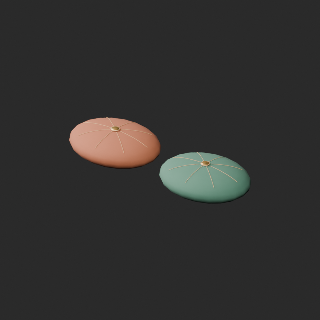

Use / purpose: Set of silk cushions from the lamp shop collection. Unit: one model record. Includes BLEND and GLB. The close-up is rendered from the distributed BLEND.

Record type: model. Formats: BLEND/GLB.

Dimensions (X × Y × Z, metres): Unknown. Triangles: Unknown.

Origin: Unknown / not independently confirmed. Orientation: Unknown / not independently confirmed.

[Base model OL_019](base-06.md#ol_019). Geometry baseline: compact_pair_v1; UV: original_uv0_plus_wearuv. Base measurements are not silently applied to changed geometry.

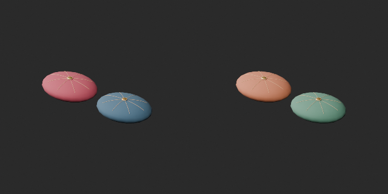

Comparison: left: compact_pair_v1 repaired layout; right: same-layout color variant.

[Download ZIP](https://raw.githubusercontent.com/k3peta/tales-on-a-table/main/distributions/quality-ol015-024-v1/OL_019__color_CC0.zip) · [License scope](../../LICENSE.md)

**CC0-1.0** — model geometry and embedded materials only. Models and embedded materials only; previews excluded.

Source details: [Catalogue 1](../../catalog/material_variants_ol015_024.md)

## OL_028__color

**Blue flattened-sphere lamp**

青い扁球形ランプ

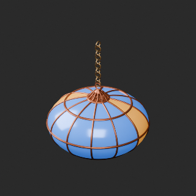

Use / purpose: Blue flattened-sphere lamp from the lamp shop collection. Unit: one model record. Includes BLEND and GLB. The close-up is rendered from the distributed BLEND.

Record type: model. Formats: BLEND/GLB.

Dimensions (X × Y × Z, metres): Unknown. Triangles: Unknown.

Origin: Unknown / not independently confirmed. Orientation: Unknown / not independently confirmed.

[Base model OL_028](base-06.md#ol_028). Geometry baseline: original; UV: original_uv0_plus_wearuv. Base measurements are not silently applied to changed geometry.

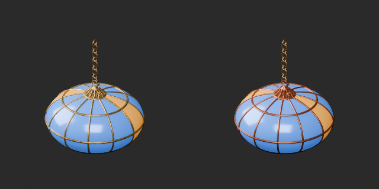

Comparison: left: original base; right: accepted variant; same overview camera.

[Download ZIP](https://raw.githubusercontent.com/k3peta/tales-on-a-table/main/distributions/quality-ol025-034-v1/OL_028__color_CC0.zip) · [License scope](../../LICENSE.md)

**CC0-1.0** — model geometry and embedded materials only. Models and embedded materials only; previews excluded.

Source details: [Catalogue 1](../../catalog/material_variants_ol025_034.md)

## OL_029__color

**Decorative hookah**

装飾用の水煙草器

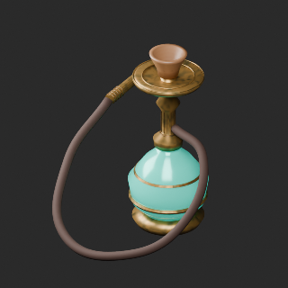

Use / purpose: Decorative hookah from the lamp shop collection. Unit: one model record. Includes BLEND and GLB. The close-up is rendered from the distributed BLEND.

Record type: model. Formats: BLEND/GLB.

Dimensions (X × Y × Z, metres): Unknown. Triangles: Unknown.

Origin: Unknown / not independently confirmed. Orientation: Unknown / not independently confirmed.

[Base model OL_029](base-06.md#ol_029). Geometry baseline: original; UV: original_uv0_plus_wearuv. Base measurements are not silently applied to changed geometry.

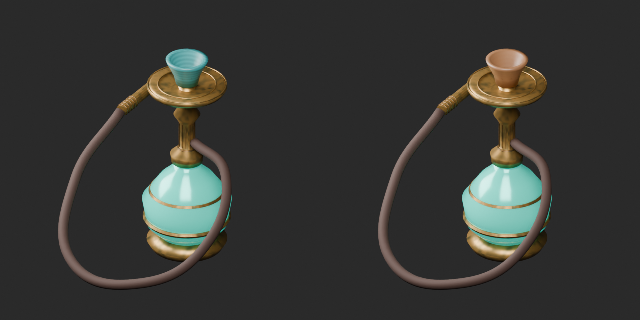

Comparison: left: original base; right: accepted variant; same overview camera.

[Download ZIP](https://raw.githubusercontent.com/k3peta/tales-on-a-table/main/distributions/quality-ol025-034-v1/OL_029__color_CC0.zip) · [License scope](../../LICENSE.md)

**CC0-1.0** — model geometry and embedded materials only. Models and embedded materials only; previews excluded.

Source details: [Catalogue 1](../../catalog/material_variants_ol025_034.md)

## OL_035__color

**Indigo wall carpet**

壁掛けの藍色絨毯

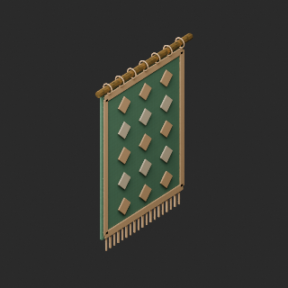

Use / purpose: Indigo wall carpet from the lamp shop collection. Unit: one model record. Includes BLEND and GLB. The close-up is rendered from the distributed BLEND.

Record type: model. Formats: BLEND/GLB.

Dimensions (X × Y × Z, metres): Unknown. Triangles: Unknown.

Origin: Unknown / not independently confirmed. Orientation: Unknown / not independently confirmed.

[Base model OL_035](base-07.md#ol_035). Geometry baseline: original; UV: original_uv0_plus_wearuv. Base measurements are not silently applied to changed geometry.

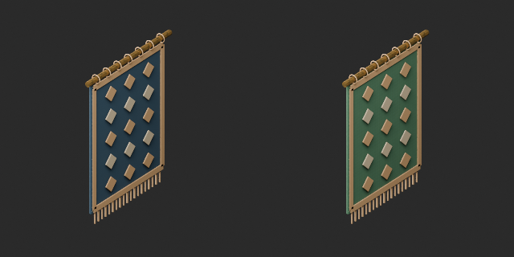

Comparison: left: original base; right: accepted variant; same overview camera.

[Download ZIP](https://raw.githubusercontent.com/k3peta/tales-on-a-table/main/distributions/quality-ol035-044-v1/OL_035__color_CC0.zip) · [License scope](../../LICENSE.md)

**CC0-1.0** — model geometry and embedded materials only. Models and embedded materials only; previews excluded.

Source details: [Catalogue 1](../../catalog/material_variants_ol035_044.md)

## OL_037__color

**Small pile of gold coins**

小さな金貨の山

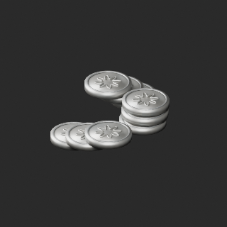

Use / purpose: Small pile of gold coins from the lamp shop collection. Unit: one model record. Includes BLEND and GLB. The close-up is rendered from the distributed BLEND.

Record type: model. Formats: BLEND/GLB.

Dimensions (X × Y × Z, metres): Unknown. Triangles: Unknown.

Origin: Unknown / not independently confirmed. Orientation: Unknown / not independently confirmed.

[Base model OL_037](base-07.md#ol_037). Geometry baseline: original; UV: original_uv0_plus_wearuv. Base measurements are not silently applied to changed geometry.

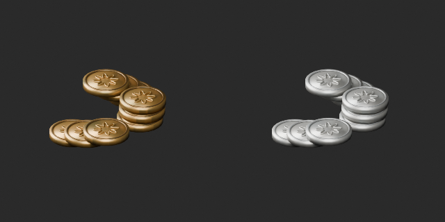

Comparison: left: original base; right: accepted variant; same overview camera.

[Download ZIP](https://raw.githubusercontent.com/k3peta/tales-on-a-table/main/distributions/quality-ol035-044-v1/OL_037__color_CC0.zip) · [License scope](../../LICENSE.md)

**CC0-1.0** — model geometry and embedded materials only. Models and embedded materials only; previews excluded.

Source details: [Catalogue 1](../../catalog/material_variants_ol035_044.md)

## OL_045__glass_orange

**Tripod table lamp**

三脚の卓上ランプ

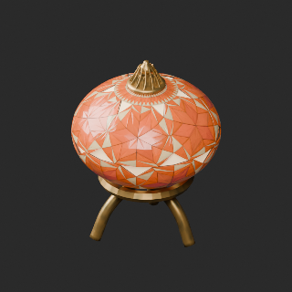

Use / purpose: Tripod table lamp from the lamp shop collection. Unit: one model record. Includes BLEND and GLB. The close-up is rendered from the distributed BLEND.

Record type: model. Formats: BLEND/GLB.

Dimensions (X × Y × Z, metres): Unknown. Triangles: Unknown.

Origin: Unknown / not independently confirmed. Orientation: Unknown / not independently confirmed.

[Base model OL_045](base-07.md#ol_045). Geometry baseline: original; UV: original_uv0_unchanged. Base measurements are not silently applied to changed geometry.

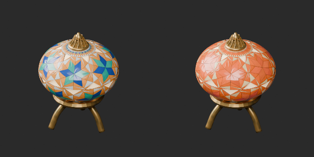

Comparison: left: original base; right: accepted variant; same overview camera.

[Download ZIP](https://raw.githubusercontent.com/k3peta/tales-on-a-table/main/distributions/quality-ol045-054-v1/OL_045__glass_orange_CC0.zip) · [License scope](../../LICENSE.md)

**CC0-1.0** — model geometry and embedded materials only. Models and embedded materials only; previews excluded.

Source details: [Catalogue 1](../../catalog/material_variants_ol045_054.md)

## OL_045__glass_green

**Tripod table lamp**

三脚の卓上ランプ

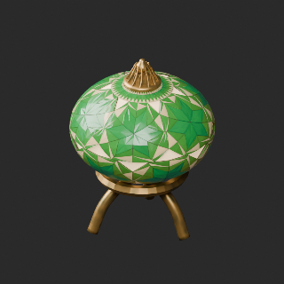

Use / purpose: Tripod table lamp from the lamp shop collection. Unit: one model record. Includes BLEND and GLB. The close-up is rendered from the distributed BLEND.

Record type: model. Formats: BLEND/GLB.

Dimensions (X × Y × Z, metres): Unknown. Triangles: Unknown.

Origin: Unknown / not independently confirmed. Orientation: Unknown / not independently confirmed.

[Base model OL_045](base-07.md#ol_045). Geometry baseline: original; UV: original_uv0_unchanged. Base measurements are not silently applied to changed geometry.

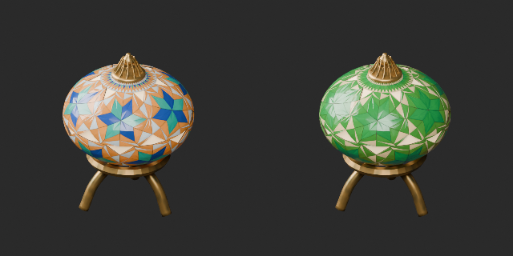

Comparison: left: original base; right: accepted variant; same overview camera.

[Download ZIP](https://raw.githubusercontent.com/k3peta/tales-on-a-table/main/distributions/quality-ol045-054-v1/OL_045__glass_green_CC0.zip) · [License scope](../../LICENSE.md)

**CC0-1.0** — model geometry and embedded materials only. Models and embedded materials only; previews excluded.

Source details: [Catalogue 1](../../catalog/material_variants_ol045_054.md)

## OL_053__color

**Framed mirror panel**

額縁付き鏡パネル

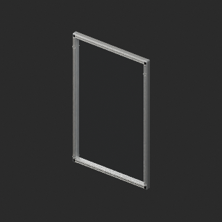

Use / purpose: Framed mirror panel from the lamp shop collection. Unit: one model record. Includes BLEND and GLB. The close-up is rendered from the distributed BLEND.

Record type: model. Formats: BLEND/GLB.

Dimensions (X × Y × Z, metres): Unknown. Triangles: Unknown.

Origin: Unknown / not independently confirmed. Orientation: Unknown / not independently confirmed.

[Base model OL_053](base-07.md#ol_053). Geometry baseline: original; UV: original_uv0_plus_wearuv. Base measurements are not silently applied to changed geometry.

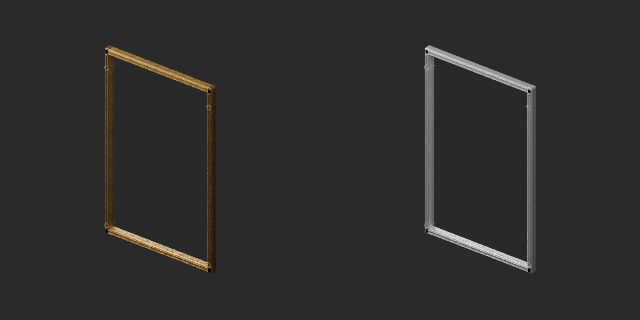

Comparison: left: original base; right: accepted variant; same overview camera.

[Download ZIP](https://raw.githubusercontent.com/k3peta/tales-on-a-table/main/distributions/quality-ol045-054-v1/OL_053__color_CC0.zip) · [License scope](../../LICENSE.md)

**CC0-1.0** — model geometry and embedded materials only. Models and embedded materials only; previews excluded.

Source details: [Catalogue 1](../../catalog/material_variants_ol045_054.md)
