# Material variants / 材質違い / 材质变体

[Catalog index](README.md)

## AT_052__color_blue

**Velvet ring stand** · 指輪のベルベット台

[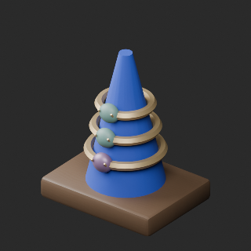](../../previews/quality-at052-061-v1/AT_052__color_blue_comparison.png)

Use: Ring stand textile: oxblood to clear blue; rings and gems retained.

Formats: BLEND/GLB; intended pivot/facing, dimensions and triangles not independently measured for this variant.

[Base AT_052](base-10.md#at_052) · [ZIP](https://raw.githubusercontent.com/k3peta/tales-on-a-table/main/distributions/quality-at052-061-v1/AT_052__color_blue_CC0.zip) · [Full comparison](../../previews/quality-at052-061-v1/AT_052__color_blue_comparison.png) · [Details](../material_variants_at052_061.md)

CC0 model/material only; images excluded. [License](../../LICENSE.md).

## AT_054__color_green

**Anonymous portrait cameo** · 匿名の肖像カメオ

[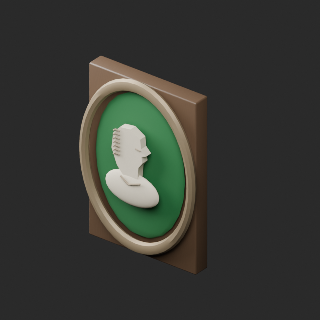](../../previews/quality-at052-061-v1/AT_054__color_green_comparison.png)

Use: Cameo background: green; relief and frame retained.

Formats: BLEND/GLB; intended pivot/facing, dimensions and triangles not independently measured for this variant.

[Base AT_054](base-10.md#at_054) · [ZIP](https://raw.githubusercontent.com/k3peta/tales-on-a-table/main/distributions/quality-at052-061-v1/AT_054__color_green_CC0.zip) · [Full comparison](../../previews/quality-at052-061-v1/AT_054__color_green_comparison.png) · [Details](../material_variants_at052_061.md)

CC0 model/material only; images excluded. [License](../../LICENSE.md).

## AT_060__color_orange

**Clockwork bird** · ぜんまいの小鳥

[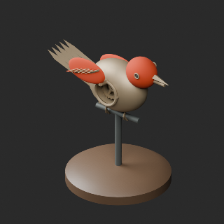](../../previews/quality-at052-061-v1/AT_060__color_orange_comparison.png)

Use: Bird head/wings: orange decorative finish instead of green patina color.

Formats: BLEND/GLB; intended pivot/facing, dimensions and triangles not independently measured for this variant.

[Base AT_060](base-10.md#at_060) · [ZIP](https://raw.githubusercontent.com/k3peta/tales-on-a-table/main/distributions/quality-at052-061-v1/AT_060__color_orange_CC0.zip) · [Full comparison](../../previews/quality-at052-061-v1/AT_060__color_orange_comparison.png) · [Details](../material_variants_at052_061.md)

CC0 model/material only; images excluded. [License](../../LICENSE.md).

## AT_062__color_blue

**Mismatched appraisal weights** · 不揃いな鑑定用分銅

[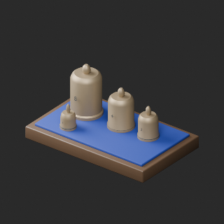](../../previews/quality-at062-071-v1/AT_062__color_blue_comparison.png)

Use: Weight display pad changed from green to blue; brass weights retained.

Formats: BLEND/GLB; intended pivot/facing, dimensions and triangles not independently measured for this variant.

[Base AT_062](base-10.md#at_062) · [ZIP](https://raw.githubusercontent.com/k3peta/tales-on-a-table/main/distributions/quality-at062-071-v1/AT_062__color_blue_CC0.zip) · [Full comparison](../../previews/quality-at062-071-v1/AT_062__color_blue_comparison.png) · [Details](../material_variants_at062_071.md)

CC0 model/material only; images excluded. [License](../../LICENSE.md).

## AT_071__color_green

**Repaired drawstring leather pouch** · 補修跡のある口紐付き革袋

[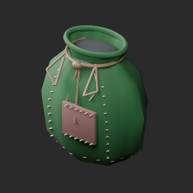](../../previews/quality-at062-071-v1/AT_071__color_green_comparison.png)

Use: Pouch main leather changed to green; repair patch, stitches and cord retained.

Formats: BLEND/GLB; intended pivot/facing, dimensions and triangles not independently measured for this variant.

[Base AT_071](base-11.md#at_071) · [ZIP](https://raw.githubusercontent.com/k3peta/tales-on-a-table/main/distributions/quality-at062-071-v1/AT_071__color_green_CC0.zip) · [Full comparison](../../previews/quality-at062-071-v1/AT_071__color_green_comparison.png) · [Details](../material_variants_at062_071.md)

CC0 model/material only; images excluded. [License](../../LICENSE.md).

## AT_073__color_blue

**Field medicine box with bandages and packets** · 包帯と薬包が残る野戦薬箱

[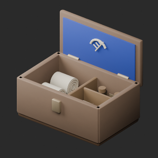](../../previews/quality-at072-081-v1/AT_073__color_blue_comparison.png)

Use: Green lid lining changed to blue; all other materials and geometry/UV retained.

Formats: BLEND/GLB; intended pivot/facing, dimensions and triangles not independently measured for this variant.

[Base AT_073](base-11.md#at_073) · [ZIP](https://raw.githubusercontent.com/k3peta/tales-on-a-table/main/distributions/quality-at072-081-v1/AT_073__color_blue_CC0.zip) · [Full comparison](../../previews/quality-at072-081-v1/AT_073__color_blue_comparison.png) · [Details](../material_variants_at072_081.md)

CC0 model/material only; images excluded. [License](../../LICENSE.md).

## WS_002__color_blue

**Cord-bound field notebook** · 紐綴じの野外採集帳

[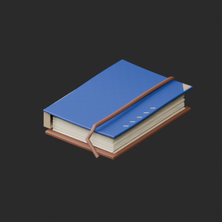](../../previews/quality-at093-094-ws001-008-v1/WS_002__color_blue_overview_comparison.png)

Use: Cover only changed to blue mapped micrograin, original geometry andUV retained.

Formats: BLEND/GLB; intended pivot/facing, dimensions and triangles not independently measured for this variant.

[Base WS_002](base-12.md#ws_002) · [ZIP](https://raw.githubusercontent.com/k3peta/tales-on-a-table/main/distributions/quality-at093-094-ws001-008-v1/WS_002__color_blue_CC0.zip) · [Full comparison](../../previews/quality-at093-094-ws001-008-v1/WS_002__color_blue_overview_comparison.png) · [Details](../material_variants_at093_ws008.md)

CC0 model/material only; images excluded. [License](../../LICENSE.md).

## WS_003__color_green

**Large star atlas** · 大型星図集

[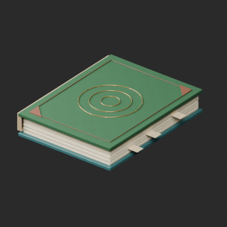](../../previews/quality-at093-094-ws001-008-v1/WS_003__color_green_overview_comparison.png)

Use: Upper cover changed to green mapped micrograin, original geometry andUV retained. Original20696 triangles exceeds20k small-prop warning; not repaired.

Formats: BLEND/GLB; intended pivot/facing, dimensions and triangles not independently measured for this variant.

[Base WS_003](base-12.md#ws_003) · [ZIP](https://raw.githubusercontent.com/k3peta/tales-on-a-table/main/distributions/quality-at093-094-ws001-008-v1/WS_003__color_green_CC0.zip) · [Full comparison](../../previews/quality-at093-094-ws001-008-v1/WS_003__color_green_overview_comparison.png) · [Details](../material_variants_at093_ws008.md)

CC0 model/material only; images excluded. [License](../../LICENSE.md).

## WS_015__color_green

**High-backed reading chair** · 高背の読書椅子

[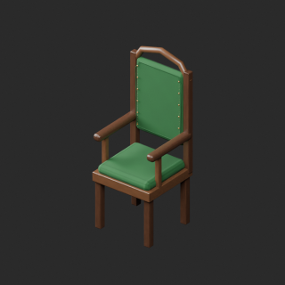](../../previews/quality-ws009-018-v1/WS_015__color_green_overview_comparison.png)

Use: Green upholstery mapped micrograin; original geometry and UV retained. Wood, metal and all other material parameters unchanged.

Formats: BLEND/GLB; intended pivot/facing, dimensions and triangles not independently measured for this variant.

[Base WS_015](base-12.md#ws_015) · [ZIP](https://raw.githubusercontent.com/k3peta/tales-on-a-table/main/distributions/quality-ws009-018-v1/WS_015__color_green_CC0.zip) · [Full comparison](../../previews/quality-ws009-018-v1/WS_015__color_green_overview_comparison.png) · [Details](../material_variants_ws009_018.md)

CC0 model/material only; images excluded. [License](../../LICENSE.md).

## WS_024__color_orange

**Hooded research lamp** · 遮光フード付き研究灯

Use: Orange lampshade basecolor texture; original geometry/UV and other material properties retained; no added emission.

Formats: BLEND/GLB; intended pivot/facing, dimensions and triangles not independently measured for this variant.

[Base WS_024](base-13.md#ws_024) · [ZIP](https://raw.githubusercontent.com/k3peta/tales-on-a-table/main/distributions/quality-ws019-028-v1/WS_024__color_orange_CC0.zip) · [Full comparison](../../previews/quality-ws019-028-v1/WS_024__color_orange_overview_comparison.png) · [Details](../material_variants_ws019_028.md)

CC0 model/material only; images excluded. [License](../../LICENSE.md).

## WS_036__color_blue

**Open leather document portfolio** · 開いた革の資料挟み

[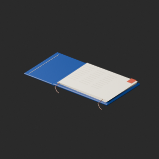](../../previews/quality-ws029-038-v1/WS_036__color_blue_overview_comparison.png)

Use: Blue leather texture on WS036 cleaned geometry baseline; same positive surface and retained UV as repair. Original paper/ink/strings and material properties unchanged.

Formats: BLEND/GLB; intended pivot/facing, dimensions and triangles not independently measured for this variant.

[Base WS_036](base-13.md#ws_036) · [ZIP](https://raw.githubusercontent.com/k3peta/tales-on-a-table/main/distributions/quality-ws029-038-v1/WS_036__color_blue_CC0.zip) · [Full comparison](../../previews/quality-ws029-038-v1/WS_036__color_blue_overview_comparison.png) · [Details](../material_variants_ws029_038.md)

CC0 model/material only; images excluded. [License](../../LICENSE.md).

## CP_004__color_green

**Hollow leather telescope case** · 望遠鏡の筒形革ケース

[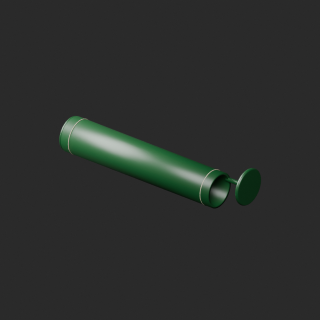](../../previews/quality-ws039-cp012-v1/CP_004__color_green_overview_comparison.png)

Use: Green goatskin texture on CP004 cleaned geometry baseline; same positive surface and retained UV as repair. Original canvas and other material properties unchanged.

Formats: BLEND/GLB; intended pivot/facing, dimensions and triangles not independently measured for this variant.

[Base CP_004](base-13.md#cp_004) · [ZIP](https://raw.githubusercontent.com/k3peta/tales-on-a-table/main/distributions/quality-ws039-cp012-v1/CP_004__color_green_CC0.zip) · [Full comparison](../../previews/quality-ws039-cp012-v1/CP_004__color_green_overview_comparison.png) · [Details](../material_variants_ws039_cp012.md)

CC0 model/material only; images excluded. [License](../../LICENSE.md).

## CP_019__orange_wool

**Cabin berth with storage** · 収納付きの船室寝台

[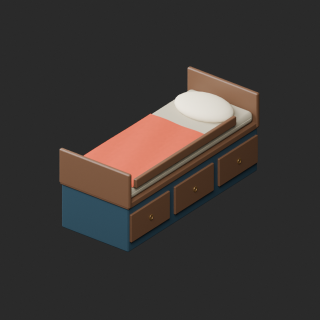](../../previews/quality-cp013-023-v1/CP_019__orange_wool_overview_comparison.png)

Use: Orange texture mapped to CP019 wool or CP023 exterior glaze only. CP019 original geometry retained; CP023 uses zero-area-cleaned baseline. Missing UV is explicitly added where recorded; all other material properties retained.

Formats: BLEND/GLB; intended pivot/facing, dimensions and triangles not independently measured for this variant.

[Base CP_019](base-14.md#cp_019) · [ZIP](https://raw.githubusercontent.com/k3peta/tales-on-a-table/main/distributions/quality-cp013-023-v1/CP_019__orange_wool_CC0.zip) · [Full comparison](../../previews/quality-cp013-023-v1/CP_019__orange_wool_overview_comparison.png) · [Details](../material_variants_cp013_023.md)

CC0 model/material only; images excluded. [License](../../LICENSE.md).

## CP_023__orange_glaze_smooth

**Ceramic coffee jug** · コーヒー入りの陶製ジャグ

[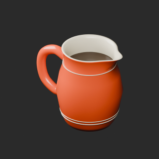](../../previews/quality-cp013-023-v1/CP_023__orange_glaze_smooth_overview_comparison.png)

Use: Orange texture mapped to CP019 wool or CP023 exterior glaze only. CP019 original geometry retained; CP023 uses zero-area-cleaned baseline. Missing UV is explicitly added where recorded; all other material properties retained.

Formats: BLEND/GLB; intended pivot/facing, dimensions and triangles not independently measured for this variant.

[Base CP_023](base-14.md#cp_023) · [ZIP](https://raw.githubusercontent.com/k3peta/tales-on-a-table/main/distributions/quality-cp013-023-v1/CP_023__orange_glaze_smooth_CC0.zip) · [Full comparison](../../previews/quality-cp013-023-v1/CP_023__orange_glaze_smooth_overview_comparison.png) · [Details](../material_variants_cp013_023.md)

CC0 model/material only; images excluded. [License](../../LICENSE.md).

## CP_025__green_silk

**Gold-trimmed admiral's hat** · 金縁と徽章の提督帽

[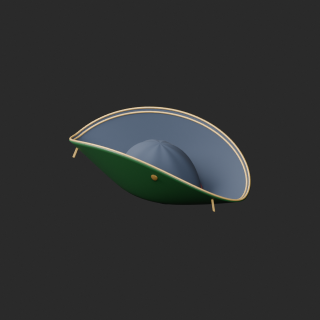](../../previews/quality-cp024-if002-v1/CP_025__green_silk_overview_comparison.png)

Use: Green silk texture mapped to CP025 wine silk material only, using cleaned geometry and explicitly added missing UV baseline. Other material properties unchanged.

Formats: BLEND/GLB; intended pivot/facing, dimensions and triangles not independently measured for this variant.

[Base CP_025](base-14.md#cp_025) · [ZIP](https://raw.githubusercontent.com/k3peta/tales-on-a-table/main/distributions/quality-cp024-if002-v1/CP_025__green_silk_CC0.zip) · [Full comparison](../../previews/quality-cp024-if002-v1/CP_025__green_silk_overview_comparison.png) · [Details](../material_variants_cp024_if002.md)

CC0 model/material only; images excluded. [License](../../LICENSE.md).

## IF_004__orange_ceramic

**Medium ceramic chimney oil lamp** · 中型・陶製油壺のホヤ油灯

[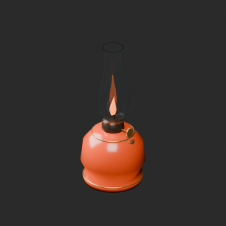](../../previews/quality-if003-td006-v1/IF_004__orange_ceramic_overview_comparison.png)

Use: Orange ceramic basecolor on IF004 cleaned geometry/UV baseline. Glass and flame unchanged.

Formats: BLEND/GLB; intended pivot/facing, dimensions and triangles not independently measured for this variant.

[Base IF_004](base-15.md#if_004) · [ZIP](https://raw.githubusercontent.com/k3peta/tales-on-a-table/main/distributions/quality-if003-td006-v1/IF_004__orange_ceramic_CC0.zip) · [Full comparison](../../previews/quality-if003-td006-v1/IF_004__orange_ceramic_overview_comparison.png) · [Details](../material_variants_if003_td006.md)

CC0 model/material only; images excluded. [License](../../LICENSE.md).

## TD_013__orange

**Round brilliant-cut gem** · 円形ブリリアント宝石

[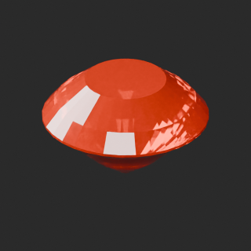](../../previews/quality-td007-016-v1/TD_013__orange_overview_comparison.png)

Use: Gem body color texture only; geometry unchanged from original, UV baseline explicitly added. Transmission/IOR/roughness/emission unchanged. Not a liquid or glass-bottle variant.

Formats: BLEND/GLB; intended pivot/facing, dimensions and triangles not independently measured for this variant.

[Base TD_013](base-15.md#td_013) · [ZIP](https://raw.githubusercontent.com/k3peta/tales-on-a-table/main/distributions/quality-td007-016-v1/TD_013__orange_CC0.zip) · [Full comparison](../../previews/quality-td007-016-v1/TD_013__orange_overview_comparison.png) · [Details](../material_variants_td007_016.md)

CC0 model/material only; images excluded. [License](../../LICENSE.md).

## TD_014__cyan

**Rectangular step-cut gem** · 長方形ステップカット宝石

[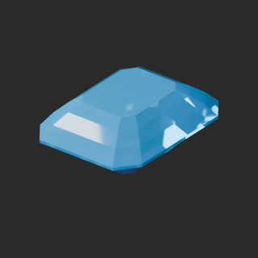](../../previews/quality-td007-016-v1/TD_014__cyan_overview_comparison.png)

Use: Gem body color texture only; geometry unchanged from original, UV baseline explicitly added. Transmission/IOR/roughness/emission unchanged. Not a liquid or glass-bottle variant.

Formats: BLEND/GLB; intended pivot/facing, dimensions and triangles not independently measured for this variant.

[Base TD_014](base-15.md#td_014) · [ZIP](https://raw.githubusercontent.com/k3peta/tales-on-a-table/main/distributions/quality-td007-016-v1/TD_014__cyan_CC0.zip) · [Full comparison](../../previews/quality-td007-016-v1/TD_014__cyan_overview_comparison.png) · [Details](../material_variants_td007_016.md)

CC0 model/material only; images excluded. [License](../../LICENSE.md).

## TD_015__amber

**Pear-cut gem** · 洋梨形カット宝石

[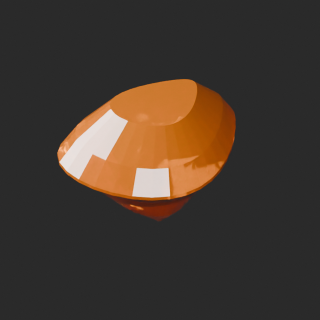](../../previews/quality-td007-016-v1/TD_015__amber_overview_comparison.png)

Use: Gem body color texture only; geometry unchanged from original, UV baseline explicitly added. Transmission/IOR/roughness/emission unchanged. Not a liquid or glass-bottle variant.

Formats: BLEND/GLB; intended pivot/facing, dimensions and triangles not independently measured for this variant.

[Base TD_015](base-15.md#td_015) · [ZIP](https://raw.githubusercontent.com/k3peta/tales-on-a-table/main/distributions/quality-td007-016-v1/TD_015__amber_CC0.zip) · [Full comparison](../../previews/quality-td007-016-v1/TD_015__amber_overview_comparison.png) · [Details](../material_variants_td007_016.md)

CC0 model/material only; images excluded. [License](../../LICENSE.md).

## TD_016__violet

**Marquise-cut gem** · マーキス形カット宝石

[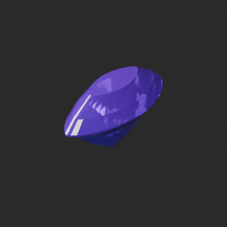](../../previews/quality-td007-016-v1/TD_016__violet_overview_comparison.png)

Use: Gem body color texture only; geometry unchanged from original, UV baseline explicitly added. Transmission/IOR/roughness/emission unchanged. Not a liquid or glass-bottle variant.

Formats: BLEND/GLB; intended pivot/facing, dimensions and triangles not independently measured for this variant.

[Base TD_016](base-15.md#td_016) · [ZIP](https://raw.githubusercontent.com/k3peta/tales-on-a-table/main/distributions/quality-td007-016-v1/TD_016__violet_CC0.zip) · [Full comparison](../../previews/quality-td007-016-v1/TD_016__violet_overview_comparison.png) · [Details](../material_variants_td007_016.md)

CC0 model/material only; images excluded. [License](../../LICENSE.md).

## TD_017__orange

**Hexagonal crystal** · 六角柱の原石結晶

[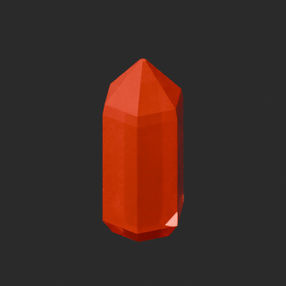](../../previews/quality-td017-arm013-v1/TD_017__orange_overview_comparison.png)

Use: TD017 gem body or ARM011 pennant cloth basecolor texture only. Original geometry retained; TD017 UV added before color baseline. Other material channels unchanged. Not a liquid-color variant.

Formats: BLEND/GLB; intended pivot/facing, dimensions and triangles not independently measured for this variant.

[Base TD_017](base-15.md#td_017) · [ZIP](https://raw.githubusercontent.com/k3peta/tales-on-a-table/main/distributions/quality-td017-arm013-v1/TD_017__orange_CC0.zip) · [Full comparison](../../previews/quality-td017-arm013-v1/TD_017__orange_overview_comparison.png) · [Details](../material_variants_td017_arm013.md)

CC0 model/material only; images excluded. [License](../../LICENSE.md).

## ARM_011__tealcloth

**葉飾り儀礼槍** · 葉飾り儀礼槍

[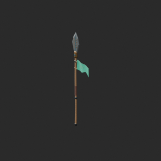](../../previews/quality-td017-arm013-v1/ARM_011__tealcloth_overview_comparison.png)

Use: TD017 gem body or ARM011 pennant cloth basecolor texture only. Original geometry retained; TD017 UV added before color baseline. Other material channels unchanged. Not a liquid-color variant.

Formats: BLEND/GLB; intended pivot/facing, dimensions and triangles not independently measured for this variant.

[Base ARM_011](base-16.md#arm_011) · [ZIP](https://raw.githubusercontent.com/k3peta/tales-on-a-table/main/distributions/quality-td017-arm013-v1/ARM_011__tealcloth_CC0.zip) · [Full comparison](../../previews/quality-td017-arm013-v1/ARM_011__tealcloth_overview_comparison.png) · [Details](../material_variants_td017_arm013.md)

CC0 model/material only; images excluded. [License](../../LICENSE.md).

## ARM_022__bluehide

**兵士の革張り円盾** · 兵士の革張り円盾

[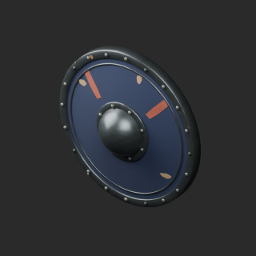](../../previews/quality-arm014-023-v1/ARM_022__bluehide_overview_comparison.png)

Use: Shield hide basecolor chroma variant; original vertex color retained, UV tint texture multiplied. Geometry and UV unchanged. Roughness/normal/metallic/emission unchanged; not a geometry repair.

Formats: BLEND/GLB; intended pivot/facing, dimensions and triangles not independently measured for this variant.

[Base ARM_022](base-16.md#arm_022) · [ZIP](https://raw.githubusercontent.com/k3peta/tales-on-a-table/main/distributions/quality-arm014-023-v1/ARM_022__bluehide_CC0.zip) · [Full comparison](../../previews/quality-arm014-023-v1/ARM_022__bluehide_overview_comparison.png) · [Details](../material_variants_arm014_arm023.md)

CC0 model/material only; images excluded. [License](../../LICENSE.md).

## ARM_023__rusthide

**道標紋の冒険者凧盾** · 道標紋の冒険者凧盾

[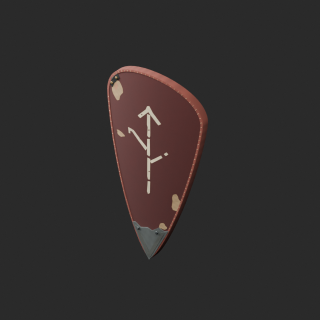](../../previews/quality-arm014-023-v1/ARM_023__rusthide_overview_comparison.png)

Use: Shield hide basecolor chroma variant; original vertex color retained, UV tint texture multiplied. Geometry and UV unchanged. Roughness/normal/metallic/emission unchanged; not a geometry repair.

Formats: BLEND/GLB; intended pivot/facing, dimensions and triangles not independently measured for this variant.

[Base ARM_023](base-16.md#arm_023) · [ZIP](https://raw.githubusercontent.com/k3peta/tales-on-a-table/main/distributions/quality-arm014-023-v1/ARM_023__rusthide_CC0.zip) · [Full comparison](../../previews/quality-arm014-023-v1/ARM_023__rusthide_overview_comparison.png) · [Details](../material_variants_arm014_arm023.md)

CC0 model/material only; images excluded. [License](../../LICENSE.md).

## ARM_027__coppertint

**幅広ひさしの歩兵兜** · 幅広ひさしの歩兵兜

Use: UV tint texture multiplied with original vertex colors; copper-colored coating on helmet steel or navy hood leather. Original geometry/UV retained; no roughness/normal/emission edit. Not a geometry repair or new base.

Formats: BLEND/GLB; intended pivot/facing, dimensions and triangles not independently measured for this variant.

[Base ARM_027](base-16.md#arm_027) · [ZIP](https://raw.githubusercontent.com/k3peta/tales-on-a-table/main/distributions/quality-arm024-033-v1/ARM_027__coppertint_CC0.zip) · [Full comparison](../../previews/quality-arm024-033-v1/ARM_027__coppertint_overview_comparison.png) · [Details](../material_variants_arm024_arm033.md)

CC0 model/material only; images excluded. [License](../../LICENSE.md).

## ARM_030__navyhide

**継ぎ革のフード** · 継ぎ革のフード

Use: UV tint texture multiplied with original vertex colors; copper-colored coating on helmet steel or navy hood leather. Original geometry/UV retained; no roughness/normal/emission edit. Not a geometry repair or new base.

Formats: BLEND/GLB; intended pivot/facing, dimensions and triangles not independently measured for this variant.

[Base ARM_030](base-16.md#arm_030) · [ZIP](https://raw.githubusercontent.com/k3peta/tales-on-a-table/main/distributions/quality-arm024-033-v1/ARM_030__navyhide_CC0.zip) · [Full comparison](../../previews/quality-arm024-033-v1/ARM_030__navyhide_overview_comparison.png) · [Details](../material_variants_arm024_arm033.md)

CC0 model/material only; images excluded. [License](../../LICENSE.md).

## ARM_034__navylinen

**縫い鎧の綿入れ胴着** · 縫い鎧の綿入れ胴着

[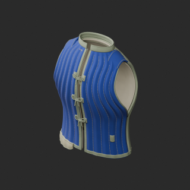](../../previews/quality-arm034-045-v1/ARM_034__navylinen_overview_comparison.png)

Use: UV tint on original vertex colors: blue quilted linen or copper-colored shoulder-armor coating. Geometry/UV/roughness/metallic/normal/emission unchanged. Not a new model or geometry repair.

Formats: BLEND/GLB; intended pivot/facing, dimensions and triangles not independently measured for this variant.

[Base ARM_034](base-17.md#arm_034) · [ZIP](https://raw.githubusercontent.com/k3peta/tales-on-a-table/main/distributions/quality-arm034-045-v1/ARM_034__navylinen_CC0.zip) · [Full comparison](../../previews/quality-arm034-045-v1/ARM_034__navylinen_overview_comparison.png) · [Details](../material_variants_arm034_arm045.md)

CC0 model/material only; images excluded. [License](../../LICENSE.md).

## ARM_035__coppertint

**花弁重ねの儀礼肩鎧** · 花弁重ねの儀礼肩鎧

[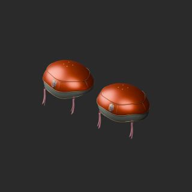](../../previews/quality-arm034-045-v1/ARM_035__coppertint_overview_comparison.png)

Use: UV tint on original vertex colors: blue quilted linen or copper-colored shoulder-armor coating. Geometry/UV/roughness/metallic/normal/emission unchanged. Not a new model or geometry repair.

Formats: BLEND/GLB; intended pivot/facing, dimensions and triangles not independently measured for this variant.

[Base ARM_035](base-17.md#arm_035) · [ZIP](https://raw.githubusercontent.com/k3peta/tales-on-a-table/main/distributions/quality-arm034-045-v1/ARM_035__coppertint_CC0.zip) · [Full comparison](../../previews/quality-arm034-045-v1/ARM_035__coppertint_overview_comparison.png) · [Details](../material_variants_arm034_arm045.md)

CC0 model/material only; images excluded. [License](../../LICENSE.md).

## ARM_051__bluefelt

**革敷きの傾斜盾架** · 革敷きの傾斜盾架

[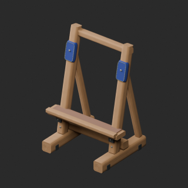](../../previews/quality-arm050-066-v1/ARM_051__bluefelt_overview_comparison.png)

Use: Blue or red felt UV tint multiplied with original vertex colors. Geometry/UV/roughness/normal/emission unchanged. Not a new model or geometry repair.

Formats: BLEND/GLB; intended pivot/facing, dimensions and triangles not independently measured for this variant.

[Base ARM_051](base-17.md#arm_051) · [ZIP](https://raw.githubusercontent.com/k3peta/tales-on-a-table/main/distributions/quality-arm050-066-v1/ARM_051__bluefelt_CC0.zip) · [Full comparison](../../previews/quality-arm050-066-v1/ARM_051__bluefelt_overview_comparison.png) · [Details](../material_variants_arm050_arm066.md)

CC0 model/material only; images excluded. [License](../../LICENSE.md).

## ARM_053__redfelt

**フェルト頭の兜掛け** · フェルト頭の兜掛け

[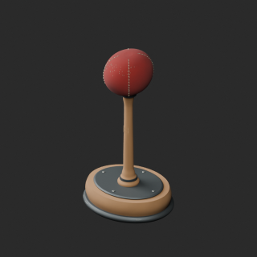](../../previews/quality-arm050-066-v1/ARM_053__redfelt_overview_comparison.png)

Use: Blue or red felt UV tint multiplied with original vertex colors. Geometry/UV/roughness/normal/emission unchanged. Not a new model or geometry repair.

Formats: BLEND/GLB; intended pivot/facing, dimensions and triangles not independently measured for this variant.

[Base ARM_053](base-17.md#arm_053) · [ZIP](https://raw.githubusercontent.com/k3peta/tales-on-a-table/main/distributions/quality-arm050-066-v1/ARM_053__redfelt_CC0.zip) · [Full comparison](../../previews/quality-arm050-066-v1/ARM_053__redfelt_overview_comparison.png) · [Details](../material_variants_arm050_arm066.md)

CC0 model/material only; images excluded. [License](../../LICENSE.md).

## ARM_068__terracotta

**封印煙玉の外見小道具** · 封印煙玉の外見小道具

[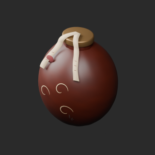](../../previews/quality-arm067-076-v1/ARM_068__terracotta_overview_comparison.png)

Use: Terracotta-colored ceramic exterior UV tint on the ARM068 cleaned geometry baseline. Original positive geometry/UV/vertex colors retained; no emission or functional mechanism added. Static fantasy display prop only; not a new base or functional device.

Formats: BLEND/GLB; intended pivot/facing, dimensions and triangles not independently measured for this variant.

[Base ARM_068](base-17.md#arm_068) · [ZIP](https://raw.githubusercontent.com/k3peta/tales-on-a-table/main/distributions/quality-arm067-076-v1/ARM_068__terracotta_CC0.zip) · [Full comparison](../../previews/quality-arm067-076-v1/ARM_068__terracotta_overview_comparison.png) · [Details](../material_variants_arm067_arm076.md)

CC0 model/material only; images excluded. [License](../../LICENSE.md).

## WH_NEW_004__cyancrystal

**琥珀結晶の二股槍** · 琥珀結晶の二股槍

[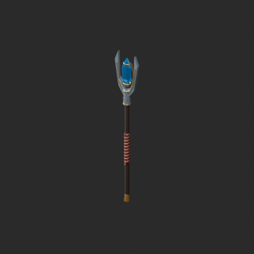](../../previews/quality-arm077-wh006-v1/WH_NEW_004__cyancrystal_overview_comparison.png)

Use: Cyan crystal body UV texture on cleaned WH_NEW004 geometry/UV baseline. Transmission/roughness/metallic/emission unchanged. Not liquid/bottle color or new base.

Formats: BLEND/GLB; intended pivot/facing, dimensions and triangles not independently measured for this variant.

[Base WH_NEW_004](base-18.md#wh_new_004) · [ZIP](https://raw.githubusercontent.com/k3peta/tales-on-a-table/main/distributions/quality-arm077-wh006-v1/WH_NEW_004__cyancrystal_CC0.zip) · [Full comparison](../../previews/quality-arm077-wh006-v1/WH_NEW_004__cyancrystal_overview_comparison.png) · [Details](../material_variants_arm077_wh006.md)

CC0 model/material only; images excluded. [License](../../LICENSE.md).

## BN_006__bluewood

**Three-compartment grain bin** · 三区画の穀物箱

[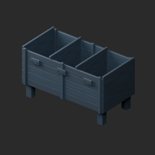](../../previews/quality-wh007-bn008-v1/BN_006__bluewood_overview_comparison.png)

Use: Blue wood pigment texture on original geometry and UV. Existing grain retained; normal, roughness and other channels unchanged.

Formats: BLEND/GLB; intended pivot/facing, dimensions and triangles not independently measured for this variant.

[Base BN_006](base-19.md#bn_006) · [ZIP](https://raw.githubusercontent.com/k3peta/tales-on-a-table/main/distributions/quality-wh007-bn008-v1/BN_006__bluewood_CC0.zip) · [Full comparison](../../previews/quality-wh007-bn008-v1/BN_006__bluewood_overview_comparison.png) · [Details](../material_variants_wh007_bn008.md)

CC0 model/material only; images excluded. [License](../../LICENSE.md).

## BM_006__green

**Travel teacup** · 旅の湯呑み

[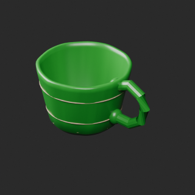](../../previews/quality-bm001-010-v1/BM_006__green_overview_comparison.png)

Use: Ceramic cup body UV tint (green) multiplied by preserved original vertex colors. Original geometry and UV unchanged. Dust/roughness/normal/metallic/emission unchanged. Main wizard_cup member only; existing dealer_cup remains in original source ZIP.

Formats: BLEND/GLB; intended pivot/facing, dimensions and triangles not independently measured for this variant.

[Base BM_006](base-19.md#bm_006) · [ZIP](https://raw.githubusercontent.com/k3peta/tales-on-a-table/main/distributions/quality-bm001-010-v1/BM_006__green_CC0.zip) · [Full comparison](../../previews/quality-bm001-010-v1/BM_006__green_overview_comparison.png) · [Details](../material_variants_bm001_bm010.md)

CC0 model/material only; images excluded. [License](../../LICENSE.md).

## BM_006__orange

**Travel teacup** · 旅の湯呑み

[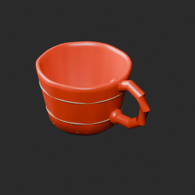](../../previews/quality-bm001-010-v1/BM_006__orange_overview_comparison.png)

Use: Ceramic cup body UV tint (orange) multiplied by preserved original vertex colors. Original geometry and UV unchanged. Dust/roughness/normal/metallic/emission unchanged. Main wizard_cup member only; existing dealer_cup remains in original source ZIP.

Formats: BLEND/GLB; intended pivot/facing, dimensions and triangles not independently measured for this variant.

[Base BM_006](base-19.md#bm_006) · [ZIP](https://raw.githubusercontent.com/k3peta/tales-on-a-table/main/distributions/quality-bm001-010-v1/BM_006__orange_CC0.zip) · [Full comparison](../../previews/quality-bm001-010-v1/BM_006__orange_overview_comparison.png) · [Details](../material_variants_bm001_bm010.md)

CC0 model/material only; images excluded. [License](../../LICENSE.md).

## BM_020__bluewood

**Shallow parts tray** · 浅い部品箱

[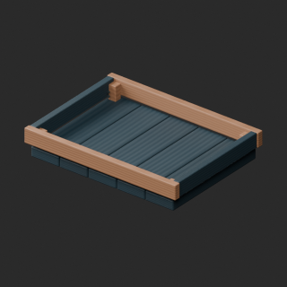](../../previews/quality-bm011-020-v1/BM_020__bluewood_overview_comparison.png)

Use: Blue UV tint on walnut board surfaces of shallow parts tray; lighter frame, iron and all non-basecolor channels unchanged. Original mesh, UV and vertex colors preserved. Same base model, not new shape.

Formats: BLEND/GLB; intended pivot/facing, dimensions and triangles not independently measured for this variant.

[Base BM_020](base-19.md#bm_020) · [ZIP](https://raw.githubusercontent.com/k3peta/tales-on-a-table/main/distributions/quality-bm011-020-v1/BM_020__bluewood_CC0.zip) · [Full comparison](../../previews/quality-bm011-020-v1/BM_020__bluewood_overview_comparison.png) · [Details](../material_variants_bm011_bm020.md)

CC0 model/material only; images excluded. [License](../../LICENSE.md).

## BM_026__tealmask

**Nameless mask** · 名前のない仮面

[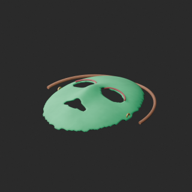](../../previews/quality-bm021-030-v1/BM_026__tealmask_overview_comparison.png)

Use: Teal UV tint on ivory mask face; straps/red trim/brass and other channels unchanged. Original geometry, UV and vertex colors preserved. Not a new shape.

Formats: BLEND/GLB; intended pivot/facing, dimensions and triangles not independently measured for this variant.

[Base BM_026](base-20.md#bm_026) · [ZIP](https://raw.githubusercontent.com/k3peta/tales-on-a-table/main/distributions/quality-bm021-030-v1/BM_026__tealmask_CC0.zip) · [Full comparison](../../previews/quality-bm021-030-v1/BM_026__tealmask_overview_comparison.png) · [Details](../material_variants_bm021_bm030.md)

CC0 model/material only; images excluded. [License](../../LICENSE.md).

## BM_034__rustred

**Flattened cushion** · ぺしゃんこの座布団

[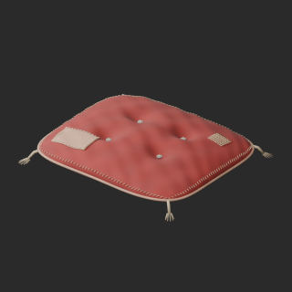](../../previews/quality-bm031-040-v1/BM_034__rustred_overview_comparison.png)

Use: Rust-red UV tint on cushion main moss fabric. Original geometry, UV, vertex colors, patches/cords and non-basecolor channels unchanged. Not a mesh repair or new shape; polygon budget remains exceeded.

Formats: BLEND/GLB; intended pivot/facing, dimensions and triangles not independently measured for this variant.

[Base BM_034](base-20.md#bm_034) · [ZIP](https://raw.githubusercontent.com/k3peta/tales-on-a-table/main/distributions/quality-bm031-040-v1/BM_034__rustred_CC0.zip) · [Full comparison](../../previews/quality-bm031-040-v1/BM_034__rustred_overview_comparison.png) · [Details](../material_variants_bm031_bm040.md)

CC0 model/material only; images excluded. [License](../../LICENSE.md).

## BM_037__bluecloth

**Tied cloth bundle** · 紐で括った布包み

[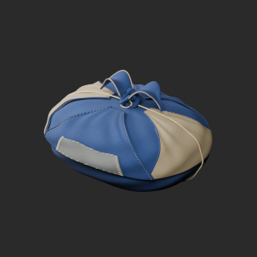](../../previews/quality-bm031-040-v1/BM_037__bluecloth_overview_comparison.png)

Use: Blue UV tint on cloth bundle main rust fabric. Original geometry, UV, vertex colors, patches/cords and non-basecolor channels unchanged. Not a mesh repair or new shape; polygon budget remains exceeded.

Formats: BLEND/GLB; intended pivot/facing, dimensions and triangles not independently measured for this variant.

[Base BM_037](base-20.md#bm_037) · [ZIP](https://raw.githubusercontent.com/k3peta/tales-on-a-table/main/distributions/quality-bm031-040-v1/BM_037__bluecloth_CC0.zip) · [Full comparison](../../previews/quality-bm031-040-v1/BM_037__bluecloth_overview_comparison.png) · [Details](../material_variants_bm031_bm040.md)

CC0 model/material only; images excluded. [License](../../LICENSE.md).

## BM_042__rustred

**Dirty robe** · 汚れたローブ

Use: Main robe/bag UV color tint only, original geometry/UV/vertex colors and other material channels preserved. Polygon budget remains exceeded.

Formats: BLEND/GLB; intended pivot/facing, dimensions and triangles not independently measured for this variant.

[Base BM_042](base-20.md#bm_042) · [ZIP](https://raw.githubusercontent.com/k3peta/tales-on-a-table/main/distributions/quality-bm041-050-v1/BM_042__rustred_CC0.zip) · [Full comparison](../../previews/quality-bm041-050-v1/BM_042__rustred_overview_comparison.png) · [Details](../material_variants_bm041_bm050.md)

CC0 model/material only; images excluded. [License](../../LICENSE.md).

## BM_043__bluebag

**Dirty bag** · 汚れたバッグ

Use: Main robe/bag UV color tint only, original geometry/UV/vertex colors and other material channels preserved. Polygon budget remains exceeded.

Formats: BLEND/GLB; intended pivot/facing, dimensions and triangles not independently measured for this variant.

[Base BM_043](base-20.md#bm_043) · [ZIP](https://raw.githubusercontent.com/k3peta/tales-on-a-table/main/distributions/quality-bm041-050-v1/BM_043__bluebag_CC0.zip) · [Full comparison](../../previews/quality-bm041-050-v1/BM_043__bluebag_overview_comparison.png) · [Details](../material_variants_bm041_bm050.md)

CC0 model/material only; images excluded. [License](../../LICENSE.md).
