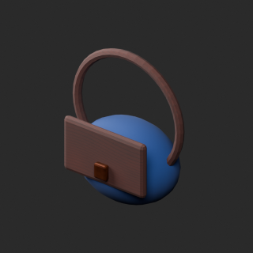

# Material variants172–187

[International index](README.md) · [Quality57–76](../quality-57-76.md)

## WT003__autumn_ochre

**Deciduous copse** · Deciduous copse

Autumn ochre leaf UV color texture on repaired WT003 baseline; geometry/UV retained against repaired baseline. Not a new base model.

[ZIP](https://raw.githubusercontent.com/k3peta/tales-on-a-table/main/distributions/quality-wm012-wt004-v1/WT003__autumn_ochre_CC0.zip) · [Base WT003](../quality-wm012-wt004-v1.md) · [Comparison](../../previews/quality-wm012-wt004-v1/WT003__autumn_ochre_overview_comparison.png). BLEND/GLB; dimensions/pivot/facing not independently measured. CC0 models/materials; images excluded.

## AP001__blue_cedar

**Weather lift beehive** · Weather lift beehive

Blue cedar recolor of existing UV woodgrain on repaired AP001 baseline, other material channels and shape retained. Not a new base.

[ZIP](https://raw.githubusercontent.com/k3peta/tales-on-a-table/main/distributions/quality-wt005-ap006-v1/AP001__blue_cedar_CC0.zip) · [Base AP001](../quality-wt005-ap006-v1.md) · [Comparison](../../previews/quality-wt005-ap006-v1/AP001__blue_cedar_overview_comparison.png). BLEND/GLB; dimensions/pivot/facing not independently measured. CC0 models/materials; images excluded.

## AP010__cobalt_glaze

**Honey dipper bowl** · Honey dipper bowl

Recolor existing bowl glaze UV texture on repaired AP010 baseline. Honey/wood, alpha, roughness and other channels retained. No new base model.

[ZIP](https://raw.githubusercontent.com/k3peta/tales-on-a-table/main/distributions/quality-ap007-016-v1/AP010__cobalt_glaze_CC0.zip) · [Base AP010](../quality-ap007-016-v1.md) · [Comparison](../../previews/quality-ap007-016-v1/AP010__cobalt_glaze_overview_comparison.png). BLEND/GLB; dimensions/pivot/facing not independently measured. CC0 models/materials; images excluded.

## AP010__rust_red_glaze

**Honey dipper bowl** · Honey dipper bowl

Recolor existing bowl glaze UV texture on repaired AP010 baseline. Honey/wood, alpha, roughness and other channels retained. No new base model.

[ZIP](https://raw.githubusercontent.com/k3peta/tales-on-a-table/main/distributions/quality-ap007-016-v1/AP010__rust_red_glaze_CC0.zip) · [Base AP010](../quality-ap007-016-v1.md) · [Comparison](../../previews/quality-ap007-016-v1/AP010__rust_red_glaze_overview_comparison.png). BLEND/GLB; dimensions/pivot/facing not independently measured. CC0 models/materials; images excluded.

## AP019__blue_ceramic

**Bee water tray** · Bee water tray

Recolor existing ceramic UV texture on repaired AP019 baseline. Water/stone, transmission, alpha, roughness and other channels retained. No new base model.

[ZIP](https://raw.githubusercontent.com/k3peta/tales-on-a-table/main/distributions/quality-ap017-al006-v1/AP019__blue_ceramic_CC0.zip) · [Base AP019](../quality-ap017-al006-v1.md) · [Comparison](../../previews/quality-ap017-al006-v1/AP019__blue_ceramic_overview_comparison.png). BLEND/GLB; dimensions/pivot/facing not independently measured. CC0 models/materials; images excluded.

## AL008__amber_glass

**Green reagent bottle** · Green reagent bottle

Glass-shell UV color on repaired AL008 baseline; not liquid. Cork, transmission, IOR, alpha, roughness and other channels retained. No new base model.

[ZIP](https://raw.githubusercontent.com/k3peta/tales-on-a-table/main/distributions/quality-al007-016-v1/AL008__amber_glass_CC0.zip) · [Base AL008](../quality-al007-016-v1.md) · [Comparison](../../previews/quality-al007-016-v1/AL008__amber_glass_overview_comparison.png). BLEND/GLB; dimensions/pivot/facing not independently measured. CC0 models/materials; images excluded.

## AL008__cyan_glass

**Green reagent bottle** · Green reagent bottle

Glass-shell UV color on repaired AL008 baseline; not liquid. Cork, transmission, IOR, alpha, roughness and other channels retained. No new base model.

[ZIP](https://raw.githubusercontent.com/k3peta/tales-on-a-table/main/distributions/quality-al007-016-v1/AL008__cyan_glass_CC0.zip) · [Base AL008](../quality-al007-016-v1.md) · [Comparison](../../previews/quality-al007-016-v1/AL008__cyan_glass_overview_comparison.png). BLEND/GLB; dimensions/pivot/facing not independently measured. CC0 models/materials; images excluded.

## AL008__emerald_glass

**Green reagent bottle** · Green reagent bottle

Glass-shell UV color on repaired AL008 baseline; not liquid. Cork, transmission, IOR, alpha, roughness and other channels retained. No new base model.

[ZIP](https://raw.githubusercontent.com/k3peta/tales-on-a-table/main/distributions/quality-al007-016-v1/AL008__emerald_glass_CC0.zip) · [Base AL008](../quality-al007-016-v1.md) · [Comparison](../../previews/quality-al007-016-v1/AL008__emerald_glass_overview_comparison.png). BLEND/GLB; dimensions/pivot/facing not independently measured. CC0 models/materials; images excluded.

## AL020__blue_ceramic

**Crucibles** · Crucibles

Ceramic UV color on repaired AL020 baseline; roughness and other channels retained. No heat/material safety claim. No new base model.

[ZIP](https://raw.githubusercontent.com/k3peta/tales-on-a-table/main/distributions/quality-al017-026-v1/AL020__blue_ceramic_CC0.zip) · [Base AL020](../quality-al017-026-v1.md) · [Comparison](../../previews/quality-al017-026-v1/AL020__blue_ceramic_overview_comparison.png). BLEND/GLB; dimensions/pivot/facing not independently measured. CC0 models/materials; images excluded.

## FW015__blue_linen

**Canvas gathering satchel** · Canvas gathering satchel

Blue linen UV color; other materials and roughness preserved. Baseline defined by final validation. No new base model.

[ZIP](https://raw.githubusercontent.com/k3peta/tales-on-a-table/main/distributions/quality-fw010-019-v1/FW015__blue_linen_CC0.zip) · [Base FW015](../quality-fw010-019-v1.md) · [Comparison](../../previews/quality-fw010-019-v1/FW015__blue_linen_overview_comparison.png). BLEND/GLB; dimensions/pivot/facing not independently measured. CC0 models/materials; images excluded.

## IN007__blue_wool

**Woven runner** · Woven runner

Blue wool UV color; trim and roughness preserved. No new base model.

[ZIP](https://raw.githubusercontent.com/k3peta/tales-on-a-table/main/distributions/quality-fw020-in007-v1/IN007__blue_wool_CC0.zip) · [Base IN007](../quality-fw020-in007-v1.md) · [Comparison](../../previews/quality-fw020-in007-v1/IN007__blue_wool_overview_comparison.png). BLEND/GLB; dimensions/pivot/facing not independently measured. CC0 models/materials; images excluded.

## IN013__rust_wool

**Rolled blanket** · Rolled blanket

UV color variant with unchanged baseline geometry/UV; alpha, roughness and other materials preserved. No new base model or wear simulation.

[ZIP](https://raw.githubusercontent.com/k3peta/tales-on-a-table/main/distributions/quality-in008-017-v1/IN013__rust_wool_CC0.zip) · [Base IN013](../quality-in008-017-v1.md) · [Comparison](../../previews/quality-in008-017-v1/IN013__rust_wool_overview_comparison.png). BLEND/GLB; dimensions/pivot/facing not independently measured. CC0 models/materials; images excluded.

## IN017__blue_ceramic

**Ceramic pitcher** · Ceramic pitcher

UV color variant with unchanged baseline geometry/UV; alpha, roughness and other materials preserved. No new base model or wear simulation.

[ZIP](https://raw.githubusercontent.com/k3peta/tales-on-a-table/main/distributions/quality-in008-017-v1/IN017__blue_ceramic_CC0.zip) · [Base IN017](../quality-in008-017-v1.md) · [Comparison](../../previews/quality-in008-017-v1/IN017__blue_ceramic_overview_comparison.png). BLEND/GLB; dimensions/pivot/facing not independently measured. CC0 models/materials; images excluded.

## IN020__blue_linen

**Table linen** · Table linen

UV color variant with unchanged baseline geometry/UV; alpha, roughness and other materials preserved. No new base model or wear simulation.

[ZIP](https://raw.githubusercontent.com/k3peta/tales-on-a-table/main/distributions/quality-in018-oc010-v1/IN020__blue_linen_CC0.zip) · [Base IN020](../quality-in018-oc010-v1.md) · [Comparison](../../previews/quality-in018-oc010-v1/IN020__blue_linen_overview_comparison.png). BLEND/GLB; dimensions/pivot/facing not independently measured. CC0 models/materials; images excluded.

## IN024__rust_wool

**Hanging cloak** · Hanging cloak

UV color variant with unchanged baseline geometry/UV; alpha, roughness and other materials preserved. No new base model or wear simulation.

[ZIP](https://raw.githubusercontent.com/k3peta/tales-on-a-table/main/distributions/quality-in018-oc010-v1/IN024__rust_wool_CC0.zip) · [Base IN024](../quality-in018-oc010-v1.md) · [Comparison](../../previews/quality-in018-oc010-v1/IN024__rust_wool_overview_comparison.png). BLEND/GLB; dimensions/pivot/facing not independently measured. CC0 models/materials; images excluded.

## OC015__amber_glass

**Gothic wall sector (entrance / south)** · Gothic wall sector (entrance / south)

Architectural glazing amber color on unchanged geometry/UV; transmission/IOR/roughness and structural materials preserved. No emission, liquid edit or optical portability guarantee.

[ZIP](https://raw.githubusercontent.com/k3peta/tales-on-a-table/main/distributions/quality-oc011-pa001-v1/OC015__amber_glass_CC0.zip) · [Base OC015](../quality-oc011-pa001-v1.md) · [Comparison](../../previews/quality-oc011-pa001-v1/OC015__amber_glass_overview_comparison.png). BLEND/GLB; dimensions/pivot/facing not independently measured. CC0 models/materials; images excluded.
