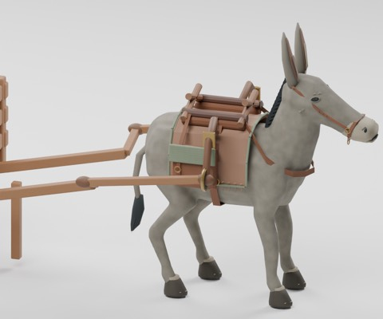
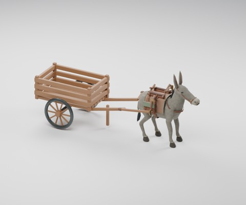
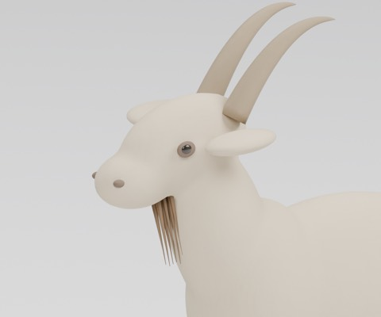
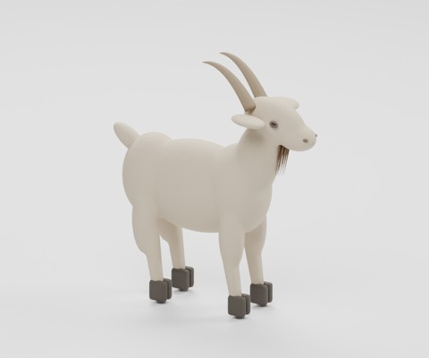
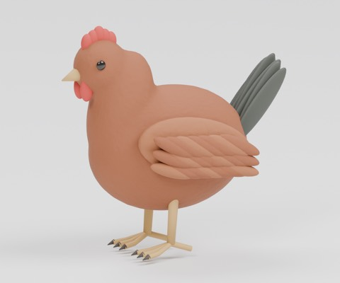
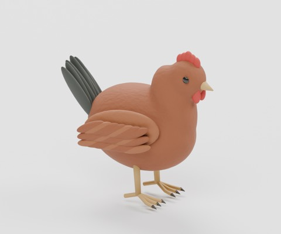
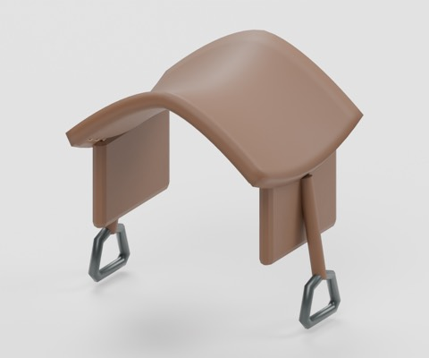

# livestock-tack-v1

970 distribution records = 965 + 5 component candidates (2 animals, 3 equipment). Existing donkey BM_048 and cart HCV506 are reused, not newly added. Four private arrangements and seven images are not distributed or counted.

|ID|Kind|License|Download|
|---|---|---|---|
|HCV601|model|CC0-1.0|[ZIP](https://raw.githubusercontent.com/k3peta/tales-on-a-table/main/distributions/livestock-tack-v1/HCV601-CC0.zip)|
|HCV602|model|CC0-1.0|[ZIP](https://raw.githubusercontent.com/k3peta/tales-on-a-table/main/distributions/livestock-tack-v1/HCV602-CC0.zip)|
|HCV603|model|CC0-1.0|[ZIP](https://raw.githubusercontent.com/k3peta/tales-on-a-table/main/distributions/livestock-tack-v1/HCV603-CC0.zip)|
|HCV604|model|CC0-1.0|[ZIP](https://raw.githubusercontent.com/k3peta/tales-on-a-table/main/distributions/livestock-tack-v1/HCV604-CC0.zip)|
|HCV605|model|CC0-1.0|[ZIP](https://raw.githubusercontent.com/k3peta/tales-on-a-table/main/distributions/livestock-tack-v1/HCV605-CC0.zip)|

HCV601 shafts; HCV602 matching harness; HCV603 stylized goat; HCV604 stylized hen; HCV605 display saddle. Static coupling points (2.65,+/-0.59,1.02)m; retain relative positions when moving the assembly. Cart hand-push support legs remain. Corrected attachment error reported about3e-8m; intentional leather-packsaddle contacts are fixed mounting, not proof of dynamic fit. Saddle display does not establish fit to any horse.

Metres, ground-centered component origins, Blender Z up / standard glTF axes. Global historical shape independence is unverified. Static display only: no animated doors/wheels/walking, rigid-body coupling, load simulation or fluid mechanisms. Safety, full motion/intersection volumes, real use, app UI/GPU/FPS and older Blender compatibility are unverified. Code, rendered images and private records are excluded.

[Checksums](../distributions/livestock-tack-v1/SHA256SUMS.txt).

## 実作画像 / Actual renders

完成バッチの配置・接写。画像は閲覧用でモデルCC0の対象外です。[既存の画像利用条件](../LICENSE.md)を維持します。

|ID|名称 / Name|Download|
|---|---|---|
|BM_048|市の傍らに佇むロバ|[ZIP](https://github.com/k3peta/tales-on-a-table/releases/download/v2026.10.19-bridge-market/BM_048_CC0.zip)|
|HCV506|HCV506|[ZIP](https://raw.githubusercontent.com/k3peta/tales-on-a-table/main/distributions/husbandry-cellar-v2/HCV506-CC0.zip)|
|HCV601|HCV601|[ZIP](https://raw.githubusercontent.com/k3peta/tales-on-a-table/main/distributions/livestock-tack-v1/HCV601-CC0.zip)|
|HCV602|HCV602|[ZIP](https://raw.githubusercontent.com/k3peta/tales-on-a-table/main/distributions/livestock-tack-v1/HCV602-CC0.zip)|
|HCV603|HCV603|[ZIP](https://raw.githubusercontent.com/k3peta/tales-on-a-table/main/distributions/livestock-tack-v1/HCV603-CC0.zip)|
|HCV604|HCV604|[ZIP](https://raw.githubusercontent.com/k3peta/tales-on-a-table/main/distributions/livestock-tack-v1/HCV604-CC0.zip)|
|HCV605|HCV605|[ZIP](https://raw.githubusercontent.com/k3peta/tales-on-a-table/main/distributions/livestock-tack-v1/HCV605-CC0.zip)|

