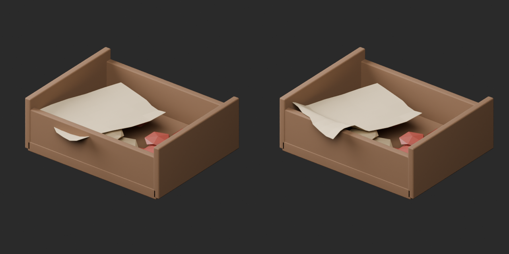
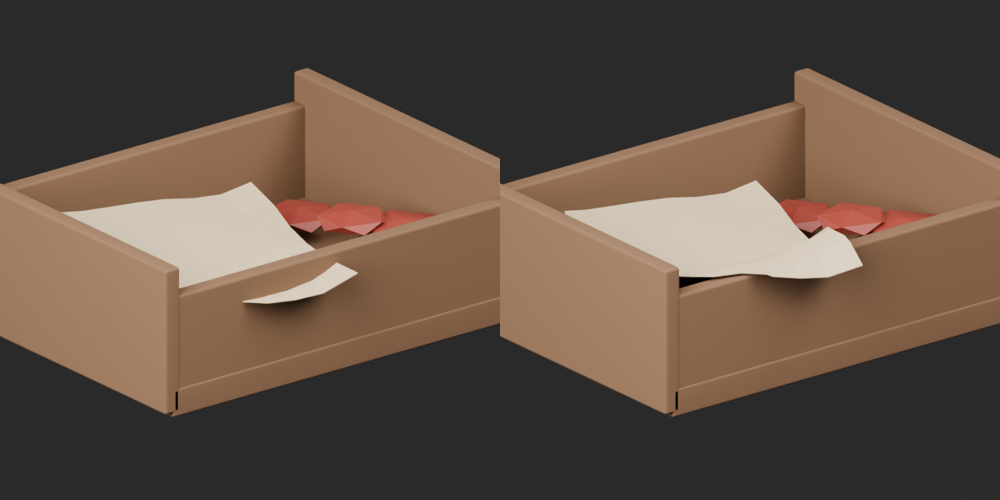
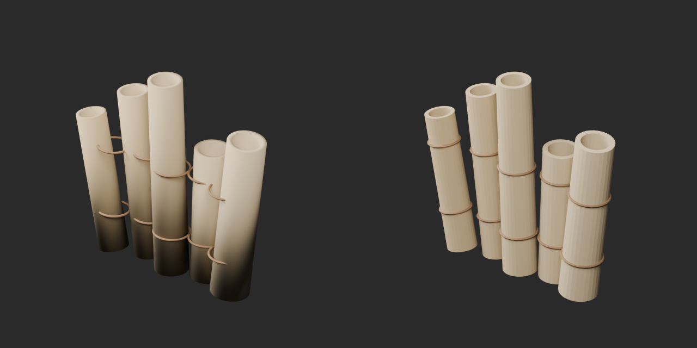
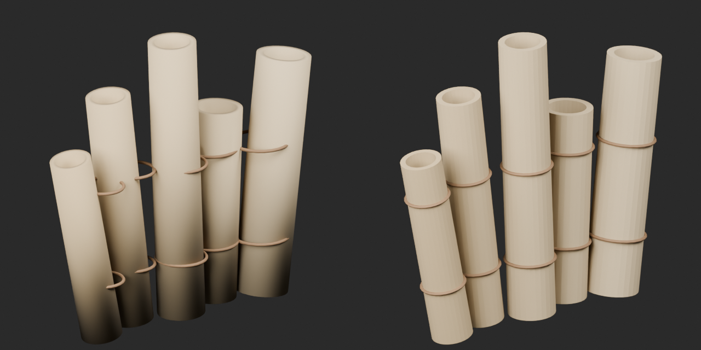
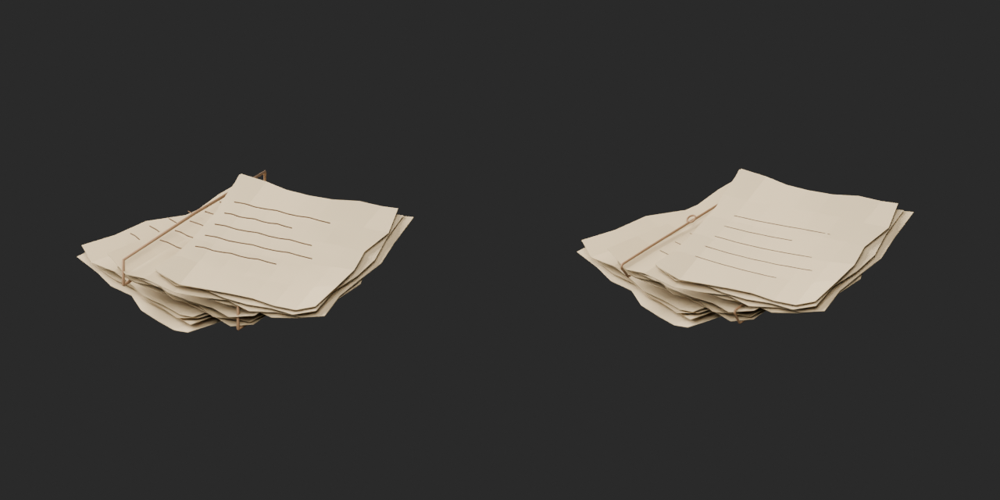
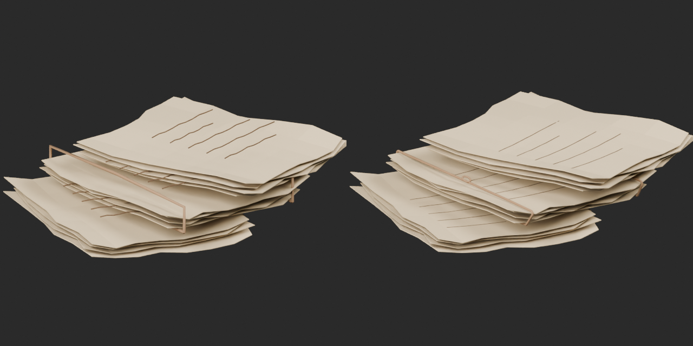

# Local geometry repairs / 局所形状修復 / 局部几何修订

Three revisions, no new base or material variants. Base1008,variant127,assessed266 unchanged. Original packages retained. Only final validation v3 applies: preliminary and v2 failures are not approved. Fixed normal tolerance was not relaxed.

AT085: paper moved inward and bent above the box wall, preserving thickness; earlier collapsed-face trial rejected. AT088: binding rings follow each scroll rotation; imported custom normals removed and final face normals used. Slight faceting remains. Smooth trial failed round-trip normal tolerance and is excluded. AT090: three separate packets retained; central binding and floating notation repaired. Convex binding spans are static, not physical tension.

伝票箱の紙交差、巻物の紐方向と黒帯法線、三束の中央紐と浮いた文字線を改訂しました。AT088は面陰影が少し残ります。旧失敗版は採用せず最終v3のみ検証。形状修復であり同形色variantではありません。

修订纸张穿箱、卷轴绑绳方向及法线、三叠纸中央绑绳和悬浮文字。保留三叠结构，卷轴仍略有面状阴影。仅最终v3通过，旧失败版本不作为合格依据。

Guard compares revised references, not original geometry/UV. Final-ZIP guard and exact public ZIP/member identity verified. Publication did not rerun Blender. No exhaustive collision, physical operation or Blender4.3.2 guarantee. Budget/redesign46 unchanged. Models and embedded materials CC0; comparison images separately licensed catalogue artwork. [License](../LICENSE.md).

## AT_085__repair — Box with a broken seal

割れた封印の箱

[Revised ZIP](https://raw.githubusercontent.com/k3peta/tales-on-a-table/main/distributions/quality-at085-088-090-repair-v1/AT_085__repair_CC0.zip) · [Original historical ZIP](https://github.com/k3peta/tales-on-a-table/releases/download/v2026.10.18/AT_085_CC0.zip)

Left original;right repair,same settings.

Left original;right repair,same settings.

## AT_088__repair — Assorted rolled parchments

巻いた羊皮紙の取り合わせ

[Revised ZIP](https://raw.githubusercontent.com/k3peta/tales-on-a-table/main/distributions/quality-at085-088-090-repair-v1/AT_088__repair_CC0.zip) · [Original historical ZIP](https://github.com/k3peta/tales-on-a-table/releases/download/v2026.10.18/AT_088_CC0.zip)

Left original;right repair,same settings.

Left original;right repair,same settings.

## AT_090__repair — Bundle of loose letters

ばらの書簡包み

[Revised ZIP](https://raw.githubusercontent.com/k3peta/tales-on-a-table/main/distributions/quality-at085-088-090-repair-v1/AT_090__repair_CC0.zip) · [Original historical ZIP](https://github.com/k3peta/tales-on-a-table/releases/download/v2026.10.18/AT_090_CC0.zip)

Left original;right repair,same settings.

Left original;right repair,same settings.

[ZIP/model/run/numerical evidence](../distributions/quality-at085-088-090-repair-v1/validation.json).
