# Boats & fishing gear 1

[← Asset shelf](../README.en.md)

[日本語](marine_01.md) · [English](marine_01.en.md) · [简体中文](marine_01.zh-CN.md)

## FH_001 — Coiled three-strand rope

Coiled three-strand rope from the harbor collection. Unit: one model record. Includes BLEND and GLB. The close-up is rendered from the distributed BLEND.

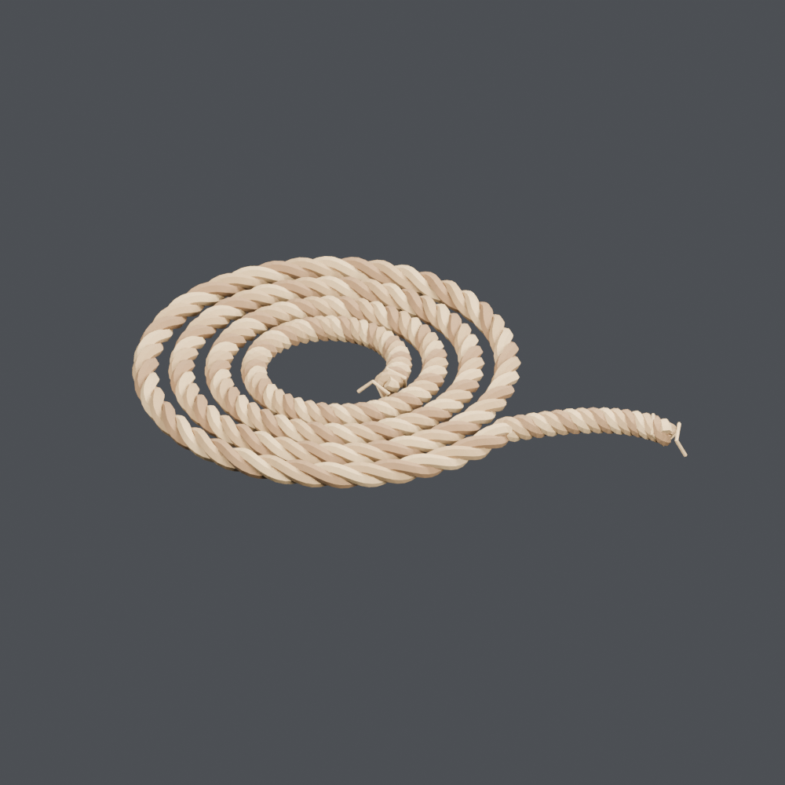

[ZIP · BLEND + GLB · 1.40 MB](https://github.com/k3peta/tales-on-a-table/releases/download/v2026.10.18/FH_001_CC0.zip) · CC0-1.0

`catalog-20261018` · SHA-256: `74d7ce058d907ef1715a91c286528925d0607c7186478a519ccee7c5e00e7d03`

## FH_002 — Rusty small-boat anchor

Rusty small-boat anchor from the harbor collection. Unit: one model record. Includes BLEND and GLB. The close-up is rendered from the distributed BLEND.

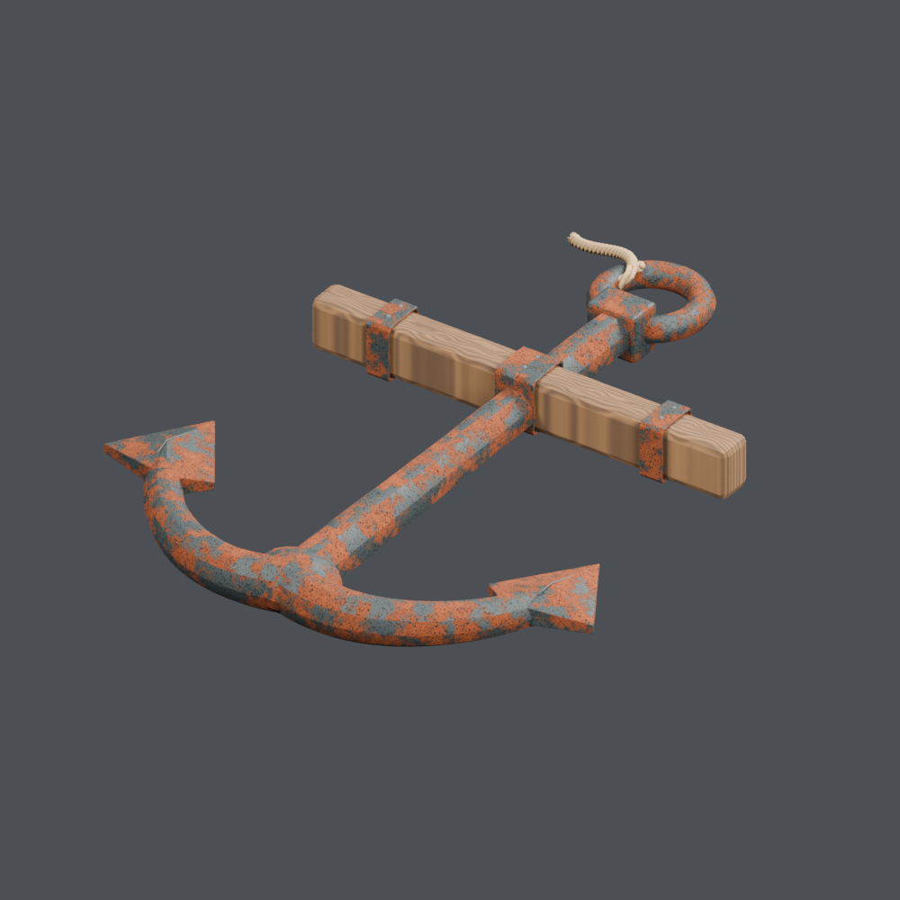

[ZIP · BLEND + GLB · 8.45 MB](https://github.com/k3peta/tales-on-a-table/releases/download/v2026.10.18/FH_002_CC0.zip) · CC0-1.0

`quality-patch-20261017` · SHA-256: `8fb8e965c5b047bf42cb0e43e9bcdd43898c8fb76a059fb42ab8b5ef5277b658`

## FH_004 — Wooden buoy with peeling paint

Wooden buoy with peeling paint from the harbor collection. Unit: one model record. Includes BLEND and GLB. The close-up is rendered from the distributed BLEND.

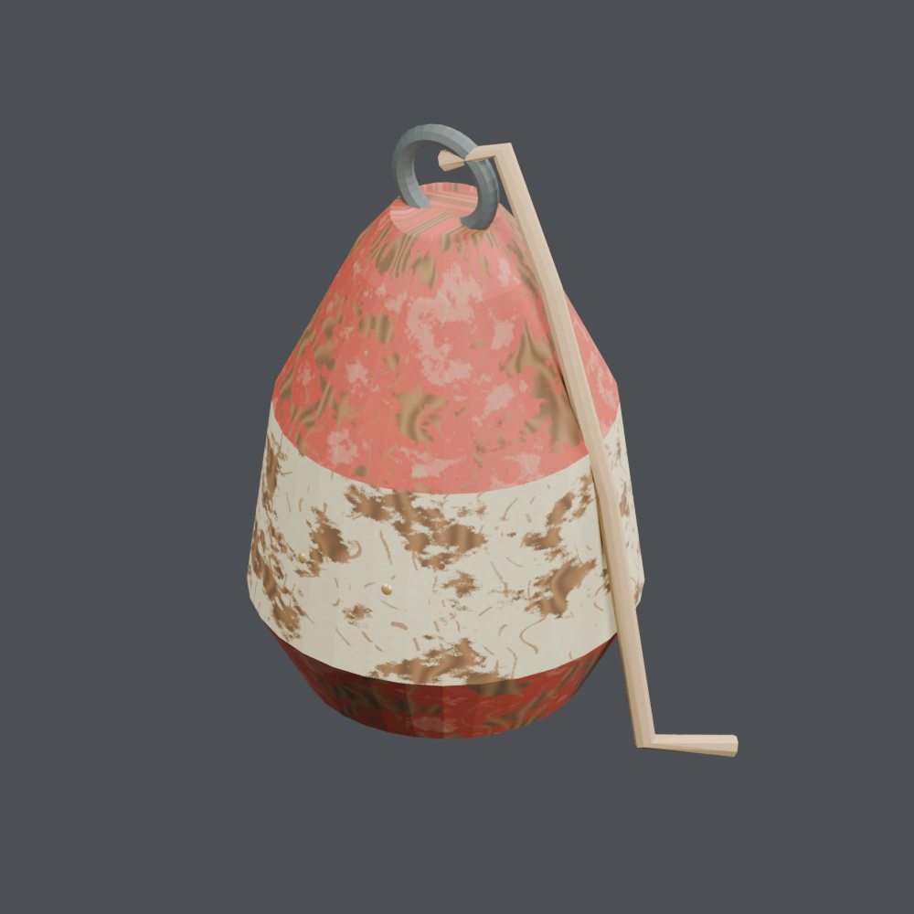

[ZIP · BLEND + GLB · 7.77 MB](https://github.com/k3peta/tales-on-a-table/releases/download/v2026.10.18/FH_004_CC0.zip) · CC0-1.0

`catalog-20261018` · SHA-256: `a901d18a5c212074aad7adc90ebd4aaa567ac97222191f07a4a29fe1875ffa86`

## FH_005 — Netting needle with thread

Netting needle with thread from the harbor collection. Unit: one model record. Includes BLEND and GLB. The close-up is rendered from the distributed BLEND.

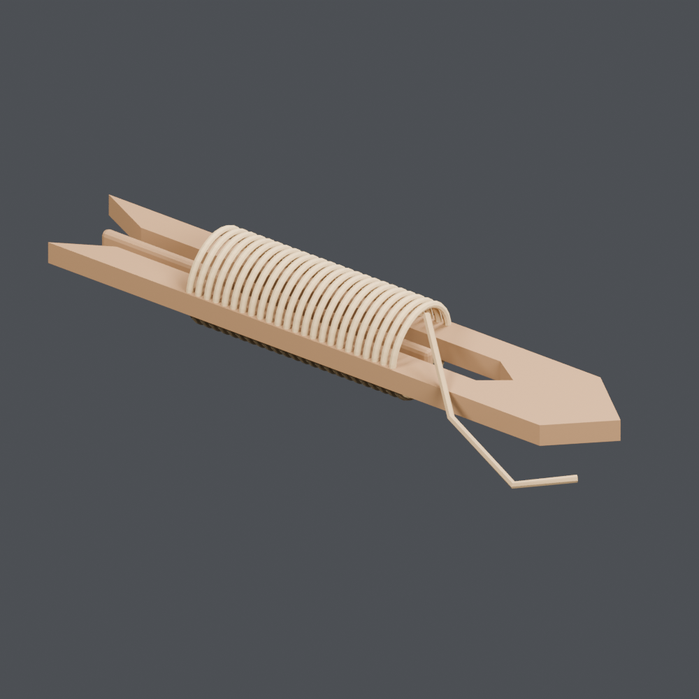

[ZIP · BLEND + GLB · 0.36 MB](https://github.com/k3peta/tales-on-a-table/releases/download/v2026.10.18/FH_005_CC0.zip) · CC0-1.0

`catalog-20261018` · SHA-256: `57bf2fb0d2646e332cab67abc20031bbca26d26ccac06be9b12a98f7f1249f94`

## FH_012 — Iron mooring bollard

Iron mooring bollard from the harbor collection. Unit: one model record. Includes BLEND and GLB. The close-up is rendered from the distributed BLEND.

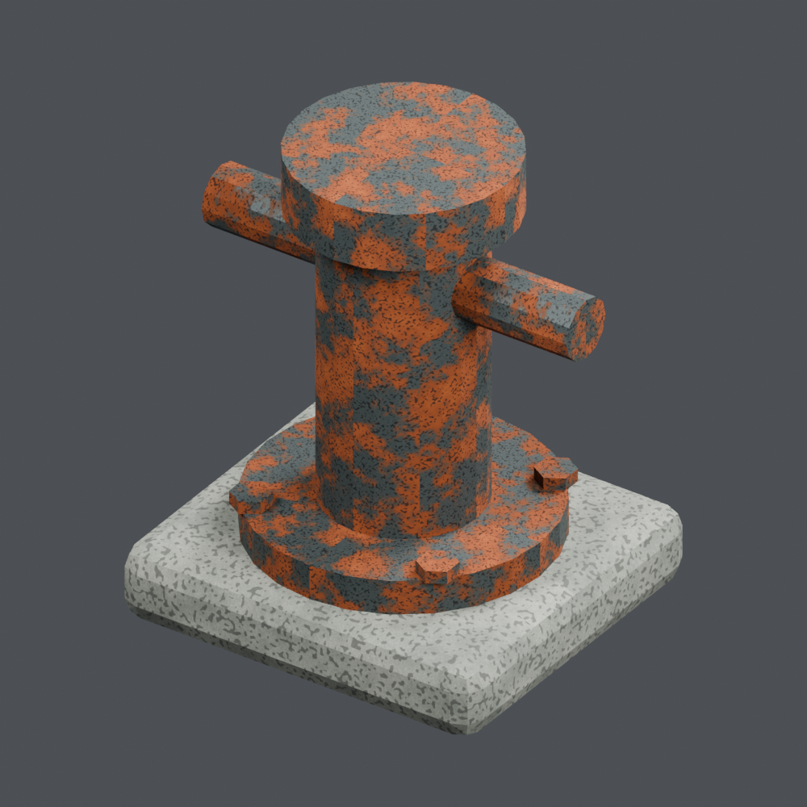

[ZIP · BLEND + GLB · 9.99 MB](https://github.com/k3peta/tales-on-a-table/releases/download/v2026.10.18/FH_012_CC0.zip) · CC0-1.0

`catalog-20261018` · SHA-256: `15bbafb2950e5690f02dc0ae6004d77cc8ca391fe16565c2578928725c305f2b`

## FH_017 — Small wooden fishing boat

Small wooden fishing boat from the harbor collection. Unit: one model record. Includes BLEND and GLB. The close-up is rendered from the distributed BLEND.

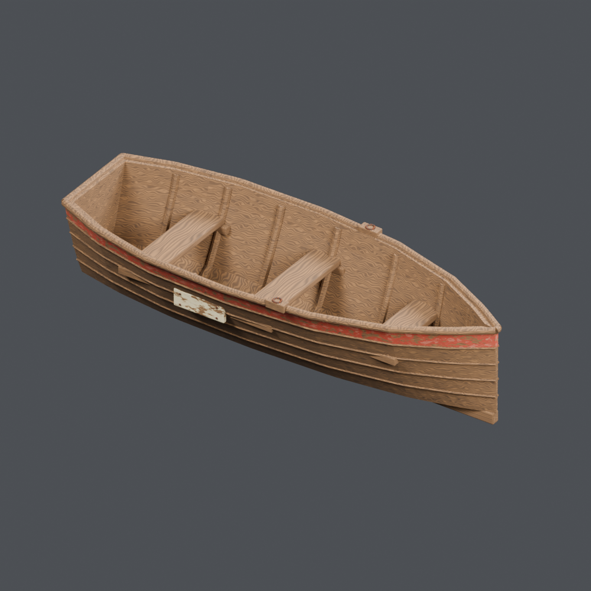

[ZIP · BLEND + GLB · 16.28 MB](https://github.com/k3peta/tales-on-a-table/releases/download/v2026.10.18/FH_017_CC0.zip) · CC0-1.0

`catalog-20261018` · SHA-256: `0e7509766ae47c01835d95195fcd8706a2212725d9c8498f94f14599695b47a7`

## FH_018 — Worn oar

Worn oar from the harbor collection. Unit: one model record. Includes BLEND and GLB. The close-up is rendered from the distributed BLEND.

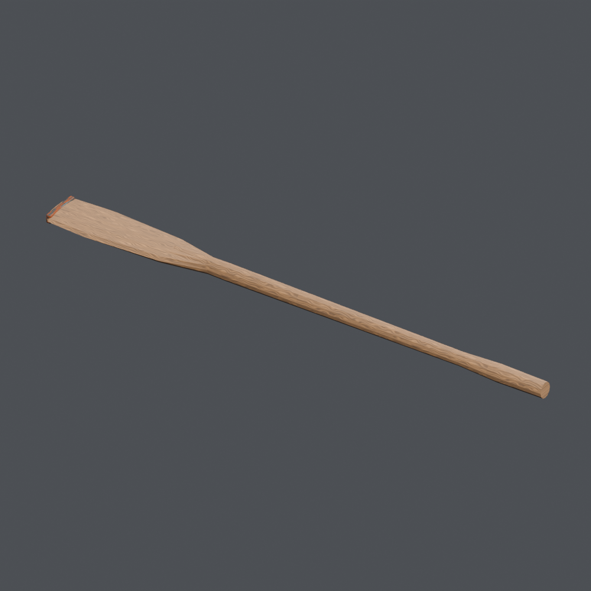

[ZIP · BLEND + GLB · 8.22 MB](https://github.com/k3peta/tales-on-a-table/releases/download/v2026.10.18/FH_018_CC0.zip) · CC0-1.0

`catalog-20261018` · SHA-256: `853a2fac1218423a9c673d3eb8e130cb76153420138d5e0e373cd276209bfca0`

## FH_019 — Boat hook

Boat hook from the harbor collection. Unit: one model record. Includes BLEND and GLB. The close-up is rendered from the distributed BLEND.

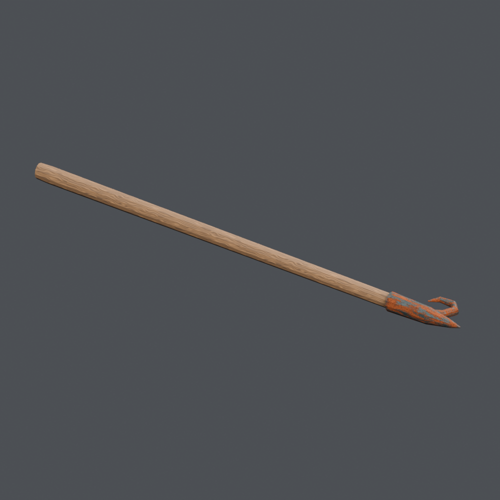

[ZIP · BLEND + GLB · 8.22 MB](https://github.com/k3peta/tales-on-a-table/releases/download/v2026.10.18/FH_019_CC0.zip) · CC0-1.0

`catalog-20261018` · SHA-256: `ebcbcf78d83a9eb5878acee91185b784ee6901af57ba64f4ab1245dd317c9db9`

## FH_020 — Wooden bailer

Wooden bailer from the harbor collection. Unit: one model record. Includes BLEND and GLB. The close-up is rendered from the distributed BLEND.

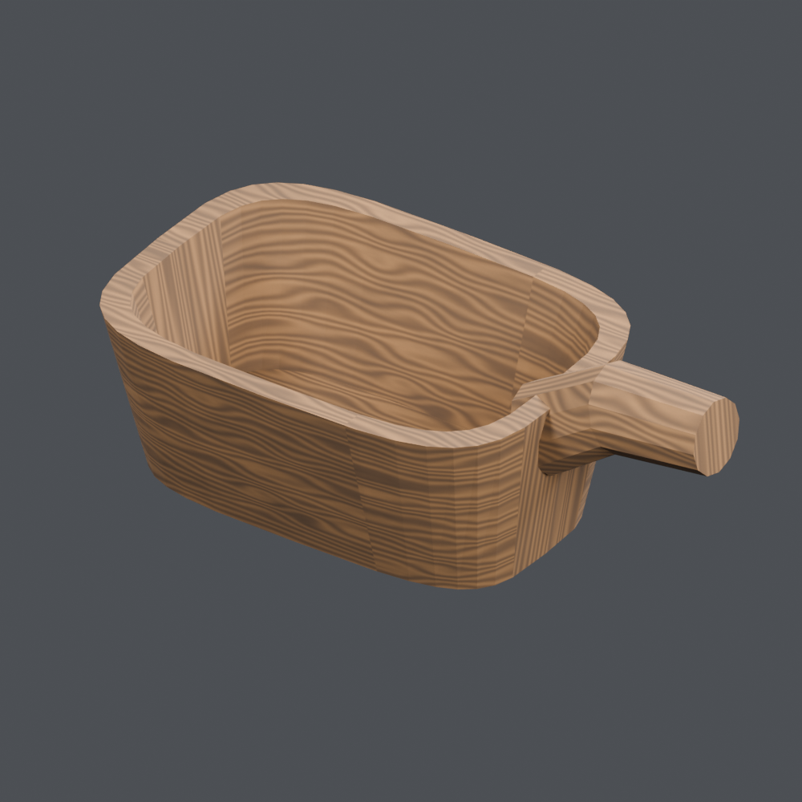

[ZIP · BLEND + GLB · 3.00 MB](https://github.com/k3peta/tales-on-a-table/releases/download/v2026.10.18/FH_020_CC0.zip) · CC0-1.0

`catalog-20261018` · SHA-256: `0e81b01aafb95d6cd467459e380d0984d31c0b09fe548b9d050dd3bdbd2ef120`

## FH_021 — Folded and tied small sail

Folded and tied small sail from the harbor collection. Unit: one model record. Includes BLEND and GLB. The close-up is rendered from the distributed BLEND.

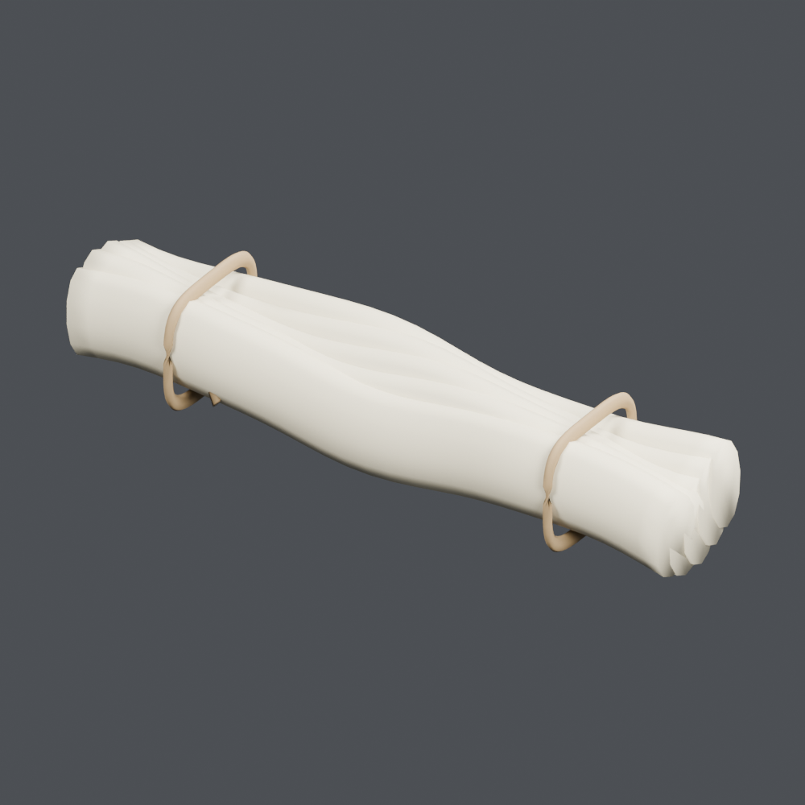

[ZIP · BLEND + GLB · 0.26 MB](https://github.com/k3peta/tales-on-a-table/releases/download/v2026.10.18/FH_021_CC0.zip) · CC0-1.0

`catalog-20261018` · SHA-256: `7efdbd111cccd1079ec37215a8ac14dced6111fb3a8bbaf58a980cf3ee4863de`

## FH_022 — Hanging fishing net

Hanging fishing net from the harbor collection. Unit: one model record. Includes BLEND and GLB. The close-up is rendered from the distributed BLEND.

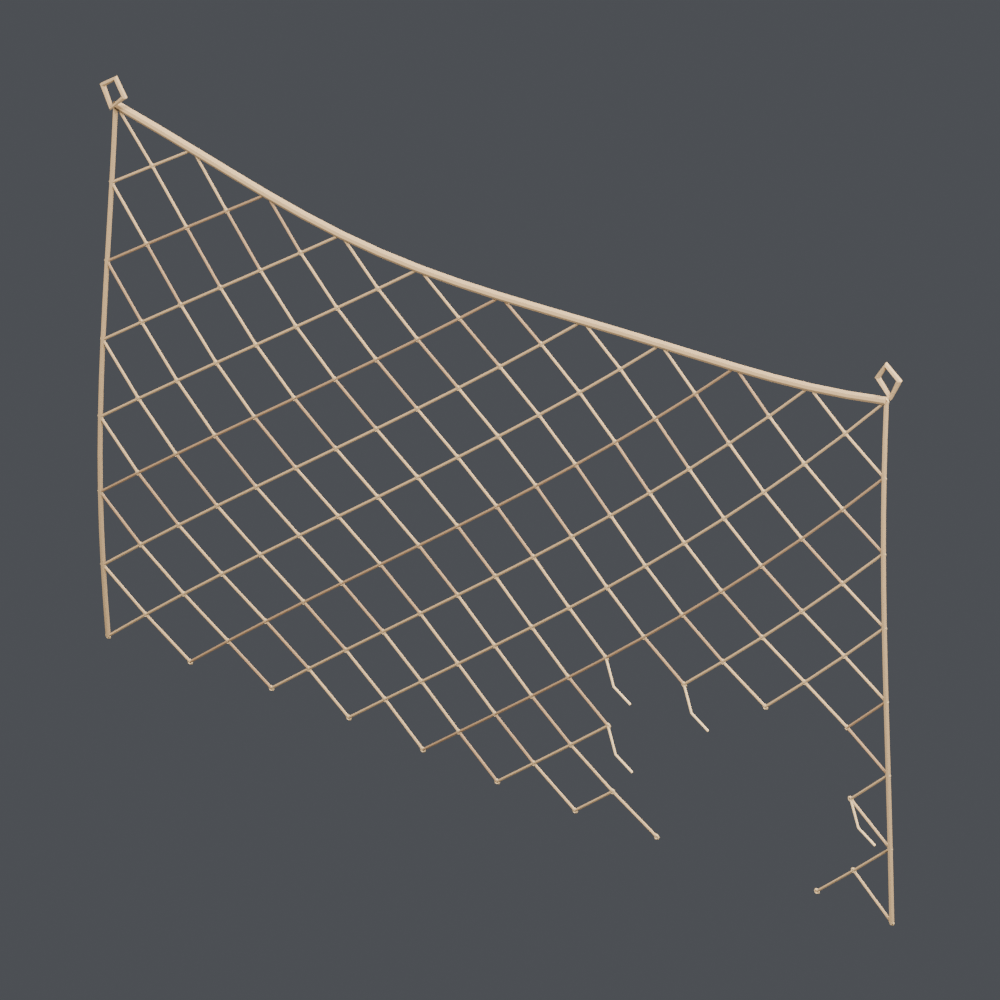

[ZIP · BLEND + GLB · 0.59 MB](https://github.com/k3peta/tales-on-a-table/releases/download/v2026.10.18/FH_022_CC0.zip) · CC0-1.0

`catalog-20261018` · SHA-256: `f17dfcbd0baa007160c7ad0ca10684f823ce8bdcb8c7cc5c10c0433e524fb94c`

## FH_023 — Wooden net-drying frame

Wooden net-drying frame from the harbor collection. Unit: one model record. Includes BLEND and GLB. The close-up is rendered from the distributed BLEND.

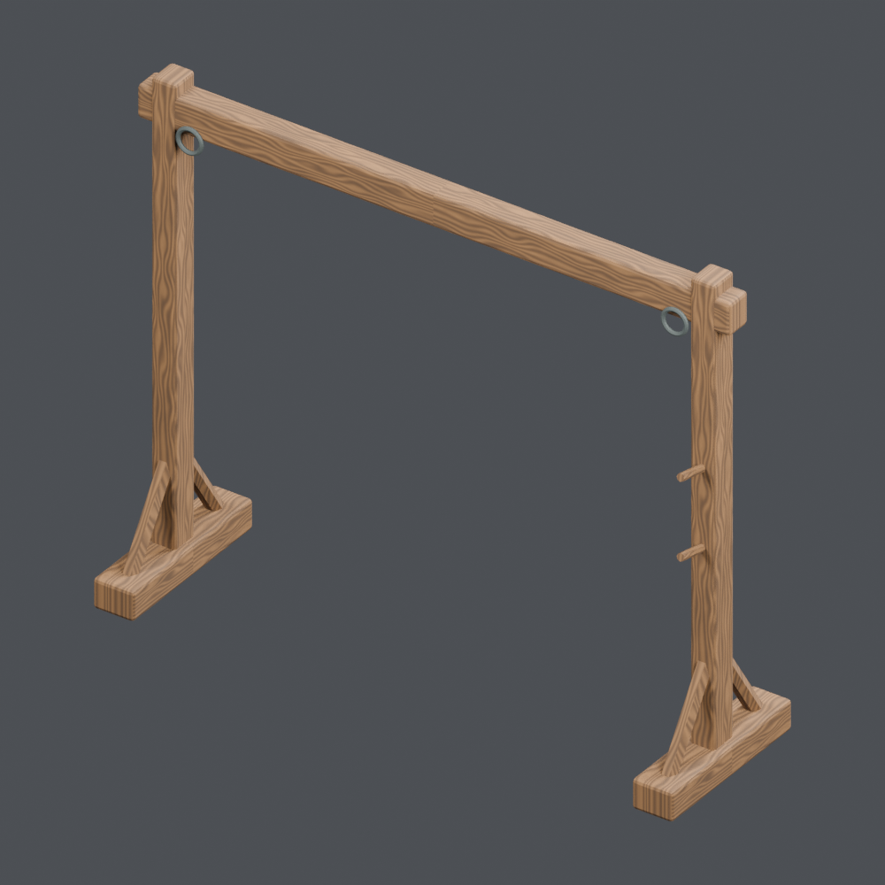

[ZIP · BLEND + GLB · 3.03 MB](https://github.com/k3peta/tales-on-a-table/releases/download/v2026.10.18/FH_023_CC0.zip) · CC0-1.0

`catalog-20261018` · SHA-256: `73606864451c9f850e0d149a094a5edfae5e3d12cd3fe963a79e4d0966d6022d`
