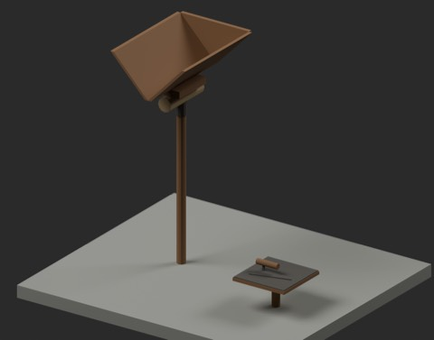
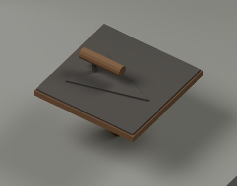
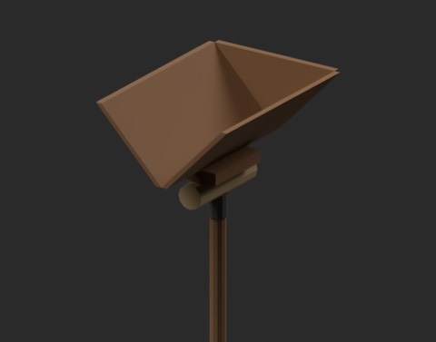

# 石工の手運び道具 / Masonry handling

**985 distribution records = 983 + 2 components.** One local-use candidate and one composite accessory. Hawk and trowel together count once. The private arrangement adds zero records; historical shape independence is unconfirmed.

|ID|Classification|ZIP|
|---|---|---|
|MRH201_ShoulderHod|local_use_candidate|[Download](https://raw.githubusercontent.com/k3peta/tales-on-a-table/main/distributions/masonry-handling-v2/MRH201_ShoulderHod_CC0.zip)|
|MRH202_MortarHawkTrowel|composite_accessory|[Download](https://raw.githubusercontent.com/k3peta/tales-on-a-table/main/distributions/masonry-handling-v2/MRH202_MortarHawkTrowel_CC0.zip)|

MRH201 shoulder hod: open V-shaped trough, long handle, support block and shoulder pad. Metres, Z up; handle endZ0, approximately0.524m wide/0.704m trough length/1.4m tall. Opening faces-Y, backboard+Y. Upright pose is a carrying-tool reference, not a freestanding stability claim.

MRH202 mortar hawk and trowel:0.36m square board, upper surfaceZ0.206m, lower grip ends atZ0; triangular blade rests on top and has a raised handle. Mortar itself is not included. BLEND is a Collection library.

Existing lamps, bells, wheelbarrows, sieves, hammers, chisels, carts, lifting tools and MRT measuring/centering accessories are not recreated or added. Name/description/code screening does not establish equality or difference across every unnamed historical mesh, nested or unavailable ZIP.

Original procedural models; no external model/image or held material used. Model geometry and embedded materials only are CC0-1.0. Code, images, articles and private arrangements are excluded. Human shoulder fit, load capacity, construction safety, carrying/plastering motion, walking/collision and Blender4.3.2 compatibility are unverified. Static viewing models only. [Checksums](../distributions/masonry-handling-v2/SHA256SUMS.txt).

## 実作画像 / Actual renders

完成バッチの配置・接写。画像は閲覧用でモデルCC0の対象外です。[既存の画像利用条件](../LICENSE.md)を維持します。

|ID|名称 / Name|Download|
|---|---|---|
|MRH201_ShoulderHod|ShoulderHod|[ZIP](https://raw.githubusercontent.com/k3peta/tales-on-a-table/main/distributions/masonry-handling-v2/MRH201_ShoulderHod_CC0.zip)|
|MRH202_MortarHawkTrowel|MortarHawkTrowel|[ZIP](https://raw.githubusercontent.com/k3peta/tales-on-a-table/main/distributions/masonry-handling-v2/MRH202_MortarHawkTrowel_CC0.zip)|

