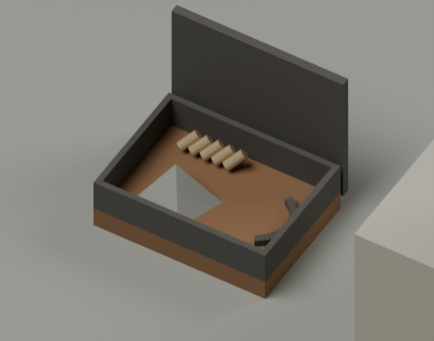
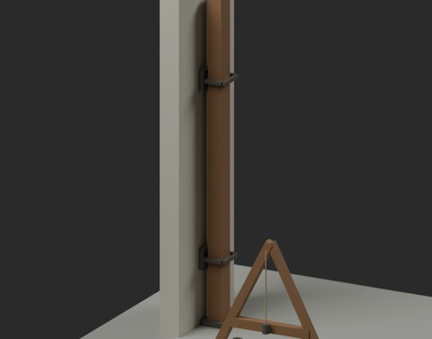
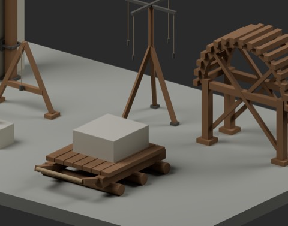
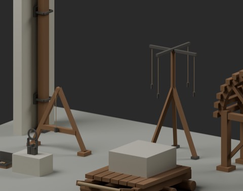
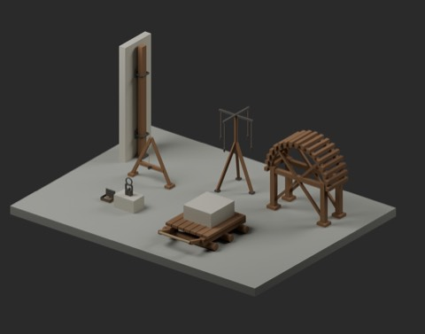

# 石工・街道道具 / Masonry and road tools

**983 distribution records = 976 + 7 components.** Four local-use candidates, two composite accessories, one structural accessory. Example arrangements add zero records; global historical shape independence is unconfirmed.

### MRT101_PlumbLevel

MRT101_PlumbLevel

local_use_candidate

[Download](https://raw.githubusercontent.com/k3peta/tales-on-a-table/main/distributions/masonry-road-tools-v1/MRT101_PlumbLevel_CC0.zip)

### MRT102_SurveyCross

MRT102_SurveyCross

local_use_candidate

[Download](https://raw.githubusercontent.com/k3peta/tales-on-a-table/main/distributions/masonry-road-tools-v1/MRT102_SurveyCross_CC0.zip)

### MRT103_ArchCentering

MRT103_ArchCentering

local_use_candidate

[Download](https://raw.githubusercontent.com/k3peta/tales-on-a-table/main/distributions/masonry-road-tools-v1/MRT103_ArchCentering_CC0.zip)

### MRT104_StoneLiftingSocket

MRT104_StoneLiftingSocket

composite_accessory

[Download](https://raw.githubusercontent.com/k3peta/tales-on-a-table/main/distributions/masonry-road-tools-v1/MRT104_StoneLiftingSocket_CC0.zip)

### MRT105_RollerStoneSled

MRT105_RollerStoneSled

local_use_candidate

[Download](https://raw.githubusercontent.com/k3peta/tales-on-a-table/main/distributions/masonry-road-tools-v1/MRT105_RollerStoneSled_CC0.zip)

### MRT106_GateBarStorage

MRT106_GateBarStorage

structural_accessory

[Download](https://raw.githubusercontent.com/k3peta/tales-on-a-table/main/distributions/masonry-road-tools-v1/MRT106_GateBarStorage_CC0.zip)

### MRT107_FiresteelKit

MRT107_FiresteelKit

composite_accessory

[Download](https://raw.githubusercontent.com/k3peta/tales-on-a-table/main/distributions/masonry-road-tools-v1/MRT107_FiresteelKit_CC0.zip)

MRT101 A-frame plumb level; MRT102 four-plumb survey cross; MRT103 timber arch centering; MRT104 stone/socket/lifting-ring composite; MRT105 three-roller stone sled; MRT106 wall-mounted gate-bar storage; MRT107 boxed firesteel/flint/tinder kit. The stone in the lifting composite is not a separately counted asset. Existing carts, pulleys, scales, maps/compasses, bags, ladders and FCS104 dressing bench are not new additions. Name/code screening is not exhaustive mesh or arbitrary-assembly equivalence proof.

Metres, Z up, ground origins except MRT106 wall mounting planeX0/baseZ0. Display walls and examples are excluded from the seven ZIPs. Approximate level width1.36m/height1.3m; survey cross height2.15m; centering radius1m/springing1.1m; gate bar3.2m; firesteel box0.30x0.22m. These are static display models: no measured surveying accuracy, lifting/sliding/gate mechanism or ignition. Historical precision, loads/construction safety, full intersection volumes, walking/collision and Blender4.3.2 compatibility are unverified.

Original procedural geometry, no external geometry/images or held material. Model geometry and embedded materials only are CC0-1.0; code, renders, articles and private records are excluded. [Checksums](../distributions/masonry-road-tools-v1/SHA256SUMS.txt).

## 実作画像 / Actual renders

完成バッチの配置・接写。画像は閲覧用でモデルCC0の対象外です。[既存の画像利用条件](../LICENSE.md)を維持します。

### MRT101_PlumbLevel

PlumbLevel

[ZIP](https://raw.githubusercontent.com/k3peta/tales-on-a-table/main/distributions/masonry-road-tools-v1/MRT101_PlumbLevel_CC0.zip)

### MRT102_SurveyCross

SurveyCross

[ZIP](https://raw.githubusercontent.com/k3peta/tales-on-a-table/main/distributions/masonry-road-tools-v1/MRT102_SurveyCross_CC0.zip)

### MRT103_ArchCentering

ArchCentering

[ZIP](https://raw.githubusercontent.com/k3peta/tales-on-a-table/main/distributions/masonry-road-tools-v1/MRT103_ArchCentering_CC0.zip)

### MRT104_StoneLiftingSocket

StoneLiftingSocket

[ZIP](https://raw.githubusercontent.com/k3peta/tales-on-a-table/main/distributions/masonry-road-tools-v1/MRT104_StoneLiftingSocket_CC0.zip)

### MRT105_RollerStoneSled

RollerStoneSled

[ZIP](https://raw.githubusercontent.com/k3peta/tales-on-a-table/main/distributions/masonry-road-tools-v1/MRT105_RollerStoneSled_CC0.zip)

### MRT106_GateBarStorage

GateBarStorage

[ZIP](https://raw.githubusercontent.com/k3peta/tales-on-a-table/main/distributions/masonry-road-tools-v1/MRT106_GateBarStorage_CC0.zip)

### MRT107_FiresteelKit

FiresteelKit

[ZIP](https://raw.githubusercontent.com/k3peta/tales-on-a-table/main/distributions/masonry-road-tools-v1/MRT107_FiresteelKit_CC0.zip)

## Individual images / 個別画像 / 单件图片

Actual distributed models; chosen camera view does not establish intended front or placement pivot. Images are outside model CC0. Original links and archives retained.

### MRT101_PlumbLevel — PlumbLevel

PlumbLevel

[Full image](../previews/chbv-mrt24/renders/MRT101_PlumbLevel.png) · [ZIP · BLEND/GLB](https://raw.githubusercontent.com/k3peta/tales-on-a-table/main/distributions/masonry-road-tools-v1/MRT101_PlumbLevel_CC0.zip)
