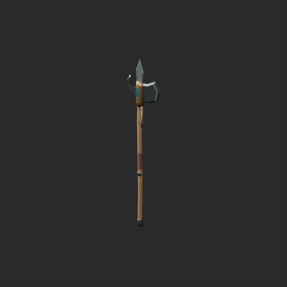
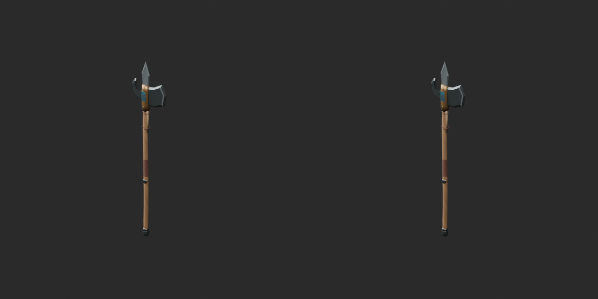
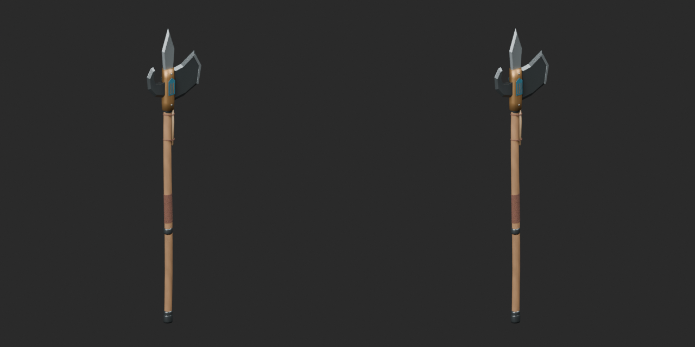
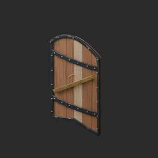
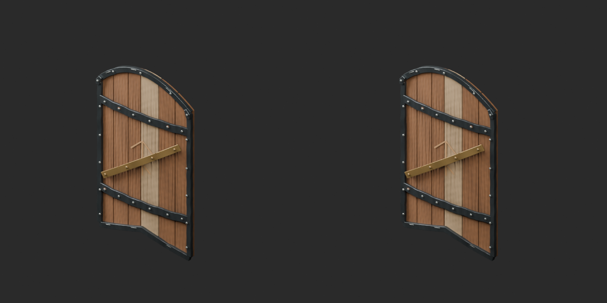
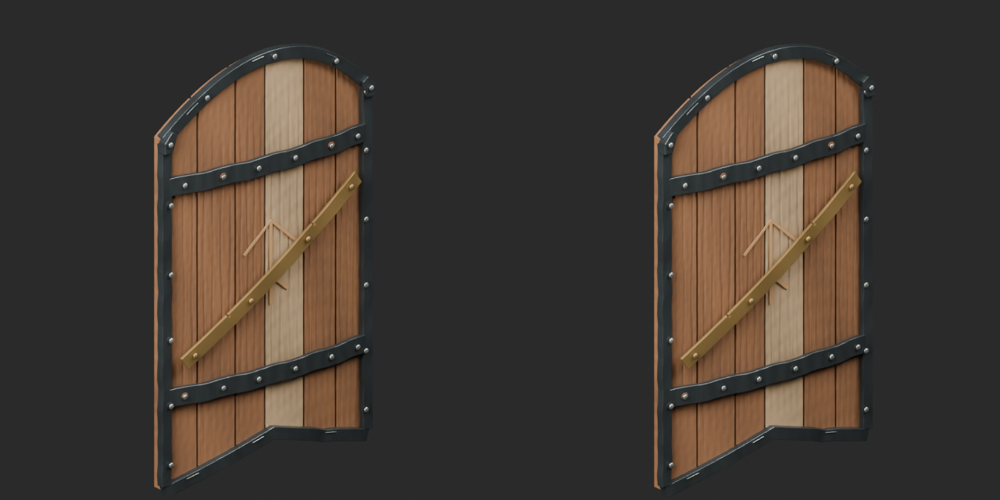
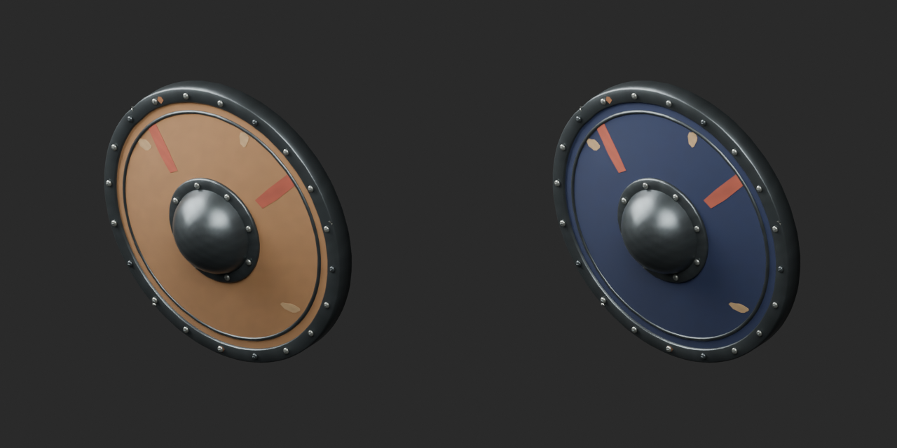
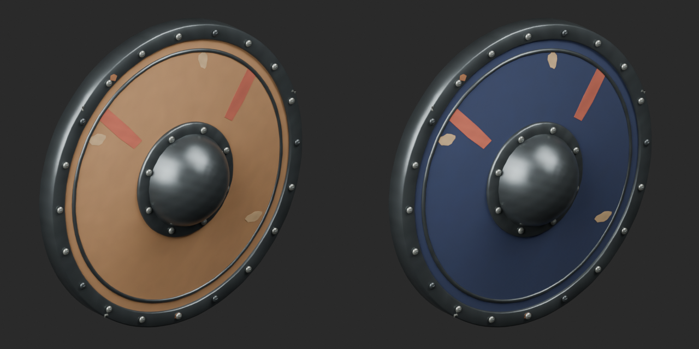
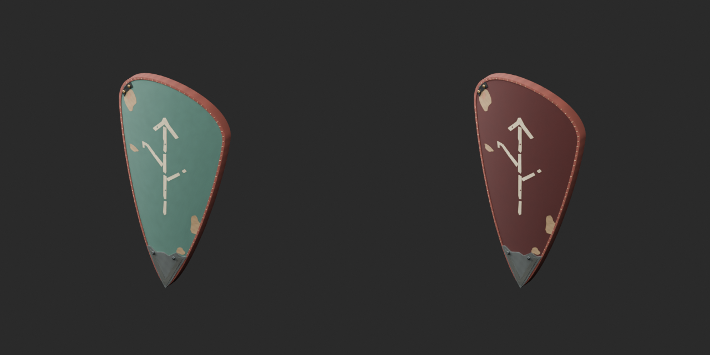
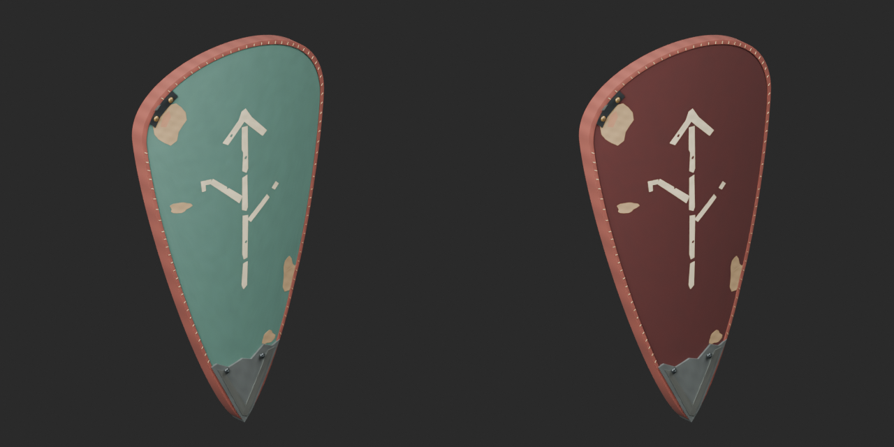

# Quality38 / 品質第38便 / 质量第38批

Base1008 unchanged; material variants145=143+2 counted separately. Two revisions add no model; originals retained.

ARM014 removes8 exact-zero triangles, ARM021 removes30; positive tiny surfaces retained. ARM021 still92210tri and regular plank grain remains. Blue ARM022 and rust-red ARM023 hide variants preserve geometry, UV and original vertex colors, adding a UV tint texture; other material channels unchanged. Color is not repair. Not liquid-color variants.

改訂2件は非加算。盾の青革/赤錆色革variant2件は別集計。元頂点色と形状UVを保持。2个修订不新增模型，2个盾面颜色变体单独统计；保留原顶点色、几何和UV。

Same camera/light/scale comparisons. Final-ZIP geometry/UV guard plus separate oriented triangle vertex-color gate cover actual extracted BLEND and GLB. Public ZIP/member hashes match the final guarded artifacts. Publication did not rerun Blender.

Assessed376 distribution records,632 remain;87 budget/redesign issues unresolved. Static display props: collision, weapon function, load, animation, optical equivalence and Blender4.3.2 untested. ARM01557496, ARM01729884, ARM018117948, ARM01973184, ARM02084396, ARM02192210, ARM02266056, ARM02377600 triangles exceed20k. Existing ARM001/003 quality37 GLB vertex-color-loss alert remains unresolved; earlier geometry/UV pass was not color preservation.

Models/embedded materials only CC0; images separate catalogue artwork. [License](../LICENSE.md). Private reports/code excluded.

## ARM_014__repair — 城門の長柄斧

城門の長柄斧

Exact-zero-area cleanup: ARM014 8 faces or ARM021 30 faces. All positive surfaces retained; ARM021 budget remains exceeded. No new base.

[ZIP · BLEND/GLB](https://raw.githubusercontent.com/k3peta/tales-on-a-table/main/distributions/quality-arm014-023-v1/ARM_014__repair_CC0.zip)

Left: original; right: accepted revision/variant, identical camera/light/scale.

## ARM_021__repair — 継ぎ板の塔盾

継ぎ板の塔盾

Exact-zero-area cleanup: ARM014 8 faces or ARM021 30 faces. All positive surfaces retained; ARM021 budget remains exceeded. No new base.

[ZIP · BLEND/GLB](https://raw.githubusercontent.com/k3peta/tales-on-a-table/main/distributions/quality-arm014-023-v1/ARM_021__repair_CC0.zip)

Left: original; right: accepted revision/variant, identical camera/light/scale.

## ARM_022__bluehide — 兵士の革張り円盾

兵士の革張り円盾

Shield hide basecolor chroma variant; original vertex color retained, UV tint texture multiplied. Geometry and UV unchanged. Roughness/normal/metallic/emission unchanged; not a geometry repair.

[ZIP · BLEND/GLB](https://raw.githubusercontent.com/k3peta/tales-on-a-table/main/distributions/quality-arm014-023-v1/ARM_022__bluehide_CC0.zip)

Left: original; right: accepted revision/variant, identical camera/light/scale.

## ARM_023__rusthide — 道標紋の冒険者凧盾

道標紋の冒険者凧盾

Shield hide basecolor chroma variant; original vertex color retained, UV tint texture multiplied. Geometry and UV unchanged. Roughness/normal/metallic/emission unchanged; not a geometry repair.

[ZIP · BLEND/GLB](https://raw.githubusercontent.com/k3peta/tales-on-a-table/main/distributions/quality-arm014-023-v1/ARM_023__rusthide_CC0.zip)

Left: original; right: accepted revision/variant, identical camera/light/scale.

[Exact package validation evidence](../distributions/quality-arm014-023-v1/validation.json).
