# Quality39 / 品質第39便 / 质量第39批

Base1008 unchanged; material variants147=145+2 separately. Three revisions add no base; originals retained.

ARM02623, ARM03148 and ARM03364 exact-zero triangles removed; all positive surfaces, UV and vertex colors retained. All three remain over20k triangles. ARM027 copper-colored helmet coating and ARM030 navy leather hood use UV tint multiplied with original vertex colors; geometry/UV and roughness/normal/metallic/emission unchanged. Coating color is not new material physics or geometry repair.

改訂3件は非加算。銅色兜/紺革フード2variantは別集計。元頂点色・形状UVを保持。3个修订不新增模型；铜色头盔和深蓝皮兜帽2个变体单独统计。

Same camera/light/scale comparisons. Final-ZIP guard includes spatial vertex-color correspondence for actual BLEND/GLB; four known old missing-color files rejected despite equal geometry. Public artifact matching is pending. Publication did not rerun Blender.

Assessed386 distribution records,622 remain;97 budget/redesign issues unresolved. All10 source models exceed20k. ARM026109853, ARM03168384, ARM03391016 triangles after cleanup. Armor shoulder attachment/rig behavior remains unverified. No collision/load/weapon functionality/gameplay or Blender4.3.2 guarantee. No arbitrary decimation; earlier diagnoses retained.

Models/embedded materials only CC0; images separate catalogue artwork. [License](../LICENSE.md). Private reports/code excluded.

## ARM_026__repair — 獅子面の空洞兜

獅子面の空洞兜

Exact-zero-area cleanup with all positive surfaces and vertex colors retained: ARM026 23, ARM031 48, ARM033 64 faces. Budget remains exceeded. No new base.

[ZIP · BLEND/GLB](https://raw.githubusercontent.com/k3peta/tales-on-a-table/main/distributions/quality-arm024-033-v1/ARM_026__repair_CC0.zip)

[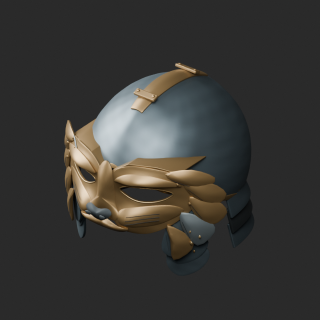](../previews/quality-arm024-033-v1/ARM_026__repair_thumb.png)

[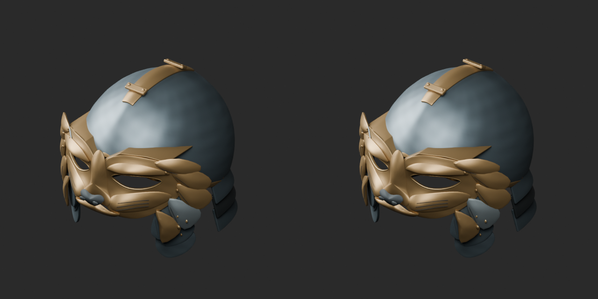](../previews/quality-arm024-033-v1/ARM_026__repair_overview_comparison.png)

[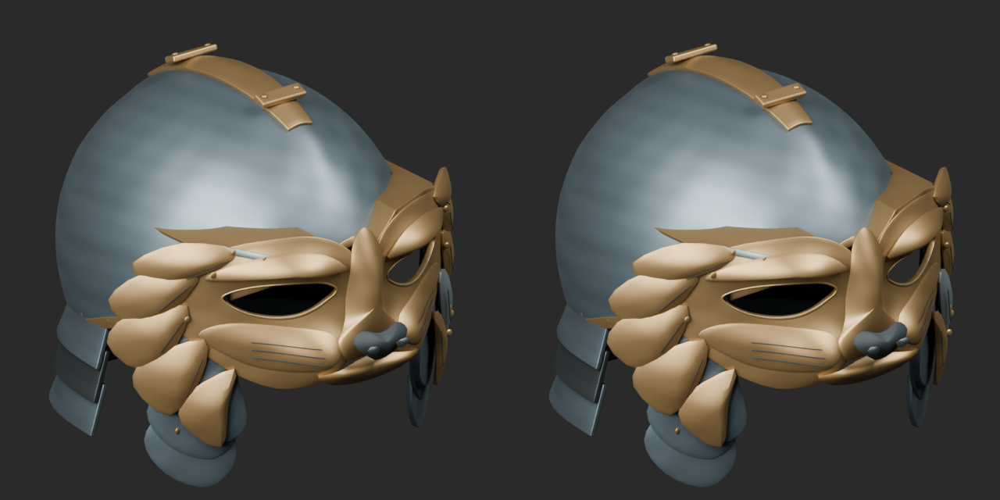](../previews/quality-arm024-033-v1/ARM_026__repair_close_comparison.png)

Left: original; right: accepted revision/variant, identical camera/light/scale.

## ARM_027__coppertint — 幅広ひさしの歩兵兜

幅広ひさしの歩兵兜

UV tint texture multiplied with original vertex colors; copper-colored coating on helmet steel or navy hood leather. Original geometry/UV retained; no roughness/normal/emission edit. Not a geometry repair or new base.

[ZIP · BLEND/GLB](https://raw.githubusercontent.com/k3peta/tales-on-a-table/main/distributions/quality-arm024-033-v1/ARM_027__coppertint_CC0.zip)

[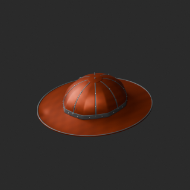](../previews/quality-arm024-033-v1/ARM_027__coppertint_thumb.png)

[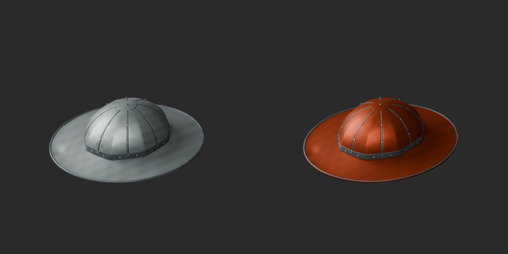](../previews/quality-arm024-033-v1/ARM_027__coppertint_overview_comparison.png)

[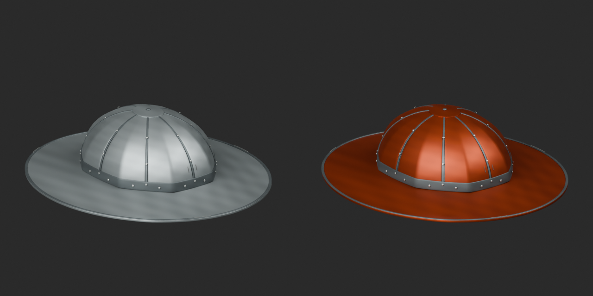](../previews/quality-arm024-033-v1/ARM_027__coppertint_close_comparison.png)

Left: original; right: accepted revision/variant, identical camera/light/scale.

## ARM_030__navyhide — 継ぎ革のフード

継ぎ革のフード

UV tint texture multiplied with original vertex colors; copper-colored coating on helmet steel or navy hood leather. Original geometry/UV retained; no roughness/normal/emission edit. Not a geometry repair or new base.

[ZIP · BLEND/GLB](https://raw.githubusercontent.com/k3peta/tales-on-a-table/main/distributions/quality-arm024-033-v1/ARM_030__navyhide_CC0.zip)

[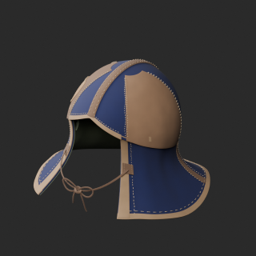](../previews/quality-arm024-033-v1/ARM_030__navyhide_thumb.png)

[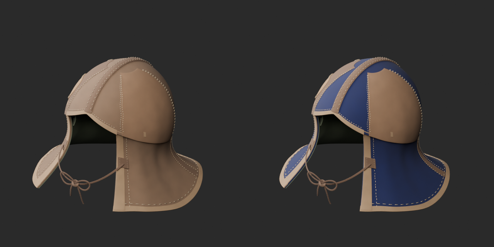](../previews/quality-arm024-033-v1/ARM_030__navyhide_overview_comparison.png)

[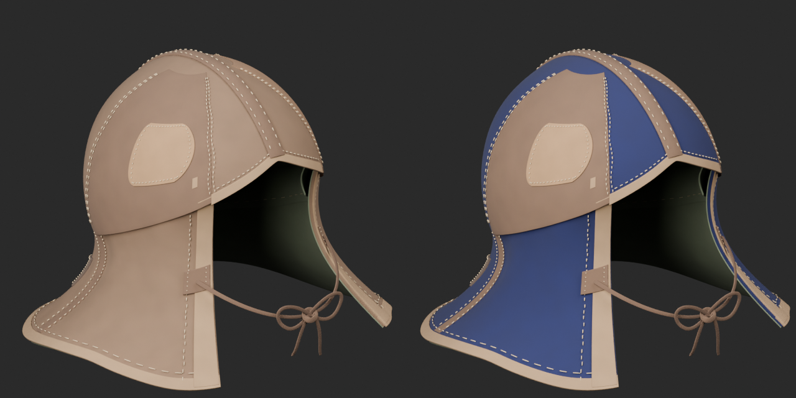](../previews/quality-arm024-033-v1/ARM_030__navyhide_close_comparison.png)

Left: original; right: accepted revision/variant, identical camera/light/scale.

## ARM_031__repair — 左右非対称の遍歴鎧

左右非対称の遍歴鎧

Exact-zero-area cleanup with all positive surfaces and vertex colors retained: ARM026 23, ARM031 48, ARM033 64 faces. Budget remains exceeded. No new base.

[ZIP · BLEND/GLB](https://raw.githubusercontent.com/k3peta/tales-on-a-table/main/distributions/quality-arm024-033-v1/ARM_031__repair_CC0.zip)

[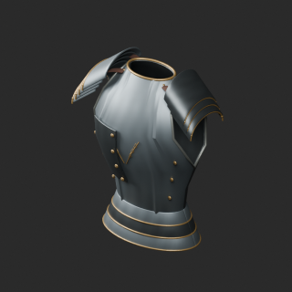](../previews/quality-arm024-033-v1/ARM_031__repair_thumb.png)

[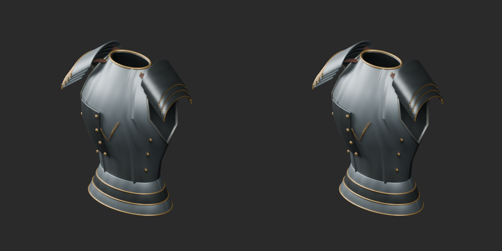](../previews/quality-arm024-033-v1/ARM_031__repair_overview_comparison.png)

[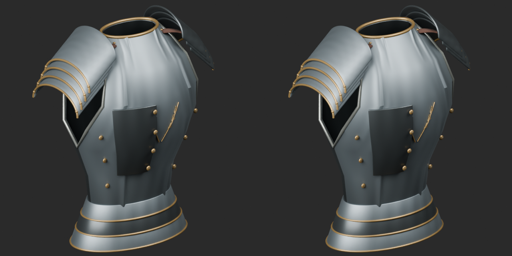](../previews/quality-arm024-033-v1/ARM_031__repair_close_comparison.png)

Left: original; right: accepted revision/variant, identical camera/light/scale.

## ARM_033__repair — 鱗重ね胸鎧

鱗重ね胸鎧

Exact-zero-area cleanup with all positive surfaces and vertex colors retained: ARM026 23, ARM031 48, ARM033 64 faces. Budget remains exceeded. No new base.

[ZIP · BLEND/GLB](https://raw.githubusercontent.com/k3peta/tales-on-a-table/main/distributions/quality-arm024-033-v1/ARM_033__repair_CC0.zip)

[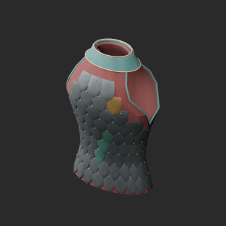](../previews/quality-arm024-033-v1/ARM_033__repair_thumb.png)

[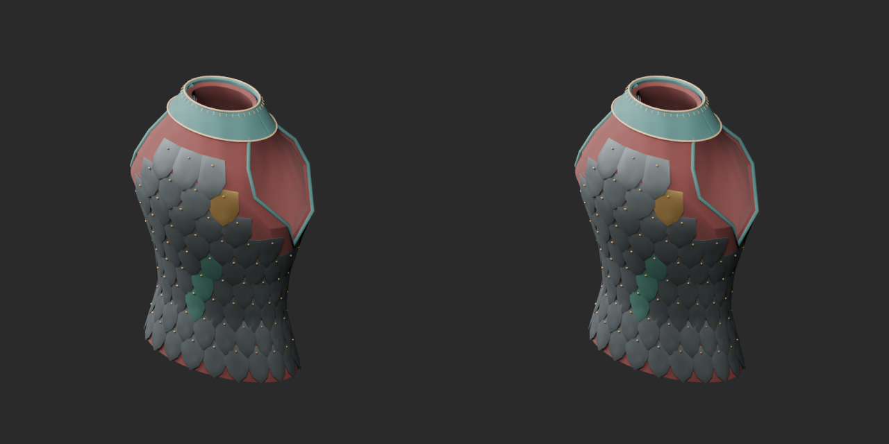](../previews/quality-arm024-033-v1/ARM_033__repair_overview_comparison.png)

[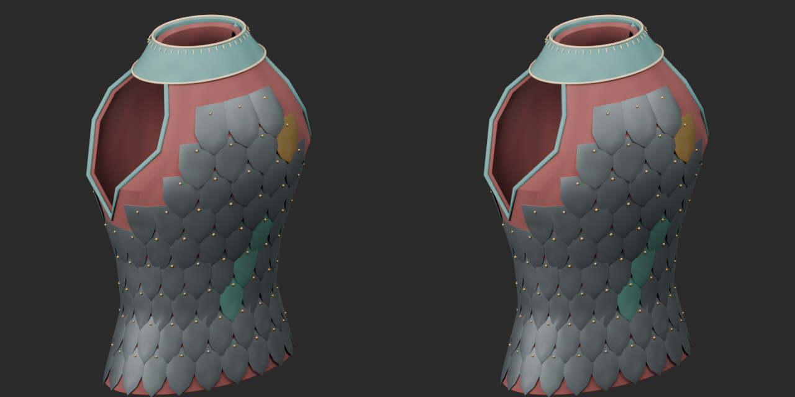](../previews/quality-arm024-033-v1/ARM_033__repair_close_comparison.png)

Left: original; right: accepted revision/variant, identical camera/light/scale.
