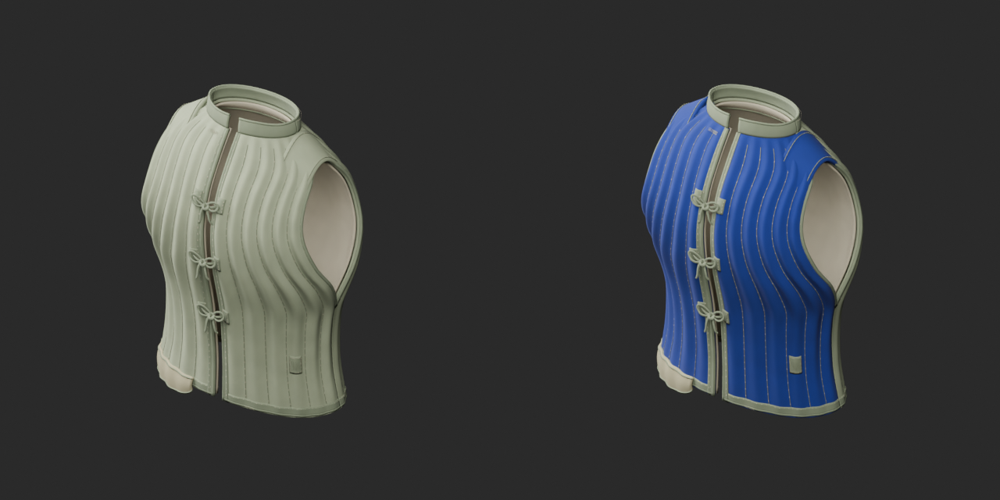
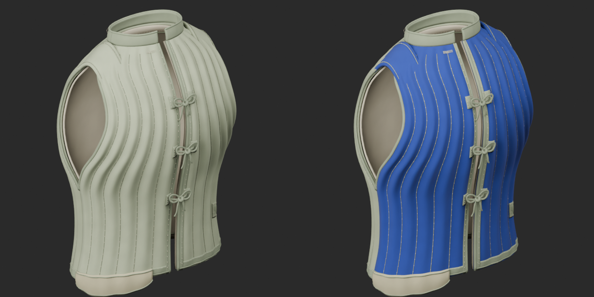
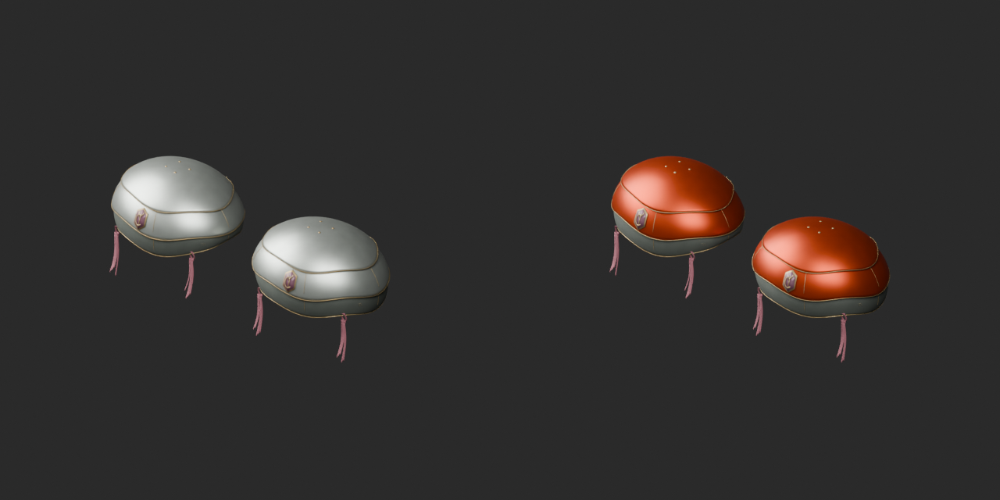
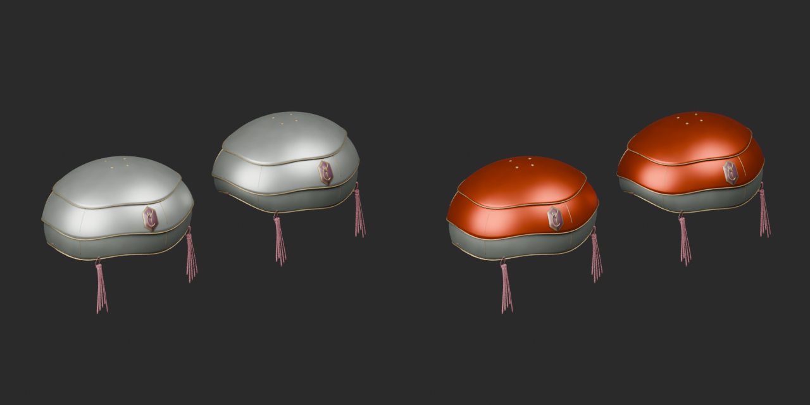
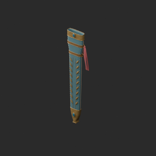
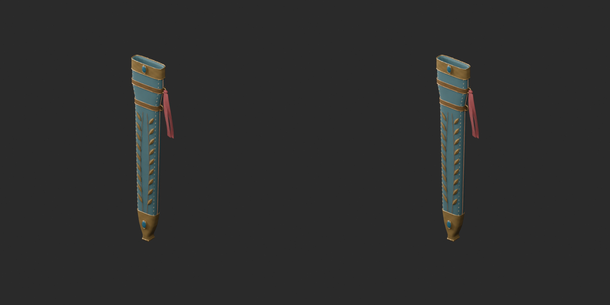
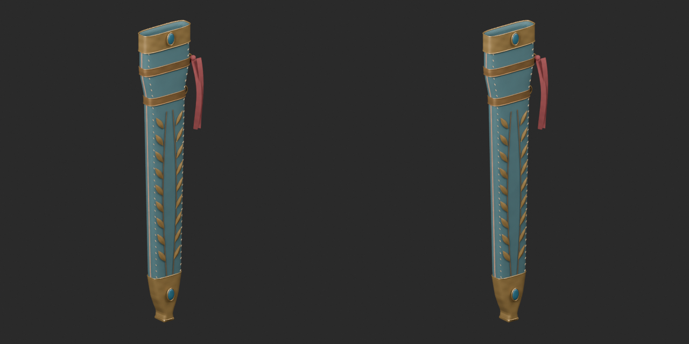
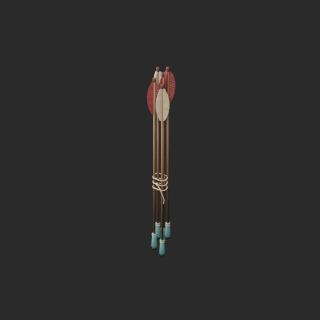
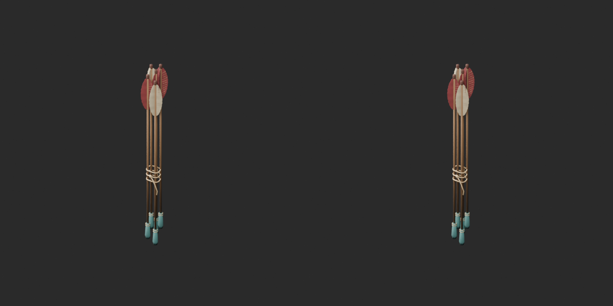
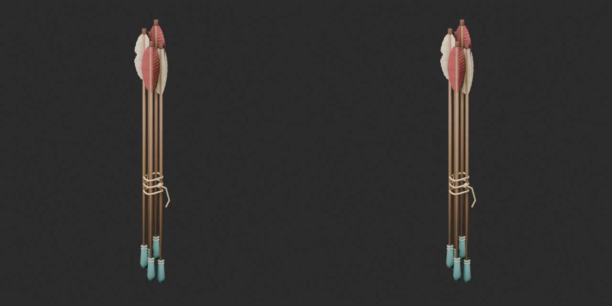

# Quality40 / 品質第40便 / 质量第40批

Base1008 unchanged; material variants149=147+2 separately. Two revisions add no base; originals retained.

ARM040144 and ARM045120 exact-zero triangles removed, retaining positive surfaces, UV and spatial vertex colors. ARM04058864 and ARM04520068tri remain over20k. ARM034 blue quilted linen and ARM035 copper-colored shoulder armor use UV tint over original vertex shading; geometry/UV/roughness/metallic/normal/emission unchanged. Color is not geometry repair or new material physics.

改訂2件非加算、青麻服/銅色肩鎧variant2件別集計。左右組は1既存記録、矢束も1記録、適合鞘は構造派生。独立形状数とはしません。2个修订不新增模型；2个同形颜色变体单独统计。成对护具、箭束和适配衍生件不拆分增加数量。

Ten real IDs: ARM034,035,037,039F001,039,040,041,042,043,045. Missing IDs not assessed. Same camera/light/scale comparisons. Final ZIP guard covers geometry/UV/spatial vertex colors of BLEND and GLB; four known bad color fixtures rejected. Public ZIP/member hashes match the final guarded artifacts. Publication did not rerun Blender.

Assessed396 distribution records;612 remain;107 budget issues unresolved. All10 exceed the20k portable-prop warning threshold, which is not a game-performance guarantee. ARM045 remains68 triangles over after cleanup. Pairs, arrow bundle and fitted-scabbard derivative remain separate classifications. No rig, wearable fit, strap motion, load, collision, gameplay or Blender4.3.2 approval. Existing diagnoses retained.

Models/embedded materials only CC0; images separate catalogue artwork. [License](../LICENSE.md). Private reports/code excluded.

## ARM_034__navylinen — 縫い鎧の綿入れ胴着

縫い鎧の綿入れ胴着

UV tint on original vertex colors: blue quilted linen or copper-colored shoulder-armor coating. Geometry/UV/roughness/metallic/normal/emission unchanged. Not a new model or geometry repair.

[ZIP · BLEND/GLB](https://raw.githubusercontent.com/k3peta/tales-on-a-table/main/distributions/quality-arm034-045-v1/ARM_034__navylinen_CC0.zip)

Left: original; right: accepted revision/variant, identical camera/light/scale.

## ARM_035__coppertint — 花弁重ねの儀礼肩鎧

花弁重ねの儀礼肩鎧

UV tint on original vertex colors: blue quilted linen or copper-colored shoulder-armor coating. Geometry/UV/roughness/metallic/normal/emission unchanged. Not a new model or geometry repair.

[ZIP · BLEND/GLB](https://raw.githubusercontent.com/k3peta/tales-on-a-table/main/distributions/quality-arm034-045-v1/ARM_035__coppertint_CC0.zip)

Left: original; right: accepted revision/variant, identical camera/light/scale.

## ARM_040__repair — 水葉の儀礼鞘

水葉の儀礼鞘

Exact-zero-area cleanup with original positive surfaces, UV and vertex colors retained: ARM040 144 faces, ARM045 120 faces. Budget warning remains. No new base.

[ZIP · BLEND/GLB](https://raw.githubusercontent.com/k3peta/tales-on-a-table/main/distributions/quality-arm034-045-v1/ARM_040__repair_CC0.zip)

Left: original; right: accepted revision/variant, identical camera/light/scale.

## ARM_045__repair — 飾り矢の束

飾り矢の束

Exact-zero-area cleanup with original positive surfaces, UV and vertex colors retained: ARM040 144 faces, ARM045 120 faces. Budget warning remains. No new base.

[ZIP · BLEND/GLB](https://raw.githubusercontent.com/k3peta/tales-on-a-table/main/distributions/quality-arm034-045-v1/ARM_045__repair_CC0.zip)

Left: original; right: accepted revision/variant, identical camera/light/scale.

[Exact package validation evidence](../distributions/quality-arm034-045-v1/validation.json).
