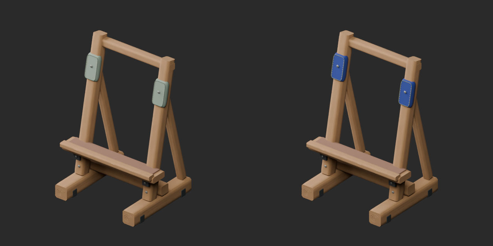
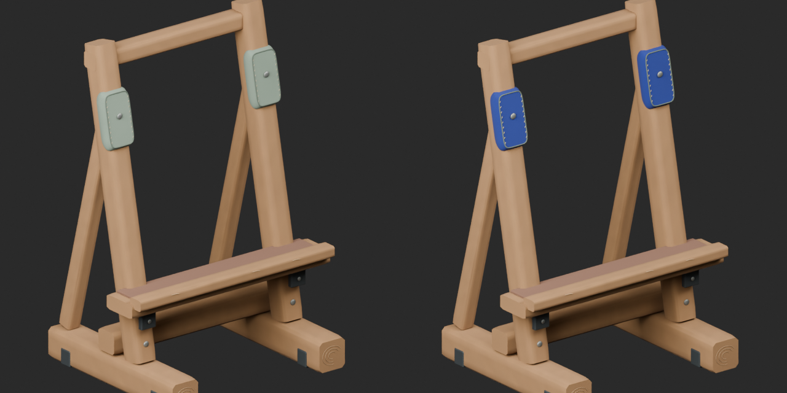
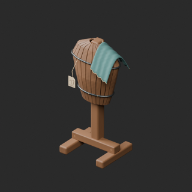
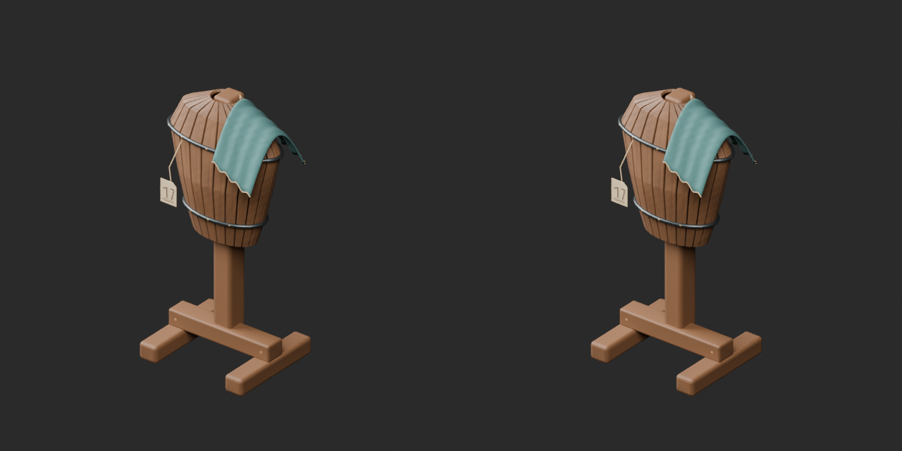
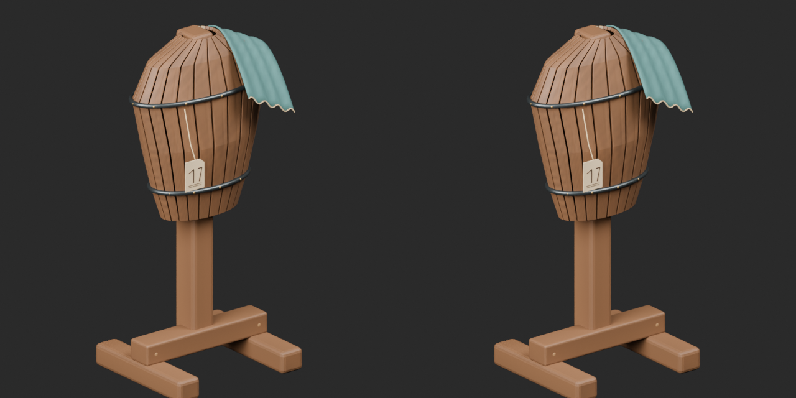
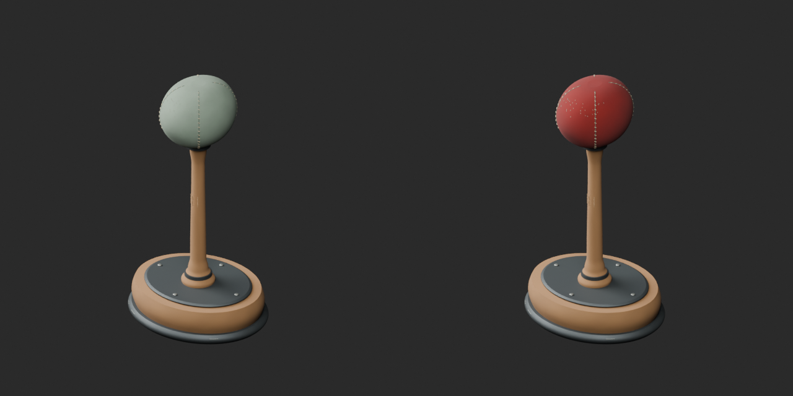
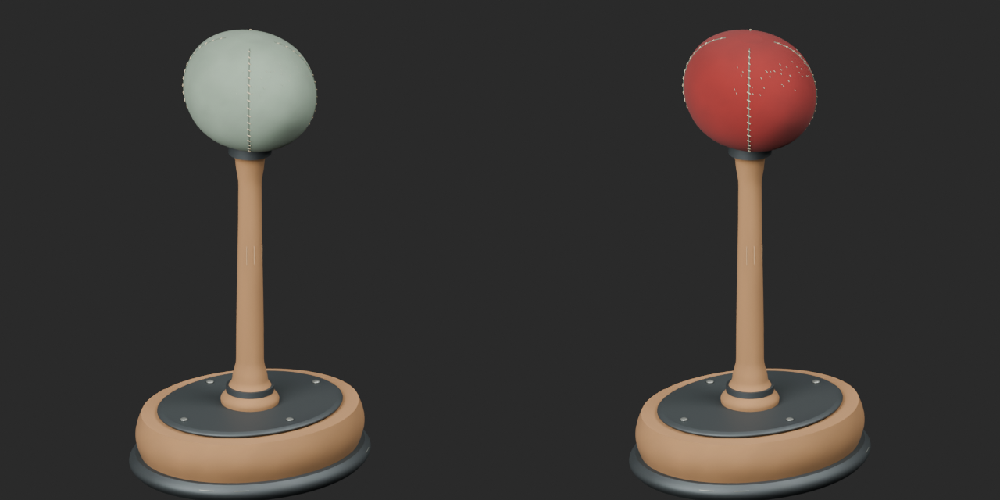
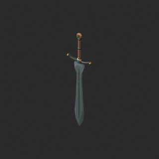
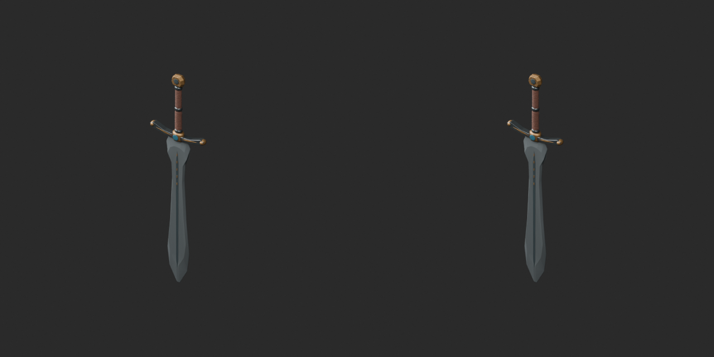
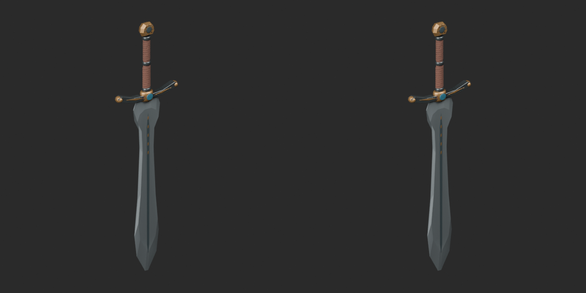

# Quality41 / 品質第41便 / 质量第41批

Base1008 unchanged; material variants151=149+2 separately. Two revisions add no base; originals retained.

ARM05240 and ARM06682 exact-zero triangles removed; positive surfaces, UV and vertex colors preserved. ARM05283072tri remains over50k furnishing warning; ARM06615386tri within20k portable warning,256 positive tiny triangles retained. ARM051 blue shield-stand felt and ARM053 red helmet-stand felt change basecolor via UV tint over original vertex shading; geometry/UV and other material channels unchanged.

改訂2件非加算、青/赤フェルトvariant2件別集計。家具50k・携行小物20kの用途区分は測定前に設定。2个修订不新增模型，2个毡垫颜色变体单独统计。家具和手持道具警告阈值不同，不代表性能保证。

Ten real IDs: ARM050,051,052,053,054,055,056,058,065,066. Missing IDs not assessed. Same camera/light/scale comparisons. Final-ZIP guard covers BLEND/GLB geometry/UV/spatial vertex-color correspondence. Four known bad missing-color fixtures rejected. Public ZIP/member hashes match the final guarded artifacts. Publication did not rerun Blender.

Assessed406 distribution records;602 remain;113 budget/redesign issues unresolved. Six new budget warnings: ARM052/054/055/065 furnishing50k;ARM056/058 portable20k. Racks and felt stands are within50k. Offset care-stone/receiver is an intentional component layout, not new model counts. Regular barrel grain remains. No load, functional fit, gameplay, rig, collision or Blender4.3.2 approval. Earlier diagnoses retained.

Models/embedded materials only CC0; images separate catalogue artwork. [License](../LICENSE.md). Private reports/code excluded.

## ARM_051__bluefelt — 革敷きの傾斜盾架

革敷きの傾斜盾架

Blue or red felt UV tint multiplied with original vertex colors. Geometry/UV/roughness/normal/emission unchanged. Not a new model or geometry repair.

[ZIP · BLEND/GLB](https://raw.githubusercontent.com/k3peta/tales-on-a-table/main/distributions/quality-arm050-066-v1/ARM_051__bluefelt_CC0.zip)

Left: original; right: accepted revision/variant, identical camera/light/scale.

## ARM_052__repair — 修理預かり防具架

修理預かり防具架

Exact-zero-area cleanup with positive surfaces, UV and vertex colors retained: ARM052 40 faces, ARM066 82 faces. ARM052 budget warning remains. No new base.

[ZIP · BLEND/GLB](https://raw.githubusercontent.com/k3peta/tales-on-a-table/main/distributions/quality-arm050-066-v1/ARM_052__repair_CC0.zip)

Left: original; right: accepted revision/variant, identical camera/light/scale.

## ARM_053__redfelt — フェルト頭の兜掛け

フェルト頭の兜掛け

Blue or red felt UV tint multiplied with original vertex colors. Geometry/UV/roughness/normal/emission unchanged. Not a new model or geometry repair.

[ZIP · BLEND/GLB](https://raw.githubusercontent.com/k3peta/tales-on-a-table/main/distributions/quality-arm050-066-v1/ARM_053__redfelt_CC0.zip)

Left: original; right: accepted revision/variant, identical camera/light/scale.

## ARM_066__repair — 日輪守の両手剣

日輪守の両手剣

Exact-zero-area cleanup with positive surfaces, UV and vertex colors retained: ARM052 40 faces, ARM066 82 faces. ARM052 budget warning remains. No new base.

[ZIP · BLEND/GLB](https://raw.githubusercontent.com/k3peta/tales-on-a-table/main/distributions/quality-arm050-066-v1/ARM_066__repair_CC0.zip)

Left: original; right: accepted revision/variant, identical camera/light/scale.

[Exact package validation evidence](../distributions/quality-arm050-066-v1/validation.json).
