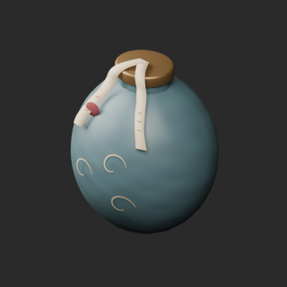
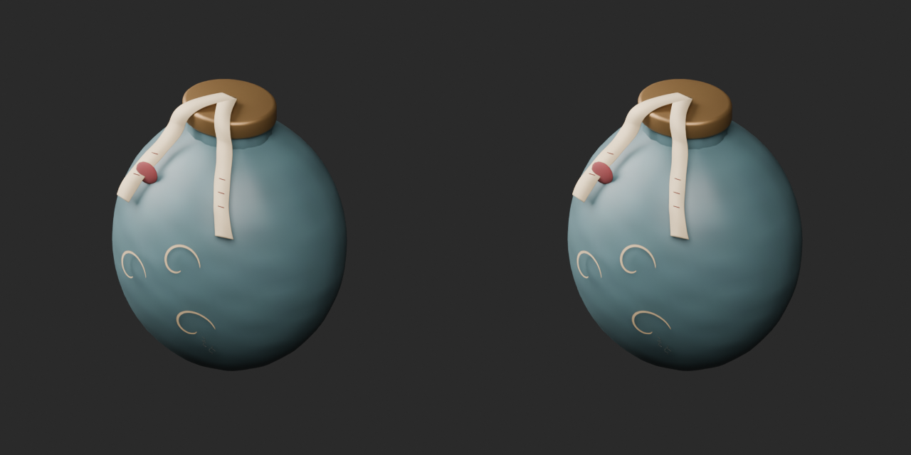
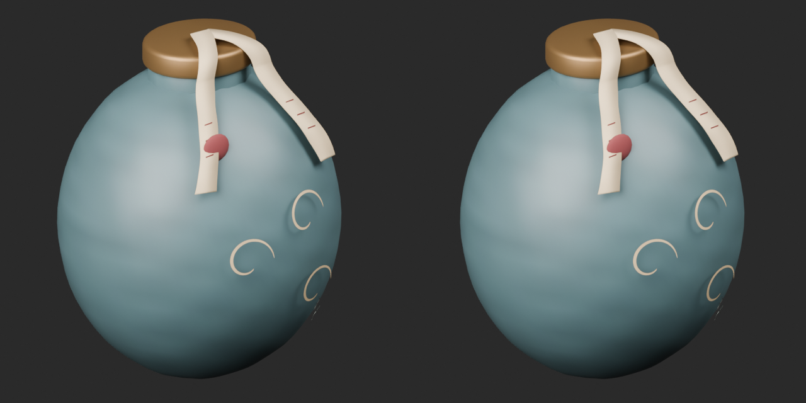
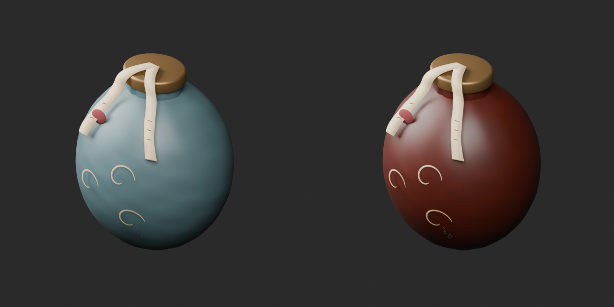
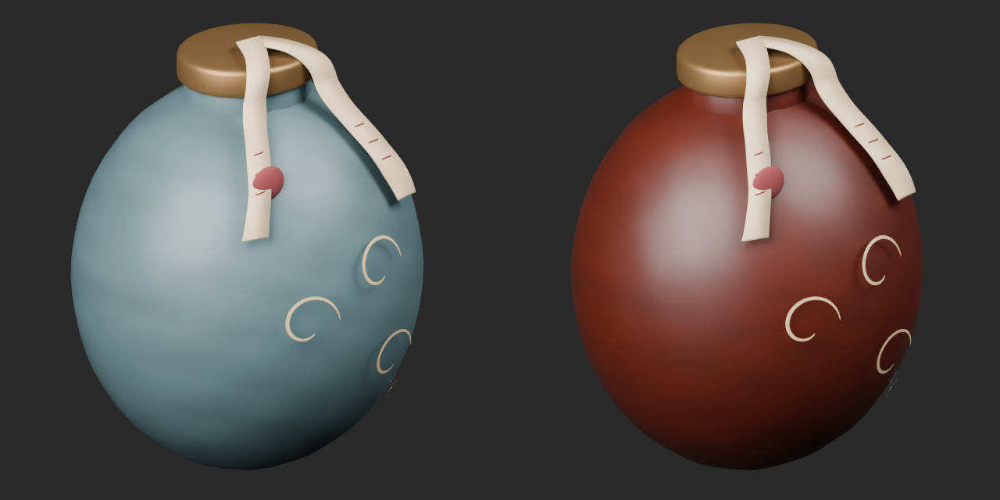
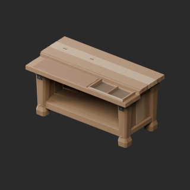
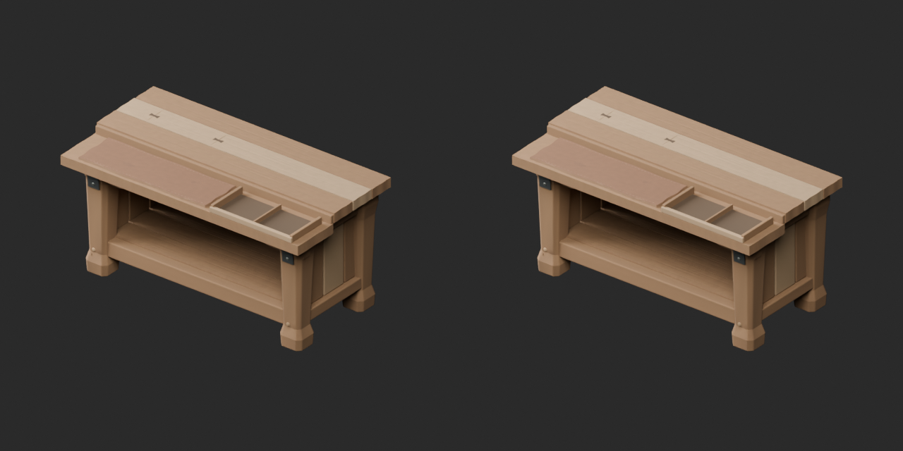
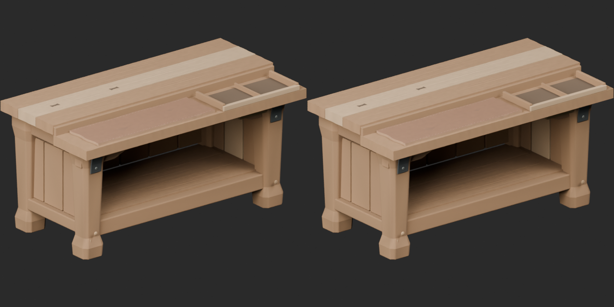

# Quality42 / 品質第42便 / 质量第42批

Base1008 unchanged; material variants152=151+1 separately. Two revisions add no base; originals retained.

ARM0686 and ARM076150 exact-zero triangles removed; positive surfaces, UV and vertex colors preserved. ARM068 terracotta ceramic exterior variant uses the cleaned8550-triangle baseline, NOT the whole original geometry unchanged. Ribbons and markings retained; no emission, functional contents or mechanism. Static fantasy display prop only. ARM07668518tri remains over50k furnishing warning.

改訂2件非加算、テラコッタ色variant1件別集計。色違いの形状UV比較基準はゼロ面除去後です。静的装飾模型で動作機構はありません。2个修订不新增模型，1个陶土色变体单独统计；变体以清理后的模型为基准。

Same camera/light/scale comparisons. Final-ZIP guard covers BLEND/GLB geometry/UV/spatial vertex colors, with four known bad color fixtures rejected. Public ZIP/member hashes match the final guarded artifacts. Publication did not rerun Blender.

Assessed416 distribution records;592 remain;122 budget issues unresolved. Nine new warnings, including ARM072272764tri strand geometry needing dedicated baking/redesign. Portable20k/counter50k warning thresholds assigned by use. Existing sheath fitting derivatives not newly independent shapes. No wearable fit, load, rig, gameplay, functional device behavior, collision or Blender4.3.2 approval. Earlier diagnoses retained.

Models/embedded materials only CC0; images separate catalogue artwork. [License](../LICENSE.md). Private reports/code excluded.

## ARM_068__repair — 封印煙玉の外見小道具

封印煙玉の外見小道具

Exact-zero-area cleanup preserving all positive surfaces, UV and vertex colors: ARM068 6 faces, ARM076 150 faces. ARM076 budget remains exceeded. No new base.

[ZIP · BLEND/GLB](https://raw.githubusercontent.com/k3peta/tales-on-a-table/main/distributions/quality-arm067-076-v1/ARM_068__repair_CC0.zip)

Left: original; right: accepted revision/variant, identical camera/light/scale.

## ARM_068__terracotta — 封印煙玉の外見小道具

封印煙玉の外見小道具

Terracotta-colored ceramic exterior UV tint on the ARM068 cleaned geometry baseline. Original positive geometry/UV/vertex colors retained; no emission or functional mechanism added. Static fantasy display prop only; not a new base or functional device.

[ZIP · BLEND/GLB](https://raw.githubusercontent.com/k3peta/tales-on-a-table/main/distributions/quality-arm067-076-v1/ARM_068__terracotta_CC0.zip)

Left: original; right: accepted revision/variant, identical camera/light/scale.

## ARM_076__repair — 店先の検品台

店先の検品台

Exact-zero-area cleanup preserving all positive surfaces, UV and vertex colors: ARM068 6 faces, ARM076 150 faces. ARM076 budget remains exceeded. No new base.

[ZIP · BLEND/GLB](https://raw.githubusercontent.com/k3peta/tales-on-a-table/main/distributions/quality-arm067-076-v1/ARM_076__repair_CC0.zip)

Left: original; right: accepted revision/variant, identical camera/light/scale.

[Exact package validation evidence](../distributions/quality-arm067-076-v1/validation.json).
