# Quality43 / 品質第43便 / 质量第43批

Base1008 unchanged; material variants153=152+1 separately. Eight revisions add no base; originals retained.

ARM0778, ARM079256 exact-zero faces removed, original colors retained. WH0016700/WH0021658/WH0031632/WH004764/WH0051040/WH0065820 zero faces removed, missing UV added. WH originals have no vertex colors: not color-attribute loss. All positive surfaces retained. Cyan crystal body variant uses repaired WH004 geometry/added-UV baseline, not unchanged whole original; transmission/emission unchanged, not liquid/bottle color.

改訂8件非加算、シアン結晶variant1件別集計。WHはUV追加あり、元頂点色なし。台付き鎧は複合記録、20枠棚は家具1件で武器20個ではありません。8个修订不新增模型；1个青色晶体变体单独统计。WH补充UV，原模型没有顶点色；展示组合和空架不拆分增加数量。

Same camera/light/scale comparisons. Final-ZIP guard checks BLEND/GLB geometry/UV/spatial vertex colors and rejects four old missing-color fixtures. Public ZIP/member hashes match the final guarded artifacts. Publication did not rerun Blender.

Assessed426 distribution records;582 remain;131 budget issues unresolved. Nine new warnings. Cold forge and decorative weapon props remain static: no functional mechanism, collision, rig, load, gameplay or Blender4.3.2 approval. ARM079 is below50k warning; other budget issues remain. Earlier diagnoses retained.

Models/embedded materials only CC0; images separate catalogue artwork. [License](../LICENSE.md). Private reports/code excluded.

## ARM_077__repair — 真鍮木製の古風レジ

真鍮木製の古風レジ

Exact-zero-area cleanup retains all positive surfaces and source vertex colors where present. Missing UV explicitly added for WH meshes; positive-face existing UV retained. Not a new base; budget remains where documented.

[ZIP · BLEND/GLB](https://raw.githubusercontent.com/k3peta/tales-on-a-table/main/distributions/quality-arm077-wh006-v1/ARM_077__repair_CC0.zip)

[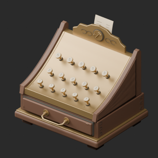](../previews/quality-arm077-wh006-v1/ARM_077__repair_thumb.png)

[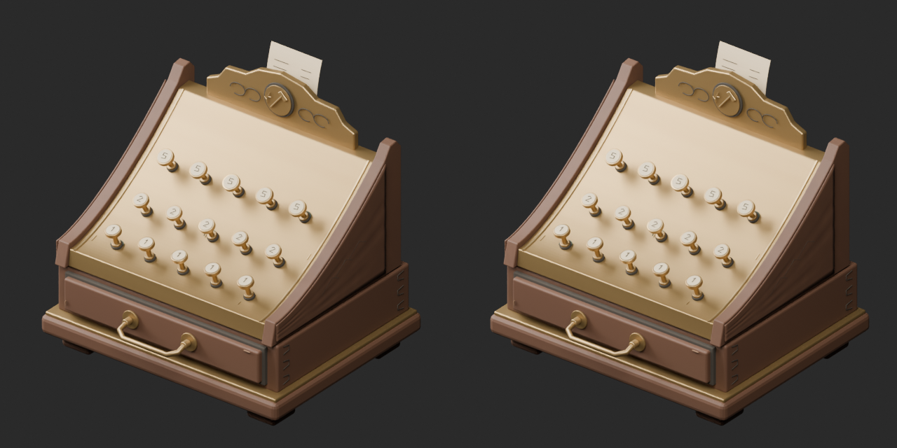](../previews/quality-arm077-wh006-v1/ARM_077__repair_overview_comparison.png)

[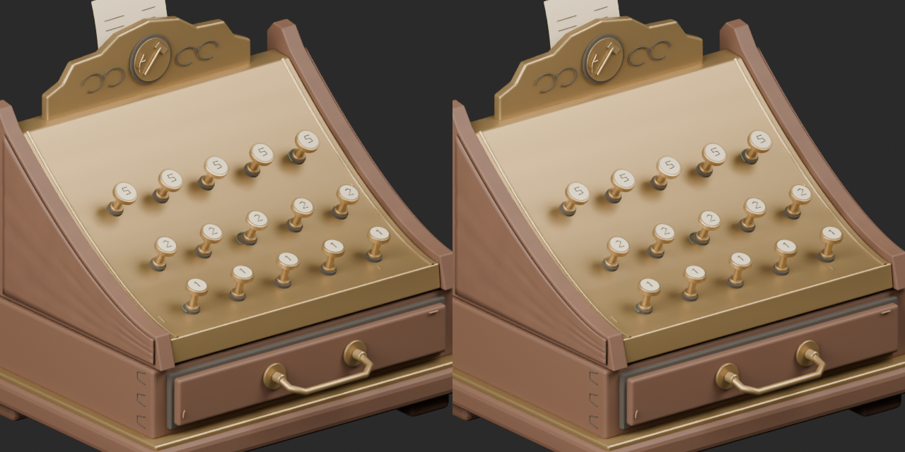](../previews/quality-arm077-wh006-v1/ARM_077__repair_close_comparison.png)

Left: original; right: accepted revision/variant, identical camera/light/scale.

## ARM_079__repair — 石造りの小修理炉

石造りの小修理炉

Exact-zero-area cleanup retains all positive surfaces and source vertex colors where present. Missing UV explicitly added for WH meshes; positive-face existing UV retained. Not a new base; budget remains where documented.

[ZIP · BLEND/GLB](https://raw.githubusercontent.com/k3peta/tales-on-a-table/main/distributions/quality-arm077-wh006-v1/ARM_079__repair_CC0.zip)

[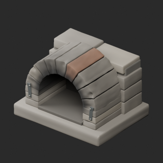](../previews/quality-arm077-wh006-v1/ARM_079__repair_thumb.png)

[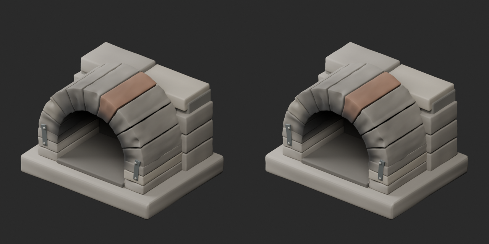](../previews/quality-arm077-wh006-v1/ARM_079__repair_overview_comparison.png)

[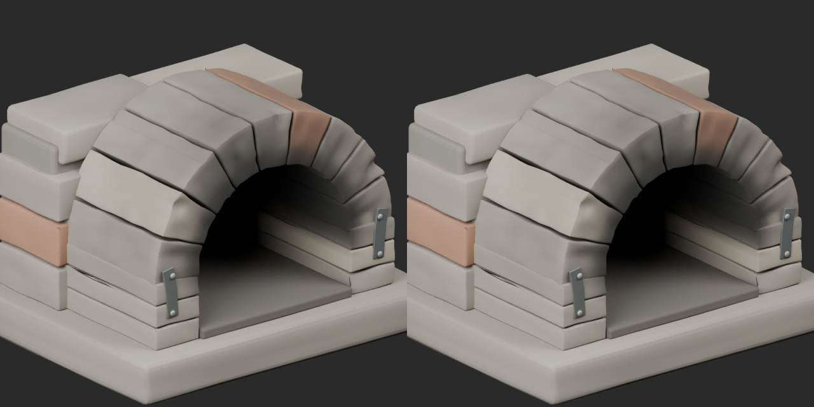](../previews/quality-arm077-wh006-v1/ARM_079__repair_close_comparison.png)

Left: original; right: accepted revision/variant, identical camera/light/scale.

## WH_NEW_001__repair — 値札付き全身鎧と鎧掛け

値札付き全身鎧と鎧掛け

Exact-zero-area cleanup retains all positive surfaces and source vertex colors where present. Missing UV explicitly added for WH meshes; positive-face existing UV retained. Not a new base; budget remains where documented.

[ZIP · BLEND/GLB](https://raw.githubusercontent.com/k3peta/tales-on-a-table/main/distributions/quality-arm077-wh006-v1/WH_NEW_001__repair_CC0.zip)

[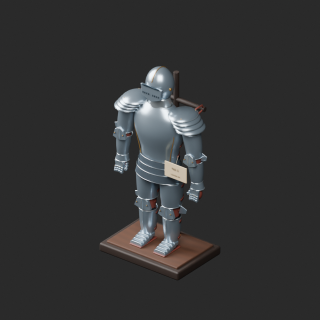](../previews/quality-arm077-wh006-v1/WH_NEW_001__repair_thumb.png)

[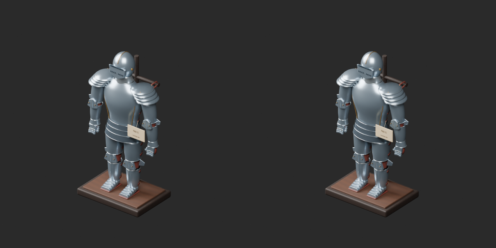](../previews/quality-arm077-wh006-v1/WH_NEW_001__repair_overview_comparison.png)

[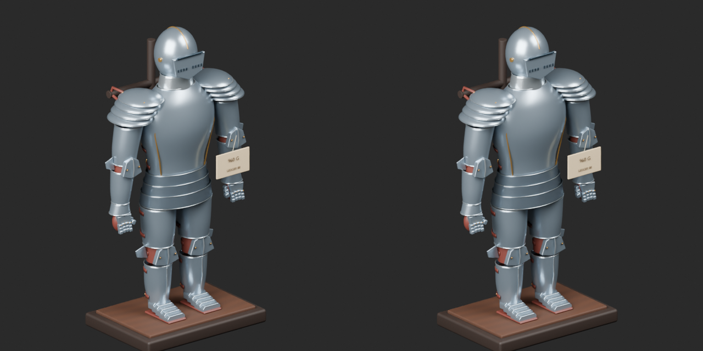](../previews/quality-arm077-wh006-v1/WH_NEW_001__repair_close_comparison.png)

Left: original; right: accepted revision/variant, identical camera/light/scale.

## WH_NEW_002__repair — 装飾用の大型弩

装飾用の大型弩

Exact-zero-area cleanup retains all positive surfaces and source vertex colors where present. Missing UV explicitly added for WH meshes; positive-face existing UV retained. Not a new base; budget remains where documented.

[ZIP · BLEND/GLB](https://raw.githubusercontent.com/k3peta/tales-on-a-table/main/distributions/quality-arm077-wh006-v1/WH_NEW_002__repair_CC0.zip)

[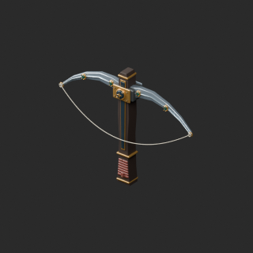](../previews/quality-arm077-wh006-v1/WH_NEW_002__repair_thumb.png)

[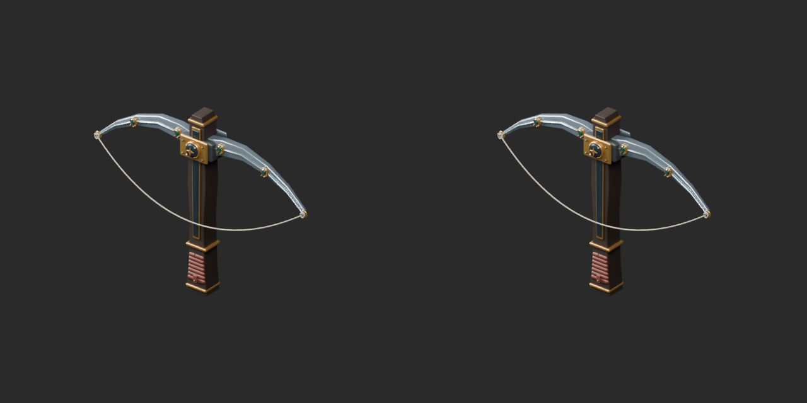](../previews/quality-arm077-wh006-v1/WH_NEW_002__repair_overview_comparison.png)

[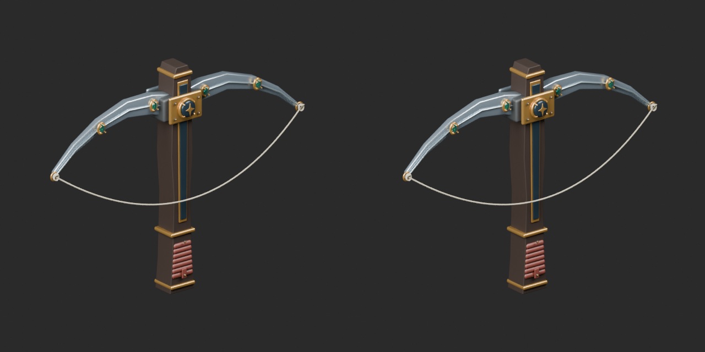](../previews/quality-arm077-wh006-v1/WH_NEW_002__repair_close_comparison.png)

Left: original; right: accepted revision/variant, identical camera/light/scale.

## WH_NEW_003__repair — 月輪の長柄武器

月輪の長柄武器

Exact-zero-area cleanup retains all positive surfaces and source vertex colors where present. Missing UV explicitly added for WH meshes; positive-face existing UV retained. Not a new base; budget remains where documented.

[ZIP · BLEND/GLB](https://raw.githubusercontent.com/k3peta/tales-on-a-table/main/distributions/quality-arm077-wh006-v1/WH_NEW_003__repair_CC0.zip)

[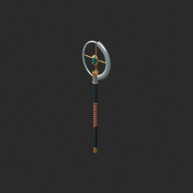](../previews/quality-arm077-wh006-v1/WH_NEW_003__repair_thumb.png)

[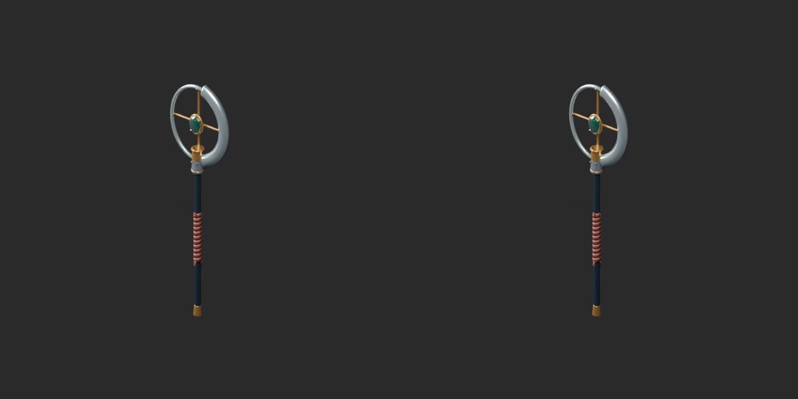](../previews/quality-arm077-wh006-v1/WH_NEW_003__repair_overview_comparison.png)

[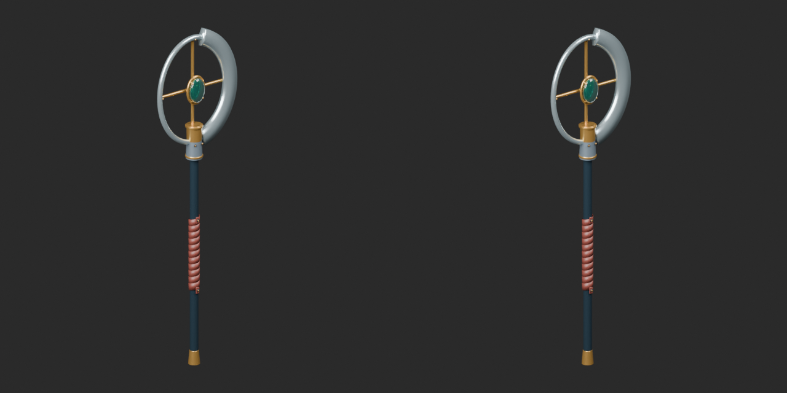](../previews/quality-arm077-wh006-v1/WH_NEW_003__repair_close_comparison.png)

Left: original; right: accepted revision/variant, identical camera/light/scale.

## WH_NEW_004__cyancrystal — 琥珀結晶の二股槍

琥珀結晶の二股槍

Cyan crystal body UV texture on cleaned WH_NEW004 geometry/UV baseline. Transmission/roughness/metallic/emission unchanged. Not liquid/bottle color or new base.

[ZIP · BLEND/GLB](https://raw.githubusercontent.com/k3peta/tales-on-a-table/main/distributions/quality-arm077-wh006-v1/WH_NEW_004__cyancrystal_CC0.zip)

[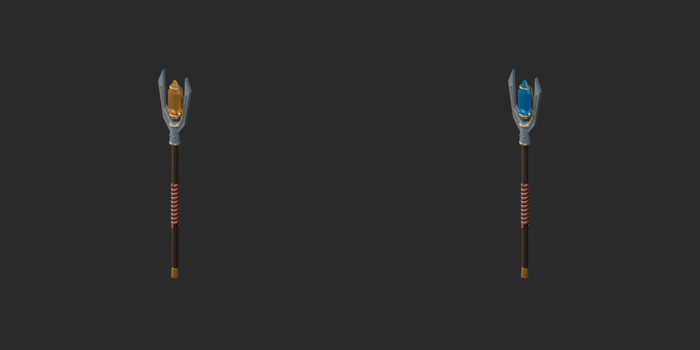](../previews/quality-arm077-wh006-v1/WH_NEW_004__cyancrystal_overview_comparison.png)

[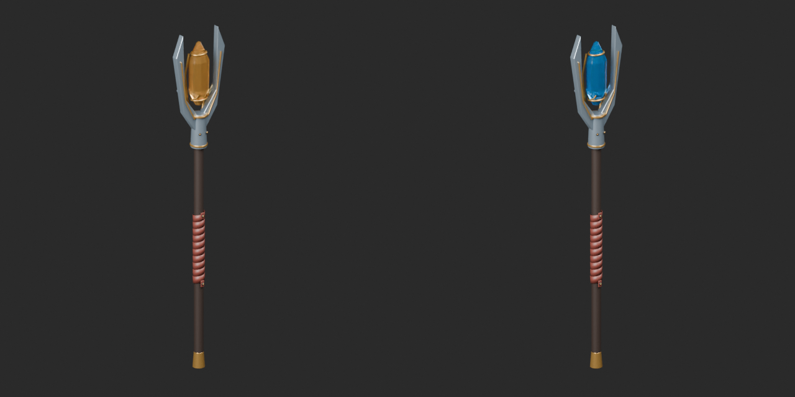](../previews/quality-arm077-wh006-v1/WH_NEW_004__cyancrystal_close_comparison.png)

Left: original; right: accepted revision/variant, identical camera/light/scale.

## WH_NEW_004__repair — 琥珀結晶の二股槍

琥珀結晶の二股槍

Exact-zero-area cleanup retains all positive surfaces and source vertex colors where present. Missing UV explicitly added for WH meshes; positive-face existing UV retained. Not a new base; budget remains where documented.

[ZIP · BLEND/GLB](https://raw.githubusercontent.com/k3peta/tales-on-a-table/main/distributions/quality-arm077-wh006-v1/WH_NEW_004__repair_CC0.zip)

[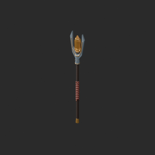](../previews/quality-arm077-wh006-v1/WH_NEW_004__repair_thumb.png)

[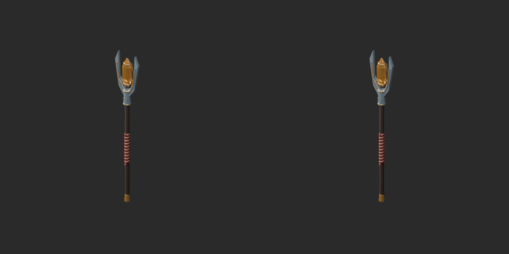](../previews/quality-arm077-wh006-v1/WH_NEW_004__repair_overview_comparison.png)

[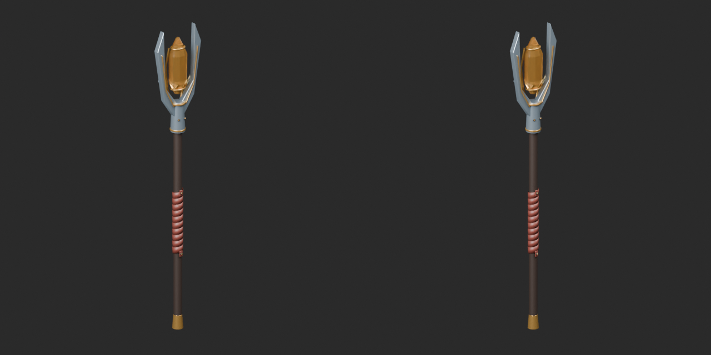](../previews/quality-arm077-wh006-v1/WH_NEW_004__repair_close_comparison.png)

Left: original; right: accepted revision/variant, identical camera/light/scale.

## WH_NEW_005__repair — 天球儀のメイス

天球儀のメイス

Exact-zero-area cleanup retains all positive surfaces and source vertex colors where present. Missing UV explicitly added for WH meshes; positive-face existing UV retained. Not a new base; budget remains where documented.

[ZIP · BLEND/GLB](https://raw.githubusercontent.com/k3peta/tales-on-a-table/main/distributions/quality-arm077-wh006-v1/WH_NEW_005__repair_CC0.zip)

[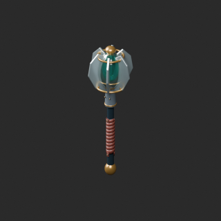](../previews/quality-arm077-wh006-v1/WH_NEW_005__repair_thumb.png)

[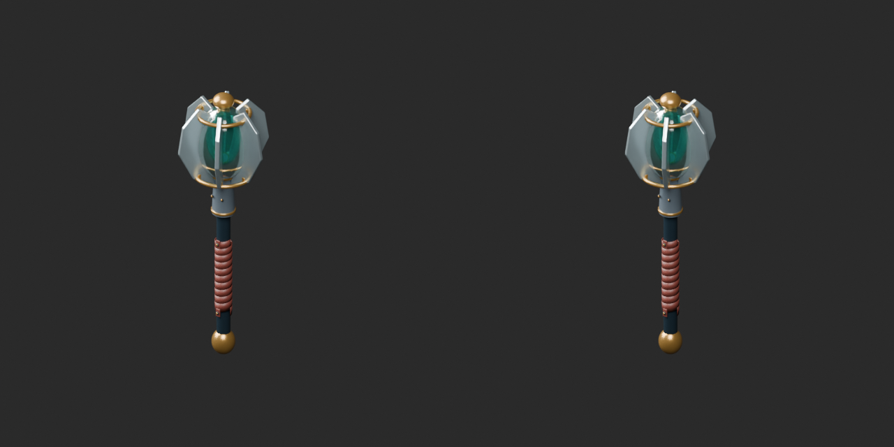](../previews/quality-arm077-wh006-v1/WH_NEW_005__repair_overview_comparison.png)

[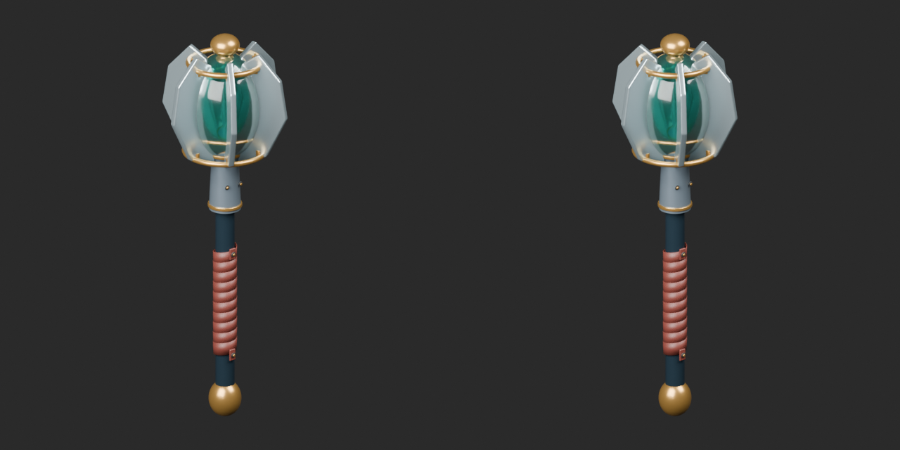](../previews/quality-arm077-wh006-v1/WH_NEW_005__repair_close_comparison.png)

Left: original; right: accepted revision/variant, identical camera/light/scale.

## WH_NEW_006__repair — 二段20本剣ラック

二段20本剣ラック

Exact-zero-area cleanup retains all positive surfaces and source vertex colors where present. Missing UV explicitly added for WH meshes; positive-face existing UV retained. Not a new base; budget remains where documented.

[ZIP · BLEND/GLB](https://raw.githubusercontent.com/k3peta/tales-on-a-table/main/distributions/quality-arm077-wh006-v1/WH_NEW_006__repair_CC0.zip)

[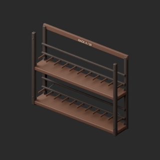](../previews/quality-arm077-wh006-v1/WH_NEW_006__repair_thumb.png)

[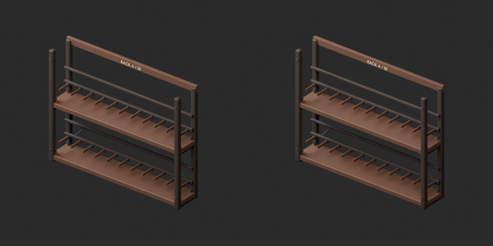](../previews/quality-arm077-wh006-v1/WH_NEW_006__repair_overview_comparison.png)

[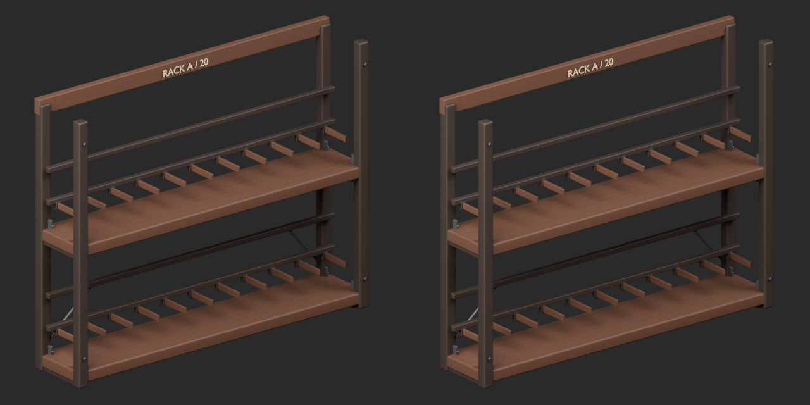](../previews/quality-arm077-wh006-v1/WH_NEW_006__repair_close_comparison.png)

Left: original; right: accepted revision/variant, identical camera/light/scale.

[Exact package validation evidence](../distributions/quality-arm077-wh006-v1/validation.json).
