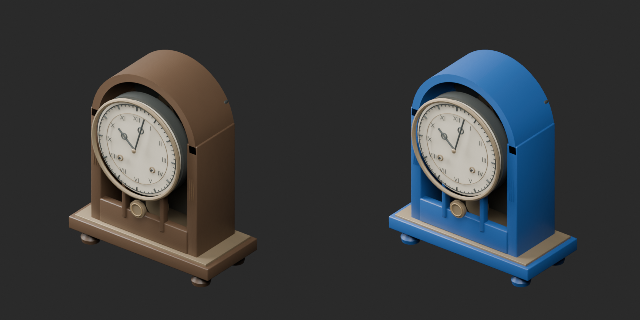
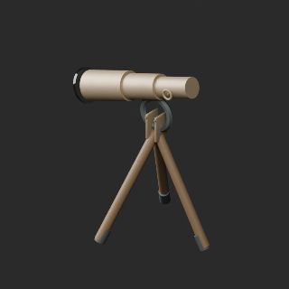
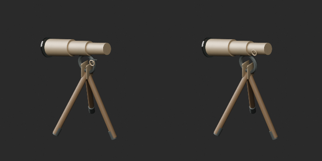
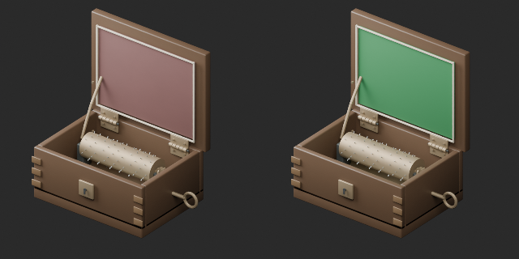
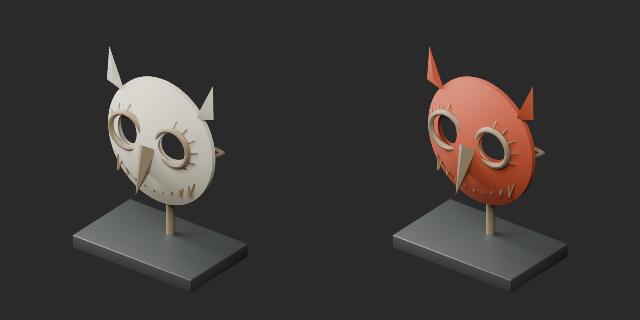

# AT002–011 quality batch 19 / 品質第19便 / 质量第19批

**Base distribution records1008 unchanged; material variants111=108+3 counted separately. One geometry revision adds no record.**

Three same-geometry color variants: AT002 blue-painted clock case, AT008 green music-box lining, AT011 terracotta owl-mask surface. Dial, hands, fittings, cylinder, silhouette, openings and original UV retained. No glass/liquid/emission change.

AT004 revision moves floating focus shaft/wheel and ten rack teeth by (0,+0.012,+0.070) metres towards the telescope tube. Original4340 triangles, UV and outer dimensions retained; positions changed. Baseline focus_mount_position_v1. It is a static depiction, not a working optical instrument or verified mechanism.

基本1008不変、色variant3を別追加し111。時計木部青、オルゴール内張り緑、梟仮面テラコッタ。AT004調節部品の位置修正は形状改訂で非加算。同形色違いと混同しません。旧版保持。累计査定186/1008、未査定822。独立形状数ではありません。

基础1008保持，颜色变体111单独统计。望远镜调节部件位置修订不加新数；不是可动或光学功能认证。

Producer final4 candidates×2 formats reimport: coordinate/UV error0 against original or AT004 revised baseline. Embedded images decoded; material optical parameters retained. Cumulative186 assessed distribution records,822 unassessed. Old defects remain open. Game collision, working mechanisms, walking, structural safety and Blender4.3.2 compatibility unverified.

モデル/埋込材質のみCC0。画像は閲覧用でモデルCC0対象外、[既存画像権利](../LICENSE.md)維持。代码图片私有査定不属模型CC0。

## AT_002__color_blue — 止まった置時計

material_variant · [ZIP · BLEND/GLB](https://raw.githubusercontent.com/k3peta/tales-on-a-table/main/distributions/quality-at002-011-v1/AT_002__color_blue_CC0.zip)

[拡大 / Full image](https://raw.githubusercontent.com/k3peta/tales-on-a-table/main/previews/quality-at002-011-v1/AT_002__color_blue_thumb.png)

[拡大 / Full image](https://raw.githubusercontent.com/k3peta/tales-on-a-table/main/previews/quality-at002-011-v1/AT_002__color_blue_comparison.png)

left: original base; right: accepted variant; same overview camera

## AT_004__repair — 三脚望遠鏡

revision · [ZIP · BLEND/GLB](https://raw.githubusercontent.com/k3peta/tales-on-a-table/main/distributions/quality-at002-011-v1/AT_004__repair_CC0.zip)

[拡大 / Full image](https://raw.githubusercontent.com/k3peta/tales-on-a-table/main/previews/quality-at002-011-v1/AT_004__repair_thumb.png)

[拡大 / Full image](https://raw.githubusercontent.com/k3peta/tales-on-a-table/main/previews/quality-at002-011-v1/AT_004__repair_comparison.png)

left: original base; right: accepted variant; same overview camera

## AT_008__color_green — 開いたオルゴール

material_variant · [ZIP · BLEND/GLB](https://raw.githubusercontent.com/k3peta/tales-on-a-table/main/distributions/quality-at002-011-v1/AT_008__color_green_CC0.zip)

[拡大 / Full image](https://raw.githubusercontent.com/k3peta/tales-on-a-table/main/previews/quality-at002-011-v1/AT_008__color_green_thumb.png)

[拡大 / Full image](https://raw.githubusercontent.com/k3peta/tales-on-a-table/main/previews/quality-at002-011-v1/AT_008__color_green_comparison.png)

left: original base; right: accepted variant; same overview camera

## AT_011__color_terracotta — 梟の遺物仮面

material_variant · [ZIP · BLEND/GLB](https://raw.githubusercontent.com/k3peta/tales-on-a-table/main/distributions/quality-at002-011-v1/AT_011__color_terracotta_CC0.zip)

[拡大 / Full image](https://raw.githubusercontent.com/k3peta/tales-on-a-table/main/previews/quality-at002-011-v1/AT_011__color_terracotta_thumb.png)

[拡大 / Full image](https://raw.githubusercontent.com/k3peta/tales-on-a-table/main/previews/quality-at002-011-v1/AT_011__color_terracotta_comparison.png)

left: original base; right: accepted variant; same overview camera
