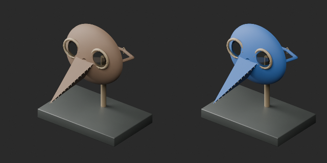
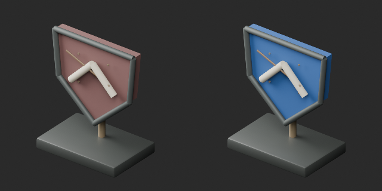
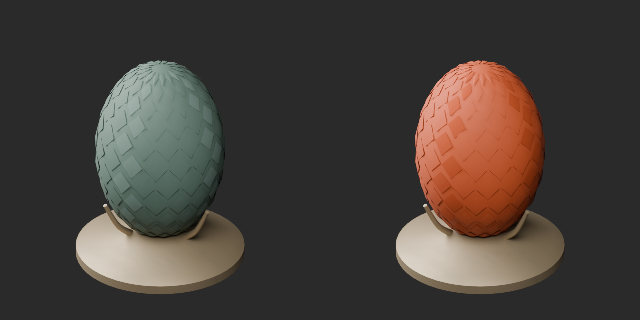

# AT012–021 quality batch20 / 品質第20便 / 质量第20批

**Base distribution records1008 unchanged; material variants114=111+3 counted separately.**

Three same-geometry variants: AT012 raven-mask leather blue; AT017 shield ground blue; AT020 dragon-egg surface copper-colored. Original lenses, fittings, scratches, heraldry, scales, stands and support geometry retained. Basecolor changes only; optical material parameters unchanged. Copper-colored does not mean newly simulated copper metal.

基本1008不変、色variant3を別追加。渡鴉仮面青・盾青・竜の卵銅色系。幾何・元UV保持。AT013竜47028tri、AT019頭骨93574triは小物20k予算超過で未修復。隠さず残件として維持。

基础1008保持，3颜色变体单独统计。AT013龙47028与AT019头骨93574三角形超出小物20k预算，尚未修复。

Producer6 format reimports checked against original geometry/UV. Cumulative196/1008 distribution records assessed,812 unassessed; not unique shapes. Focused PM/WM5 repairs not added again. Old sources and outstanding defects retained. Game performance/collision, operation, strength and Blender4.3.2 compatibility unverified.

モデル/埋込材質のみCC0。画像は閲覧用でモデルCC0対象外、[既存画像権利](../LICENSE.md)維持。代码图片私有査定不属模型CC0。

## AT_012__color_blue — 渡鴉の行列仮面

material_variant · [ZIP · BLEND/GLB](https://raw.githubusercontent.com/k3peta/tales-on-a-table/main/distributions/quality-at012-021-v1/AT_012__color_blue_CC0.zip)

[拡大 / Full image](https://raw.githubusercontent.com/k3peta/tales-on-a-table/main/previews/quality-at012-021-v1/AT_012__color_blue_thumb.png)

[拡大 / Full image](https://raw.githubusercontent.com/k3peta/tales-on-a-table/main/previews/quality-at012-021-v1/AT_012__color_blue_comparison.png)

left: original base; right: accepted variant; same overview camera

## AT_017__color_blue — 傷だらけの盾

material_variant · [ZIP · BLEND/GLB](https://raw.githubusercontent.com/k3peta/tales-on-a-table/main/distributions/quality-at012-021-v1/AT_017__color_blue_CC0.zip)

[拡大 / Full image](https://raw.githubusercontent.com/k3peta/tales-on-a-table/main/previews/quality-at012-021-v1/AT_017__color_blue_thumb.png)

[拡大 / Full image](https://raw.githubusercontent.com/k3peta/tales-on-a-table/main/previews/quality-at012-021-v1/AT_017__color_blue_comparison.png)

left: original base; right: accepted variant; same overview camera

## AT_020__color_copper — 台座に据えた竜の卵

material_variant · [ZIP · BLEND/GLB](https://raw.githubusercontent.com/k3peta/tales-on-a-table/main/distributions/quality-at012-021-v1/AT_020__color_copper_CC0.zip)

[拡大 / Full image](https://raw.githubusercontent.com/k3peta/tales-on-a-table/main/previews/quality-at012-021-v1/AT_020__color_copper_thumb.png)

[拡大 / Full image](https://raw.githubusercontent.com/k3peta/tales-on-a-table/main/previews/quality-at012-021-v1/AT_020__color_copper_comparison.png)

left: original base; right: accepted variant; same overview camera
