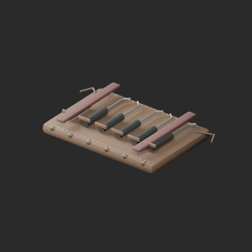
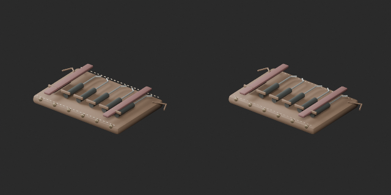
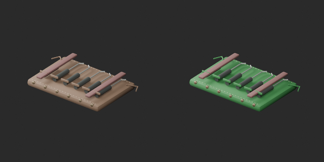

# AT022–031 quality batch21 / 品質第21便 / 质量第21批

**Base distribution records1008 unchanged; material variants116=114+2 counted separately. One geometry revision adds no record.**

AT031:48 floating stitches moved10mm towards the centre and6mm downward, seating them on the roll surface. Producer ray checks found at least2.4mm overlap. Mesh topology, UV, tools and overall bounds retained; stitch positions changed. Revised geometry baseline stitch_seating_v1. Green leather variant preserves this repaired baseline, not the unrepaired original. Old versions and downloads retained.

AT022 red spellbook cover retains paper, chains, fittings and jewel. AT031 green leather retains tools/fittings. No glass/liquid/emission changes. Existing AT025 liquid variants are not republished or recounted.

基本1008不変、赤魔導書と修復後緑巻袋の色variant2を別追加。縫目48本修復は改訂で非加算。AT028木目修復・青色候補は改善不十分で不採用、公開しません。粗木目は未修復。AT027暗い占視材質は資料根拠あり、暗いだけで欠面とは断定しません。

基础1008保持。新增2个颜色变体单独统计；绿卷袋以修复后形状为基准。AT028木纹与蓝色候选未采用、不发布。

Cumulative206/1008 distribution records assessed,802 unassessed; not unique shapes. Producer BLEND/GLB geometry/UV and packed-image checks verified for the3accepted packages only. AT028 rejected attempts excluded. Earlier poly-budget exceedances and unresolved WT007/008 dark cut ends remain open. Sewing strength, physics/collision, operation and Blender4.3.2 compatibility unverified.

モデル/埋込材質のみCC0。画像は閲覧用でモデルCC0対象外、[既存画像権利](../LICENSE.md)維持。代码图片私有査定不属模型CC0。

## AT_022__color_red — 鎖で閉じた魔導書

material_variant · [ZIP · BLEND/GLB](https://raw.githubusercontent.com/k3peta/tales-on-a-table/main/distributions/quality-at022-031-v1/AT_022__color_red_CC0.zip)

[拡大 / Full image](https://raw.githubusercontent.com/k3peta/tales-on-a-table/main/previews/quality-at022-031-v1/AT_022__color_red_thumb.png)

[拡大 / Full image](https://raw.githubusercontent.com/k3peta/tales-on-a-table/main/previews/quality-at022-031-v1/AT_022__color_red_comparison.png)

left: original base; right: accepted revision/variant; same overview camera

## AT_031__repair — 古い工具の巻き袋

revision · [ZIP · BLEND/GLB](https://raw.githubusercontent.com/k3peta/tales-on-a-table/main/distributions/quality-at022-031-v1/AT_031__repair_CC0.zip)

[拡大 / Full image](https://raw.githubusercontent.com/k3peta/tales-on-a-table/main/previews/quality-at022-031-v1/AT_031__repair_thumb.png)

[拡大 / Full image](https://raw.githubusercontent.com/k3peta/tales-on-a-table/main/previews/quality-at022-031-v1/AT_031__repair_comparison.png)

left: original base; right: accepted revision/variant; same overview camera

## AT_031__color_green — 古い工具の巻き袋

material_variant · [ZIP · BLEND/GLB](https://raw.githubusercontent.com/k3peta/tales-on-a-table/main/distributions/quality-at022-031-v1/AT_031__color_green_CC0.zip)

[拡大 / Full image](https://raw.githubusercontent.com/k3peta/tales-on-a-table/main/previews/quality-at022-031-v1/AT_031__color_green_thumb.png)

[拡大 / Full image](https://raw.githubusercontent.com/k3peta/tales-on-a-table/main/previews/quality-at022-031-v1/AT_031__color_green_comparison.png)

left: repaired stitch_seating_v1; right: same-geometry green variant
