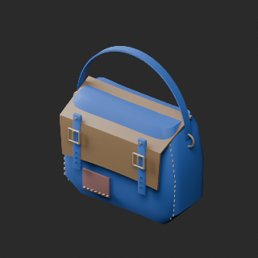
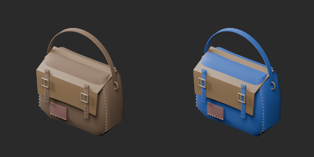
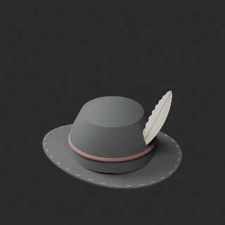
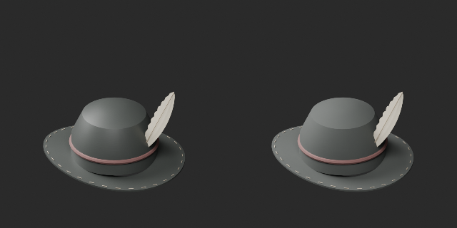
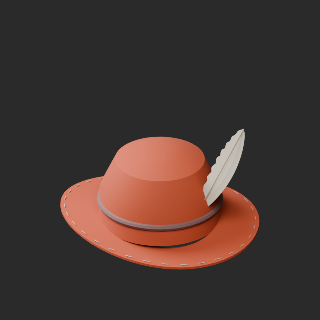
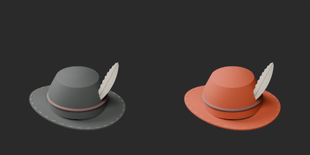
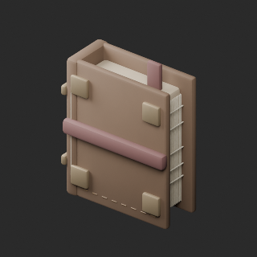
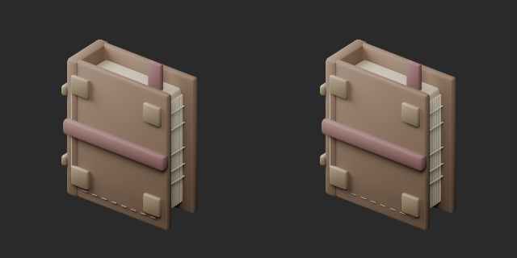
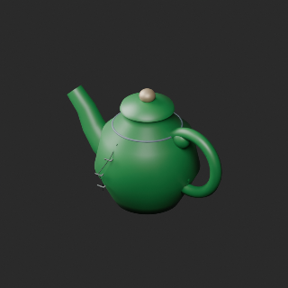
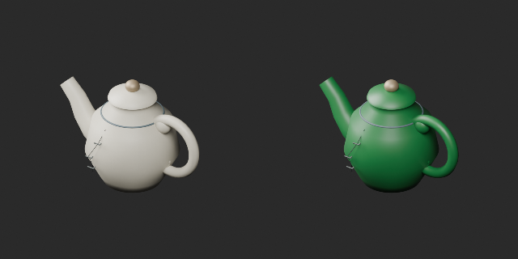

# AT032–041 quality batch22 / 品質第22便 / 质量第22批

**Base distribution records1008 unchanged; material variants119=116+3 counted separately. Two revisions do not add records.**

AT034 hat: removed inappropriate wood-grain normal and set roughness0.85, retaining original shape/UV/base color. Orange hat variant uses this repaired material baseline. AT038 diary:8front stitches moved+Y3mm to seat against leather; topology/UV retained, positions revised (front_stitch_seating_v1).

Three color variants: AT033 blue leather bag retaining wooden flap/fittings/patch; AT034 orange repaired-material hat; AT041 green ceramic glaze retaining cracks/repair staples. No new base shapes.

基本1008維持、帽子材質改訂と日記縫目修復は非加算。鞄青/材質修復後帽子橙/陶器緑のvariant3を別追加。AT032は36920triで小物20k予算超過・未修復。累積査定216、未査定792。独立形状数ではありません。

基础1008保持，修订2不加新数。颜色变体3单独统计。AT032的36920三角形超预算，未修复。累计査定216、剩余792。

Producer final10format reimports against original or revised references checked. Color variants retain geometry/UV; this is not a claim that the diary repair preserves original positions. Hat normal/roughness intentionally change. Earlier poly-budget defects remain open. Operation, walking/collision, strength and Blender4.3.2 compatibility unverified.

モデル/埋込材質のみCC0。画像は閲覧用でモデルCC0対象外、[既存画像権利](../LICENSE.md)維持。代码图片私有査定不属模型CC0。

## AT_033__color_blue — 継ぎ当て旅鞄

material_variant · [ZIP · BLEND/GLB](https://raw.githubusercontent.com/k3peta/tales-on-a-table/main/distributions/quality-at032-041-v1/AT_033__color_blue_CC0.zip)

[拡大 / Full image](https://raw.githubusercontent.com/k3peta/tales-on-a-table/main/previews/quality-at032-041-v1/AT_033__color_blue_thumb.png)

[拡大 / Full image](https://raw.githubusercontent.com/k3peta/tales-on-a-table/main/previews/quality-at032-041-v1/AT_033__color_blue_comparison.png)

left: reference (AT034 orange uses material repair); right: accepted; same overview camera

## AT_034__repair — 羽飾りの古帽子

revision · [ZIP · BLEND/GLB](https://raw.githubusercontent.com/k3peta/tales-on-a-table/main/distributions/quality-at032-041-v1/AT_034__repair_CC0.zip)

[拡大 / Full image](https://raw.githubusercontent.com/k3peta/tales-on-a-table/main/previews/quality-at032-041-v1/AT_034__repair_thumb.png)

[拡大 / Full image](https://raw.githubusercontent.com/k3peta/tales-on-a-table/main/previews/quality-at032-041-v1/AT_034__repair_comparison.png)

left: reference (AT034 orange uses material repair); right: accepted; same overview camera

## AT_034__color_orange — 羽飾りの古帽子

material_variant · [ZIP · BLEND/GLB](https://raw.githubusercontent.com/k3peta/tales-on-a-table/main/distributions/quality-at032-041-v1/AT_034__color_orange_CC0.zip)

[拡大 / Full image](https://raw.githubusercontent.com/k3peta/tales-on-a-table/main/previews/quality-at032-041-v1/AT_034__color_orange_thumb.png)

[拡大 / Full image](https://raw.githubusercontent.com/k3peta/tales-on-a-table/main/previews/quality-at032-041-v1/AT_034__color_orange_comparison.png)

left: reference (AT034 orange uses material repair); right: accepted; same overview camera

## AT_038__repair — 縫い綴じの旅日記

revision · [ZIP · BLEND/GLB](https://raw.githubusercontent.com/k3peta/tales-on-a-table/main/distributions/quality-at032-041-v1/AT_038__repair_CC0.zip)

[拡大 / Full image](https://raw.githubusercontent.com/k3peta/tales-on-a-table/main/previews/quality-at032-041-v1/AT_038__repair_thumb.png)

[拡大 / Full image](https://raw.githubusercontent.com/k3peta/tales-on-a-table/main/previews/quality-at032-041-v1/AT_038__repair_comparison.png)

left: reference (AT034 orange uses material repair); right: accepted; same overview camera

## AT_041__color_green — ひびの入った陶器ポット

material_variant · [ZIP · BLEND/GLB](https://raw.githubusercontent.com/k3peta/tales-on-a-table/main/distributions/quality-at032-041-v1/AT_041__color_green_CC0.zip)

[拡大 / Full image](https://raw.githubusercontent.com/k3peta/tales-on-a-table/main/previews/quality-at032-041-v1/AT_041__color_green_thumb.png)

[拡大 / Full image](https://raw.githubusercontent.com/k3peta/tales-on-a-table/main/previews/quality-at032-041-v1/AT_041__color_green_comparison.png)

left: reference (AT034 orange uses material repair); right: accepted; same overview camera
