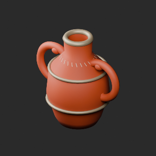
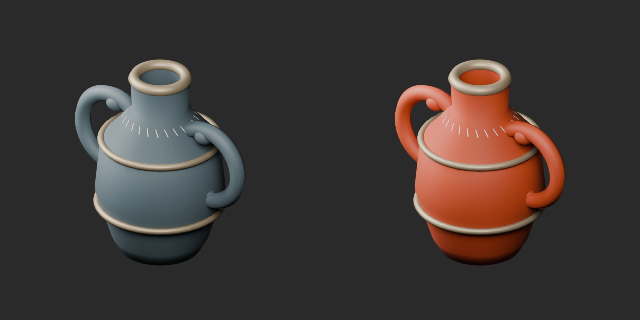
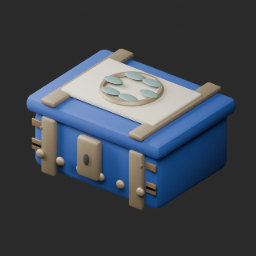
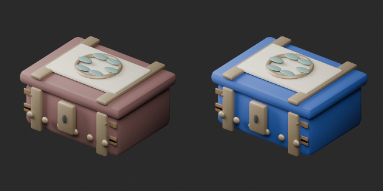

# AT042–051 quality batch23 / 品質第23便 / 质量第23批

**Base1008 unchanged; material variants121=119+2 counted separately.**

AT043 orange amphora ceramic retains fittings, ornament, geometry and UV. AT051 blue jewel-box exterior retains inlay, fittings, interior, geometry and UV. New bases0, revisions0. Same-geometry color variants are not defect repairs.

基本1008維持、アンフォラ橙/宝石箱青の色variant2別追加。AT050ポリ予算超過、AT042杯内部装飾の断面診断は未解決。全件査定226、未査定782。独立形状数ではありません。旧版・既存残件を保持。

基础1008保持，2颜色变体单独统计。AT050超多边形预算、AT042内部断面待诊断仍未解决。累计査定226，剩余782。

Producer4 format reimports checked; optical material properties retained. Actual function, collision and Blender4.3.2 compatibility unverified. WT correction is separately tracked, not added to cumulative assessment or base/variant counts.

モデル/埋込材質のみCC0。画像は閲覧用でモデルCC0対象外、[既存画像権利](../LICENSE.md)維持。代码图片私有査定不属模型CC0。

## AT_043__color_orange — 青い双耳アンフォラ

material_variant · [ZIP · BLEND/GLB](https://raw.githubusercontent.com/k3peta/tales-on-a-table/main/distributions/quality-at042-051-v1/AT_043__color_orange_CC0.zip)

[拡大 / Full image](https://raw.githubusercontent.com/k3peta/tales-on-a-table/main/previews/quality-at042-051-v1/AT_043__color_orange_thumb.png)

[拡大 / Full image](https://raw.githubusercontent.com/k3peta/tales-on-a-table/main/previews/quality-at042-051-v1/AT_043__color_orange_comparison.png)

left: original; right: accepted; same overview camera

## AT_051__color_blue — 螺鈿の宝石箱

material_variant · [ZIP · BLEND/GLB](https://raw.githubusercontent.com/k3peta/tales-on-a-table/main/distributions/quality-at042-051-v1/AT_051__color_blue_CC0.zip)

[拡大 / Full image](https://raw.githubusercontent.com/k3peta/tales-on-a-table/main/previews/quality-at042-051-v1/AT_051__color_blue_thumb.png)

[拡大 / Full image](https://raw.githubusercontent.com/k3peta/tales-on-a-table/main/previews/quality-at042-051-v1/AT_051__color_blue_comparison.png)

left: original; right: accepted; same overview camera
