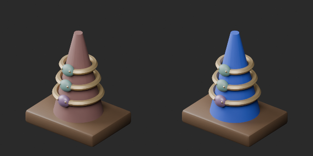
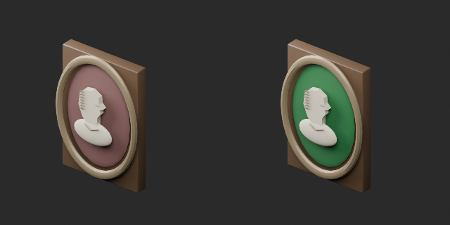
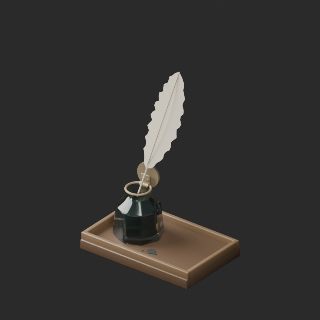
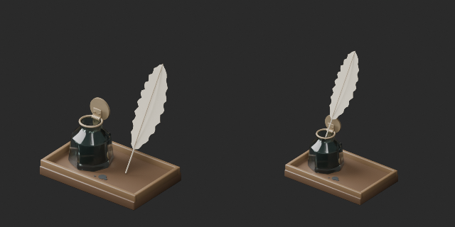
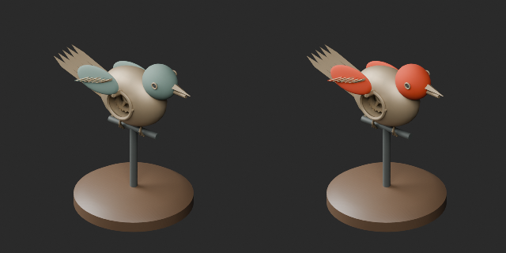

# AT052–061 quality batch24 / 品質第24便 / 质量第24批

**Base1008 unchanged; material variants124=121+3 counted separately. One placement revision is not a new model.**

Blue ring-display textile, green cameo background and orange mechanical-bird finish retain their original geometry and UV. AT056 quill and nib are translated into the inkwell; this is a placement revision, preserving topology and UV. Variant comparisons use identical camera and lighting. The quill comparison uses the same view direction but independently framed images because its height changed; it is not an equal-scale comparison.

基本1008を保持。青い指輪台・緑のカメオ背景・橙の鳥の同形色variant3を別集計。羽根ペンとペン先の配置改訂1は非加算。高さが変わるため羽根ペン比較は左右別の画角調整、同一縮尺ではありません。旧版を保持。

基础1008保持，新增3个同形颜色变体单独统计。羽毛笔位置修订不计新增。羽毛笔对比方向相同、取景分别调整，并非相同比例。

Producer final-ZIP guard binds package/member/input/verifier hashes, run ID, timestamps and Blender5.2.2. Public artifact matching is pending. Publication does not claim a separate Blender rerun. Cumulative236 assessed distribution records,772 remaining;41 budget/redesign issues remain, including AT058 at98392 triangles. Ten FW material/image holds tracked separately. Gameplay, continuous collision, balance, optical behavior and Blender4.3.2 compatibility unverified.

Models and embedded materials only: CC0-1.0. Images are catalogue artwork outside modelCC0; [license scope](../LICENSE.md). Code/private reports are not distributed.

## AT_052__color_blue — Velvet ring stand

指輪のベルベット台

Ring stand textile: oxblood to clear blue; rings and gems retained.

[ZIP · BLEND/GLB](https://raw.githubusercontent.com/k3peta/tales-on-a-table/main/distributions/quality-at052-061-v1/AT_052__color_blue_CC0.zip)

left: original; right: accepted; identical camera and lighting

## AT_054__color_green — Anonymous portrait cameo

匿名の肖像カメオ

Cameo background: green; relief and frame retained.

[ZIP · BLEND/GLB](https://raw.githubusercontent.com/k3peta/tales-on-a-table/main/distributions/quality-at052-061-v1/AT_054__color_green_CC0.zip)

left: original; right: accepted; identical camera and lighting

## AT_056__repair — Quill and inkwell

羽ペンとインク壺

Quill and complete nib translated into inkwell; geometry revision, not new base or variant.

[ZIP · BLEND/GLB](https://raw.githubusercontent.com/k3peta/tales-on-a-table/main/distributions/quality-at052-061-v1/AT_056__repair_CC0.zip)

left: original; right: repair; same view direction, independently framed due changed height

## AT_060__color_orange — Clockwork bird

ぜんまいの小鳥

Bird head/wings: orange decorative finish instead of green patina color.

[ZIP · BLEND/GLB](https://raw.githubusercontent.com/k3peta/tales-on-a-table/main/distributions/quality-at052-061-v1/AT_060__color_orange_CC0.zip)

left: original; right: accepted; identical camera and lighting
