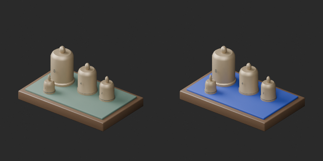
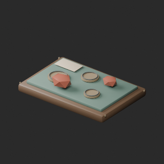
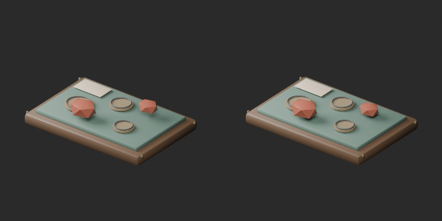
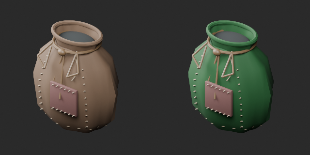

# AT062–071 quality batch25 / 品質第25便 / 质量第25批

**Base1008 unchanged; material variants126=124+2 counted separately. One geometry revision is not a new model.**

Blue weight-display pad and green pouch leather retain original geometry and UV. AT066 lowers two floating gems onto the planar tray pad, preserving topology/UV. Color comparisons use identical camera/light; gem comparison uses the same direction but independent framing because bounds changed, not equal scale.

基本1008据置、青い分銅台と緑の袋の同形色variant2を別追加。宝石2個の接地改訂1は非加算。宝石の比較は左右別に画角調整、同一縮尺ではありません。旧版保全。

基础1008保持，2个同形颜色变体单独统计。宝石接地修订不新增。对比视线相同、分别取景，并非相同比例。

Producer final-ZIP guard binds ZIP/member/input/verifier hashes, run ID, timestamps and Blender5.2.2. Public ZIP/member hashes match the final guarded artifacts. No separate Blender rerun by publication task. Cumulative246 assessed distribution records,762 remaining.44 budget/redesign issues remain, including new AT067/069/070. AT067 apparently floating scratch strips remain unmeasured and unrepaired; not an approved fix. FW ten material revisions are tracked separately, no full-audit increment.

Function, stability, continuous collision and Blender4.3.2 compatibility unverified. Model/embedded materials only CC0. Images outside modelCC0; [license scope](../LICENSE.md). Code/private reports not distributed.

## AT_062__color_blue — Mismatched appraisal weights

不揃いな鑑定用分銅

Weight display pad changed from green to blue; brass weights retained.

[ZIP · BLEND/GLB](https://raw.githubusercontent.com/k3peta/tales-on-a-table/main/distributions/quality-at062-071-v1/AT_062__color_blue_CC0.zip)

left: original; right: accepted; identical camera and lighting

## AT_066__repair — Tray of coins and gems under appraisal

鑑定中の古銭と宝石皿

Two floating gems lowered onto planar tray pad; topology/UV retained, geometry revision.

[ZIP · BLEND/GLB](https://raw.githubusercontent.com/k3peta/tales-on-a-table/main/distributions/quality-at062-071-v1/AT_066__repair_CC0.zip)

left: original; right: repair; same view direction, independently framed due changed bounds

## AT_071__color_green — Repaired drawstring leather pouch

補修跡のある口紐付き革袋

Pouch main leather changed to green; repair patch, stitches and cord retained.

[ZIP · BLEND/GLB](https://raw.githubusercontent.com/k3peta/tales-on-a-table/main/distributions/quality-at062-071-v1/AT_071__color_green_CC0.zip)

left: original; right: accepted; identical camera and lighting

[Exact package validation evidence](../distributions/quality-at062-071-v1/validation.json).
