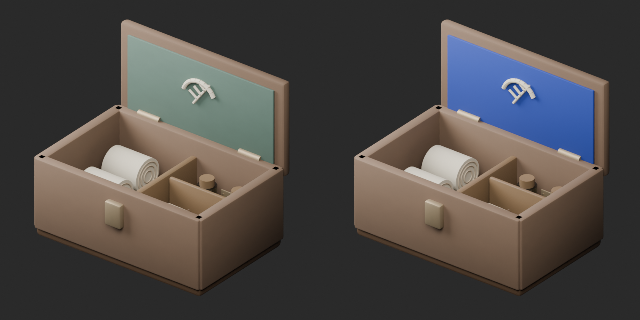

# AT072–081 quality batch26 / 品質第26便 / 质量第26批

**Base1008 unchanged; material variants127=126+1 separately. No geometry revisions or new bases.**

AT073 lid lining changes from green to blue; other materials, geometry and UV retained. Identical camera/light comparison. This is a color variant, not a geometry or functional repair.

蓋裏の緑を青へ変更した同形色variant1件。他の材質・形状・UV保持。基本1008維持。10配布記録の査定であり独立10形状の証明ではありません。

蓋内衬由绿改蓝，同形颜色变体1件。其他材质、几何和UV保持，基本1008不变。

Cumulative256 assessed distribution records,752 remaining. Provisional batch classifications:base1/composite5/decorative-component3/assembly1. Budget/redesign45 unrepaired, including AT074 at85628 triangles. AT078 placement context, AT079–081 raised cords/overlap and AT080 public-name/content correspondence remain unresolved, not marked repaired. FW nine material repairs tracked separately without assessment increment.

Producer final-ZIP guard binds exact ZIP/member/input/verifier SHA,run,times and Blender5.2.2. Public ZIP/member hashes match the final guarded artifacts. Publication does not claim a separate Blender rerun. Medical/poison/physical/gameplay/Blender4.3.2 suitability unverified. Models/materials only CC0; images separate, code/private reports excluded. [License](../LICENSE.md).

## AT_073__color_blue — Field medicine box with bandages and packets

包帯と薬包が残る野戦薬箱

Green lid lining changed to blue; all other materials and geometry/UV retained.

[ZIP · BLEND/GLB](https://raw.githubusercontent.com/k3peta/tales-on-a-table/main/distributions/quality-at072-081-v1/AT_073__color_blue_CC0.zip)

left: original; right: accepted; identical camera and lighting

[Exact package validation evidence](../distributions/quality-at072-081-v1/validation.json).
