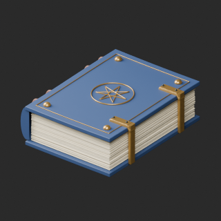
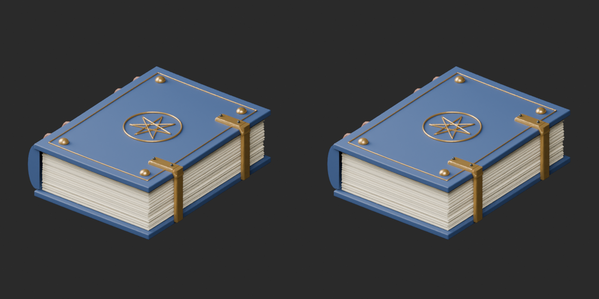
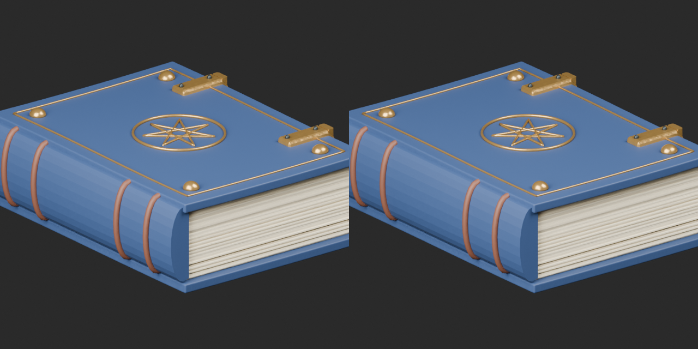
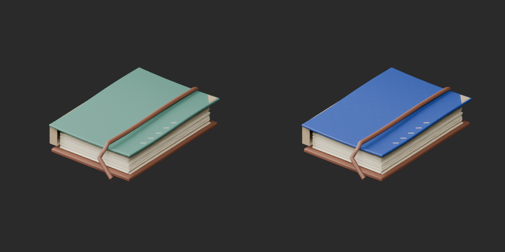
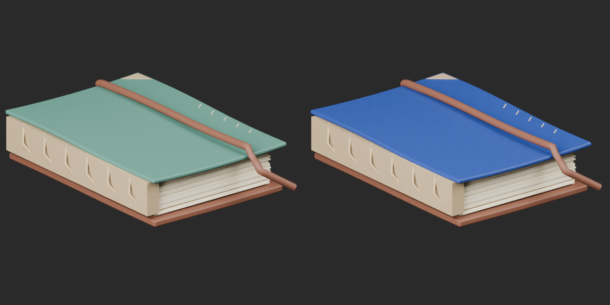
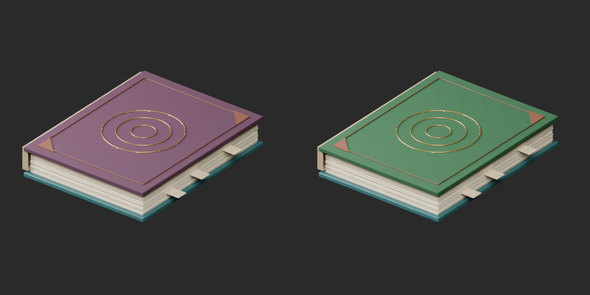
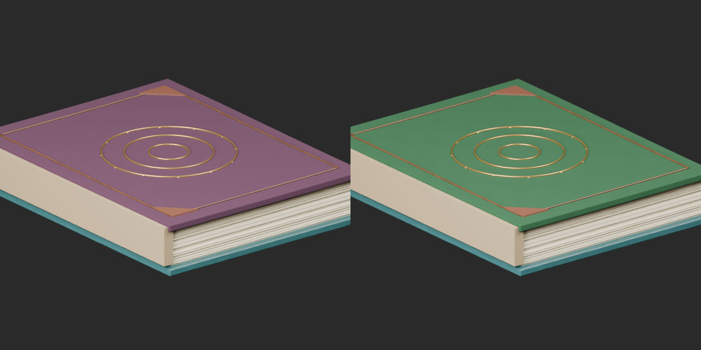

# Quality28 / 品質第28便 / 质量第28批

Base1008 unchanged; material variants129=127+2 counted separately. WS001 topology revision adds no model. Old versions retained.

WS001 removes3720 strictly zero-area clasp triangles, retaining all positive faces and UV, including64 tiny positive faces.39380 to35660 triangles: still over budget. Both final ZIP reimports have zero exactly-zero-area triangles. Moon title versus star ornament remains editorially unresolved; no silent rename. WS002 blue and WS003 green covers retain geometry/UV. WS00320696 triangles remains over20k warning.

WS001の面積ゼロ三角形3720枚のみ除去。正の微小面64枚は保持、35660三角形で予算超過は未解消。WS002青・WS003緑は同形色variant2件として別集計。旧版と名称を保持。

WS001仅移除3720个严格零面积三角形，保留64个微小正面积面，仍超预算。WS002蓝色、WS003绿色封面保持几何和UV，单独计为2种材质变体。

Same camera/light/scale comparisons. Producer final-ZIP guard binds final packages, inputs, scripts, run/time/build. Texture contract resolves image bytes and samplers instead of export-dependent indices; packed image decoding and external-URI checks passed. Public ZIP/member hashes match the final guarded artifacts. Publication did not rerun Blender.

Assessed276 source records,732 remain;51 budget/redesign issues remain. AT093/094 default-white material intent unresolved; WS004 binding joint gaps, WS005 raised cord bridge need diagnosis. AT094/WS001/003/004/006 over budget. No complete defect-free, functional binding, gameplay/collision or Blender4.3.2 guarantee.

Models/embedded materials only CC0; images separate catalogue artwork. [License](../LICENSE.md). Private reports/code excluded.

## WS_001__repair — Moon-emblem grimoire with twin clasps

双留め金の月章魔導書

Removed3720 strictly zero-area triangles from2 clasps; all positive-area faces and UV retained, including64 tiny positive faces. Topology revision, no new model. Polygon budget remains exceeded.

[ZIP · BLEND/GLB](https://raw.githubusercontent.com/k3peta/tales-on-a-table/main/distributions/quality-at093-094-ws001-008-v1/WS_001__repair_CC0.zip)

Left: original; right: accepted revision/variant, identical camera/light/scale.

## WS_002__color_blue — Cord-bound field notebook

紐綴じの野外採集帳

Cover only changed to blue mapped micrograin, original geometry andUV retained.

[ZIP · BLEND/GLB](https://raw.githubusercontent.com/k3peta/tales-on-a-table/main/distributions/quality-at093-094-ws001-008-v1/WS_002__color_blue_CC0.zip)

Left: original; right: accepted revision/variant, identical camera/light/scale.

## WS_003__color_green — Large star atlas

大型星図集

Upper cover changed to green mapped micrograin, original geometry andUV retained. Original20696 triangles exceeds20k small-prop warning; not repaired.

[ZIP · BLEND/GLB](https://raw.githubusercontent.com/k3peta/tales-on-a-table/main/distributions/quality-at093-094-ws001-008-v1/WS_003__color_green_CC0.zip)

Left: original; right: accepted revision/variant, identical camera/light/scale.

[Exact package validation evidence](../distributions/quality-at093-094-ws001-008-v1/validation.json).
