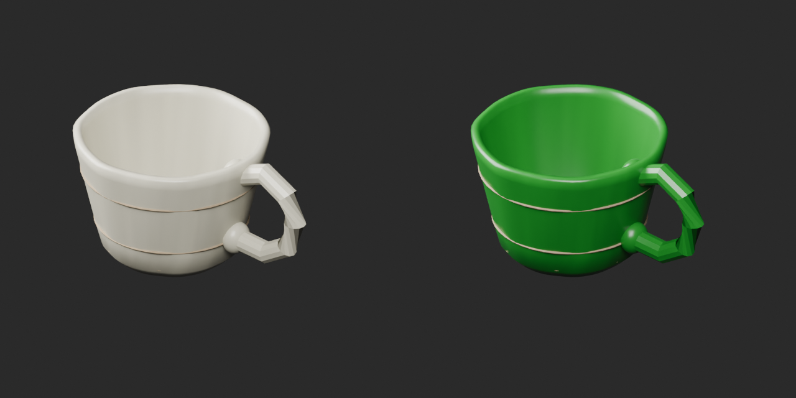
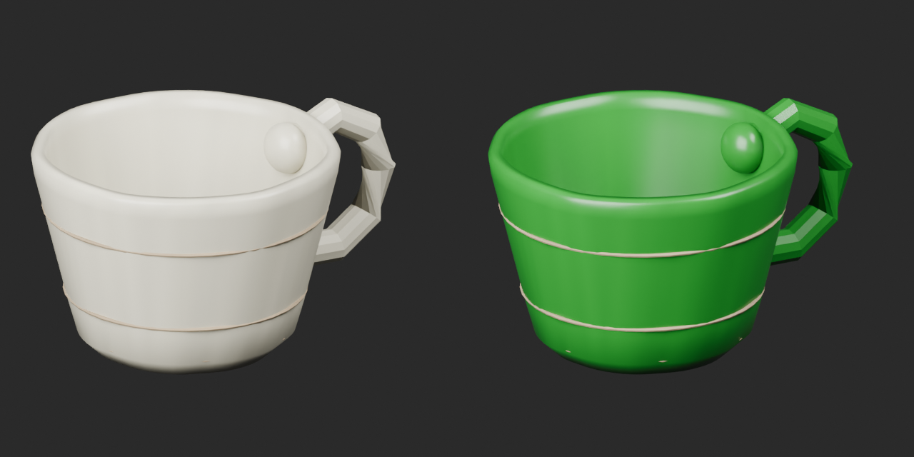
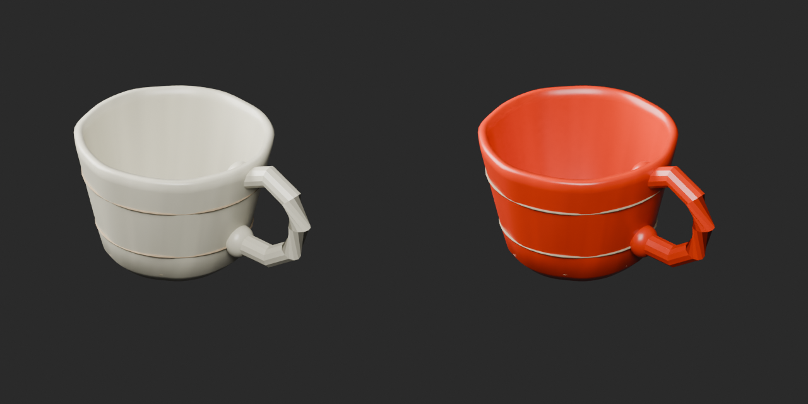
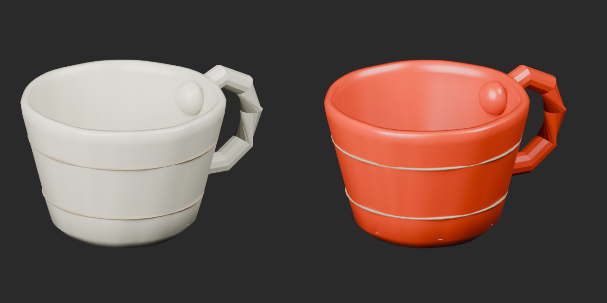

# Quality45 / 品質第45便 / 质量第45批

Base1008 unchanged; material variants156=154+2 separately. No revisions or new base models. Originals retained.

BM006 ceramic wizard_cup green/orange UV tint retains original geometry, UV, vertex colors, dust/roughness/normal/metallic/emission. Main ceramic member only; dealer_cup stays in original ZIP. Not bottle/liquid color or functional change.

10配布レコード・収録16モデルを査定。収録物を追加件数としません。緑/橙陶器カップvariant2件のみ、元の金属カップは置換しません。10个配布记录含16个模型；不重复计数。2个陶瓷杯颜色变体只对应主模型，原金属杯保留。

Same camera/light/scale comparisons. Final ZIP BLEND/GLB geometry/UV/spatial vertex-color guard and four rejected old color-loss fixtures matched. Public ZIP/member hashes match the final guarded artifacts. Publication did not rerun Blender.

Assessed446 distribution records;562 remain;134 budget issues unresolved. BM002 scroll29192tri over20k. BM007 pale pouch fragments remain attachment diagnosis, not fixed or declared intentional. BM01072 positive tiny faces retained. Source16-member visual audit covered GLB, not independent bundled BLEND imports; delivered2 variant ZIPs cover both formats. No collision/load/gameplay/mechanical sound/Blender4.3.2 approval. Existing book/bottle color members not duplicated.

Models/embedded materials only CC0; images separate catalogue artwork. [License](../LICENSE.md). Private reports/code excluded.

## BM_006__green — Travel teacup

旅の湯呑み

Ceramic cup body UV tint (green) multiplied by preserved original vertex colors. Original geometry and UV unchanged. Dust/roughness/normal/metallic/emission unchanged. Main wizard_cup member only; existing dealer_cup remains in original source ZIP.

[ZIP · BLEND/GLB](https://raw.githubusercontent.com/k3peta/tales-on-a-table/main/distributions/quality-bm001-010-v1/BM_006__green_CC0.zip)

Left: original; right: accepted revision/variant, identical camera/light/scale.

## BM_006__orange — Travel teacup

旅の湯呑み

Ceramic cup body UV tint (orange) multiplied by preserved original vertex colors. Original geometry and UV unchanged. Dust/roughness/normal/metallic/emission unchanged. Main wizard_cup member only; existing dealer_cup remains in original source ZIP.

[ZIP · BLEND/GLB](https://raw.githubusercontent.com/k3peta/tales-on-a-table/main/distributions/quality-bm001-010-v1/BM_006__orange_CC0.zip)

Left: original; right: accepted revision/variant, identical camera/light/scale.

[Exact package validation evidence](../distributions/quality-bm001-010-v1/validation.json).
